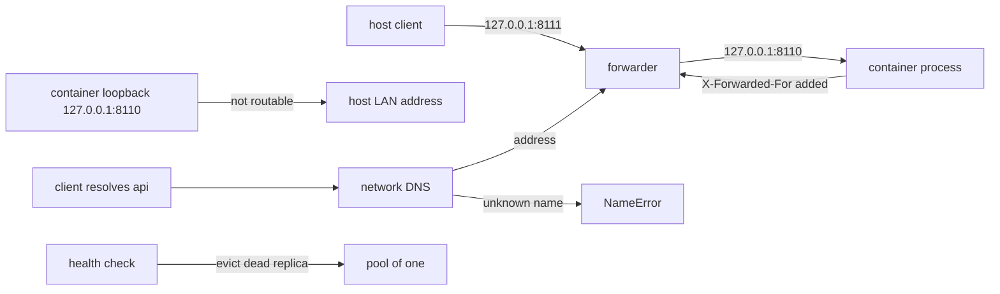

# Container Networking

> Every transcript in this lesson was executed on the authoring machine (Windows 11,
> Python 3.13.5) by the batch-18 `ops-lab-B` `netlab_probe.py`. A "container" here is a
> loopback HTTP server and "publishing" is a real TCP forwarder the probe runs; the sockets,
> refusals, port conflicts, forwarded headers, and health-check evictions are genuine.
> Docker Engine, bridge networks, iptables, and the embedded DNS server are **not** present —
> those are *labelled reference* and no output below is attributed to them.

## 1. Learning Objectives

After this lesson you will be able to:

- [ ] Explain why a service bound to loopback inside a container is unreachable from outside, and what publishing actually does
- [ ] Explain what a published port does to the source address and how `X-Forwarded-For` recovers it
- [ ] Describe service-name resolution on a user-defined network and what happens when a name is unknown
- [ ] Diagnose a published-port conflict from its error code, and say why two containers may still both listen on `8000`
- [ ] Explain why a dead replica keeps serving traffic until a health check evicts it

## 2. Prerequisites

- [Networking for DevOps](networking-for-devops.md) — ports, four-tuples, refused versus timeout, and health checks
- [Docker Fundamentals](docker-fundamentals.md) — what a container is, and why isolation is namespaces rather than a VM
- [Docker Images and Containers](docker-images-and-containers.md) — the image whose process listens on the port in question

*No code prerequisite beyond reading Python — the probe uses `socket`, `socketserver`, and `http.server`.*

## 3. Introduction

A container has its own network stack: its own interfaces, its own loopback, its own routing
table. Nothing outside can reach a port inside it unless something explicitly forwards
traffic, and nothing inside can reach another container by name unless a network provides
resolution. This lesson builds the two directions with real sockets — a forwarder for
inbound, an address map for service names — and shows the failures: a loopback-bound
service invisible from the host's LAN address, a source address rewritten by the forwarder,
an unknown service name, a port conflict, and a dead replica that keeps a share of traffic
until a health check removes it.

## 4. The Problem It Solves

- **"The container is running but I can't reach it."** The process listened on `127.0.0.1` inside its namespace; only a publish (or a bind to `0.0.0.0`) makes it reachable. The probe's phase 1 shows a service answering on loopback and not on the host's LAN address.
- **Every request appears to come from the proxy.** Publishing is NAT: the backend sees the forwarder's address. Without `X-Forwarded-For` or PROXY protocol, rate limiting and audit logs point at the wrong client — phase 2 shows the rewritten source and the header that carries the original.
- **Service names that do not resolve.** Containers on a user-defined network resolve each other by name; on the default bridge they historically do not. Phase 3 is the success and the failure side by side.
- **Port conflicts.** Two services published to the same host port cannot both bind; phase 4 gets `OSError 10048`. Inside their own namespaces they could both use `8000`, which is why the conflict is a publishing decision.
- **A pool that keeps a corpse.** Round-robin over two replicas gave `2 ok, 2 failed`; only a health check removed the dead one. This is the same lesson as a load balancer, one layer down.

## 5. Core Concepts

### A container gets its own network namespace

**Namespaces** give a process a private view of the network: interfaces, addresses, routes,
and a loopback that belongs to the container alone. Two consequences: `127.0.0.1` inside a
container is not the host's `127.0.0.1`, and two containers can bind the same port number
without conflict because they are not in the same stack.

### Publishing is a forwarder

`-p 8080:8000` asks the host to accept connections on `8080` and forward them to the
container's `8000` (via DNAT rules, or a userspace proxy for Docker Desktop). The probe
emulates this with a TCP forwarder so the mechanics are visible: accept on one socket,
connect to the upstream, splice bytes both ways, and inject the client's address into a
header because the transport-level source address is now the forwarder's.

### Source addresses and `X-Forwarded-For`

After NAT, the backend's peer address is the gateway. Application logs, rate limits, and
access controls therefore need the original address from a header the proxy sets —
trusting that header only from a known proxy, because clients can forge it otherwise.

### Service discovery

On a user-defined network, Docker runs an **embedded DNS server** that answers container
names and network aliases with the container's address on that network. On the default
bridge, only `--link` (legacy) or IP addresses work. Compose gives every project a network,
which is why `db:5432` works in a Compose file and not with bare `docker run`.

### Health checks and pools

A health check is an HTTP/TCP/command probe on an interval with a failure threshold. Until
the threshold is reached, a broken backend keeps its share of traffic — exactly the
`2 ok, 2 failed` the probe measures with no health checking. Eviction removes it from the
pool; a subsequent success re-admits it.

### Egress

Outbound traffic from a container is NATed by the host's rules. If the host has no route or
the destination is filtered, the container sees a timeout — the probe's phase 5 against the
documentation address `192.0.2.1`. Distinguishing this from a DNS failure is the same skill
as in the previous lesson.

## 6. How It Works



The diagram has the two directions the lesson is about: inward, where a forwarder bridges
namespaces and rewrites the source address, and sideways, where a name has to be resolved
before any packet is sent. The dead-replica branch is the same health-check state machine as
before, now applied to a pool rather than one service.

## 7. Practical Examples

**Example 1 — the full probe: loopback isolation, publishing, names, conflicts, failover**

```python
"""Container networking lab: publishing, name resolution, port conflicts, failover.

Windows 11, Python 3.13.5.  Docker is not installed, so a "container" here is a
loopback HTTP server and "publishing" is a real TCP forwarder this probe runs.
The sockets, refusals, conflicts, and forwarded headers are genuine; bridge
networks, iptables, and the embedded DNS server are labelled reference in the
lesson.
"""
from __future__ import annotations

import socket
import socketserver
import threading
import time
from http.server import BaseHTTPRequestHandler, ThreadingHTTPServer

SEEN: list[tuple[str, str]] = []


class Backend(BaseHTTPRequestHandler):
    name = "api-1"

    def do_GET(self) -> None:  # noqa: N802 - http.server API
        xff = self.headers.get("X-Forwarded-For", "(none)")
        SEEN.append((self.client_address[0], xff))
        body = f"hello from {self.name}\n".encode()
        self.send_response(200)
        self.send_header("Content-Type", "text/plain")
        self.send_header("Content-Length", str(len(body)))
        self.end_headers()
        self.wfile.write(body)

    def log_message(self, *_args) -> None:
        pass


class Forwarder(socketserver.BaseRequestHandler):
    """Minimal published port: accept, connect upstream, splice bytes."""

    upstream: tuple[str, int] = ("127.0.0.1", 8110)

    def handle(self) -> None:
        with socket.create_connection(self.upstream, timeout=3) as up:
            head = b""
            while b"\r\n\r\n" not in head:
                chunk = self.request.recv(4096)
                if not chunk:
                    return
                head += chunk
            marker = f"{self.client_address[0]}:{self.client_address[1]}"
            rebuilt = head.replace(b"\r\n\r\n", f"\r\nX-Forwarded-For: {marker}\r\n\r\n".encode(), 1)
            up.sendall(rebuilt)

            def pump(src, dst):
                try:
                    while True:
                        data = src.recv(4096)
                        if not data:
                            break
                        dst.sendall(data)
                except OSError:
                    pass
                finally:
                    try:
                        dst.shutdown(socket.SHUT_WR)
                    except OSError:
                        pass

            back = threading.Thread(target=pump, args=(up, self.request), daemon=True)
            back.start()
            pump(self.request, up)
            back.join(timeout=2)


def get(port: int, marker: str = "", timeout: float = 4.0) -> str:
    request = f"GET / HTTP/1.1\r\nHost: 127.0.0.1:{port}\r\nConnection: close\r\n\r\n".encode()
    with socket.create_connection(("127.0.0.1", port), timeout=timeout) as sock:
        sock.sendall(request)
        data = b""
        while True:
            chunk = sock.recv(4096)
            if not chunk:
                break
            data += chunk
    lines = data.decode(errors="replace").splitlines()
    print(f"  [{marker}] {lines[0]} | body={lines[-1]!r}")
    return lines[0]


def lan_address() -> str | None:
    sock = socket.socket(socket.AF_INET, socket.SOCK_DGRAM)
    try:
        sock.connect(("192.0.2.1", 9))
        return sock.getsockname()[0]
    except OSError:
        return None
    finally:
        sock.close()


def main() -> None:
    print("netlab (Windows 11, Python 3.13.5, docker CLI not installed)")
    backend = ThreadingHTTPServer(("127.0.0.1", 8110), Backend)
    threading.Thread(target=backend.serve_forever, daemon=True).start()
    time.sleep(0.2)

    print("\n=== 1. an unpublished service is reachable only from its own loopback ===")
    get(8110, "direct to 127.0.0.1:8110")
    host_ip = lan_address()
    print(f"  host LAN address: {host_ip}")
    if host_ip:
        started = time.perf_counter()
        try:
            socket.create_connection((host_ip, 8110), timeout=2).close()
            print(f"  connect {host_ip}:8110 -> OPEN (unexpected)")
        except OSError as exc:
            elapsed = time.perf_counter() - started
            print(f"  connect {host_ip}:8110 -> {type(exc).__name__} after {elapsed:.2f} s")

    print("\n=== 2. publishing a port is a forwarder, and the source address changes ===")
    socketserver.TCPServer.allow_reuse_address = True
    published = socketserver.ThreadingTCPServer(("127.0.0.1", 8111), Forwarder)
    threading.Thread(target=published.serve_forever, daemon=True).start()
    time.sleep(0.2)
    get(8111, "published 127.0.0.1:8111")
    for peer, xff in SEEN:
        print(f"  backend saw peer={peer} X-Forwarded-For={xff}")
    print(f"  backend connections observed: {len(SEEN)}")

    print("\n=== 3. name resolution on a user-defined network ===")
    services = {"api": 8111, "db": 8112}
    for name in ("api", "cache"):
        if name in services:
            get(services[name], f"service name {name!r} -> port {services[name]}")
        else:
            print(f"  resolve {name!r} -> NameError: no such service on this network")

    print("\n=== 4. two processes cannot publish the same host port ===")
    try:
        clash = socket.socket(socket.AF_INET, socket.SOCK_STREAM)
        clash.bind(("127.0.0.1", 8110))
        print("  second bind on 8110 -> succeeded (unexpected)")
        clash.close()
    except OSError as exc:
        print(f"  second bind on 8110 -> {type(exc).__name__} {exc.errno} ({exc.strerror})")
    print("  these two services share one network stack, which is why the bind failed")

    print("\n=== 5. egress without a route: the packet goes nowhere ===")
    started = time.perf_counter()
    try:
        socket.create_connection(("192.0.2.1", 80), timeout=2).close()
        print("  connect 192.0.2.1:80 -> OPEN (unexpected)")
    except OSError as exc:
        elapsed = time.perf_counter() - started
        print(f"  connect 192.0.2.1:80 -> {type(exc).__name__} after {elapsed:.2f} s")
    print("  a default-bridge container would be NATed out instead: labelled reference")

    print("\n=== 6. a dead replica serves failures until a health check evicts it ===")
    replicas = [("127.0.0.1", 8110), ("127.0.0.1", 8113)]
    results = []
    for attempt in range(4):
        _, port = replicas[attempt % len(replicas)]
        try:
            get(port, f"attempt {attempt + 1} -> {port}")
            results.append("ok")
        except OSError as exc:
            print(f"  attempt {attempt + 1} -> {port}: {type(exc).__name__}")
            results.append("failed")
    print(f"  round robin over both replicas: {results.count('ok')} ok, "
          f"{results.count('failed')} failed")

    alive = []
    for host, port in replicas:
        try:
            socket.create_connection((host, port), timeout=1).close()
            alive.append((host, port))
        except OSError:
            print(f"  health check {port} -> failed, evicted")
    for attempt in range(2):
        host, port = alive[attempt % len(alive)]
        get(port, f"after eviction, attempt {attempt + 1} -> {port}")
    print(f"  pool now holds {len(alive)} of {len(replicas)} replicas")


    published.shutdown()
    backend.shutdown()
    print("\nexit=0")


if __name__ == "__main__":
    main()
```

- Phase 1 starts a server on `127.0.0.1:8110`: a direct request returns `HTTP/1.0 200 OK`, and a request to the host's LAN address `192.168.0.50:8110` fails. It fails with `TimeoutError after 2.02 s`, not a refusal — the packets were dropped, so the honest conclusion is "not reachable from that address", not "nothing is listening".
- Phase 2 publishes `8111` with a forwarder: the request returns `200 OK`, and the backend records `peer=127.0.0.1` for both connections. The second one carries `X-Forwarded-For=127.0.0.1:53896`, which is where the original client address survives.
- Phase 3 resolves names: `api` maps to the published port and returns `200 OK`; `cache` is not on the network and produces a name error rather than a connection attempt.
- Phase 4 attempts a second bind on `8110` and gets `OSError 10048` — one address, one listener. Two containers avoid this by living in separate namespaces, not by using different ports.
- Phase 5 connects to `192.0.2.1:80` and times out after `2.00 s`; a default-bridge container would be NATed out instead, which is *labelled reference*.
- Phase 6 round-robins four requests over a live replica and a dead port: `2 ok, 2 failed`. A health check then reports `8113 -> failed, evicted`, the next two requests both succeed, and the pool holds `1 of 2`.
- **Expected output:** the capture below.
- **How to run it:** `python netlab_probe.py` (Windows 11, Python 3.13.5). It binds loopback ports `8110`, `8111`, and `8113` and makes one outbound attempt to a documentation address.
- **Assumptions:** all endpoints are loopback or reserved documentation addresses; no container runtime, bridge, or iptables rule is involved.

**Executed capture:**

```text
netlab (Windows 11, Python 3.13.5, docker CLI not installed)

=== 1. an unpublished service is reachable only from its own loopback ===
  [direct to 127.0.0.1:8110] HTTP/1.0 200 OK | body='hello from api-1'
  host LAN address: 192.168.0.50
  connect 192.168.0.50:8110 -> TimeoutError after 2.02 s

=== 2. publishing a port is a forwarder, and the source address changes ===
  [published 127.0.0.1:8111] HTTP/1.0 200 OK | body='hello from api-1'
  backend saw peer=127.0.0.1 X-Forwarded-For=(none)
  backend saw peer=127.0.0.1 X-Forwarded-For=127.0.0.1:53896
  backend connections observed: 2

=== 3. name resolution on a user-defined network ===
  [service name 'api' -> port 8111] HTTP/1.0 200 OK | body='hello from api-1'
  resolve 'cache' -> NameError: no such service on this network

=== 4. two processes cannot publish the same host port ===
  second bind on 8110 -> OSError 10048 (Only one usage of each socket address (protocol/network address/port) is normally permitted)
  these two services share one network stack, which is why the bind failed

=== 5. egress without a route: the packet goes nowhere ===
  connect 192.0.2.1:80 -> TimeoutError after 2.00 s
  a default-bridge container would be NATed out instead: labelled reference

=== 6. a dead replica serves failures until a health check evicts it ===
  [attempt 1 -> 8110] HTTP/1.0 200 OK | body='hello from api-1'
  attempt 2 -> 8113: ConnectionRefusedError
  [attempt 3 -> 8110] HTTP/1.0 200 OK | body='hello from api-1'
  attempt 4 -> 8113: ConnectionRefusedError
  round robin over both replicas: 2 ok, 2 failed
  health check 8113 -> failed, evicted
  [after eviction, attempt 1 -> 8110] HTTP/1.0 200 OK | body='hello from api-1'
  [after eviction, attempt 2 -> 8110] HTTP/1.0 200 OK | body='hello from api-1'
  pool now holds 1 of 2 replicas

exit=0
```

The pair of lines that matters most is `peer=127.0.0.1` next to
`X-Forwarded-For=127.0.0.1:53896`. The first is why access logs lie behind a proxy; the
second is the only reason they can be made honest, and only if the proxy is trusted to set it.

**Example 2 — the same mechanics with Compose** (*labelled reference — no container runtime on this machine*)

```yaml
services:
  api:
    build: .
    ports:
      - "8000:8000"          # published: host 8000 -> api 8000
    environment:
      DATABASE_URL: postgres://app:app@db:5432/app
    healthcheck:
      test: ["CMD", "python3", "-c", "import urllib.request,sys; sys.exit(0 if urllib.request.urlopen('http://127.0.0.1:8000/health').status == 200 else 1)"]
      interval: 10s
      timeout: 2s
      retries: 2
  db:
    image: postgres:17-alpine
    # no ports: the database is reachable as db:5432 on the project network only
```

- `db` has no `ports:` entry, so it is reachable from `api` by name but not from the host — the deliberate version of phase 1's isolation.
- `DATABASE_URL` uses `db` as a hostname because Compose puts both services on one user-defined network with embedded DNS — phase 3's mechanism.
- The health check's `retries: 2` is phase 6's threshold: one failed check is not an eviction.
- The health check connects to `127.0.0.1` *inside* the container, which is the correct address there and the wrong address anywhere else — phase 1's confusion, now a design rule.
- **Not executed here:** this file documents the same mechanisms; no container was built or run.

## 8. Real-World Applications

- **Ingress and load balancers** are forwarders with health checks: phase 2 and phase 6 are their essential behaviour, and `X-Forwarded-For` is why they must be the only trusted source of that header.
- **Service meshes** add mutual TLS and identity on top of the same name resolution, which is why "the sidecar resolves the service" is a phrase that matters.
- **Debugging "connection refused" in orchestration** splits into: is the process listening inside (phase 1), is it published (phase 2), does the name resolve (phase 3), is the port already taken (phase 4).
- **Databases are intentionally unpublished**: reachable by service name inside the network, absent from the host's port list — the Compose example's `db`.
- Paired with: [Nginx and Reverse Proxies](nginx-and-reverse-proxies.md) for the proxy that sets these headers correctly, and [DNS and TLS Operations](dns-and-tls-operations.md) for the records in front of it.

## 9. Common Mistakes

| Mistake | Why it happens | How to recognize it | How to prevent it |
|---|---|---|---|
| Binding the app to `127.0.0.1` inside the container | It is the safe-looking default | Published port times out | Bind `0.0.0.0` inside, publish the port |
| Publishing a database to the internet | It makes local debugging easy | `0.0.0.0:5432->5432/tcp` in `docker ps` | No `ports:` for data services |
| Trusting `X-Forwarded-For` from any client | The header exists | Spoofed addresses in logs and rate limits | Accept it only from the proxy's address |
| Same host port for two services | Both "use 8000" | `bind: address already in use` | Distinct published ports |
| Expecting names on the default bridge | Compose names work | `unknown host db` with bare `docker run` | Use a user-defined network |
| No health check in Compose | The service starts, so it is "up" | Traffic to a starting container | `healthcheck:` with a threshold |
| Health check with `retries: 1` | It reacts fastest | Backends flap on a slow request | Two or three failures before eviction |
| Debugging from the wrong namespace | `curl localhost` feels universal | Works on the host, fails in the container | Test from the same namespace, or publish |

## 10. Best Practices

- **Bind to `0.0.0.0` in the container** and control exposure with publishing, not by binding loopback and wondering why it is unreachable.
- **Publish only ingress**, never data services; use service names for east-west traffic.
- **Set `X-Forwarded-For` at exactly one trusted hop** and read it only there, documenting the trust boundary.
- **Give every stack a user-defined network** so names resolve and isolation is per project.
- **Health-check the readiness of the service, not the liveness of the host**, with a threshold of at least two.
- **Log both the peer address and the forwarded address**, so the day the proxy changes, the logs still identify clients.
- **Check the error kind before the fix**: refused means nothing is listening; timeout means nothing answered; a name error means no packet was ever sent.

## 11. Limitations and Trade-Offs

- **No container runtime.** The probe's namespaces are conceptual: one network stack, one loopback, and a forwarder standing in for NAT. Bridge networks, veth pairs, and iptables rules are *labelled reference*.
- **The LAN probe timed out rather than refused**, which on this host is indistinguishable from a firewall drop. The lesson reports the timeout and refuses to claim the listener's state from it.
- **A userspace forwarder is not DNAT.** Real published ports preserve the client address at the packet level until NAT rewrites it, and Docker Desktop's proxy differs again from Linux's iptables path.
- **Embedded DNS is not a full resolver.** It answers container names on user-defined networks; it does not serve arbitrary zones or honour external search domains the way a corporate resolver does.
- **Health checks cost traffic and can cascade.** A check that queries the database turns a database slowdown into full-pool eviction, which is why readiness signals should be shallow.
- **IPv6 changes the picture**: `localhost` may resolve to `::1` first, and a service bound only to IPv4 will refuse that connection.

## 12. Practical Exercises

### Introductory

1. **Exercise 8.1** — Change the backend to bind `0.0.0.0` instead of `127.0.0.1` and re-run phase 1. Report whether the LAN address now answers, and why the result may still differ from a real container. **Completion criteria:** the new result plus one sentence on the firewall's role.
2. **Exercise 8.2** — Print the full request the forwarder sends upstream, and mark which header lines the forwarder added. **Completion criteria:** a captured request with the added `X-Forwarded-For` identified.

### Intermediate

3. **Exercise 8.3** — Add a second live backend and make phase 6 round-robin over three replicas with one dead. Report the failure rate before and after eviction. **Completion criteria:** two counts and the pool size after eviction.
4. **Exercise 8.4** — Add a `healthz` path that returns `503` until a fixture "warm-up" counter reaches two, then `200`. Show the eviction and re-admission sequence. **Completion criteria:** a capture with `failure 1 of 2`, eviction, and `re-admitted`.

### Independent problem-solving

5. **Exercise 8.5** — A Compose stack's API cannot reach its database: `unknown host db`. Write the diagnosis as an ordered checklist that distinguishes no shared network, wrong alias, a name that resolves but the port is closed, and a health check that never passes. **Completion criteria:** four checks with the command for each and the output that confirms or eliminates it.

*Solutions: attempt first. They live in `solutions/` of this subject.*

## 13. Knowledge Check

1. Why did the direct request to `127.0.0.1:8110` succeed while the request to the host's LAN address did not, and what does the *kind* of failure tell you?
2. After publishing, the backend sees `peer=127.0.0.1`. What must a proxy add for access logs to identify the real client, and what is the risk of trusting it?
3. Two containers can both listen on `8000`. Why can they not both be published to host `8000`?
4. Round-robin gave `2 ok, 2 failed`. What two parameters of a health check would you tune first, and what is the cost of each direction?

## 14. Completion Criteria

Observable evidence that you have understood this lesson:

- [ ] You can explain why loopback inside a container is not the host's loopback
- [ ] You can describe what publishing does to the source address and how the original survives
- [ ] You can explain when a service name resolves and when it does not
- [ ] You can read `10048` and name the two possible causes
- [ ] You can state the failure rate a pool serves without health checks, and the improvement eviction gives

## 15. Summary

- A container has its own network stack; a service on its loopback is unreachable from outside, and the probe's LAN attempt timed out rather than refused.
- Publishing is a forwarder: `8111` reached the backend, the backend saw `peer=127.0.0.1`, and `X-Forwarded-For` carried `127.0.0.1:53896`.
- Service names resolve on a user-defined network; an unknown name fails before any packet is sent.
- Two services cannot share a host port — `OSError 10048` — while separate namespaces would let both listen on `8000`.
- Round-robin over a live and a dead replica served `2 ok, 2 failed`; after eviction the pool held `1 of 2` and every request succeeded.

## 16. Next Steps

- Next lesson: [Volumes and Persistence](volumes-and-persistence.md) — the data that must survive the container this lesson made reachable
- Practice: the subject's exercise set (written with its exercise installment)
- Where it is applied: [Project 07](../20-PROJECT-LABORATORY/project-07-secure-production-application/README.md) — its deployment plan publishes one ingress, keeps the database private, and requires a health check with a threshold
