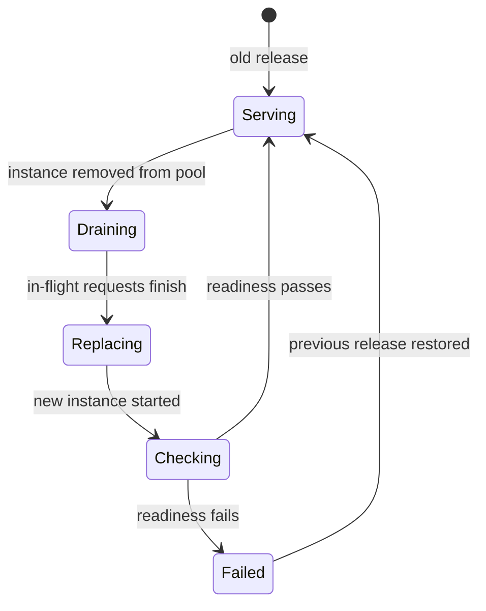

# Deployment Strategies

> Executed on the authoring machine (Windows 11, Python 3.13.5) by the batch-18 `ops-lab-B`
> `deploy_probe.py`. The probe is a deterministic model of three instances behind a load balancer:
> requests arrive every tick, capacity is finite, and each strategy is measured by failed requests,
> peak unavailable capacity, ticks to finish and rollback time. No cluster, orchestrator or cloud
> load balancer exists on this host, so Kubernetes, ECS and cloud console procedures are
> *labelled reference*; every number below is from the probe.

## 1. Learning Objectives

After this lesson you will be able to:

- [ ] Explain what "deploy" changes: code, configuration, or both, and which of them is reversible
- [ ] Compare recreate, rolling, blue-green and canary by user impact and infrastructure cost
- [ ] Compute whether a rolling deploy has enough headroom to avoid dropped requests
- [ ] Explain what a readiness check must prove before an instance receives traffic
- [ ] Describe how a canary is judged and how an automatic rollback is triggered
- [ ] Choose a strategy for a given constraint and defend the trade-off in writing

## 2. Prerequisites

- [CI/CD Fundamentals](ci-cd-fundamentals.md) — the pipeline that produces the artifact being deployed
- [Docker Fundamentals](docker-fundamentals.md) — the unit that is replaced during a deploy
- [Nginx and Reverse Proxies](nginx-and-reverse-proxies.md) — where traffic is shifted between pools
- [Networking for DevOps](networking-for-devops.md) — health checks, ports and connection handling

## 3. Introduction

A **deployment** is the act of making a new version of a program serve production traffic. A
**deployment strategy** is the sequence of steps used to get from "old version serving" to "new
version serving" while deciding what happens to requests in between.

The naive sequence is: stop everything, install the new version, start everything. It is easy to
reason about and it guarantees an outage. Everything else in this lesson exists to buy back
availability, and each option charges for it in a different currency: extra capacity, extra
complexity, longer deploys, or a period where two versions run at once.

Two words carry most of the weight. **Capacity** is how many requests the running instances can
serve per unit of time. **Headroom** is the capacity left over when one or more instances are out
of service. A rolling deploy without headroom is a recreate with extra steps.

## 4. The Problem It Solves

Before orchestration, a release meant a maintenance window: a human stopped the service, copied
files, restarted it, and watched. Downtime was accepted because the alternative — running two
versions at once — raised questions nobody had good answers for: which version owns the database
schema, which one writes the session, which one is "current" if the switch fails halfway.

Those questions still matter, but the tools changed the default. Users now expect a deploy to be
invisible, and businesses expect several deploys a day. The strategies in this lesson are the
answers that industry converged on, each with a different answer to "how much may a user notice?"

There is also a failure-driven reason. A release that fails is not rare; a release that fails and
cannot be undone quickly is what turns an incident into an outage. Every strategy below is judged
partly on how fast it can go backwards.

## 5. Core Concepts

### Release, instance and pool

A **release** is an immutable artifact: an image digest, a binary, a bundle. An **instance** is one
running copy of a release. A **pool** is the set of instances currently serving traffic. A deploy
replaces instances in a pool, not the release itself.

### Recreate

Stop every old instance, start every new one. Simple, fast in wall-clock terms, and the only
strategy that guarantees downtime. Acceptable for internal tools, batch workers and single-tenant
systems with a maintenance window.

### Rolling

Replace instances a few at a time. Two knobs describe it:

- **max_unavailable** — how many instances may be down at once.
- **max_surge** — how many extra instances may exist during the deploy.

With three instances of capacity 3 and six requests per tick, taking one out leaves capacity 6,
which exactly meets demand, so no request fails. Taking two out leaves capacity 3 against demand
6, and requests fail. The arithmetic, not the tool, decides.

### Blue-green

Run two complete pools. Green is started and health-checked while blue serves. When green is
ready, traffic switches in one step, and blue is kept as the rollback target until confidence
arrives. The cost is double capacity for the duration of the window and a database that must
tolerate two versions at once.

### Canary

Send a small percentage of traffic to the new version, compare its error rate and latency against
the stable version, and either promote it or remove it. A canary is a *measurement*, not a
deployment: it is only meaningful if the comparison is defined in advance and the removal is
automatic.

### Readiness and liveness

A **readiness check** answers "may this instance receive traffic now?" A **liveness check**
answers "is this process still alive?" Conflating them is a classic outage: an instance that is
alive but not ready gets traffic, or a process that is briefly busy gets restarted. Readiness must
include dependency checks that the instance needs to serve a request; liveness must not, or a
dependency outage restarts the whole fleet.

### Rollback

Rollback is a deploy of the previous release. It is fast only if the previous artifact still
exists, the schema change is backward compatible, and the switch mechanism is the same one used
forward. A rollback that requires a database restore is not a rollback; it is an incident.

### Error budget

An **error budget** is the amount of failure an SLO permits. A canary that pushes the error rate
past the budget is not "a bit risky"; it has spent the budget and must be removed.

## 6. How It Works



The diagram is the per-instance loop that every strategy shares. Strategies differ in how many
instances are in the loop at once, and in whether a second pool exists.

The probe's loop, per tick:

1. Apply the strategy's decision: drain an instance, start a pool, route a percentage.
2. Count capacity from instances in the `up` state.
3. Serve `min(requests, capacity)` and count the rest as failed.
4. Advance timers: a replaced instance must pass a health window before it returns.

That is enough to expose the central trade-off: the strategy that finishes fastest (recreate)
fails the most requests; the strategy with zero failures (blue-green) pays with a second pool.

## 7. Practical Examples

**Example 1 — the executed probe**

The probe runs the same traffic against six strategies and prints the comparison an operator would
take to a review.

```python
"""OPS-18 probe: what each deployment strategy actually costs in failed requests.

Windows 11, Python 3.13.5. No cluster is available on this host, so the probe is a
deterministic model of three instances behind a load balancer: requests arrive every
tick, capacity is finite, and each strategy is measured by failed requests, peak
unavailable capacity, ticks to finish and rollback time. The simulation is executed;
the strategies are models of the real thing.
"""

from __future__ import annotations

from dataclasses import dataclass, field

TICKS = 40
REQUESTS_PER_TICK = 6
CAPACITY = 3          # requests one instance can serve per tick
HEALTH_TICKS = 2      # ticks a new instance must stay healthy before it takes traffic
CANARY_PERCENT = 10
ERROR_BUDGET_PERCENT = 1.0


@dataclass
class Instance:
    name: str
    version: str = "v1"
    state: str = "up"          # "up" or "down"
    down_since: int = -99
    broken: bool = False


@dataclass
class Metrics:
    strategy: str
    served: int = 0
    failed: int = 0
    peak_unavailable: int = 0
    finish_tick: int | None = None
    rollback_tick: int | None = None
    notes: list[str] = field(default_factory=list)

    def record(self, instances: list[Instance], requests: int, tick: int) -> None:
        capacity = sum(CAPACITY for i in instances if i.state == "up")
        self.served += min(requests, capacity)
        self.failed += max(0, requests - capacity)
        self.peak_unavailable = max(self.peak_unavailable, sum(1 for i in instances if i.state == "down"))


def recreate() -> Metrics:
    metrics = Metrics("recreate")
    instances = [Instance(f"web{i}") for i in range(3)]
    for tick in range(TICKS):
        if tick == 5:
            for instance in instances:
                instance.state = "down"
            metrics.notes.append("all instances stopped at once")
        if tick == 8:
            for instance in instances:
                instance.version, instance.state = "v2", "up"
            metrics.finish_tick = tick
            metrics.notes.append("all instances started on v2 at once")
        metrics.record(instances, REQUESTS_PER_TICK, tick)
    return metrics


def rolling(max_unavailable: int) -> Metrics:
    metrics = Metrics(f"rolling (max_unavailable={max_unavailable})")
    instances = [Instance(f"web{i}") for i in range(3)]
    for tick in range(TICKS):
        down = [i for i in instances if i.state == "down"]
        if any(i.version == "v1" and i.state == "up" for i in instances) and len(down) < max_unavailable:
            victim = next(i for i in instances if i.version == "v1" and i.state == "up")
            victim.state, victim.down_since = "down", tick
            metrics.notes.append(f"{victim.name} drained at tick {tick}")
        for instance in down:
            age = tick - instance.down_since
            if instance.version == "v1" and age >= 1:
                instance.version, instance.down_since = "v2", tick
                metrics.notes.append(f"{instance.name} replaced with v2 at tick {tick}")
            elif instance.version == "v2" and age >= 1 + HEALTH_TICKS:
                instance.state = "up"
                metrics.notes.append(f"{instance.name} healthy on v2 at tick {tick}")
        metrics.record(instances, REQUESTS_PER_TICK, tick)
        if all(i.version == "v2" and i.state == "up" for i in instances) and metrics.finish_tick is None:
            metrics.finish_tick = tick
    return metrics


def blue_green(broken_release: bool = False) -> Metrics:
    metrics = Metrics("blue-green (broken release)" if broken_release else "blue-green")
    blue = [Instance(f"blue{i}") for i in range(3)]
    green = [Instance(f"green{i}", version="v2", state="down", broken=broken_release) for i in range(3)]
    live = blue
    for tick in range(TICKS):
        if tick == 5:
            for instance in green:
                instance.state = "up"
            metrics.notes.append("green pool up beside blue: 2x capacity for the window")
        if tick == 5 + HEALTH_TICKS:
            if broken_release:
                metrics.notes.append("green health check failed: switch aborted, blue still serving")
                metrics.rollback_tick = tick
                metrics.finish_tick = tick
            else:
                live = green
                metrics.notes.append("traffic switched to green in one step")
                metrics.finish_tick = tick
        if tick == 5 + HEALTH_TICKS + 3 and not broken_release:
            for instance in blue:
                instance.state = "down"
            metrics.notes.append("blue pool stopped, capacity back to single")
        metrics.record(live, REQUESTS_PER_TICK, tick)
    return metrics


def canary() -> Metrics:
    metrics = Metrics("canary (bad release, auto-rollback)")
    stable = [Instance(f"stable{i}") for i in range(3)]
    canary_instance = Instance("canary0", version="v2", broken=True)
    total_window = 0
    canary_failures = 0
    rolled_back = False
    for tick in range(TICKS):
        if 5 <= tick < 9 and not rolled_back:
            to_canary = max(1, REQUESTS_PER_TICK * CANARY_PERCENT // 100)
            total_window += REQUESTS_PER_TICK
            canary_failures += to_canary if canary_instance.broken else 0
        if tick == 9 and not rolled_back:
            rate = 100.0 * canary_failures / max(1, total_window)
            metrics.notes.append(f"canary saw {canary_failures} failures of {total_window} requests ({rate:.1f}%)")
            if rate > ERROR_BUDGET_PERCENT:
                metrics.notes.append("budget burned: canary removed, stable untouched")
                rolled_back = True
                metrics.rollback_tick = tick
                metrics.finish_tick = tick
        metrics.record(stable, REQUESTS_PER_TICK, tick)
        metrics.failed += (max(1, REQUESTS_PER_TICK * CANARY_PERCENT // 100) if 5 <= tick < 9 and not rolled_back else 0)
    return metrics


def report(rows: list[Metrics]) -> None:
    width = max(len(r.strategy) for r in rows)
    print(f"  {'strategy':<{width}}  failed  peak_unavail  finish  rollback")
    for r in rows:
        finish = "-" if r.finish_tick is None else str(r.finish_tick)
        rollback = "-" if r.rollback_tick is None else str(r.rollback_tick)
        print(f"  {r.strategy:<{width}}  {r.failed:>6}  {r.peak_unavailable:>12}  {finish:>6}  {rollback:>8}")
        for note in r.notes[:3]:
            print(f"      - {note}")


def main() -> None:
    print("deploy-lab (Windows 11, Python 3.13.5, no cluster)")
    print(f"  {REQUESTS_PER_TICK} requests/tick; 3 instances x {CAPACITY} = {3 * CAPACITY} capacity/tick")
    print(f"  health window {HEALTH_TICKS} ticks, canary {CANARY_PERCENT}%, budget {ERROR_BUDGET_PERCENT}%")

    recreated = recreate()
    roll_one = rolling(1)
    roll_two = rolling(2)
    bg = blue_green()
    bg_bad = blue_green(broken_release=True)
    can = canary()

    print("\n=== 1. recreate: stops everything, so the outage is guaranteed ===")
    print(f"  failed requests: {recreated.failed}, peak unavailable: {recreated.peak_unavailable}")

    print("\n=== 2. rolling, one instance at a time: surviving capacity still meets demand ===")
    print(f"  failed requests: {roll_one.failed}, peak unavailable: {roll_one.peak_unavailable}")
    for note in roll_one.notes[:4]:
        print(f"  - {note}")

    print("\n=== 3. rolling, two at a time: capacity drops below demand ===")
    print(f"  failed requests: {roll_two.failed}, peak unavailable: {roll_two.peak_unavailable}")

    print("\n=== 4. blue-green: an atomic switch, paid for with a second pool ===")
    print(f"  failed requests: {bg.failed}, switched and finished at tick {bg.finish_tick}")

    print("\n=== 5. blue-green where the release fails its health check ===")
    print(f"  failed requests: {bg_bad.failed}, switch aborted at tick {bg_bad.rollback_tick}")

    print("\n=== 6. canary: a bad version reaches a tenth of traffic, then is removed ===")
    print(f"  failed requests: {can.failed}, rollback at tick {can.rollback_tick}")

    print("\n=== 7. the comparison an operator takes to a review ===")
    report([recreated, roll_one, roll_two, bg, bg_bad, can])

    print("\nexit=0")


if __name__ == "__main__":
    main()
```

**Expected output** (full capture):

```text
deploy-lab (Windows 11, Python 3.13.5, no cluster)
  6 requests/tick; 3 instances x 3 = 9 capacity/tick
  health window 2 ticks, canary 10%, budget 1.0%

=== 1. recreate: stops everything, so the outage is guaranteed ===
  failed requests: 18, peak unavailable: 3

=== 2. rolling, one instance at a time: surviving capacity still meets demand ===
  failed requests: 0, peak unavailable: 1
  - web0 drained at tick 0
  - web0 replaced with v2 at tick 1
  - web0 healthy on v2 at tick 4
  - web1 drained at tick 5

=== 3. rolling, two at a time: capacity drops below demand ===
  failed requests: 9, peak unavailable: 2

=== 4. blue-green: an atomic switch, paid for with a second pool ===
  failed requests: 0, switched and finished at tick 7

=== 5. blue-green where the release fails its health check ===
  failed requests: 0, switch aborted at tick 7

=== 6. canary: a bad version reaches a tenth of traffic, then is removed ===
  failed requests: 4, rollback at tick 9

=== 7. the comparison an operator takes to a review ===
  strategy                             failed  peak_unavail  finish  rollback
  recreate                                 18             3       8         -
      - all instances stopped at once
      - all instances started on v2 at once
  rolling (max_unavailable=1)               0             1      14         -
      - web0 drained at tick 0
      - web0 replaced with v2 at tick 1
      - web0 healthy on v2 at tick 4
  rolling (max_unavailable=2)               9             2       9         -
      - web0 drained at tick 0
      - web1 drained at tick 1
      - web0 replaced with v2 at tick 1
  blue-green                                0             0       7         -
      - green pool up beside blue: 2x capacity for the window
      - traffic switched to green in one step
      - blue pool stopped, capacity back to single
  blue-green (broken release)               0             0       7         7
      - green pool up beside blue: 2x capacity for the window
      - green health check failed: switch aborted, blue still serving
  canary (bad release, auto-rollback)       4             0       9         9
      - canary saw 4 failures of 24 requests (16.7%)
      - budget burned: canary removed, stable untouched

exit=0
```

**How to run it:**

```bash
cd CodePath-Masterclass/.scratch/ops-lab-B
python deploy_probe.py
```

- **Assumptions:** Python 3.13.5 on Windows 11; the cluster is modelled, not real; ticks are
  logical time, so "finish tick 8" means eight scheduling rounds after the deploy starts.
- **What the important lines show:** `failed requests: 18, peak unavailable: 3` is recreate paying
  for its simplicity; `failed requests: 0, peak unavailable: 1` is rolling with enough headroom;
  `failed requests: 9` is rolling with two instances out, where capacity 3 meets demand 6;
  `switched and finished at tick 7` is blue-green's atomic switch; `switch aborted at tick 7` is a
  failed health check leaving the old pool serving; and `canary saw 4 failures of 24 requests
  (16.7%)` with `budget burned: canary removed, stable untouched` is measurement triggering
  removal.

**Example 2 — the same three strategies as Kubernetes settings** *(labelled reference — not executed)*

```yaml
apiVersion: apps/v1
kind: Deployment
metadata:
  name: api
spec:
  replicas: 3
  strategy:
    type: RollingUpdate
    rollingUpdate:
      maxUnavailable: 1
      maxSurge: 1
  template:
    spec:
      containers:
        - name: api
          image: registry.example.com/api:1.2.0
          readinessProbe:
            httpGet: { path: /ready, port: 8080 }
            periodSeconds: 2
          livenessProbe:
            httpGet: { path: /live, port: 8080 }
            periodSeconds: 10
```

`maxUnavailable: 1` is the headroom decision from the probe written into a manifest. The readiness
probe is separate from the liveness probe for the reason in section 5: `/ready` may fail while the
process is healthy, and that must stop traffic without restarting the container.

**Example 3 — a canary at the proxy** *(labelled reference — not executed)*

```nginx
upstream api {
    server 10.0.1.10:8080 weight=9;
    server 10.0.1.11:8080 weight=1;
}
```

Weight 9:1 sends roughly a tenth of traffic to the new instance, which is the canary percentage in
the probe. The proxy does not judge the result; a separate check compares error rates and decides
whether to rewrite the weights.

## 8. Real-World Applications

- **Consumer web services** deploy behind a load balancer many times a day, usually rolling with
  canaries for high-risk changes.
- **Payment and health systems** favour blue-green with a manual gate, because a fast, certain
  rollback matters more than deploy frequency.
- **Batch and internal tools** use recreate, because nobody is harmed by a two-minute maintenance
  window and the operational surface stays small.
- **Mobile and desktop clients** cannot be redeployed at all; the equivalent is a staged rollout
  percentage in the store, with the same error-budget logic.

## 9. Common Mistakes

| Mistake | Why it happens | How to recognize it | How to prevent it |
| --- | --- | --- | --- |
| Rolling with no headroom | Replica count equals peak capacity | Requests fail during the deploy although tests pass | Compute capacity with one instance out before choosing the strategy |
| Readiness check that only pings the process | Copied from a tutorial | Traffic reaches an instance whose database connection is not open | Readiness must exercise the dependencies needed to serve |
| Liveness check that calls a dependency | "Be thorough" | A dependency outage restarts every instance | Keep liveness local; put dependency checks in readiness |
| Canary with no decision rule | It looks sophisticated | Nobody knows what error rate means "abort" | Define the threshold and window before the deploy starts |
| Blue-green sharing one mutable database schema | The schema was changed in place | Rollback fails because the old code cannot read the new schema | Expand-and-contract migrations, two versions compatible during the window |
| Calling a restore "rollback" | The previous artifact was overwritten | Rollback takes hours instead of seconds | Retain previous artifacts; make rollback the same switch used forward |

## 10. Best Practices

- Write the strategy down per service, with the numbers: replicas, capacity per instance, peak
  demand, max_unavailable, canary percentage, abort threshold.
- Make readiness meaningful and fast; a slow readiness check turns a deploy into a long window.
- Keep the previous release deployable and tested; a rollback path that is never exercised is a
  hypothesis.
- Prefer expand-and-contract database changes so two versions can run at once.
- Automate the canary decision. A human watching a dashboard at midnight is not a control.
- Record the deploy as an event with the artifact digest, so an incident review can correlate.

## 11. Limitations and Trade-Offs

- **Blue-green doubles cost** for the window and requires a compatible schema; it is not free
  availability.
- **Canaries need traffic.** A low-traffic service may take days to collect enough samples; the
  comparison is noise until then.
- **Rolling deploys mix versions.** Session formats, caches and APIs must tolerate that for the
  duration.
- **The model here ignores queueing.** Real systems queue requests, so brief capacity dips show up
  as latency before they show up as errors.
- **Small instance counts make arithmetic brutal.** Three instances cannot lose two and still serve;
  the fix is capacity, not cleverness.

## 12. Practical Exercises

### Introductory

1. **Exercise 18.1** — Run the probe and explain why recreate fails exactly 18 requests.
   **Completion criteria:** you quote `failed requests: 18, peak unavailable: 3` and show the
   arithmetic: three ticks with zero capacity at six requests per tick.
2. **Exercise 18.2** — Compare rolling with one and two instances out.
   **Completion criteria:** you quote `failed requests: 0, peak unavailable: 1` and
   `failed requests: 9, peak unavailable: 2`, and state the capacity available in each case.

### Intermediate

3. **Exercise 18.3** — Change `REQUESTS_PER_TICK` to 9 and predict every strategy's failures before
   running. Then run it and reconcile the differences.
   **Completion criteria:** a prediction table for all six strategies plus the capture that
   confirms or corrects it, with one sentence per correction.
4. **Exercise 18.4** — Make the blue-green release fail its health check *after* traffic has
   switched, and describe what the probe would need to support that.
   **Completion criteria:** you explain why the current model cannot express it and name the state
   that must be added (a post-switch verification window with automatic switch-back).

### Independent problem-solving

5. **Exercise 18.5** — Choose a strategy for a service with a nightly batch job, a mutable schema
   and a 99.95% SLO. Write the deployment plan: steps, gates, abort conditions, rollback, and what
   you would measure in the first hour.
   **Completion criteria:** a one-page plan that names the strategy, justifies it against at least
   one alternative, defines the canary or gate numerically, and states the rollback trigger.

*Solutions: attempt first. They live in `solutions/` of this subject.*

## 13. Knowledge Check

1. What is the difference between headroom and capacity, and which one decides whether a rolling
   deploy drops requests?
2. Why must readiness and liveness be different checks? Give one failure caused by merging them.
3. A canary shows a higher error rate but the absolute number of errors is small. What else must
   you know before rolling back?
4. Why is blue-green cheaper to roll back than to run forward?

## 14. Completion Criteria

Observable evidence that you have understood this lesson:

- [ ] You can compute whether a given replica count survives a rolling deploy
- [ ] You can explain recreate, rolling, blue-green and canary by user impact and cost
- [ ] You can specify a readiness check that proves an instance can serve
- [ ] You can define a canary abort rule with a threshold and a window
- [ ] You can state why a database restore is not a rollback

## 15. Summary

- A deploy replaces instances; the strategy decides how many are out at once and whether a second
  pool exists.
- Capacity arithmetic, not tooling, determines whether users notice a rolling deploy.
- Recreate is honest about downtime; blue-green buys an atomic switch with double capacity; canary
  buys evidence with a small blast radius.
- Readiness gates traffic, liveness restarts processes; merging them causes outages in both
  directions.
- Rollback is a forward deploy of a retained artifact, and it is only as fast as the schema allows.

## 16. Next Steps

- Next lesson: [Monitoring and Logging](monitoring-and-logging.md) — how you know whether the
  deploy you just completed is healthy
- Practice: [exercise set](README.md#exercises-and-practice)
- Where it is applied: [Secure Production Application](../20-PROJECT-LABORATORY/project-07-secure-production-application/README.md)
