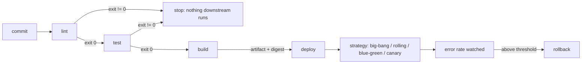

# DevOps Fundamentals

> Every transcript in this lesson was executed on the authoring machine (Windows 11,
> Python 3.13.5, Git Bash, standard library only) in the batch-18 `ops-lab-A` scratch lab.
> The pipeline steps are real subprocesses with real exit codes; the deployment-strategy
> table is a *model* of traffic and error rates, not a load balancer run, and Docker,
> GitHub Actions, and hosted runners were not available on this machine — those are marked
> *labelled reference*.

## 1. Learning Objectives

After this lesson you will be able to:

- [ ] Explain DevOps as a feedback loop between writing software and running it, not as a job title or a tool list
- [ ] Build a delivery pipeline whose steps are real commands and whose gates actually block the steps downstream
- [ ] Show why a failed test must stop the build and deploy, using exit codes rather than prose
- [ ] Prove an artifact is reproducible by comparing its digest across two independent builds
- [ ] Compare big-bang, rolling, blue-green, and canary releases by blast radius and recovery time, and justify one for a given risk

## 2. Prerequisites

- [03-DEVELOPER-TOOLS](../03-DEVELOPER-TOOLS/README.md) — the terminal, exit codes, and Git: a pipeline is those three things automated
- [11-BACKEND-ENGINEERING](../11-BACKEND-ENGINEERING/README.md) — the application this pipeline ships
- [14-TESTING-AND-QUALITY](../14-TESTING-AND-QUALITY/README.md) — the test suite a gate runs; a gate is only as strong as its tests
- [15-APPLICATION-SECURITY](../15-APPLICATION-SECURITY/README.md) — secrets handling, because pipelines are where credentials leak

*No code prerequisite beyond reading Python — the probe is printed in full and uses only the standard library.*

## 3. Introduction

DevOps is the practice of shortening the distance between "the code is written" and "the
code is running in front of users", while making that distance safe to travel often. The
unit of delivery is not a person handing work to another team; it is a **pipeline** — an
ordered set of steps, each of which either passes and lets the next run, or fails and
stops everything after it. This lesson builds that pipeline from real commands, drains a
bug through it to watch the gate hold, and then measures what happens when a broken
release does get out, across four deployment strategies.

## 4. The Problem It Solves

Before pipelines, delivery looked like this:

- **Deployment was an event.** A release happened on a Thursday night, by hand, following a wiki page that was last correct two years ago. Everyone stayed late because nobody could rehearse it.
- **Testing happened before the handoff, not at the gate.** The developer ran the tests they remembered. The `test` step was a human promise, not an exit code, so a failing suite shipped whenever someone was in a hurry.
- **Builds were not reproducible.** "Build it again" produced a different artifact because the build embedded a timestamp, a random temp path, or whatever was in the working directory that day. Two people could not agree on what was deployed.
- **Every release was all-or-nothing.** A single bad version went to 100% of traffic at once, and rollback meant another full manual deployment — the slowest possible recovery at the worst possible moment.
- **Nobody measured it.** Lead time, failure rate, and recovery time were opinions. Without numbers, "we ship fast" and "we ship safely" could never be checked.

A pipeline fixes each of these with a mechanism rather than a promise: exit codes instead
of memory, deterministic builds instead of "works here", and staged rollouts instead of
all-or-nothing.

## 5. Core Concepts

### The pipeline and its gates

A **pipeline** is an ordered list of steps — here `lint`, `test`, `build`, `deploy` — where
each step runs a command and reports success through its **exit code** (0 = success, any
other value = failure). A **gate** is the rule that a failed step stops every step after
it. This is the whole safety property: the deploy step cannot run in a process that never
reached it.

### Fail fast

**Failing fast** means putting the cheapest, most likely-to-fail check first, so a broken
candidate is rejected in seconds rather than after an expensive build. The lint step is
first because a syntax error should cost a compile, not a deployment.

### Artifact and digest

An **artifact** is the thing you actually deploy — a zip, a jar, a container image — built
once and promoted through environments rather than rebuilt per environment. A **digest**
(here a SHA-256 hash) is its identity: if two builds produce the same digest, they produced
the same bytes. Reproducibility means the same source produces the same digest, so
"what is running?" has a checkable answer.

### Deployment strategies

A **deployment strategy** decides how much traffic meets the new version, and when. The
**blast radius** is how many users a defect can reach before you notice and stop it.

- **Big-bang** — switch everything at once. Cheapest to operate, largest blast radius.
- **Rolling** — replace instances in batches. Moderate blast radius, no extra capacity needed.
- **Blue-green** — stand up the full new environment beside the old one, then switch the router. Rollback is an instantaneous switch back, at the cost of double capacity during the change.
- **Canary** — send a small slice of traffic to the new version first, watch the error rate, then widen. Smallest blast radius, slowest full rollout, and it needs traffic-splitting and real metrics to work.

### DORA metrics

Four measures, popularised by the DORA research programme, describe delivery performance:
**lead time** (commit to production), **deployment frequency**, **change failure rate**
(share of releases causing degradation), and **time to restore** (recovery after failure).
They are useful because each one can be improved without gaming the others only if the
pipeline is genuinely healthy.

## 6. How It Works



Read the diagram as exit codes, not boxes: the only thing that moves a candidate forward is
a zero exit status, and the only thing that stops it is a non-zero one. In the probe, the
test step exits `1` on the buggy release and the harness prints
`gate: test failed -> build, deploy never runs` — the skipped steps never spawn a process
at all. After the fix, the same harness reaches `deploy` and the artifact digest is
recomputed to prove the promoted file is the one that was built.

## 7. Practical Examples

**Example 1 — the full probe: a gated pipeline, a reproducibility check, and a blast-radius model**

```python
# OPS-02 DevOps fundamentals probe: a fail-fast delivery pipeline built from real
# subprocess steps, a reproducibility check on the artifact it produces, and a
# blast-radius model of four deployment strategies with automatic rollback.
# Standard library only. Run: python pipeline_probe.py
import hashlib
import shutil
import subprocess
import sys
import zipfile
from pathlib import Path

LAB = Path("pipeline-lab")
DIST = LAB / "dist"
DEPLOYED = LAB / "deployed"

GOOD_APP = '''"""Discount helper -- the app this pipeline ships."""


def discount(price, pct):
    """Return the price after a percentage discount."""
    return price - price * pct / 100
'''

BAD_APP = '''"""Discount helper -- this version is blocked by the pipeline."""


def discount(price, pct):
    """Return the price after a percentage discount."""
    return price - price * pct        # BUG: pct treated as 0..1 instead of 0..100
'''

TESTS = '''"""Tests the pipeline must pass before anything ships."""
import sys

from app import discount

cases = [("ten percent off 100", 100, 10, 90), ("zero percent off 50", 50, 0, 50)]
failures = 0
for name, price, pct, expected in cases:
    got = discount(price, pct)
    if got == expected:
        print(f"  PASS {name}")
    else:
        failures += 1
        print(f"  FAIL {name}: expected {expected}, got {got}")
print(f"  {failures} failure(s)")
sys.exit(1 if failures else 0)
'''

BUILD = '''"""Deterministic build: zip the app with fixed metadata, print its digest."""
import hashlib
import zipfile
from pathlib import Path

source = Path("app.py").read_text(encoding="utf-8")
out = Path("dist")
out.mkdir(exist_ok=True)
archive = out / "app.zip"
with zipfile.ZipFile(archive, "w") as z:
    info = zipfile.ZipInfo("app.py", date_time=(1980, 1, 1, 0, 0, 0))
    info.external_attr = 0o644 << 16
    z.writestr(info, source)
digest = hashlib.sha256(archive.read_bytes()).hexdigest()
print(f"  artifact dist/app.zip sha256 {digest[:12]}")
'''

DEPLOY = '''"""Deploy step: promote the artifact the build step produced."""
import hashlib
import shutil
from pathlib import Path

archive = Path("dist/app.zip")
digest = hashlib.sha256(archive.read_bytes()).hexdigest()[:12]
target = Path("deployed")
target.mkdir(exist_ok=True)
destination = target / f"app-{digest}.zip"
shutil.copy2(archive, destination)
print(f"  deployed {destination.as_posix()}")
'''

STEPS = [
    ("lint", [sys.executable, "-m", "py_compile", "app.py"]),
    ("test", [sys.executable, "test_app.py"]),
    ("build", [sys.executable, "build.py"]),
    ("deploy", [sys.executable, "deploy.py"]),
]


def write_lab(app_source):
    LAB.mkdir(exist_ok=True)
    (LAB / "app.py").write_text(app_source, encoding="utf-8")
    (LAB / "test_app.py").write_text(TESTS, encoding="utf-8")
    (LAB / "build.py").write_text(BUILD, encoding="utf-8")
    (LAB / "deploy.py").write_text(DEPLOY, encoding="utf-8")


def run_pipeline(label):
    print(f"\n=== {label} ===")
    for index, (name, command) in enumerate(STEPS):
        result = subprocess.run(command, cwd=LAB, capture_output=True, text=True)
        for line in (result.stdout + result.stderr).rstrip().splitlines():
            print(line)
        print(f"  [{name}] exit {result.returncode}")
        if result.returncode != 0:
            skipped = ", ".join(step for step, _ in STEPS[index + 1:])
            print(f"  gate: {name} failed -> {skipped} never runs")
            return False
    return True


def artifact_digest():
    return hashlib.sha256((LAB / "dist" / "app.zip").read_bytes()).hexdigest()


def simulate(name, rollout, drain):
    """Return (alert_slot, errors, cleared_slot) for one rollout schedule."""
    errors = 0
    slot_errors = lambda frac: round(TRAFFIC * frac * FAIL_RATE)
    for slot, fraction in enumerate(rollout, start=1):
        errors += slot_errors(fraction)
        if slot_errors(fraction) > TRAFFIC * ALERT_RATE:
            cleared = slot                      # v2 gone as soon as this slot ends
            for extra in drain:
                slot += 1
                errors += slot_errors(extra)
                if extra > 0:
                    cleared = slot              # still serving while it drains
            return (slot - len(drain)), errors, cleared
    return (None, errors, None)


TRAFFIC = 200          # requests per 15-second slot
FAIL_RATE = 0.5        # the broken release fails half the requests it serves
ALERT_RATE = 0.05      # alert when more than 5% of a slot's requests error
SLOT_SECONDS = 15

STRATEGIES = [
    ("big-bang", [1.0], [1.0, 0.5]),
    ("rolling", [0.25], [0.25, 0.0]),
    ("blue-green", [1.0], [0.0]),
    ("canary", [0.05, 0.25], [0.05, 0.0]),
]

print("pipeline-lab (Windows 11, Git Bash, Python %d.%d.%d)" % sys.version_info[:3])

write_lab(BAD_APP)
shutil.rmtree(DIST, ignore_errors=True)
shutil.rmtree(DEPLOYED, ignore_errors=True)
run_pipeline("1. release candidate: lint, test, build, deploy")

write_lab(GOOD_APP)
shutil.rmtree(DIST, ignore_errors=True)
run_pipeline("2. same pipeline after the bug fix")

print("\n=== 3. rebuild: is the artifact reproducible? ===")
first = artifact_digest()
shutil.rmtree(DIST, ignore_errors=True)
subprocess.run([sys.executable, "build.py"], cwd=LAB, capture_output=True, text=True)
second = artifact_digest()
print(f"  build 1 sha256 {first[:16]}")
print(f"  build 2 sha256 {second[:16]}")
print(f"  identical bytes: {first == second}")

print("\n=== 4. deployment strategies: blast radius of the same broken release ===")
print(f"  model: {TRAFFIC} requests per {SLOT_SECONDS}s slot, v2 fails {int(FAIL_RATE * 100)}% of what it serves")
print("  strategy    alert at   errors   old version fully back")
for name, rollout, drain in STRATEGIES:
    alert_slot, errors, cleared = simulate(name, rollout, drain)
    print(f"  {name:<11} {alert_slot * SLOT_SECONDS:>5}s {errors:>9} {cleared * SLOT_SECONDS:>18}s")
```

- The probe writes four real files into `pipeline-lab/` (`app.py`, `test_app.py`, `build.py`, `deploy.py`) and runs each as a subprocess with `subprocess.run(..., capture_output=True)`, so every line of output and every exit code below is the child process's own.
- Phase 1 ships a deliberately broken `discount()` (`return price - price * pct` — treating 10 as a fraction instead of 10 percent). The test prints `FAIL ten percent off 100: expected 90, got -900`, exits `1`, and the gate skips `build` and `deploy` entirely.
- Phase 2 rewrites `app.py` with the fix and re-runs the *same* harness: two `PASS` lines, `0 failure(s)`, then `build` and `deploy` run.
- Phase 3 deletes `dist/`, rebuilds, and compares digests: both builds report `c14ac46096ab4a28`, so the artifact is byte-reproducible. The determinism comes from the build script writing a fixed zip timestamp (`date_time=(1980, 1, 1, 0, 0, 0)`) and a fixed `external_attr` instead of the current time.
- Phase 4 models the same broken release under four strategies: a 15-second slot, 200 requests per slot, and a version that fails half of what it serves, with rollback triggered when a slot's error rate exceeds 5%.
- **Expected output:** the capture below.
- **How to run it:** `python pipeline_probe.py` (Windows 11, Python 3.13.5, Git Bash). It creates and overwrites `pipeline-lab/`.
- **Assumptions:** standard library only; no network; the "traffic" is arithmetic, not sockets.

**Executed capture:**

```text
pipeline-lab (Windows 11, Git Bash, Python 3.13.5)

=== 1. release candidate: lint, test, build, deploy ===
  [lint] exit 0
  FAIL ten percent off 100: expected 90, got -900
  PASS zero percent off 50
  1 failure(s)
  [test] exit 1
  gate: test failed -> build, deploy never runs

=== 2. same pipeline after the bug fix ===
  [lint] exit 0
  PASS ten percent off 100
  PASS zero percent off 50
  0 failure(s)
  [test] exit 0
  artifact dist/app.zip sha256 c14ac46096ab
  [build] exit 0
  deployed deployed/app-c14ac46096ab.zip
  [deploy] exit 0

=== 3. rebuild: is the artifact reproducible? ===
  build 1 sha256 c14ac46096ab4a28
  build 2 sha256 c14ac46096ab4a28
  identical bytes: True

=== 4. deployment strategies: blast radius of the same broken release ===
  model: 200 requests per 15s slot, v2 fails 50% of what it serves
  strategy    alert at   errors   old version fully back
  big-bang       15s       250                 45s
  rolling        15s        50                 30s
  blue-green     15s       100                 15s
  canary         30s        35                 45s
```

The two numbers that matter in phase 4 are not the error counts but the pair. **Canary**
produces the fewest errors (`35`) because only 5% then 25% of traffic ever met the bad
version — but it takes the longest to get the old version fully back (`45s`), because the
remaining canary traffic must drain. **Blue-green** produces more errors (`100`) yet
recovers fastest (`15s`): the whole new environment failed at once, but a router switch
returns all traffic to the old one in a single slot. **Big-bang** is worst on both counts
(`250` errors, `45s`). There is no strategy that wins on every axis — that trade-off is the
lesson, not a defect in the model.

**Example 2 — the same pipeline as a CI workflow** (*illustration — not executed here*)

```yaml
# .github/workflows/ci.yml — the same four steps, expressed as a hosted workflow.
# Not executed in this lab: this machine has no GitHub Actions runner. Shapes only.
name: ci
on: [push, pull_request]
jobs:
  pipeline:
    runs-on: ubuntu-24.04
    steps:
      - uses: actions/checkout@v7
      - uses: actions/setup-python@v6
        with:
          python-version: "3.13"
      - run: python -m py_compile app.py        # lint
      - run: python test_app.py                 # test — non-zero exit fails the job
      - run: python build.py                    # build
      - run: python deploy.py                   # deploy (guarded by the steps above)
```

- Each `run:` inherits the gate from the runner: a non-zero exit fails the job, and later steps do not execute — the same contract the probe enforces with `run_pipeline`.
- **Not executed:** the YAML is a shape, not a transcript. The executed evidence in this lesson is Example 1.
- `actions/checkout@v7` and `actions/setup-python@v6` are the pins recorded in [VERSIONS.md](../VERSIONS.md).

## 8. Real-World Applications

- **Every professional codebase** has some version of this pipeline: a change is proposed, checks run automatically, and merging is blocked until they pass. The probe is a miniature of the same contract.
- **Artifact promotion** is how regulated and high-scale systems deploy: one immutable build per commit, promoted from staging to production by reference to its digest, never rebuilt.
- **Progressive delivery** (canary and blue-green) is standard at services where a bad release costs real money per minute — payment paths, authentication, anything with a global user base.
- **DORA metrics** are used by platform teams to decide where to invest: a high change-failure rate points at testing, a long time-to-restore points at observability and rollback tooling.
- Paired with: [Monitoring and Logging](monitoring-and-logging.md) for the error rate a canary watches, and [Deployment Strategies](deployment-strategies.md) for the operational detail behind phase 4.

## 9. Common Mistakes

| Mistake | Why it happens | How to recognize it | How to prevent it |
|---|---|---|---|
| Tests run "when remembered" | No gate exists; the suite is a local habit | A broken commit reaches `main` with a green pipeline | Make the test step a pipeline step whose exit code halts the rest |
| Gate passes on output, not status | Parsing stdout instead of checking the exit code | Pipeline green while the log says `FAIL` | Branch on the exit status, as `run_pipeline` does |
| Build redeployed per environment | "Build for prod with prod config" | Staging and prod artifacts have different digests | Build once, promote the digest, inject config at runtime |
| Non-deterministic builds | Timestamps, absolute paths, random ids baked in | Two builds of one commit differ | Fix metadata (as `build.py` does) and compare digests in CI |
| Deploy before testing | Ordering by perceived speed | Rollback rate tracks test coverage inversely | Cheapest check first: lint, test, build, deploy |
| Big-bang for everything | Simplest to wire up | One bad release pages everyone at once | Choose the strategy by blast radius, not by wiring effort |
| Canary without metrics | The traffic split exists, the judgement does not | Nobody can say what error rate should trigger rollback | Define the threshold *before* rollout, as the model's 5% does |
| Rollback untested | Assumed to work because it exists | First real rollback takes longer than the outage | Rehearse rollback like a deploy; blue-green makes it a switch |

## 10. Best Practices

- **Order steps by cost and likelihood of failure.** Fast, cheap checks first. The practice stops applying only when a later step is a prerequisite for the earlier one (for example, compile-before-lint in languages where linting needs type information).
- **One artifact per commit, promoted not rebuilt.** This is what makes digest comparison meaningful; the exception is when build-time configuration is genuinely part of the artifact's identity — then the digest must include it.
- **Make gates machine-checkable.** An exit code, a coverage threshold, a policy file — anything a human must remember is not a gate.
- **Record the digest in the deployment record.** "Which build is in production?" should be answerable in one lookup.
- **Pick the rollout strategy from the blast-radius budget.** Internal tools can take big-bang; a payments path should take canary with an automatic threshold.
- **Write the rollback criterion before the rollout starts,** and prefer automated triggers for it, exactly as phase 4's `ALERT_RATE` models.

## 11. Limitations and Trade-Offs

- **The strategy table is a model, not a load balancer.** It assumes constant traffic (200 requests per slot), a fixed 50% failure rate for the bad version, instant alerting at the end of a slot, and no retries or caching. A real rollout varies all four, so treat the numbers as a way to compare strategies, not a forecast.
- **Canary requires traffic splitting and trustworthy metrics.** With low traffic, a 5% canary may see too few requests to distinguish a real regression from noise — the reason small services often jump to blue-green.
- **Blue-green doubles capacity** during the change and needs a router or load balancer that can switch cleanly; stateful services also need schema compatibility across both versions.
- **A pipeline is only as good as its tests.** The gate in this lesson caught an obvious arithmetic bug; it would have passed anything the two test cases did not cover — the subject of [14-TESTING-AND-QUALITY](../14-TESTING-AND-QUALITY/README.md).
- **Reproducibility has limits.** The probe achieves it by fixing zip metadata; compilers, dependency resolution, and base images can still introduce drift, which is why lockfiles and digest-pinned images matter.
- **No hosted CI ran here.** GitHub Actions, its runners, and `gh` were unavailable on this machine; Example 2 is an illustration and is marked as such.

## 12. Practical Exercises

### Introductory

1. **Exercise 2.1** — Run the probe and explain, in one paragraph, why `deploy` never ran in phase 1 — using the words *exit code* and *gate*. **Completion criteria:** the paragraph names the non-zero status from `test` as the cause, not "the script stopped".
2. **Exercise 2.2** — Add a `coverage` step between `test` and `build` that fails when fewer than three test cases exist, and re-run both phases. **Completion criteria:** a capture where phase 1 stops at the new step or at `test`, and phase 2 still reaches `deploy`.

### Intermediate

3. **Exercise 2.3** — Break reproducibility deliberately: change `BUILD` to use `date_time=time.localtime()[:6]` and re-run phase 3. Then restore the fixed timestamp. **Completion criteria:** two captures — one with `identical bytes: False`, one with `True` — plus one sentence on what made the difference.
4. **Exercise 2.4** — Add a fifth strategy to `STRATEGIES` — canary at 1%, then 10%, then 100% — and explain why its error count can be *lower* than the existing canary's while its recovery time is longer. **Completion criteria:** a table row with both numbers and a two-sentence justification that references the slots.

### Independent problem-solving

5. **Exercise 2.5** — Your team deploys a nightly batch job (no user traffic, results read next morning) and a login service. Choose a strategy for each, defend the choice with the blast-radius and recovery numbers from this lesson, and state the one metric you would instrument to know the choice was wrong. **Completion criteria:** two named strategies, each with a cited trade-off from phase 4, and one concrete metric per service.

*Solutions: attempt first. They live in `solutions/` of this subject.*

## 13. Knowledge Check

1. Phase 1's `test` step printed a `FAIL` line and exited `1`. What would the pipeline have done if the harness had checked stdout instead of the exit code?
2. Both builds in phase 3 produced `c14ac46096ab4a28`. Name two things in `build.py` that make that possible and one thing that could still break it in a real project.
3. Canary produced the *fewest* errors but the *slowest* recovery. Explain why both facts follow from the same design decision.
4. When would a big-bang release be the professionally correct choice rather than a shortcut?

## 14. Completion Criteria

Observable evidence that you have understood this lesson:

- [ ] You can explain the pipeline as a chain of exit codes and say what a gate is without notes
- [ ] You can write the four steps from a blank editor and make a failing test stop the deploy
- [ ] You can compute and compare artifact digests, and name two sources of non-determinism
- [ ] You can diagnose the eight mistakes in section 9 in a real CI configuration
- [ ] You can state one situation where canary is the wrong strategy and one where blue-green is

## 15. Summary

- DevOps is a feedback loop made of mechanisms: gates, artifacts, rollouts, and measurements — not a role or a toolchain.
- A gate is an exit code: `test` exiting `1` is what stopped `build` and `deploy` in phase 1.
- Deploy one immutable artifact and identify it by digest; two builds of the fix produced identical bytes.
- Deployment strategy is a blast-radius decision: canary minimises errors (`35`), blue-green minimises recovery time (`15s`), big-bang loses on both.
- Measure delivery with lead time, deployment frequency, change failure rate, and time to restore — otherwise every claim about speed or safety is an opinion.

## 16. Next Steps

- Next lesson: [Linux Administration](linux-administration.md) — the operating system underneath every deploy target: users, permissions, logs, disks, and services
- Practice: the subject's exercise set (written with its exercise installment)
- Where it is applied: [Project 07](../20-PROJECT-LABORATORY/project-07-secure-production-application/README.md) — its deployment plan asks for exactly this pipeline: build, test, promote one artifact, and roll back
