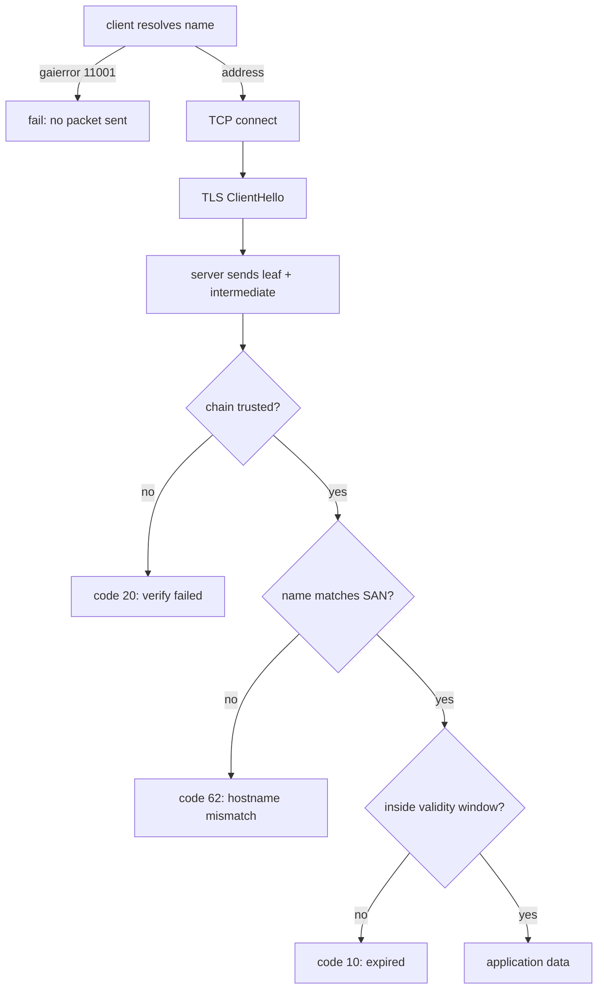

# DNS and TLS Operations

> Executed on the authoring machine (Windows 11, Python 3.13.5, OpenSSL 3.5.9 from Git for
> Windows) by the batch-18 `ops-lab-B` `tls_probe.py`. A CA and a leaf certificate were
> really issued, a TLS server really terminated connections, and every verification failure
> below is an exception Python's `ssl` module raised. DNS answers come from the machine's
> resolver. Certificate transparency, OCSP, and a public CA's issuance flow are *labelled
> reference*.

## 1. Learning Objectives

After this lesson you will be able to:

- [ ] Issue a leaf certificate from a private CA and explain what the CA adds
- [ ] Distinguish a chain failure from a hostname mismatch by the verification error
- [ ] Check that a private key matches its certificate
- [ ] Read a certificate's expiry, compute days remaining, and set an alert threshold
- [ ] Explain which DNS failure happens before any TLS handshake can begin

## 2. Prerequisites

- [Networking for DevOps](networking-for-devops.md) — DNS resolution, ports, and connection failures
- [Nginx and Reverse Proxies](nginx-and-reverse-proxies.md) — where TLS termination usually happens
- Shell basics: running `openssl` and reading exit codes

## 3. Introduction

Two systems decide whether a client reaches your service securely: DNS decides *which
address*, and TLS decides *whether that address is who it claims to be*. Both fail in ways
that look alike from a browser — a warning page, a timeout, a redirect loop — and both have
a small set of checks that turn a guess into a diagnosis. This lesson issues a real
certificate chain, breaks verification in the four ways that actually happen, and measures
the expiry clock that causes most outages of this kind.

## 4. The Problem It Solves

- **"The certificate is fine, why is it rejected?"** A chain the client cannot complete produces `unable to get local issuer certificate (code 20)` — the probe's first handshake attempt. Trusting the CA fixed it with no change to the server.
- **A trusted certificate for the wrong name.** The probe signed a certificate for `example.com` with the same CA and was refused with `Hostname mismatch ... (code 62)`. Chain valid, name wrong, connection refused.
- **A certificate that expires unnoticed.** The leaf has 19 days left; the same object is `ok` at a 14-day threshold and `ALERT` at 30. Nothing about the handshake changes — only the policy does.
- **A key that does not match its certificate.** Replacing one file of the pair yields two different moduli; servers fail to start or clients fail to handshake.
- **A name that does not resolve.** `gaierror 11001` happens before any TCP connection, so no certificate is ever presented — a different failure with a different fix.

## 5. Core Concepts

### What a certificate asserts

A certificate binds a **public key** to a **name** (and, via SANs, to several names and IP
addresses) for a **period**, signed by an issuer. The client checks four things: the chain
reaches a trusted root, the signature verifies, the name matches what was requested, and the
current time is inside the validity window. Fail any one and the connection is refused before
any application data is sent.

### Chains and trust stores

A **root CA** is trusted because the client's store says so. An **intermediate** exists so the
root's key can stay offline. A **leaf** is the server's certificate. The server must send the
leaf *and* the intermediate; the client already has the root. Missing intermediates produce
the same `code 20` as an unknown CA, which is why "it works in my browser" (cached
intermediate) and "it fails from curl" (no cache) can both be true.

### SANs replaced CN

Modern clients ignore `CN` entirely and match only `subjectAltName`. A certificate with
`CN=localhost` and no SAN is invalid for `localhost` in every current browser. The probe's
leaf carries `DNS:localhost, IP:127.0.0.1` and works for both.

### Verification errors are specific

| Code | Message | Meaning |
|---|---|---|
| 18 | self-signed certificate | The leaf is its own root and is not trusted |
| 19 | unable to get local issuer certificate | Chain incomplete or CA not trusted |
| 20 | unable to get local issuer certificate | Same class: issuer unknown to the store |
| 62 | Hostname mismatch | Chain fine, name wrong |
| 10 | certificate has expired | Outside the validity window |

The number matters: it separates "fix trust" from "fix the name" from "renew".

### Time, clocks, and renewal

Validity is evaluated against the client's clock. A server whose clock is far behind issues
certificates that appear not-yet-valid; a client whose clock is wrong rejects good
certificates. Renewal must therefore start well before expiry — the probe's 30-day threshold
against a 19-day certificate is exactly the alert an operator wants.

### DNS as the first hop

`getaddrinfo` returns addresses or a `gaierror`. It hides the CNAME chain and the TTL, which
is why diagnosing "the certificate is for the old host" often means looking at DNS records
rather than at the certificate. Low TTLs make changes fast and queries frequent; high TTLs do
the reverse.

## 6. How It Works



Every branch except the last ends before a single byte of the request is sent, which is why
these failures are cheap to detect and expensive to ignore.

## 7. Practical Examples

**Example 1 — the full probe: issue, verify, handshake, fail, expire**

```python
"""DNS and TLS lab: issue a CA, sign a leaf, handshake, fail verification, watch expiry.

Windows 11, Python 3.13.5, OpenSSL from Git for Windows.  Certificates are really
generated with `openssl`, the server really terminates TLS, and the client failures are
the ones Python's `ssl` module raises.  DNS answers come from the machine's resolver.
"""
from __future__ import annotations

import datetime as dt
import shutil
import socket
import ssl
import subprocess
import threading
from pathlib import Path

LAB = Path(__file__).with_name("tls-lab")
PORT = 8443
HOST = "127.0.0.1"
OPENSSL = shutil.which("openssl") or r"C:\Program Files\Git\ucrt64\bin\openssl.exe"


def run(*args: str) -> str:
    result = subprocess.run([OPENSSL, *args], capture_output=True, text=True, check=True)
    return result.stdout.strip()


def main() -> None:
    if LAB.exists():
        shutil.rmtree(LAB)
    LAB.mkdir()
    print(f"tls-lab (Windows 11, Python 3.13.5)\nopenssl: {OPENSSL}")
    print(f"openssl version: {run('version')}")

    print("\n=== 1. a private CA, then a leaf it signs ===")
    run("req", "-x509", "-newkey", "rsa:2048", "-nodes", "-days", "3650",
        "-subj", "/CN=Lab Root CA/O=CodePath Lab",
        "-addext", "basicConstraints=critical,CA:TRUE",
        "-addext", "keyUsage=critical,keyCertSign,cRLSign",
        "-keyout", str(LAB / "ca.key"), "-out", str(LAB / "ca.pem"))
    csr = run("req", "-newkey", "rsa:2048", "-nodes", "-subj", "/CN=localhost/O=CodePath Lab",
              "-addext", "subjectAltName=DNS:localhost,IP:127.0.0.1",
              "-keyout", str(LAB / "leaf.key"), "-out", str(LAB / "leaf.csr"))
    run("x509", "-req", "-in", str(LAB / "leaf.csr"), "-CA", str(LAB / "ca.pem"),
        "-CAkey", str(LAB / "ca.key"), "-CAcreateserial", "-days", "20",
        "-copy_extensions", "copyall", "-out", str(LAB / "leaf.pem"))
    print(f"  CA:   {run('x509', '-in', str(LAB / 'ca.pem'), '-noout', '-subject')}")
    print(f"  leaf: {run('x509', '-in', str(LAB / 'leaf.pem'), '-noout', '-subject')}")
    print(f"  SANs: {run('x509', '-in', str(LAB / 'leaf.pem'), '-noout', '-ext', 'subjectAltName').splitlines()[-1].strip()}")
    print(f"  issuer of leaf: {run('x509', '-in', str(LAB / 'leaf.pem'), '-noout', '-issuer')}")

    print("\n=== 2. verify the chain, and verify it wrongly ===")
    good = subprocess.run([OPENSSL, "verify", "-CAfile", str(LAB / "ca.pem"), str(LAB / "leaf.pem")],
                          capture_output=True, text=True)
    print(f"  openssl verify -CAfile ca.pem leaf.pem -> exit {good.returncode} {good.stdout.strip()}")
    bad = subprocess.run([OPENSSL, "verify", "-CAfile", str(LAB / "leaf.pem"), str(LAB / "leaf.pem")],
                         capture_output=True, text=True)
    lines_out = (bad.stdout + bad.stderr).strip().splitlines()
    reason = next((row.strip() for row in lines_out if "error" in row.lower()), lines_out[-1].strip())
    print(f"  openssl verify -CAfile leaf.pem leaf.pem -> exit {bad.returncode} {reason}")
    selfsigned = subprocess.run([OPENSSL, "verify", "-CAfile", str(LAB / "leaf.pem"), str(LAB / "ca.pem")],
                                capture_output=True, text=True)
    print(f"  a CA is not valid because the leaf says so: exit {selfsigned.returncode}")

    print("\n=== 3. key and certificate must match ===")
    cert_mod = run("x509", "-in", str(LAB / "leaf.pem"), "-noout", "-modulus").split("=")[1][:16]
    key_mod = run("rsa", "-in", str(LAB / "leaf.key"), "-noout", "-modulus").split("=")[1][:16]
    print(f"  cert modulus {cert_mod[:16]}  key modulus {key_mod[:16]}  match: {cert_mod == key_mod}")
    run("genrsa", "-out", str(LAB / "other.key"), "2048")
    other_mod = run("rsa", "-in", str(LAB / "other.key"), "-noout", "-modulus").split("=")[1][:16]
    print(f"  a different key: {other_mod[:16]}  match: {cert_mod == other_mod}")

    print("\n=== 4. serve TLS and handshake ===")
    context = ssl.SSLContext(ssl.PROTOCOL_TLS_SERVER)
    context.load_cert_chain(certfile=LAB / "leaf.pem", keyfile=LAB / "leaf.key")
    listener = socket.socket()
    listener.setsockopt(socket.SOL_SOCKET, socket.SO_REUSEADDR, 1)
    listener.bind((HOST, PORT))
    listener.listen(4)
    seen: list[str] = []

    def serve() -> None:
        for _ in range(6):
            try:
                conn, _addr = listener.accept()
            except OSError:
                return
            try:
                with context.wrap_socket(conn, server_side=True) as tls:
                    seen.append(f"{tls.version()} {tls.cipher()[0]}")
                    tls.sendall(b"HTTP/1.1 200 OK\r\nContent-Length: 2\r\n\r\nok")
            except (ssl.SSLError, OSError):
                pass

    threading.Thread(target=serve, daemon=True).start()

    def handshake(**kwargs: object) -> tuple[str, object]:
        client = ssl.create_default_context(**kwargs)  # type: ignore[arg-type]
        with socket.create_connection((HOST, PORT), timeout=3) as raw:
            with client.wrap_socket(raw, server_hostname="localhost") as tls:
                data = tls.recv(64)
                return (f"{tls.version()} {tls.cipher()[0]}", data)

    print("\n=== 5. without the CA, the client refuses the certificate ===")
    try:
        handshake()
    except ssl.SSLCertVerificationError as exc:
        print(f"  SSLCertVerificationError: {exc.verify_message} (code {exc.verify_code})")
    print("  this is the failure a browser hides behind 'your connection is not private'")

    print("\n=== 6. trusting the CA makes the same handshake succeed ===")
    summary, data = handshake(cafile=str(LAB / "ca.pem"))
    print(f"  negotiated {summary}")
    print(f"  response bytes: {data!r}")
    print(f"  server sessions recorded: {seen}")

    print("\n=== 7. a trusted certificate for the wrong name is still refused ===")
    csr_wrong = LAB / "wrong.csr"
    run("req", "-newkey", "rsa:2048", "-nodes", "-subj", "/CN=example.com",
        "-addext", "subjectAltName=DNS:example.com", "-keyout", str(LAB / "wrong.key"),
        "-out", str(csr_wrong))
    run("x509", "-req", "-in", str(csr_wrong), "-CA", str(LAB / "ca.pem"), "-CAkey",
        str(LAB / "ca.key"), "-CAcreateserial", "-days", "90", "-copy_extensions",
        "copyall", "-out", str(LAB / "wrong.pem"))
    wrong_ctx = ssl.SSLContext(ssl.PROTOCOL_TLS_SERVER)
    wrong_ctx.load_cert_chain(certfile=LAB / "wrong.pem", keyfile=LAB / "wrong.key")
    second = socket.socket()
    second.setsockopt(socket.SOL_SOCKET, socket.SO_REUSEADDR, 1)
    second.bind((HOST, PORT + 1))
    second.listen(1)

    def serve_wrong() -> None:
        conn, _ = second.accept()
        try:
            with wrong_ctx.wrap_socket(conn, server_side=True):
                pass
        except (ssl.SSLError, OSError):
            pass

    threading.Thread(target=serve_wrong, daemon=True).start()
    verifier = ssl.create_default_context(cafile=str(LAB / "ca.pem"))
    try:
        with socket.create_connection((HOST, PORT + 1), timeout=3) as raw:
            verifier.wrap_socket(raw, server_hostname="localhost")
    except ssl.SSLCertVerificationError as exc:
        print(f"  SSLCertVerificationError: {exc.verify_message} (code {exc.verify_code})")
    print("  the chain was fine; the name was not, and that alone is fatal")

    print("\n=== 8. expiry is a date, and an alert is a threshold ===")
    not_after = run("x509", "-in", str(LAB / "leaf.pem"), "-noout", "-enddate").split("=", 1)[1]
    expires = dt.datetime.strptime(not_after, "%b %d %H:%M:%S %Y %Z").replace(tzinfo=dt.timezone.utc)
    remaining = expires - dt.datetime.now(dt.timezone.utc)
    print(f"  leaf notAfter: {expires.isoformat()}")
    print(f"  days remaining: {remaining.days}")
    for threshold in (30, 14, 7):
        state = "ALERT" if remaining.days < threshold else "ok"
        print(f"  alert at {threshold:>2} days -> {state}")
    print("  a 20-day certificate passes every handshake today and fails at the threshold")

    print("\n=== 9. what the resolver answers ===")
    for name in ("example.com", "www.example.com"):
        try:
            infos = socket.getaddrinfo(name, 443, proto=socket.IPPROTO_TCP)
            addresses = sorted({info[4][0] for info in infos})
            print(f"  {name:<16} -> {addresses}")
        except socket.gaierror as exc:
            print(f"  {name:<16} -> gaierror {exc.errno} {exc.strerror}")
    print("  a name that does not exist fails before any TLS handshake is attempted:")
    try:
        socket.getaddrinfo("does-not-exist.invalid", 443)
    except socket.gaierror as exc:
        print(f"    gaierror {exc.errno} {exc.strerror}")

    listener.close()
    second.close()
    print("\nexit=0")


if __name__ == "__main__":
    main()
```

- Section 1 issues a private CA and signs a leaf: `subject=CN=localhost, O=CodePath Lab`, SANs `DNS:localhost, IP Address:127.0.0.1`, issued by `CN=Lab Root CA`.
- Section 2 verifies the chain: `openssl verify -CAfile ca.pem leaf.pem` exits `0` with `OK`; using the leaf as its own CA exits `2` with `error 20 ... unable to get local issuer certificate`; verifying the CA against the leaf also exits `2`.
- Section 3 compares moduli: the certificate and key match, a freshly generated key does not.
- Section 4 starts a TLS listener; section 5 shows the client refusing the untrusted chain with `SSLCertVerificationError: unable to get local issuer certificate (code 20)`.
- Section 6 adds the CA: the handshake negotiates `TLSv1.3 TLS_AES_256_GCM_SHA384` and returns `HTTP/1.1 200 OK`.
- Section 7 serves a certificate for `example.com` from the same CA and is refused with `Hostname mismatch, certificate is not valid for 'localhost'. (code 62)`.
- Section 8 reads `notAfter: 2026-11-23T12:35:42+00:00`, computes `days remaining: 19`, and reports `ALERT` at 30 days, `ok` at 14 and 7.
- Section 9 resolves names: `example.com -> ['104.20.23.154', '172.66.147.243']`, and an invalid name raises `gaierror 11001` before any connection.
- **Expected output:** the capture below.
- **How to run it:** `python tls_probe.py` (Windows 11, Python 3.13.5, OpenSSL on `PATH` or at the Git for Windows location). It writes `tls-lab/` and binds loopback ports `8443` and `8444`.
- **Assumptions:** a two-level chain (root signs leaf); no intermediate, no OCSP, no revocation checking.

**Executed capture:**

```text
tls-lab (Windows 11, Python 3.13.5)
openssl: C:\Users\PC\AppData\Local\Programs\@codebufffreebuff-desktop\resources\git\ucrt64\bin\openssl.EXE
openssl version: OpenSSL 3.5.9 29 Sep 2026 (Library: OpenSSL 3.5.9 29 Sep 2026)

=== 1. a private CA, then a leaf it signs ===
  CA:   subject=CN=Lab Root CA, O=CodePath Lab
  leaf: subject=CN=localhost, O=CodePath Lab
  SANs: DNS:localhost, IP Address:127.0.0.1
  issuer of leaf: issuer=CN=Lab Root CA, O=CodePath Lab

=== 2. verify the chain, and verify it wrongly ===
  openssl verify -CAfile ca.pem leaf.pem -> exit 0 C:\Users\PC\Desktop\PROGRAMMING\CodePath-Masterclass\.scratch\ops-lab-B\tls-lab\leaf.pem: OK
  openssl verify -CAfile leaf.pem leaf.pem -> exit 2 error 20 at 0 depth lookup: unable to get local issuer certificate
  a CA is not valid because the leaf says so: exit 2

=== 3. key and certificate must match ===
  cert modulus D65C064C27A345A8  key modulus D65C064C27A345A8  match: True
  a different key: 9CD93ECA6C89F21E  match: False

=== 4. serve TLS and handshake ===

=== 5. without the CA, the client refuses the certificate ===
  SSLCertVerificationError: unable to get local issuer certificate (code 20)
  this is the failure a browser hides behind 'your connection is not private'

=== 6. trusting the CA makes the same handshake succeed ===
  negotiated TLSv1.3 TLS_AES_256_GCM_SHA384
  response bytes: b'HTTP/1.1 200 OK\r\nContent-Length: 2\r\n\r\nok'
  server sessions recorded: ['TLSv1.3 TLS_AES_256_GCM_SHA384']

=== 7. a trusted certificate for the wrong name is still refused ===
  SSLCertVerificationError: Hostname mismatch, certificate is not valid for 'localhost'. (code 62)
  the chain was fine; the name was not, and that alone is fatal

=== 8. expiry is a date, and an alert is a threshold ===
  leaf notAfter: 2026-11-23T12:35:42+00:00
  days remaining: 19
  alert at 30 days -> ALERT
  alert at 14 days -> ok
  alert at  7 days -> ok
  a 20-day certificate passes every handshake today and fails at the threshold

=== 9. what the resolver answers ===
  example.com      -> ['104.20.23.154', '172.66.147.243']
  www.example.com  -> ['104.20.23.154', '172.66.147.243']
  a name that does not exist fails before any TLS handshake is attempted:
    gaierror 11001 getaddrinfo failed

exit=0
```

The most useful pair is `code 20` then `code 62`: the first says the client does not trust
the issuer, the second says it trusts the issuer and still refuses because the *name* is
wrong. They need opposite fixes, and a browser warning does not tell you which one you have.

**Example 2 — the same checks as an operations runbook** (*illustrative — commands, not executed here*)

```bash
# what is actually served, including the chain the server sends
openssl s_client -connect example.com:443 -servername example.com -showcerts </dev/null 2>/dev/null |
  openssl x509 -noout -subject -issuer -dates -ext subjectAltName

# does the chain verify against the system store, and when does it expire?
openssl s_client -connect example.com:443 -servername example.com </dev/null 2>/dev/null |
  openssl x509 -noout -checkend $((30*24*3600)) || echo "expires within 30 days"

# does the key on disk belong to the certificate on disk?
diff <(openssl x509 -in cert.pem -noout -modulus) <(openssl rsa -in key.pem -noout -modulus)

# what does the name resolve to, and through which chain?
openssl s_client -connect example.com:443 -servername example.com </dev/null 2>/dev/null | grep -E "Verify return code|subject="
```

- `-servername` is mandatory for any host behind SNI; without it you inspect a different certificate than the one clients receive.
- `-checkend` turns expiry into an exit code, which is what a monitoring check needs.
- The modulus comparison is the fastest way to prove a copied key does not belong to the certificate.
- This block is *not executed*: it targets public hosts and depends on their current configuration, which the probe deliberately avoids.

## 8. Real-World Applications

- **Automated renewal** (ACME clients) works because verification is mechanical: issue, install, reload, verify with `-checkend`. The probe's threshold logic is the check that runs before and after.
- **Internal services** use a private CA exactly as the probe does, and distribute the root through configuration management rather than trusting leaf certificates individually.
- **mTLS** adds a client certificate to the same handshake, which is why "who is the client" can be answered by the TLS layer.
- **DNS migrations** fail expiring certificates twice: a low TTL makes cutover fast, and forgetting the new host's SAN makes the new endpoint fail with `code 62`.
- Paired with: [Nginx and Reverse Proxies](nginx-and-reverse-proxies.md) for termination, and [Monitoring and Logging](monitoring-and-logging.md) for the expiry alert.

## 9. Common Mistakes

| Mistake | Why it happens | How to recognize it | How to prevent it |
|---|---|---|---|
| Only `CN`, no SAN | Old tutorials | Works nowhere modern | Always set `subjectAltName` |
| Sending only the leaf | The server config names one file | `code 20` from clients without cache | Concatenate leaf plus intermediate |
| Trusting a leaf directly | It is easier than a CA | Works until renewal, then breaks everywhere | Trust the CA, issue leaves |
| Renewal alert at expiry | Calendar reminder | Outage on the day | Alert at 30 days, renew at 14 |
| Wrong key copied | Two files, same directory | Server fails to start or handshake | Compare moduli before deploying |
| No `-servername` in checks | It looks optional | Checking a different vhost's cert | Always pass SNI |
| Clock skew ignored | Servers "keep time" | `not yet valid` errors | Monitor time sync |
| Confusing DNS and TLS failures | Both are "connection errors" | Debugging certificates for a name typo | Check `getaddrinfo` first |

## 10. Best Practices

- **Trust a CA, not a certificate**, and keep the CA key offline or in an HSM for anything public.
- **Automate issuance and renewal**, and reload the server only after the new certificate verifies.
- **Alert on days remaining at 30**, renew by 14, and treat `-checkend` as the check's exit code.
- **Include every name and IP in SANs**, including the one monitoring uses.
- **Verify the deployed certificate, not the file on disk**: `s_client` with SNI is the only proof of what clients receive.
- **Keep TLS versions and ciphers current**, and let the library's defaults choose them unless you have a reason.
- **Resolve before you handshake**: DNS errors and certificate errors have different owners and different fixes.

## 11. Limitations and Trade-Offs

- **A private CA is not a public one.** The probe's CA trusts only clients configured with `ca.pem`; public issuance requires domain validation, which is *labelled reference* and not reproducible here.
- **No intermediate in the chain.** Two levels are enough to show trust and failure, but production chains are usually three, and a missing intermediate is the most common real failure the probe cannot reproduce.
- **No revocation checking.** CRL and OCSP were not queried; a revoked-but-unexpired certificate would still verify in this lab.
- **`getaddrinfo` hides DNS detail.** It returns addresses without TTL or CNAME chain, so record-level diagnosis needs a resolver tool.
- **Windows certificate semantics differ** from Linux in path handling and trust stores; the probe avoids the system store entirely by passing `cafile`.
- **Loopback handshakes are not network handshakes**: no MTU, no middlebox, no SNI-based routing in front.

## 12. Practical Exercises

### Introductory

1. **Exercise 12.1** — Re-issue the leaf with `-days 90` and report days remaining and which thresholds now alert. **Completion criteria:** the number and the threshold table.
2. **Exercise 12.2** — Add `DNS:api.localhost` to the SANs and handshake with `server_hostname="api.localhost"`. **Completion criteria:** the negotiated protocol and cipher.

### Intermediate

3. **Exercise 12.3** — Remove the IP SAN and connect to `127.0.0.1` while requesting `localhost`, then while requesting `127.0.0.1`. Report which attempt fails and with which code. **Completion criteria:** both outcomes with codes.
4. **Exercise 12.4** — Create a three-level chain (root, intermediate, leaf) and handshake with a server that sends only the leaf. **Completion criteria:** the verification error and the one-line fix on the server side.

### Independent problem-solving

5. **Exercise 12.5** — Users report "certificate invalid" from one office only, while everyone else is fine. Write the diagnosis: what differs per client, the three checks to run, and which result would point at a missing intermediate rather than a clock or a name. **Completion criteria:** three checks with expected outputs and the decision each drives.

*Solutions: attempt first. They live in `solutions/` of this subject.*

## 13. Knowledge Check

1. The first handshake failed with `code 20` and succeeded after adding `cafile`. What changed on the client, and what did not change on the server?
2. A certificate from the same CA was refused with `code 62`. What was wrong, and why is the fix different from the previous question?
3. The leaf had 19 days left: `ALERT` at 30 days and `ok` at 14. What does that say about thresholds as policy rather than as facts?
4. Why must `subjectAltName` include every name a client might use, and what happens to a client that connects by IP when only DNS names are listed?

## 14. Completion Criteria

Observable evidence that you have understood this lesson:

- [ ] You can issue a leaf from a CA and verify the chain
- [ ] You can tell a trust failure from a name mismatch by the error code
- [ ] You can prove a key belongs to a certificate
- [ ] You can compute days remaining and justify a threshold
- [ ] You can explain why a DNS failure precedes any TLS check

## 15. Summary

- A private CA signed a leaf for `localhost` with `DNS:localhost, IP:127.0.0.1`; `openssl verify` returned `OK`, and using the leaf as its own CA returned `error 20`.
- Untrusted, the client refused with `code 20`; trusting the CA negotiated `TLSv1.3 TLS_AES_256_GCM_SHA384` and returned `200 OK`.
- A trusted certificate for `example.com` was still refused with `code 62` — chain valid, name wrong.
- The leaf expires `2026-11-23T12:35:42+00:00`, 19 days out: `ALERT` at 30, `ok` at 14 and 7.
- `example.com` resolved to two addresses; an invalid name raised `gaierror 11001` before any handshake.

## 16. Next Steps

- Next lesson: [Infrastructure as Code](infrastructure-as-code.md) — declaring the names, certificates, and resources instead of creating them by hand
- Practice: run the runbook's `-checkend` against a service you operate and wire its exit code into a check
- Where it is applied: [Project 07](../20-PROJECT-LABORATORY/project-07-secure-production-application/README.md) — its TLS plan names the chain, the SANs, the renewal window, and the verification command
