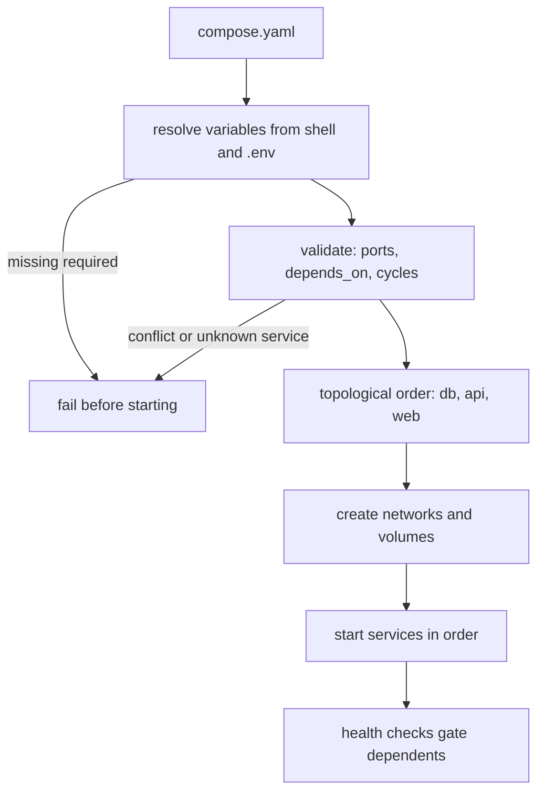

# Docker Compose

> Executed on the authoring machine (Windows 11, Python 3.13.5) by the batch-18
> `ops-lab-B` `compose_probe.py`. The file is parsed and validated for real: interpolation,
> published-port conflicts, unknown dependencies, cycle detection, and start ordering all
> run against the fixture in the probe. The `docker compose` CLI is not installed, so its
> output format and orchestration behaviour are *labelled reference*.

## 1. Learning Objectives

After this lesson you will be able to:

- [ ] Read a Compose file and describe the stack it will create
- [ ] Write variable interpolation with defaults and required values, and explain why it matters
- [ ] Detect the two failures that stop a stack before it starts: port conflicts and unknown dependencies
- [ ] Explain what `depends_on` does and does not wait for, and when to use a health condition
- [ ] Order services correctly from `depends_on` and recognise a cycle

## 2. Prerequisites

- [Docker Fundamentals](docker-fundamentals.md) — images, containers, and published ports
- [Container Networking](container-networking.md) — why `api` can reach `db` by name
- [Volumes and Persistence](volumes-and-persistence.md) — the `volumes:` block this file declares

## 3. Introduction

A stack is several containers with relationships: the web server needs the API, the API needs
the database, and data must outlive all of them. Compose writes that down in one YAML file
and starts it with one command. The value is not the typing saved but the review: a stack
described in a file can be diffed, validated, and reproduced, and the failures below —
conflicting ports, a dependency that does not exist, a cycle, a missing variable — are
found before anything starts, not after.

## 4. The Problem It Solves

- **"It works on my machine."** Ten `docker run` flags in a README do not describe a stack; a compose file does, including the parts people forget (`depends_on`, volumes, health checks).
- **A stack that half-starts.** A port conflict or a typo in a service name leaves three containers up and one dead. The probe finds both problems in a broken fixture before any container exists.
- **Secrets in the file.** `${DB_PASSWORD:?set DB_PASSWORD}` refuses to resolve until the operator supplies the value — the probe raises `KeyError 'DB_PASSWORD: set DB_PASSWORD'`, which is the file refusing to guess.
- **One file, many environments.** `TAG=2.3.1` produced `app:2.3.1` while unsetting it produced `app:1.0`; environment is input, not source.
- **Startup order you cannot see.** The probe derives `['db', 'api', 'web']` from `depends_on`, and refuses `a -> b -> a` instead of looping.

## 5. Core Concepts

### The file is a description, not a script

Compose resolves variables, merges overrides, validates, and only then creates containers.
Every check in this lesson runs at that resolution stage, which is why `docker compose
config` is the first command to run when something is wrong: it prints what the CLI thinks
the file means.

### Services, not containers

A **service** is a template: image or build, command, environment, ports, volumes, health
check. `docker compose up --scale api=3` creates three containers from one service
definition. Naming services well is naming the architecture.

### Interpolation and precedence

Compose reads variables from the shell and from a `.env` file next to the file. `${VAR}`,
`${VAR:-default}`, `${VAR:?message}`, and `$$` for a literal dollar are the four forms worth
knowing. Precedence is shell over `.env` over the file's defaults, which is exactly why a
stale exported variable can change a deployment silently.

### Published ports and conflicts

`"8000:8000"` binds host `8000`. Two services cannot publish the same host port; the second
fails. Inside their networks they may both use `8000`. The probe reports
`host port 8000 published by both api and worker`.

### depends_on: creation, not readiness

Short syntax (`depends_on: [db]`) waits for the dependency's container to be created and
started. It does not wait for the database to accept connections. Long syntax adds a
condition:

```yaml
depends_on:
  db:
    condition: service_healthy
```

with `healthcheck:` defining what healthy means. Without it, the API's first connection
attempt races the database's startup — the classic "connection refused on first boot".

### Dependency order and cycles

`depends_on` forms a directed graph. A valid stack has a topological order — the probe
computes `['db', 'api', 'web']` — and a cycle is an error, not a retry loop.

### Overrides and profiles

`compose.override.yml` is merged automatically for development; `profiles:` keep optional
services (debug tools, seeders) out of the default `up`. Both are ways to keep one file
expressive without one environment's habits leaking into another.

## 6. How It Works



Resolution and validation come before anything is created, which is why the fastest way to
debug a stack is to ask Compose what it resolved rather than to watch containers fail.

## 7. Practical Examples

**Example 1 — the full probe: parse, interpolate, validate, order**

```python
"""Compose lab: parse a compose file, interpolate variables, validate, order startup.

Windows 11, Python 3.13.5.  The docker compose CLI is not installed, so this probe
implements the parts of the file format that decide whether a stack starts: the YAML
subset compose uses, `${VAR:-default}` interpolation, published-port conflicts,
depends_on validation, and dependency-ordered startup.  The parser is deliberately a
subset and says so; the validations are the same checks the CLI performs.
"""
from __future__ import annotations

import os
import re
from pathlib import Path

LAB = Path(__file__).with_name("compose-lab")

COMPOSE = """\
services:
  web:
    image: nginx:1.30
    ports:
      - "8080:80"
    depends_on:
      api:
        condition: service_healthy
  api:
    build: .
    image: app:${TAG:-1.0}
    ports:
      - "8000:8000"
    environment:
      DATABASE_URL: postgres://app:${DB_PASSWORD:?set DB_PASSWORD}@db:5432/app
      LOG_LEVEL: ${LOG_LEVEL:-info}
    depends_on:
      - db
  db:
    image: postgres:${PG_VERSION:-17}-alpine
    volumes:
      - pgdata:/var/lib/postgresql/data
volumes:
  pgdata:
"""

BROKEN = """\
services:
  api:
    image: app:1.0
    ports:
      - "8000:8000"
    depends_on:
      - database
  worker:
    image: app:1.0
    ports:
      - "8000:9000"
"""

CYCLE = """\
services:
  a:
    image: one
    depends_on:
      - b
  b:
    image: two
    depends_on:
      - a
"""


def parse_document(text: str) -> dict:
    """Parse the YAML subset compose uses: nested mappings, scalar lists, quoted strings."""
    lines = [
        (len(line) - len(line.lstrip(" ")), line.strip())
        for line in text.splitlines()
        if line.strip() and not line.lstrip().startswith("#")
    ]
    root: dict = {}
    stack: list[tuple[int, object]] = [(-1, root)]
    for index, (indent, content) in enumerate(lines):
        while stack and indent <= stack[-1][0]:
            stack.pop()
        parent = stack[-1][1]
        if content.startswith("- "):
            assert isinstance(parent, list), f"list item outside a list at {content!r}"
            parent.append(_scalar(content[2:]))
            continue
        key, _, value = content.partition(":")
        key = key.strip().strip("'\"")
        value = value.strip()
        if not isinstance(parent, dict):
            raise AssertionError("mapping entry inside a list")
        if value:
            parent[key] = _scalar(value)
        else:
            nxt = lines[index + 1][1] if index + 1 < len(lines) else ""
            child: object = [] if nxt.startswith("- ") else {}
            parent[key] = child
            stack.append((indent, child))
    return root


def _scalar(raw: str) -> str:
    raw = raw.strip()
    if len(raw) >= 2 and raw[0] == raw[-1] and raw[0] in "'\"":
        return raw[1:-1]
    return raw


INTERP = re.compile(r"\$\{([A-Za-z_][A-Za-z0-9_]*)(?::([-?])([^}]*))?\}|\$\$")


def interpolate(value: str, env: dict[str, str]) -> str:
    def replace(match: re.Match[str]) -> str:
        if match.group(0) == "$$":
            return "$"
        name, op, argument = match.group(1), match.group(2), match.group(3)
        if name in env:
            return env[name]
        if op == "-":
            return argument or ""
        if op == "?":
            raise KeyError(f"{name}: {argument or 'required variable is missing'}")
        return ""

    return INTERP.sub(replace, value)


def published_port(spec: str) -> tuple[int, int]:
    parts = spec.split(":")
    if len(parts) != 2:
        raise ValueError(f"expected HOST:CONTAINER, got {spec!r}")
    return int(parts[0]), int(parts[1])


def main() -> None:
    LAB.mkdir(exist_ok=True)
    print("compose-lab (Windows 11, Python 3.13.5, docker compose not installed)")

    print("\n=== 1. parse the file into the stack it describes ===")
    doc = parse_document(COMPOSE)
    services = doc["services"]
    print(f"  services parsed: {sorted(services)}")
    for name in sorted(services):
        service = services[name]
        print(f"  {name:<6} image={service.get('image', '(build)')!r} ports={service.get('ports', [])}")

    print("\n=== 2. interpolate before validating ===")
    env = {"LOG_LEVEL": "debug"}
    resolved = {}
    for name, service in services.items():
        image = interpolate(service.get("image", "build:local"), env)
        resolved[name] = {**service, "image": image}
        print(f"  {name:<6} image={image}")
    print("  DB_PASSWORD absent -> validation stops here:")
    try:
        interpolate(services["api"]["environment"]["DATABASE_URL"], env)
    except KeyError as exc:
        print(f"    KeyError {exc}")

    print("\n=== 3. environment values are validated too ===")
    env_with_password = dict(env, DB_PASSWORD="lab-only-not-a-secret")
    url = interpolate(services["api"]["environment"]["DATABASE_URL"], env_with_password)
    print(f"  DATABASE_URL resolves to {url}")
    print(f"  LOG_LEVEL default: {interpolate('${LOG_LEVEL:-info}', {})}")
    print(f"  escaped dollar survives: {interpolate('cost=$$5', {})}")

    print("\n=== 4. published ports cannot collide ===")
    taken: dict[int, str] = {}
    for name in sorted(services):
        for spec in services[name].get("ports", []):
            host, target = published_port(spec)
            if host in taken:
                print(f"  conflict on host port {host}: {taken[host]} and {name}")
            taken[host] = name
            print(f"  {name:<6} host {host} -> container {target}")

    print("\n=== 5. a broken file is reported, not started ===")
    bad = parse_document(BROKEN)["services"]
    problems = []
    seen: dict[int, str] = {}
    for name, service in bad.items():
        for spec in service.get("ports", []):
            host, _ = published_port(spec)
            if host in seen:
                problems.append(f"host port {host} published by both {seen[host]} and {name}")
            seen[host] = name
        for dep in service.get("depends_on", []):
            if dep not in bad:
                problems.append(f"{name} depends_on unknown service {dep!r}")
    print(f"  problems found: {len(problems)}")
    for problem in problems:
        print(f"    - {problem}")

    print("\n=== 6. dependency order, and what depends_on waits for ===")

    def order(graph: dict[str, list[str]]) -> list[str]:
        done: list[str] = []
        visiting: list[str] = []

        def visit(name: str) -> None:
            if name in done:
                return
            if name in visiting:
                raise ValueError(f"dependency cycle: {' -> '.join(visiting + [name])}")
            visiting.append(name)
            for dep in graph.get(name, []):
                if dep in graph:
                    visit(dep)
            visiting.pop()
            done.append(name)

        for name in graph:
            visit(name)
        return done

    short_graph = {name: list(s.get("depends_on", []) or []) for name, s in services.items()}
    print(f"  short depends_on order: {order(short_graph)}")
    print("  short syntax waits for the container to be created, not for it to work")
    print(f"  web's depends_on is the long form: {services['web']['depends_on']}")
    print("  so web waits for api's health check, not merely its start")
    print("  a cycle is refused instead of looping:")
    cyclic = {name: list(s.get("depends_on", [])) for name, s in parse_document(CYCLE)["services"].items()}
    try:
        order(cyclic)
    except ValueError as exc:
        print(f"    ValueError {exc}")

    print("\n=== 7. variables from the environment, not from the file ===")
    os.environ["TAG"] = "2.3.1"
    print(f"  TAG={os.environ['TAG']} -> image {interpolate('app:${TAG:-1.0}', dict(os.environ))}")
    del os.environ["TAG"]
    print(f"  TAG unset      -> image {interpolate('app:${TAG:-1.0}', dict(os.environ))}")
    print("  same file, two builds: the tag is deployment input, not source")
    print("\nexit=0")


if __name__ == "__main__":
    main()
```

- Section 1 parses the file: services `['api', 'db', 'web']`, with `api` still showing its unexpanded `${TAG:-1.0}` — parsing happens before interpolation.
- Section 2 resolves images to `nginx:1.30`, `app:1.0`, and `postgres:17-alpine`; the missing `DB_PASSWORD` stops resolution with `KeyError 'DB_PASSWORD: set DB_PASSWORD'`.
- Section 3 shows the three interpolation outcomes: a required value supplied, a default applied (`info`), and an escaped dollar surviving as `cost=$5`.
- Section 4 maps published ports: `api` host `8000`, `web` host `8080 -> 80`, with no conflict.
- Section 5 validates a broken fixture and reports two problems: `api depends_on unknown service 'database'` and `host port 8000 published by both api and worker`.
- Section 6 computes the order `['db', 'api', 'web']`, distinguishes short `depends_on` from `service_healthy`, and refuses `a -> b -> a` with `ValueError dependency cycle`.
- Section 7 shows `TAG=2.3.1 -> app:2.3.1` against `TAG unset -> app:1.0`.
- **Expected output:** the capture below.
- **How to run it:** `python compose_probe.py` (Windows 11, Python 3.13.5). It parses fixtures embedded in the probe and creates `compose-lab/`.
- **Assumptions:** the YAML parser handles the subset Compose uses (nested mappings, scalar lists, quoted strings) and is labelled as a subset; no CLI, daemon, or container is involved.

**Executed capture:**

```text
compose-lab (Windows 11, Python 3.13.5, docker compose not installed)

=== 1. parse the file into the stack it describes ===
  services parsed: ['api', 'db', 'web']
  api    image='app:${TAG:-1.0}' ports=['8000:8000']
  db     image='postgres:${PG_VERSION:-17}-alpine' ports=[]
  web    image='nginx:1.30' ports=['8080:80']

=== 2. interpolate before validating ===
  web    image=nginx:1.30
  api    image=app:1.0
  db     image=postgres:17-alpine
  DB_PASSWORD absent -> validation stops here:
    KeyError 'DB_PASSWORD: set DB_PASSWORD'

=== 3. environment values are validated too ===
  DATABASE_URL resolves to postgres://app:lab-only-not-a-secret@db:5432/app
  LOG_LEVEL default: info
  escaped dollar survives: cost=$5

=== 4. published ports cannot collide ===
  api    host 8000 -> container 8000
  web    host 8080 -> container 80

=== 5. a broken file is reported, not started ===
  problems found: 2
    - api depends_on unknown service 'database'
    - host port 8000 published by both api and worker

=== 6. dependency order, and what depends_on waits for ===
  short depends_on order: ['db', 'api', 'web']
  short syntax waits for the container to be created, not for it to work
  web's depends_on is the long form: {'api': {'condition': 'service_healthy'}}
  so web waits for api's health check, not merely its start
  a cycle is refused instead of looping:
    ValueError dependency cycle: a -> b -> a

=== 7. variables from the environment, not from the file ===
  TAG=2.3.1 -> image app:2.3.1
  TAG unset      -> image app:1.0
  same file, two builds: the tag is deployment input, not source

exit=0
```

The pair that matters most is `problems found: 2` — both found by reading the file, with no
container, no daemon, and no waiting. That is the entire argument for describing a stack
instead of scripting it.

**Example 2 — the file the probe parses** (*illustrative — the probe embeds the same content*)

```yaml
services:
  web:
    image: nginx:1.30
    ports:
      - "8080:80"
    depends_on:
      api:
        condition: service_healthy
  api:
    build: .
    image: app:${TAG:-1.0}
    ports:
      - "8000:8000"
    environment:
      DATABASE_URL: postgres://app:${DB_PASSWORD:?set DB_PASSWORD}@db:5432/app
      LOG_LEVEL: ${LOG_LEVEL:-info}
    depends_on:
      - db
  db:
    image: postgres:${PG_VERSION:-17}-alpine
    volumes:
      - pgdata:/var/lib/postgresql/data
volumes:
  pgdata:
```

- `web` uses the long form because an nginx proxy that starts before the API is healthy serves 502s; the condition turns "start order" into "readiness order".
- `api` uses the short form for `db` and pays for it with a possible first-connection race unless the application retries — the honest fix is either a health condition or a retry loop in the app.
- `DB_PASSWORD` has no default on purpose: a password with a fallback is a password that ships.
- `app:${TAG:-1.0}` makes the deployed version an explicit input, so the same file builds development and release.
- **Not executed:** the CLI was not run; the probe's parser and validator did the work.

## 8. Real-World Applications

- **Local development stacks** (app, database, cache, mail catcher) are the canonical use, and `compose.override.yml` keeps debug settings out of the base file.
- **CI integration tests** start a real database with `docker compose up -d db`, run migrations, and tear down — reproducible because the versions are pinned in the file.
- **Small production deployments** use Compose on a single host with `restart: unless-stopped`, accepting single-host failure in exchange for simplicity.
- **Architecture review** reads the compose file: its services, networks, and volumes are a diagram that runs.
- Paired with: [Nginx and Reverse Proxies](nginx-and-reverse-proxies.md) for the `web` service, and [Deployment Strategies](deployment-strategies.md) for what happens when `up` is a release.

## 9. Common Mistakes

| Mistake | Why it happens | How to recognize it | How to prevent it |
|---|---|---|---|
| `depends_on` treated as readiness | It sounds like ordering | Connection refused on first boot | Health condition plus application retries |
| Same host port for two services | Both "use 8000" | `port is already allocated` | Distinct published ports; internal ports may repeat |
| Password default in the file | Convenience in development | `${DB_PASSWORD:-changeme}` in git | No default; `:?` to fail loudly |
| `latest` tags | They feel current | Unreproducible rebuilds | Pin versions, as `nginx:1.30` does |
| Compose file copied between projects | Reuse | New project name, empty volumes | Stable project names; explicit volume names |
| Migrations run in `command:` | Easy to wire | Two replicas race the same migration | A dedicated job, or one-off `run` |
| No health check on the database | It starts fast enough locally | Flaky CI | `healthcheck` with `pg_isready` |
| `$$` forgotten in shell commands | `$` is interpolation | Empty variables inside the container | Escape as `$$` |

## 10. Best Practices

- **Pin versions** for every image, and treat a tag bump as a reviewed change.
- **Validate before starting**: resolve and print the file, then start; the probe's checks are the ones to look for.
- **Fail loudly on missing configuration** with `:?`, and keep secrets out of the file entirely.
- **Use health conditions for anything that must be ready**, and retries in the application for everything else.
- **Name volumes explicitly** so backups and restores can find them.
- **Keep one base file and small overrides** rather than one file per environment with copies of every service.
- **Read the file as the architecture diagram** in review: if the services do not match the intended system, the deployment will not either.

## 11. Limitations and Trade-Offs

- **No CLI, no daemon.** The probe is the file format's semantics, not Compose's implementation: merge rules for multiple files, `profiles`, `extends`, and orchestration timing are *labelled reference*.
- **The YAML parser is a subset.** Anchors, aliases, multi-line strings, and flow collections are not parsed; the fixtures avoid them, and a real file may not.
- **A topological order is not a readiness guarantee.** The probe can order services but cannot know when a database is accepting connections — only a health check or an application retry can.
- **Compose targets one host.** Scaling beyond one machine, rolling updates, and self-healing are orchestration concerns; Compose's `restart` policy is a blunt instrument.
- **`depends_on` cycles are refused**, but cycles through runtime calls (A calls B, B calls A) are invisible to the file and are a design question, not a syntax one.
- **Interpolation happens at resolve time**, so a variable changed after `up` has no effect until a recreate — a frequent source of "the config did not change".

## 12. Practical Exercises

### Introductory

1. **Exercise 10.1** — Add a `cache` service (Redis) with a named volume and no published port, and confirm the parse, the order, and the absence of a port conflict. **Completion criteria:** the parsed service list and the new order.
2. **Exercise 10.2** — Change `LOG_LEVEL` to have no default and supply it from the environment. Report both the success and the failure output. **Completion criteria:** two runs, one resolved and one refused.

### Intermediate

3. **Exercise 10.3** — Give `api` a health check and switch `web` to `condition: service_healthy`. Report what the validator says about the file and what it cannot check. **Completion criteria:** a sentence on the difference between what the file declares and what only a running stack can prove.
4. **Exercise 10.4** — Add a `seed` service under `profiles: [tools]` and explain why it must not be in the default order. **Completion criteria:** the profile's purpose plus the default order unchanged.

### Independent problem-solving

5. **Exercise 10.5** — A colleague's stack starts but the API returns 500 for the first thirty seconds after every deploy, then recovers. Using the failures in this lesson, write the diagnosis: which two mechanisms could explain it, what to check in the file, and what evidence would distinguish them. **Completion criteria:** two hypotheses, one check each, and the fix for the more likely one.

*Solutions: attempt first. They live in `solutions/` of this subject.*

## 13. Knowledge Check

1. Parsing showed `app:${TAG:-1.0}` and interpolation showed `app:1.0`. Why are these two different stages, and which one fails when a variable is missing?
2. Two services both publish host port `8000`. What does the validator report, and why can both containers still listen on `8000` internally?
3. What does `depends_on: [db]` guarantee, and what does it not? Name the mechanism that closes the gap.
4. The probe refused `a -> b -> a` with `ValueError`. What would happen with `docker compose up` and a real cycle, and why is refusing better?

## 14. Completion Criteria

Observable evidence that you have understood this lesson:

- [ ] You can read a compose file and list its services, ports, volumes, and order
- [ ] You can write `:-`, `:?`, and `$$` correctly and say what each does
- [ ] You can find a port conflict and an unknown dependency by reading the file
- [ ] You can explain the difference between start ordering and readiness
- [ ] You can name the cycle in a dependency graph and the error it produces

## 15. Summary

- The file parses to three services with unexpanded variables; interpolation resolves `app:1.0` and `postgres:17-alpine`.
- A missing required variable stops resolution (`KeyError 'DB_PASSWORD: set DB_PASSWORD'`) before any container exists.
- Two problems in a broken fixture — a duplicate host port and an unknown dependency — were found by validation alone.
- Startup order is `['db', 'api', 'web']`; short `depends_on` waits for creation, and `service_healthy` is what waits for readiness.
- `TAG` changed the image from `1.0` to `2.3.1` without touching the file: environment is deployment input.

## 16. Next Steps

- Next lesson: [Nginx and Reverse Proxies](nginx-and-reverse-proxies.md) — the `web` service this file declared
- Practice: convert a README's `docker run` commands into a compose file and validate it
- Where it is applied: [Project 07](../20-PROJECT-LABORATORY/project-07-secure-production-application/README.md) — its stack description is a compose file with pinned images, a health-gated database, and no secrets in the file
