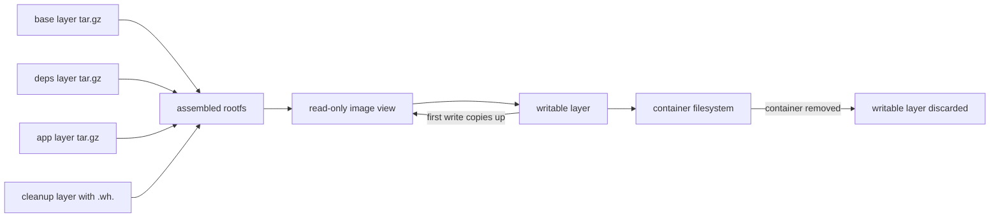

# Docker Fundamentals

> Every transcript in this lesson was produced on the authoring machine (Windows 11,
> Python 3.13.5) by the batch-18 `ops-lab-B` `docker_probe.py`. Docker Engine is **not
> installed** here, so the probe builds real artefacts — gzipped tar layers with real
> bytes, a real overlay application, a real writable layer — and exercises the mechanisms
> itself. Anything that requires the Docker daemon or CLI is marked *labelled reference*
> and never quoted as output.

## 1. Learning Objectives

After this lesson you will be able to:

- [ ] Explain an image as an ordered list of content-addressed layers, and show why rebuilding it from the same content gives the same digests
- [ ] Apply layers in order to produce a root filesystem, including whiteout deletions
- [ ] Explain copy-on-write: what a container writes, where it goes, and what is thrown away
- [ ] Compute what two images sharing base layers actually cost on disk
- [ ] Assemble the exact `argv` a container runs from `ENTRYPOINT` and `CMD`, and state why the exec form is preferred

## 2. Prerequisites

- [Shell Scripting](shell-scripting.md) — the entrypoint is a command, and a bad one fails the same way a script does
- [Linux Administration](linux-administration.md) — users, permissions, and processes: what a container's filesystem and uid actually are
- [11-BACKEND-ENGINEERING](../11-BACKEND-ENGINEERING/README.md) — the application being packaged, and its configuration surface

*No code prerequisite beyond reading Python — the probe uses only `hashlib`, `tarfile`, `gzip`, and `json`.*

## 3. Introduction

"Works on my machine" is a statement about a filesystem: the right interpreter, the right
libraries, the right environment variables, and the right config file. A **container** is
the smallest honest answer to that — a process running in its own set of namespaces, on a
filesystem assembled from a stack of immutable layers, with only what the image author
chose to put in it. This lesson takes the image apart: which bytes are in which layer, what
a digest commits to, what happens when a container writes, and what a second image built on
the same base really costs.

## 4. The Problem It Solves

- **Environments drifted.** A host with the "same" setup had a different library version because installs are mutations of shared state; layers make the environment content-addressed and immutable.
- **Deploys were not reproducible.** "Rebuild and redeploy" produced a different artefact, so a rollback was an archaeology exercise. Phase 1 shows the property that fixes it: the same content yields the same digests.
- **Image size grew without anyone noticing.** Files deleted in a later `RUN` do not shrink the image — the layer that added them still ships. The probe measures it (`237 B` added, `187 B` to remove, `328 KB` still shipped).
- **Nobody knew what a container wrote.** Application state written to a container's filesystem disappears with the container; the probe shows the write landing in a separate upper layer while the image digest stays identical.
- **`docker run` did something unexpected.** Most "why is my container not starting?" questions are answered by the assembled `argv` and by which user it runs as — both visible before the container runs.

## 5. Core Concepts

### The image is a stack of layers

An image is an ordered list of **layers**, each a tar archive of filesystem changes, each
addressed by the **digest** of its content. The base layer carries the operating system
files, the next a package install, the next the application. Because a layer is identified
by content, identical content is stored once no matter how many images use it.

### Digests, not tags

A **tag** (`python:3.13-slim`) is a mutable pointer; a **digest** (`sha256:…`) names exact
bytes. An image's identity is the digest of its manifest, which lists layer digests and the
config (entrypoint, cmd, user, environment). Phase 7 shows the consequence: changing `CMD`
changes the manifest digest, and changing the base changes it again.

### Overlay: how a stack becomes a filesystem

At runtime the layers are combined into one view by a union filesystem. A file in a higher
layer shadows the same path in a lower one. A deletion is recorded as a **whiteout** — an
empty file named `.wh.<name>` beside the target — because layers are immutable and cannot
be edited in place. Phase 2 does this literally: the cleanup layer's `srv/app/.wh.config.json`
removes `config.json` from the assembled root, and `config.production.json` survives.

### Copy-on-write and the writable layer

A running container gets one thin **writable layer** on top. Reads come from the image;
the first write to a path copies that path up and modifies the copy. The image is never
touched, which is why phase 5's digest is identical before and after the write, and why
deleting the container discards exactly the writable layer and nothing else.

### Process isolation, briefly

A container is a normal process on the host kernel with restricted views: its own process
tree (so its entrypoint is PID 1), its own network stack, its own mounts. That is a
namespace story with cgroup limits added, not a virtual machine. The practical consequences
appear in later lessons: PID 1 must reap children, signal handling is your program's job,
and a container's "disk" is the writable layer.

### ENTRYPOINT and CMD

`ENTRYPOINT` is the executable and its fixed arguments; `CMD` supplies defaults that a
`docker run … <args>` overrides. In **exec form** (`["python3","-m","app"]`) they concatenate
into one argument vector. In **shell form** (`python3 -m app`) the command is wrapped in
`/bin/sh -c`, which is why phase 6 prints `['/bin/sh', '-c', 'python3 -m app', '--port', '8000']`
— and why a shell-form entrypoint often fails to receive signals.

## 6. How It Works



The diagram separates the two halves of the mental model: build time is a stack of
immutable archives applied in order, and run time is that stack plus one writable layer
that absorbs every change. Phase 2 is the left half, phase 5 the right half, and phase 3 is
what happens when you only *look* at the stack: a file deleted higher up still costs bytes
further down.

## 7. Practical Examples

**Example 1 — the full probe: layers, overlay, whiteouts, sharing, copy-on-write, argv**

```python
"""Container fundamentals lab: layers, digests, overlay application, copy-on-write.

Windows 11, Python 3.13.5.  Docker is not installed on this machine, so every
*mechanism* below is executed for real against artefacts this probe builds:
gzipped tar layers with real bytes, a real overlay application with whiteouts,
and a real writable layer.  Only the `docker` CLI surface is reference.
"""
from __future__ import annotations

import gzip
import hashlib
import io
import json
import random
import shutil
import tarfile
from pathlib import Path

LAB = Path(__file__).with_name("container-lab")


def sha(data: bytes) -> str:
    return hashlib.sha256(data).hexdigest()


def make_layer(files: dict[str, tuple[bytes, int]]) -> bytes:
    """Deterministic gzipped tar: fixed mtime/uid/gid/order and a zeroed gzip header."""
    buf = io.BytesIO()
    with tarfile.open(fileobj=buf, mode="w") as tar:
        for path in sorted(files):
            payload, mode = files[path]
            info = tarfile.TarInfo(path)
            info.size = len(payload)
            info.mode = mode
            info.mtime = 0
            info.uid = info.gid = 0
            info.uname = info.gname = "root"
            tar.addfile(info, io.BytesIO(payload))
    return gzip.compress(buf.getvalue(), compresslevel=6, mtime=0)


def apply_layer(root: Path, layer: bytes) -> None:
    """Extract one layer into root, honouring .wh.<name> whiteouts beside the file."""
    with tarfile.open(fileobj=io.BytesIO(gzip.decompress(layer)), mode="r") as tar:
        for member in tar.getmembers():
            target = root / member.name
            if target.name.startswith(".wh."):
                victim = target.parent / target.name.split(".wh.", 1)[1]
                if victim.exists():
                    victim.unlink()
                continue
            target.parent.mkdir(parents=True, exist_ok=True)
            data = tar.extractfile(member)
            if data is not None:
                target.write_bytes(data.read())


def kb(n: int) -> str:
    if n < 2048:
        return f"{n} B"
    return f"{n / 1024:.0f} KB"


def main() -> None:
    if LAB.exists():
        shutil.rmtree(LAB)
    LAB.mkdir()
    print("container-lab (Windows 11, Python 3.13.5, docker CLI not installed)")

    rng = random.Random(20261103)
    base = make_layer({
        "etc/os-release": (b'PRETTY_NAME="Container Linux fixture"\n', 0o644),
        "bin/sh": (b"#!fixture-shell\n" + rng.randbytes(4_000), 0o755),
        "usr/bin/python3": (b"#!fixture-python\n" + rng.randbytes(180_000), 0o755),
    })
    deps = make_layer({
        "usr/lib/python3/site-packages/httpcore/__init__.py": (b"VERSION = '1.0'\n" + rng.randbytes(60_000), 0o644),
        "usr/lib/python3/site-packages/httpcore/_sync.py": (rng.randbytes(48_000), 0o644),
        "usr/lib/python3/site-packages/anyio/__init__.py": (b"VERSION = '4.6'\n" + rng.randbytes(30_000), 0o644),
        "usr/lib/python3/site-packages/typing_extensions.py": (rng.randbytes(12_000), 0o644),
    })
    app = make_layer({
        "srv/app/main.py": (b"def handler(request):\n    return {'status': 200}\n" * 40, 0o644),
        "srv/app/config.json": (b'{"log_level": "info", "port": 8000}\n', 0o644),
    })
    cleanup = make_layer({
        "srv/app/.wh.config.json": (b"", 0o644),
        "srv/app/config.production.json": (b'{"log_level": "warning", "port": 8000}\n', 0o644),
    })
    worker_app = make_layer({
        "srv/worker/main.py": (b"def run_job(job):\n    return 'done'\n" * 30, 0o644),
    })

    layers = [("base", base), ("deps", deps), ("app", app), ("cleanup", cleanup)]
    print("\n=== 1. an image is an ordered list of layers, each addressed by digest ===")
    for name, blob in layers:
        print(f"  {name:<8} {kb(len(blob)):>7}  sha256:{sha(blob)[:12]}")
    total = sum(len(blob) for _, blob in layers)
    print(f"  image app:1.0 total: {kb(total)} over {len(layers)} layers")
    probe_a = make_layer({"etc/os-release": (b"PRETTY_NAME=fixed", 0o644)})
    probe_b = make_layer({"etc/os-release": (b"PRETTY_NAME=fixed", 0o644)})
    print(f"  rebuilding the same content twice gives the same digest: {sha(probe_a) == sha(probe_b)}")

    print("\n=== 2. applying the layers in order produces the root filesystem ===")
    rootfs = LAB / "rootfs"
    for _, blob in layers:
        apply_layer(rootfs, blob)
    files = sorted(p for p in rootfs.rglob("*") if p.is_file())
    print(f"  files in the assembled rootfs: {len(files)}")
    for path in files:
        print(f"  {path.relative_to(rootfs).as_posix():<56} {path.stat().st_size:>7} bytes")
    print(f"  srv/app/config.json removed by the cleanup layer: {(not (rootfs / 'srv/app/config.json').exists())}")

    print("\n=== 3. deleting a file in a later layer does not shrink the image ===")
    print(f"  layer that added config.json: {kb(len(app))}")
    print(f"  layer that removed it:        {kb(len(cleanup))}")
    print(f"  image still ships both:       {kb(total)}")
    print("  reclaiming the bytes requires a rebuild without the file: True")

    print("\n=== 4. two images sharing base layers ===")
    worker_layers = [("base", base), ("deps", deps), ("worker", worker_app)]
    worker_total = sum(len(b) for _, b in worker_layers)
    shared = len(base) + len(deps)
    duplicated = total + worker_total
    stored = duplicated - shared
    print(f"  app:1.0    {kb(total)}")
    print(f"  worker:1.0 {kb(worker_total)}")
    print(f"  bytes if every layer were unique: {kb(duplicated)}, shared layers: {kb(shared)}")
    print(f"  bytes actually stored: {kb(stored)} (saves {shared * 100 // duplicated}%)")

    print("\n=== 5. copy-on-write: the container writes, the image stays identical ===")
    image_before = sha(b"".join(b for _, b in layers))
    lower = (rootfs / "srv/app/main.py").read_bytes()
    upper = LAB / "upper"
    upper.mkdir()
    (upper / "main.py").write_bytes(b"def handler(request):\n    return {'status': 503}\n")
    merged = (upper / "main.py").read_bytes()
    image_after = sha(b"".join(b for _, b in layers))
    print(f"  image digest before write: {image_before[:12]}")
    print(f"  image digest after write:  {image_after[:12]}")
    print(f"  image unchanged: {image_before == image_after}")
    print(f"  lower layer still holds {len(lower)} bytes; the writable layer holds {len(merged)}")
    print(f"  the two copies differ: {lower != merged}")
    print("  deleting the container discards only the writable layer: True")

    print("\n=== 6. ENTRYPOINT and CMD combine into one exec vector ===")
    entrypoint = ["python3", "-m", "app"]
    cmd = ["--port", "8000"]
    print('  ENTRYPOINT ["python3", "-m", "app"] + CMD ["--port", "8000"]')
    print(f"  argv: {entrypoint + cmd}")
    print(f"  CMD overridden to [\"--port\", \"9000\"]: {entrypoint + ['--port', '9000']}")
    print(f"  shell-form ENTRYPOINT \"python3 -m app\" runs as: {['/bin/sh', '-c', 'python3 -m app'] + cmd}")

    print("\n=== 7. image identity is the digest of its manifest ===")
    manifest = {
        "layers": [f"sha256:{sha(b)}" for _, b in layers],
        "config": {"Entrypoint": entrypoint, "Cmd": cmd, "User": "0"},
    }
    first = sha(json.dumps(manifest, sort_keys=True).encode())
    manifest["config"]["Cmd"] = ["--port", "9000"]
    second = sha(json.dumps(manifest, sort_keys=True).encode())
    manifest["layers"][0] = f"sha256:{sha(base + b'#rebuilt')}"
    third = sha(json.dumps(manifest, sort_keys=True).encode())
    print(f"  manifest digest:         {first[:12]}")
    print(f"  after changing CMD:      {second[:12]} (differs: {first != second})")
    print(f"  after changing the base: {third[:12]} (differs: {second != third})")
    print("\nexit=0")


if __name__ == "__main__":
    main()
```

- Phase 1 builds four layers from fixtures and prints each one's size and digest: `base 180 KB`, `deps 147 KB`, `app 237 B`, `cleanup 187 B`, total `328 KB`. Rebuilding the same content produces the same digest (`True`) because the tarball metadata is fixed — that is the property a deploy needs.
- Phase 2 applies the stack to a directory and lists the result: nine files, and `srv/app/config.json removed by the cleanup layer: True`, with `config.production.json` present. That is a whiteout doing its job.
- Phase 3 measures the cost of deletion: the layer that added `config.json` is `237 B`, the layer that removes it is `187 B`, and the image still ships `328 KB`. Deleting in a later layer is a correctness tool, not a size tool.
- Phase 4 puts two images side by side: `app:1.0 328 KB`, `worker:1.0 327 KB`, `655 KB` if every layer were unique, `327 KB` shared, so only `328 KB` is stored — `49%` saved by sharing the base and dependency layers.
- Phase 5 writes to `srv/app/main.py` in the writable layer: the image digest is `d8e4d1251ce3` before and after, the lower copy still holds `1960 bytes`, the writable layer holds `49`, and the two differ.
- Phase 6 assembles the argv: `['python3', '-m', 'app', '--port', '8000']`, overridable to `--port 9000`, and the shell form producing `['/bin/sh', '-c', 'python3 -m app', '--port', '8000']`.
- Phase 7 ties identity to the manifest: `b10021fdd6b6`, then `787f3278066e` after a `CMD` change, then `17d2228516f5` after the base changes.
- **Expected output:** the capture below.
- **How to run it:** `python docker_probe.py` (Windows 11, Python 3.13.5). It writes and rewrites `container-lab/`.
- **Assumptions:** the layer contents are deterministic fixtures, not a real base image; `docker build`, `docker run`, and the overlay driver are not exercised on this machine.

**Executed capture:**

```text
container-lab (Windows 11, Python 3.13.5, docker CLI not installed)

=== 1. an image is an ordered list of layers, each addressed by digest ===
  base      180 KB  sha256:bbbdbd4ac0c8
  deps      147 KB  sha256:94c818508611
  app        237 B  sha256:e4fd9ee9a798
  cleanup    187 B  sha256:98251530c879
  image app:1.0 total: 328 KB over 4 layers
  rebuilding the same content twice gives the same digest: True

=== 2. applying the layers in order produces the root filesystem ===
  files in the assembled rootfs: 9
  bin/sh                                                      4016 bytes
  etc/os-release                                                38 bytes
  srv/app/config.production.json                                39 bytes
  srv/app/main.py                                             1960 bytes
  usr/bin/python3                                           180017 bytes
  usr/lib/python3/site-packages/anyio/__init__.py            30016 bytes
  usr/lib/python3/site-packages/httpcore/__init__.py         60016 bytes
  usr/lib/python3/site-packages/httpcore/_sync.py            48000 bytes
  usr/lib/python3/site-packages/typing_extensions.py         12000 bytes
  srv/app/config.json removed by the cleanup layer: True

=== 3. deleting a file in a later layer does not shrink the image ===
  layer that added config.json: 237 B
  layer that removed it:        187 B
  image still ships both:       328 KB
  reclaiming the bytes requires a rebuild without the file: True

=== 4. two images sharing base layers ===
  app:1.0    328 KB
  worker:1.0 327 KB
  bytes if every layer were unique: 655 KB, shared layers: 327 KB
  bytes actually stored: 328 KB (saves 49%)

=== 5. copy-on-write: the container writes, the image stays identical ===
  image digest before write: d8e4d1251ce3
  image digest after write:  d8e4d1251ce3
  image unchanged: True
  lower layer still holds 1960 bytes; the writable layer holds 49
  the two copies differ: True
  deleting the container discards only the writable layer: True

=== 6. ENTRYPOINT and CMD combine into one exec vector ===
  ENTRYPOINT ["python3", "-m", "app"] + CMD ["--port", "8000"]
  argv: ['python3', '-m', 'app', '--port', '8000']
  CMD overridden to ["--port", "9000"]: ['python3', '-m', 'app', '--port', '9000']
  shell-form ENTRYPOINT "python3 -m app" runs as: ['/bin/sh', '-c', 'python3 -m app', '--port', '8000']

=== 7. image identity is the digest of its manifest ===
  manifest digest:         b10021fdd6b6
  after changing CMD:      787f3278066e (differs: True)
  after changing the base: 17d2228516f5 (differs: True)

exit=0
```

The line worth remembering is `image unchanged: True`. Everything else follows from it: a
container cannot corrupt its image, a rebuild is not a repair, and the only way to change an
image is to build a new one whose manifest digest differs.

**Example 2 — the same model through the Docker CLI** (*labelled reference — Docker is not installed on this machine*)

```bash
docker build -t app:1.0 .                     # each instruction becomes a layer
docker image inspect app:1.0 --format '{{.Id}} {{.RootFS.Layers}}'
docker history --no-trunc app:1.0             # which instruction created which layer
docker run --rm app:1.0 python3 -c 'print(open("/srv/app/main.py").read()[:40])'
docker diff $(docker run -d app:1.0)          # files changed in the writable layer
```

- `docker image inspect` prints the layer digests the probe computes by hand; `docker history` maps them to instructions, which is how you find the layer that bloated the image.
- `docker diff` lists exactly what landed in the writable layer — the operational version of phase 5.
- `--rm` discards that layer on exit; without it the layer survives on disk until the container is removed.
- **Not executed here:** these commands are the CLI surface for the mechanisms in Example 1, and no output above is claimed to come from them.

## 8. Real-World Applications

- **Reproducible deploys** depend on content-addressed layers: the same commit builds the same digest, and a deploy can assert the digest it expects.
- **Registry storage and pull time** are dominated by layer sharing; phase 4's `49%` is why base-image choice matters more than application code size.
- **Debugging "my container lost data"** starts with phase 5: writes to the container filesystem are in the writable layer and disappear with it, so persistence is a volume decision, not a container one.
- **Entrypoint bugs** — arguments not passed, signals ignored, exit code `0` on crash — are phase 6 in production.
- Paired with: [Docker Images and Containers](docker-images-and-containers.md) for writing the Dockerfile that produces these layers, and [Volumes and Persistence](volumes-and-persistence.md) for the state that must outlive the writable layer.

## 9. Common Mistakes

| Mistake | Why it happens | How to recognize it | How to prevent it |
|---|---|---|---|
| Treating a tag as a version | `python:3.13-slim` looks pinned | A rebuild produces a different image | Pin by digest in CI and production |
| Deploying a container as a data store | The filesystem looks persistent | Data gone after `docker rm` | Volumes or external storage |
| Deleting large files in a later `RUN` | It feels like cleanup | Image size unchanged | Combine install and cleanup in one layer, or start from a smaller base |
| Shell-form `ENTRYPOINT` | It is the shorter line | Signals ignored; `CMD` appended as shell arguments | Exec form, and let the process be PID 1 |
| Assuming PID 1 gets default signal handling | Ordinary processes do | `docker stop` waits, then `SIGKILL`s | Handle `SIGTERM` in the entrypoint, or use an init |
| `latest` in Compose and CI | Convenient | Unreproducible environments | Explicit tags and digests |
| Inspecting a container's config after it fails | It is already gone | Nothing to inspect | `docker inspect` before removing, and log the argv at start |
| Measuring image size by tag name | The tag is short | The pulled size is large | Measure layers, not tags |

## 10. Best Practices

- **Pin base images by digest** in CI and production; use tags for humans, digests for machines.
- **Order layers by change frequency**: base, system packages, dependencies, application — later lessons measure the cache effect.
- **Keep the writable layer for scratch only.** Anything that must survive belongs in a volume or an external service.
- **Use exec-form entrypoints** and let the application handle `SIGTERM`; if it cannot, add a tiny init.
- **Assert the image digest** at deploy time so "the same image" is a checkable claim rather than a hope.
- **Read `docker history`** when an image grows; the answer is always one layer.

## 11. Limitations and Trade-Offs

- **Docker is not installed on the authoring machine.** The probe reproduces the layer, digest, overlay, whiteout, and copy-on-write semantics over real artefacts; the daemon, image store, and registry are *labelled reference*.
- **Union filesystems differ.** OverlayFS, `fuse-overlayfs`, and macOS's virtualization layer have different performance and different whiteout encodings; the model is the same, the bytes are not.
- **Layer sharing has limits.** Sharing requires identical layer digests, so a different base tag or a differently ordered `RUN` shares nothing — as phase 7's digest change implies.
- **Containers are not security boundaries** in the way a VM is: they share the host kernel, and a kernel vulnerability crosses the namespace. Isolation is a hardening topic, not a guarantee.
- **Fixtures exaggerate determinism.** Real `RUN` steps can be non-deterministic (timestamps, package mirrors), which is why reproducible builds need deliberate pinning beyond this lesson.

## 12. Practical Exercises

### Introductory

1. **Exercise 6.1** — Add a fifth layer that re-adds `srv/app/config.json` and re-run. Report the new total size and the file count in the rootfs. **Completion criteria:** both numbers plus a sentence on why the total grew by the new layer's size.
2. **Exercise 6.2** — Change one byte in `app`'s `main.py` fixture and print the old and new layer digests plus the image manifest digest. **Completion criteria:** three digests, with the `base` digest shown unchanged.

### Intermediate

3. **Exercise 6.3** — Make the probe report the *unique* bytes stored for three images that share `base` but differ in dependencies, and compute the saving percentage. **Completion criteria:** a table of totals plus one stored figure and its percentage.
4. **Exercise 6.4** — Extend phase 6 to model `docker run app:1.0 --help`: show the argv with `CMD` replaced, and the argv when `ENTRYPOINT` is shell-form and the user passes `--help`. **Completion criteria:** two argv lines and a sentence on why the shell form appends the user's arguments to the `sh -c` string.

### Independent problem-solving

5. **Exercise 6.5** — An image is 1.8 GB and the application is 4 MB. Design the investigation: which command lists layers by size, which instruction is usually responsible, and what three changes would you make first? **Completion criteria:** an ordered procedure with commands, plus expected evidence that identifies the offending layer.

*Solutions: attempt first. They live in `solutions/` of this subject.*

## 13. Knowledge Check

1. Two images share `base` and `deps`. What is the total stored bytes, and what must be identical for sharing to happen?
2. Why does the image digest stay the same after a container writes to `main.py`, and where did those 49 bytes go?
3. A layer deletes `config.json` with `.wh.config.json`. Why can the layer not simply omit the file, and what does the deletion cost in bytes?
4. Give one concrete symptom of a shell-form `ENTRYPOINT` and the exec-form fix.

## 14. Completion Criteria

Observable evidence that you have understood this lesson:

- [ ] You can explain what a layer digest commits to and why rebuilding identical content reproduces it
- [ ] You can trace a whiteout through an overlay application and name the file it removes
- [ ] You can compute stored bytes for two images sharing layers and state the saving
- [ ] You can predict the argv for a given `ENTRYPOINT`/`CMD` pair, in both exec and shell form
- [ ] You can name one thing a container's writable layer is safe for and one it is not

## 15. Summary

- An image is ordered content-addressed layers; identical content gives identical digests, which is what makes a build reproducible.
- Applying layers in order builds the rootfs, and a `.wh.` whiteout is how an immutable layer records a deletion.
- Deleting in a later layer does not reclaim space: `237 B` added, `187 B` to remove, `328 KB` still shipped.
- Two images sharing `base` and `deps` stored `328 KB` instead of `655 KB` — a `49%` saving from sharing alone.
- Copy-on-write keeps the image immutable: the digest was `d8e4d1251ce3` before and after the write, and only the writable layer changed.
- `ENTRYPOINT` plus `CMD` is one argument vector in exec form, and a `sh -c` wrapper in shell form.

## 16. Next Steps

- Next lesson: [Docker Images and Containers](docker-images-and-containers.md) — writing the Dockerfile that produces these layers, and the cache rules that decide how fast it builds
- Practice: the subject's exercise set (written with its exercise installment)
- Where it is applied: [Project 07](../20-PROJECT-LABORATORY/project-07-secure-production-application/README.md) — its deployment plan requires a pinned, non-root image with a digest you can assert
