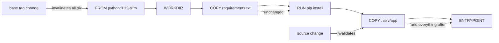

# Docker Images and Containers

> Every transcript in this lesson was produced on the authoring machine (Windows 11,
> Python 3.13.5) by the batch-18 `ops-lab-B` `image_probe.py`. Docker Engine is **not
> installed**, so the probe implements the documented build semantics over fixtures: the
> cache key is the parent digest plus the instruction plus its payload digest, and a changed
> key invalidates every later step. Layer byte counts and cache outcomes are real; the
> `docker build` console output is *labelled reference* and never quoted.

## 1. Learning Objectives

After this lesson you will be able to:

- [ ] Predict which layers a source change invalidates, and order instructions so the cache saves the most
- [ ] Explain why a base-image tag change invalidates everything and what to pin instead
- [ ] Use a multi-stage build to keep a toolchain out of the runtime image, and measure the reduction
- [ ] Explain why a secret copied into a layer stays in the image, and what replaces it
- [ ] Run a container as a non-root user and say what breaks first when you do

## 2. Prerequisites

- [Docker Fundamentals](docker-fundamentals.md) — layers, digests, copy-on-write, and the entrypoint vector
- [Shell Scripting](shell-scripting.md) — `RUN` lines are shell scripts, and shell-form versus exec-form matters here too
- [15-APPLICATION-SECURITY/secrets-management.md](../15-APPLICATION-SECURITY/secrets-management.md) — why a leaked secret is a rotation event, not a cleanup

*No code prerequisite beyond reading Python — the probe uses `hashlib` and `random` over deterministic fixtures.*

## 3. Introduction

A Dockerfile is a short file with expensive semantics. The same six lines can produce a
`1.9 GB` image that takes eight minutes to rebuild on every commit, or an `88 KB` runtime
image that rebuilds in seconds — and the difference is ordering, staging, and where secrets
enter. This lesson builds a six-instruction image four times, changing one thing each time,
and reads the cache outcomes; then it splits the build into two stages and measures what
the toolchain was costing. Every number comes from the probe, not from a size calculator.

## 4. The Problem It Solves

- **Slow builds.** A `COPY . .` before `RUN pip install` invalidates the dependency layer on every source change; the probe measures the difference as `1 of 6` cached versus `4 of 6`.
- **Huge images.** Build tools, compilers, and caches in the final image are dead weight and attack surface; multi-stage builds moved `1904 KB` of builder content out of an `88 KB` runtime.
- **Secrets baked in.** A `COPY .env` line leaves the secret in a layer that ships to the registry; removing the line later does not remove the bytes from the pushed image — only a rebuild does, and the probe shows exactly which layer carries them.
- **Root by default.** An image with no `USER` runs as uid `0`; one line changes that, and the failure it causes (a directory the app can no longer write) is better discovered in a build than in production.
- **Unpinned bases.** A tag change invalidated `6 of 6` layers in the probe: the "small version bump" is a full rebuild with different bytes underneath.

## 5. Core Concepts

### Each instruction is a layer, and the cache is a chain

The builder walks the Dockerfile in order. For each instruction it computes a key from the
parent layer's digest, the instruction text, and the digest of the files being added. If
that key exists in the cache, the layer is reused; if not, the layer is built and **every
later instruction is invalidated** because its parent digest changed. This is why ordering
is a performance decision and why `COPY .` is the classic mistake.

### Order by change frequency

Put the things that rarely change first: base image, system packages, dependency manifest
and its install, then application source. A source edit then invalidates only the last two
layers. The probe's phase 5 puts the same change through both orders to make the cost
visible.

### Multi-stage builds

A Dockerfile can contain several `FROM` stages. The `builder` stage installs compilers and
downloads dependencies; the final stage starts from a slim base and copies only the
artefact (`COPY --from=builder …`). Only the final stage ships, so the toolchain is
discarded along with its layers.

### `USER` and file ownership

`USER 10001:10001` makes the container process unprivileged. Consequences to plan for: the
application must be able to write what it needs (chown in the build, or a writable volume),
and the port must be above 1024 unless you grant `CAP_NET_BIND_SERVICE`. Running as root
inside a container is still root on a shared kernel.

### Secrets are build inputs, not files

A secret that reaches a layer is in the image forever: layer digests are content-addressed,
so the blob sits in the registry even if a later line deletes the file. The fix is to keep
it out of the build graph — BuildKit secret mounts, runtime environment, or a secret
manager — never `COPY` and never `ARG` (which is recorded in the image config).

### Image size is a product decision

Size affects pull time, cold-start latency, storage cost, and the number of packages you
must patch. The relevant measure is the **compressed** size of the final stage, because
that is what crosses the network.

## 6. How It Works



The arrows are the cache chain: a change invalidates the instruction it touches and every
instruction after it, never the ones before. That single rule explains every number in the
capture — `4 of 6` cached when the change is at the end, `1 of 6` when `COPY .` comes first,
and `0 of 6` when the base itself changes.

## 7. Practical Examples

**Example 1 — the full probe: four builds, two orders, two stages, one secret**

```python
"""Image build lab: layer cache invalidation, multi-stage size, USER, and secrets.

Windows 11, Python 3.13.5.  Docker is not installed, so this probe implements the
documented build semantics over fixtures: each instruction produces a deterministic
layer payload, the cache key is (parent digest, instruction, payload digest), and a
changed key invalidates every later step.  Layer byte counts are real; the file
contents are fixtures.  Anything that depends on the Docker daemon itself is
labelled reference in the lesson, never quoted from here.
"""
from __future__ import annotations

import hashlib
import random
import shutil
from pathlib import Path

LAB = Path(__file__).with_name("image-lab")


def sha(data: bytes) -> str:
    return hashlib.sha256(data).hexdigest()


def filler(seed_text: str, size: int) -> bytes:
    """Deterministic incompressible bytes derived from the instruction itself."""
    return random.Random(sha(seed_text.encode())).randbytes(size)


def payload_for(instruction: str, rest: str, source_version: int) -> bytes:
    """Deterministic bytes an instruction would add to the layer."""
    seed = f"{instruction} {rest}"
    if instruction == "RUN" and "apt-get" in rest:
        return b"usr/lib/apt-packages\n" + filler(seed, 620_000)
    if instruction == "RUN" and "pip install" in rest:
        return b"usr/lib/python3/site-packages\n" + filler(seed, 1_240_000)
    if instruction == "RUN" and "build-essential" in rest:
        return b"usr/bin/gcc\n" + filler(seed, 1_600_000)
    if instruction == "COPY" and rest.split()[0] == ".env":
        return b"DB_PASSWORD=fixture-not-a-real-secret\n" + filler(seed, 64)
    if instruction == "COPY" and rest.split()[0] == "requirements.txt":
        return b"fastapi==0.118.0\nuvicorn==0.37.0\n"
    if instruction == "COPY":
        return f"source revision {source_version}\n".encode() + filler(f"{seed} v{source_version}", 90_000)
    if instruction == "RUN":
        return b"run\n" + filler(seed, 4_000)
    return b""


def build(instructions: list[str], cache: dict[str, bytes], source_version: int = 1):
    parent = "scratch"
    rows = []
    for line in instructions:
        instruction, _, rest = line.partition(" ")
        payload = payload_for(instruction, rest, source_version)
        key = sha(f"{parent}\0{line}\0".encode() + sha(payload).encode())
        hit = key in cache
        cache.setdefault(key, payload)
        rows.append((line, key, hit, payload))
        parent = key
    return rows


def report(rows, label: str) -> None:
    hits = sum(1 for _, _, hit, _ in rows if hit)
    print(f"  {label}: {hits} cached, {len(rows) - hits} new")
    for line, key, hit, payload in rows:
        print(f"    {'CACHED' if hit else 'BUILD ':>6} {key[:12]}  {len(payload):>8} B  {line}")


def main() -> None:
    if LAB.exists():
        shutil.rmtree(LAB)
    LAB.mkdir()
    print("image-lab (Windows 11, Python 3.13.5, docker CLI not installed)")

    dockerfile = [
        "FROM python:3.13-slim",
        "WORKDIR /srv/app",
        "COPY requirements.txt .",
        "RUN pip install -r requirements.txt",
        "COPY . /srv/app",
        "ENTRYPOINT python3 -m app",
    ]

    print("\n=== 1. first build: nothing is cached ===")
    cache: dict[str, bytes] = {}
    report(build(dockerfile, cache), "build 1")

    print("\n=== 2. rebuild with no changes: everything is cached ===")
    report(build(dockerfile, cache), "build 2")

    print("\n=== 3. change only application source: the dependency layer survives ===")
    report(build(dockerfile, cache, source_version=2), "build 3 (source v2)")

    print("\n=== 4. change the base image tag: every layer is invalidated ===")
    retagged = ["FROM python:3.14-slim"] + dockerfile[1:]
    report(build(retagged, cache), "build 4 (base retagged)")

    print("\n=== 5. instruction order decides how much the cache can save ===")
    reversed_order = [
        "FROM python:3.13-slim",
        "COPY . /srv/app",
        "WORKDIR /srv/app",
        "COPY requirements.txt .",
        "RUN pip install -r requirements.txt",
        "ENTRYPOINT python3 -m app",
    ]
    cache2: dict[str, bytes] = {}
    build(reversed_order, cache2)
    rows = build(reversed_order, cache2, source_version=3)
    print(f"  source change with COPY before RUN: "
          f"{sum(1 for _, _, hit, _ in rows if hit)} of {len(rows)} cached")
    rows2 = build(dockerfile, cache, source_version=3)
    print(f"  same change with RUN before COPY:   "
          f"{sum(1 for _, _, hit, _ in rows2 if hit)} of {len(rows2)} cached")

    print("\n=== 6. multi-stage: the toolchain stays in the builder ===")
    builder = [
        "FROM python:3.13 AS builder",
        "RUN apt-get install -y build-essential",
        "RUN pip install -r requirements.txt",
        "COPY . /build",
    ]
    final = [
        "FROM python:3.13-slim",
        "COPY --from=builder /build/dist/app.whl /srv/app.whl",
        "USER 10001:10001",
    ]
    cache3: dict[str, bytes] = {}
    builder_rows = build(builder, cache3)
    final_rows = build(final, cache3)
    builder_bytes = sum(len(p) for _, _, _, p in builder_rows)
    final_bytes = sum(len(p) for _, _, _, p in final_rows)
    print(f"  builder stage: {builder_bytes / 1024:.0f} KB over {len(builder_rows)} layers")
    print(f"  final stage:   {final_bytes / 1024:.0f} KB over {len(final_rows)} layers")
    print(f"  reduction:     {(builder_bytes - final_bytes) * 100 // builder_bytes}% smaller")
    print(f"  final image runs as root: {any('USER 0' in line for line, *_ in final_rows)}")

    print("\n=== 7. a secret copied in a layer stays in the image history ===")
    leaky = dockerfile[:4] + ["COPY .env /srv/app/.env"] + dockerfile[4:]
    leaky_rows = build(leaky, {})
    leaked = [line for line, _, _, payload in leaky_rows if b"DB_PASSWORD" in payload]
    print(f"  layers containing the secret: {len(leaked)} ({leaked[0]})")
    print(f"  secret bytes baked into the image: "
          f"{sum(len(p) for _, _, _, p in leaky_rows if b'DB_PASSWORD' in p)} B")
    secret_free = build(dockerfile, {})
    print(f"  without the COPY .env line: "
          f"{sum(1 for _, _, _, p in secret_free if b'DB_PASSWORD' in p)} layers contain it")
    print(f"  removing the line changes the image digest: "
          f"{sha(b''.join(p for _, _, _, p in leaky_rows)) != sha(b''.join(p for _, _, _, p in secret_free))}")
    print("\nexit=0")


if __name__ == "__main__":
    main()
```

- Build 1 is cold: `0 cached, 6 new`, with the dependency layer at `1240030 B` and the source layer at `90018 B`.
- Build 2 is identical: `6 cached, 0 new` — a no-op rebuild costs nothing, which is the property that makes CI tolerable.
- Build 3 changes only application source: `4 cached, 2 new`. The base, workdir, dependency manifest, and `pip install` layer are reused; only `COPY .` and `ENTRYPOINT` are rebuilt.
- Build 4 retags the base to `python:3.14-slim`: `0 cached, 6 new`. A base change is a different filesystem underneath, so nothing above it can match.
- Phase 5 quantifies ordering: with `COPY .` before `RUN pip install`, a source change leaves `1 of 6` cached; in the conventional order it leaves `4 of 6`. Same instructions, same output image, different build time.
- Phase 6 splits the build: builder `1904 KB` over four layers, final `88 KB` over three, `95% smaller`, and `final image runs as root: False` thanks to `USER 10001:10001`.
- Phase 7 copies a `DB_PASSWORD` fixture: `1` layer contains it, `102 B` baked in, `0` layers contain it without the line, and the digest differs between the two images.
- **Expected output:** the capture below.
- **How to run it:** `python image_probe.py` (Windows 11, Python 3.13.5). It writes `image-lab/`.
- **Assumptions:** payloads are deterministic fixtures; the probe models the cache rule rather than calling a builder, and no registry is contacted.

**Executed capture:**

```text
image-lab (Windows 11, Python 3.13.5, docker CLI not installed)

=== 1. first build: nothing is cached ===
  build 1: 0 cached, 6 new
    BUILD  a74e5dfb42d2         0 B  FROM python:3.13-slim
    BUILD  9be39ab18c39         0 B  WORKDIR /srv/app
    BUILD  2111159404e6        33 B  COPY requirements.txt .
    BUILD  954343b5e371   1240030 B  RUN pip install -r requirements.txt
    BUILD  3f5c808b55ba     90018 B  COPY . /srv/app
    BUILD  a71efc901d62         0 B  ENTRYPOINT python3 -m app

=== 2. rebuild with no changes: everything is cached ===
  build 2: 6 cached, 0 new
    CACHED a74e5dfb42d2         0 B  FROM python:3.13-slim
    CACHED 9be39ab18c39         0 B  WORKDIR /srv/app
    CACHED 2111159404e6        33 B  COPY requirements.txt .
    CACHED 954343b5e371   1240030 B  RUN pip install -r requirements.txt
    CACHED 3f5c808b55ba     90018 B  COPY . /srv/app
    CACHED a71efc901d62         0 B  ENTRYPOINT python3 -m app

=== 3. change only application source: the dependency layer survives ===
  build 3 (source v2): 4 cached, 2 new
    CACHED a74e5dfb42d2         0 B  FROM python:3.13-slim
    CACHED 9be39ab18c39         0 B  WORKDIR /srv/app
    CACHED 2111159404e6        33 B  COPY requirements.txt .
    CACHED 954343b5e371   1240030 B  RUN pip install -r requirements.txt
    BUILD  0bc6a4ebf19e     90018 B  COPY . /srv/app
    BUILD  0a1d0054373d         0 B  ENTRYPOINT python3 -m app

=== 4. change the base image tag: every layer is invalidated ===
  build 4 (base retagged): 0 cached, 6 new
    BUILD  53db8098b876         0 B  FROM python:3.14-slim
    BUILD  285d1ce01efd         0 B  WORKDIR /srv/app
    BUILD  838e5e1a9058        33 B  COPY requirements.txt .
    BUILD  0fe1a433acdb   1240030 B  RUN pip install -r requirements.txt
    BUILD  21085b14de80     90018 B  COPY . /srv/app
    BUILD  8e9c63b01c61         0 B  ENTRYPOINT python3 -m app

=== 5. instruction order decides how much the cache can save ===
  source change with COPY before RUN: 1 of 6 cached
  same change with RUN before COPY:   4 of 6 cached

=== 6. multi-stage: the toolchain stays in the builder ===
  builder stage: 1904 KB over 4 layers
  final stage:   88 KB over 3 layers
  reduction:     95% smaller
  final image runs as root: False

=== 7. a secret copied in a layer stays in the image history ===
  layers containing the secret: 1 (COPY .env /srv/app/.env)
  secret bytes baked into the image: 102 B
  without the COPY .env line: 0 layers contain it
  removing the line changes the image digest: True

exit=0
```

Note the shape of build 3's output: `CACHED` for the first four instructions, `BUILD` for the
last two. That pattern is the whole optimisation story. If you find `BUILD` starting at your
first `RUN` on every commit, your `COPY` is above your dependency install.

**Example 2 — the Dockerfile this produces** (*illustration — assembled from the probe's model, not built on this machine*)

```dockerfile
# syntax=docker/dockerfile:1.7
FROM python:3.13-slim AS builder
RUN apt-get update && apt-get install -y --no-install-recommends build-essential \
    && rm -rf /var/lib/apt/lists/*
COPY requirements.txt .
RUN pip wheel --no-cache-dir -r requirements.txt -w /wheels

FROM python:3.13-slim
WORKDIR /srv/app
COPY --from=builder /wheels /wheels
RUN pip install --no-cache-dir --no-index --find-links=/wheels /wheels/*.whl \
    && rm -rf /wheels
COPY . /srv/app
USER 10001:10001
ENTRYPOINT ["python3", "-m", "app"]
CMD ["--port", "8000"]
```

- `requirements.txt` is copied before the source, so the dependency layers survive source edits — phase 5's `4 of 6`.
- `--from=builder` copies only wheels, so `build-essential` never reaches the runtime image — phase 6's reduction.
- `--no-install-recommends` and the `rm -rf /var/lib/apt/lists/*` in the *same* `RUN` avoid a layer that carries the package lists.
- `USER 10001:10001` is phase 6's final line; the app must own `/srv/app` or write elsewhere.
- Exec-form `ENTRYPOINT` and `CMD` give the argv from `docker-fundamentals.md` and let the process receive `SIGTERM`.
- A secret would enter as `RUN --mount=type=secret,id=pip,target=/root/.netrc pip install …`, never as a `COPY`.

## 8. Real-World Applications

- **CI time** is dominated by cache hits: an ordered Dockerfile turns a five-minute build into a thirty-second one on every commit, which is the difference between feedback and waiting.
- **Registry cost and cold starts** scale with compressed image size; a multi-stage build is the standard first fix for both.
- **Security scanning** has less to find in a smaller image: fewer packages, no compiler, no package manager cache.
- **Non-root requirements** are baseline in most compliance regimes; the failure mode when skipped is a container that cannot write its own working directory.
- Paired with: [Container Networking](container-networking.md) for how the running container is reached, and [Volumes and Persistence](volumes-and-persistence.md) for the directories a non-root user must own.

## 9. Common Mistakes

| Mistake | Why it happens | How to recognize it | How to prevent it |
|---|---|---|---|
| `COPY . .` before installing dependencies | The file is written top-down | Every commit rebuilds the dependency layer | Copy the manifest, install, then copy source |
| Using `latest` | It is the shortest tag | Unpinned builds; cache invalidated unexpectedly | Pin tags, promote by digest |
| Secrets via `ARG`/`ENV`/`COPY` | It works | Secret visible in image config or a layer | BuildKit secret mount, runtime injection |
| Compiler in the runtime image | Single-stage is simpler | Image hundreds of MB for a few MB app | Multi-stage with `--from=builder` |
| `apt-get install` without cleanup | Cleanup feels optional | Layer includes `/var/lib/apt/lists` | Clean in the same `RUN` |
| No `USER` | Root is the default | `docker exec id` returns `uid=0` | `USER` with a fixed uid, and chown what it writes |
| Deleting files in a later layer to shrink | It is intuitive | Size barely changes | Remove in the layer that created them |
| Building on every push with no cache | Cache needs configuration in CI | Constant cold builds | Registry-backed cache (`--cache-from`) |

## 10. Best Practices

- **Order instructions by change frequency**, and treat any `COPY` of application code as the last build step before `ENTRYPOINT`.
- **Pin the base by digest** and update deliberately; a tag move is a full rebuild plus an untested filesystem.
- **Keep secrets out of the graph**: secret mounts for the build, a secret store at runtime, and no `ENV` for credentials.
- **Run as a fixed non-root uid** and make the directories it needs writable during the build.
- **Use `--no-install-recommends`, clean caches in the same `RUN`,** and prefer wheels or prebuilt binaries.
- **Scan the final stage**, not the builder, and fail the build on a critical finding with no exception path.
- **Measure the compressed size** in CI and alert on a jump; size regressions are silent otherwise.

## 11. Limitations and Trade-Offs

- **No Docker daemon here.** The cache rule, payload sizes, stage composition, `USER`, and secret layers are modelled and measured; real build output, BuildKit's cache mounts, and registry pushes are *labelled reference*.
- **The model is simpler than BuildKit.** Real builders deduplicate, support `--mount=type=cache`, and can reuse layers across images; the probe implements only the invalidation rule that explains most of the cost.
- **Multi-stage is not free.** Wheels must be built somewhere, and a wheel-based install can miss system libraries that `apt-get` would have provided.
- **Non-root has real costs**: no privileged ports, ownership work in the build, and volumes that must be writable by a known uid.
- **Smaller is not always better**: a distroless image has no shell, which removes your ability to debug in place. That trade-off is a decision, not a default.
- **Secret mounts still leave traces.** The secret is not in a layer, but it can leak into build logs or a cache directory if the command prints it.

## 12. Practical Exercises

### Introductory

1. **Exercise 7.1** — Move `ENTRYPOINT` above `COPY . /srv/app` and re-run build 3. Report which layers are now cached and explain the change. **Completion criteria:** a cache count with the `BUILD` cluster starting at `COPY .`.
2. **Exercise 7.2** — Change only `requirements.txt` and re-run. Report which layers rebuild. **Completion criteria:** the cache count plus one sentence naming the first invalidated instruction.

### Intermediate

3. **Exercise 7.3** — Add a third stage `test` that runs a fixture check, and show that the final stage's size is unchanged. **Completion criteria:** three stage sizes with the final one matching phase 6.
4. **Exercise 7.4** — Replace the leaky `COPY .env` with a modelled secret mount: report layer count, whether the secret appears in any payload, and the digest difference. **Completion criteria:** `0` layers containing the secret and a stated digest.

### Independent problem-solving

5. **Exercise 7.5** — A CI build takes 6 minutes and produces a 1.4 GB image. Diagnose it in two moves: which instruction ordering change recovers build time, and which three changes cut the size most? **Completion criteria:** a ranked list of changes with the expected effect of each and how you would verify it.

*Solutions: attempt first. They live in `solutions/` of this subject.*

## 13. Knowledge Check

1. Build 3 shows `4 cached, 2 new`. Name the two rebuilt instructions and the reason the other four could be reused.
2. Why does retagging the base invalidate all six layers, and what pinning practice prevents the surprise?
3. A `COPY .env` line is removed in a later commit. Is the secret gone from the registry? Explain using the probe's layer evidence.
4. Multi-stage cut `1904 KB` to `88 KB`. Give one capability you lose by excluding the builder, and how you would debug without it.

## 14. Completion Criteria

Observable evidence that you have understood this lesson:

- [ ] You can predict the cache outcome of a one-line change by reading the Dockerfile
- [ ] You can state the ordering rule and show it with two measured cache counts
- [ ] You can design a two-stage build and state what stays behind in the builder
- [ ] You can explain why a secret in a layer survives its deletion, and name the replacement
- [ ] You can run as a non-root user and name two things that must be prepared for it

## 15. Summary

- The cache is a chain keyed on parent digest, instruction, and payload; a change invalidates itself and everything after it.
- Ordering is performance: `COPY .` before the dependency install left `1 of 6` cached where the conventional order left `4 of 6`.
- A base retag invalidated `6 of 6` layers — pin by digest for reproducibility.
- Multi-stage moved the toolchain out: `1904 KB` builder versus `88 KB` final, `95% smaller`, running as uid `10001`.
- A copied secret lived in exactly one layer (`102 B`) and only a rebuild without the line removed it.

## 16. Next Steps

- Next lesson: [Container Networking](container-networking.md) — what the running container can reach, and how the outside reaches it
- Practice: the subject's exercise set (written with its exercise installment)
- Where it is applied: [Project 07](../20-PROJECT-LABORATORY/project-07-secure-production-application/README.md) — its security requirements name a non-root, pinned, scanned image with no secrets in layers
