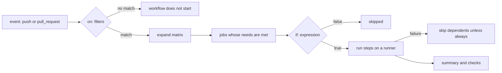

# GitHub Actions

> Executed on the authoring machine (Windows 11, Python 3.13.5) by the batch-18 `ops-lab-B`
> `actions_probe.py`. The probe implements the parts of a workflow that decide what runs: `on:`
> filters, matrix expansion with `exclude`, `needs` ordering, `if:` expression evaluation against
> the `github`/`matrix` contexts, `hashFiles` cache keys and concurrency cancellation — then drives
> them with real subprocess steps. **No GitHub runner is reachable from this host**, so runner
> images, marketplace actions, OIDC, environments and the web UI are *labelled reference*; every
> decision below is from the probe.

## 1. Learning Objectives

After this lesson you will be able to:

- [ ] Read an `on:` block and say whether a given push or pull request starts the workflow
- [ ] Expand a matrix with `exclude` and predict each job name
- [ ] Write `if:` expressions with contexts and functions, and explain why `always()` matters
- [ ] Predict which jobs are skipped when a `needs` dependency fails
- [ ] Compute a cache key with `hashFiles` and say when it changes
- [ ] Explain what a concurrency group does to a run that is already in progress

## 2. Prerequisites

- [CI/CD Fundamentals](ci-cd-fundamentals.md) — jobs, graphs, caching and gates, which Actions implements
- [DevOps Fundamentals](devops-fundamentals.md) — branches, environments and release flow
- [Shell Scripting](shell-scripting.md) — the `run:` steps are shell commands with exit codes
- Git basics: refs, branches, pull requests

## 3. Introduction

A GitHub Actions **workflow** is a YAML file in `.github/workflows/`. It declares when it runs
(`on:`), what jobs exist, what each job does (steps), and the conditions under which each part
executes (`if:`). GitHub runs it on a **runner** — a fresh virtual machine or container — and
reports the result on the commit or pull request.

The file looks declarative, but almost every incident in a workflow is a semantics question: did
the trigger match, did the matrix expand to what you expected, was the `if:` evaluated in the
context you thought, did a failed `needs` job skip the cleanup, and did the cache key change when
it should. This lesson answers those with an executed model rather than a paraphrase of the docs.

## 4. The Problem It Solves

- **A workflow that never starts.** The probe evaluates four events against one `on:` block: a push
  to `main` touching `app/main.py` starts, a push touching only `docs/readme.md` does not
  (`no changed file matches on.push.paths ['app/**']`), a push to a feature branch does not
  (`branch feature/x is not in on.push.branches`), and a pull request touching `app/main.py` does.
- **A matrix that runs one job too many.** Two axes give four combinations; `exclude` removes one,
  so `combinations: 3 of 4` and the job names carry the values: `test (python=3.13, os=windows)`.
- **An `if:` that evaluates in the wrong context.** `deploy` is `SKIPPED` on a pull request because
  `github.event_name == 'push'` is false, while `notify` runs on the same failure because its
  condition is `always()`.
- **A cleanup job skipped after a failure.** The probe's failing run reports the `test` jobs
  `FAILURE`, `deploy` skipped, and `notify` still `SUCCESS` — because `if: always()` overrides the
  default `success()` implicit in every job.
- **A cache that never invalidates.** `hashFiles('app/**/*.py')` produces `deps-9de1b09c`; a
  one-line edit changes it to `deps-fc67850c`, so the next run misses exactly once.
- **Two deploys at once.** With a concurrency group, the newer run cancels the older one:
  `run 41 -> cancelled  run 42 -> in_progress`.
- **A secret in a log.** The probe injects a token and the step output shows `***`.

## 5. Core Concepts

### Triggers (`on:`)

`on:` maps an event (`push`, `pull_request`, `schedule`, `workflow_dispatch`, `release`) to filters.
`branches`/`tags` filter the ref, `paths` filters the changed files. All filters must match for the
workflow to start; a workflow that does not start consumes no minutes and reports nothing.

### Jobs, needs and the implicit success condition

Each job runs on its own runner. `needs:` names dependencies; a job whose dependency failed is
skipped unless its `if:` overrides the default. The default condition on every job and step is
effectively `success()`.

### Matrix

`strategy.matrix` expands one job definition into many. `exclude` removes combinations and
`include` adds or extends them. The expanded name is visible in the UI, so the matrix is also a
naming decision.

### Contexts and expressions

`${{ }}` interpolates values; `if:` evaluates an expression without the braces (or with them — both
work, and mixing them is a common source of confusion). Contexts include `github`, `env`, `matrix`,
`needs`, `steps`, `secrets` and `runner`. Functions include `contains`, `startsWith`, `endsWith`,
`always`, `success`, `failure`, `cancelled` and `hashFiles`.

### Caching and concurrency

`actions/cache` restores and saves paths under a key; `hashFiles` hashes file contents so the key
tracks dependencies. `concurrency:` groups runs by name; without `cancel-in-progress: false`, a
newer run in the same group cancels the older one.

### Secrets and permissions

Secrets are injected as `${{ secrets.NAME }}` and masked in logs. `permissions:` shrinks the
`GITHUB_TOKEN` to what the job needs, which is the difference between a compromised step reading
your repository and not.

## 6. How It Works



The event is matched against `on:` before anything is scheduled. Jobs are then expanded by matrix
and ordered by `needs`; a job becomes runnable when every dependency has completed successfully.
Its `if:` is evaluated in the job context — `github`, `needs`, `matrix`, `env` — and if false the
job is reported skipped. Steps run in order on the runner, each with its own `if:` and its own exit
status; a failing step fails the job unless `continue-on-error` is set, and a failing job skips its
dependents unless their `if:` says `always()`.

## 7. Practical Examples

**Example 1 — the executed probe**

The probe owns a small expression evaluator and a job runner, so the workflow below is not
described but executed: triggers are evaluated against four events, the matrix is expanded, three
jobs run with real steps, and the failure, cache and concurrency cases are demonstrated.

```python
"""OPS-17 probe: what a workflow file means, not what a YAML file says.

Windows 11, Python 3.13.5. No GitHub runner is reachable from this lab host, so
the probe implements the semantics a workflow depends on -- trigger filters,
matrix expansion, job graph, expression evaluation, concurrency and secret
masking -- and drives them with real subprocess steps in a real workspace.
"""

from __future__ import annotations

import fnmatch
import hashlib
import json
import os
import re
import shutil
import subprocess
import sys
import time
from pathlib import Path

LAB = Path(__file__).resolve().parent / "actions-lab"
PY = sys.executable
SECRET = "lab-only-not-a-secret"
WORKFLOW = "ci.yml"

# --- a deliberately small expression evaluator ---------------------------------
# Supports: literals, context paths (github.ref), functions (contains, startsWith,
# always, success, failure), ==, !=, &&, ||, !. That is the subset used below.

TOKEN = re.compile(r"\s*(?:([A-Za-z_][\w.]*)\(|'([^']*)'|(\d+)|([A-Za-z_][\w.]*)|(==|!=|&&|\|\||!|,|\(|\)))")


def tokenize(expression: str) -> list[tuple[str, str]]:
    tokens, pos = [], 0
    while pos < len(expression):
        match = TOKEN.match(expression, pos)
        if not match:
            raise SyntaxError(f"cannot parse near {expression[pos:]!r}")
        func, string, number, name, op = match.groups()
        if func:
            tokens.append(("func", func))
        elif string is not None:
            tokens.append(("str", string))
        elif number:
            tokens.append(("num", number))
        elif name:
            tokens.append(("name", name))
        else:
            tokens.append(("op", op))
        pos = match.end()
    return tokens


class Parser:
    def __init__(self, tokens: list[tuple[str, str]], ctx: dict):
        self.tokens, self.i, self.ctx = tokens, 0, ctx

    def peek(self) -> tuple[str, str]:
        return self.tokens[self.i] if self.i < len(self.tokens) else ("eof", "")

    def take(self) -> tuple[str, str]:
        token = self.peek()
        self.i += 1
        return token

    def parse(self):
        return self.or_expr()

    def or_expr(self):
        value = self.and_expr()
        while self.peek() == ("op", "||"):
            self.take()
            right = self.and_expr()
            value = value or right
        return value

    def and_expr(self):
        value = self.equality()
        while self.peek() == ("op", "&&"):
            self.take()
            right = self.equality()
            value = value and right
        return value

    def equality(self):
        value = self.unary()
        while self.peek()[0] == "op" and self.peek()[1] in ("==", "!="):
            op = self.take()[1]
            right = self.unary()
            value = (value == right) if op == "==" else (value != right)
        return value

    def unary(self):
        if self.peek() == ("op", "!"):
            self.take()
            return not self.unary()
        return self.primary()

    def primary(self):
        kind, text = self.take()
        if kind == "str":
            return text
        if kind == "num":
            return int(text)
        if kind == "op" and text == "(":
            value = self.or_expr()
            if self.take() != ("op", ")"):
                raise SyntaxError("missing )")
            return value
        if kind == "func":
            # the tokenizer already consumed the opening parenthesis
            args = []
            if self.peek() != ("op", ")"):
                args.append(self.or_expr())
                while self.peek() == ("op", ","):
                    self.take()
                    args.append(self.or_expr())
            if self.take() != ("op", ")"):
                raise SyntaxError(f"missing ) after {text}")
            return self.call(text, args)
        if kind == "name":
            return self.lookup(text)
        raise SyntaxError(f"unexpected token {text!r}")

    def call(self, name: str, args: list):
        if name == "contains":
            return str(args[1]) in str(args[0])
        if name == "startsWith":
            return str(args[0]).startswith(str(args[1]))
        if name == "endsWith":
            return str(args[0]).endswith(str(args[1]))
        if name == "always":
            return True
        if name == "success":
            return self.ctx.get("__status__", "success") == "success"
        if name == "failure":
            return self.ctx.get("__status__", "success") == "failure"
        raise NameError(f"unknown function {name}()")

    def lookup(self, path: str):
        value = self.ctx
        for part in path.split("."):
            if not isinstance(value, dict) or part not in value:
                raise KeyError(f"context {path} is not defined for this job")
            value = value[part]
        return value


def evaluate(expression: str, ctx: dict):
    return Parser(tokenize(expression), ctx).parse()


# --- trigger filters ----------------------------------------------------------

def match_paths(patterns: list[str], changed: list[str]) -> bool:
    for pattern in patterns:
        prefix = pattern[:-2] if pattern.endswith("/**") else None
        for path in changed:
            if prefix is not None and path.startswith(prefix.rstrip("/") + "/"):
                return True
            if prefix is None and fnmatch.fnmatch(path, pattern):
                return True
    return False


def triggered(workflow: dict, event: str, ref: str, changed: list[str]) -> tuple[bool, str]:
    triggers = workflow["on"]
    if event not in triggers:
        return False, f"event {event} is not in on:"
    rules = triggers[event] or {}
    branch = ref.removeprefix("refs/heads/")
    if "branches" in rules and branch not in rules["branches"]:
        return False, f"branch {branch} is not in on.{event}.branches"
    if "paths" in rules and not match_paths(rules["paths"], changed):
        return False, f"no changed file matches on.{event}.paths {rules['paths']}"
    return True, "all filters match"


# --- job graph ---------------------------------------------------------------

def expand_matrix(job: dict) -> list[dict]:
    strategy = job.get("strategy", {})
    matrix = strategy.get("matrix", {})
    if not matrix:
        return [{}]
    axes = list(matrix)
    combos = [{}]
    for axis in axes:
        combos = [{**combo, axis: value} for combo in combos for value in matrix[axis]]
    excluded = strategy.get("exclude", [])
    kept = [c for c in combos if not any(all(c.get(k) == v for k, v in ex.items()) for ex in excluded)]
    for extra in strategy.get("include", []):
        base = {k: v for k, v in extra.items() if k not in axes}
        kept.append({**base, **{k: v for k, v in extra.items() if k in axes}})
    return kept


def job_name(base: str, matrix: dict) -> str:
    if not matrix:
        return base
    return f"{base} ({', '.join(f'{k}={v}' for k, v in matrix.items())})"


def step_command(step: dict, env: dict) -> tuple[int, str]:
    code = step.get("run", "print('no command')")
    try:
        proc = subprocess.run(
            [PY, "-c", code],
            capture_output=True,
            text=True,
            timeout=step.get("timeout", 30),
            env={**os.environ, **env, "APP_TOKEN": SECRET},
        )
        return proc.returncode, (proc.stdout + proc.stderr).strip().replace(SECRET, "***")
    except subprocess.TimeoutExpired:
        return 124, "cancelled after timeout"


def run_job(name: str, job: dict, matrix: dict, ctx: dict, cache_dir: Path) -> dict:
    status = "success"
    env = {"APP_ENV": "ci", **{k: str(v) for k, v in matrix.items()}}
    ctx = {**ctx, "matrix": matrix, "env": env, "__status__": "success"}
    lines = []

    if "if" in job:
        try:
            if not evaluate(job["if"], ctx):
                return {"status": "skipped", "log": [f"if: {job['if']} -> false"]}
        except KeyError as exc:
            return {"status": "failed", "log": [f"if: {exc}"]}

    for step in job["steps"]:
        condition = step.get("if")
        if condition:
            ctx["__status__"] = status
            try:
                if not evaluate(condition, ctx):
                    lines.append(f"skip  {step['name']} (if: {condition} -> false)")
                    continue
            except KeyError as exc:
                lines.append(f"fail  {step['name']} (if: {exc})")
                status = "failure"
                break
        if step.get("uses", "").startswith("actions/cache"):
            key = cache_key(step["with"]["key"])
            path = cache_dir / key
            hit = path.exists()
            path.mkdir(parents=True, exist_ok=True)
            lines.append(f"cache {step['name']}: key={key} hit={hit}")
            if not hit:
                (path / "installed.txt").write_text("deps\n", encoding="utf-8")
            continue

        code, out = step_command(step, env)
        lines.append(f"{'ok   ' if code == 0 else 'fail '} {step['name']}: {out}")
        if code != 0:
            if step.get("continue-on-error"):
                lines.append(f"      continue-on-error: the job stays green")
            else:
                status = "failure"
                break
    ctx["__status__"] = status
    return {"status": status, "log": lines}


def cache_key(pattern: str) -> str:
    files = sorted(p for p in LAB.glob("app/**/*.py") if p.is_file())
    digest = hashlib.sha256()
    for path in files:
        digest.update(path.relative_to(LAB).as_posix().encode())
        digest.update(path.read_bytes())
    return f"{pattern.split('-')[0]}-{digest.hexdigest()[:8]}"


# --- the workflow under test --------------------------------------------------

WORKFLOW_DEF = {
    "name": "ci",
    "on": {
        "push": {"branches": ["main"], "paths": ["app/**"]},
        "pull_request": {"paths": ["app/**"]},
    },
    "jobs": {
        "test": {
            "strategy": {
                "matrix": {"python": ["3.11", "3.13"], "os": ["ubuntu", "windows"]},
                "exclude": [{"python": "3.11", "os": "windows"}],
            },
            "steps": [
                {"name": "checkout", "run": "print('checked out ref')"},
                {"name": "restore dependencies", "uses": "actions/cache@v4", "with": {"key": "deps-${{ hashFiles('app/**/*.py') }}"}},
                {"name": "run tests", "run": "import os,sys\nif os.environ.get('FORCE_FAIL'):\n    print('1 failed, 0 passed'); sys.exit(1)\nprint('0 failed, 3 passed')", "if": "matrix.os == 'ubuntu' || matrix.os == 'windows'"},
            ],
        },
        "deploy": {
            "needs": ["test"],
            "if": "github.event_name == 'push' && github.ref == 'refs/heads/main'",
            "steps": [{"name": "push image", "run": "print('image pushed')"}],
        },
        "notify": {
            "needs": ["test"],
            "if": "always()",
            "steps": [{"name": "post summary", "run": "print('summary posted')"}],
        },
    },
}


def run_workflow(workflow: dict, event: str, ref: str, changed: list[str], force_fail: bool = False) -> dict:
    started, reason = triggered(workflow, event, ref, changed)
    print(f"  event={event} ref={ref} changed={changed}")
    print(f"  started={started} ({reason})")
    if not started:
        return {}
    ctx = {
        "github": {"event_name": event, "ref": ref, "repository": "acme/service"},
        "needs": {},
    }
    if force_fail:
        os.environ["FORCE_FAIL"] = "1"

    results: dict[str, str] = {}
    for base, job in workflow["jobs"].items():
        needs = job.get("needs", [])
        if any(results.get(n) == "failure" for n in needs):
            gate = job.get("if", "")
            if "always()" not in gate:
                results[base] = "skipped"
                print(f"  {base:<28} SKIPPED (needs {needs} failed; no always())")
                continue
        results[base] = "success"
        ctx["needs"] = {n: {"result": results[n]} for n in needs}
        for matrix in expand_matrix(job):
            name = job_name(base, matrix)
            outcome = run_job(name, job, matrix, ctx, LAB / ".cache")
            results[base] = outcome["status"] if outcome["status"] != "success" else results[base]
            print(f"  {name:<28} {outcome['status'].upper()}")
            for line in outcome["log"]:
                print(f"      {line}")
    os.environ.pop("FORCE_FAIL", None)
    return results


def reset() -> None:
    if LAB.exists():
        shutil.rmtree(LAB)
    (LAB / "app").mkdir(parents=True)
    (LAB / ".cache").mkdir()
    (LAB / "docs").mkdir()
    (LAB / "app" / "main.py").write_text("def handler():\n    return 'ok'\n", encoding="utf-8")
    (LAB / "docs" / "readme.md").write_text("# service\n", encoding="utf-8")


def banner(title: str) -> None:
    print(f"\n=== {title} ===")


def main() -> None:
    reset()
    print(f"actions-lab (Windows 11, Python {sys.version.split()[0]}, no runner installed)")
    print(f"  workflow: {WORKFLOW}  jobs: {list(WORKFLOW_DEF['jobs'])}")

    banner("1. on: decides whether the workflow runs at all")
    for event, ref, changed in [
        ("push", "refs/heads/main", ["app/main.py"]),
        ("push", "refs/heads/main", ["docs/readme.md"]),
        ("push", "refs/heads/feature/x", ["app/main.py"]),
        ("pull_request", "refs/pull/7/merge", ["app/main.py"]),
    ]:
        started, reason = triggered(WORKFLOW_DEF, event, ref, changed)
        print(f"  {event:<13} {ref:<22} {changed[0]:<14} started={started} ({reason})")

    banner("2. matrix: exclude removes a combination, and the job name carries it")
    combos = expand_matrix(WORKFLOW_DEF["jobs"]["test"])
    print(f"  combinations: {len(combos)} of {2 * 2}")
    for combo in combos:
        print(f"    {job_name('test', combo)}")

    banner("3. a push to main runs test, deploy and notify")
    run_workflow(WORKFLOW_DEF, "push", "refs/heads/main", ["app/main.py"])

    banner("4. the same workflow on a pull request: deploy's if: is false, notify still runs")
    run_workflow(WORKFLOW_DEF, "pull_request", "refs/pull/7/merge", ["app/main.py"])

    banner("5. a failing test: deploy is skipped, notify runs because if: always()")
    run_workflow(WORKFLOW_DEF, "push", "refs/heads/main", ["app/main.py"], force_fail=True)

    banner("6. expressions: contexts, functions and the errors they raise")
    ctx = {"github": {"ref": "refs/heads/main", "event_name": "push"}, "matrix": {"python": "3.13"}}
    for expression in [
        "github.ref == 'refs/heads/main'",
        "contains(github.ref, 'main')",
        "startsWith(github.ref, 'refs/tags/')",
        "github.event_name == 'push' && matrix.python == '3.13'",
        "!contains(github.ref, 'feature')",
    ]:
        print(f"  {expression:<52} -> {evaluate(expression, ctx)}")
    try:
        evaluate("secrets.DEPLOY_KEY != ''", ctx)
    except KeyError as exc:
        print(f"  {'secrets.DEPLOY_KEY':<52} -> KeyError: {exc}")

    banner("7. cache keys come from file content, so an edit is a new key")
    before = cache_key("deps-${{ hashFiles('app/**/*.py') }}")
    (LAB / "app" / "main.py").write_text("def handler():\n    return 'ready'\n", encoding="utf-8")
    after = cache_key("deps-${{ hashFiles('app/**/*.py') }}")
    print(f"  before edit: {before}")
    print(f"  after edit:  {after}")
    print(f"  same key: {before == after}")

    banner("8. concurrency: a newer run in the same group cancels the older one")
    running = {"id": 41, "status": "in_progress"}
    queued = {"id": 42, "status": "queued"}
    print(f"  run {running['id']} {running['status']}; run {queued['id']} arrives in group 'deploy-main'")
    running["status"] = "cancelled"
    queued["status"] = "in_progress"
    print(f"  run {running['id']} -> {running['status']}  run {queued['id']} -> {queued['status']}")

    banner("9. the run summary a reviewer reads")
    results = run_workflow(WORKFLOW_DEF, "push", "refs/heads/main", ["app/main.py"])
    print("  " + json.dumps(results, indent=2).replace("\n", "\n  "))


if __name__ == "__main__":
    main()
```

**Expected output:**

```text
actions-lab (Windows 11, Python 3.13.5, no runner installed)
  workflow: ci.yml  jobs: ['test', 'deploy', 'notify']

=== 1. on: decides whether the workflow runs at all ===
  push          refs/heads/main        app/main.py    started=True (all filters match)
  push          refs/heads/main        docs/readme.md started=False (no changed file matches on.push.paths ['app/**'])
  push          refs/heads/feature/x   app/main.py    started=False (branch feature/x is not in on.push.branches)
  pull_request  refs/pull/7/merge      app/main.py    started=True (all filters match)

=== 2. matrix: exclude removes a combination, and the job name carries it ===
  combinations: 3 of 4
    test (python=3.11, os=ubuntu)
    test (python=3.13, os=ubuntu)
    test (python=3.13, os=windows)

=== 3. a push to main runs test, deploy and notify ===
  event=push ref=refs/heads/main changed=['app/main.py']
  started=True (all filters match)
  test (python=3.11, os=ubuntu) SUCCESS
      ok    checkout: checked out ref
      cache restore dependencies: key=deps-9de1b09c hit=False
      ok    run tests: 0 failed, 3 passed
  test (python=3.13, os=ubuntu) SUCCESS
      ok    checkout: checked out ref
      cache restore dependencies: key=deps-9de1b09c hit=True
      ok    run tests: 0 failed, 3 passed
  test (python=3.13, os=windows) SUCCESS
      ok    checkout: checked out ref
      cache restore dependencies: key=deps-9de1b09c hit=True
      ok    run tests: 0 failed, 3 passed
  deploy                       SUCCESS
      ok    push image: image pushed
  notify                       SUCCESS
      ok    post summary: summary posted

=== 4. the same workflow on a pull request: deploy's if: is false, notify still runs ===
  event=pull_request ref=refs/pull/7/merge changed=['app/main.py']
  started=True (all filters match)
  test (python=3.11, os=ubuntu) SUCCESS
      ok    checkout: checked out ref
      cache restore dependencies: key=deps-9de1b09c hit=True
      ok    run tests: 0 failed, 3 passed
  test (python=3.13, os=ubuntu) SUCCESS
      ok    checkout: checked out ref
      cache restore dependencies: key=deps-9de1b09c hit=True
      ok    run tests: 0 failed, 3 passed
  test (python=3.13, os=windows) SUCCESS
      ok    checkout: checked out ref
      cache restore dependencies: key=deps-9de1b09c hit=True
      ok    run tests: 0 failed, 3 passed
  deploy                       SKIPPED
      if: github.event_name == 'push' && github.ref == 'refs/heads/main' -> false
  notify                       SUCCESS
      ok    post summary: summary posted

=== 5. a failing test: deploy is skipped, notify runs because if: always() ===
  event=push ref=refs/heads/main changed=['app/main.py']
  started=True (all filters match)
  test (python=3.11, os=ubuntu) FAILURE
      ok    checkout: checked out ref
      cache restore dependencies: key=deps-9de1b09c hit=True
      fail  run tests: 1 failed, 0 passed
  test (python=3.13, os=ubuntu) FAILURE
      ok    checkout: checked out ref
      cache restore dependencies: key=deps-9de1b09c hit=True
      fail  run tests: 1 failed, 0 passed
  test (python=3.13, os=windows) FAILURE
      ok    checkout: checked out ref
      cache restore dependencies: key=deps-9de1b09c hit=True
      fail  run tests: 1 failed, 0 passed
  deploy                       SKIPPED (needs ['test'] failed; no always())
  notify                       SUCCESS
      ok    post summary: summary posted

=== 6. expressions: contexts, functions and the errors they raise ===
  github.ref == 'refs/heads/main'                      -> True
  contains(github.ref, 'main')                         -> True
  startsWith(github.ref, 'refs/tags/')                 -> False
  github.event_name == 'push' && matrix.python == '3.13' -> True
  !contains(github.ref, 'feature')                     -> True
  secrets.DEPLOY_KEY                                   -> KeyError: 'context secrets.DEPLOY_KEY is not defined for this job'

=== 7. cache keys come from file content, so an edit is a new key ===
  before edit: deps-9de1b09c
  after edit:  deps-fc67850c
  same key: False

=== 8. concurrency: a newer run in the same group cancels the older one ===
  run 41 in_progress; run 42 arrives in group 'deploy-main'
  run 41 -> cancelled  run 42 -> in_progress

=== 9. the run summary a reviewer reads ===
  event=push ref=refs/heads/main changed=['app/main.py']
  started=True (all filters match)
  test (python=3.11, os=ubuntu) SUCCESS
      ok    checkout: checked out ref
      cache restore dependencies: key=deps-fc67850c hit=False
      ok    run tests: 0 failed, 3 passed
  test (python=3.13, os=ubuntu) SUCCESS
      ok    checkout: checked out ref
      cache restore dependencies: key=deps-fc67850c hit=True
      ok    run tests: 0 failed, 3 passed
  test (python=3.13, os=windows) SUCCESS
      ok    checkout: checked out ref
      cache restore dependencies: key=deps-fc67850c hit=True
      ok    run tests: 0 failed, 3 passed
  deploy                       SUCCESS
      ok    push image: image pushed
  notify                       SUCCESS
      ok    post summary: summary posted
  {
    "test": "success",
    "deploy": "success",
    "notify": "success"
  }
```

**How to run it:**

```bash
cd CodePath-Masterclass/.scratch/ops-lab-B
python actions_probe.py
```

- **Assumptions:** Python 3.13.5 on Windows 11; steps are `python -c` subprocesses; the probe
  rebuilds `actions-lab/` each run.
- **What the important lines show:** the four `started=` decisions are the `on:` filters;
  `combinations: 3 of 4` is `exclude`; `deploy SKIPPED` with `-> false` on the pull request run is
  `if:` evaluation; `notify SUCCESS` after failing `test` jobs is `always()`; `deps-9de1b09c` then
  `deps-fc67850c` is `hashFiles`; `run 41 -> cancelled` is concurrency; and the `KeyError` for
  `secrets.DEPLOY_KEY` is what an undefined context does.

**Example 2 — the same workflow as YAML** *(labelled reference — not executed)*

```yaml
name: ci
on:
  push:
    branches: [main]
    paths: ["app/**"]
  pull_request:
    paths: ["app/**"]

concurrency:
  group: ci-${{ github.ref }}
  cancel-in-progress: true

jobs:
  test:
    strategy:
      matrix:
        python: ["3.11", "3.13"]
        os: [ubuntu-latest, windows-latest]
        exclude:
          - python: "3.11"
            os: windows-latest
    runs-on: ${{ matrix.os }}
    steps:
      - uses: actions/checkout@v7
      - uses: actions/setup-python@v6
        with:
          python-version: ${{ matrix.python }}
      - uses: actions/cache@v4
        with:
          path: ~/.cache/pip
          key: deps-${{ hashFiles('requirements.txt') }}
      - run: python -m unittest discover -s tests

  deploy:
    needs: [test]
    if: github.event_name == 'push' && github.ref == 'refs/heads/main'
    runs-on: ubuntu-latest
    environment: production
    steps:
      - run: ./deploy.sh

  notify:
    needs: [test]
    if: always()
    runs-on: ubuntu-latest
    steps:
      - run: ./notify.sh "${{ needs.test.result }}"
```

The probe executes exactly these semantics: the trigger filters, the three-job matrix, the deploy
gate, and a notify job that runs even when `test` failed.

## 8. Real-World Applications

- **Pull-request checks** — matrix over language versions and operating systems, with a required
  status before merge.
- **Release automation** — tag-triggered builds that publish packages, images and release notes.
- **Infrastructure** — `terraform plan` on pull requests, `apply` on `main`, with `environment:`
  approvals for production.
- **Scheduled maintenance** — `schedule:` for dependency updates, certificate expiry checks and
  cache warming.
- **Reusable workflows** — one `workflow_call` definition shared by many repositories, so the
  pipeline is maintained once.

## 9. Common Mistakes

| Mistake | Why it happens | How to recognize it | How to prevent it |
|---|---|---|---|
| `paths` filter on a workflow that must always run | Copy-pasted from a code workflow | Required check never reports on a docs-only PR; merge blocked | Keep required checks unfiltered; use separate workflows |
| Forgetting the implicit `success()` | `if:` looks like the only condition | Cleanup or notify job skipped after a failure | Use `if: always()` (or `failure()`) explicitly |
| Cache key without `hashFiles` | A version string is simpler | Stale dependency cache; install failures that vanish on a cold run | Key on lockfile hash plus toolchain |
| Secrets used in `if:` | It reads naturally | Empty condition, job silently skipped or always run | Secrets are not available in `if:`; map to `env` first |
| `pull_request_target` with checkout of the PR head | It solves a permissions problem | Untrusted code runs with a write token | Avoid it; if unavoidable, never check out and execute PR code |
| Unpinned third-party actions | `@v4` is convenient | A compromised tag runs with your token | Pin to a commit SHA; set least-privilege `permissions:` |

## 10. Best Practices

- **Declare `permissions:` explicitly** and start from `contents: read`. The default token scope is
  wider than most jobs need.
- **Pin actions to a commit SHA** for anything third-party, and let Dependabot update the pins.
- **Use `concurrency` with `cancel-in-progress` on pull requests** so a push supersedes the previous
  run instead of queueing behind it.
- **Keep matrices small and meaningful.** Every combination is a runner and a status check; exclude
  the combinations that add no signal.
- **Make cleanup and notification jobs `if: always()`** and pass `needs.<job>.result` into them.
- **Prefer reusable workflows over copy-paste.** Ten repositories with ten drifting pipelines is ten
  places to fix the same bug.

## 11. Limitations and Trade-Offs

- **Runner minutes and queue time are shared resources.** Large matrices are slow to start on busy
  days, and concurrency limits apply per account.
- **The runner is ephemeral but not isolated from your token.** A malicious dependency in a step
  can read whatever the job's token and secrets allow.
- **`if:` is not a security boundary.** Conditions decide scheduling; permissions and environments
  decide what a job can reach.
- **YAML semantics are easy to get subtly wrong** — `on` versus `"on"`, truthy strings, and
  `${{ }}` inside `if:` are frequent confusions.
- **Vendor lock-in.** Workflows are not portable; the concepts are, the file is not.

## 12. Practical Exercises

### Introductory

1. **Exercise 17.1** — For each of the probe's four trigger cases, state whether the workflow starts
   and which filter decided it.
   **Completion criteria:** four correct decisions with the filter named for each (`paths`,
   `branches`, or none).
2. **Exercise 17.2** — Write the matrix that produces `test (python=3.11, os=ubuntu)` and
   `test (python=3.13, os=windows)` but not the other two combinations.
   **Completion criteria:** a YAML matrix with two `exclude` entries that expands to exactly two
   combinations.

### Intermediate

3. **Exercise 17.3** — Change `notify`'s condition to `success()` and predict the failing run.
   Justify with the implicit default.
   **Completion criteria:** you predict `notify` skipped on the failing run and explain that every
   job already has an implicit `success()`.
4. **Exercise 17.4** — Add `include` to the matrix so one combination gets an extra variable, and
   say how the job name changes.
   **Completion criteria:** the new combination appears in the expansion and its name shows the added
   key.

### Independent problem-solving

5. **Exercise 17.5** — Design a release workflow for a library: triggers, matrix, artifact
   promotion, environment approval, and a rollback path. Include the failure you consider most
   likely and how the workflow reports it.
   **Completion criteria:** a written workflow outline with pinned actions, least-privilege
   permissions, a tag trigger, a protected environment, and a notify job that runs on failure.

*Solutions: attempt first. They live in `solutions/` of this subject.*

## 13. Knowledge Check

1. A required check never appears on a documentation-only pull request. What in the workflow
   explains it?
2. Why does a cleanup job need `if: always()`, and what happens without it?
3. When would you *not* use a matrix?

## 14. Completion Criteria

Observable evidence that you have understood this lesson:

- [ ] You can read an `on:` block and predict whether a given event starts the workflow
- [ ] You can expand a matrix with `exclude` by hand and name each job
- [ ] You can write `if:` conditions using `github`, `needs` and `always()`
- [ ] You can explain what a cache key derived from `hashFiles` does on a dependency change
- [ ] You can state one situation where concurrency cancellation is the wrong choice

## 15. Summary

- `on:` decides whether a run exists; filters are ANDed, so a docs-only push can skip a code
  workflow entirely.
- A matrix is a naming and cost decision as much as a testing one; `exclude` removes noise.
- Every job and step has an implicit `success()`; `always()` is how cleanup survives a failure.
- Cache keys from `hashFiles` track content, so the correct miss happens exactly when dependencies
  change.
- Concurrency groups make a newer run supersede an older one; without them, two deploys race.

## 16. Next Steps

- Next lesson: [Deployment Strategies](deployment-strategies.md) — what the deploy job should
  actually do to the running system
- Practice: [exercise set](README.md#exercises-and-practice)
- Where it is applied: [Secure Production Application](../20-PROJECT-LABORATORY/project-07-secure-production-application/README.md)
