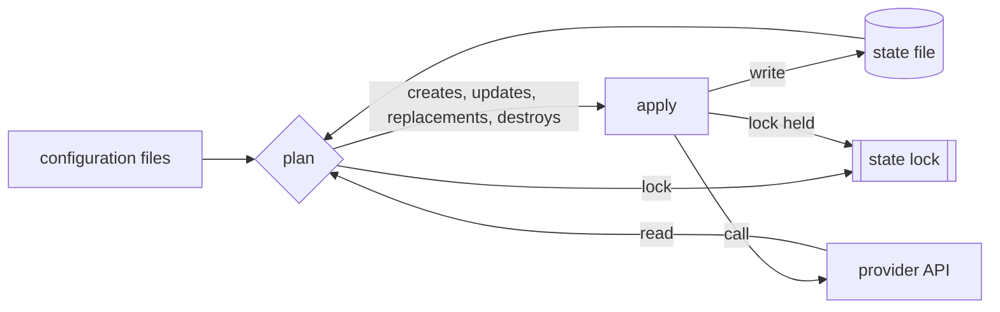

# Infrastructure as Code

> Executed on the authoring machine (Windows 11, Python 3.13.5) by the batch-18 `ops-lab-B`
> `iac_probe.py`. The probe is a working plan/apply engine: it reads declared resources, diffs
> them against a state file, applies creates, updates, replacements and destroys, orders
> destroys by dependency, and enforces a state lock. Terraform, OpenTofu, Pulumi, CloudFormation
> and a real cloud provider are not installed on this host, so their CLI syntax and provider
> behaviour are *labelled reference*; every number below comes from the probe.

## 1. Learning Objectives

After this lesson you will be able to:

- [ ] Explain the difference between a desired-state declaration and an imperative script
- [ ] Read a plan and say which resources will be created, updated, replaced or destroyed
- [ ] Explain why a second run of the same configuration is free
- [ ] Diagnose drift and say why a hand-edited attribute is a bug, not a fix
- [ ] Distinguish an in-place update from a replacement, and say what a replacement costs
- [ ] Explain what the state file is for, why it needs a lock, and what an import does

## 2. Prerequisites

- [DevOps Fundamentals](devops-fundamentals.md) — environments, repeatability, and the delivery pipeline this feeds
- [Docker Images and Containers](docker-images-and-containers.md) — immutable artifacts and the container lifecycle you will be describing
- [Volumes and Persistence](volumes-and-persistence.md) — why state that lives outside the process must be planned for
- [Shell Scripting](shell-scripting.md) — the imperative alternative this lesson is measured against

## 3. Introduction

Infrastructure as code (IaC) means the servers, networks, DNS records and buckets an
application needs are described in files that live in version control, and a tool turns that
description into reality. The description is *declarative*: it says what should exist, not
which commands to run in which order. The tool works out the difference between what the files
say and what is actually there, shows you that difference as a plan, and only then changes
anything.

That sounds like a small convenience. It is not. The difference between "run these twelve
commands" and "this is what should exist" is the difference between a system whose state you
can only guess and one whose state you can read, review, diff and roll back.

## 4. The Problem It Solves

Before declarative tools, a team provisioned with a wiki page of shell commands, or by clicking
in a console. Both produce the same five failures, and the probe in section 7 reproduces each
one:

- **The script is not idempotent.** Run it twice and it creates a second server, or fails on an
  object that already exists. The probe's second plan says `No changes. Infrastructure is up to
  date.` — the work is detected as done rather than repeated.
- **Reality drifts away from the record.** Someone changes a size in the console at 2 a.m. The
  probe changes `size` to `large` by hand and the next plan reports `update   server.web     size
  changes`. Nothing else knows the change happened.
- **A "small" edit destroys data.** Some attributes can be changed on a running resource; others
  cannot, and the provider replaces the whole object. The probe's `image` change produces
  `replace  server.web     image forces replacement`.
- **Ordering is guessed.** Deleting a subnet before the servers inside it fails. The probe
  removes a subnet from configuration and destroys in the order
  `['server.web', 'subnet.a']` because the dependency graph says so.
- **Two operators collide.** Two applies at once interleave, and neither state file is true. The
  probe's lock refuses the second operator while the first holds it.

The record of what exists — the **state file** — is the part people underestimate. It is not a
cache. It is the only thing that maps a name in your configuration to a real object in a
provider, and losing it is the difference between a plan and an outage.

## 5. Core Concepts

### Desired state and current state

**Desired state** is what the configuration files declare. **Current state** is what the
provider's API reports, as recorded in the state file. A plan is the difference between the two.
Apply is the act of closing that difference.

### Resources and addresses

A **resource** is one managed object: a network, a subnet, a server, a DNS record. Its
**address** is its identity inside the configuration — `network.main`, `subnet.a`,
`server.web`. Addresses are what plans, state and destroy ordering refer to, which is why
renaming one is a bigger operation than it looks.

### The plan

A plan is a proposal with four possible verbs: **create**, **update** (change in place),
**replace** (destroy and create, because an attribute is immutable), and **destroy**. Reading a
plan means reading those verbs and knowing which of them touch data.

### Idempotence

**Idempotence** means applying the same configuration twice leaves the system in the same
state, and the second application does nothing. It is the property that makes automation safe
to re-run after a failure, and the one a hand-written script almost never has.

### Drift

**Drift** is any difference between the state file and reality that the configuration did not
ask for: a manual console change, an out-of-band script, a deleted object. Drift is detected
because the tool re-reads reality on every plan, and repaired by the next apply.

### State, locking and import

The **state file** records resource addresses, their provider IDs, and their last-known
attributes. Because two writers corrupt it, tools take a **lock** for the duration of an
operation. A resource that exists but is not in state is invisible: **importing** it is how you
adopt it without destroying it.

### Dependency graph

Resources reference each other's outputs, and the tool builds a directed graph from those
references. Creates run in dependency order and destroys run in reverse — which is why the
probe destroys the server before the subnet it sits in.

## 6. How It Works



Three inputs reach the plan: the configuration, the state file, and a fresh read of reality
from the provider. The plan is a pure function of those three, which is why the same commit can
produce different plans on two machines — the state and the world differ, not the files. Apply
then executes the plan in graph order, updates the state after each successful change, and
increments the state **serial** so that a stale writer can be detected. The lock wraps the whole
operation; a second process either waits or is refused.

## 7. Practical Examples

**Example 1 — the executed probe**

The probe below is the whole lab: a tiny engine that reads instructions, plans against state and
reality, applies, and prints what it did. Its output is the transcript that follows it, and
every claim in this lesson is quoted from that transcript.

```python
"""IaC lab: desired state, plan, apply, drift, replacement, ordering, state locking.

Windows 11, Python 3.13.5.  No cloud, no Terraform.  A "resource" is a JSON file in a
directory that stands for a managed object, and state records what was created.  The
probe implements the loop every declarative tool shares: read actual, diff against
desired, apply the difference, and prove that a second apply changes nothing.
"""
from __future__ import annotations

import json
import os
import shutil
import time
from pathlib import Path

LAB = Path(__file__).with_name("iac-lab")
CLOUD = LAB / "cloud"
STATE = LAB / "state.json"
LOCK = LAB / "state.lock"

DESIRED = {
    "network.main": {"cidr": "10.0.0.0/16"},
    "subnet.a": {"network": "network.main", "cidr": "10.0.1.0/24"},
    "server.web": {"subnet": "subnet.a", "size": "small", "image": "app:1.0"},
}
REPLACE_ON = {"image"}  # changing this attribute cannot be done in place


def read_state() -> dict:
    if not STATE.exists():
        return {"serial": 0, "resources": {}}
    return json.loads(STATE.read_text(encoding="utf-8"))


def write_state(state: dict) -> None:
    state["serial"] += 1
    STATE.write_text(json.dumps(state, indent=2, sort_keys=True) + "\n", encoding="utf-8")


def actual_of(address: str) -> dict | None:
    path = CLOUD / f"{address}.json"
    if not path.exists():
        return None
    return json.loads(path.read_text(encoding="utf-8"))


def all_actual() -> dict[str, dict]:
    found = {}
    for path in sorted(CLOUD.glob("*.json")):
        found[path.stem] = json.loads(path.read_text(encoding="utf-8"))
    return found


def order(desired: dict[str, dict]) -> list[str]:
    done: list[str] = []
    visiting: list[str] = []

    def visit(name: str) -> None:
        if name in done:
            return
        if name in visiting:
            raise ValueError(f"dependency cycle: {' -> '.join(visiting + [name])}")
        visiting.append(name)
        for value in desired[name].values():
            if isinstance(value, str) and value in desired:
                visit(value)
        visiting.pop()
        done.append(name)

    for name in desired:
        visit(name)
    return done


def plan(desired: dict[str, dict]) -> list[tuple[str, str, str]]:
    actions: list[tuple[str, str, str]] = []
    state = read_state()["resources"]
    for address in order(desired):
        want = desired[address]
        have = actual_of(address)
        if have is None:
            actions.append(("create", address, "does not exist"))
            continue
        changed = [key for key in want if have.get(key) != want[key]]
        if not changed:
            continue
        replaces = sorted(set(changed) & REPLACE_ON)
        if replaces:
            actions.append(("replace", address, f"{', '.join(replaces)} forces replacement"))
        else:
            actions.append(("update", address, f"{', '.join(changed)} changes"))
    actual = all_actual()

    def references(address: str) -> list[str]:
        return [value for value in actual.get(address, {}).values() if isinstance(value, str)]

    pending = [address for address in state if address not in desired]
    ordered: list[str] = []
    while pending:
        for address in list(pending):
            if not any(address in references(other) for other in pending if other != address):
                ordered.append(address)
                pending.remove(address)
                break
        else:  # a cycle among leftovers: destroy in name order and say so
            ordered.extend(sorted(pending))
            pending.clear()
    for address in ordered:
        actions.append(("destroy", address, "removed from configuration"))
    return actions


def apply(desired: dict[str, dict], actions: list[tuple[str, str, str]]) -> dict:
    state = read_state()
    added = changed = replaced = destroyed = 0
    for action, address, _reason in actions:
        path = CLOUD / f"{address}.json"
        if action == "destroy":
            path.unlink(missing_ok=True)
            state["resources"].pop(address, None)
            destroyed += 1
        else:
            if action == "create":
                added += 1
            elif action == "replace":
                replaced += 1
            else:
                changed += 1
            payload = dict(desired[address])
            if action == "replace":
                path.unlink(missing_ok=True)
            path.write_text(json.dumps(payload, indent=2, sort_keys=True) + "\n", encoding="utf-8")
            state["resources"][address] = {"id": f"{address}-{int(time.time()) % 100000}"}
    path = CLOUD / "server.web.json"
    if path.exists() and "server.web" in state["resources"]:
        record = json.loads(path.read_text(encoding="utf-8"))
        record["_id"] = state["resources"]["server.web"]["id"]
        path.write_text(json.dumps(record, indent=2, sort_keys=True) + "\n", encoding="utf-8")
    write_state(state)
    return {"added": added, "changed": changed, "replaced": replaced, "destroyed": destroyed}


def acquire_lock(owner: str) -> str | None:
    try:
        descriptor = os.open(LOCK, os.O_CREAT | os.O_EXCL | os.O_WRONLY)
    except FileExistsError:
        return LOCK.read_text(encoding="utf-8").strip()
    with os.fdopen(descriptor, "w", encoding="utf-8") as handle:
        handle.write(owner)
    return None


def release_lock() -> None:
    LOCK.unlink(missing_ok=True)


def show(actions: list[tuple[str, str, str]]) -> None:
    if not actions:
        print("  No changes. Infrastructure is up to date.")
        return
    for action, address, reason in actions:
        print(f"  {action:<8} {address:<14} {reason}")


def main() -> None:
    if LAB.exists():
        shutil.rmtree(LAB)
    CLOUD.mkdir(parents=True)
    print("iac-lab (Windows 11, Python 3.13.5, no cloud provider)")

    print("\n=== 1. a first plan: nothing exists, three resources are needed ===")
    actions = plan(DESIRED)
    show(actions)
    print(f"  plan: {sum(1 for a in actions if a[0] == 'create')} to add, 0 to change, 0 to destroy")

    print("\n=== 2. apply the plan ===")
    result = apply(DESIRED, actions)
    print(f"  apply complete: {result}")
    print(f"  resources on disk: {sorted(all_actual())}")
    print(f"  state serial: {read_state()['serial']}")

    print("\n=== 3. a second plan is empty: the work is done, not repeated ===")
    show(plan(DESIRED))
    print("  this is the property a shell script does not have: running it again is free")

    print("\n=== 4. change one attribute out of band, then look again ===")
    path = CLOUD / "server.web.json"
    drifted = actual_of("server.web") or {}
    drifted["size"] = "large"
    path.write_text(json.dumps(drifted, indent=2, sort_keys=True) + "\n", encoding="utf-8")
    print(f"  someone changed size to {drifted['size']} by hand")
    actions = plan(DESIRED)
    show(actions)
    print(f"  applied: {apply(DESIRED, actions)}")
    show(plan(DESIRED))

    print("\n=== 5. an attribute that cannot change in place forces replacement ===")
    desired_v2 = json.loads(json.dumps(DESIRED))
    desired_v2["server.web"]["image"] = "app:2.0"
    show(plan(desired_v2))
    print(f"  image is in REPLACE_ON: {sorted(REPLACE_ON)}")
    print("  a new address would be assigned by the provider; data on the old one is lost unless it is detached first")
    print(f"  applying it: {apply(desired_v2, plan(desired_v2))}")
    show(plan(desired_v2))

    print("\n=== 6. removing a resource from configuration destroys dependents first ===")
    desired_v3 = {"network.main": desired_v2["network.main"]}
    after = plan(desired_v3)
    show(after)
    print(f"  destroy order: {[a[1] for a in after if a[0] == 'destroy']}")
    print("  a server that references a subnet must be gone before the subnet is")

    print("\n=== 7. a second operator is refused, not interleaved ===")
    blocked = acquire_lock("alice@laptop")
    print(f"  alice acquires the lock: {blocked is None}")
    holder = acquire_lock("bob@ci")
    print(f"  bob tries to apply: refused, lock held by {holder}")
    release_lock()
    print(f"  after release, bob acquires: {acquire_lock('bob@ci')}")
    release_lock()

    print("\n=== 8. state and reality disagree in both directions ===")
    state = read_state()
    state["resources"]["server.ghost"] = {"id": "ghost-1"}
    write_state(state)
    print("  state lists server.ghost, which no longer exists:")
    show(plan(desired_v2))
    (CLOUD / "bucket.orphan.json").write_text('{"name": "orphan"}\n', encoding="utf-8")
    print("  reality has bucket.orphan, which configuration never declared:")
    print(f"  plan destroys it only if it is in state: {'bucket.orphan' in read_state()['resources']}")
    print("  an unmanaged resource is invisible to the tool until it is imported")
    print("\nexit=0")


if __name__ == "__main__":
    main()
```

**Expected output:**

```text
iac-lab (Windows 11, Python 3.13.5, no cloud provider)

=== 1. a first plan: nothing exists, three resources are needed ===
  create   network.main   does not exist
  create   subnet.a       does not exist
  create   server.web     does not exist
  plan: 3 to add, 0 to change, 0 to destroy

=== 2. apply the plan ===
  apply complete: {'added': 3, 'changed': 0, 'replaced': 0, 'destroyed': 0}
  resources on disk: ['network.main', 'server.web', 'subnet.a']
  state serial: 1

=== 3. a second plan is empty: the work is done, not repeated ===
  No changes. Infrastructure is up to date.
  this is the property a shell script does not have: running it again is free

=== 4. change one attribute out of band, then look again ===
  someone changed size to large by hand
  update   server.web     size changes
  applied: {'added': 0, 'changed': 1, 'replaced': 0, 'destroyed': 0}
  No changes. Infrastructure is up to date.

=== 5. an attribute that cannot change in place forces replacement ===
  replace  server.web     image forces replacement
  image is in REPLACE_ON: ['image']
  a new address would be assigned by the provider; data on the old one is lost unless it is detached first
  applying it: {'added': 0, 'changed': 0, 'replaced': 1, 'destroyed': 0}
  No changes. Infrastructure is up to date.

=== 6. removing a resource from configuration destroys dependents first ===
  destroy  server.web     removed from configuration
  destroy  subnet.a       removed from configuration
  destroy order: ['server.web', 'subnet.a']
  a server that references a subnet must be gone before the subnet is

=== 7. a second operator is refused, not interleaved ===
  alice acquires the lock: True
  bob tries to apply: refused, lock held by alice@laptop
  after release, bob acquires: None

=== 8. state and reality disagree in both directions ===
  state lists server.ghost, which no longer exists:
  destroy  server.ghost   removed from configuration
  reality has bucket.orphan, which configuration never declared:
  plan destroys it only if it is in state: False
  an unmanaged resource is invisible to the tool until it is imported

exit=0
```

**How to run it:**

```bash
cd CodePath-Masterclass/.scratch/ops-lab-B
python iac_probe.py
```

- **Assumptions:** Python 3.13.5 on Windows 11; no provider or CLI installed. The probe recreates
  its `iac-lab/` working directory on every run, so it is safe to run repeatedly.
- **What the important lines show:** `3 to add` is a plan against empty state; the second
  `No changes.` is idempotence; `update   server.web     size changes` is drift being repaired;
  `replace  server.web     image forces replacement` is the immutable-attribute case; the
  `destroy order: ['server.web', 'subnet.a']` line is the dependency graph; `refused, lock held
  by alice@laptop` is the lock; and `plan destroys it only if it is in state: False` is why an
  unmanaged object survives.

**Example 2 — the same plan in real Terraform syntax** *(labelled reference — not executed)*

```hcl
resource "aws_subnet" "a" {
  vpc_id     = aws_vpc.main.id
  cidr_block = "10.0.1.0/24"
}

resource "aws_instance" "web" {
  ami           = "ami-0123456789abcdef0"
  instance_type = "t3.micro"
  subnet_id     = aws_subnet.a.id
}
```

`terraform plan` on this pair proposes two creates, in that order, because `aws_instance.web`
references `aws_subnet.a.id`. Change `instance_type` and the plan is an in-place update; change
`ami` and it is a replacement. The mechanism is the one the probe implements; only the provider
and the CLI differ.

## 8. Real-World Applications

- **Cloud accounts** — VPCs, subnets, load balancers, managed databases and IAM roles are created
  per environment from the same modules, with different variable files.
- **Kubernetes** — Helm charts and Kustomize overlays are declarative in the same sense, and
  `kubectl apply` is a plan/apply loop with a server-side diff.
- **DNS and certificates** — records and certificate requests are resources, so a deleted
  environment cannot leave a dangling CNAME.
- **CI/CD** — the runner, its cache bucket and its IAM role are provisioned by the same code that
  provisions production, so the pipeline is reproducible rather than hand-built.
- **Review** — a plan attached to a pull request is the only change-review mechanism that shows
  what will actually happen, not what the author believes will happen.

## 9. Common Mistakes

| Mistake | Why it happens | How to recognize it | How to prevent it |
|---|---|---|---|
| Editing a resource in the console "just this once" | It is faster than a pull request | Next plan shows an unexpected `update`; the probe's `size changes` line | Deny console write access outside break-glass; treat every drift as an incident |
| Committing the state file to Git | It feels like backup | Secrets and stale serials in history; noisy conflicts | Remote backend with locking, encrypted at rest, access-controlled |
| Two applies at once | Two terminals, or a pipeline without concurrency control | Lock errors, or worse, a corrupted state with no error | Always use a locking backend; one pipeline per environment |
| Assuming every change is in place | The plan output is skimmed | `replace` in a plan nobody read; data gone after apply | Read the verb, not the resource name; use `prevent_destroy` on stateful resources |
| Deleting configuration to "clean up" | Looks tidy in review | A plan that destroys a database nobody meant to drop | Review destroy counts explicitly; protect stateful resources and require approval |
| Hand-building a resource then adding it to code | Brownfield migration | Plan proposes to create something that already exists | Import the existing object first, then plan to confirm no changes |

## 10. Best Practices

- **Keep state remote, locked and encrypted.** The state contains every attribute, including
  secrets some providers do not mark sensitive. A local file is a single point of loss and a
  concurrency bug waiting to happen.
- **One state per environment and per blast radius.** A plan that can touch production and
  staging at once cannot be reviewed safely; separate states make the blast radius of an apply
  legible.
- **Pin provider and tool versions.** A provider upgrade can change a default and turn a no-op
  plan into a replacement.
- **Run plan in CI on every pull request and apply only from the default branch.** The plan is
  the review artifact; the apply is the privileged action.
- **Protect stateful resources explicitly.** `prevent_destroy` is not paranoia on a database; it
  converts a silent outage into a failed plan.
- **Treat drift as a signal.** Recurring drift means someone has a workflow the code does not
  cover; fix the workflow rather than the symptom.

These practices stop applying to genuinely ephemeral sandboxes, where a lost state file costs
minutes and no data.

## 11. Limitations and Trade-Offs

- **State is a liability.** It must be stored, locked, backed up and migrated. A team without
  that discipline is safer with manual provisioning than with a state file nobody protects.
- **Small changes have large diffs.** Adding one attribute can restructure a module and produce a
  plan that is hard to review; module design is real work.
- **Immutable attributes are provider-specific.** Whether a field forces replacement is a
  property of the provider, not of your intent, and it changes between versions.
- **Not everything is a resource.** Data-plane contents, running processes and application
  configuration inside a VM are usually better handled by images and configuration management
  (the next two lessons) than by IaC.
- **Latency.** A plan reads the world; on a large estate that is slow, and some teams split
  states purely to keep plans under a minute.

## 12. Practical Exercises

### Introductory

1. **Exercise 13.1** — Run the probe, then re-run it. Record the plan line from each run and
   explain in one sentence why the second is free.
   **Completion criteria:** your notes contain `plan: 3 to add` and `No changes. Infrastructure
   is up to date.`, and the explanation names state, not caching.
2. **Exercise 13.2** — In the probe, change the declared `size` of `server.web` and run a plan
   before applying. Classify the verb and say whether data is at risk.
   **Completion criteria:** the plan shows `update` for exactly one resource and you state that
   an in-place update preserves the object.

### Intermediate

3. **Exercise 13.3** — Reproduce drift: apply, edit the state file's recorded `size` by hand,
   then plan. Explain why the plan is not empty even though the configuration did not change.
   **Completion criteria:** the plan shows an update, and your explanation distinguishes
   "configuration changed" from "reality or state changed".
4. **Exercise 13.4** — Add a second resource that references `server.web`, remove both from
   configuration, and record the destroy order. Then reverse the reference and record it again.
   **Completion criteria:** both orders are recorded and match the dependency direction, with the
   dependent destroyed first in each case.

### Independent problem-solving

5. **Exercise 13.5** — Design a two-environment layout (staging and production) for the probe's
   resources that a single mistake cannot apply to both. Decide how many state files you need,
   where they live, how variables differ, and what a reviewer sees in a pull request.
   **Completion criteria:** a written design naming the state boundaries, the variable inputs,
   the locking mechanism, and one concrete failure it prevents that a single shared state would
   not.

*Solutions: attempt first. They live in `solutions/` of this subject.*

## 13. Knowledge Check

1. A plan says `replace` where you expected `update`. What property of the changed attribute
   explains it, and what should you check before applying?
2. Why does an object that exists in the provider but not in state survive a plan that destroys
   everything else?
3. When is infrastructure as code the wrong tool for a piece of the system?

## 14. Completion Criteria

Observable evidence that you have understood this lesson:

- [ ] You can explain desired state, current state and state file without notes
- [ ] You can read a plan and name the verb and the risk for each resource
- [ ] You can explain why the second apply is free and why a shell script's second run is not
- [ ] You can diagnose drift, replacement and an unmanaged object from plan output alone
- [ ] You can state one situation where hand provisioning is the safer choice

## 15. Summary

- Declarative infrastructure says *what should exist*; the tool derives the commands.
- A plan is the diff between configuration, state file and reality — read the verbs, not the names.
- Idempotence is the property that makes re-running safe; it comes from state, not from caching.
- Replacement happens when an attribute is immutable; it costs the data on the old object.
- State is the map from configuration to real objects: remote, locked, encrypted, and protected.

## 16. Next Steps

- Next lesson: [Terraform](terraform.md) — the same model with real HCL, real state, and real
  provider semantics
- Practice: [exercise set](exercises/README.md)
- Where it is applied: [Secure Production Application](../20-PROJECT-LABORATORY/project-07-secure-production-application/README.md)
