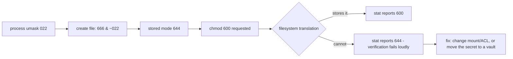

# Linux Administration

> Every transcript in this lesson was executed on the authoring machine (Windows 11,
> Python 3.13.5, Git Bash coreutils — `stat`, `chmod`, `awk`, `grep`, `df`, `gzip`) in the
> batch-18 `ops-lab-A` scratch lab. This host is *not* Linux: it is Windows with a POSIX
> layer, and the probe reports what that layer actually stores rather than what a Linux
> server would. Where the two differ — file modes, `systemd`, `journalctl` — the Linux
> behaviour is marked *labelled reference*.

## 1. Learning Objectives

After this lesson you will be able to:

- [ ] Read a mode string and say exactly what the owner, the group, and everyone else may do
- [ ] Compute a new file's mode from `umask` and explain why creation-time permissions differ from `chmod`
- [ ] Verify that a permission change actually took effect instead of assuming it did
- [ ] Triage a log file with `grep`/`awk`/`sort`: count failures by kind, rank source addresses, identify targeted accounts
- [ ] Rotate a log safely, check disk pressure against a threshold, and explain what `systemd` would manage on a real server

## 2. Prerequisites

- [03-DEVELOPER-TOOLS](../03-DEVELOPER-TOOLS/README.md) — the shell, pipes, and `grep`: this lesson assumes you can already run a command
- [DevOps Fundamentals](devops-fundamentals.md) — the deploy target this lesson administers, and why logs and disk belong to operations
- [15-APPLICATION-SECURITY](../15-APPLICATION-SECURITY/README.md) — why a world-readable secrets file is a security finding, not a tidiness issue

*No code prerequisite beyond reading Python — the probe is printed in full and uses only the standard library plus coreutils.*

## 3. Introduction

A deployed application is a process on a machine, owned by a user, reading files whose
permissions decide who else can read them, writing logs nobody reads until something
breaks, and filling a disk that was fine last week. **Linux administration** is the set of
skills that keep those four facts from becoming incidents: users and permissions, logs,
disk, and services. This lesson runs each of them as a real command and — for permissions —
shows the more valuable half of the skill: checking what the filesystem actually stored.

## 4. The Problem It Solves

Servers fail in boring, repeated ways:

- **The wrong file was readable.** An `.env` file created by a script inherited the shell's default mode, so every account on the box could read the database password. Nobody noticed because `ls -l` was never run.
- **`chmod` was assumed to have worked.** "I set it to 600" is a claim about intent. The filesystem, the mount options, and the layer between you and the disk decide what is stored, so the claim needs a `stat` behind it.
- **Logs were never triaged.** A 4 GB `auth.log` with 200,000 failed logins is not a log, it is an unanswered question. Without a way to count and rank, an intrusion looks like noise.
- **The disk filled and the service died.** Nobody watched `df`, nobody rotated, and the first symptom was a crashed write at 3 a.m.
- **"Is it running?" had no answer.** Without a service manager, a crashed process stays crashed until someone notices — the reason `systemd` exists.

## 5. Core Concepts

### Users, groups, and the three permission classes

Every file has an **owner** (a user), a **group**, and three permission classes that apply
to three audiences: the owner, members of the group, and **others** (everyone else). Each
class carries three bits: **read** (`r`, 4), **write** (`w`, 2), **execute** (`x`, 1). A
mode like `640` is three octal digits — owner `rw`, group `r`, others nothing.

### umask: the mode a new file is allowed to have

`umask` is a mask subtracted from the default creation mode (`666` for files, `777` for
directories). The arithmetic is `mode & ~umask`: with `umask 022`, a new file gets
`666 & ~022 = 644`; with `027`, `640`; with `077`, `600`. Two consequences matter:

- **`umask` is per-process and inherited.** A service started by an init system gets the init system's mask unless the unit sets its own.
- **It only applies at creation.** Changing `umask` never alters an existing file; that is `chmod`'s job.

### A mode is a request; `stat` is the authority

`chmod` asks the filesystem to store a mode. Whether it can depends on the filesystem, the
mount options, and any translation layer. The probe proves this rather than asserting it:
on this Windows host every `chmod` except read-only and execute collapses to `644`, and a
`chmod 600` on a secrets file leaves it readable by others. On ext4 the same commands store
`600`, `640`, `755` exactly — that is *labelled reference*, because this machine cannot
demonstrate it. The transferable habit is the one the probe performs: **after changing a
permission, read it back.**

### Logs, severity, and triage

A **log line** records when, where, what, and how bad. **Triage** is the act of turning a
file of lines into a small number of decisions: how many failures, from where, against
which accounts, and is that normal? Three tools do most of it: `grep` to select, `awk` to
extract fields, `sort | uniq -c | sort -rn` to rank.

### Rotation

**Rotation** bounds a log's size: move the current file aside, compress the moved copy,
start a fresh empty file, and delete the oldest archive when the retention count is
exceeded. Systems use `logrotate`; the mechanics are the four steps above. Compression is
not cosmetic — the probe's 1212-byte day compresses to 507 bytes, and log text compresses
well because timestamps and addresses repeat.

### Disk pressure

`df` reports space per **filesystem**; `du` reports space per **directory**. A threshold
check turns `df` output into an alert before the disk is full, because a full disk fails
writes in ways that look like application bugs. Inodes (file count) can also run out, which
`df -i` shows.

### Services and systemd

A **service manager** starts processes at boot, restarts them when they die, and gives you
one command to ask about state: `systemctl status`, `journalctl -u`. This host has no
`systemctl` at all — the probe records the failure — so unit files and `journalctl` are
*labelled reference* in this lesson.

## 6. How It Works



The permission half of the diagram is a round trip: creation masks the default, `chmod`
requests a change, and `stat` reports the result. The probe's phases 1 and 2 walk that round
trip; phase 2 is where the round trip breaks on this host, and finding that out is the point.
The log half — phases 3 and 4 — is a funnel: a file becomes counts, counts become a ranked
list, the ranked list supports one decision, and the file is then compressed and replaced so
the next day starts clean.

## 7. Practical Examples

**Example 1 — the full probe: umask, mode verification, log triage, rotation, disk, and the systemd seam**

```python
# OPS-03 Linux administration probe: the permission model (umask arithmetic, chmod
# request vs what the filesystem stores), auth-log triage with grep/awk, rotation,
# disk pressure against a threshold, and the systemd seam on a Windows host.
# Python standard library + Git Bash coreutils. Run: python admin_probe.py
import gzip
import os
import shutil
import subprocess
from pathlib import Path

LAB = Path("admin-lab")
LOGS = LAB / "logs"


def sh(command):
    """Run one command in Git Bash; return (stdout, stderr, exit code)."""
    result = subprocess.run(["bash", "-c", command], capture_output=True, text=True)
    return result.stdout.rstrip("\n"), result.stderr.rstrip("\n"), result.returncode


def mode_of(path):
    return sh(f"stat -c '%a' '{Path(path).as_posix()}'")[0]


def symbolic(mode):
    """Turn '640' into 'rw- r-- ---'."""
    bits = "rwx"
    return " ".join(
        "".join(bits[i] if int(digit) & (4 >> i) else "-" for i in range(3))
        for digit in mode
    )


SYSLOG = """Oct 12 03:14:01 web-01 sshd[2101]: Failed password for invalid user admin from 198.51.100.23 port 51422 ssh2
Oct 12 03:14:09 web-01 sshd[2101]: Failed password for root from 198.51.100.23 port 51488 ssh2
Oct 12 03:14:16 web-01 sshd[2103]: Failed password for invalid user oracle from 203.0.113.9 port 39210 ssh2
Oct 12 03:15:02 web-01 sshd[2104]: Accepted password for deploy from 192.168.0.44 port 41002 ssh2
Oct 12 03:15:02 web-01 sshd[2104]: pam_unix(sshd:session): session opened for user deploy by (uid=0)
Oct 12 03:16:40 web-01 sshd[2109]: Failed password for invalid user test from 203.0.113.9 port 39744 ssh2
Oct 12 03:17:11 web-01 sudo[2115]: deploy : TTY=pts/0 ; PWD=/srv/app ; USER=root ; COMMAND=/usr/bin/systemctl restart app
Oct 12 03:20:00 web-01 kernel: [12345.678] Out of memory: Killed process 2201 (python3) total-vm:1843200kB
Oct 12 03:21:37 web-01 sshd[2130]: Failed password for invalid user admin from 198.51.100.23 port 52110 ssh2
Oct 12 03:24:02 web-01 cron[2140]: (root) CMD (/usr/local/bin/backup.sh)
Oct 12 03:24:55 web-01 sshd[2151]: Accepted publickey for deploy from 192.168.0.44 port 41088 ssh2
Oct 12 03:25:01 web-01 cron[2141]: (root) CMD (/usr/local/bin/report.sh)
"""

AWK_SUMMARY = (
    '/Failed password/ {failed++} /Accepted/ {accepted++} '
    '/Out of memory/ {oom++} /session opened/ {sessions++} '
    'END {printf "failed=%d accepted=%d sessions=%d oom=%d", '
    "failed, accepted, sessions, oom}"
)

AWK_IPS = '/Failed password/ {for (i=1;i<=NF;i++) if ($i=="from") print $(i+1)}'

print("admin-lab (Windows 11, Git Bash coreutils + Python 3.13.5)")
LAB.mkdir(exist_ok=True)
LOGS.mkdir(exist_ok=True)

print("\n=== 1. umask: the mode a new file is allowed to have ===")
current = sh("umask")[0]
print(f"  this shell starts with umask {current}")
for mask in ("022", "027", "077"):
    print(f"  0666 & ~{mask} = {0o666 & ~int(mask, 8):03o}  -> a file created under it")
created = LAB / "created.conf"
created.write_text("key=value\n", encoding="utf-8")
print(f"  file created by this Python process: stat reports {mode_of(created)}")

print("\n=== 2. chmod: the mode you ask for vs the mode that is stored ===")
probe = LAB / "mode-probe.txt"
for requested in ("600", "640", "644", "755", "400"):
    probe.write_text("x\n", encoding="utf-8")
    sh(f"chmod {requested} '{probe.as_posix()}'")
    stored = mode_of(probe)
    print(f"  requested {requested} -> stored {stored} ({symbolic(stored)})")
script = LAB / "backup.sh"
script.write_text("#!/bin/sh\nset -eu\necho backup\n", encoding="utf-8")
sh(f"chmod +x '{script.as_posix()}'")
stored = mode_of(script)
print(f"  chmod +x on a shebang script -> {stored} ({symbolic(stored)})")

secret = LAB / "secret.env"
secret.write_text("API_KEY=lab-value-1234\n", encoding="utf-8")
others = lambda p: bool(os.stat(p).st_mode & 0o004)
print(f"  secret.env others-readable before chmod: {others(secret)} ({mode_of(secret)})")
sh(f"chmod 600 '{secret.as_posix()}'")
print(f"  secret.env others-readable after chmod 600: {others(secret)} ({mode_of(secret)})")

print("\n=== 3. triage 12 auth-log lines ===")
syslog = LOGS / "auth.log"
syslog.write_text(SYSLOG, encoding="utf-8")
summary = sh(f"awk '{AWK_SUMMARY}' '{syslog.as_posix()}'")[0]
print(f"  {summary}")
top = sh(f"grep 'Failed password' '{syslog.as_posix()}' | awk '{AWK_IPS}' | sort | uniq -c | sort -rn")[0]
for line in top.splitlines():
    print(f"  {line.strip()} failed attempts")
users = sh(f"grep -o 'invalid user [a-z]*' '{syslog.as_posix()}' | sort | uniq -c | sort -rn")[0]
for line in users.splitlines():
    print(f"  {line.strip()}")

print("\n=== 4. rotate: compress yesterday, start today with an empty file ===")
before = syslog.stat().st_size
sh(f"mv '{syslog.as_posix()}' '{syslog.as_posix()}.1'")
with open(f"{syslog.as_posix()}.1", "rb") as source, gzip.open(f"{syslog.as_posix()}.1.gz", "wb") as packed:
    shutil.copyfileobj(source, packed)
Path(f"{syslog.as_posix()}.1").unlink()
syslog.touch()
after = Path(f"{syslog.as_posix()}.1.gz").stat().st_size
print(f"  auth.log {before} bytes -> auth.log.1.gz {after} bytes ({(1 - after / before) * 100:.0f}% smaller)")
print(f"  yesterday's lines still readable: {sh('gzip -dc admin-lab/logs/auth.log.1.gz | grep -c .')[0]} of 12")
print(f"  new auth.log size: {syslog.stat().st_size} bytes")

print("\n=== 5. disk pressure against a 90% threshold ===")
usage = sh("df -h . | tail -1")[0].split()
percent = next((field for field in usage if field.endswith("%")), "?")
used = int(percent[:-1]) if percent != "?" else 0
print(f"  df -h . -> {' '.join(usage[:5])}")
print(f"  {used}% used -> {'ALERT: above 90%' if used > 90 else 'ok'} (threshold 90%)")

print("\n=== 6. the service manager seam on this host ===")
where, _, code = sh("command -v systemctl")
print(f"  command -v systemctl -> {where or '(nothing on PATH)'} (exit {code})")
out, err, code = sh("systemctl status ssh")
reason = (err or out).splitlines()[-1] if (err or out) else ""
print(f"  systemctl status ssh -> exit {code}: {reason}")
```

- Phase 1 prints the shell's `umask` (`0022`) and the arithmetic for three masks, then creates a file and reports what was stored: `644`. On a POSIX filesystem the same code under `umask 077` would store `600` (*labelled reference*).
- Phase 2 is the verification lesson. Requested `600`, `640`, `644`, and `755` all come back as `644`; `400` comes back as `444`; `chmod +x` on a `#!/bin/sh` script does come back as `755`. The read-only bit and the execute bit are honoured here; group and other read-only distinctions are not.
- Phase 2's secrets check is the operational consequence: `secret.env` is **others-readable before and after** `chmod 600`, because the mode that was stored did not change. The probe reports that honestly instead of claiming the fix worked.
- Phase 3 turns 12 syslog lines into decisions: `failed=5 accepted=2 sessions=1 oom=1`, three failed attempts from `198.51.100.23`, two from `203.0.113.9`, and `admin` targeted twice — enough to justify blocking one address and locking the `admin` account name out of password auth.
- Phase 4 rotates: `1212 bytes -> 507 bytes (58% smaller)`, all `12 of 12` lines still readable through `gzip -dc`, and the new `auth.log` at `0 bytes`.
- Phase 5 compares disk use to a 90% threshold and phase 6 records that `systemctl` does not exist on this host (exit `127`), which is why unit files stay *labelled reference*.
- **Expected output:** the capture below.
- **How to run it:** `python admin_probe.py` (Windows 11, Git Bash coreutils, Python 3.13.5). It writes and rewrites `admin-lab/`.
- **Assumptions:** the syslog lines are a fixture written by the probe, not a live `/var/log/auth.log`; `df` reports this machine's real filesystem; no service manager is present.

**Executed capture:**

```text
admin-lab (Windows 11, Git Bash coreutils + Python 3.13.5)

=== 1. umask: the mode a new file is allowed to have ===
  this shell starts with umask 0022
  0666 & ~022 = 644  -> a file created under it
  0666 & ~027 = 640  -> a file created under it
  0666 & ~077 = 600  -> a file created under it
  file created by this Python process: stat reports 644

=== 2. chmod: the mode you ask for vs the mode that is stored ===
  requested 600 -> stored 644 (rw- r-- r--)
  requested 640 -> stored 644 (rw- r-- r--)
  requested 644 -> stored 644 (rw- r-- r--)
  requested 755 -> stored 644 (rw- r-- r--)
  requested 400 -> stored 444 (r-- r-- r--)
  chmod +x on a shebang script -> 755 (rwx r-x r-x)
  secret.env others-readable before chmod: True (644)
  secret.env others-readable after chmod 600: True (644)

=== 3. triage 12 auth-log lines ===
  failed=5 accepted=2 sessions=1 oom=1
  3 198.51.100.23 failed attempts
  2 203.0.113.9 failed attempts
  2 invalid user admin
  1 invalid user test
  1 invalid user oracle

=== 4. rotate: compress yesterday, start today with an empty file ===
  auth.log 1212 bytes -> auth.log.1.gz 507 bytes (58% smaller)
  yesterday's lines still readable: 12 of 12
  new auth.log size: 0 bytes

=== 5. disk pressure against a 90% threshold ===
  df -h . -> C: 350G 331G 20G 95%
  95% used -> ALERT: above 90% (threshold 90%)

=== 6. the service manager seam on this host ===
  command -v systemctl -> (nothing on PATH) (exit 1)
  systemctl status ssh -> exit 127: bash: line 1: systemctl: command not found
```

The most useful line in that capture is the least satisfying one: `requested 600 -> stored 644`.
A runbook that says "`chmod 600` the secrets file" is only correct on a filesystem that
stores the mode. The probe's version of that runbook checks the result and fails when the
check fails — which is what the `others-readable after chmod 600: True (644)` line is doing.

**Example 2 — what a real server looks like** (*labelled reference — not executed here*)

```ini
# /etc/systemd/system/app.service — this host has no systemd, so this is reference, not a transcript.
[Unit]
Description=subject 11 API
After=network-online.target

[Service]
User=app
Group=app
WorkingDirectory=/srv/app
ExecStart=/usr/bin/python3 -m uvicorn main:app --host 127.0.0.1 --port 8000
Restart=on-failure
RestartSec=3
EnvironmentFile=/etc/app/secrets.env
UMask=0077

[Install]
WantedBy=multi-user.target
```

- `User=app` runs the process as an unprivileged account, so a compromise does not own the box.
- `Restart=on-failure` is the "is it running?" answer: the manager restarts a crashed process and records why.
- `EnvironmentFile` keeps secrets out of the unit file, and `UMask=0077` gives the process the restrictive creation mask that phase 1's arithmetic predicts (`600` files).
- `systemctl daemon-reload`, `systemctl enable --now app`, and `journalctl -u app -f` are the corresponding commands — *labelled reference*, since `systemctl` returns exit `127` on this machine (phase 6 of the capture).

## 8. Real-World Applications

- **Every deploy target** is administered this way: a service account, a restricted `umask`, a unit or container entrypoint, logs with rotation, and a disk alert.
- **Incident response** starts with the phase-3 queries: how many failures, from where, against which accounts. The same three pipelines answer "is this normal?" on any Linux host.
- **Secrets hygiene** depends on the verification habit: a `.env` at `644` is a finding in every audit, and the only way to know is to read the mode back.
- **Capacity planning** uses `df` trends rather than a single reading; the 90% threshold check is the last line of defence, not the whole plan.
- Paired with: [Monitoring and Logging](monitoring-and-logging.md) for shipping these logs somewhere searchable, and [Backups and Recovery](backups-and-recovery.md) for the data that shares the disk.

## 9. Common Mistakes

| Mistake | Why it happens | How to recognize it | How to prevent it |
|---|---|---|---|
| Trusting `chmod` without checking | The command exited 0, so it "worked" | `stat -c '%a' file` disagrees with the command you ran | Read the mode back; fail the runbook when it differs |
| `chmod 777` to fix access | Fastest way past a permission error | Any file with `777` outside `/tmp` | Fix ownership or group membership instead |
| Secrets created with the default mask | The service inherits the shell's `umask` | `.env` at `644` | Set `UMask=0077` in the unit, or create the file then verify |
| No rotation | "The disk is big enough" | A log growing monotonically for months | Rotate on size *and* time, with retention |
| Alerting at 100% disk | Threshold set to the failure point | First alert arrives with the outage | Alert at 85–90% with headroom to act |
| `du` used to find free space | `du` measures directories, `df` measures filesystems | `du` totals far below `df` used | Use `df` for capacity; remember deleted-but-open files |
| Grepping logs by hand | One-off investigation repeated forever | The same `grep | grep | grep` in a runbook | Save the `awk` summaries; they are the runbook |
| Running everything as root | Avoids permission errors entirely | `User=root` in a unit file | A dedicated account per service; root only for the manager |

## 10. Best Practices

- **Verify every permission change with `stat`.** The rule stops applying only where the tool itself is the verification (a configuration manager that reports drift), and even then its report is the `stat`.
- **Set the restrictive mask at the source** — the unit's `UMask`, the container's user, the directory's default ACL — rather than fixing files after creation.
- **Give each service its own unprivileged user,** owning only what it needs. This limits blast radius the same way a canary limits a bad release.
- **Triage before archiving.** Rotation is cheaper after the counts are recorded; a compressed log nobody queried is storage, not evidence.
- **Rank, then decide.** `sort | uniq -c | sort -rn` gives an ordered list; act on the top entries, not on the first one you happened to read.
- **Alert on trend, not just threshold.** 90% used is urgent on a disk that grew 5% in a day and unremarkable on one that has been at 91% for a year.

## 11. Limitations and Trade-Offs

- **This host is not Linux.** `chmod` here collapses most modes to `644`, so the lesson cannot demonstrate `600`/`640` being stored; ext4 behaviour is *labelled reference*. The probe reports the real result instead of imitating Linux output.
- **No `systemd`, no `journalctl`, no `logrotate`.** Phase 6 records the absence; the unit file in Example 2 is reference, and rotation was performed by hand (move, `gzip`, truncate) rather than by a daemon.
- **The log is a fixture.** Twelve lines written by the probe demonstrate the query shapes; real auth logs have far more variety, and a real triage also correlates with firewall, application, and network logs.
- **A single `df` reading is not capacity planning.** It says nothing about growth rate, inode exhaustion (`df -i`), or per-directory usage (`du -sh *`).
- **Permissions are one layer.** A file at `600` owned by the wrong user is still a problem, and a secret in a world-readable location is a findings-list item regardless of mode — see [Secrets Management](../15-APPLICATION-SECURITY/secrets-management.md).

## 12. Practical Exercises

### Introductory

1. **Exercise 3.1** — Run the probe, then delete `admin-lab/` and run it again. Explain why phase 5's numbers changed while phase 3's did not. **Completion criteria:** a one-paragraph answer naming the real filesystem (`df`) versus the fixture (`SYSLOG`).
2. **Exercise 3.2** — Use `awk` to print only the *usernames* that failed, one per line, then count them. **Completion criteria:** a command and its output showing `admin` twice, `root` once, `oracle` once, `test` once.

### Intermediate

3. **Exercise 3.3** — Modify phase 2 to write the mode it *intended* and the mode it *stored* side by side, and mark each row `ok` or `MISMATCH`. **Completion criteria:** a capture with four `MISMATCH` rows and one `ok` row (`400`), matching the existing results.
4. **Exercise 3.4** — Add a severity histogram: map each fixture line to `ERROR` (failed logins, OOM), `WARN` (sudo), or `INFO` (cron, accepted logins) with `awk`, and print counts per severity. **Completion criteria:** a table whose total equals 12.

### Independent problem-solving

5. **Exercise 3.5** — A production host reports `No space left on device` while `df -h` shows 40% used. Design the diagnosis: name the two most likely causes (inode exhaustion, deleted-but-open files), the command that distinguishes them, and the fix for each. **Completion criteria:** a written procedure with commands, the expected output signature for each cause, and a remediation that does not involve rebooting.

*Solutions: attempt first. They live in `solutions/` of this subject.*

## 13. Knowledge Check

1. Under `umask 027`, what mode does a newly created file get, and why is the answer not `027`?
2. Phase 2 shows `chmod 600` stored as `644`. Which two bits *were* honoured, and what does that tell you about what this layer can represent?
3. `secret.env` is reported as others-readable both before and after the `chmod`. What should the runbook do at that point, and why is "run `chmod` again" the wrong answer?
4. The probe alerts at 95% used. Give one argument for a lower threshold and one for a threshold based on growth rate instead of absolute usage.

## 14. Completion Criteria

Observable evidence that you have understood this lesson:

- [ ] You can decode any three-digit mode into per-class permissions without notes
- [ ] You can compute a creation mode from `umask` and explain why `chmod` cannot change a `umask`
- [ ] You can write the triage pipeline that ranks failed logins by source address and by account
- [ ] You can rotate a log by hand and verify the archive is still readable
- [ ] You can state what this host cannot demonstrate (stored modes, `systemd`) and what you would run on a Linux server to check the same facts

## 15. Summary

- A mode has three classes of three bits; `umask` decides what a *new* file may have, `chmod` what an *existing* one is asked to have.
- The filesystem is the authority: on this host `600`/`640`/`755` all store as `644`, so verification with `stat` is part of the change, not an optional extra.
- Log triage is three pipelines — select, extract, rank — and the probe turns 12 lines into `failed=5`, one blocked address, and one targeted account.
- Rotation is move, compress, truncate, retain: 1212 bytes became 507 with all 12 lines still readable.
- Watch disk against a threshold before it is full, and know that `systemd` is what answers "is it running?" on a real server.

## 16. Next Steps

- Next lesson: [Networking for DevOps](networking-for-devops.md) — ports, sockets, DNS, and health checks: how the service you just administered is reached
- Practice: the subject's exercise set (written with its exercise installment)
- Where it is applied: [Project 07](../20-PROJECT-LABORATORY/project-07-secure-production-application/README.md) — its deployment plan requires a service account, a restrictive `umask`, and logs you can triage
