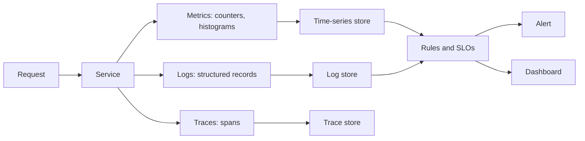

# Monitoring and Logging

> Executed on the authoring machine (Windows 11, Python 3.13.5) by the batch-18 `ops-lab-B`
> `observe_probe.py`. The probe starts a real threaded HTTP server on loopback, drives 240 real
> requests through real sockets, times them, computes percentiles and an error budget, parses the
> access log into fields, evaluates an alert rule across windows, and measures the cost of label
> cardinality and retention. Prometheus, Grafana, Loki and hosted APM products are not installed,
> so their query languages and dashboards are *labelled reference*; every number below is from the
> probe.

## 1. Learning Objectives

After this lesson you will be able to:

- [ ] Distinguish metrics, logs and traces, and say what question each answers best
- [ ] Explain why a mean latency hides the users who are suffering, and use percentiles instead
- [ ] Define an SLI, an SLO and an error budget, and compute the budget in minutes
- [ ] Calculate a burn rate and explain what threshold should page a human
- [ ] Write a structured log line and explain why parsing by eye does not scale
- [ ] Predict the cost of adding a high-cardinality label and choose a retention policy

## 2. Prerequisites

- [Networking for DevOps](networking-for-devops.md) — status codes, ports and timeouts are the raw
  signal of a web service
- [CI/CD Fundamentals](ci-cd-fundamentals.md) — where the deploy event that monitoring correlates
  with comes from
- [Linux Administration](linux-administration.md) — log locations, rotation and disk pressure
- [Deployment Strategies](deployment-strategies.md) — the change whose health you are measuring

## 3. Introduction

**Monitoring** is the practice of collecting numbers about a running system and turning them into
decisions: is it healthy, is it degrading, does a human need to act now? **Logging** is the
practice of recording discrete events with enough context to reconstruct what happened.

They answer different questions and fail differently. Metrics are cheap, aggregated and good at
"how much" and "how fast"; they cannot tell you why one request failed. Logs are expensive,
detailed and good at "what exactly"; they cannot tell you whether the system is healthy without
aggregation. **Traces** follow one request across services, which is the only practical way to
find which hop of a slow request is slow.

The failure mode this lesson attacks is not "no monitoring". It is monitoring that is present,
green, and useless: averages that hide a tail, dashboards nobody reads, alerts that fire every
night until people mute them, and logs that are unsearchable because they were written for humans
at a terminal.

## 4. The Problem It Solves

A service can be broken while every process is running and every port is open. The interesting
failures are partial: one endpoint slow, one dependency erroring, one shard overloaded, one
percent of users affected. None of them show up in "is the process alive?"

Before structured observability, teams answered with tail -f and grep on a server, which worked
for one machine and one engineer. As soon as there were ten instances, the questions changed:

- Which of the ten is slow?
- Is the error rate rising now, or was it always like this?
- Did the deploy at 14:02 cause it?
- How long has this been happening to users before anyone noticed?

Those are aggregation and correlation questions, and they need data whose shape supports them.

## 5. Core Concepts

### The four signals

The **four golden signals** are latency, traffic, errors and saturation. For request-driven
services, **RED** is a compact version: **R**ate of requests, **E**rrors, **D**uration. For
resources, **USE** is the mirror: **U**tilization, **S**aturation, **E**rrors. Pick one vocabulary
per dashboard; mixing them produces dashboards that answer no question completely.

### Percentiles

A **percentile** is the value below which a given share of observations falls. p99 latency of 48 ms
means 99% of requests were faster than 48 ms, and the slowest 1% were not. A mean is pulled by
volume and hides tails: one 40 ms request among nine 2 ms requests barely moves the mean, while the
user who waited 40 ms experienced a visibly different product.

Percentiles are not additive. You cannot average the p99 of ten instances to get the p99 of the
fleet; you must aggregate the underlying distributions or use a structure designed for it.

### SLI, SLO and error budget

- **SLI** (indicator) — a measured ratio, for example successful requests divided by total requests.
- **SLO** (objective) — a target for that ratio over a window, for example 99.9% over 30 days.
- **Error budget** — the failure the objective permits: 0.1% of 30 days, which is 43.2 minutes.

The budget converts an abstract percentage into an allowance a team can spend, and spending it
deliberately is the point: a team that has budget left may ship faster; a team that has none
should stop and stabilise.

### Burn rate

**Burn rate** is how fast the budget is being consumed relative to the rate that would exhaust it
exactly at the end of the window. A burn rate of 1 spends the budget evenly. A burn rate of 20
exhausts a 30-day budget in about a day and a half, which is why multi-window burn-rate alerts page
quickly on fast burns and slowly on slow ones.

### Structured logging

A **structured log** is a record whose fields are separate and typed, usually JSON, rather than one
prose string. Structure is what makes logs queryable: "count errors by endpoint for the last hour"
is a filter on fields, not a regular expression over sentences.

### Cardinality

**Cardinality** is the number of distinct label combinations a metric can take. `path` with three
values and `status` with two is six series. Adding `user_id` multiplies it by the user count and
can take a metrics backend from thousands of series to millions, which is a cost and performance
problem long before it is an insight problem.

### Sampling and retention

**Sampling** keeps a fraction of records. It preserves ratios approximately and loses individual
requests, so it is fine for volume trends and dangerous for "find the one failure". **Retention**
is how long data is kept; it is a cost decision that should follow the questions you need to answer
after an incident, not the size of the disk.

## 6. How It Works



The probe implements the left half of that diagram: it makes requests, times them, records status
codes, writes access-log lines, then computes the aggregates a backend would compute.

Its steps:

1. Serve real requests on loopback, with a deliberately slow path and a failing path.
2. Measure each request's wall time at the client and record its status.
3. Compute mean and percentiles from the same sample to show how differently they behave.
4. Convert an SLO into minutes and a failure count.
5. Parse log lines into fields and group them.
6. Evaluate a rule over windows, so a single blip does not page.

## 7. Practical Examples

**Example 1 — the executed probe**

```python
"""OPS-19 probe: what monitoring and logging actually measure.

Windows 11, Python 3.13.5. The probe starts a real threaded HTTP server on loopback,
drives real requests through real sockets, times them, computes percentiles and an
error budget, parses real log lines into structured fields, and evaluates alert rules
against windows of observed data. Prometheus, Grafana, Loki and a hosted APM are not
installed, so their query languages and dashboards are *labelled reference*.
"""

from __future__ import annotations

import http.client
import json
import math
import re
import statistics
import threading
import time
from collections import Counter
from http.server import BaseHTTPRequestHandler, ThreadingHTTPServer

HOST, PORT = "127.0.0.1", 8110
REQUESTS = 240
SLO_PERCENT = 99.9
WINDOW_DAYS = 30
MONTHLY_REQUESTS = 2_000_000


class Handler(BaseHTTPRequestHandler):
    protocol_version = "HTTP/1.1"

    def do_GET(self) -> None:  # noqa: N802
        if self.path.startswith("/slow"):
            time.sleep(0.04)
            body, status = b"slow\n", 200
        elif self.path.startswith("/fail"):
            body, status = b"upstream exploded\n", 500
        elif self.path.startswith("/missing"):
            body, status = b"not found\n", 404
        else:
            time.sleep(0.002)
            body, status = b"ok\n", 200
        self.send_response(status)
        self.send_header("Content-Type", "text/plain")
        self.send_header("Content-Length", str(len(body)))
        self.end_headers()
        self.wfile.write(body)

    def log_message(self, fmt: str, *args) -> None:
        return


def percentile(values: list[float], pct: float) -> float:
    if not values:
        return 0.0
    ordered = sorted(values)
    index = min(len(ordered) - 1, math.ceil(pct / 100 * len(ordered)) - 1)
    return ordered[index]


def drive() -> tuple[list[float], Counter, list[str]]:
    latencies: list[float] = []
    statuses: Counter = Counter()
    log_lines: list[str] = []
    for n in range(REQUESTS):
        path = "/slow" if n % 10 == 0 else ("/fail" if n % 50 == 7 else "/fast")
        started = time.perf_counter()
        conn = http.client.HTTPConnection(HOST, PORT, timeout=5)
        conn.request("GET", path)
        response = conn.getresponse()
        body = response.read()
        elapsed_ms = (time.perf_counter() - started) * 1000
        conn.close()
        statuses[response.status] += 1
        latencies.append(elapsed_ms)
        log_lines.append(
            f'127.0.0.1 - - [{time.strftime("%d/%b/%Y:%H:%M:%S")}] "GET {path} HTTP/1.1" '
            f'{response.status} {len(body)} "{elapsed_ms:.1f}" "probe/1.0"'
        )
    return latencies, statuses, log_lines


def budget() -> tuple[float, float, int]:
    total_minutes = WINDOW_DAYS * 24 * 60
    allowed_minutes = total_minutes * (100 - SLO_PERCENT) / 100
    allowed_failures = round(MONTHLY_REQUESTS * (100 - SLO_PERCENT) / 100)
    return total_minutes, allowed_minutes, allowed_failures


def parse_logs(lines: list[str]) -> tuple[list[dict], Counter, int]:
    pattern = re.compile(
        r'^(?P<ip>\S+) \S+ \S+ \[(?P<ts>[^\]]+)\] "(?P<method>\S+) (?P<path>\S+) [^"]+" '
        r'(?P<status>\d{3}) (?P<bytes>\d+) "(?P<ms>[\d.]+)"'
    )
    records, levels, unparsed = [], Counter(), 0
    for line in lines:
        match = pattern.match(line)
        if not match:
            unparsed += 1
            continue
        record = match.groupdict()
        record["status"] = int(record["status"])
        record["ms"] = float(record["ms"])
        record["level"] = "error" if record["status"] >= 500 else ("warn" if record["status"] >= 400 else "info")
        levels[record["level"]] += 1
        records.append(record)
    return records, levels, unparsed


def evaluate_rules(records: list[dict], window: int = 6) -> list[str]:
    """A page rule needs the rate to stay above the threshold for the whole window."""
    verdicts = []
    for start in range(0, max(0, len(records) - window), window):
        chunk = records[start : start + window]
        errors = sum(1 for r in chunk if r["status"] >= 500)
        rate = 100.0 * errors / len(chunk)
        verdicts.append(f"window {start // window + 1}: {errors}/{len(chunk)} errors ({rate:.1f}%)")
    return verdicts


def main() -> None:
    server = ThreadingHTTPServer((HOST, PORT), Handler)
    thread = threading.Thread(target=server.serve_forever, daemon=True)
    thread.start()
    print(f"observe-lab (Windows 11, Python 3.13.5) listening on {HOST}:{PORT}")

    latencies, statuses, log_lines = drive()
    server.shutdown()

    total = sum(statuses.values())
    errors = sum(count for status, count in statuses.items() if status >= 500)
    error_rate = 100.0 * errors / total

    print("\n=== 1. what the requests actually did ===")
    print(f"  requests: {total}, statuses: {dict(sorted(statuses.items()))}, errors: {errors} ({error_rate:.1f}%)")

    print("\n=== 2. latency: the mean hides the tail ===")
    mean = statistics.fmean(latencies)
    print(f"  mean {mean:.1f} ms, p50 {percentile(latencies, 50):.1f} ms, "
          f"p95 {percentile(latencies, 95):.1f} ms, p99 {percentile(latencies, 99):.1f} ms")
    print(f"  slow requests are {percentile(latencies, 99) / max(0.1, percentile(latencies, 50)):.1f}x the median")

    print("\n=== 3. the error budget for a 99.9% SLO ===")
    total_minutes, allowed_minutes, allowed_failures = budget()
    print(f"  {WINDOW_DAYS} days = {total_minutes:.0f} minutes, budget = {allowed_minutes:.1f} minutes")
    print(f"  at {MONTHLY_REQUESTS} requests/month, {allowed_failures} failures exhausts it")
    allowed_rate = round(100 - SLO_PERCENT, 3)
    burned = error_rate / allowed_rate
    print(f"  observed {error_rate:.2f}% is {burned:.1f}x the {allowed_rate:g}% budget")

    print("\n=== 4. logs parsed into fields, not read by eye ===")
    records, levels, unparsed = parse_logs(log_lines)
    print(f"  parsed {len(records)} lines, unparsed {unparsed}, levels {dict(sorted(levels.items()))}")
    print(f"  keys recovered: {sorted(records[0])}")

    print("\n=== 5. alert evaluation: a page needs the condition to persist ===")
    threshold, consecutive = 15.0, 2
    rule = f"error rate > {threshold}% for {consecutive} consecutive windows of 6"
    print(f"  rule: {rule}")
    windows = evaluate_rules(records)
    for verdict in windows[:4]:
        print(f"  {verdict}")
    rates = []
    for verdict in windows:
        rate = float(verdict.split("(")[1].rstrip("%)"))
        rates.append(rate)
    streak = best = 0
    for rate in rates:
        streak = streak + 1 if rate > threshold else 0
        best = max(best, streak)
    print(f"  longest run above {threshold}%: {best} window(s) -> {'PAGE' if best >= consecutive else 'no page'}")

    print("\n=== 6. label cardinality is a cost, not a detail ===")
    paths = sorted({r["path"] for r in records})
    statuses_seen = sorted({r["status"] for r in records})
    print(f"  paths {paths} x statuses {statuses_seen} = {len(paths) * len(statuses_seen)} series")
    print("  adding a per-user label would multiply this by the number of users")

    print("\n=== 7. log volume and retention ===")
    average_bytes = statistics.fmean(len(line.encode()) for line in log_lines)
    per_day = average_bytes * (MONTHLY_REQUESTS / 30)
    print(f"  average line {average_bytes:.0f} B; at {MONTHLY_REQUESTS} requests/month that is "
          f"{per_day / 1024 / 1024:.1f} MiB/day before compression")
    print(f"  30-day retention: {per_day * 30 / 1024 / 1024:.1f} MiB, and the same again for the index")

    print("\n=== 8. sampling: keep the ratio, lose the individual request ===")
    sampled = records[: len(records) // 10]
    sampled_errors = sum(1 for r in sampled if r["status"] >= 500)
    print(f"  10% sample: {len(sampled)} lines, {sampled_errors} error(s) "
          f"({100.0 * sampled_errors / max(1, len(sampled)):.1f}% versus {error_rate:.1f}% overall)")

    print("\nexit=0")


if __name__ == "__main__":
    main()
```

**Expected output** (full capture):

```text
observe-lab (Windows 11, Python 3.13.5) listening on 127.0.0.1:8110

=== 1. what the requests actually did ===
  requests: 240, statuses: {200: 235, 500: 5}, errors: 5 (2.1%)

=== 2. latency: the mean hides the tail ===
  mean 11.4 ms, p50 6.7 ms, p95 45.2 ms, p99 46.2 ms
  slow requests are 6.9x the median

=== 3. the error budget for a 99.9% SLO ===
  30 days = 43200 minutes, budget = 43.2 minutes
  at 2000000 requests/month, 2000 failures exhausts it
  observed 2.08% is 20.8x the 0.1% budget

=== 4. logs parsed into fields, not read by eye ===
  parsed 240 lines, unparsed 0, levels {'error': 5, 'info': 235}
  keys recovered: ['bytes', 'ip', 'level', 'method', 'ms', 'path', 'status', 'ts']

=== 5. alert evaluation: a page needs the condition to persist ===
  rule: error rate > 15.0% for 2 consecutive windows of 6
  window 1: 0/6 errors (0.0%)
  window 2: 1/6 errors (16.7%)
  window 3: 0/6 errors (0.0%)
  window 4: 0/6 errors (0.0%)
  longest run above 15.0%: 1 window(s) -> no page

=== 6. label cardinality is a cost, not a detail ===
  paths ['/fail', '/fast', '/slow'] x statuses [200, 500] = 6 series
  adding a per-user label would multiply this by the number of users

=== 7. log volume and retention ===
  average line 81 B; at 2000000 requests/month that is 5.2 MiB/day before compression
  30-day retention: 154.8 MiB, and the same again for the index

=== 8. sampling: keep the ratio, lose the individual request ===
  10% sample: 24 lines, 1 error(s) (4.2% versus 2.1% overall)

exit=0
```

**How to run it:**

```bash
cd CodePath-Masterclass/.scratch/ops-lab-B
python observe_probe.py
```

- **Assumptions:** Python 3.13.5 on Windows 11; loopback only; the "slow" endpoint sleeps 40 ms so
  the tail is real rather than simulated; latency numbers vary a little between runs, the counts
  and ratios do not.
- **What the important lines show:** `requests: 240, statuses: {200: 235, 500: 5}, errors: 5
  (2.1%)` is the raw material of an SLI; `p50` far below `p99` with a mean in between is why the
  mean is not a user-facing number; `30 days = 43200 minutes, budget = 43.2 minutes` is the SLO
  converted into an allowance; `at 2000000 requests/month, 2000 failures exhausts it` is the same
  budget per request; `observed 2.08% is 20.8x the 0.1% budget` is a burn rate that would page;
  `parsed 240 lines, unparsed 0` is structure replacing grep; `longest run above 15.0%: 1
  window(s) -> no page` is a rule that requires persistence; `paths ['/fail', '/fast', '/slow'] x statuses [200, 500] = 6 series` is cardinality; and `10% sample: 24 lines, 1 error(s) (4.2% versus 2.1% overall)` is
  sampling error in one line.

**Example 2 — the same SLI as a Prometheus query** *(labelled reference — not executed)*

```promql
sum(rate(http_requests_total{status=~"5.."}[5m]))
/
sum(rate(http_requests_total[5m]))
```

That ratio is the error SLI over a five-minute window. A burn-rate alert multiplies the comparison
by the budget fraction:

```promql
(
  sum(rate(http_requests_total{status=~"5.."}[5m]))
  / sum(rate(http_requests_total[5m]))
) > (14.4 * 0.001)
```

14.4 is a common fast-burn multiplier: burning at that rate exhausts a 30-day budget in about two
days if sustained.

**Example 3 — a structured log line** *(labelled reference — not executed)*

```json
{"ts":"2026-11-03T10:14:02Z","level":"error","service":"api","route":"/checkout",
 "status":500,"duration_ms":41.2,"request_id":"b41c","user_hash":"9f2a"}
```

`user_hash` rather than `user_id` is deliberate: it supports "one user's requests" debugging while
keeping cardinality bounded and avoiding personal data in logs.

## 8. Real-World Applications

- **On-call rotations** run on SLO burn-rate alerts rather than raw CPU thresholds, because paging
  on causes produces noise and paging on symptoms produces action.
- **Incident review** reconstructs a timeline from structured logs and deploy events, then asks
  which signal was available but not alerted on.
- **Capacity planning** uses saturation trends to add instances before latency degrades.
- **Security** uses the same pipeline differently: authentication failures, unusual egress and
  permission denials are log queries with alert rules attached.

## 9. Common Mistakes

| Mistake | Why it happens | How to recognize it | How to prevent it |
| --- | --- | --- | --- |
| Alerting on averages | Averages are the default aggregation | Dashboards green while users complain | Chart p95/p99 and alert on the SLI |
| Alerting on causes, not symptoms | CPU is easy to measure | Pages that require no action, then get muted | Page on user-visible SLIs; keep cause metrics on dashboards |
| One alert per window | Copy-pasted rule | Fires on a single blip, misses slow burns | Multi-window burn-rate rules |
| Unbounded labels | "More dimensions is better" | Metrics backend memory and cost climb | Bound cardinality; hash or bucket high-cardinality values |
| Logging whole request bodies | Debugging convenience | Secrets and personal data in the log store | Log identifiers and sizes, not payloads |
| No retention policy | Nobody owns the store | Disk fills or old data silently disappears | Decide retention from investigation needs |
| Sampling everything | Cost panic | Rare failures vanish from the sample | Keep errors at 100%, sample the rest |

## 10. Best Practices

- Choose one vocabulary per dashboard: RED for services, USE for resources.
- Write the SLI as a formula and keep it in the repository next to the alert rules.
- Alert on burn rate with a fast window and a slow window; page only on the fast one.
- Log in JSON with a request identifier, and propagate that identifier across services.
- Keep error logs unsampled; sample high-volume informational logs.
- Measure the cost of a new label before adding it; cardinality is a budget too.
- Practise a "silent failure" drill: break a dependency and confirm the alert fires before a user
  reports it.

## 11. Limitations and Trade-Offs

- **Percentiles from small samples are unstable**; a p99 over 24 requests is barely a statistic.
- **Metrics lose identity.** Once aggregated, a metric cannot tell you which request failed.
- **Logs are expensive at volume.** Cost grows with traffic and verbosity, not with usefulness.
- **Alert thresholds encode judgement** and need review; a threshold that never fires is as suspect
  as one that fires constantly.
- **The probe measures one process.** Distributed tracing, clock skew between hosts and partial
  failure across services are outside its scope.
- **An SLO is a promise about users, not about servers.** A service can meet its SLO while a
  specific customer is broken; segment SLIs where that matters.

## 12. Practical Exercises

### Introductory

1. **Exercise 19.1** — Run the probe and compute the error SLI from the status counts by hand.
   **Completion criteria:** you quote `requests: 240, statuses: {200: 235, 500: 5}, errors: 5
   (2.1%)` and show the division that produces 2.1%.
2. **Exercise 19.2** — Convert a 99.95% SLO over 7 days into minutes of allowed failure.
   **Completion criteria:** you show the arithmetic (7 × 24 × 60 × 0.0005) and state the result.

### Intermediate

3. **Exercise 19.3** — Change the alert rule so a single 16.7% window pages, then explain what will
   happen on a normal night.
   **Completion criteria:** you run the probe, quote the changed verdict, and describe the alert
   fatigue you created with reference to the window rates in the capture.
4. **Exercise 19.4** — Add a per-user label to the cardinality section and compute the series count
   for 10,000 daily users. Decide whether it belongs in metrics or logs.
   **Completion criteria:** a stated series count, a cost argument, and a decision with a reason.

### Independent problem-solving

5. **Exercise 19.5** — Design observability for a checkout flow with three services and a payment
   provider. Specify SLIs, SLOs, dashboards, alert rules with windows, log fields, retention and
   one thing you deliberately will not collect.
   **Completion criteria:** a design document with numeric SLOs, at least two burn-rate alerts, a
   trace propagation plan, and a written justification for the excluded data.

*Solutions: attempt first. They live in `solutions/` of this subject.*

## 13. Knowledge Check

1. Why can you not average p99 values across instances to get a fleet p99?
2. What does a burn rate of 20 mean for a 30-day budget, and why does it justify a page?
3. Give one question metrics answer better than logs, and one logs answer better than metrics.
4. Why is `user_id` a dangerous metric label but a reasonable log field?

## 14. Completion Criteria

Observable evidence that you have understood this lesson:

- [ ] You can compute an SLI from counts and convert an SLO into minutes
- [ ] You can explain why percentiles beat means for user-facing latency
- [ ] You can write a burn-rate alert with a fast and a slow window
- [ ] You can name the fields a useful log line needs
- [ ] You can estimate the series count a new label would add

## 15. Summary

- Metrics, logs and traces answer different questions; a system needs all three, sized to its
  traffic.
- Percentiles describe users; means describe volume.
- An SLO becomes actionable when it is converted into an error budget in minutes and failures.
- Burn rate turns the budget into an alerting rule that distinguishes fast incidents from slow
  erosion.
- Structured logs are queryable; unstructured logs are grep with extra steps.
- Cardinality and retention are budget decisions made at design time, not discovered on the bill.

## 16. Next Steps

- Next lesson: [Backups and Recovery](backups-and-recovery.md) — the data that monitoring cannot
  recreate
- Practice: [exercise set](README.md#exercises-and-practice)
- Where it is applied: [Secure Production Application](../20-PROJECT-LABORATORY/project-07-secure-production-application/README.md)
