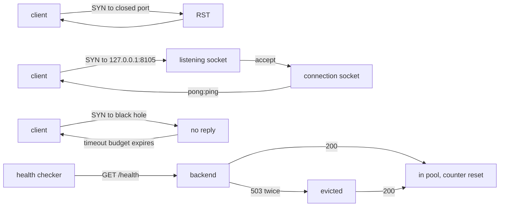

# Networking for DevOps

> Every transcript in this lesson was executed on the authoring machine (Windows 11,
> Python 3.13.5, loopback sockets, `nslookup` from a Git Bash shell) in the batch-18
> `ops-lab-A` scratch lab. All servers and clients are local processes; `192.0.2.1` is a
> reserved documentation address used deliberately as a black hole. A real load balancer,
> firewall, or DNS zone was **not** configured, and those behaviours are marked
> *labelled reference*.

## 1. Learning Objectives

After this lesson you will be able to:

- [ ] Explain the four-tuple that identifies a connection, and why many clients can share one server port
- [ ] Distinguish a refused connection from a timeout, and say what each tells you about the far end
- [ ] Read a socket error code and decide whether the fault is DNS, the target, or your own process
- [ ] Implement a health check with a consecutive-failure threshold and explain what eviction does to a backend pool
- [ ] Diagnose a port conflict from the error message rather than restarting the machine

## 2. Prerequisites

- [06-INTERNET-AND-WEB-FOUNDATIONS](../06-INTERNET-AND-WEB-FOUNDATIONS/README.md) — IP addresses, ports, TCP, and DNS: the model this lesson operates
- [Linux Administration](linux-administration.md) — the host whose services listen on these ports
- [11-BACKEND-ENGINEERING](../11-BACKEND-ENGINEERING/README.md) — the application being reached, and its own HTTP semantics

*No code prerequisite beyond reading Python — the probe is printed in full and uses only the standard library.*

## 3. Introduction

Networking problems look alike from the outside: "it can't reach the service". They are
different problems underneath. A connection can be **refused** because the host is up and
nothing is listening; it can **time out** because something is dropping the packets; a name
can fail to **resolve** before any packet is sent; and a healthy-looking backend can still
be **removed from the pool** because its health check failed twice in a row. This lesson
runs each failure for real, on loopback, and shows how the error you get narrows the search.

## 4. The Problem It Solves

Operations teams spend much of their time on the same handful of confusions:

- **"The service is down" was really "the name doesn't resolve".** DNS failures look like connection failures in most tools, so people debug the wrong layer for an hour.
- **Refused and timeout were treated as the same event.** Refused means the target answered and said no; timeout means nobody answered. One is usually a wrong port or a stopped process; the other is a firewall, a wrong host, or a full backlog.
- **A port was "busy" and nobody could say why.** Without reading the error, the fix becomes a reboot.
- **Health checks were cosmetic.** A check that needs five consecutive failures to evict, on a ten-second interval, keeps sending traffic to a broken backend for a minute after it broke.
- **Localhost meant six things.** `localhost`, `127.0.0.1`, and `::1` are related but not identical, and a service bound to one may be invisible on another.

## 5. Core Concepts

### Addresses, ports, and the connection four-tuple

An **IP address** identifies a host; a **port** identifies a service on that host. A TCP
connection is identified by four values: source address, source port, destination address,
destination port. The server's side is fixed — `127.0.0.1:8105` — while each client gets a
short-lived **ephemeral port** chosen by the operating system. That is why a thousand
clients can use one server port: the tuples differ in their source port.

### Listening socket versus connection socket

A **listening socket** is bound to an address and port and waits (`listen`); it never
carries data. Each `accept` produces a *new* socket for one connection. Kill the listener
and the port is free; leave it and the port belongs to exactly one process — a second
`bind` fails with `EADDRINUSE`.

### Refused versus timeout

- **Refused (RST):** the host is reachable and replied "no service here". Fast, definite, and usually your problem: wrong port, wrong protocol, process not started. On Windows the message is *"No connection could be made because the target machine actively refused it"* (error `10061`).
- **Timeout:** no reply at all. The packet was dropped — by a firewall, a routing rule, or because the address does not exist. Slow and ambiguous: you learn only that nothing answered within your budget.

This host takes about two seconds to refuse a closed loopback port, which is exactly why a
two-second timeout can make a refusal look like a timeout — a trap the probe exposes by
using a five-second budget and printing the elapsed time.

### DNS resolution

A **name** is resolved to addresses by a **resolver**, configured per host (the probe's
`nslookup` shows this machine's resolver is `192.168.0.1`, an OpenWrt router). Resolution
returns records with types — `A` for IPv4, `AAAA` for IPv6, plus `CNAME`, `MX`, `TXT`, and
others. Failures are distinct: **no such name** (`NXDOMAIN`, here `gaierror 11001`) versus
a resolver that cannot be reached (a timeout, again). `localhost` is usually answered
locally from the hosts file, which is why it resolves even with no network at all.

### Health checks, thresholds, and eviction

A **health check** is a cheap request a load balancer or orchestrator makes to decide
whether a backend should receive traffic. A **consecutive-failure threshold** prevents a
single blip from removing a healthy backend; the cost is that a genuinely broken backend
keeps serving until the threshold is reached. **Eviction** removes it from the pool;
**re-admission** puts it back after a successful check. Getting the threshold and interval
wrong is how a minute of errors becomes the blast radius of an outage.

### Socket errors worth recognising

`EADDRINUSE` (`10048` on Windows) means the port is already bound — a duplicate service or an
old process still running. `ECONNREFUSED` means nothing is listening. A timeout means
silence. Each points at a different fix, which is why the error text is worth reading before
the restart.

## 6. How It Works



The diagram is the whole lesson in one picture: the same client code produces three different
outcomes depending on what is on the far side, and the health checker is a small state
machine that flips a boolean in a pool. Phase 1 is the successful path, phase 2 the two
failures, phase 4 the state machine.

## 7. Practical Examples

**Example 1 — the full probe: ports, failures, DNS, a health check, and a port conflict**

```python
# OPS-04 networking-for-devops probe: ports and the listen/connect handshake, refused
# vs timeout, DNS resolution and failure, a health check that evicts an unhealthy
# backend after two consecutive failures, and what a socket error actually tells you.
# Python standard library only. Run: python net_probe.py
import errno
import http.server
import socket
import subprocess
import threading
import time
import urllib.error
import urllib.request

HOST = "127.0.0.1"

print("net-lab (Windows 11, Python 3.13.5, loopback sockets)")

print("\n=== 1. a listener owns a port; each connection gets its own ephemeral port ===")
listener = socket.socket(socket.AF_INET, socket.SOCK_STREAM)
listener.setsockopt(socket.SOL_SOCKET, socket.SO_REUSEADDR, 1)
listener.bind((HOST, 8105))
listener.listen(1)
print(f"  bound and listening on {listener.getsockname()[0]}:{listener.getsockname()[1]}")


def echo_once():
    conn, peer = listener.accept()
    payload = conn.recv(1024)
    conn.sendall(b"pong:" + payload)
    conn.close()


server_thread = threading.Thread(target=echo_once, daemon=True)
server_thread.start()
client = socket.create_connection((HOST, 8105), timeout=3)
client.sendall(b"ping")
local, peer = client.getsockname(), client.getpeername()
print(f"  client socket {local[0]}:{local[1]} -> server {peer[0]}:{peer[1]}")
print(f"  round trip: {client.recv(1024).decode()}")
client.close()
server_thread.join()
listener.close()

print("\n=== 2. refused and timeout are different failures ===")
start = time.perf_counter()
sock = socket.socket()
sock.settimeout(5)
try:
    sock.connect((HOST, 8106))
    print("  connected to 8106 (unexpected)")
except ConnectionRefusedError as error:
    elapsed = time.perf_counter() - start
    print(f"  {HOST}:8106 -> ConnectionRefusedError after {elapsed:.2f} s")
    print(f"    message: {error.strerror}")
finally:
    sock.close()

start = time.perf_counter()
sock = socket.socket()
sock.settimeout(1.5)
try:
    sock.connect(("192.0.2.1", 80))
    print("  connected to 192.0.2.1:80 (unexpected)")
except TimeoutError:
    elapsed = time.perf_counter() - start
    print(f"  192.0.2.1:80 -> TimeoutError after {elapsed:.2f} s (no reply at all, so we waited)")
finally:
    sock.close()

print("\n=== 3. names resolve to addresses, and some names do not resolve at all ===")
for name in ("localhost", "example.com"):
    infos = socket.getaddrinfo(name, None, socket.AF_INET, socket.SOCK_STREAM)
    addresses = sorted({info[4][0] for info in infos})
    print(f"  {name} -> {', '.join(addresses)}")
try:
    socket.getaddrinfo("no-such-host.invalid", None)
except socket.gaierror as error:
    print(f"  no-such-host.invalid -> gaierror {error.errno}: {error.strerror}")

resolver = subprocess.run(["bash", "-c", "nslookup example.com"], capture_output=True, text=True)
for line in resolver.stdout.splitlines():
    if "Server:" in line or line.strip().startswith("Address:"):
        print(f"  nslookup: {line.strip()}")

print("\n=== 4. a health check that evicts after two consecutive failures ===")


class HealthHandler(http.server.BaseHTTPRequestHandler):
    healthy = True

    def do_GET(self):
        self.send_response(200 if HealthHandler.healthy else 503)
        self.send_header("Content-Type", "text/plain")
        self.end_headers()
        self.wfile.write(b"ok" if HealthHandler.healthy else b"down")

    def log_message(self, *args):
        return


health_server = http.server.HTTPServer((HOST, 8107), HealthHandler)
threading.Thread(target=health_server.serve_forever, daemon=True).start()

pool = {"10.0.0.11:8080": {"failures": 0, "in_pool": True}}
for tick, healthy in enumerate((True, True, False, False, True, True), start=1):
    HealthHandler.healthy = healthy
    backend = next(iter(pool))
    state = pool[backend]
    try:
        with urllib.request.urlopen(f"http://{HOST}:8107/health", timeout=2) as response:
            code = response.status
    except urllib.error.HTTPError as error:
        code = error.code
    if code == 200:
        state["failures"] = 0
        if state["in_pool"]:
            action = "healthy, failure counter reset"
        else:
            state["in_pool"] = True
            action = "re-admitted after a good check"
    else:
        state["failures"] += 1
        if state["failures"] >= 2 and state["in_pool"]:
            state["in_pool"] = False
            action = f"EVICTED after {state['failures']} consecutive failures"
        else:
            action = f"failure {state['failures']} of 2, still in pool"
    print(f"  check {tick}: HTTP {code} -> {action}")

health_server.shutdown()
health_server.server_close()

print("\n=== 5. a port can be held by exactly one listener ===")
first = socket.socket(socket.AF_INET, socket.SOCK_STREAM)
first.bind((HOST, 8108))
first.listen(1)
second = socket.socket(socket.AF_INET, socket.SOCK_STREAM)
try:
    second.bind((HOST, 8108))
    print("  second bind succeeded (unexpected)")
except OSError as error:
    number = error.errno if error.errno is not None else error.winerror
    name = errno.errorcode.get(number, "EADDRINUSE")
    detail = error.strerror or str(error)
    print(f"  second bind on 8108 -> OSError {number} ({name}): {detail}")
finally:
    second.close()
    first.close()
```

- Phase 1 binds `127.0.0.1:8105`, accepts one connection, and echoes. The capture shows the client's ephemeral port `61445` against the server's fixed `8105` — two connections to the same service would differ only in that first number.
- Phase 2 produces the two failures side by side: `ConnectionRefusedError after 2.02 s` from the closed port (the host answered), and `TimeoutError after 1.51 s` from `192.0.2.1:80` (nothing answered, so the client waited out its budget).
- Phase 3 resolves `localhost` to `127.0.0.1` and `example.com` to two addresses (`104.20.23.154`, `172.66.147.243`), fails on `no-such-host.invalid` with `gaierror 11001`, and shows the resolver: `OpenWrt` at `192.168.0.1`.
- Phase 4 runs six health checks: two `200`s reset the counter, the first `503` records `failure 1 of 2`, the second evicts, and the next `200` re-admits. That single extra tolerance is what separates a stable pool from one that drops backends every time a request is slow.
- Phase 5 tries to bind `8108` twice and gets `OSError 10048 (WSAEADDRINUSE)` — the message names the cause, so no reboot is required.
- **Expected output:** the capture below.
- **How to run it:** `python net_probe.py` (Windows 11, Python 3.13.5). It uses loopback ports `8105`–`8108` and makes one outbound DNS query for `example.com`.
- **Assumptions:** no external service is contacted except the resolver; the resolved addresses for `example.com` are whatever DNS returned at the time of the run and may differ later.

**Executed capture:**

```text
net-lab (Windows 11, Python 3.13.5, loopback sockets)

=== 1. a listener owns a port; each connection gets its own ephemeral port ===
  bound and listening on 127.0.0.1:8105
  client socket 127.0.0.1:61445 -> server 127.0.0.1:8105
  round trip: pong:ping

=== 2. refused and timeout are different failures ===
  127.0.0.1:8106 -> ConnectionRefusedError after 2.02 s
    message: No connection could be made because the target machine actively refused it
  192.0.2.1:80 -> TimeoutError after 1.51 s (no reply at all, so we waited)

=== 3. names resolve to addresses, and some names do not resolve at all ===
  localhost -> 127.0.0.1
  example.com -> 104.20.23.154, 172.66.147.243
  no-such-host.invalid -> gaierror 11001: getaddrinfo failed
  nslookup: Server:  OpenWrt
  nslookup: Address:  192.168.0.1

=== 4. a health check that evicts after two consecutive failures ===
  check 1: HTTP 200 -> healthy, failure counter reset
  check 2: HTTP 200 -> healthy, failure counter reset
  check 3: HTTP 503 -> failure 1 of 2, still in pool
  check 4: HTTP 503 -> EVICTED after 2 consecutive failures
  check 5: HTTP 200 -> re-admitted after a good check
  check 6: HTTP 200 -> healthy, failure counter reset

=== 5. a port can be held by exactly one listener ===
  second bind on 8108 -> OSError 10048 (WSAEADDRINUSE): Only one usage of each socket address (protocol/network address/port) is normally permitted
```

Read phase 2 as a diagnostic rule: the refusal arrived *from* the machine, so the machine is
fine and the listener is missing; the timeout arrived from nowhere, so the packets went
nowhere. The elapsed times are as informative as the exceptions — `2.02 s` for a reply that
should be immediate is itself a symptom worth investigating on a real network.

**Example 2 — the same checks as operator commands** (*illustration — not executed as a transcript*)

```bash
# Which process owns a port? (Linux: ss; Windows: netstat)
ss -ltnp 'sport = :8000'          # Linux, needs root for the process name
netstat -ano | grep ':8000'       # Windows equivalent, then map PID in Task Manager

# Is it DNS, or is it the target?
getent hosts api.internal         # Linux: does the name resolve at all?
nslookup api.internal             # show which resolver answered

# Is anything answering on the port, ignoring HTTP?
curl -sS -m 3 -o /dev/null -w '%{http_code} in %{time_total}s\n' http://127.0.0.1:8000/health
```

- Each command answers one layer: `ss`/`netstat` for the local port, `getent`/`nslookup` for the name, `curl` with a timeout for the service.
- The `-m 3` is the point of the last line: without a timeout, a black-holed address hangs the check instead of failing it.
- **Not executed here:** this is a command reference for a Linux server, not a capture. The executed evidence is Example 1.

## 8. Real-World Applications

- **Load balancers and orchestrators** are health checkers with a scheduler attached: the phase-4 state machine, at scale, deciding which pods receive traffic.
- **Incident triage** uses the refused/timeout distinction constantly: a refused connection points at a dead process or wrong port; a timeout points at security groups, firewalls, or routing.
- **DNS is the most common root cause** of "the service is down" in cloud environments — a stale record, a wrong resolver, or a TTL that has not expired yet.
- **Port conflicts** are everyday container and local-development failures; reading `EADDRINUSE` saves the reboot.
- Paired with: [Nginx and Reverse Proxies](nginx-and-reverse-proxies.md) for the layer that actually does the health checking in production, and [DNS and TLS Operations](dns-and-tls-operations.md) for the records behind phase 3.

## 9. Common Mistakes

| Mistake | Why it happens | How to recognize it | How to prevent it |
|---|---|---|---|
| Timeout treated as "service down" | Both look like failure in most tools | The error says *timed out*, not *refused* | Read the exception; a timeout means no reply, not a refusal |
| No client timeout | Defaults wait a long time | A check hangs instead of failing | Set an explicit timeout shorter than your alert budget |
| Health check with no threshold | "Evict immediately on failure" | Backends flap in and out of the pool | Require N consecutive failures, as phase 4 does with 2 |
| Health threshold too high | Fear of false positives | Broken backend serves traffic for a minute | Tune interval × threshold to your error budget |
| `localhost` assumed to be one address | It resolves to `127.0.0.1` and often `::1` | Service bound to IPv4 only, client tries IPv6 first | Bind explicitly, or bind both; test with the literal address |
| Debugging before checking DNS | Connection errors look identical | The name does not resolve at all | Resolve first, connect second |
| Rebooting on `EADDRINUSE` | The message is unread | Same conflict returns after reboot | Find the owning PID and stop that process |
| Assuming a resolved address is current | DNS caches and TTLs | Old address still in use after a change | Check the resolver and TTL; verify from the client, not the server |

## 10. Best Practices

- **Fail with the most specific error you can.** The probe's phases produce three distinguishable failures; a client that collapses them into "network error" throws away the diagnosis.
- **Always set a timeout, and make it shorter than the alert budget.** A check that can hang is a check that cannot alert.
- **Use consecutive failures for eviction and a single success for re-admission** — that asymmetry keeps pools stable without keeping broken backends in service.
- **Bind explicitly.** `0.0.0.0` for a service that should be reachable, `127.0.0.1` for one that must not be — and know that binding loopback makes the port invisible to other hosts.
- **Check DNS before packets.** One `getent`/`nslookup` costs a second and rules out half the causes.
- **Log the four-tuple on failure** (source and destination address and port); it is the difference between "it failed" and "this client could not reach that service".

## 11. Limitations and Trade-Offs

- **Everything here is loopback.** No firewall, NAT, load balancer, or real DNS zone was configured; those behaviours are *labelled reference*, and latency on a real network changes the timings that phase 2 prints.
- **This host is slow to refuse.** The `2.02 s` refusal is a property of this machine's networking stack (and possibly its filtering), not of TCP in general; on a Linux host a refusal to a closed local port is typically immediate. That is why the probe uses a five-second budget and prints elapsed time instead of assuming.
- **The health check is HTTP-shaped.** gRPC, TCP-only, and command-based checks differ in what "healthy" means, and a check that only verifies the process is alive (liveness) does not tell you it can serve (readiness).
- **DNS answers change.** `example.com`'s addresses in the capture are a snapshot; treating them as stable would be a mistake, and that instability is exactly why TTLs exist.
- **Health checks add load and coupling.** Every check is a request; a check that hits the database turns a database slowdown into a full-pool eviction, which is why deep checks belong to a separate readiness signal.

## 12. Practical Exercises

### Introductory

1. **Exercise 4.1** — Run the probe and copy the client's ephemeral port from phase 1. Add a second connection and confirm the ephemeral port differs while the server port does not. **Completion criteria:** a capture with two client ports, one server port, and a one-sentence explanation using the word *four-tuple*.
2. **Exercise 4.2** — Change phase 2's timeout to `1.0` seconds and re-run. Explain the new result for `127.0.0.1:8106`. **Completion criteria:** a capture showing the refusal reported as a timeout, plus the sentence that names the cause (refusal took longer than the budget).

### Intermediate

3. **Exercise 4.3** — Make the health check require **three** consecutive failures before eviction, and add a tenth check. **Completion criteria:** a capture where the backend is evicted on the third `503` and the earlier failures are reported as `failure n of 3`.
4. **Exercise 4.4** — Extend phase 3 to resolve `example.com` for IPv6 (`socket.AF_INET6`) and print the `AAAA` answer, then explain what a service bound only to `127.0.0.1` would do with an IPv6 client. **Completion criteria:** a capture with at least one IPv6 address and a two-sentence explanation of the mismatch.

### Independent problem-solving

5. **Exercise 4.5** — A colleague reports: "the API is down — `curl` hangs for 30 seconds and then times out, but our monitoring says the process is running." Design the diagnosis as an ordered checklist that distinguishes DNS, firewall, wrong port, bound-to-loopback-only, and a full accept backlog. **Completion criteria:** five ordered checks, each with the command to run and the output that confirms or eliminates that cause.

*Solutions: attempt first. They live in `solutions/` of this subject.*

## 13. Knowledge Check

1. Two clients connect to the same server port at the same moment. Which parts of the four-tuple differ, and why does the server not need two ports?
2. Phase 2's closed port produced a refusal in `2.02 s`, while the black-holed address produced a timeout in `1.51 s`. What does the difference in *who* answered tell you, and why is elapsed time on its own misleading?
3. The health checker evicts after two failures but re-admits after one success. Why the asymmetry, and what would happen with two successes required?
4. When would you deliberately bind a service to `127.0.0.1` rather than `0.0.0.0`, and what breaks first if you get it wrong?

## 14. Completion Criteria

Observable evidence that you have understood this lesson:

- [ ] You can explain the four-tuple without notes and predict which part changes per connection
- [ ] You can reproduce a refusal and a timeout and say what each proves
- [ ] You can write a health checker with a consecutive-failure threshold and re-admission
- [ ] You can diagnose a port conflict from its error code and name the owning process
- [ ] You can state one situation where a health check makes an outage worse

## 15. Summary

- A connection is a four-tuple; a listener owns the port, each connection gets its own ephemeral port.
- Refused means the host answered ("nothing here"); timeout means silence — different causes, different fixes.
- DNS failures happen before any packet, and `NXDOMAIN` is a distinct answer from an unreachable resolver.
- Health checks are a state machine: two failures evicted the backend in phase 4, one success brought it back.
- `EADDRINUSE` names its own cause; the fix is finding the process, not restarting the machine.

## 16. Next Steps

- Next lesson: [Shell Scripting](shell-scripting.md) — turning these one-off commands into scripts that run the same way every time
- Practice: the subject's exercise set (written with its exercise installment)
- Where it is applied: [Project 07](../20-PROJECT-LABORATORY/project-07-secure-production-application/README.md) — its deployment plan needs a health check, a timeout, and a rollback trigger
