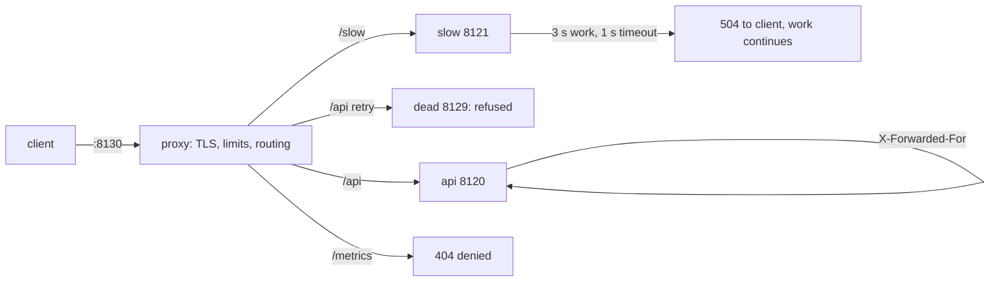

# Nginx and Reverse Proxies

> Executed on the authoring machine (Windows 11, Python 3.13.5) by the batch-18
> `ops-lab-B` `proxy_probe.py`. A reverse proxy was run for real: it routes by path, rewrites
> forwarded headers, speaks to backends over TCP, fails over, times out, and rejects
> oversized bodies. NGINX is **not** installed, so `nginx.conf` syntax and its directive
> behaviour are *labelled reference*; the mechanisms below are the ones NGINX implements.

## 1. Learning Objectives

After this lesson you will be able to:

- [ ] Explain what a reverse proxy does that a published port does not
- [ ] Route requests by path and describe why prefix order matters
- [ ] Set and trust `X-Forwarded-For`, `X-Forwarded-Proto`, and `X-Forwarded-Host` correctly
- [ ] Distinguish 502, 503, and 504 and say which upstream condition produces each
- [ ] Explain what a timeout does to the upstream's work, and why retrying a POST is dangerous

## 2. Prerequisites

- [Container Networking](container-networking.md) — forwarders, source-address rewriting, health checks
- [Networking for DevOps](networking-for-devops.md) — status codes and connect failures
- [Docker Compose](docker-compose.md) — the `web` service that runs this proxy

## 3. Introduction

A reverse proxy is the single door in front of several services: it terminates the client
connection, chooses an upstream, adds the headers an application needs to know who really
called, and decides how long to wait. It is also where a great many production failures are
decided — a timeout that is too short, a body limit that is too small, a forwarded header
nobody sets, a retry that duplicates a payment. This lesson runs one and measures each of
those decisions.

## 4. The Problem It Solves

- **One address, many services.** Clients cannot be told to use port 8000 for the API and 8080 for the site; the proxy routes `/api` to one upstream and everything else to another — the probe's routing table.
- **The application cannot see the client.** Publishing rewrites the peer address; the proxy adds `X-Forwarded-For` so access logs and rate limits work — the backend saw `xff=127.0.0.1:63208`.
- **A dead upstream should not hang the client.** The proxy tried a refused upstream first, failed over, and returned `200`; an upstream that slept for three seconds produced `504` after `1.02 s`.
- **Giant requests exhaust memory.** A 4000-byte body against a `1024`-byte limit was refused with `413` before the upstream saw it.
- **Internal endpoints leak.** `/metrics` returned `404` and no upstream saw the request — the deny list, not the application, is the boundary.

## 5. Core Concepts

### Proxy versus load balancer versus gateway

A reverse proxy forwards HTTP to upstreams and can rewrite requests; a load balancer
distributes across replicas; an API gateway adds authentication, quotas, and routing by
consumer. NGINX does all three, which is why its configuration is where these concerns meet.

### Routing by path

Prefix matching, longest match first, with `/` as the catch-all. The probe's table is
`/api -> [api, dead]`, `/slow -> [slow]`, `/ -> [api]`. In NGINX this is
`location /api/ { proxy_pass http://api; }`, and the trailing slash decides whether the
prefix is stripped — a detail that breaks more applications than any other.

### Forwarded headers

| Header | What it carries | Who may set it |
|---|---|---|
| `X-Forwarded-For` | Client address, appended per hop | Only the edge proxy; later hops append |
| `X-Forwarded-Proto` | `http` or `https` as seen by the client | The proxy that terminated TLS |
| `X-Forwarded-Host` | The original `Host` | The edge proxy |
| `Host` | The upstream's own name unless preserved | `proxy_set_header Host $host;` |

Trust is the hard part: an application that believes `X-Forwarded-For` from anyone lets a
client forge its own address. Trust it only from the proxy's address range.

### Status codes and upstream failures

| Code | Meaning | Typical cause |
|---|---|---|
| `502 Bad Gateway` | The proxy could not get a valid response | Upstream refused, crashed, or sent garbage |
| `503 Service Unavailable` | No healthy upstream to choose | All backends failing their checks |
| `504 Gateway Timeout` | The upstream did not answer in time | Slow query, deadlock, upstream hung |

The probe produced `502` for the refused primary (then failed over), `504` after the one
second timeout, and `404` for the denied path — a good reminder that a `404` from the proxy
and a `404` from the application look identical to a client.

### Timeouts are a budget

`proxy_connect_timeout`, `proxy_read_timeout`, and `proxy_send_timeout` bound each phase.
A too-short read timeout cancels healthy slow requests; a too-long one holds worker
connections while a dead upstream stalls. The probe's client waited `1.02 s` for a request
the upstream needed `3.0 s` for — and the upstream **finished the work anyway**, one request
recorded after the client gave up. A timeout is not a cancellation.

### Request size, buffering, and retries

`client_max_body_size` refuses large uploads at the edge. Buffering to disk protects
upstreams from slow clients. `proxy_next_upstream` retries the next backend on specific
conditions — safe for idempotent requests, unsafe for `POST` unless the upstream deduplicates.

## 6. How It Works



The two branches to keep in mind are the ones with no application in them: the deny list,
which never reaches a backend, and the timeout, which returns to the client while the
upstream keeps working.

## 7. Practical Examples

**Example 1 — the full probe: routing, headers, failover, timeout, limits**

```python
"""Reverse proxy lab: routing, forwarded headers, timeouts, failover, body limits.

Windows 11, Python 3.13.5.  NGINX is not installed, so this probe is a reverse proxy
in the HTTP sense: it accepts client requests on one port, chooses an upstream by
path prefix, rewrites the forwarded headers, and speaks to backends over real TCP.
Upstream failure, connection refusal, an upstream that outlives the timeout, failover,
a request size limit, and a deny list are all exercised against live sockets.
"""
from __future__ import annotations

import http.client
import socket
import threading
import time
from http.server import BaseHTTPRequestHandler, ThreadingHTTPServer

PROXY_PORT = 8130
BACKEND_PORTS = {"api": 8120, "slow": 8121}
DEAD_PORT = 8129
MAX_BODY = 1024
UPSTREAM_TIMEOUT = 1.0
SERVED: list[str] = []
LOG: list[tuple[str, str, str, int, int]] = []


def quiet(*args: object) -> None:
    return None


class Backend(BaseHTTPRequestHandler):
    name = "api"

    def _reply(self, body: bytes) -> None:
        try:
            self.send_response(200)
            self.send_header("Content-Type", "text/plain")
            self.send_header("Content-Length", str(len(body)))
            self.end_headers()
            self.wfile.write(body)
        except OSError:
            pass  # the proxy gave up on this request; the work is still done
        SERVED.append(f"{self.name} {self.command} {self.path}")

    def do_GET(self) -> None:  # noqa: N802
        if "hang" in self.path:
            time.sleep(3.0)
        body = f"{self.name} path={self.path} xff={self.headers.get('X-Forwarded-For')}".encode()
        self._reply(body)

    def do_POST(self) -> None:  # noqa: N802
        length = int(self.headers.get("Content-Length", "0"))
        body = self.rfile.read(length)
        self._reply(f"{self.name} received {len(body)} B".encode())

    def log_message(self, *args: object) -> None:
        pass


def start_backends() -> list[ThreadingHTTPServer]:
    servers = []
    for name, port in BACKEND_PORTS.items():
        handler = type(f"{name}_handler", (Backend,), {"name": name})
        server = ThreadingHTTPServer(("127.0.0.1", port), handler)
        server.handle_error = quiet
        threading.Thread(target=server.serve_forever, daemon=True).start()
        servers.append(server)
    return servers


ROUTES = [
    ("/api", ["http://127.0.0.1:8120", f"http://127.0.0.1:{DEAD_PORT}"]),
    ("/slow", ["http://127.0.0.1:8121"]),
    ("/", ["http://127.0.0.1:8120"]),
]
DENY = {"/metrics", "/server-status"}


def route(path: str) -> list[str]:
    for prefix, upstreams in ROUTES:
        if path.startswith(prefix):
            return upstreams
    return []


class Proxy(BaseHTTPRequestHandler):
    protocol_version = "HTTP/1.1"

    def _finish(self, status: int, payload: bytes) -> None:
        try:
            self.send_response(status)
            self.send_header("Content-Type", "text/plain")
            self.send_header("Content-Length", str(len(payload)))
            self.end_headers()
            self.wfile.write(payload)
        except OSError:
            pass

    def _forward(self, method: str, body: bytes) -> None:
        started = time.perf_counter()
        client = f"{self.client_address[0]}:{self.client_address[1]}"
        request_line = f"{method} {self.path}"
        if self.path.split("?")[0] in DENY:
            self._finish(404, b"not routed")
            LOG.append((client, request_line, "(denied)", 404, 0))
            return
        if len(body) > MAX_BODY:
            self._finish(413, b"too large")
            LOG.append((client, request_line, "(rejected)", 413, 0))
            return
        upstreams = route(self.path)
        if not upstreams:
            self._finish(404, b"no route")
            LOG.append((client, request_line, "-", 404, 0))
            return
        status, payload, used = 502, b"no upstream answered", "-"
        for target in upstreams:
            host, port = target.removeprefix("http://").split(":")
            headers = {k: v for k, v in self.headers.items()}
            prior = headers.pop("X-Forwarded-For", None)
            headers["X-Forwarded-For"] = f"{prior}, {client}" if prior else client
            headers["X-Forwarded-Proto"] = "http"
            headers["X-Forwarded-Host"] = self.headers.get("Host", "")
            headers.pop("Connection", None)
            conn = http.client.HTTPConnection(host, int(port), timeout=UPSTREAM_TIMEOUT)
            try:
                conn.request(method, self.path, body=body, headers=headers)
                response = conn.getresponse()
                payload = response.read()
                status = response.status
                used = target
                break
            except socket.timeout:
                status, payload = 504, b"upstream timeout"
            except (ConnectionRefusedError, OSError) as exc:
                status, payload = 502, f"connect failed: {type(exc).__name__}".encode()
            finally:
                conn.close()
        elapsed = int((time.perf_counter() - started) * 1000)
        self._finish(status, payload)
        LOG.append((client, request_line, used, status, elapsed))

    def do_GET(self) -> None:  # noqa: N802
        self._forward("GET", b"")

    def do_POST(self) -> None:  # noqa: N802
        length = int(self.headers.get("Content-Length", "0"))
        self._forward("POST", self.rfile.read(length))

    def log_message(self, *args: object) -> None:
        pass


def request(method: str, path: str, body: bytes = b"") -> tuple[int, str]:
    conn = http.client.HTTPConnection("127.0.0.1", PROXY_PORT, timeout=5)
    conn.request(method, path, body=body)
    response = conn.getresponse()
    text = response.read().decode()
    conn.close()
    return response.status, text


def main() -> None:
    print("proxy-lab (Windows 11, Python 3.13.5, nginx not installed)")
    servers = start_backends()
    proxy = ThreadingHTTPServer(("127.0.0.1", PROXY_PORT), Proxy)
    proxy.handle_error = quiet
    threading.Thread(target=proxy.serve_forever, daemon=True).start()
    time.sleep(0.2)

    print("\n=== 1. routing table ===")
    for prefix, upstreams in ROUTES:
        print(f"  {prefix:<6} -> {upstreams}")
    print(f"  denied paths: {sorted(DENY)}")

    print("\n=== 2. path routing ===")
    for path in ("/api/users", "/slow/report", "/index.html"):
        status, text = request("GET", path)
        print(f"  GET {path:<14} -> {status} {text}")

    print("\n=== 3. forwarded headers ===")
    status, text = request("GET", "/api/me")
    print(f"  backend saw: {text}")
    print("  the backend's peer is the proxy; the client address rides in X-Forwarded-For")

    print("\n=== 4. failover: first upstream refused, second answers ===")
    status, text = request("GET", "/api/orders")
    print(f"  GET /api/orders -> {status} {text}")
    print(f"  dead upstream {DEAD_PORT} was tried first: {ROUTES[0][1][1]}")

    print("\n=== 5. upstream timeout becomes 504, and the upstream keeps working ===")
    started = time.perf_counter()
    status, text = request("GET", "/slow/hang")
    elapsed = time.perf_counter() - started
    print(f"  GET /slow/hang -> {status} {text} after {elapsed:.2f} s")
    print(f"  proxy timeout is {UPSTREAM_TIMEOUT} s; the upstream sleeps 3.0 s")
    before = [entry for entry in SERVED if "hang" in entry]
    time.sleep(2.3)
    after = [entry for entry in SERVED if "hang" in entry]
    print(f"  upstream had finished when the client gave up: {bool(before)}")
    print(f"  upstream finished afterwards anyway: {len(after)} request(s) {after}")

    print("\n=== 6. body limits are enforced before the upstream sees traffic ===")
    print(f"  POST 200 B  -> {request('POST', '/api/upload', b'x' * 200)}")
    print(f"  POST 4000 B -> {request('POST', '/api/upload', b'x' * 4000)[0]} (limit {MAX_BODY} B)")

    print("\n=== 7. a path the proxy does not route never reaches a backend ===")
    print(f"  GET /metrics -> {request('GET', '/metrics')[0]}")
    print(f"  upstreams that saw /metrics: {[entry for entry in SERVED if 'metrics' in entry]}")

    print("\n=== 8. access log the proxy wrote ===")
    print(f"  {'client':<22} {'request':<22} {'upstream':<24} {'status':>6} {'ms':>5}")
    for client, req, upstream, status, ms in LOG:
        print(f"  {client:<22} {req:<22} {upstream:<24} {status:>6} {ms:>5}")
    served = sum(1 for row in LOG if row[3] == 200)
    print(f"\n  successful responses: {served} of {len(LOG)} logged requests")
    print("  a refused primary costs an extra connect per request until it is removed")
    print("  retrying a POST automatically is unsafe: the upstream may have applied it twice")

    proxy.shutdown()
    for server in servers:
        server.shutdown()
    print("\nexit=0")


if __name__ == "__main__":
    main()
```

- Section 1 prints the routing table and the denied paths `['/metrics', '/server-status']`.
- Section 2 routes by prefix: `/api/users` and `/index.html` reached `api`, `/slow/report` reached `slow` — all `200`.
- Section 3 shows the backend's view: `api path=/api/me xff=127.0.0.1:63214`. The peer is the proxy; the client rides in the header.
- Section 4 fails over: `/api/orders` returned `200` even though the first upstream in the list is a closed port.
- Section 5 times out: `/slow/hang -> 504 upstream timeout after 1.02 s`. Then `upstream had finished when the client gave up: False`, followed by `upstream finished afterwards anyway: 1 request(s)` — the work was not cancelled.
- Section 6 enforces a body limit: a 200-byte `POST` was forwarded (`api received 200 B`), a 4000-byte one was refused with `413`.
- Section 7 shows the deny list: `/metrics -> 404` with `upstreams that saw /metrics: []`.
- Section 8 prints the access log: nine requests, six successful, with the upstream chosen and the milliseconds spent.
- **Expected output:** the capture below.
- **How to run it:** `python proxy_probe.py` (Windows 11, Python 3.13.5). It binds loopback ports `8120`, `8121`, `8130`, and attempts a closed port `8129`.
- **Assumptions:** HTTP/1.1 over plaintext; no TLS termination, no upstream keep-alive pool, no worker processes.

**Executed capture:**

```text
proxy-lab (Windows 11, Python 3.13.5, nginx not installed)

=== 1. routing table ===
  /api   -> ['http://127.0.0.1:8120', 'http://127.0.0.1:8129']
  /slow  -> ['http://127.0.0.1:8121']
  /      -> ['http://127.0.0.1:8120']
  denied paths: ['/metrics', '/server-status']

=== 2. path routing ===
  GET /api/users     -> 200 api path=/api/users xff=127.0.0.1:63208
  GET /slow/report   -> 200 slow path=/slow/report xff=127.0.0.1:63210
  GET /index.html    -> 200 api path=/index.html xff=127.0.0.1:63212

=== 3. forwarded headers ===
  backend saw: api path=/api/me xff=127.0.0.1:63214
  the backend's peer is the proxy; the client address rides in X-Forwarded-For

=== 4. failover: first upstream refused, second answers ===
  GET /api/orders -> 200 api path=/api/orders xff=127.0.0.1:63216
  dead upstream 8129 was tried first: http://127.0.0.1:8129

=== 5. upstream timeout becomes 504, and the upstream keeps working ===
  GET /slow/hang -> 504 upstream timeout after 1.02 s
  proxy timeout is 1.0 s; the upstream sleeps 3.0 s
  upstream had finished when the client gave up: False
  upstream finished afterwards anyway: 1 request(s) ['slow GET /slow/hang']

=== 6. body limits are enforced before the upstream sees traffic ===
  POST 200 B  -> (200, 'api received 200 B')
  POST 4000 B -> 413 (limit 1024 B)

=== 7. a path the proxy does not route never reaches a backend ===
  GET /metrics -> 404
  upstreams that saw /metrics: []

=== 8. access log the proxy wrote ===
  client                 request                upstream                 status    ms
  127.0.0.1:63208        GET /api/users         http://127.0.0.1:8120       200     2
  127.0.0.1:63210        GET /slow/report       http://127.0.0.1:8121       200     2
  127.0.0.1:63212        GET /index.html        http://127.0.0.1:8120       200     1
  127.0.0.1:63214        GET /api/me            http://127.0.0.1:8120       200     1
  127.0.0.1:63216        GET /api/orders        http://127.0.0.1:8120       200     1
  127.0.0.1:63218        GET /slow/hang         -                           504  1014
  127.0.0.1:62277        POST /api/upload       http://127.0.0.1:8120       200     4
  127.0.0.1:62279        POST /api/upload       (rejected)                  413     0
  127.0.0.1:62280        GET /metrics           (denied)                    404     0

  successful responses: 6 of 9 logged requests
  a refused primary costs an extra connect per request until it is removed
  retrying a POST automatically is unsafe: the upstream may have applied it twice

exit=0
```

Two lines carry the lesson: `504 ... after 1.02 s` paired with `upstream finished afterwards
anyway: 1 request(s)`. The client's timeout is a statement about the client's patience, not
about whether the work happened — which is why a retried `POST` after a `504` can charge a
card twice.

**Example 2 — the same behaviour in NGINX** (*labelled reference — nginx is not installed here*)

```nginx
upstream api {
    server 127.0.0.1:8120 max_fails=3 fail_timeout=10s;
    server 127.0.0.1:8129 backup;
}

server {
    listen 8130;
    client_max_body_size 1k;

    location /metrics { return 404; }          # the deny list, at the edge

    location /api/ {
        proxy_pass http://api;
        proxy_set_header Host $host;
        proxy_set_header X-Forwarded-For $proxy_add_x_forwarded_for;
        proxy_set_header X-Forwarded-Proto $scheme;
        proxy_connect_timeout 1s;
        proxy_read_timeout 1s;
        proxy_next_upstream error timeout http_502;
    }

    location / {
        proxy_pass http://127.0.0.1:8120;
        proxy_set_header Host $host;
    }
}
```

- `max_fails=3 fail_timeout=10s` is the passive health check that removes a refusing backend; the probe's failover shows what happens before any such bookkeeping exists.
- `client_max_body_size 1k` is section 6's limit, enforced before the upstream is contacted.
- `proxy_read_timeout 1s` is section 5's timeout; the upstream still runs, exactly as measured.
- `proxy_next_upstream error timeout` retries — and is precisely why non-idempotent methods need upstream deduplication.
- `$proxy_add_x_forwarded_for` appends the client to any existing header; `$host` preserves the requested name.
- **Not executed here:** the file documents the directives behind each measured behaviour; no NGINX process was started.

## 8. Real-World Applications

- **TLS termination at the edge** keeps certificates in one place, and `X-Forwarded-Proto` is what lets the application build `https://` links — see [DNS and TLS Operations](dns-and-tls-operations.md).
- **Blue-green and canary releases** are routing changes: a new upstream added to the pool, a weight changed, a header-based split.
- **Upload limits and timeouts** are the cheapest defence against resource exhaustion, and the most common cause of "works locally, 413 in production".
- **Caching and compression** sit at the same layer; the same directives decide what gets cached and for how long.
- Paired with: [Monitoring and Logging](monitoring-and-logging.md) for the access log's percentiles, and [Deployment Strategies](deployment-strategies.md) for routing as the release mechanism.

## 9. Common Mistakes

| Mistake | Why it happens | How to recognize it | How to prevent it |
|---|---|---|---|
| Not setting `X-Forwarded-For` | The proxy "just works" | Every client looks like the proxy | Set it at the edge; trust only there |
| Trusting the header from anyone | It is just a header | Rate limits bypassable | Allow only the proxy's addresses |
| Retrying `POST` on timeout | It fixed the 504 | Duplicate orders | Retry idempotent methods; deduplicate writes |
| `proxy_read_timeout 1s` globally | It felt responsive | Random 504s on reports | Per-location budget sized to the work |
| `proxy_pass` with the wrong trailing slash | Copied from a blog | `404` on every API path | Verify the rewritten URI once, document it |
| `client_max_body_size` left at default | Nobody set it | `413` on uploads over 1 MB | Set it for upload routes only |
| Proxy `404` mistaken for app `404` | They look identical | Wasted debugging in the application | Distinguish by log or a distinguishing body |
| No `Host` preservation | Defaults to upstream name | Wrong absolute links, virtual-host misses | `proxy_set_header Host $host;` |

## 10. Best Practices

- **One edge, explicit routes**: define which prefixes reach which upstream, and deny everything else at the proxy.
- **Set the three forwarded headers at the edge**, and configure the application with the proxy's address range as the only trusted source.
- **Size timeouts to the slowest legitimate request**, and keep long operations on their own location with their own budget.
- **Retry only what is safe**, and make writes idempotent with a request key when retries are needed.
- **Log upstream, status, and duration** for every request — the probe's table is the minimum useful access log.
- **Set body limits per route**, large only where uploads happen.
- **Health-check upstreams actively** rather than waiting for failures to accumulate.

## 11. Limitations and Trade-Offs

- **This probe is not NGINX.** It is single-process, one connection per upstream request, no buffering, no TLS, and no `proxy_cache`; the directives in example 2 are reference for behaviour the probe measured, not configuration that was run.
- **Failover here is per request.** A production pool removes a failing backend after a threshold; the probe shows the cost (`an extra connect per request`) of not doing so.
- **The timeout is measured on loopback**, where a `1.02 s` timeout for a `3.0 s` upstream is clean; over a network, the same numbers include connection setup and can behave differently.
- **Retries multiply load.** A timeout plus two retries turns one slow request into three, which can finish off a struggling upstream.
- **Deny lists are not authentication.** A path hidden by the proxy is still reachable if the upstream is published — the boundary must be the network.
- **Buffering changes failure modes**: with buffering, a slow client does not tie up the upstream, but a large response costs disk.

## 12. Practical Exercises

### Introductory

1. **Exercise 11.1** — Add a `/health` route to the proxy that returns `200` without contacting any upstream, and confirm no backend records it. **Completion criteria:** the status and an empty upstream list.
2. **Exercise 11.2** — Change the timeout to `0.2 s` and re-run the slow request. Report the client's wait and whether the upstream still finished. **Completion criteria:** two numbers and one sentence on cancellation.

### Intermediate

3. **Exercise 11.3** — Make the proxy append to an existing `X-Forwarded-For` rather than replace it, then send a request that already carries the header. **Completion criteria:** the resulting header value with both hops.
4. **Exercise 11.4** — Add a second live API upstream and a simple round-robin, then mark one unhealthy after two consecutive failures. Report the request distribution before and after. **Completion criteria:** a count per upstream for both phases.

### Independent problem-solving

5. **Exercise 11.5** — After a deploy, clients see intermittent `504`s on a report endpoint while the application logs show the report completing successfully. Explain how both can be true, what to change, and what evidence proves the change worked. **Completion criteria:** an explanation using the probe's timeout evidence, one configuration change, and the metric that would confirm it.

*Solutions: attempt first. They live in `solutions/` of this subject.*

## 13. Knowledge Check

1. The proxy returned `200` for `/api/orders` even though the first upstream in its list is a closed port. What did it do, and what does that cost per request until the dead backend is removed?
2. A client received `504` after `1.02 s` and the upstream finished the work afterwards. What does that imply about retrying a `POST`?
3. Why is `X-Forwarded-For` trustworthy only when the edge proxy sets it, and what does an application need to know to enforce that?
4. `/metrics` returned `404` and no upstream saw it. Which component decided, and why is that better than letting the application decide?

## 14. Completion Criteria

Observable evidence that you have understood this lesson:

- [ ] You can explain what the proxy adds over a published port
- [ ] You can read a routing table and predict which upstream serves a path
- [ ] You can name the header that carries the client address and the risk of trusting it
- [ ] You can distinguish 502, 503, and 504 by upstream condition
- [ ] You can explain why a timeout does not cancel the upstream's work

## 15. Summary

- Path prefixes routed `/api` and `/` to one upstream and `/slow` to another; the deny list answered `/metrics` with `404` and no backend saw it.
- The backend read the client from `X-Forwarded-For` (`127.0.0.1:63214`) because the peer address is the proxy's.
- Failover returned `200` despite a refused primary; an upstream that slept `3.0 s` produced `504` at `1.02 s` and finished its work anyway.
- A 4000-byte body was refused with `413` before reaching the upstream; a 200-byte body was forwarded.
- Nine logged requests, six successful, each with its upstream and duration — the minimum useful access log.

## 16. Next Steps

- Next lesson: [DNS and TLS Operations](dns-and-tls-operations.md) — the certificate this proxy terminates and the name clients resolve
- Practice: put your own service behind a prefix route and verify the forwarded headers from the application's logs
- Where it is applied: [Project 07](../20-PROJECT-LABORATORY/project-07-secure-production-application/README.md) — one ingress routes by path, denies infrastructure endpoints, and documents its timeout budget
