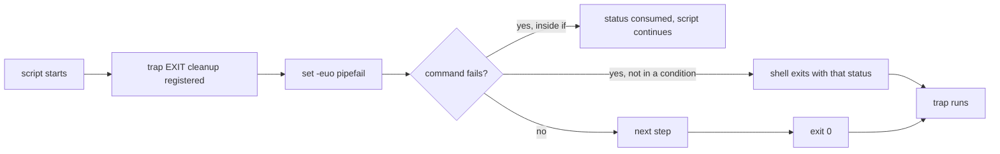

# Shell Scripting

> Every transcript in this lesson was executed on the authoring machine (Windows 11,
> GNU bash 5.3.15 from Git Bash, Python 3.13.5) in the batch-18 `ops-lab-B` scratch lab.
> Each case is a real script run with `bash --noprofile --norc -c` and a reported exit
> status. Where bash on Linux differs from bash inside this POSIX layer the difference is
> called out; nothing here is a transcript of a script that was not run.

## 1. Learning Objectives

After this lesson you will be able to:

- [ ] Explain what `set -e`, `set -u`, and `set -o pipefail` each catch, and the case where `-e` deliberately does nothing
- [ ] Quote expansions so filenames with spaces survive, and say what `"$@"` does that `$@` does not
- [ ] Guarantee cleanup on both the success and failure paths with `trap`
- [ ] Write an argument parser that fails loudly on unknown flags and missing values
- [ ] Make a script idempotent and prove it by comparing state before and after

## 2. Prerequisites

- [03-DEVELOPER-TOOLS](../03-DEVELOPER-TOOLS/README.md) — the shell, exit codes, and pipes
- [Linux Administration](linux-administration.md) — the host these scripts run on
- [Networking for DevOps](networking-for-devops.md) — the commands scripts wrap, and why a timeout matters in one

*No code prerequisite beyond reading Python — the probe drives bash from Python for repeatability.*

## 3. Introduction

A shell script is a program that remembers what you typed once. Its value is not that it
saves keystrokes; it is that the same steps run in the same order with the same failure
behaviour every time. That only holds if the script is written with three habits: **fail
fast and visibly**, **quote everything that came from outside**, and **clean up on every
exit path**. This lesson runs the failures that reveal each habit — the pipeline that hides
a broken first command, the loop that splits a filename in half, the failed deploy that
leaves a temporary directory behind.

## 4. The Problem It Solves

Scripts fail silently more often than they fail loudly:

- **The pipeline masked the failure.** `cat missing.txt | wc -l` exits with `wc`'s status, so `set -e` never fires and the script carries on with empty input — the capture below shows exactly that.
- **An unset variable became an empty string.** `${DEPLOY_ENV}` with no value silently expands to nothing, and the script "deploys to " without complaint.
- **A filename with a space became two arguments.** Unquoted expansion splits on whitespace, so the loop processed `my` and `report.txt` as separate files.
- **The failure path leaked.** A `mktemp -d` directory survives a `set -e` exit unless a `trap` removes it, and a daily cron job fills `/tmp`.
- **A missing flag value died with no message.** The parser `shift`ed past the end and exited `1` with nothing on screen — the operator learns nothing.

## 5. Core Concepts

### Exit status is the contract

Every command returns `0` for success and non-zero for failure, and a script returns its
last command's status. This single byte is how automation composes: a pipeline is a chain
of statuses, `&&` and `||` branch on them, and a CI job passes only when the status is `0`.
A script that cannot fail is a script nobody can trust.

### `set -euo pipefail`

- `-e` (**errexit**) exits when a simple command fails. Two documented exceptions matter: a command in an `if`/`while` condition is exempt (the status is *consumed*), and a failing command in a pipeline is not the pipeline's status without `pipefail`.
- `-u` (**nounset**) makes expansion of an unset variable an error instead of an empty string.
- `pipefail` makes a pipeline return the rightmost non-zero status, so `cat missing | wc -l` fails.

Together they convert silent wrongness into a visible stop. Each has a cost: `-e` can exit
before a cleanup you still wanted (mitigate with `trap`), and `pipefail` breaks the common
idiom `grep pattern file | head`, which now fails when `head` closes early.

### Quoting and the argument vector

`$var` unquoted undergoes **word splitting** and **globbing**; `"$var"` does not. `$@`
unquoted is `$1 $2 …` split again; `"$@"` is the argument vector preserved, one argument
per element. `$*` joins into a single string. The rule that follows: quote every expansion
unless you can name why splitting is what you want.

### Traps

`trap 'command' EXIT` runs on *any* exit, including one caused by `set -e`. Trap on `EXIT`
for cleanup (temp files, lock release, a "deploy failed" message) and on `ERR` for
diagnostics. Because `EXIT` fires for both success and failure, cleanup lives in one place
instead of being duplicated after every step.

### Idempotence

A script is **idempotent** when running it twice leaves the same state as running it once.
`mkdir -p`, `install -d`, `ln -sfn`, and "write only if changed" patterns are idempotent;
`mkdir` and `>>` are not. Idempotence is what lets a script be re-run after a partial
failure instead of requiring manual repair first.

### Argument parsing

A `while [ $# -gt 0 ]` loop with `case` handles `--flag value`, `--boolean`, and `--` end-of-flags.
The failure modes are the point: an unknown flag should exit `2` with a usage line on
stderr, and a flag with a missing value should be *checked* (`[ $# -ge 2 ] || usage`) rather
than discovered by a `shift` that runs off the end.

## 6. How It Works



The diagram is the whole failure model: a status either stops the script or is deliberately
consumed by a condition, and the trap runs on both exits. The probe's cases are the arrows —
phase 1 shows a status going missing in a pipeline, phase 3 shows one consumed by `if`, and
phase 5 shows the trap firing on the `E` path.

## 7. Practical Examples

**Example 1 — the full probe: eight cases, each with a real exit status**

```python
"""Shell scripting lab: set -e / -u / pipefail, quoting, traps, arg parsing.

Windows 11, Git Bash bash, Python 3.13.5.  Writes and rewrites ./script-lab/.
Every result below is a real bash run: each case is a small script executed with
`bash --noprofile --norc -c` and the exit status is reported, not assumed.
"""
from __future__ import annotations

import shutil
import subprocess
from pathlib import Path

LAB = Path(__file__).with_name("script-lab")
BASH = "bash"


def run(label: str, script: str) -> int:
    print(f"--- {label} ---")
    proc = subprocess.run(
        [BASH, "--noprofile", "--norc", "-c", script],
        cwd=LAB,
        capture_output=True,
        text=True,
        timeout=60,
    )
    for line in (proc.stdout + proc.stderr).strip().splitlines():
        print(f"  {line}")
    print(f"  exit={proc.returncode}")
    return proc.returncode


def main() -> None:
    if LAB.exists():
        shutil.rmtree(LAB)
    LAB.mkdir()
    (LAB / "my report.txt").write_text("quarterly\n", encoding="utf-8")
    (LAB / "other.txt").write_text("misc\n", encoding="utf-8")
    print(f"script-lab (Windows 11, {subprocess.run([BASH, '--version'], capture_output=True, text=True).stdout.splitlines()[0]}, Python 3.13.5)")

    print("\n=== 1. set -e does not see into a pipeline without pipefail ===")
    run("set -e, failing pipe, no pipefail", """
set -e
cat missing.txt | wc -l
echo "STILL RUNNING after the failed cat"
""")
    run("set -euo pipefail", """
set -euo pipefail
cat missing.txt | wc -l
echo "UNREACHABLE: this must not print"
""")

    print("\n=== 2. set -u catches the unset variable ===")
    run("unquoted unset var without -u", """
unset DEPLOY_ENV
echo "deploying to ${DEPLOY_ENV}"
""")
    run("same line with set -u", """
set -u
unset DEPLOY_ENV
echo "deploying to ${DEPLOY_ENV}"
""")

    print("\n=== 3. set -e is disabled inside a condition ===")
    run("exit status consumed by if", """
set -e
if ! grep -q present my\\ report.txt; then
  echo "grep failed, and the script keeps going"
fi
echo "reached the end"
""")

    print("\n=== 4. quoting: $* splits, \"$@\" does not ===")
    run("unquoted expansion of a filename with a space", """
for f in $(ls *.txt); do echo "loop item: [$f]"; done
""")
    run("quoted \"$@\"", """
set -- "my report.txt" "other.txt"
for f in "$@"; do echo "loop item: [$f]"; done
echo "count: $#"
""")

    print("\n=== 5. trap runs on the failure path, not just the happy one ===")
    (LAB / "deploy.sh").write_text(
        "#!/usr/bin/env bash\n"
        "set -euo pipefail\n"
        "work=$(mktemp -d)\n"
        "trap 'rm -rf \"$work\"; echo \"cleanup removed $work\"' EXIT\n"
        "echo \"work dir: $work\"\n"
        "cp my\\ report.txt \"$work\"/snapshot.txt\n"
        "false\n"
        "echo \"UNREACHABLE: deploy finished\"\n",
        encoding="utf-8",
    )
    run("deploy.sh with a failing step", "bash deploy.sh")
    leftovers = sorted(p.name for p in LAB.glob("tmp.*"))
    print(f"  leftover temp dirs in cwd: {leftovers if leftovers else 'none'}")

    print("\n=== 6. argument parsing with case, and a usage exit code ===")
    (LAB / "args.sh").write_text(
        "#!/usr/bin/env bash\n"
        "set -euo pipefail\n"
        "env_name=\"\"\n"
        "dry_run=0\n"
        "while [ $# -gt 0 ]; do\n"
        "  case \"$1\" in\n"
        "    --env) shift; env_name=\"${1:-}\" ;;\n"
        "    --dry-run) dry_run=1 ;;\n"
        "    --) shift; break ;;\n"
        "    *) echo \"unknown flag: $1\" >&2; exit 2 ;;\n"
        "  esac\n"
        "  shift\n"
        "done\n"
        "echo \"env=[$env_name] dry_run=$dry_run rest=[$*]\"\n",
        encoding="utf-8",
    )
    run("valid flags", "bash args.sh --env prod --dry-run -- ./migrate.sql")
    run("missing value after --env", "bash args.sh --env")
    run("unknown flag", "bash args.sh --enviroment prod")

    print("\n=== 7. idempotence: the second run changes nothing ===")
    run("mkdir -p twice, then checksum the tree", """
mkdir -p state/releases
printf 'v1\\n' > state/releases/current
sum1=$(find state -type f -exec sha256sum {} + | sort | sha256sum)
mkdir -p state/releases
printf 'v1\\n' > state/releases/current
sum2=$(find state -type f -exec sha256sum {} + | sort | sha256sum)
echo "run 1 tree digest: ${sum1%% *}"
echo "run 2 tree digest: ${sum2%% *}"
[ "$sum1" = "$sum2" ] && echo "idempotent: True" || echo "idempotent: False"
""")

    print("\n=== 8. errexit vs explicit status handling ===")
    run("command substitution swallows the failure", """
set -euo pipefail
out=$(grep -c present missing.txt || true)
echo "captured [$out] and continued"
""")
    run("the same thing without || true", """
set -euo pipefail
out=$(grep -c present missing.txt)
echo "UNREACHABLE"
""")

    print("\nexit=0")


if __name__ == "__main__":
    main()
```

- Phase 1 is the most expensive bug in shell scripting: `cat missing.txt | wc -l` prints `0` and the script keeps going with exit `0`. Adding `pipefail` makes the same pipeline exit `1`, and the "UNREACHABLE" line is never printed.
- Phase 2: without `-u`, `${DEPLOY_ENV}` prints an empty string and exits `0`; with `-u`, bash reports `DEPLOY_ENV: unbound variable` and exits `127`. A missing variable is now a failure, not a blank.
- Phase 3 shows the documented exception: `if ! grep …` consumes the status, so `-e` does not fire and both echo lines print.
- Phase 4 is the quoting rule with a filename that contains a space: unquoted expansion produces `[my]` and `[report.txt]`, `"$@"` produces `[my report.txt]` and `[other.txt]` with `count: 2`.
- Phase 5 runs a deploy script that fails at `false`: the `trap` still prints `cleanup removed /tmp/tmp.…`, the exit status is `1`, and no `tmp.*` directory is left behind.
- Phase 6 parses flags three ways: valid flags give `env=[prod] dry_run=1 rest=[./migrate.sql]`; a missing value exits `1` with **no message** (the `shift` ran off the end); an unknown flag exits `2` with `unknown flag: --enviroment`.
- Phase 7 proves idempotence by hashing the tree before and after a second identical run: both digests are `7ee1a121bff85b40…` and `idempotent: True`.
- Phase 8 contrasts `|| true` (captured empty output, exit `0`) with the same command unprotected (exit `2`).
- **Expected output:** the capture below.
- **How to run it:** `python script_probe.py` (Windows 11, Git Bash, Python 3.13.5). It writes and rewrites `script-lab/`.
- **Assumptions:** bash is GNU bash 5.x; `-u`'s `127` status is this platform's, not a POSIX guarantee (Linux bash exits `1` for the same error).

**Executed capture:**

```text
script-lab (Windows 11, GNU bash, version 5.3.15(2)-release (x86_64-pc-cygwin), Python 3.13.5)

=== 1. set -e does not see into a pipeline without pipefail ===
--- set -e, failing pipe, no pipefail ---
  0
  STILL RUNNING after the failed cat
  cat: missing.txt: No such file or directory
  exit=0
--- set -euo pipefail ---
  0
  cat: missing.txt: No such file or directory
  exit=1

=== 2. set -u catches the unset variable ===
--- unquoted unset var without -u ---
  deploying to
  exit=0
--- same line with set -u ---
  bash: line 4: DEPLOY_ENV: unbound variable
  exit=127

=== 3. set -e is disabled inside a condition ===
--- exit status consumed by if ---
  grep failed, and the script keeps going
  reached the end
  exit=0

=== 4. quoting: $* splits, "$@" does not ===
--- unquoted expansion of a filename with a space ---
  loop item: [my]
  loop item: [report.txt]
  loop item: [other.txt]
  exit=0
--- quoted "$@" ---
  loop item: [my report.txt]
  loop item: [other.txt]
  count: 2
  exit=0

=== 5. trap runs on the failure path, not just the happy one ===
--- deploy.sh with a failing step ---
  work dir: /tmp/tmp.AHAHzmoeVh
  cleanup removed /tmp/tmp.AHAHzmoeVh
  exit=1
  leftover temp dirs in cwd: none

=== 6. argument parsing with case, and a usage exit code ===
--- valid flags ---
  env=[prod] dry_run=1 rest=[./migrate.sql]
  exit=0
--- missing value after --env ---
  exit=1
--- unknown flag ---
  unknown flag: --enviroment
  exit=2

=== 7. idempotence: the second run changes nothing ===
--- mkdir -p twice, then checksum the tree ---
  run 1 tree digest: 7ee1a121bff85b40711507487083d11fe2932b782209f22dd0258a04d28a6d25
  run 2 tree digest: 7ee1a121bff85b40711507487083d11fe2932b782209f22dd0258a04d28a6d25
  idempotent: True
  exit=0

=== 8. errexit vs explicit status handling ===
--- command substitution swallows the failure ---
  captured [] and continued
  grep: missing.txt: No such file or directory
  exit=0
--- the same thing without || true ---
  grep: missing.txt: No such file or directory
  exit=2

exit=0
```

The most instructive line is `exit=1` for the missing `--env` value with no message above
it. That is what a parser without an explicit check looks like from the operator's side: a
non-zero status, no explanation, and no clue which flag was wrong.

**Example 2 — the deploy script these habits produce** (*illustration — assembled from the case results, not a separate run*)

```bash
#!/usr/bin/env bash
set -euo pipefail

usage() { echo "usage: $0 --env <name> [--dry-run] -- <command...>" >&2; exit 2; }

env_name=""
dry_run=0
while [ $# -gt 0 ]; do
  case "$1" in
    --env)        [ $# -ge 2 ] || usage; shift; env_name="$1" ;;
    --dry-run)    dry_run=1 ;;
    -h|--help)    usage ;;
    --)           shift; break ;;
    *)            echo "unknown flag: $1" >&2; usage ;;
  esac
  shift
done
[ -n "$env_name" ] || usage
[ $# -gt 0 ] || { echo "no command given" >&2; usage; }

work=$(mktemp -d)
trap 'rm -rf "$work"' EXIT

echo "deploying to $env_name${dry_run:+ (dry run)}"
for f in "$@"; do
  [ -f "$f" ] || { echo "missing file: $f" >&2; exit 1; }
done
```

- `[ $# -ge 2 ] || usage` is the explicit check phase 6 lacked; it turns a silent `1` into a usage message.
- `for f in "$@"` is phase 4's fix, and `[ -f "$f" ]` turns a missing input into a named error.
- `trap 'rm -rf "$work"' EXIT` is phase 5, and `mktemp -d` keeps concurrent runs apart.
- The quoted `"$@"` after `--` is what makes `./deploy.sh --env prod -- ./migrate.sql` safe with paths that contain spaces.

## 8. Real-World Applications

- **CI steps are shell scripts** with a fixed status contract; a masked pipeline failure is how a red build turns green while shipping nothing.
- **Deploy and migration scripts** run in the failure path more often than the success path, which is why `trap` cleanup and idempotence are non-negotiable.
- **Cron jobs** start with a minimal environment: an unset variable under `-u` fails loudly instead of deleting the wrong directory.
- **Wrapper scripts** around `kubectl`, `terraform`, and `docker` are argument parsers first; unknown flags must fail before they reach a destructive command.
- Paired with: [CI/CD Fundamentals](ci-cd-fundamentals.md) for pipelines built from these scripts, and [Ansible](ansible.md) for when a script should become a declarative task.

## 9. Common Mistakes

| Mistake | Why it happens | How to recognize it | How to prevent it |
|---|---|---|---|
| `set -e` without `pipefail` | `-e` is the famous half | A pipeline's early command fails but the script continues | `set -euo pipefail` in every script |
| `for f in $(ls)` | It looks like a loop over files | Filenames split at spaces; globbing double-expands | `for f in "$dir"/*` or `find … -print0` |
| Unquoted `$var` in a path | It works on the author's machine | Empty or split paths in production | Quote every expansion |
| `shift` before checking `$#` | The happy path works | Exit `1` with no message on a malformed call | Validate arity, print usage to stderr |
| Cleanup after the last step | Easy to see while writing | Temp files and stale locks after a failure | `trap … EXIT` |
| `mkdir` instead of `mkdir -p` | First run succeeded | Second run fails with "File exists" | Idempotent commands |
| `exit` inside a pipeline subshell | Hoping to stop the pipeline | The script continues anyway | Check statuses explicitly; avoid `| while read` for control flow |
| Parsing `ls` output | Convenient | Breaks on spaces, newlines, and symlinks | Globs and `find -print0` |

## 10. Best Practices

- **Open with `set -euo pipefail`** and treat each exception as a decision you can explain, not a habit.
- **Quote by default**, and drop the quotes only where word splitting is the intent (rare, and worth a comment).
- **One exit point for cleanup.** `trap 'cleanup' EXIT` beats repeating `rm` after every step.
- **Validate inputs at the top**: arity, flag values, required files, and a command's presence (`command -v jq`), all with messages on stderr.
- **Write for re-runs.** Idempotent steps mean a failed deploy can be retried instead of repaired.
- **Keep scripts under ~150 lines with functions**; past that, the logic belongs in Python or a declarative tool.
- **Test the failure paths**, not just the happy one: the probe's eight cases are a template for a script's own test list.

## 11. Limitations and Trade-Offs

- **`bash` is not portable POSIX `sh`.** `pipefail` and `[[ ]]` are bash features; `#!/bin/sh` on Debian is `dash` and will reject them. Choose the interpreter deliberately.
- **`set -e` is subtler than it looks.** Conditions, `!`, `&&`/`||` chains, and command substitutions all change whether it fires; relying on it alone produces scripts that are safe in the cases you tested.
- **This host's statuses are not Linux's.** The `-u` failure exits `127` here, while Linux bash exits `1`; the lesson quotes what ran.
- **Exit status is one byte.** A script that needs to distinguish five failure kinds must encode them (or write to a log), because `1` is all a caller sees.
- **Trap-on-EXIT cannot survive `SIGKILL`**, so cleanup must also tolerate leftovers (unique names, stale-lock expiry).
- **Shell scripts do not scale to structured data.** Past a few `jq` calls, the quoting cost exceeds the rewrite cost.

## 12. Practical Exercises

### Introductory

1. **Exercise 5.1** — Add `set -o pipefail` to a script containing `grep pattern file | head -1` and run it when the pattern is absent. Explain the non-zero exit and how you would rewrite the line so it keeps its intended meaning. **Completion criteria:** both runs' statuses and a rewritten line.
2. **Exercise 5.2** — Reproduce phase 4's split with three filenames, one containing a tab. **Completion criteria:** a capture showing the unquoted split and the `"$@"` version, plus a one-sentence rule.

### Intermediate

3. **Exercise 5.3** — Fix phase 6's missing-value case so it prints `usage: … --env <name>` to stderr and exits `2`, matching the unknown-flag path. **Completion criteria:** two captures (missing value, unknown flag) with identical usage text and status `2`.
4. **Exercise 5.4** — Make the phase-5 deploy script hold a lock: fail with a clear message if another instance is running, and release the lock from the same `trap`. **Completion criteria:** a capture where the second concurrent run exits non-zero with `another deploy is running`, and a third run succeeds afterwards.

### Independent problem-solving

5. **Exercise 5.5** — Write a `backup.sh` with the habits from this lesson: `set -euo pipefail`, a `trap` that removes partial archives, `--dry-run`, and a final line that prints the archive's sha256. Run it twice and prove the second run is idempotent. **Completion criteria:** two captured runs with identical tree digests, plus a deliberately failing run (unreadable file) that leaves no partial archive.

*Solutions: attempt first. They live in `solutions/` of this subject.*

## 13. Knowledge Check

1. Why does `set -e` not stop the script in phase 1, and what exactly does `pipefail` change about that pipeline's status?
2. Phase 3 shows a failing `grep` inside `if !` that does not exit the script. Is that a bash bug, a documented exception, or a quoting problem?
3. Phase 6's missing-value case exits `1` with no output. Trace the exact commands that produced that status, and name the one-line fix.
4. A script's `trap` removes its temp directory on `EXIT`. What still leaks if the process is killed with `SIGKILL`, and what design change limits the damage?

## 14. Completion Criteria

Observable evidence that you have understood this lesson:

- [ ] You can explain the failure mode each of `-e`, `-u`, and `pipefail` prevents, and one cost of each
- [ ] You can quote an expansion correctly and say what breaks without the quotes
- [ ] You can write a `trap` that cleans up on success and failure, and demonstrate it
- [ ] You can write an argument parser that rejects unknown flags and missing values with a usage message
- [ ] You can prove a script is idempotent with a before/after state comparison

## 15. Summary

- Exit status is the contract; `set -euo pipefail` is how a script keeps it, with `if` conditions as the documented exception.
- Unquoted expansion splits filenames; `"$@"` preserves the argument vector, and phase 4 shows the difference in one capture.
- `trap … EXIT` ran on the failing path and left no temp directory behind.
- Argument parsing needs explicit arity checks: without one, a missing value exits `1` with nothing on screen.
- Idempotence is provable — two runs, one tree digest, `idempotent: True`.

## 16. Next Steps

- Next lesson: [Docker Fundamentals](docker-fundamentals.md) — packaging the application these scripts deploy
- Practice: the subject's exercise set (written with its exercise installment)
- Where it is applied: [Project 07](../20-PROJECT-LABORATORY/project-07-secure-production-application/README.md) — its deploy and rollback steps are scripts, and both paths must be safe to re-run
