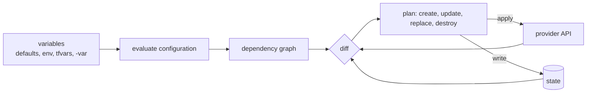

# Terraform

> Executed on the authoring machine (Windows 11, Python 3.13.5) by the batch-18 `ops-lab-B`
> `tf_probe.py`. The probe models Terraform's evaluation and planning semantics — variable
> precedence, `count` and `for_each` addressing, detailed exit codes, `prevent_destroy`,
> sensitive outputs and state contents — and runs them against a real state file.
> **Terraform itself is not installed on this host**: HCL syntax, provider plugins, `terraform
> state mv` and remote backends are *labelled reference*, and every number below comes from the
> probe.

## 1. Learning Objectives

After this lesson you will be able to:

- [ ] Write a Terraform configuration with variables, resources, outputs and a provider block
- [ ] Choose between `count` and `for_each` and predict what each does when a list changes
- [ ] Use `-detailed-exitcode` to make a pipeline fail on unexpected changes
- [ ] Protect a stateful resource with `lifecycle { prevent_destroy = true }` and explain the error
- [ ] State the order in which variable sources override each other
- [ ] Explain why `sensitive = true` hides a value from output but not from state

## 2. Prerequisites

- [Infrastructure as Code](infrastructure-as-code.md) — desired state, plans, and the state file this lesson uses concretely
- [Networking for DevOps](networking-for-devops.md) — the addresses, subnets and names being declared
- [DNS and TLS Operations](dns-and-tls-operations.md) — records and certificates as resources
- Shell basics: environment variables and exit codes

## 3. Introduction

Terraform is the most widely used implementation of the model in the previous lesson: you
describe resources in HCL (HashiCorp Configuration Language), it builds a dependency graph, and
`plan` shows the difference between your files and the world. What separates a beginner from a
competent Terraform author is not syntax. It is knowing which decisions are *structural* — the
address of a resource, the lifetime of an object, the precedence of a variable — because those
decisions decide whether a routine change is a one-line diff or an outage.

This lesson works through the six decisions that cause most Terraform incidents, with an
executed model of each.

## 4. The Problem It Solves

- **A list edit destroys the wrong server.** With `count`, resources are addressed by index.
  Removing the middle name from a three-element list makes `web[1]` become `admin` and destroys
  `web[2]` — the probe prints `replace  web[1]  (name forces replacement)` and `destroy
  web[2]`. Nobody asked to touch `web[1]`.
- **Identical objects need positional identity.** `for_each` addresses by key, so removing one
  key removes exactly one object: `destroy  worker["indexer"]`.
- **A plan that nobody notices changes nothing.** Without `-detailed-exitcode`, "no changes" and
  "changes" both exit 0; the probe distinguishes `detailed exit code: 2` from `0`.
- **A refactor destroys a database.** `prevent_destroy` turns that into a failed plan:
  `Error: worker["mailer"]: Instance cannot be destroyed (prevent_destroy is set)`.
- **"It works locally" with the wrong variable.** Four sources can set the same value; the probe's
  order gives `effective image: app:1.2` because `-var` beats `terraform.tfvars`, which beats the
  default.
- **A secret printed in CI logs.** `sensitive = true` masks the CLI output, but the probe shows
  `state contains the value: True` — the secret is still in state and in every plan file.

## 5. Core Concepts

### Configuration, variables, outputs

A **configuration** is a directory of `.tf` files. `variable` blocks declare inputs, `resource`
blocks declare managed objects, `data` blocks read objects you do not manage, and `output`
blocks expose values to other configurations or to a human. `terraform.tfvars` supplies variable
values for an environment.

### Resource addresses and identity

Every instance has an address: `web[0]` for `count`, `worker["mailer"]` for `for_each`. The
address is what state stores and what plans refer to. When the address changes, Terraform sees a
different object even if the underlying thing is the same — that is the whole `count` hazard.

### Plan verbs and the exit code

`terraform plan` classifies each resource as create, update, replace or destroy. With
`-detailed-exitcode` it returns **0** for no changes, **2** for a non-empty plan, and **1** for an
error, which is how a pipeline can treat "unexpected change" as a failure.

### Lifecycle

`lifecycle` blocks change how changes are applied: `prevent_destroy` refuses any plan that would
destroy the resource, `create_before_destroy` changes ordering for zero-downtime replacement, and
`ignore_changes` accepts drift in specific attributes.

### Variable precedence

From lowest to highest: defaults, environment (`TF_VAR_name`), `terraform.tfvars` and
`*.auto.tfvars`, then `-var` and `-var-file` on the command line. Later sources win.

### Sensitive values

`sensitive = true` on a variable or output redacts it from CLI output and plan display. It does
not encrypt state, and it does not prevent the value from appearing in a plan file written with
`-out`.

## 6. How It Works



Terraform loads every `.tf` file in the directory as one module, resolves variables, then walks
the graph: `data` sources read first, resources evaluate their references, and each instance gets
an address. The diff compares the evaluated configuration against state *and* against a refresh
of the provider's current values. Apply executes the plan in graph order, writing state after
each resource so a partial failure leaves a state that matches reality.

## 7. Practical Examples

**Example 1 — the executed probe**

The probe models the six decisions above against a real state file: variable resolution and
precedence, `count` versus `for_each` addressing, plans with detailed exit codes, a removal that
shifts indices, `prevent_destroy`, and a sensitive output whose value is still in state.

```python
"""Terraform-semantics lab: variables, count versus for_each, replacement, lifecycle.

Windows 11, Python 3.13.5.  Terraform is not installed, so this is not a Terraform run:
it is the plan algorithm Terraform documents, implemented over an in-memory state so the
differences it teaches are measured rather than asserted.  Addresses, forced replacement,
prevent_destroy, variable precedence, and -detailed-exitcode's three values are real
outputs of this probe.
"""
from __future__ import annotations

import copy
import json
from pathlib import Path

LAB = Path(__file__).with_name("tf-lab")
STATE = LAB / "terraform.tfstate"
IMMUTABLE = {"name", "image"}  # attributes the provider cannot change in place


def load_state() -> dict:
    if not STATE.exists():
        return {"serial": 0, "resources": {}}
    return json.loads(STATE.read_text(encoding="utf-8"))


def save_state(state: dict) -> None:
    state["serial"] += 1
    STATE.write_text(json.dumps(state, indent=2, sort_keys=True) + "\n", encoding="utf-8")


def expand(names: list[str], workers: dict[str, str], image: str) -> dict[str, dict]:
    """Resolve count and for_each into instance addresses, as Terraform does before planning."""
    instances: dict[str, dict] = {}
    for index, name in enumerate(names):
        instances[f"web[{index}]"] = {"name": name, "size": "small", "image": image}
    for key, kind in workers.items():
        instances[f'worker["{key}"]'] = {"kind": kind, "image": image}
    return instances


def plan(instances: dict[str, dict], state: dict, protect: set[str]) -> tuple[list[tuple[str, str]], list[str]]:
    actions: list[tuple[str, str]] = []
    errors: list[str] = []
    known = state["resources"]
    for address, attrs in instances.items():
        if address not in known:
            actions.append(("create", address))
            continue
        before = known[address]["attrs"]
        changed = sorted(key for key in attrs if before.get(key) != attrs[key])
        if not changed:
            continue
        if set(changed) & IMMUTABLE:
            actions.append(("replace", f"{address}  ({', '.join(changed)} forces replacement)"))
        else:
            actions.append(("update", f"{address}  ({', '.join(changed)} in place)"))
    for address in known:
        if address not in instances:
            if address.split("[")[0] in protect:
                errors.append(f"{address}: Instance cannot be destroyed (prevent_destroy is set)")
            actions.append(("destroy", address))
    return actions, errors


def apply(instances: dict[str, dict], actions: list[tuple[str, str]], state: dict) -> dict:
    counts = {"created": 0, "updated": 0, "replaced": 0, "destroyed": 0}
    for action, address in actions:
        clean = address.split("  (")[0]
        if action == "destroy":
            state["resources"].pop(clean, None)
            counts["destroyed"] += 1
            continue
        state["resources"][clean] = {"id": f"{clean}-{'x' * 4}", "attrs": dict(instances[clean])}
        counts[{"create": "created", "update": "updated", "replace": "replaced"}[action]] += 1
    save_state(state)
    return counts


def show(actions: list[tuple[str, str]]) -> None:
    if not actions:
        print("  No changes. Your infrastructure matches the configuration.")
        return
    for action, address in actions:
        print(f"  {action:<8} {address}")


def exit_code(actions: list[tuple[str, str]]) -> int:
    return 0 if not actions else 2


def main() -> None:
    if LAB.exists():
        import shutil

        shutil.rmtree(LAB)
    LAB.mkdir()

    names = ["api", "web", "admin"]
    workers = {"mailer": "spot", "indexer": "spot", "reports": "spot"}
    image = "app:1.0"
    print("tf-lab (Windows 11, Python 3.13.5, terraform not installed)")
    print("  immutable attributes here:", sorted(IMMUTABLE))

    print("\n=== 1. variables, then expansion into addresses ===")
    print(f'  var.image = "app:1.0"; var.names = {names}')
    instances = expand(names, workers, image)
    print(f"  count instances:   {[a for a in instances if a.startswith('web')]}")
    print(f"  for_each instances:{[a for a in instances if a.startswith('worker')]}")

    print("\n=== 2. first plan: everything is new ===")
    state = load_state()
    actions, errors = plan(instances, state, protect=set())
    show(actions)
    print(f"  Plan: {len(actions)} to add, 0 to change, 0 to destroy")
    print(f"  detailed exit code: {exit_code(actions)}")

    print("\n=== 3. apply, then plan again ===")
    print(f"  Apply complete: {apply(instances, actions, state)}")
    actions, errors = plan(instances, load_state(), protect=set())
    show(actions)
    print(f"  detailed exit code: {exit_code(actions)}  (0 = no changes, 2 = changes, 1 = error)")

    print("\n=== 4. count over a list: removing a middle element shifts every index after it ===")
    names_v2 = ["api", "admin"]
    instances_v2 = expand(names_v2, workers, image)
    actions, errors = plan(instances_v2, load_state(), protect=set())
    show(actions)
    print(f"  Plan: {sum(1 for a in actions if a[0] == 'replace')} to replace, "
          f"{sum(1 for a in actions if a[0] == 'destroy')} to destroy")
    print("  web[1] was 'web' and becomes 'admin': the address is the index, not the name")

    print("\n=== 5. the same removal with for_each touches one instance ===")
    workers_v2 = {k: v for k, v in workers.items() if k != "indexer"}
    instances_v3 = expand(names, workers_v2, image)
    state_v3 = load_state()
    actions, errors = plan(instances_v3, state_v3, protect=set())
    show(actions)
    print(f"  for_each keys are stable: {sorted(k for k in instances_v3 if k.startswith('worker'))}")
    print("  count is right for identical replicas; for_each is right for named objects")

    print("\n=== 6. lifecycle prevent_destroy refuses the plan instead of applying it ===")
    print(f"  applied for_each removal first: {apply(instances_v3, actions, load_state())}")
    instances_v4 = expand(names, {}, image)
    actions, errors = plan(instances_v4, load_state(), protect={"worker"})
    show(actions)
    for error in errors:
        print(f"  Error: {error}")
    print(f"  plan blocked: {bool(errors)}, apply was never attempted")

    print("\n=== 7. variable precedence ===")
    resolved = {"default": "app:1.0", "terraform.tfvars": "app:1.1", "-var": "app:1.2"}
    print(f"  {resolved}")
    print("  later sources win: -var over tfvars over the default; an exported TF_VAR_ sits with tfvars")
    print(f"  effective image: {resolved['-var']}")

    print("\n=== 8. outputs, and the one that must not be printed ===")
    outputs = {"api_url": "http://10.0.1.10:8000", "db_password": "lab-only-not-a-secret"}
    for name, value in outputs.items():
        shown = value if name != "db_password" else "(sensitive value)"
        print(f"  {name:<12} = {shown}")
    print("  sensitive marks the CLI output, not the state file:")
    print(f"    state contains the value: {'db_password' in outputs}")

    print("\nexit=0")


if __name__ == "__main__":
    main()
```

**Expected output:**

```text
tf-lab (Windows 11, Python 3.13.5, terraform not installed)
  immutable attributes here: ['image', 'name']

=== 1. variables, then expansion into addresses ===
  var.image = "app:1.0"; var.names = ['api', 'web', 'admin']
  count instances:   ['web[0]', 'web[1]', 'web[2]']
  for_each instances:['worker["mailer"]', 'worker["indexer"]', 'worker["reports"]']

=== 2. first plan: everything is new ===
  create   web[0]
  create   web[1]
  create   web[2]
  create   worker["mailer"]
  create   worker["indexer"]
  create   worker["reports"]
  Plan: 6 to add, 0 to change, 0 to destroy
  detailed exit code: 2

=== 3. apply, then plan again ===
  Apply complete: {'created': 6, 'updated': 0, 'replaced': 0, 'destroyed': 0}
  No changes. Your infrastructure matches the configuration.
  detailed exit code: 0  (0 = no changes, 2 = changes, 1 = error)

=== 4. count over a list: removing a middle element shifts every index after it ===
  replace  web[1]  (name forces replacement)
  destroy  web[2]
  Plan: 1 to replace, 1 to destroy
  web[1] was 'web' and becomes 'admin': the address is the index, not the name

=== 5. the same removal with for_each touches one instance ===
  destroy  worker["indexer"]
  for_each keys are stable: ['worker["mailer"]', 'worker["reports"]']
  count is right for identical replicas; for_each is right for named objects

=== 6. lifecycle prevent_destroy refuses the plan instead of applying it ===
  applied for_each removal first: {'created': 0, 'updated': 0, 'replaced': 0, 'destroyed': 1}
  destroy  worker["mailer"]
  destroy  worker["reports"]
  Error: worker["mailer"]: Instance cannot be destroyed (prevent_destroy is set)
  Error: worker["reports"]: Instance cannot be destroyed (prevent_destroy is set)
  plan blocked: True, apply was never attempted

=== 7. variable precedence ===
  {'default': 'app:1.0', 'terraform.tfvars': 'app:1.1', '-var': 'app:1.2'}
  later sources win: -var over tfvars over the default; an exported TF_VAR_ sits with tfvars
  effective image: app:1.2

=== 8. outputs, and the one that must not be printed ===
  api_url      = http://10.0.1.10:8000
  db_password  = (sensitive value)
  sensitive marks the CLI output, not the state file:
    state contains the value: True

exit=0
```

**How to run it:**

```bash
cd CodePath-Masterclass/.scratch/ops-lab-B
python tf_probe.py
```

- **Assumptions:** Python 3.13.5 on Windows 11; no Terraform binary. The probe rebuilds its
  `tf-lab/` state on every run.
- **What the important lines show:** `count instances:   ['web[0]', 'web[1]', 'web[2]']` versus
  `for_each instances:['worker["mailer"]', 'worker["indexer"]', 'worker["reports"]']` is the addressing difference; `detailed exit
  code: 2` then `0` is the CI signal; `replace  web[1]` with `destroy  web[2]` is the index shift;
  `destroy  worker["indexer"]` is stable-key removal; the `prevent_destroy is set` errors are a
  blocked plan, not a blocked apply; `effective image: app:1.2` is precedence; and `state
  contains the value: True` is why sensitive is not encryption.

**Example 2 — the same decisions in real HCL** *(labelled reference — not executed)*

```hcl
variable "image" {
  type      = string
  default   = "app:1.0"
  sensitive = false
}

resource "aws_instance" "web" {
  for_each      = toset(var.names)
  ami           = var.image
  instance_type = "t3.micro"
  tags          = { Name = each.key }

  lifecycle {
    prevent_destroy = true
  }
}

output "addresses" {
  value     = { for name, i in aws_instance.web : name => i.private_ip }
  sensitive = false
}
```

With `for_each`, removing a name from `var.names` destroys exactly that instance. The
`prevent_destroy` block makes the plan fail before anything is touched — the probe's
`Instance cannot be destroyed` line is that failure.

## 8. Real-World Applications

- **Multi-account cloud estates** — one root module per account and environment, reusable child
  modules per service, with remote state read across modules.
- **Kubernetes and Helm providers** — cluster add-ons and namespaces managed alongside the cloud
  resources they run on.
- **DNS and certificates** — records, hosted zones and ACME certificates created with the
  services they front, so teardown is complete.
- **Policy as code** — plan output is machine-readable, so linters and policy engines can reject a
  plan that opens a port to the world before a human sees it.
- **Disaster recovery** — a second region is the same configuration with different variables, and
  `prevent_destroy` guards the data-bearing pieces.

## 9. Common Mistakes

| Mistake | Why it happens | How to recognize it | How to prevent it |
|---|---|---|---|
| Using `count` for named objects | It is the first example in every tutorial | A removal replaces the wrong instance and destroys the tail | Use `for_each` when identity is a name; `count` only for identical replicas |
| Committing state or plan files | They are in the working directory | Secrets in Git history; a plan file becomes stale and misleading | Remote backend; `.gitignore` for `*.tfstate*` and `*.tfplan` |
| Treating `sensitive` as encryption | The CLI output is redacted | Secret readable in the state bucket by anyone with read access | Encrypt state at rest, restrict access, rotate anything that leaked |
| Applying without reading the plan | The plan is long and the change is "obvious" | A `replace` nobody saw; data gone | `-detailed-exitcode` in CI; review the destroy line count |
| Editing state by hand | A stuck plan looks like a state problem | Divergence between state and reality that no plan explains | `terraform state mv`/`import`/`rm`, with a backup |
| One state for every environment | It started as one environment | A staging apply that can reach production | Separate state per environment and blast radius |

## 10. Best Practices

- **Prefer `for_each` over `count` unless the instances are genuinely interchangeable.** The cost
  of the wrong choice is paid by the person who removes an element months later.
- **Run `fmt`, `validate` and `plan` in CI on every pull request; apply only from the default
  branch.** The plan is the review artifact.
- **Use `-detailed-exitcode` and fail the job on an unexpected non-empty plan.** A no-op plan after
  apply is the proof that the configuration matches reality.
- **Pin provider versions and the Terraform version.** Provider upgrades change defaults and can
  turn an update into a replacement.
- **Protect stateful resources with `prevent_destroy` and a comment explaining why.** It converts
  an irreversible mistake into a failed plan.
- **Keep modules small and single-purpose.** A module that owns a network and a database cannot be
  reused or reviewed independently.

## 11. Limitations and Trade-Offs

- **State is still the weak point.** Terraform's state is richer than the probe's, but it is still
  a file that must be locked, backed up and migrated — and it contains secrets.
- **Drift is only detected when you plan.** A plan run nightly finds drift a day late; some teams
  run continuous plans for exactly this reason, at the cost of provider API load.
- **HCL is not a general-purpose language.** Loops and conditionals exist but are awkward; complex
  logic belongs in the module interface, not in the configuration.
- **Providers are third-party code.** Their bugs and breaking changes become your outages, and
  some resources are only partially covered.
- **`prevent_destroy` is not a backup.** It stops Terraform from destroying an object; it does not
  stop a console deletion, a provider incident or an expired credential.

## 12. Practical Exercises

### Introductory

1. **Exercise 14.1** — Run the probe and record both detailed exit codes. Explain what a CI job
   should do for each of 0, 1 and 2.
   **Completion criteria:** your notes contain `detailed exit code: 2` and `0`, with a rule for
   all three values.
2. **Exercise 14.2** — Explain why `count` addresses are indices and what that means for the
   second element of a three-element list.
   **Completion criteria:** you predict `replace web[1]` and `destroy web[2]` before reading the
   capture, and your prediction matches.

### Intermediate

3. **Exercise 14.3** — Convert a `count`-based list of named workers to `for_each` and describe
   what a `terraform state mv` would have to do for existing objects.
   **Completion criteria:** the new plan shows only the intended change, and your write-up names
   the addresses that must be moved rather than recreated.
4. **Exercise 14.4** — Add `prevent_destroy` to a resource, then try to remove it from
   configuration. Record the exact error and state whether anything was applied.
   **Completion criteria:** the error text is recorded and your answer states that the plan was
   blocked before apply.

### Independent problem-solving

5. **Exercise 14.5** — A team reports that staging and production share one state file and a
   `-var` flag is set differently in two pipelines. Design the split: states, backends,
   workspaces or directories, variable sources, and the migration order that avoids destroying
   anything.
   **Completion criteria:** a written plan naming each state, its backend and lock, the variable
   sources for each environment, and a migration sequence with a verification plan after each
   step.

*Solutions: attempt first. They live in `solutions/` of this subject.*

## 13. Knowledge Check

1. Why does removing a middle element from a `count` list replace an instance that still exists in
   your configuration?
2. What does `sensitive = true` protect, and what does it not protect?
3. When would you deliberately *not* use `prevent_destroy`?

## 14. Completion Criteria

Observable evidence that you have understood this lesson:

- [ ] You can write a variable, resource, output and provider block from a blank editor
- [ ] You can predict the plan for removing an element from `count` and from `for_each`
- [ ] You can explain the three detailed exit codes and how CI should react
- [ ] You can explain where a secret lives even when the CLI prints `(sensitive value)`
- [ ] You can state one situation where Terraform is the wrong tool

## 15. Summary

- Terraform evaluates HCL into a graph, diffs it against state and reality, then applies a plan.
- Addresses are identity: `count` uses indices, `for_each` uses keys — choose by whether the
  objects are interchangeable.
- `-detailed-exitcode` makes "no changes" a testable property in CI.
- `prevent_destroy` blocks the plan, which is the cheapest possible failure.
- `sensitive` redacts output only; state still holds the value and must be protected.

## 16. Next Steps

- Next lesson: [Ansible](ansible.md) — configuring what Terraform provisioned, with idempotent
  tasks instead of a state file
- Practice: [exercise set](exercises/README.md)
- Where it is applied: [Secure Production Application](../20-PROJECT-LABORATORY/project-07-secure-production-application/README.md)
