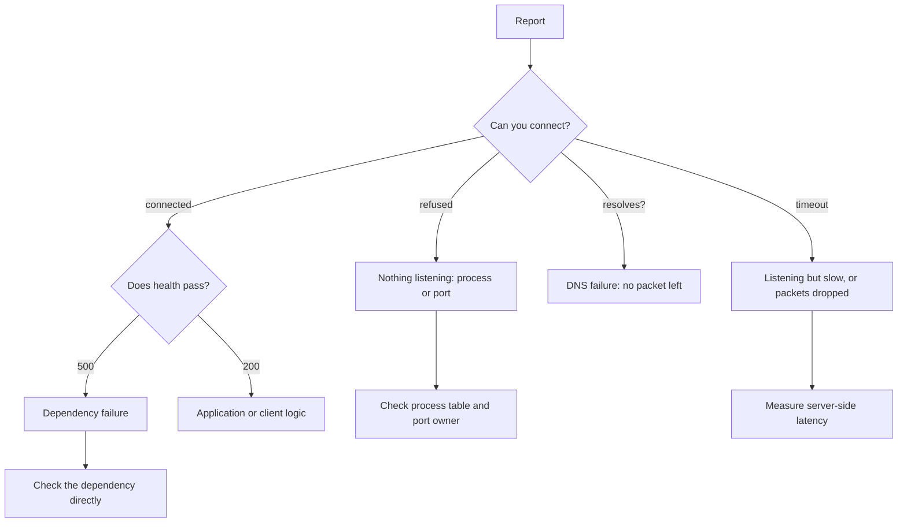

# Troubleshooting Playbooks

> Executed on the authoring machine (Windows 11, Python 3.13.5) by the batch-18 `ops-lab-B`
> `troubleshoot_probe.py`. The probe injects six real failures on loopback — a held port, a
> listener that answers 500, an unresolvable name, a read-only file, a dependency slower than the
> client timeout, and a lock left by a dead process — and runs the same narrowing procedure against
> each: observe the symptom, test the cheapest hypothesis, name the cause only after a check has
> eliminated the alternatives. Docker, systemd and Kubernetes are not installed on this host, so
> their inspection commands are *labelled reference*; every number below is from the probe.

## 1. Learning Objectives

After this lesson you will be able to:

- [ ] Turn a vague report ("it is down") into a specific symptom with a measurable definition
- [ ] Order checks by cost and by how much each one eliminates
- [ ] Distinguish refused, timeout, DNS failure, permission failure and application failure
- [ ] Use the process table to prove whether a lock's owner is alive
- [ ] Write a playbook another engineer can follow without asking you questions
- [ ] Recognise when to stop diagnosing and mitigate first

## 2. Prerequisites

- [Networking for DevOps](../networking-for-devops.md) — ports, connection states and DNS
- [Linux Administration](../linux-administration.md) — processes, permissions and log locations
- [Monitoring and Logging](../monitoring-and-logging.md) — the signals that start an investigation
- [Deployment Strategies](../deployment-strategies.md) — the change that is often the cause
- [Backups and Recovery](../backups-and-recovery.md) — the last resort when data is damaged

## 3. Introduction

A **playbook** is a written procedure for diagnosing a class of failure: the symptom, the checks in
order, what each result rules in or out, and the action for each branch. It exists so that
diagnosis does not depend on who is awake.

**Triage** is the part of diagnosis that decides what to look at first. Good triage is not
thoroughness; it is efficiency under uncertainty. The cheapest checks come first, and each check
should cut the space of possible causes roughly in half. "Restart everything and see" is not
triage; it destroys evidence and often appears to work.

The discipline this lesson teaches is narrow and practical: *do not name a cause until a check has
excluded the others*. Every incident in the probe is designed so that the obvious guess is wrong at
least once.

## 4. The Problem It Solves

The same report — "the service is down" — can mean at least six different failures, each with a
different fix:

- the process is not running;
- the process runs but another process owns the port;
- the process listens but its dependency is failing;
- the name does not resolve, so no connection is attempted;
- the request is refused by a permission or quota;
- the request is simply slower than the client will wait.

Fixing the wrong one wastes the most valuable minutes of an incident and can make things worse: a
restart during a database failover, a permission change that hides a disk-full condition, a
firewall rule added for a DNS problem. A playbook exists to prevent that.

There is a second problem: knowledge lives in one person's head. When that person is on holiday,
the team's mean time to recovery is that person's availability. Written procedures are how a team
scales diagnosis.

## 5. Core Concepts

### Symptom, hypothesis, check, verdict

- **Symptom** — what is observable and wrong, stated precisely: "connections to :8080 are refused",
  not "the API is broken".
- **Hypothesis** — one candidate cause that would produce that symptom.
- **Check** — the cheapest observation that distinguishes the hypothesis from its alternatives.
- **Verdict** — the cause, only after a check has eliminated the others.

### The failure vocabulary

Learning to tell these apart is most of the skill:

| Observation | Most likely meaning |
| --- | --- |
| Connection refused immediately | Nothing is listening on that port |
| Connection hangs, then times out | Something is listening but not answering, or a firewall drops packets |
| Name resolution error | No packet left the machine; DNS or the hostname is wrong |
| Permission denied on a file operation | The process user lacks the right; the path and disk may be fine |
| HTTP 500 from a health endpoint | The listener is healthy, the dependency behind it is not |
| Lock file naming a dead process | The lock is stale, not held |

### Elimination order

Order checks by *cost* (seconds, no side effects) and by *discrimination* (how much each outcome
rules out). Binding a port again is free and eliminates a whole class. Reading a log is cheap but
often ambiguous. Restarting is expensive, destroys state, and should be a mitigation, not a
diagnostic step.

### Mitigate versus diagnose

Under time pressure, stop the bleeding first: roll back, fail over, disable the feature. Then
diagnose on the preserved evidence. A rollback that makes the symptom disappear is itself a strong
clue — but only if you captured the state before it.

### Blameless facts

Write down what you observed, with timestamps, before interpreting it. "Deploy finished at 14:02,
first 500 at 14:03" is a fact. "The deploy broke it" is a conclusion that may be wrong — the
database may have failed at 14:02:30 for unrelated reasons.

## 6. How It Works



The probe walks the left branch of that tree once per incident and prints the verdict after the
check, never before.

Its method, repeated for each failure:

1. Print the symptom as a quoted user report.
2. Run the cheapest check that could eliminate a class of causes.
3. Print the raw result — error number and message, not a paraphrase.
4. State the verdict and the next action, conditional on that result.

## 7. Practical Examples

**Example 1 — the executed probe**

```python
"""OPS-21 probe: triage is a sequence of checks that eliminate causes.

Windows 11, Python 3.13.5. The probe injects six real failures on loopback -- a held
port, a listening process that answers 500, an unresolvable name, a read-only file, a
dependency slower than the client timeout, and a lock left by a dead process -- and runs
the same narrowing procedure against each: observe the symptom, test the cheapest
hypothesis, and only then name a cause. No docker, systemd or Kubernetes is present, so
their inspection commands are *labelled reference*.
"""

from __future__ import annotations

import http.client
import os
import socket
import stat
import subprocess
import sys
import threading
import time
from http.server import BaseHTTPRequestHandler, ThreadingHTTPServer
from pathlib import Path

WORK = Path("trouble-lab")


def pid_exists(pid: int) -> bool:
    """Ask the process table, the same source an operator reads.

    OpenProcess alone is misleading on Windows: a terminated child stays openable while
    a handle to it is alive, so liveness must come from the table, not the handle.
    """
    result = subprocess.run(["tasklist", "/FI", f"PID eq {pid}", "/NH"],
                            capture_output=True, text=True)
    return str(pid) in result.stdout


class Unhealthy(BaseHTTPRequestHandler):
    protocol_version = "HTTP/1.1"

    def do_GET(self) -> None:  # noqa: N802
        body = b"dependency unavailable\n"
        self.send_response(500)
        self.send_header("Content-Length", str(len(body)))
        self.end_headers()
        self.wfile.write(body)

    def log_message(self, *args) -> None:
        return


class Slow(BaseHTTPRequestHandler):
    protocol_version = "HTTP/1.1"

    def do_GET(self) -> None:  # noqa: N802
        time.sleep(1.5)
        body = b"late\n"
        self.send_response(200)
        self.send_header("Content-Length", str(len(body)))
        self.end_headers()
        self.wfile.write(body)

    def log_message(self, *args) -> None:
        return


def serve(handler, port: int) -> ThreadingHTTPServer:
    server = ThreadingHTTPServer(("127.0.0.1", port), handler)
    threading.Thread(target=server.serve_forever, daemon=True).start()
    return server


def incident_port_conflict() -> None:
    print('=== incident 1: "the service will not start" ===')
    holder = socket.socket()
    holder.bind(("127.0.0.1", 8115))
    holder.listen()
    print("  check 1 (is the port free?): trying to bind 127.0.0.1:8115 again")
    try:
        second = socket.socket()
        second.bind(("127.0.0.1", 8115))
    except OSError as error:
        print(f"  result: OSError {error.errno} ({error.strerror})")
    print("  check 2 (is anything listening?): connect succeeds")
    probe = socket.create_connection(("127.0.0.1", 8115), timeout=1)
    probe.close()
    print("  verdict: port conflict, not a broken build; the old process still owns the port")
    holder.close()


def incident_500() -> None:
    print('\n=== incident 2: "the service is up but every request fails" ===')
    server = serve(Unhealthy, 8116)
    print("  check 1 (process alive?): TCP connect to 127.0.0.1:8116 succeeds")
    conn = http.client.HTTPConnection("127.0.0.1", 8116, timeout=2)
    conn.request("GET", "/health")
    response = conn.getresponse()
    response.read()
    conn.close()
    print(f"  check 2 (does health pass?): status {response.status}")
    print("  verdict: the listener is healthy, the dependency behind it is not")
    server.shutdown()


def incident_dns() -> None:
    print('\n=== incident 3: "the database host cannot be reached" ===')
    print("  check 1 (does the name resolve?):")
    try:
        socket.getaddrinfo("db.internal.invalid", 5432)
    except socket.gaierror as error:
        print(f"  result: gaierror {error.errno} ({error.strerror})")
    print("  check 2 (is the failure name resolution or routing?): IP literal still connects?")
    print("  verdict: name resolution, so no packet ever left the machine")
    print("  next: fix DNS or the hostname, not the firewall")


def incident_permissions() -> None:
    print('\n=== incident 4: "the app cannot write its log" ===')
    WORK.mkdir(exist_ok=True)
    target = WORK / "app.log"
    target.write_text("started\n", encoding="utf-8")
    os.chmod(target, stat.S_IREAD)
    print("  check 1 (does the path exist?): yes")
    try:
        target.write_text("next line\n", encoding="utf-8")
    except PermissionError as error:
        print(f"  result: PermissionError {error.errno} ({error.strerror})")
    print("  verdict: permissions, not disk space and not a broken path")
    print("  next: compare file mode and owner with the process user")
    os.chmod(target, stat.S_IWRITE | stat.S_IREAD)


def incident_timeout() -> None:
    print('\n=== incident 5: "the endpoint is slow, or is it dead?" ===')
    server = serve(Slow, 8117)
    print("  check 1 (does it answer inside the client timeout?)")
    started = time.perf_counter()
    conn = http.client.HTTPConnection("127.0.0.1", 8117, timeout=0.4)
    try:
        conn.request("GET", "/report")
        conn.getresponse().read()
    except (TimeoutError, socket.timeout):
        elapsed = time.perf_counter() - started
        print(f"  result: timeout after {elapsed:.2f}s, not a refusal")
    conn.close()
    print("  check 2 (refused versus slow): a closed port refuses immediately and never answers")
    print("  verdict: the server is listening and working, just slower than the client will wait")
    server.shutdown()


def incident_stale_lock() -> None:
    print('\n=== incident 6: "the deploy is blocked by a lock" ===')
    WORK.mkdir(exist_ok=True)
    with subprocess.Popen([sys.executable, "-c", "pass"]) as child:
        dead_pid = child.pid
        child.wait()
    lock = WORK / "deploy.lock"
    lock.write_text(str(dead_pid), encoding="utf-8")
    live_pid = os.getpid()
    print(f"  check 1 (is the owning process alive?): pid {live_pid} -> {pid_exists(live_pid)}")
    print("  check 2 (and the pid recorded in the lock?):")
    print(f"  recorded pid {dead_pid} was a child that already exited -> {pid_exists(dead_pid)}")
    print("  verdict: the lock file is stale; it names a process that no longer exists")
    print("  next: confirm with the process table before deleting it, never delete blind")
    lock.unlink()


def main() -> None:
    print("trouble-lab (Windows 11, Python 3.13.5)")
    print("  each incident: cheapest check first, then the cause it rules out\n")
    incident_port_conflict()
    incident_500()
    incident_dns()
    incident_permissions()
    incident_timeout()
    incident_stale_lock()

    print("\n=== playbook: symptom -> first check -> what it proves ===")
    rows = [
        ("service will not start", "bind the port again", "conflict vs permission"),
        ("every request fails", "GET /health", "listener vs dependency"),
        ("host unreachable", "resolve the name", "DNS vs routing"),
        ("cannot write a file", "open the path", "permissions vs space"),
        ("request hangs", "time the connect", "slow vs refused"),
        ("deploy blocked", "check the lock owner pid", "live vs stale lock"),
    ]
    for symptom, check, proves in rows:
        print(f"  {symptom:<24} {check:<26} {proves}")
    print("\nexit=0")


if __name__ == "__main__":
    main()
```

**Expected output** (full capture):

```text
trouble-lab (Windows 11, Python 3.13.5)
  each incident: cheapest check first, then the cause it rules out

=== incident 1: "the service will not start" ===
  check 1 (is the port free?): trying to bind 127.0.0.1:8115 again
  result: OSError 10048 (Only one usage of each socket address (protocol/network address/port) is normally permitted)
  check 2 (is anything listening?): connect succeeds
  verdict: port conflict, not a broken build; the old process still owns the port

=== incident 2: "the service is up but every request fails" ===
  check 1 (process alive?): TCP connect to 127.0.0.1:8116 succeeds
  check 2 (does health pass?): status 500
  verdict: the listener is healthy, the dependency behind it is not

=== incident 3: "the database host cannot be reached" ===
  check 1 (does the name resolve?):
  result: gaierror 11001 (getaddrinfo failed)
  check 2 (is the failure name resolution or routing?): IP literal still connects?
  verdict: name resolution, so no packet ever left the machine
  next: fix DNS or the hostname, not the firewall

=== incident 4: "the app cannot write its log" ===
  check 1 (does the path exist?): yes
  result: PermissionError 13 (Permission denied)
  verdict: permissions, not disk space and not a broken path
  next: compare file mode and owner with the process user

=== incident 5: "the endpoint is slow, or is it dead?" ===
  check 1 (does it answer inside the client timeout?)
  result: timeout after 0.41s, not a refusal
  check 2 (refused versus slow): a closed port refuses immediately and never answers
  verdict: the server is listening and working, just slower than the client will wait

=== incident 6: "the deploy is blocked by a lock" ===
  check 1 (is the owning process alive?): pid 4060 -> True
  check 2 (and the pid recorded in the lock?):
  recorded pid 20412 was a child that already exited -> False
  verdict: the lock file is stale; it names a process that no longer exists
  next: confirm with the process table before deleting it, never delete blind

=== playbook: symptom -> first check -> what it proves ===
  service will not start   bind the port again        conflict vs permission
  every request fails      GET /health                listener vs dependency
  host unreachable         resolve the name           DNS vs routing
  cannot write a file      open the path              permissions vs space
  request hangs            time the connect           slow vs refused
  deploy blocked           check the lock owner pid   live vs stale lock

exit=0
```

**How to run it:**

```bash
cd CodePath-Masterclass/.scratch/ops-lab-B
python troubleshoot_probe.py
```

- **Assumptions:** Python 3.13.5 on Windows 11; all failures are injected on loopback; error
  numbers are Windows values (`10048`, `11001`, `13`), and the Linux equivalents are named in the
  prose where they differ.
- **What the important lines show:** `OSError 10048` with a successful connect is a port conflict,
  not a broken build; `status 500` after a successful connect separates the listener from its
  dependency; `gaierror 11001` proves no packet was sent, so firewall rules are irrelevant;
  `PermissionError 13` with an existing path separates permissions from space; `not a refusal`
  distinguishes a slow server from a dead one; and `already exited -> False` from the process
  table is what makes a lock provably stale.

**Example 2 — the same checks on Linux** *(labelled reference — not executed)*

```bash
ss -ltnp 'sport = :8080'          # who owns the port, if anyone
ss -tn state time-wait           # sockets still draining
getent hosts db.internal         # name resolution, the Linux path
ls -l /var/log/app/app.log       # mode and owner before blaming disk
curl -fsS -m 2 http://127.0.0.1:8080/health
ps -o pid,lstart,cmd -p "$(cat /run/app/deploy.lock)"
```

`ss -ltnp` answers both "is anything listening?" and "which process?" in one command, which is why
it is the first line of the port playbook. `ps -o lstart` compares the process start time with the
lock's creation time, the Linux equivalent of the probe's liveness check.

**Example 3 — a written playbook entry** *(template — adapt, do not copy verbatim)*

```markdown
## Symptom: API returns 502 from the edge

1. Check the edge's upstream health: `curl -sS http://127.0.0.1:8080/health`
   - connection refused -> go to "nothing listening"
   - 5xx -> go to "dependency failing"
   - 200 -> go to "edge configuration"
2. Nothing listening: `ss -ltnp 'sport = :8080'`
   - empty -> the process died; read its log and its exit code before restarting
   - owned by another pid -> port conflict; identify the owner before killing anything
3. Dependency failing: check the dependency directly, then its credentials and pool saturation
4. Edge configuration: compare the running config with the repository version by hash
```

The value is in the branches and the order, not in the prose. A playbook that says "investigate the
logs" is a wish.

## 8. Real-World Applications

- **On-call handover** passes a playbook, not a person's memory; the new shift can act without a
  call.
- **Incident review** uses the playbook's timestamps to reconstruct what was checked and what was
  missed, and the playbook is amended afterwards.
- **Support tiers** escalate by evidence: tier one collects the outputs the playbook names, so tier
  two starts with data instead of a description.
- **Chaos exercises** inject a known failure and time how long the playbook takes to reach the
  verdict, which is a measurable skill.

## 9. Common Mistakes

| Mistake | Why it happens | How to recognize it | How to prevent it |
| --- | --- | --- | --- |
| Restarting before observing | It often works, and it is fast | The cause is unknown and the incident recurs | Capture state, then mitigate |
| Trusting "connection refused" as "server down" | The message sounds definitive | The process is running but on another port | Check the listening socket, not the process name |
| Ignoring DNS | The host "obviously" exists | Error is name resolution, yet firewall rules are being edited | Resolve the name first; it is one command |
| Deleting a lock without checking | The lock is in the way | Two deploys run at once, or a live job is interrupted | Prove the owner is gone via the process table |
| Diagnosing during an active outage | Urgency feels like progress | The timeline has no facts, only actions | Mitigate, preserve evidence, diagnose after |
| Playbook with no branches | Written from memory after the fact | Steps say "investigate" and "check logs" | Write the decision tree with observable outputs |
| One playbook for all services | Copy-paste | Steps reference the wrong ports and paths | One per service, generated from the same template |

## 10. Best Practices

- Start every playbook with the symptom as a user would report it, then define it measurably.
- Make each step produce a raw output (error number, status, line) that the next step branches on.
- Put the cheapest, most discriminating check first; put restarts last and label them as mitigation.
- Include the "stop and escalate" condition: what evidence means this is beyond the playbook.
- Record timestamps and command output in the incident channel as you go.
- After every incident, amend the playbook with the check you wished you had run.
- Test playbooks in a drill; a procedure nobody has executed is a document, not a capability.

## 11. Limitations and Trade-Offs

- **Playbooks age.** Ports, paths and service names change; an unmaintained playbook is worse than
  none because it is trusted.
- **They cover known failures.** Novel failures need the same discipline applied live, not a
  script.
- **They can encourage tunnel vision** if followed without judgement; the escalation condition is
  part of the procedure, not an admission of failure.
- **The probe's failures are single-cause.** Real incidents often combine two (a slow dependency
  plus a retry storm), and the checks interact.
- **Windows error numbers differ from Linux** (`10048` versus `EADDRINUSE`); the mapping is part of
  the playbook, not something to guess under pressure.

## 12. Practical Exercises

### Introductory

1. **Exercise 21.1** — Run the probe and classify each incident by the failure vocabulary table.
   **Completion criteria:** a six-row table naming the observation and its class, with the exact
   error number or status quoted for each.
2. **Exercise 21.2** — Explain why incident 3 rules out a firewall problem before any firewall rule
   is inspected.
   **Completion criteria:** you quote `gaierror 11001` and state that name resolution happens
   before any packet is sent.

### Intermediate

3. **Exercise 21.3** — Reorder the checks in incident 1 so the first step is connecting instead of
   binding. Explain what information is lost and whether the verdict still holds.
   **Completion criteria:** you show that a successful connect proves a listener exists but not that
   it is the *intended* one, and state the ambiguity that the bind check removes.
4. **Exercise 21.4** — Add a seventh incident: a service that is running and healthy but returns
   stale data from a cache. Write the symptom, the checks in order, and the verdict condition.
   **Completion criteria:** a playbook entry with at least three branching checks, including how to
   distinguish stale cache from stale replica.

### Independent problem-solving

5. **Exercise 21.5** — Write a complete playbook for a two-service deployment (web plus database)
   covering: no response, 502, slow responses, failed migrations after a deploy, and a stale deploy
   lock. Include escalation conditions and the exact evidence to capture.
   **Completion criteria:** each symptom has an ordered decision tree ending in a verdict, at least
   one check per branch is a one-line command, and the escalation section names the evidence that
   triggers it.

*Solutions: attempt first. They live in `solutions/` of this subject.*

## 13. Knowledge Check

1. Why is "connection refused" different from a timeout, and what does each suggest?
2. What does a DNS failure prove about the network path?
3. How do you prove a deploy lock is stale without deleting it?
4. When should you stop diagnosing and mitigate, and what must you capture first?

## 14. Completion Criteria

Observable evidence that you have understood this lesson:

- [ ] You can restate a vague report as a measurable symptom
- [ ] You can order checks by cost and discrimination
- [ ] You can distinguish refused, timeout, DNS, permission and application failures by output
- [ ] You can prove a lock owner is gone using the process table
- [ ] You can write a playbook with branches and an escalation condition

## 15. Summary

- Triage is ordered elimination, not thoroughness; each check should cut the hypothesis space.
- The error you see is evidence about *where* the request stopped, and that is often enough.
- Refused, timeout, DNS, permission and 5xx failures each narrow the cause to a different layer.
- Locks and processes must be checked against the process table, not inferred from a file.
- A playbook is a decision tree with observable branches, maintained after every incident.
- Mitigate first under time pressure, but capture evidence before you change state.

## 16. Next Steps

- Subject index: [DevOps and Infrastructure](../README.md)
- Practice: [exercise set](../exercises/README.md)
- Where it is applied: [Secure Production Application](../../20-PROJECT-LABORATORY/project-07-secure-production-application/README.md)
- Revisit: [Monitoring and Logging](../monitoring-and-logging.md) — the signals these playbooks
  consume
