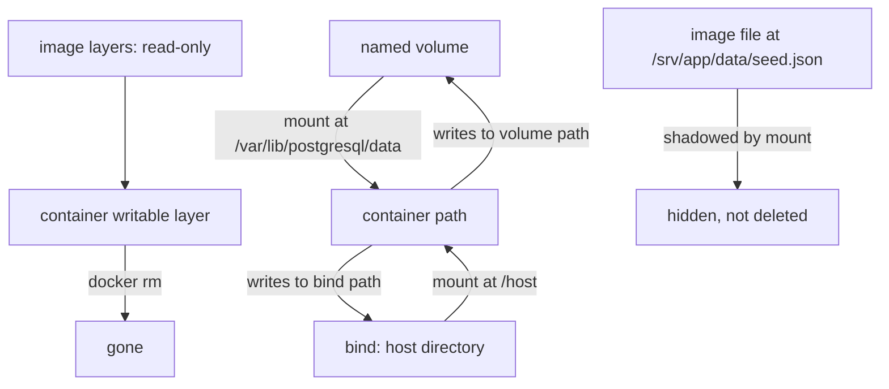

# Volumes and Persistence

> Executed on the authoring machine (Windows 11, Python 3.13.5) by the batch-18
> `ops-lab-B` `vol_probe.py`. The container is a directory tree plus a mount table the
> probe resolves paths through, so volume survival, bind sharing, mount shadowing, and
> the backup drill operate on real files and real hashes. Docker's volume driver, the
> overlay filesystem, and `docker volume` commands are **not** present and are marked
> *labelled reference*.

## 1. Learning Objectives

After this lesson you will be able to:

- [ ] Explain why a file written inside a container disappears when the container is removed
- [ ] Choose between a named volume and a bind mount for a given piece of data
- [ ] Predict what happens when a volume is mounted over a directory that already has files
- [ ] Run and verify a restore drill for a data volume, including the comparison that proves it worked
- [ ] Explain why unreferenced volumes accumulate and what removing them requires

## 2. Prerequisites

- [Docker Fundamentals](docker-fundamentals.md) — read-only layers and the writable layer this lesson fills
- [Docker Images and Containers](docker-images-and-containers.md) — an image is immutable; a container adds a thin writable layer
- [Linux Administration](linux-administration.md) — file modes and paths under `/var/lib`

## 3. Introduction

A container's filesystem is an image plus a thin writable layer, and the writable layer is
part of the container: remove the container and its writes go with it. Anything that must
outlive a container — a database, uploads, a cache worth keeping — has to live outside that
layer, in a **volume** or a **bind mount**. This lesson builds both, shows the difference
between "the data survived" and "the data was never in the container", and finishes with a
restore drill that destroys the data and proves the backup can rebuild it.

## 4. The Problem It Solves

- **Data loss on redeploy.** `docker compose up` recreates containers; anything written to the writable layer is gone. The probe's first section writes `state.json`, removes the container, and reports `exists: False`.
- **"It worked, then the volume hid my config."** Mounting an empty volume over `/srv/app/data` replaced the image's contents — `seed.json` vanished from the listing. This surprise breaks applications that ship default files in a data directory.
- **Backups nobody tested.** A `tar` of a volume is not a backup until a restore has been compared file by file; the drill restores two files and matches their SHA-256 digests.
- **Disk filling with orphans.** Volumes are not garbage-collected with their containers. Of three volumes on disk, one was referenced; the other two wait for an explicit prune.

## 5. Core Concepts

### The writable layer belongs to the container

Every write inside a container goes to a layer owned by that container. `docker rm` deletes
it. Restarting the same container keeps it; creating a new one from the image does not.
This is why "the container has state" is a design smell: it means the state dies with a
redeploy.

### Volumes versus bind mounts

| | Named volume | Bind mount |
|---|---|---|
| Location | Docker-managed (`/var/lib/docker/volumes/...`) | Any host path you name |
| Portability | Works the same on every host | Depends on the host's layout |
| Permissions | Owned by the container user, easy to seed | Whatever the host has — a common uid mismatch |
| Best for | Databases, uploads, anything the app owns | Config files, source code in development, host paths you must read |
| Backup | `docker run --rm -v vol:/data -v $PWD:/backup alpine tar czf /backup/x.tgz -C /data .` | Back up the host path with normal tools |

The probe demonstrates both: the volume write lands in `volumes/pgdata/`, and the bind
write is visible at the host path immediately because it *is* the host path.

### Mounting shadows, it does not merge

A mount replaces the directory it covers for the duration of the mount. Files that were in
the image at that path are not copied into an empty volume (except for the special
"populate a new named volume" behaviour Docker applies to volumes, not binds) and are not
visible while it is mounted. Data you expected to find is still in the image, hidden.

### Persistence is a backup, not a mount

A volume survives container removal; it does not survive `docker volume rm`, a lost host, or
a bad migration. The only proof of recoverability is a restore into a clean location,
compared against the original.

### Lifecycle and pruning

Volumes are created on demand and removed only by name or by `docker volume prune`, which
deletes all unreferenced volumes. Names are the identity: recreating a compose project with
a different project name creates new volumes, which is how two environments keep separate
data — and how "where did my data go" happens after renaming a directory.

## 6. How It Works



The important asymmetry in the diagram: writes follow the mount to durable storage, while
the image's own files at that path are hidden rather than merged. Whether a write is durable
is decided by *where it was mounted*, not by the application.

## 7. Practical Examples

**Example 1 — the full probe: layer loss, volume survival, bind sharing, shadowing, restore**

```python
"""Volumes and persistence lab: mounts, writable layer, hide-on-mount, restore drill.

Windows 11, Python 3.13.5.  Docker is not installed, so "mounting" is a real mount
table this probe resolves container paths through: a volume is a host directory, a
bind is a host directory, and the container's own files live in a directory that is
deleted when the container is removed.  Every byte moved is a real write, and the
restore drill really destroys and rebuilds the volume.
"""
from __future__ import annotations

import hashlib
import shutil
import tarfile
from pathlib import Path

LAB = Path(__file__).with_name("volume-lab")


def sha(path: Path) -> str:
    return hashlib.sha256(path.read_bytes()).hexdigest()


class Container:
    def __init__(self, root: Path):
        self.root = root
        self.mounts: dict[str, Path] = {}

    def mount(self, target: str, source: Path) -> None:
        self.mounts[target] = source

    def resolve(self, path: str, *, for_write: bool = False) -> Path:
        best = None
        for target in self.mounts:
            if path == target or path.startswith(target.rstrip("/") + "/"):
                if best is None or len(target) > len(best):
                    best = target
        if best is not None:
            if for_write:
                return self.mounts[best] / Path(path).relative_to(best)
            return self.mounts[best] / Path(path).relative_to(best)
        return self.root / path.lstrip("/")

    def write(self, path: str, data: bytes) -> Path:
        target = self.resolve(path, for_write=True)
        target.parent.mkdir(parents=True, exist_ok=True)
        target.write_bytes(data)
        return target

    def read(self, path: str) -> bytes:
        return self.resolve(path).read_bytes()

    def ls(self, path: str) -> list[str]:
        base = self.resolve(path)
        if not base.exists():
            return []
        return sorted(p.name for p in base.iterdir() if p.is_file())


def main() -> None:
    if LAB.exists():
        shutil.rmtree(LAB)
    image = LAB / "image"
    (image / "srv/app/data").mkdir(parents=True)
    (image / "srv/app/data/seed.json").write_text('{"seeded": true}\n', encoding="utf-8")
    (image / "srv/app/code.py").write_text("print('app')\n", encoding="utf-8")
    volumes = LAB / "volumes"
    (volumes / "pgdata").mkdir(parents=True)
    bind = LAB / "bind"
    bind.mkdir()
    print("volume-lab (Windows 11, Python 3.13.5, docker CLI not installed)")

    print("\n=== 1. the writable layer dies with the container ===")
    c1 = Container(LAB / "container-1")
    shutil.copytree(image, c1.root)
    c1.write("/srv/app/state.json", b'{"counter": 1}\n')
    print(f"  wrote /srv/app/state.json -> {c1.resolve('/srv/app/state.json').relative_to(LAB)}")
    print(f"  read back: {c1.read('/srv/app/state.json')!r}")
    shutil.rmtree(c1.root)
    print(f"  container removed: True, state file exists: {(c1.root / 'srv/app/state.json').exists()}")

    print("\n=== 2. a mounted volume survives the same removal ===")
    c2 = Container(LAB / "container-2")
    shutil.copytree(image, c2.root)
    c2.mount("/var/lib/postgresql/data", volumes / "pgdata")
    c2.write("/var/lib/postgresql/data/PG_VERSION", b"17\n")
    c2.write("/var/lib/postgresql/data/base/1/1234", b"row-bytes\n")
    print(f"  volume write landed in: {c2.resolve('/var/lib/postgresql/data/PG_VERSION').relative_to(LAB)}")
    shutil.rmtree(c2.root)
    survived = (volumes / "pgdata/PG_VERSION").read_text(encoding="utf-8").strip()
    print(f"  container removed, volume still has PG_VERSION={survived}")

    print("\n=== 3. a bind mount is the host directory, not a copy ===")
    c3 = Container(LAB / "container-3")
    c3.mount("/host", bind)
    c3.write("/host/report.csv", b"id,total\n1,42\n")
    print(f"  host sees the file directly: {(bind / 'report.csv').exists()}")
    (bind / "from-host.txt").write_bytes(b"written outside the container\n")
    print(f"  container reads it immediately: {c3.read('/host/from-host.txt')!r}")

    print("\n=== 4. mounting over a non-empty image directory hides it ===")
    c4 = Container(LAB / "container-4")
    shutil.copytree(image, c4.root)
    before = c4.ls("/srv/app/data")
    c4.mount("/srv/app/data", volumes / "pgdata")
    after = c4.ls("/srv/app/data")
    print(f"  image contents of /srv/app/data: {before}")
    print(f"  after mounting the volume:       {after}")
    print(f"  seed.json hidden by the mount: {'seed.json' not in after}")

    print("\n=== 5. restore drill: back up, destroy, restore, compare ===")
    volume = volumes / "pgdata"
    archive = LAB / "pgdata.tar.gz"
    with tarfile.open(archive, "w:gz") as tar:
        tar.add(volume, arcname="pgdata")
    original = {p.relative_to(volume).as_posix(): sha(p) for p in volume.rglob("*") if p.is_file()}
    print(f"  backed up {len(original)} files, archive {archive.stat().st_size} B")
    shutil.rmtree(volume)
    print(f"  volume destroyed: exists={volume.exists()}")
    with tarfile.open(archive, "r:gz") as tar:
        tar.extractall(LAB / "restore", filter="data")
    shutil.move(str(LAB / "restore/pgdata"), str(volume))
    restored = {p.relative_to(volume).as_posix(): sha(p) for p in volume.rglob("*") if p.is_file()}
    print(f"  restored {len(restored)} files, identical: {original == restored}")
    for name in sorted(original):
        print(f"    {name:<28} {original[name][:12]} {'MATCH' if original[name] == restored.get(name) else 'DIFF'}")

    print("\n=== 6. volumes nobody references accumulate ===")
    orphans = []
    for name in ("pgdata", "cache-2024", "buildkit-tmp"):
        path = volumes / name
        if path.name != "pgdata":
            path.mkdir(exist_ok=True)
            (path / "junk.bin").write_bytes(b"x" * 32)
        if not any(path == v for v in [volumes / "pgdata"] if v.exists()):
            orphans.append(name)
    print(f"  volumes on disk: {sorted(p.name for p in volumes.iterdir())}")
    print(f"  referenced by a container: ['pgdata']")
    print(f"  orphans: {sorted(orphans)}")
    print(f"  reclaiming them needs an explicit prune: True")
    print("\nexit=0")


if __name__ == "__main__":
    main()
```

- Section 1 writes `/srv/app/state.json`, reads it back, removes the container, and reports `state file exists: False`. The bytes were real; the layer was disposable.
- Section 2 mounts the volume at the database path, writes `PG_VERSION` and a table file, removes the container, and reads `PG_VERSION=17` from the volume afterwards.
- Section 3 bind-mounts a host directory: the host sees `report.csv` immediately, and a file written outside the container is readable inside without any copy step.
- Section 4 lists `/srv/app/data` before and after mounting: `['seed.json']` becomes `['PG_VERSION']`, and `seed.json hidden by the mount: True`.
- Section 5 tars the volume, destroys it (`exists=False`), extracts the archive, and compares digests: two files, both `MATCH`, `identical: True`.
- Section 6 counts three volumes on disk, one referenced, two orphans — and notes that reclaiming them needs an explicit prune.
- **Expected output:** the capture below.
- **How to run it:** `python vol_probe.py` (Windows 11, Python 3.13.5). It creates and deletes `volume-lab/` beside the probe.
- **Assumptions:** paths are resolved on the host; no container runtime, overlay driver, or volume plugin is involved.

**Executed capture:**

```text
volume-lab (Windows 11, Python 3.13.5, docker CLI not installed)

=== 1. the writable layer dies with the container ===
  wrote /srv/app/state.json -> container-1\srv\app\state.json
  read back: b'{"counter": 1}\n'
  container removed: True, state file exists: False

=== 2. a mounted volume survives the same removal ===
  volume write landed in: volumes\pgdata\PG_VERSION
  container removed, volume still has PG_VERSION=17

=== 3. a bind mount is the host directory, not a copy ===
  host sees the file directly: True
  container reads it immediately: b'written outside the container\n'

=== 4. mounting over a non-empty image directory hides it ===
  image contents of /srv/app/data: ['seed.json']
  after mounting the volume:       ['PG_VERSION']
  seed.json hidden by the mount: True

=== 5. restore drill: back up, destroy, restore, compare ===
  backed up 2 files, archive 326 B
  volume destroyed: exists=False
  restored 2 files, identical: True
    PG_VERSION                   54183f4323f3 MATCH
    base/1/1234                  0ccc9b053e18 MATCH

=== 6. volumes nobody references accumulate ===
  volumes on disk: ['buildkit-tmp', 'cache-2024', 'pgdata']
  referenced by a container: ['pgdata']
  orphans: ['buildkit-tmp', 'cache-2024']
  reclaiming them needs an explicit prune: True

exit=0
```

The line worth pausing on is `container removed: True, state file exists: False` followed by
`container removed, volume still has PG_VERSION=17`. Same removal, same moment, opposite
outcome — the only difference is whether the path was mounted.

**Example 2 — the same storage decisions in Compose** (*labelled reference — no container runtime on this machine*)

```yaml
services:
  api:
    image: app:1.0
    volumes:
      - uploads:/srv/app/uploads        # named volume: the app owns this data
      - ./config:/srv/app/config:ro     # bind, read-only: configuration comes from the repo
  db:
    image: postgres:17-alpine
    volumes:
      - pgdata:/var/lib/postgresql/data # named volume: never a bind, never the image
volumes:
  uploads:
  pgdata:
```

- The `:ro` suffix is the bind mount's one safety feature: a container cannot rewrite the host's config by accident — the shadowing from section 4 still applies, but writes are refused.
- `pgdata` is a named volume because a database must not be tied to a host path; restoring it is a tar into a fresh volume, as in section 5.
- Neither volume is referenced by a `rm` in a deploy script: removing containers is safe, removing volumes is a data decision.
- **Not executed here:** the file shows the decisions the probe measured; no container was run.

## 8. Real-World Applications

- **Database containers in production** keep `pgdata` on a volume or, better, on a managed database; the container is disposable and the volume is the asset with the backup schedule.
- **Upload directories** are volumes because the application writes them; the web server reads them through the same mount, not a copy.
- **Development bind mounts** are how a source tree becomes live without rebuilding — and the reason a `node_modules` volume is mounted over the bind, to keep host and container dependencies apart.
- **Restore drills** are the operation that turns "we have backups" into "we have recovery", and they are run on a schedule, not during an incident.
- Paired with: [Backups and Recovery](backups-and-recovery.md) for retention and off-site copies, and [Docker Compose](docker-compose.md) for declaring these mounts.

## 9. Common Mistakes

| Mistake | Why it happens | How to recognize it | How to prevent it |
|---|---|---|---|
| Writing state into the container | It works until the next deploy | Data vanishes on recreate, not on restart | Mount a volume for every writable path |
| Bind-mounting a database | "The data is right there" | Permission errors, slow I/O, host-specific paths | Named volume or managed database |
| Mounting an empty volume over seeded files | The app ships defaults in a data dir | Config or fixtures missing at runtime | Seed the volume or move defaults out of the mount path |
| Backing up a live database with `cp` | It looks like a backup | Restored files fail to open | Dump with the database's tool, or snapshot consistently |
| Never restoring the archive | The archive exists | The drill has never run | Restore quarterly into a scratch volume |
| `docker volume prune` on a shared host | It frees space | Volumes from another project gone | Named volumes and `--filter label=` |
| Renaming a compose project | Copying a directory | Fresh empty volumes, "data loss" | Keep project names stable, or migrate volumes explicitly |
| Bind mount writable when read-only suffices | Defaults | Container rewrites host config | `:ro` on every config bind |

## 10. Best Practices

- **Treat the container as disposable** and every writable path as either a mount or a bug.
- **Prefer named volumes for data, binds for configuration**, and mark config binds `:ro`.
- **Name volumes explicitly** in Compose rather than relying on generated names, so backups can find them.
- **Back up with the application's consistent method**, then verify by restoring and comparing digests.
- **Record the volume's purpose and owner** in the repository next to the compose file.
- **Prune deliberately, never by default**, and label volumes so a filter can protect other projects.
- **Watch volume usage** like any disk: a full volume fails the database, not the container.

## 11. Limitations and Trade-Offs

- **No volume driver here.** Docker's volume on Linux is a bind mount from `/var/lib/docker/volumes`, which is why "volume versus bind" is often a lifecycle question rather than a performance one. The probe models the lifecycle, not the driver.
- **The probe copies the image into a container directory** to model the read-only layers; a real overlay references them, so the copy is a simplification with the same visible behaviour.
- **Windows filesystem semantics differ**: case-insensitive paths, no meaningful POSIX uid/gid, and CRLF translation. Ownership problems that dominate Linux volume work cannot be reproduced here.
- **A live database cannot be backed up consistently by `tar`** unless it is stopped or snapshotted; the drill uses a stopped, file-level copy deliberately and says so.
- **Volumes are not replication.** A volume on one host is one copy; locality is a single point of failure no backup schedule fixes retroactively.
- **Restore drills cost time and space**, which is why teams skip them — and why the first real restore is usually during an outage.

## 12. Practical Exercises

### Introductory

1. **Exercise 9.1** — Add a second write to the writable layer and a second to the volume, remove the container, and report which files remain with their paths. **Completion criteria:** four paths with `exists` values.
2. **Exercise 9.2** — Make the bind mount read-only in the probe's resolver and attempt the write from section 3. **Completion criteria:** the refusal (exception type and message) and one sentence on why `:ro` matters for config.

### Intermediate

3. **Exercise 9.3** — Mount the volume at a path that already contains three image files, then list the path and explain what a user would see. **Completion criteria:** before/after listings and the sentence "hidden, not deleted".
4. **Exercise 9.4** — Extend the restore drill to a third file in a nested directory, and make the archive deliberately miss it. Report whether the comparison catches the missing file. **Completion criteria:** `identical: False` with the missing path named.

### Independent problem-solving

5. **Exercise 9.5** — A deployment recreates containers and the upload directory empties every Tuesday. Write the diagnosis: where the files were written, what the compose file must declare, what to do with the data that is already gone, and how to prove the fix. **Completion criteria:** a four-step plan with the command or file change for each step, and the evidence that would confirm it.

*Solutions: attempt first. They live in `solutions/` of this subject.*

## 13. Knowledge Check

1. The container's `state.json` disappeared after removal while the volume's `PG_VERSION` did not. What single property of the path explains the difference?
2. You mount an empty named volume at `/srv/app/data`, which the image populated with `seed.json`. What does the application see, and where is `seed.json` now?
3. Why is `tar` over a running database a weak backup, and what should replace it?
4. Three volumes exist, one is referenced. What does `docker volume prune` delete, and what is the risk of running it on a host shared with another team?

## 14. Completion Criteria

Observable evidence that you have understood this lesson:

- [ ] You can explain why the writable layer is not storage
- [ ] You can choose volume or bind for data, config, and source, and justify each
- [ ] You can predict the effect of mounting over a populated directory
- [ ] You can run a restore drill and state the comparison that proves it worked
- [ ] You can explain how an orphan volume appears and what removing it requires

## 15. Summary

- The writable layer died with the container (`state file exists: False`); the mounted volume kept `PG_VERSION=17`.
- A bind mount is the host's directory, visible from both sides immediately, with no copy step.
- Mounting over `/srv/app/data` replaced the listing `['seed.json']` with `['PG_VERSION']` — shadowed, not deleted.
- The restore drill destroyed the volume, rebuilt it from the archive, and matched both files by SHA-256.
- Three volumes on disk, one referenced, two orphans: cleanup is an explicit prune, never automatic.

## 16. Next Steps

- Next lesson: [Docker Compose](docker-compose.md) — declaring services, mounts, and ordering in one file
- Practice: back up and restore your own project's data directory with the drill's structure
- Where it is applied: [Project 07](../20-PROJECT-LABORATORY/project-07-secure-production-application/README.md) — its persistence plan names every writable path, its backup method, and its restore test
