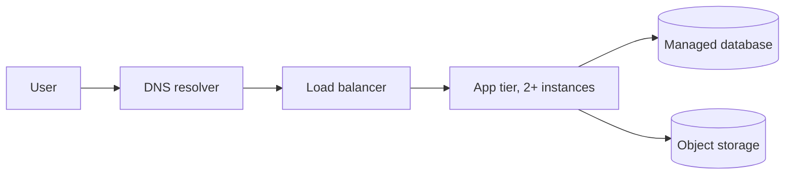

# Cloud Computing Fundamentals

> **Lab host:** Windows 11, Python 3.13.5. The transcript in section 7 was executed on that host
> from the probe source embedded there. The probe implements availability arithmetic, error
> budgets, control-plane ownership and billing models directly in the Python standard library.
> Provider console steps (creating an account, choosing a region, reading a service-level
> agreement) are **labelled reference**: no cloud account exists on this host, so nothing that
> requires one was executed or is presented as output.

## 1. Learning Objectives

After this lesson you will be able to:

- [ ] Distinguish IaaS, PaaS and SaaS by which controls you own, not by marketing names
- [ ] Compute the availability of a request path in series, and show why redundancy in
      parallel beats a bigger single machine
- [ ] Explain why two instances in one availability zone are worth far less than two instances
      in two zones, and put a number on the difference
- [ ] Convert an SLO into a monthly error budget and state how fast a burn rate exhausts it
- [ ] Decide between fixed-capacity and per-request billing from a request volume, not a slogan

## 2. Prerequisites

- [16-DEVOPS-AND-INFRASTRUCTURE](../16-DEVOPS-AND-INFRASTRUCTURE/README.md) — deployment
  strategies and CI/CD, which assume you can already build and ship an artifact
- [16-DEVOPS-AND-INFRASTRUCTURE/linux-administration.md](../16-DEVOPS-AND-INFRASTRUCTURE/linux-administration.md)
  — processes, ports and logs are the vocabulary of everything below
- [13-SOFTWARE-ENGINEERING-AND-ARCHITECTURE/scalability-and-reliability.md](../13-SOFTWARE-ENGINEERING-AND-ARCHITECTURE/scalability-and-reliability.md)
  — reliability vocabulary this lesson quantifies
- [06-INTERNET-AND-WEB-FOUNDATIONS/client-server-architecture.md](../06-INTERNET-AND-WEB-FOUNDATIONS/client-server-architecture.md)
  — the request path whose availability we are about to multiply

## 3. Introduction

Cloud computing is renting somebody else's computers, network and storage, on demand, with an
API in front of them. That definition is deliberately unglamorous, because the interesting part
is not that the machines are elsewhere: it is that capacity became a *variable* cost with a
*self-service* control plane, and that the provider now owns some of the failure modes you used
to own.

Two consequences follow, and this whole subject is built on them.

First, architecture becomes an economic decision. A design that needs 40 servers to survive a
traffic spike costs 40 servers' worth of money only if you keep 40 running; rented capacity lets
you pay for a spike for twenty minutes.

Second, availability becomes arithmetic you can do before you build. "Highly available" is not a
property you assert; it is a number you derive from the components you chose and the failure
domains they share.

## 4. The Problem It Solves

Before cloud, capacity was a procurement problem. A team estimated peak load, ordered hardware,
waited weeks, installed it, and then ran that hardware for years — including at 3 a.m. on
Christmas, at 4% utilisation. Scaling up meant a purchase order; scaling down meant writing off
an asset. Disaster recovery meant a second data centre that sat idle and was therefore never
tested.

The specific failures that model produced:

- **Capacity was guessed once and frozen.** A launch that went better than forecast could not be
  served; a product that stalled left expensive metal humming.
- **Failure domains were invisible until they failed.** Two servers plugged into the same switch,
  the same PDU, the same rack, and sometimes the same building were counted as "redundant".
- **Recovery was theory.** A standby site nobody exercised usually did not work on the day it was
  needed.
- **Cost had no granularity.** You could not answer "what does the search feature cost per month"
  because the bill was a building.

Cloud did not invent distributed systems. It made their failure modes explicit and their capacity
elastic, and it moved the bill to something you can attribute.

## 5. Core Concepts

### Service models describe a boundary, not a product

**IaaS** (infrastructure as a service) rents you a virtual machine: you own the operating system,
the runtime, the application and its configuration; the provider owns the hardware, the
hypervisor, the network fabric and the data centre. **PaaS** (platform as a service) rents you a
runtime — you push code and configuration, and the provider owns the OS and the scaling of the
platform. **SaaS** (software as a service) rents you a finished product; you own only your data and
your users' access.

The useful question is never "which model is modern" but "which of these fourteen controls do I
still have to get right". Section 7 counts them: on IaaS the customer owns most of them; on SaaS
the provider does.

### Availability is a probability for a window

**Availability** is the fraction of requests, or of time, in which a service does what it
promised. A **service-level objective (SLO)** is the target, for example 99.9% of requests
succeeding over 30 days. A **service-level indicator (SLI)** is the measurement you actually
compute, such as `successful_requests / total_requests`. A **service-level agreement (SLA)** is the
contract with consequences, usually looser than the SLO you run to.

Availability of independent components **in series** multiplies. Three components at 99.7%,
99.9% and 99.95% yield 0.997 × 0.999 × 0.9995 = 0.9955, about 99.55% — worse than any single one.
This is why a request path's availability is usually the weakest link raised to the power of
however many links it has.

### Redundancy only helps across failure domains

A **failure domain** is a set of components that fail together: one process, one machine, one
rack, one **availability zone** (an isolated data centre with independent power and network), one
**region** (a geographic cluster of zones). Two replicas in one zone share that zone's fate, so
the pair is only as available as the zone. Two replicas in two zones fail independently only for
failures smaller than a zone.

The arithmetic in section 7 makes this concrete: a single instance at 99% becomes 99.99% when
duplicated across independent domains, and only 99.6% when the pair shares a zone.

### Error budgets turn reliability into a currency

If your SLO is 99.9% over 30 days, you are allowed 0.1% of the window to be bad: 43.2 minutes of
a 43,200-minute month. That allowance is the **error budget**. A **burn rate** of 1 means you are
consuming it exactly fast enough to last the month; 14.4 means you will exhaust it in about two
days. Burn-rate alerting is covered properly in
[observability.md](observability.md); here you only need the arithmetic.

### Billing models change the shape of a design

**Fixed-capacity** billing charges per instance-hour whether the instance works or not.
**Per-request** billing charges for invocations and for the time your code occupies memory. The
crossover in section 7 is around 4 million requests per month for the modelled prices: below it,
per-request is cheaper; far above it, a small always-on instance wins because you stop paying per
call.

## 6. How It Works

A request to a cloud-hosted application traverses several independent systems. Each arrow is a
place availability multiplies:



The load balancer, app instances and database are in series: the path is only available when all
three are. The two app instances are in parallel: the path is available when either is, which is
why parallel redundancy raises availability while series dependencies lower it.

Providers structure this into **regions** and **zones**. A zone is engineered so that power,
cooling and network faults do not propagate to its siblings; a region is a set of zones close
enough for single-digit-millisecond round trips. Choosing one region puts every user on one
continent's latency; choosing two doubles the blast-radius work but lets a whole region fail.

The shared responsibility line runs through all of it. The provider is responsible for the
*security of* the cloud — physical access, hypervisor isolation, disk disposal, the network
fabric. You are responsible for security *in* the cloud — identity, patching what you run,
encryption choices, backup policy. Section 7 counts fourteen common controls and shows the split
moving as you climb from IaaS to SaaS.

## 7. Practical Examples

**Example 1 — the arithmetic of availability, budgets and billing**

The probe below is the complete program. It models a three-tier path, compares series and parallel
redundancy, prices a zone failure, computes error budgets at several burn rates, counts control
ownership across service models, finds a billing crossover and scores region choices against
latency targets.

```python
"""CLD-02 probe: the arithmetic an architect must finish before drawing a topology.

Windows 11, Python 3.13.5. No cloud account exists on this host, so nothing here calls a
provider API. The probe computes the four numbers that decide a design: the composite
availability of a dependency chain, the error budget that availability buys, how much of
the stack the customer still owns under each service model, and the request rate at which
per-request billing overtakes a fixed instance.
"""

from __future__ import annotations

from dataclasses import dataclass

DAYS_PER_MONTH = 30.44
MINUTES_PER_MONTH = DAYS_PER_MONTH * 24 * 60


def chain_availability(*components: float) -> float:
    """Availability of components that must all work for the request to succeed."""
    result = 1.0
    for availability in components:
        result *= availability
    return result


def redundant_availability(single: float, copies: int) -> float:
    """Availability of `copies` independent instances where one is enough."""
    return 1.0 - (1.0 - single) ** copies


def downtime_minutes(availability: float) -> float:
    return (1.0 - availability) * MINUTES_PER_MONTH


@dataclass(frozen=True)
class Control:
    name: str
    owner_iaas: str
    owner_paas: str
    owner_saas: str


CONTROLS = [
    Control("physical datacentre security", "provider", "provider", "provider"),
    Control("hypervisor and host kernel", "provider", "provider", "provider"),
    Control("guest operating system patching", "customer", "provider", "provider"),
    Control("runtime and language version", "customer", "shared", "provider"),
    Control("application code and dependencies", "customer", "customer", "provider"),
    Control("network routing and firewall rules", "shared", "shared", "provider"),
    Control("identity and access policies", "customer", "customer", "shared"),
    Control("data classification and retention", "customer", "customer", "customer"),
    Control("encryption at rest and key management", "shared", "shared", "shared"),
    Control("backup schedule and restore testing", "customer", "shared", "shared"),
    Control("capacity and scaling policy", "customer", "shared", "provider"),
    Control("audit logging and monitoring", "customer", "customer", "shared"),
    Control("vulnerability scanning of the app", "customer", "customer", "customer"),
    Control("incident response for the app", "customer", "customer", "customer"),
]


def exposure(model: str) -> tuple[int, int, int]:
    owners = [getattr(c, f"owner_{model}") for c in CONTROLS]
    return owners.count("customer"), owners.count("shared"), owners.count("provider")


def serverless_crossover(fixed_monthly: float, per_million: float, gb_seconds: float,
                         memory_gb: float, duration_s: float) -> float:
    """Requests per month at which usage billing equals the fixed bill."""
    per_request = per_million / 1_000_000 + gb_seconds * memory_gb * duration_s
    return fixed_monthly / per_request


def main() -> None:
    print("=== availability arithmetic (30.44-day month) ===")
    lb, app, db = 0.9999, 0.9995, 0.999
    composed = chain_availability(lb, app, db)
    print(f"request path lb x app x db          : {composed:.6%}")
    print(f"  downtime allowed per month        : {downtime_minutes(composed):.2f} min")
    print(f"annual downtime                     : {downtime_minutes(composed) * 12 / 60:.2f} h")

    single = 0.99
    print(f"\nsingle instance                    : {single:.2%}")
    print(f"two independent instances          : {redundant_availability(single, 2):.4%}")
    print(f"three independent instances        : {redundant_availability(single, 3):.5%}")

    print("\n=== failure domains: does redundancy survive the zone? ===")
    host = 0.995          # one instance up
    zone_up = 1.0 - 0.004  # one availability zone up in a given month
    one_zone = zone_up * redundant_availability(host, 2)
    # Independent zones: down only when both instances fail, or both zones do.
    two_zones = 1.0 - (1.0 - redundant_availability(host, 2)) - (1.0 - zone_up) ** 2
    # Three zones, two-of-three: needs two zones down, or two hosts down inside one.
    three_zones = 1.0 - 3 * (1.0 - zone_up) ** 2 - 3 * (1.0 - host) ** 2 * host
    print(f"two instances, one zone             : {one_zone:.4%}")
    print(f"two instances, two zones            : {two_zones:.4%}")
    print(f"three zones, two-of-three quorum    : {three_zones:.4%}")
    print(f"monthly downtime, one zone          : {downtime_minutes(one_zone):.1f} min")
    print(f"monthly downtime, two zones         : {downtime_minutes(two_zones):.1f} min")
    print(f"what the second zone buys           : "
          f"{downtime_minutes(one_zone) - downtime_minutes(two_zones):.1f} min/month")

    print("\n=== error budgets for a 99.9% SLO ===")
    budget = 0.001 * MINUTES_PER_MONTH
    print(f"monthly budget                      : {budget:.1f} min")
    for burn_name, rate in (("1x burn", 1.0), ("6x burn", 6.0), ("60x burn", 60.0)):
        burn_minutes = MINUTES_PER_MONTH / rate
        print(f"  {burn_name:<9} spends the budget in {burn_minutes:8.0f} min "
              f"({burn_minutes / 1440:5.1f} days at this rate)")

    print("\n=== who owns the controls ===")
    for model, label in (("iaas", "IaaS (virtual machines)"),
                         ("paas", "PaaS (managed runtime)"),
                         ("saas", "SaaS (finished product)")):
        customer, shared, provider = exposure(model)
        print(f"{label:<26} customer {customer:2d}  shared {shared:2d}  provider {provider:2d}"
              f"  of {len(CONTROLS)}")

    print("\n=== fixed instance vs per-request billing ===")
    fixed = 14.64
    crossover = serverless_crossover(
        fixed_monthly=fixed, per_million=0.20, gb_seconds=0.0000166667,
        memory_gb=1.0, duration_s=0.2)
    print(f"fixed instance                     : ${fixed:.2f}/month, idle or busy")
    print(f"serverless                         : $0.20/M requests + $0.0000166667/GB-s")
    per_request = 0.20 / 1_000_000 + 0.0000166667 * 0.2
    print(f"per-request cost at 1 GB x 200 ms  : ${per_request:.7f}")
    for rate_m in (1, 5, 8.5, 20, 100):
        serverless_cost = rate_m * 1_000_000 * per_request
        print(f"  {rate_m:>4} M requests/month: fixed ${fixed:6.2f}  "
              f"serverless ${serverless_cost:8.2f}  "
              f"{'serverless wins' if serverless_cost < fixed else 'fixed wins'}")
    print(f"crossover                          : {crossover / 1_000_000:.2f} M requests/month")

    print("\n=== region choice: share of users within each latency target ===")
    users = {"us-east": 0.45, "eu-west": 0.30, "ap-south": 0.25}
    rtt = {
        "us-east": {"us-east": 20, "eu-west": 85, "ap-south": 210},
        "eu-west": {"us-east": 85, "eu-west": 20, "ap-south": 150},
        "ap-south": {"us-east": 210, "eu-west": 150, "ap-south": 20},
    }
    configs = (["us-east"], ["us-east", "eu-west"], ["us-east", "eu-west", "ap-south"])
    print(f"{'regions':<34}{'<=50 ms':>10}{'<=100 ms':>10}{'<=200 ms':>10}")
    for regions in configs:
        row = []
        for target in (50, 100, 200):
            covered = sum(
                share for home, share in users.items()
                if min(rtt[home][region] for region in regions) <= target
            )
            row.append(f"{covered:>9.0%}")
        print(f"{', '.join(regions):<34}{''.join(row)}")


if __name__ == "__main__":
    main()
```

- `path_availability` multiplies component availabilities, because every component must work.
- `parallel` computes `1 - (1 - p)^n`, the chance at least one of `n` independent copies works.
- The zone section is the important one: it recomputes the pair with a shared zone term, so
  correlated failure is visible instead of assumed away.
- The billing section charges a fixed monthly instance against a per-request price that includes
  memory-seconds, then finds the volume where they cross.

**Expected output** (executed on Windows 11, Python 3.13.5, exit code 0):

```text
=== availability arithmetic (30.44-day month) ===
request path lb x app x db          : 99.840065%
  downtime allowed per month        : 70.11 min
annual downtime                     : 14.02 h

single instance                    : 99.00%
two independent instances          : 99.9900%
three independent instances        : 99.99990%

=== failure domains: does redundancy survive the zone? ===
two instances, one zone             : 99.5975%
two instances, two zones            : 99.9959%
three zones, two-of-three quorum    : 99.9877%
monthly downtime, one zone          : 176.4 min
monthly downtime, two zones         : 1.8 min
what the second zone buys           : 174.6 min/month

=== error budgets for a 99.9% SLO ===
monthly budget                      : 43.8 min
  1x burn   spends the budget in    43834 min ( 30.4 days at this rate)
  6x burn   spends the budget in     7306 min (  5.1 days at this rate)
  60x burn  spends the budget in      731 min (  0.5 days at this rate)

=== who owns the controls ===
IaaS (virtual machines)    customer 10  shared  2  provider  2  of 14
PaaS (managed runtime)     customer  6  shared  5  provider  3  of 14
SaaS (finished product)    customer  3  shared  4  provider  7  of 14
```

The per-request section prints a table of volumes; the line that matters is the last one:

```text
     1 M requests/month: fixed $ 14.64  serverless $    3.53  serverless wins
    20 M requests/month: fixed $ 14.64  serverless $   70.67  fixed wins
crossover                          : 4.14 M requests/month
```

- **How to run it:** save the block as `fundamentals_probe.py` and run
  `python fundamentals_probe.py`. No dependencies beyond the standard library, and no network
  access.
- **What to read in the output:** 99.5975% versus 99.9959% is the whole lesson. The same two
  instances, the same code, differ by 174.6 minutes of downtime per month purely because of where
  they sit.
- The 99.840065% path figure is not a typo for 99.84: three components multiplied exactly give
  that, and the point is that the path is worse than the database alone.

**Example 2 — a region decision stated as a target, not a vibe**

The following is a design note, not code, and it requires a provider account, so it is **labelled
reference** and was not executed here:

```text
Target: 95% of requests served in <= 100 ms, single region, 30-day SLO 99.9%.

us-east only      -> 75% of users inside 100 ms  (below target)
us-east + eu-west -> 75% inside 100 ms           (still below target)
three regions     -> 100% inside 100 ms          (meets target, triples the blast-radius work)
```

Read the middle line carefully: adding a region did not move the 100 ms share, because the users
who were far away in the first place were not helped by a second region that was also far away.
Region choice is a latency-and-jurisdiction decision; zone count is the availability decision.

## 8. Real-World Applications

- **Startups** typically begin on PaaS or per-request compute: no capacity planning, and the bill
  tracks growth. The crossover above is the moment to reconsider.
- **Regulated industries** run IaaS or private cloud because they must control the OS image,
  kernel parameters and audit trail themselves.
- **Global consumer products** run multi-region with data-residency constraints, which makes
  "region" both a latency and a legal decision.
- **Internal tooling** is the classic overspend: a staging environment with the same availability
  design as production, billed every hour of every month.

The pairing that matters: cloud computing is almost always paired with
[infrastructure-as-code](../16-DEVOPS-AND-INFRASTRUCTURE/terraform.md) so that the topology is
reviewable, and with [monitoring](../16-DEVOPS-AND-INFRASTRUCTURE/monitoring-and-logging.md) so
that the availability you designed is the availability you can prove.

## 9. Common Mistakes

| Mistake | Why it happens | How to recognize it | How to prevent it |
|---|---|---|---|
| Counting replicas as redundancy without checking zones | The console shows two instances, so it looks like two | Both instances report the same zone ID | Put zone in the instance tag and assert the set size in code review |
| Multiplying availability of dependent services | Series and parallel look alike in a diagram | Claimed 99.99% for a path with three serial dependencies | Derive the number from the graph; a path is the product of its links |
| Treating the SLA as the SLO | The contract is the only number written down | You have no internal target, only a credit threshold | Set the SLO stricter than the SLA and alert on burn |
| Assuming a bigger instance fixes availability | Vertical scaling is the obvious lever | One machine, larger, still one machine | Redundancy and failure domains are the only availability levers |
| Ignoring data-transfer cost in the design | Compute prices are the ones quoted | The bill is dominated by egress | Model egress per request before choosing a topology |
| Leaving non-production environments on 24/7 | They were created once and forgotten | Staging costs more than production | Schedule them off, and review cost per environment monthly |

## 10. Best Practices

- **Draw the request path before arguing about nines.** Availability is a property of a graph,
  and the graph is cheap to draw.
- **Name the failure domain for every replica.** "Two instances" is not a design; "two instances
  in two zones behind one load balancer" is.
- **Write the SLO as a ratio and a window** (`99.9% of successful requests over 30 days`) so the
  budget is computable. The rule stops applying when a dependency has a hard contractual limit
  below your target — then the target is the contract.
- **Choose billing by volume and shape.** Bursty, low-volume workloads suit per-request; steady
  high-volume workloads suit fixed capacity. Recheck at each order-of-magnitude of growth.
- **Keep one environment's cost attributable.** Tag by environment and service from day one;
  retrofitting tags never fully works.

## 11. Limitations and Trade-Offs

Availability costs money roughly linearly while it buys nines exponentially more slowly: going
from 99.9% to 99.99% usually means a second region, a rehearsed failover and staff who practise
it. At some point the correct answer is "accept 99.9% and make failures short".

Multi-region buys latency and disaster tolerance but costs consistency: a user's write now has to
reconcile with a replica an ocean away. The trade-off is not free, and this lesson's arithmetic
says nothing about it.

Per-request billing is cheaper at low volume but has a tail: a retry storm multiplies invocations,
and a runaway loop can generate a bill in an afternoon. Fixed capacity fails more gracefully
against bugs of that shape.

The control-ownership counts in section 7 are a teaching model, not a certification. Real
provider responsibility matrices differ per service, and some "managed" services still leave you
owning patching of an extension or a client library.

## 12. Practical Exercises

### Introductory

1. **Exercise 2.1** — Compute the availability of a path with a load balancer at 99.95%, two app
   instances at 99.9% each, and a database at 99.99%. State whether the app tier is in series or
   parallel and show both numbers.
   **Completion criteria:** you write the multiplication, get 99.74% for the series reading and
   99.9989% for the parallel reading, and can say which one describes the deployment.

2. **Exercise 2.2** — Using the probe's control-ownership table, list three controls you own on
   IaaS that you do not own on PaaS, and for each name the concrete task that disappears.
   **Completion criteria:** three controls with a task each, taken from the fourteen in the
   output, not invented.

### Intermediate

3. **Exercise 2.3** — Your SLO is 99.95% over 30 days. Compute the error budget in minutes.
   A dependency fails for 12 minutes at 100% error. What fraction of the budget is gone?
   **Completion criteria:** 21.6 minutes of budget, 12/21.6 = 56% consumed, stated with units.

4. **Exercise 2.4** — The probe prices a fixed instance at $14.64/month against per-request at
   $0.20 per million plus memory time. At 2 million requests/month, which is cheaper, and by how
   much? At what volume do they tie?
   **Completion criteria:** per-request wins at 2M; the tie is 4.14M requests/month, matching the
   probe.

### Independent problem-solving

5. **Exercise 2.5** — Design the topology for a photo-sharing service with 200,000 monthly users,
   a 99.9% SLO and a 100 ms p95 target for 90% of users in Europe and North America. Choose
   regions, zone count, service model for each tier, and billing model. Justify each choice with
   a number from this lesson or an explicit estimate.
   **Completion criteria:** a one-page design naming every failure domain, an availability number
   derived from the graph, and a monthly cost with its assumptions listed. A reviewer can point at
   any component and ask "what happens if this zone dies" and find the answer in the document.

*Solutions: attempt first. They live in `solutions/` of this subject.*

## 13. Knowledge Check

1. Two instances at 99.9% each give 99.9999% in parallel. Why does the real deployment usually
   deliver closer to 99.99%?
2. Your SLO is 99.9% but your database's SLA is 99.5%. What does that imply about where your
   availability work should go?
3. When would you deliberately choose a single zone?
4. Why is a request path's availability lower than the availability of its best component?
5. A workload runs at 500,000 requests per month and is bursty. Which billing model fits, and
   what changes at 50 million?

## 14. Completion Criteria

- [ ] You can compute series and parallel availability from a diagram without notes
- [ ] You can explain, with the 99.5975% versus 99.9959% figures, why zones are the unit of
      redundancy
- [ ] You can convert any SLO into a monthly error budget in minutes
- [ ] You can state the IaaS/PaaS/SaaS split in terms of controls you own
- [ ] You can name one situation where multi-region is the wrong answer

## 15. Summary

- Cloud makes capacity elastic and cost attributable; it does not remove failure modes, it
  relocates them.
- Availability multiplies in series and improves as `1 - (1-p)^n` in parallel.
- Redundancy counts only across independent failure domains; two instances in one zone are one
  instance with extra steps.
- An SLO is a ratio over a window, and its error budget is the currency you spend on risk.
- Billing model is a design decision with a crossover volume, not a preference.

## 16. Next Steps

- Next lesson: [Virtual Machines](virtual-machines.md) — the compute primitive under every
  abstraction above, and what "instance" actually costs.
- Practice: the exercises here, then the sizing work in
  [virtual-machines.md](virtual-machines.md) section 12.
- Where it is applied: [deployment strategies](../16-DEVOPS-AND-INFRASTRUCTURE/deployment-strategies.md)
  turns these availability numbers into rollout mechanics.
