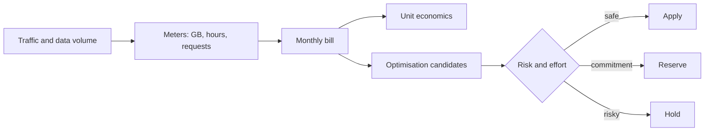

# Cloud Cost Management

> **Lab host:** Windows 11, Python 3.13.5. The transcript in section 7 was executed on that host
> from the probe source embedded there; the probe prices a monthly bill from list rates, computes
> unit economics, costs seven optimisations against that bill, and models spot economics and traffic
> growth. Reading a real billing console, setting budgets and buying reserved capacity are
> **labelled reference**: no cloud account exists on this host, and no invoice was consulted.

## 1. Learning Objectives

After you finish this lesson you will be able to:

- [ ] Build a monthly bill from unit rates and show each line's share
- [ ] Compute unit economics — cost per million requests — and use it to price a change
- [ ] Rank optimisations by saving against this specific bill, not in general
- [ ] Model spot savings net of interruption risk, before engineering cost
- [ ] Identify which lines scale with traffic and which are fixed
- [ ] Explain why the bill omits the decisions that created it

## 2. Prerequisites

- [virtual-machines.md](virtual-machines.md) — instance-hours and the price of a vCPU
- [object-storage.md](object-storage.md) — storage, requests and egress as separate meters
- [managed-databases.md](managed-databases.md) — Multi-AZ and storage pricing
- [observability.md](observability.md) — log ingest, priced here as a line item
- [scaling.md](scaling.md) — the instance counts this lesson bills

## 3. Introduction

Cloud bills are itemised by *meter*, not by *decision*. You are charged per GB of egress, per GB of
log ingest, per instance-hour, per request — meters that are easy to sum and hard to reason about.
The decisions that produced them (an uncompressed API, a debug log line, a Multi-AZ database, a
14-instance fleet for 12% CPU) are nowhere on the invoice.

Cost management is the practice of connecting the two: a bill line back to the decision, and a
decision forward to a number. Without that connection, cost conversations become "the bill is up"
and the answer becomes "use smaller instances", which is usually wrong and sometimes harmful.

This lesson prices one realistic bill, ranks optimisations against it, and shows which of those
savings are real and which quietly buy risk.

## 4. The Problem It Solves

Cloud spend grows without anyone deciding to spend more. Three mechanisms drive it:

- **Per-request meters.** Egress and logs are charged per byte or per request, so traffic growth
  multiplies them. In the probe they are 57% of the bill, and they grow with success.
- **Defaults that are safe, not cheap.** Multi-AZ, verbose logging, snapshot retention and
  over-provisioned fleets are all reasonable defaults that cost money silently.
- **Orphans.** Unattached volumes, old snapshots, idle dev instances and forgotten load balancers
  keep billing after the project that created them ends.

A cost practice solves these by attributing spend to an owner and a decision, then choosing which
optimisations are worth the risk. The probe finds 62% of the bill is addressable — but not all of it
should be addressed.

## 5. Core Concepts

### The bill is a set of independent meters

From the probe: 12 TB of egress is $1,095.68 (32%), log ingest is $855.50 (25%), a Multi-AZ managed
database is $700.80 (20%), 12 instances are $371.42 (11%), object storage and requests are $204.42
(6%), database storage $163.84 (5%), and two load balancers $32.85 (1%). Total $3,424.51.

The first lesson of the table is that compute is *not* the biggest line. Teams that optimise compute
by default spend effort on 11% of the bill while 32% and 25% sit untouched.

### Unit economics

1.56 billion requests per month against $3,424.51 is **$2.1952 per million requests**. That number is
the bridge between engineering and finance: a feature that adds 100 million requests adds about
$220/month, and a 30% caching improvement removes about $658.

Unit cost also exposes regressions that absolute spend hides. A bill that doubles while traffic
triples is an improvement; the unit cost fell.

### Optimisations are ranked against this bill

| Change | Saving | Share | Mechanism |
|---|---|---|---|
| Serve 12 TB through a CDN | $849.92 | 25% | $0.09/GB → $0.02/GB |
| Expire snapshots older than 90 days | $286.72 | 8% | 70% of 8 TB |
| Drop debug logging in production | $285.00 | 8% | 1,711 GB → 1,141 GB |
| Right-size 14 instances to 5 | $278.57 | 8% | p95 CPU 12% on 4 vCPU |
| Delete 2 TB unattached volumes | $163.84 | 5% | no reads in 90 days |
| Schedule 6 dev instances to 220 h | $129.74 | 4% | 730 h → 220 h |
| 3-year reserved capacity on 8 | $123.81 | 4% | 50% off on-demand |

Total identified: $2,117.60, or 62%, taking the bill to $1,306.91.

The ranking is the point. CDN is the largest single saving and the least risky. Snapshot expiry and
unattached volumes are pure waste. Right-sizing and dropping debug logs change behaviour and need
care. Reserved capacity is a commitment, not a saving — it is only a saving if the workload survives
three years.

### Spot is a risk-adjusted number

Spot at 70% off with a 10% interruption risk is an expected 63% saving *before* engineering cost:
`0.7 × 0.9 = 0.63`. If handling an interruption costs two engineer-weeks to build and one incident
per quarter to operate, the 63% may still be worth it on a stateless batch fleet and not worth it on
a stateful primary.

### Which lines scale

Egress and logs are per-request; compute and database are per-hour; storage is per-GB-month. When
traffic doubles, compute doubles to $742.85 but egress goes to $2,140.16 at 24 TB — the per-request
share is what punishes a retry storm, a hot loop, or an uncompressed payload.

That is also why caching beats every line item in the table: it reduces the request count, and the
request count is the multiplier on 57% of the bill.

## 6. How It Works



Attribution is what makes the loop work: each line needs an owner who can say whether the volume is
necessary. Without an owner, the only available action is a blanket cut, which reliably removes
something load-bearing.

## 7. Practical Examples

**Example 1 — a bill, its unit cost, seven optimisations and two sensitivities**

The probe prices eight line items from unit rates, computes cost per million requests, costs each
optimisation against the bill, models spot with interruption risk, and recomputes under doubled
traffic.

```python
"""CLD-13 probe: what a small production system costs, and where the money actually goes.

Windows 11, Python 3.13.5. Unit prices are representative published list prices in USD, stated
inline so every figure can be recomputed; no billing API is called and no account exists on this
host. The probe builds a monthly bill line by line, applies tiered egress pricing, then prices
six common optimisations against that bill and reports each saving as a share of the total.
Provider SKUs and discount programmes in the lesson are labelled reference.
"""

from __future__ import annotations

from dataclasses import dataclass

HOURS = 730
COMPUTE_HOURLY = 0.0424
DB_HOURLY = 0.48
GP3_GB = 0.08
S3_GB = 0.023
S3_GET_PER_1K = 0.0004
LOG_GB = 0.50
CDN_GB = 0.02
SNAPSHOT_GB = 0.05


@dataclass
class Line:
    name: str
    monthly: float
    detail: str


def egress_cost(tb: float) -> tuple[float, str]:
    gb = tb * 1024
    first = min(gb, 10 * 1024) * 0.09
    rest = max(0.0, gb - 10 * 1024) * 0.085
    return first + rest, f"{min(tb, 10):.0f} TB at $0.09 + {max(0.0, tb - 10):.0f} TB at $0.085"


def main() -> None:
    lines: list[Line] = []

    compute = 12 * HOURS * COMPUTE_HOURLY
    lines.append(Line("compute, 12 instances", compute, f"12 x {HOURS} h x ${COMPUTE_HOURLY}/h"))
    db = 2 * DB_HOURLY * HOURS
    lines.append(Line("managed database, Multi-AZ", db, f"2 x {HOURS} h x ${DB_HOURLY}/h"))
    storage = 2048 * GP3_GB
    lines.append(Line("database storage, 2 TB gp3", storage, f"2048 GB x ${GP3_GB}/GB"))
    objects = 8192 * S3_GB + 40_000 * S3_GET_PER_1K
    lines.append(Line("object storage, 8 TB + 40M GET", objects,
                      f"8192 GB x ${S3_GB} + 40,000 x ${S3_GET_PER_1K}/1k"))
    egress, egress_detail = egress_cost(12)
    lines.append(Line("egress, 12 TB", egress, egress_detail))
    lb = 2 * 0.0225 * HOURS
    lines.append(Line("load balancers, 2", lb, f"2 x {HOURS} h x $0.0225/h"))
    logs = 1711 * LOG_GB
    lines.append(Line("log ingest, 600 req/s", logs, f"1711 GB x ${LOG_GB}/GB"))

    total = sum(line.monthly for line in lines)
    print("=== monthly bill, list prices ===")
    for line in sorted(lines, key=lambda item: -item.monthly):
        print(f"  {line.name:<30}{line.monthly:>9.2f}  {line.monthly / total:>5.0%}  {line.detail}")
    print(f"  {'total':<30}{total:>9.2f}")

    print("\n=== unit economics ===")
    monthly_requests = 600 * 2_600_000
    print(f"  {monthly_requests / 1e9:.2f}B requests/month at 600 req/s average")
    print(f"  ${total / (monthly_requests / 1e6):.4f} per million requests")
    print(f"  compute and database are {compute + db:.1f} of {total:.1f} "
          f"({(compute + db) / total:.0%}); egress and logs are {(egress + logs) / total:.0%}")

    print("\n=== optimisations, priced against this bill ===")
    savings: list[tuple[str, float, str]] = []

    cdn = egress - 12 * 1024 * CDN_GB
    savings.append(("serve 12 TB through a CDN", cdn,
                    f"${egress:.0f} egress -> ${12 * 1024 * CDN_GB:.0f} at ${CDN_GB}/GB"))

    dev_idle = 6 * HOURS * COMPUTE_HOURLY - 6 * 220 * COMPUTE_HOURLY
    savings.append(("schedule 6 dev instances to 220 h", dev_idle, "730 h -> 220 h each"))

    unattached = 2048 * GP3_GB
    savings.append(("delete 2 TB of unattached volumes", unattached, "no reads in 90 days"))

    old_snapshots = 8192 * SNAPSHOT_GB * 0.70
    savings.append(("expire snapshots older than 90 days", old_snapshots, "70% of 8 TB"))

    oversized = 14
    rightsized = 5
    rightsize = (oversized - rightsized) * HOURS * COMPUTE_HOURLY
    savings.append(("right-size 14 instances to 5", rightsize, "p95 CPU 12% on 4 vCPU"))

    baseline = 8
    reserved = baseline * HOURS * COMPUTE_HOURLY * 0.50
    savings.append(("3-year reserved capacity on 8", reserved, "50% off the on-demand rate"))

    trimmed_logs = (1711 - 1141) * LOG_GB
    savings.append(("drop debug logging in production", trimmed_logs, "1711 GB -> 1141 GB"))

    for name, amount, detail in sorted(savings, key=lambda item: -item[1]):
        print(f"  {name:<38}{amount:>8.2f}  {amount / total:>5.0%}  {detail}")
    saved = sum(amount for _, amount, _ in savings)
    print(f"  {'total identified':<38}{saved:>8.2f}  {saved / total:>5.0%} "
          f"-> ${total - saved:.2f}/month")

    print("\n=== the decisions the bill does not show ===")
    spot_discount, interruption = 0.70, 0.10
    expected = spot_discount * (1 - interruption)
    print(f"  spot at {spot_discount:.0%} off with {interruption:.0%} interruption risk: "
          f"expected {expected:.0%} saving before engineering cost")
    print("  a 30% cut in the request count from caching beats every line item above")
    print(f"  doubling traffic doubles compute to ${compute * 2:.2f} but egress scales too: "
          f"${egress_cost(24)[0]:.2f} at 24 TB")
    print(f"  the share of the bill that is per-request (egress, logs) is "
          f"{(egress + logs) / total:.0%}; that is the part that punishes a retry storm")


if __name__ == "__main__":
    main()
```

- Each line is `(name, amount, note)` with the rate arithmetic in the note, so every number is
  auditable.
- Unit economics divides total by requests in millions.
- Optimisations are ordered by saving, and the total is applied to the bill.
- The growth section separates per-request meters from per-hour meters.

**Expected output** (executed on Windows 11, Python 3.13.5, exit code 0):

```text
=== monthly bill, list prices ===
  egress, 12 TB                   1095.68    32%  10 TB at $0.09 + 2 TB at $0.085
  log ingest, 600 req/s            855.50    25%  1711 GB x $0.5/GB
  managed database, Multi-AZ       700.80    20%  2 x 730 h x $0.48/h
  compute, 12 instances            371.42    11%  12 x 730 h x $0.0424/h
  object storage, 8 TB + 40M GET   204.42     6%  8192 GB x $0.023 + 40,000 x $0.0004/1k
  database storage, 2 TB gp3       163.84     5%  2048 GB x $0.08/GB
  load balancers, 2                 32.85     1%  2 x 730 h x $0.0225/h
  total                           3424.51

=== unit economics ===
  1.56B requests/month at 600 req/s average
  $2.1952 per million requests
  compute and database are 1072.2 of 3424.5 (31%); egress and logs are 57%
```

Optimisations and sensitivities:

```text
=== optimisations, priced against this bill ===
  serve 12 TB through a CDN               849.92    25%  $1096 egress -> $246 at $0.02/GB
  expire snapshots older than 90 days     286.72     8%  70% of 8 TB
  drop debug logging in production        285.00     8%  1711 GB -> 1141 GB
  right-size 14 instances to 5            278.57     8%  p95 CPU 12% on 4 vCPU
  delete 2 TB of unattached volumes       163.84     5%  no reads in 90 days
  schedule 6 dev instances to 220 h       129.74     4%  730 h -> 220 h each
  3-year reserved capacity on 8           123.81     4%  50% off the on-demand rate
  total identified                       2117.60    62% -> $1306.91/month

=== the decisions the bill does not show ===
  spot at 70% off with 10% interruption risk: expected 63% saving before engineering cost
  a 30% cut in the request count from caching beats every line item above
  doubling traffic doubles compute to $742.85 but egress scales too: $2140.16 at 24 TB
  the share of the bill that is per-request (egress, logs) is 57%; that is the part that punishes a retry storm
```

- **How to run it:** save the block as `cost_probe.py` and run `python cost_probe.py`. Standard
  library only; the rates are the model's inputs, not live prices.
- **What to read in the output:** 32% egress and 25% logs against 11% compute. The instinct to resize
  instances addresses an eighth of the bill.
- `$2.1952 per million requests` is the number to quote when someone proposes a feature that
  multiplies traffic. It converts a product decision into a monthly cost in one line.
- `expected 63% saving before engineering cost` is the honest framing of spot: the discount is a
  probability-weighted number, and the engineering to handle interruption is a real cost that is
  not on any invoice.

**Example 2 — the cost review, as a checklist**

Provider-neutral, **labelled reference** (no console used):

```text
1. list every line, with rate and volume            # the bill is the source of truth
2. tag by service and owner                         # an untagged line has no owner
3. compute unit cost: $ / million requests          # exposes regressions
4. mark each line: scales with traffic / fixed / orphan
5. rank candidates by saving, then by risk
6. commit only to what will outlive the commitment
```

Step 6 is where most optimisation programmes fail: reserved capacity and savings plans convert a
one-month decision into a three-year liability, and workload shape changes are the norm.

## 8. Real-World Applications

- **Product engineering** uses unit cost to decide whether a feature pays for itself: $2.19 per
  million requests is a price list for product decisions.
- **Platform teams** run monthly cost reviews with per-service attribution and a target, and treat an
  untagged resource as a defect.
- **Finance and engineering** share an SLO-like budget: forecast, actual, and variance explained.
- **Architecture reviews** ask what a design costs at 10× traffic, because the per-request meters are
  the ones that scale.

The pairing that matters is with [scaling.md](scaling.md): autoscaling decides the instance count,
and the count is the input to the compute line. A scaling policy that overshoots is a cost decision
as well as a latency one.

## 9. Common Mistakes

| Mistake | Why it happens | How to recognize it | How to prevent it |
|---|---|---|---|
| Optimising compute first | It is the visible part of the architecture | Compute is a minority of the bill | Rank by saving, not by familiarity |
| Cutting debug logs without measuring | It looks like easy money | Lost the signal that would explain the next incident | Price the reduction and keep error logs |
| Buying reserved capacity for a changing workload | The discount is presented as a saving | Commitment outlives the service shape | Reserve only the steady floor |
| Spot on stateful primaries | 70% off is compelling | Interruptions become incidents | Spot for stateless, batch and workers |
| No unit economics | Finance owns the bill | Cost per request is unknown | Compute it monthly and chart it |
| Untagged resources | Tagging is nobody's job | A line with no owner cannot be questioned | Enforce tags at creation |

## 10. Best Practices

- **Attribute every line to an owner**, and treat untagged spend as a defect.
- **Chart unit cost, not just total**, so growth is separated from efficiency.
- **Rank optimisations against the actual bill**, largest saving first.
- **Apply the free wins first**: orphaned volumes, expired snapshots, scheduled dev instances.
- **Separate per-request from per-hour meters**, because they respond to different levers.
- **Treat commitments as liabilities**, sized to the floor rather than the average.

## 11. Limitations and Trade-Offs

List prices are a model. Real bills have discounts, credits, commitments, data-transfer details and
tax, so the arithmetic here is directional rather than exact — the *ranking* survives, the absolute
numbers do not.

Some savings are transfers: a CDN shifts egress cost to CDN cost, which is cheaper per GB but adds a
vendor and a cache-invalidation problem. The net saving is real, the operational surface is not free.

Right-sizing trades capacity headroom for money, and p95 CPU is a dangerous sole input: a service
that is CPU-light and memory-heavy will be mis-sized by CPU alone, and one with bursty traffic needs
headroom the average hides.

Reserved capacity is only a saving if the workload outlives it; the risk is concentrated at exactly
the moment a company changes direction.

Spot savings depend on interruption tolerance that must be designed, tested and operated — the
engineering cost is real and usually underestimated.

## 12. Practical Exercises

### Introductory

1. **Exercise 13.1** — Which two lines are 57% of the bill, and what do they have in common?
   **Completion criteria:** egress (32%) and log ingest (25%); both are per-byte meters that grow with traffic.

2. **Exercise 13.2** — At $2.1952 per million requests, what does an extra 250 million requests per
   month cost?
   **Completion criteria:** about $548.80/month, before any additional compute or storage.

### Intermediate

3. **Exercise 13.3** — Apply the three "free win" optimisations (CDN, snapshot expiry, unattached
   volumes) to the $3,424.51 bill. What is the new total, and what share of the original did you
   remove?
   **Completion criteria:** $3,424.51 − ($849.92 + $286.72 + $163.84) = $2,124.03, a 38% reduction, with no
   behavioural change.

4. **Exercise 13.4** — Spot is 70% off with a 10% interruption rate. Compute the expected saving.
   Then state one workload where you would take it and one where you would not.
   **Completion criteria:** 63%; yes for a stateless batch worker, no for the primary database, because an
   interruption there is an outage rather than a retry.

### Independent problem-solving

5. **Exercise 13.5** — You inherit this bill and a mandate to cut it 40% in one quarter without
   reducing the SLO. Choose the changes, sequence them, state the risk of each, and say what you
   would measure to prove the SLO held.
   **Completion criteria:** a plan that takes the CDN, snapshot, orphan-volume and log-trimming savings
   (about 49% combined) before touching capacity, sequences observability changes after the SLO
   dashboard exists, keeps reserved capacity out of the quarter, and names the measurements —
   error rate, p99, and unit cost — that prove the SLO held while the bill fell. A reviewer can add
   the savings and check the 40% target is met without right-sizing.

*Solutions: attempt first. They live in `solutions/` of this subject.*

## 13. Knowledge Check

1. Why is compute usually not the largest line, and what follows for optimisation effort?
2. What does cost per million requests reveal that total spend does not?
3. Why is a CDN saving a transfer rather than a pure reduction?
4. What makes reserved capacity a liability rather than a saving?
5. Why do per-request meters punish a retry storm more than a per-hour meter does?

## 14. Completion Criteria

- [ ] You can build a bill from rates and volumes and show each line's share
- [ ] You can compute unit cost and use it to price a traffic change
- [ ] You can rank optimisations against a specific bill
- [ ] You can model spot net of interruption risk
- [ ] You can separate meters that scale with traffic from those that do not
- [ ] You can name the decision behind a line item

## 15. Summary

- A bill is a set of meters; the decisions behind them are not on the invoice.
- Egress and logs can outweigh compute, and they scale with traffic.
- Unit cost is the bridge between traffic, product decisions and money.
- Rank optimisations by saving against this bill; take the free wins first.
- Spot is a probability-weighted saving minus engineering cost.
- Commitments are liabilities sized to the floor, not the average.

## 16. Next Steps

- This completes the cloud and production subject. Review the
  [subject overview](README.md) for the full lesson list.
- Practice: compute the unit cost of a service you own, then price one optimisation against it.
- Where it is applied: [scaling](scaling.md) sets the instance count, and
  [observability](observability.md) sets the log volume that becomes 25% of this bill.
