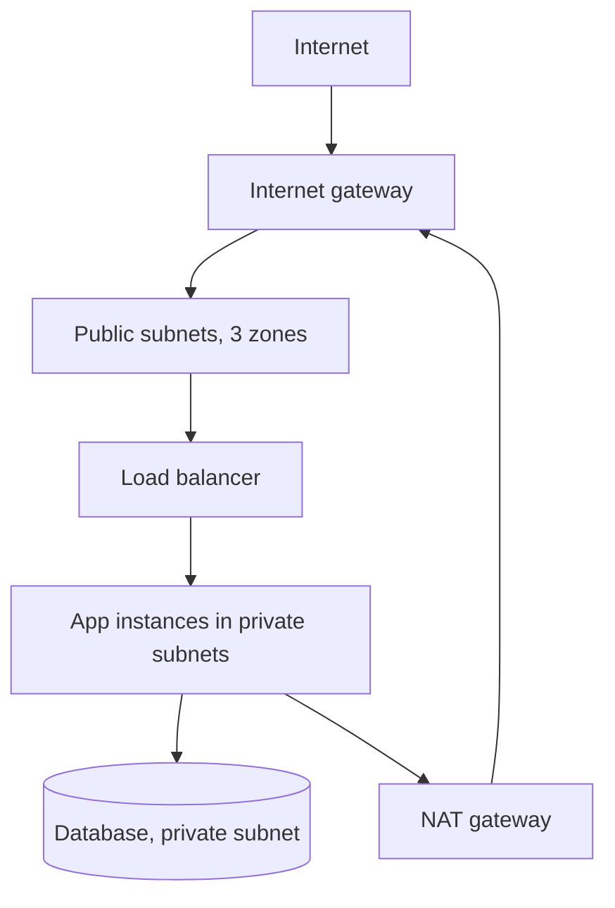

# Cloud Networking

> **Lab host:** Windows 11, Python 3.13.5. The transcript in section 7 was executed on that host
> from the probe source embedded there; the probe computes subnet plans, security-group decisions,
> route resolution and ACL behaviour with `ipaddress` and the standard library. Creating a VPC in
> a provider console, attaching an internet gateway and inspecting flow logs are **labelled
> reference**: no cloud account exists on this host.

## 1. Learning Objectives

After this lesson you will be able to:

- [ ] Plan a VPC across three availability zones without overlapping CIDR blocks
- [ ] Predict whether a packet is allowed by evaluating security-group rules in order
- [ ] Explain why a deleted NAT gateway produces a timeout rather than a permission error
- [ ] Distinguish stateful security groups from stateless network ACLs and say what that changes
- [ ] Place a load balancer correctly, and know the minimum subnet count it requires

## 2. Prerequisites

- [06-INTERNET-AND-WEB-FOUNDATIONS/ip-addressing.md](../06-INTERNET-AND-WEB-FOUNDATIONS/ip-addressing.md)
  — CIDR notation and host ranges, assumed fluent here
- [06-INTERNET-AND-WEB-FOUNDATIONS/tcp-and-udp.md](../06-INTERNET-AND-WEB-FOUNDATIONS/tcp-and-udp.md)
  — ports and connection setup
- [16-DEVOPS-AND-INFRASTRUCTURE/networking-for-devops.md](../16-DEVOPS-AND-INFRASTRUCTURE/networking-for-devops.md)
  — routing and DNS from an operator's point of view
- [virtual-machines.md](virtual-machines.md) — the instances that live in these subnets

## 3. Introduction

Cloud networking is a software-defined network you build out of four objects: a **VPC** (your
private address space), **subnets** (slices of it, each tied to one zone), **route tables** (where
traffic goes) and **security rules** (what is allowed). Nothing is cabled; every one of those
objects is an API resource, and every mistake is a configuration mistake rather than a broken
cable.

That is the good news and the bad news. Good, because a network can be reviewed in a pull request
and reproduced identically in three environments. Bad, because a network can be *wrong in a way
that works*: a rule that is too broad passes every test, and a route that is subtly absent only
fails at 3 a.m. in one zone.

This lesson is about reasoning correctly before you click. The probe does the arithmetic that
console wizards hide: how much of the address space is actually consumed, which rule matched a
flow, which route won, and whether a reply packet survives a stateless boundary.

## 4. The Problem It Solves

Applications need three distinct kinds of connectivity, and conflating them is the origin of most
cloud security incidents:

1. **Public ingress** — users reaching a load balancer on 443.
2. **Private east-west traffic** — the app tier reaching a database that must never be reachable
   from the internet.
3. **Controlled egress** — instances reaching package mirrors or third-party APIs without being
   reachable themselves.

A flat network with permissive rules satisfies all three at once and is therefore the default in
every rushed project. The VPC model exists to make the separation structural: a database in a
private subnet has no route to the internet, so "somebody opened 5432 by accident" cannot become
an exposure. The rule is defence in depth: the subnet has no path, *and* the security group denies
the port, *and* the database requires TLS and a password.

## 5. Core Concepts

### Address planning

A VPC is a CIDR block, commonly `/16` — 65,536 addresses. Subnets carve it up, and **each subnet
must live in exactly one zone**. The probe's plan uses three `/24` public subnets (one per zone)
and three `/20` private subnets, consuming 13,056 of 65,536 addresses, 19.9% of the space.

Every subnet loses five addresses to provider reservations: network address, broadcast, and three
for the router, DNS and future use. A `/24` therefore yields 251 usable addresses, not 256, and a
`/20` yields 4,091.

Overlap is the failure that hurts most later: two VPCs with overlapping ranges cannot be peered,
and merging two teams' networks after the fact means renumbering. The probe validates overlap
before anything is created.

### Security groups are stateful and allow-only

A security group is a set of allow rules evaluated against a flow's protocol, port and source.
There are no deny rules: anything not matched is denied. Crucially, groups are **stateful** —
reply traffic for an established connection is permitted automatically, so a rule allowing inbound
443 on the web tier implies the outbound replies work.

Rules are usually evaluated as "does any rule match", so a broad rule silently defeats a narrow
one. The audit in section 7 counts what is *actually* reachable rather than what the rules were
meant to say.

### Network ACLs are stateless and ordered

A network ACL applies at the subnet boundary, has both allow and deny rules evaluated in order,
and is **stateless**: the reply to an inbound request is a separate flow that must be allowed
explicitly. That is why a client connecting to port 443 from an ephemeral port such as 51000 needs
the ACL's inbound direction to permit 49152–65535 — forget it, and the TCP handshake completes
while every response is dropped.

The practical lesson: do not transcribe ACL rules into a security group or vice versa. They have
different semantics, and the copy is wrong in exactly the direction that is hard to debug.

### Route tables and longest-prefix match

A route table maps destinations to targets. When several routes match, the **longest prefix wins**:
`10.20.3.10` matches both `10.20.0.0/16` (local) and `0.0.0.0/0` (internet), and the `/16` wins
because it is more specific. That is why intra-VPC traffic stays local even when a default route
exists.

A private subnet typically routes `0.0.0.0/0` to a NAT gateway so instances can initiate outbound
connections without accepting inbound ones. Delete the NAT gateway and the route becomes a
**blackhole**: packets are dropped, connections time out, and there is no "access denied" anywhere
— just silence.

### Placement rules that are actually constraints

A load balancer needs at least two subnets in two zones; one subnet per zone is what makes those
subnets separate failure domains. It also consumes addresses in each — eight or more per subnet in
the model — which is why a `/28` public subnet is a bad idea for a busy balancer.

## 6. How It Works



Ingress arrives through the internet gateway into a public subnet and is forwarded by the load
balancer to private instances. Egress from private instances leaves through the NAT gateway, which
rewrites the source address so replies return to it. The database has no route to the internet at
all: its security group permits 5432 only from the VPC range, and its subnet's route table has no
default route.

Every arrow is checked twice — once by the route table (is there a path?) and once by a security
rule (is it allowed?). A failure in either produces a different symptom, and knowing which one you
are looking at halves the debugging time.

## 7. Practical Examples

**Example 1 — planning, evaluating and auditing a VPC**

The probe below allocates subnets, verifies they do not overlap, evaluates security-group flows
against ordered allow rules, audits internet exposure, resolves routes with longest-prefix match,
and demonstrates the stateful/stateless distinction.

```python
"""CLD-04 probe: the networking mistakes that show up as outages, computed rather than guessed.

Windows 11, Python 3.13.5. No VPC exists on this host; the probe uses the standard library's
`ipaddress` module to build a real subnet plan, evaluates a real security-group rule set
against sample flows, resolves routes by longest prefix match, and shows why a stateless
firewall needs an explicit return-traffic rule. The addressing arithmetic is exact; only the
provider API calls are absent.
"""

from __future__ import annotations

import ipaddress
from dataclasses import dataclass

VPC = ipaddress.ip_network("10.20.0.0/16")
RESERVED_PER_SUBNET = 5  # first four addresses plus the last one, in the usual provider model


def carve(name: str, prefix: int, index: int) -> ipaddress.IPv4Network:
    """Split the VPC into blocks of `prefix` and return the index-th one."""
    blocks = list(VPC.subnets(new_prefix=prefix))
    block = blocks[index]
    print(f"{name:<18}{str(block):<20}{block.num_addresses:>6} addresses"
          f"{block.num_addresses - RESERVED_PER_SUBNET:>7} usable")
    return block


@dataclass(frozen=True)
class Rule:
    direction: str          # "ingress" or "egress"
    protocol: str           # "tcp", "udp", "icmp"
    port_low: int
    port_high: int
    cidr: str
    note: str = ""

    def allows(self, protocol: str, port: int, source: str) -> bool:
        if self.direction != "ingress":
            return False
        if self.protocol != protocol:
            return False
        if not self.port_low <= port <= self.port_high:
            return False
        return ipaddress.ip_address(source) in ipaddress.ip_network(self.cidr)


SECURITY_GROUP = [
    Rule("ingress", "tcp", 443, 443, "0.0.0.0/0", "public HTTPS"),
    Rule("ingress", "tcp", 80, 80, "0.0.0.0/0", "redirect to HTTPS"),
    Rule("ingress", "tcp", 22, 22, "0.0.0.0/0", "ssh from anywhere"),
    Rule("ingress", "tcp", 5432, 5432, "10.20.0.0/16", "database inside the VPC"),
    Rule("egress", "tcp", 443, 443, "0.0.0.0/0", "outbound TLS"),
]


@dataclass(frozen=True)
class Flow:
    name: str
    protocol: str
    port: int
    source: str


FLOWS = [
    Flow("user loads the site", "tcp", 443, "203.0.113.9"),
    Flow("user opens plain HTTP", "tcp", 80, "198.51.100.4"),
    Flow("admin ssh", "tcp", 22, "192.0.2.77"),
    Flow("app reaches the database", "tcp", 5432, "10.20.4.15"),
    Flow("internet scans the database", "tcp", 5432, "203.0.113.50"),
    Flow("health check on 8000", "tcp", 8000, "10.20.0.10"),
]


@dataclass(frozen=True)
class Route:
    destination: ipaddress.IPv4Network
    target: str


PUBLIC_ROUTES = [
    Route(ipaddress.ip_network("10.20.0.0/16"), "local"),
    Route(ipaddress.ip_network("0.0.0.0/0"), "internet-gateway"),
]
PRIVATE_ROUTES = [
    Route(ipaddress.ip_network("10.20.0.0/16"), "local"),
    Route(ipaddress.ip_network("0.0.0.0/0"), "nat-gateway-a"),
]
NO_NAT_ROUTES = [
    Route(ipaddress.ip_network("10.20.0.0/16"), "local"),
]


def resolve(destination: str, routes: list[Route]) -> str:
    address = ipaddress.ip_address(destination)
    candidates = [r for r in routes if address in r.destination]
    if not candidates:
        return "blackhole (no route)"
    best = max(candidates, key=lambda r: r.destination.prefixlen)
    return f"{best.target} via {best.destination}"


def main() -> None:
    print(f"VPC {VPC} has {VPC.num_addresses} addresses")
    print("\n=== subnet plan, three zones ===")
    public = [carve(f"public-{zone}", 24, i) for i, zone in enumerate("abc")]
    private = [carve(f"private-{zone}", 20, 1 + i) for i, zone in enumerate("abc")]

    print("\n=== plan validation ===")
    overlaps = 0
    all_blocks = public + private
    for i, first in enumerate(all_blocks):
        for second in all_blocks[i + 1:]:
            if first.overlaps(second):
                overlaps += 1
                print(f"  overlap: {first} and {second}")
    print(f"  overlapping pairs: {overlaps}")
    used = sum(b.num_addresses for b in all_blocks)
    print(f"  addresses allocated: {used} of {VPC.num_addresses} ({used / VPC.num_addresses:.1%})")
    print(f"  /16 hosts usable after subnet reservations: "
          f"{sum(b.num_addresses - RESERVED_PER_SUBNET for b in all_blocks)}")

    print("\n=== security group evaluation ===")
    print(f"{'flow':<30}{'port':>6}  {'decision':<8} rule")
    for flow in FLOWS:
        match = next((r for r in SECURITY_GROUP if r.allows(flow.protocol, flow.port, flow.source)), None)
        if match:
            print(f"{flow.name:<30}{flow.port:>6}  {'ALLOW':<8} {match.cidr}:{match.port_low}"
                  f" ({match.note})")
        else:
            print(f"{flow.name:<30}{flow.port:>6}  {'DENY':<8} no matching rule")

    print("\n=== rule audit ===")
    open_ports = [r for r in SECURITY_GROUP
                  if r.direction == "ingress" and r.cidr == "0.0.0.0/0" and r.port_low <= 1024]
    for rule in open_ports:
        print(f"  internet-reachable port {rule.port_low}: {rule.note}")
    wide = [r for r in SECURITY_GROUP
            if r.direction == "ingress" and r.port_high - r.port_low > 1000]
    print(f"  rules spanning more than 1000 ports: {len(wide)}")
    print(f"  privileged ports open to the internet: {len(open_ports)}")

    print("\n=== route resolution (longest prefix wins) ===")
    for table, routes in (("public", PUBLIC_ROUTES),
                          ("private", PRIVATE_ROUTES),
                          ("private, NAT deleted", NO_NAT_ROUTES)):
        print(f"  route table: {table}")
        for destination in ("10.20.3.10", "10.20.48.9", "8.8.8.8"):
            print(f"    {destination:<12} -> {resolve(destination, routes)}")

    print("\n=== stateful security group vs stateless network ACL ===")
    ephemeral = range(49152, 65536)
    acl_ingress = [Rule("ingress", "tcp", 443, 443, "0.0.0.0/0")]
    acl_egress = [Rule("egress", "tcp", 443, 443, "0.0.0.0/0")]
    inbound_reply = 51000
    allowed_in = any(r.allows("tcp", inbound_reply, "198.51.100.4") for r in acl_ingress)
    allowed_out = any(
        r.direction == "egress"
        and r.protocol == "tcp"
        and r.port_low <= 443 <= r.port_high
        and ipaddress.ip_address("198.51.100.4") in ipaddress.ip_network(r.cidr)
        for r in acl_egress
    )
    print(f"  stateless ACL: reply to port {inbound_reply} permitted: {allowed_in}")
    print(f"  stateless ACL: request to 443 permitted: {allowed_out}")
    print(f"  ephemeral range {ephemeral.start}-{ephemeral.stop - 1} must be allowed explicitly "
          f"in the ACL's inbound direction")
    print("  stateful security group: reply traffic is tracked automatically -> lesson: "
          "do not copy ACL rules into a security group")

    print("\n=== load balancer placement rule ===")
    zones = len(public)
    print(f"  public subnets: {zones}; a load balancer needs at least 2 -> "
          f"{'ok' if zones >= 2 else 'rejected'}")
    print(f"  distinct /24 blocks among them: {len({str(b) for b in public})} "
          f"(one subnet per zone is what makes them separate failure domains)")
    smallest = min(b.num_addresses - RESERVED_PER_SUBNET for b in public)
    print(f"  smallest public subnet has {smallest} usable addresses; a load balancer "
          f"consumes 8 or more per subnet -> {'ok' if smallest > 8 else 'too small'}")


if __name__ == "__main__":
    main()
```

- `carve` slices the VPC block by subnet index; `subnets.overlaps` is the real overlap check, not a
  string comparison.
- `decide` walks the rule list in order and returns the first match, which is how a broad rule
  shadows a narrow one.
- The route table is a list of `(prefix, target)` and `route_for` picks the longest matching
  prefix.
- The ACL section models the reply direction explicitly, because that is the part people forget.

**Expected output** (executed on Windows 11, Python 3.13.5, exit code 0):

```text
VPC 10.20.0.0/16 has 65536 addresses

=== subnet plan, three zones ===
public-a          10.20.0.0/24           256 addresses    251 usable
public-b          10.20.1.0/24           256 addresses    251 usable
public-c          10.20.2.0/24           256 addresses    251 usable
private-a         10.20.16.0/20         4096 addresses   4091 usable
private-b         10.20.32.0/20         4096 addresses   4091 usable
private-c         10.20.48.0/20         4096 addresses   4091 usable

=== plan validation ===
  overlapping pairs: 0
  addresses allocated: 13056 of 65536 (19.9%)
  /16 hosts usable after subnet reservations: 13026

=== security group evaluation ===
flow                            port  decision rule
user loads the site              443  ALLOW    0.0.0.0/0:443 (public HTTPS)
user opens plain HTTP             80  ALLOW    0.0.0.0/0:80 (redirect to HTTPS)
admin ssh                         22  ALLOW    0.0.0.0/0:22 (ssh from anywhere)
app reaches the database        5432  ALLOW    10.20.0.0/16:5432 (database inside the VPC)
internet scans the database     5432  DENY     no matching rule
health check on 8000            8000  DENY     no matching rule
```

The audit then states the consequence of those rules rather than leaving it implicit:

```text
=== rule audit ===
  internet-reachable port 443: public HTTPS
  internet-reachable port 80: redirect to HTTPS
  internet-reachable port 22: ssh from anywhere
  rules spanning more than 1000 ports: 0
  privileged ports open to the internet: 3
```

That "3" is the finding. SSH from anywhere is allowed by a rule somebody wrote to unblock
themselves, and the audit makes it visible without reading the console.

Routes and ACLs:

```text
=== route resolution (longest prefix wins) ===
  route table: private
    10.20.3.10   -> local via 10.20.0.0/16
    10.20.48.9   -> local via 10.20.0.0/16
    8.8.8.8      -> nat-gateway-a via 0.0.0.0/0
  route table: private, NAT deleted
    10.20.3.10   -> local via 10.20.0.0/16
    10.20.48.9   -> local via 10.20.0.0/16
    8.8.8.8      -> blackhole (no route)

=== stateful security group vs stateless network ACL ===
  stateless ACL: reply to port 51000 permitted: False
  stateless ACL: request to 443 permitted: True
```

- **How to run it:** save the block as `networking_probe.py` and run `python networking_probe.py`.
- **What to read in the output:** the blackhole line. The instance is healthy, the application is
  running, the security group allows egress, and the request still times out — because the path
  disappeared. That is the single most common "the cloud is broken" ticket.
- The ACL lines show a connection that *establishes* (request allowed) and then *stalls* (reply
  dropped). If you have ever seen a TLS handshake hang at exactly the moment the server should
  respond, this is the shape of it.

**Example 2 — the two rules that should never ship**

Provider-specific, **labelled reference**, not executed here:

```text
ingress  tcp  22   0.0.0.0/0     # ssh from anywhere
ingress  tcp  0-65535  10.20.0.0/16   # "allow everything internally"
```

The first is the audit finding above; the second is worse because it looks scoped. Internal
networks are where flat-trust lateral movement happens, and a database that accepts any port from
any internal host is one compromised container away from exfiltration.

## 8. Real-World Applications

- **Three-tier web applications** use exactly the layout above: public subnets for balancers,
  private subnets for app and data tiers, NAT for egress.
- **Kubernetes clusters** add a second layer: the CNI assigns pod addresses, and security groups
  or network policies gate pod-to-pod traffic. The VPC rules still apply underneath.
- **Hybrid connectivity** replaces the internet gateway with a VPN or dedicated link, and the
  hardest part is still address planning — overlapping ranges cannot be routed.
- **Multi-account estates** peer VPCs or share a transit gateway; the blast-radius argument is the
  same as zones, one level up.

The pairing that matters operationally is
[monitoring and logging](../16-DEVOPS-AND-INFRASTRUCTURE/monitoring-and-logging.md): flow logs
turn "the request timed out" into "the packet was rejected by rule X at 10:14:02".

## 9. Common Mistakes

| Mistake | Why it happens | How to recognize it | How to prevent it |
|---|---|---|---|
| Overlapping CIDRs across VPCs | Each team picks `10.0.0.0/16` | Peering fails or routes are ambiguous | Allocate from one address plan; validate overlap in CI |
| Counting 256 usable addresses in a `/24` | The maths looks obvious | Instances fail to launch near the end of the range | Subtract five per subnet everywhere |
| Assuming a timeout is a firewall problem | The error says nothing | Security group allows the traffic | Check the route table before the rules |
| Copying ACL rules into a security group | They look like the same object | Replies blocked for one tier only | Keep ACLs broad and stateless-correct; put policy in groups |
| One public subnet for the load balancer | It works in the console | The balancer refuses or a zone is single-homed | Two subnets in two zones, minimum |
| Leaving SSH open to the world | It unblocked someone once | Audit shows port 22 at `0.0.0.0/0` | Session manager or a bastion; never a permanent rule |

## 10. Best Practices

- **Write the address plan first**, in a file, before creating a VPC. Reserve a `/16` per
  environment and a `/20` per tier per zone.
- **Separate tiers by subnet, not by port.** A database reachable only from the app subnet is
  safer than one reachable from the VPC on a filtered port.
- **Give private subnets no inbound path and one controlled egress path.** Prefer a NAT gateway or
  an egress proxy with logging over per-instance public addresses.
- **Audit exposure as code.** Compute internet-reachable ports from the rules and fail the build
  when the set changes unexpectedly.
- **Name rules by intent** (`allow-https-from-internet`), so the diff explains itself.

## 11. Limitations and Trade-Offs

A NAT gateway is a per-hour cost plus per-GB processing, and it is a single point of failure per
zone unless you build one per zone — which triples that line item. Private subnets buy isolation
and charge you for it.

Security groups cannot express deny, so "allow the VPC except one host" is impossible; you
restructure into a tighter group instead, which is usually the right answer but occasionally means
more groups than you wanted.

Multi-zone subnets multiply objects: three zones means three private subnets, three route
associations, three NAT gateways. That is correct and tedious, which is exactly what
[infrastructure as code](../16-DEVOPS-AND-INFRASTRUCTURE/terraform.md) is for.

Flow logs cost money per GB ingested, and a busy VPC generates a lot. Sampling or filtering to
rejects only is a legitimate compromise.

## 12. Practical Exercises

### Introductory

1. **Exercise 4.1** — A `/22` subnet: how many total addresses, how many usable, and how many
   `/24`s fit inside it? Show the arithmetic.
   **Completion criteria:** 1,024 total, 1,019 usable, four `/24`s.

2. **Exercise 4.2** — Using the probe's security-group table, list every flow that is allowed and
   say which rule allowed it. Then name the one rule you would remove first and the symptom its
   removal causes.
   **Completion criteria:** four allowed flows mapped to their rules; removal of the `0.0.0.0/0:22`
   rule causes SSH from outside the VPC to time out.

### Intermediate

3. **Exercise 4.3** — Add a fourth zone to the probe's plan. Choose non-overlapping CIDRs for one
   public and one private subnet, state the new allocation percentage, and say what breaks if you
   reuse `10.20.48.0/20`.
   **Completion criteria:** non-overlapping blocks (for example `10.20.3.0/24` and
   `10.20.64.0/20`), a recomputed percentage, and the observation that reuse makes
   `overlapping pairs` non-zero and the plan invalid.

4. **Exercise 4.4** — A private instance can reach `8.8.8.8` but a newly deployed instance in the
   same subnet cannot. List, in order, the four things you check and what each failure looks like.
   **Completion criteria:** route table (blackhole/timeout), NAT gateway state (timeout), security
   group egress (timeout or reject), and DNS (name resolution failure, distinct symptom).

### Independent problem-solving

5. **Exercise 4.5** — Design the network for a three-environment estate (dev, staging, production)
   with a shared services VPC, a 3-zone production tier, and a requirement that no environment can
   reach another except through a controlled endpoint. Produce the CIDR plan, the route tables and
   the security-group intent list.
   **Completion criteria:** no overlapping CIDRs across four VPCs, every subnet labelled with its
   zone and tier, and a table showing which flows are permitted between environments and by what
   mechanism. A reviewer can trace any permitted flow to a rule and any denied flow to an absent
   route.

*Solutions: attempt first. They live in `solutions/` of this subject.*

## 13. Knowledge Check

1. Why does a `/24` yield 251 usable addresses?
2. A security group has `allow 443 from 0.0.0.0/0` and `allow 443 from 10.0.0.0/8`. Which one
   "wins"? Does the answer matter?
3. What is the difference in failure symptom between a missing route and a missing rule?
4. Why must an ACL allow the ephemeral port range for replies?
5. Why does a load balancer need at least two subnets?

## 14. Completion Criteria

- [ ] You can plan non-overlapping subnets across three zones and compute usable addresses
- [ ] You can trace a flow through route table, security group and ACL and predict the outcome
- [ ] You can explain stateful versus stateless and the reply-direction consequence
- [ ] You can audit internet exposure from a rule list
- [ ] You can diagnose "times out" as route, rule or DNS without guessing

## 15. Summary

- A VPC is four objects: address space, subnets per zone, route tables, and rules.
- Each subnet reserves five addresses; a `/24` gives 251 usable.
- Security groups are stateful and allow-only; ACLs are stateless and ordered.
- Longest-prefix match keeps intra-VPC traffic local and sends the rest to the default route.
- A deleted NAT gateway is a blackhole, not a permission error — silence, not rejection.
- Internet exposure is a number you can compute, and it should be reviewed like code.

## 16. Next Steps

- Next lesson: [Object Storage](object-storage.md) — the other half of "where does data live",
  and the service whose pricing model surprises people most.
- Practice: run the audit section against a rule list of your own and see what it reports.
- Where it is applied: [load balancing](load-balancing.md) depends on the subnet placement rules
  here, and [infrastructure as code](../16-DEVOPS-AND-INFRASTRUCTURE/terraform.md) is how these
  objects get reviewed.
