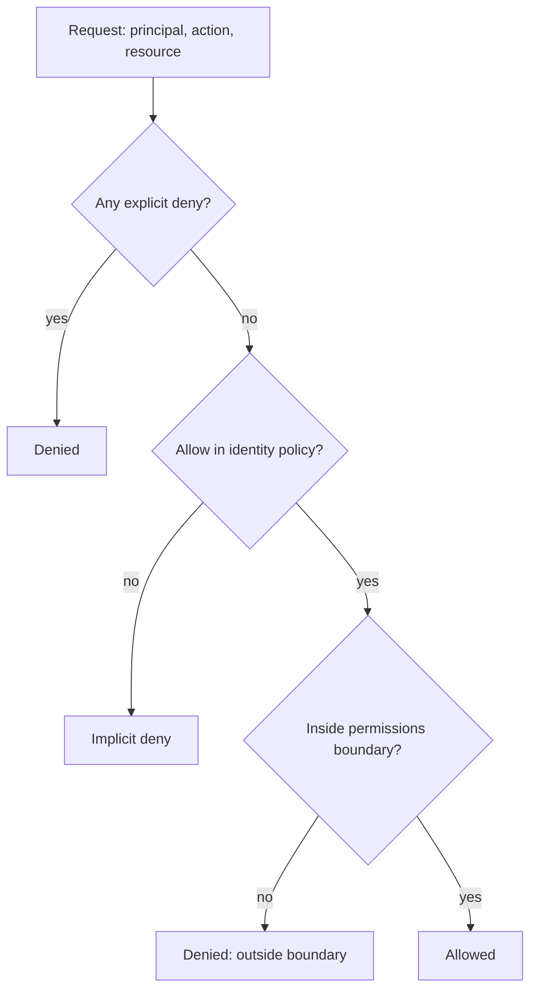

# Identity and Access Management

> **Lab host:** Windows 11, Python 3.13.5. The transcript in section 7 was executed on that host
> from the probe source embedded there; the probe implements a policy evaluator with allow, explicit
> deny, implicit deny, permissions boundaries, trust policies and escalation-path detection. Creating
> a real role in a provider console and inspecting CloudTrail are **labelled reference**: no cloud
> account exists on this host.

## 1. Learning Objectives

After this lesson you will be able to:

- [ ] Evaluate a request against allow, explicit deny and implicit deny, in the right precedence
- [ ] Explain what a permissions boundary removes that a policy does not
- [ ] Measure policy breadth against a fixed action catalogue instead of by reading JSON
- [ ] Derive a least-privilege policy from an access log, and state what the log cannot tell you
- [ ] Recognise a confused-deputy vulnerability in a role trust policy
- [ ] Find privilege-escalation combinations that are individually harmless

## 2. Prerequisites

- [cloud-computing-fundamentals.md](cloud-computing-fundamentals.md) — the control plane and who
  owns which controls
- [15-APPLICATION-SECURITY/access-control.md](../15-APPLICATION-SECURITY/access-control.md) —
  authentication, authorisation and the difference
- [11-BACKEND-ENGINEERING/authorization.md](../11-BACKEND-ENGINEERING/authorization.md) — the
  application-side model this mirrors
- [managed-databases.md](managed-databases.md) — the resource whose control plane these policies
  guard

## 3. Introduction

Identity and access management is the system that answers one question, billions of times a day:
*may this principal perform this action on this resource, under these conditions?* A **principal**
is a user, a role or a service. An **action** is an API call. A **resource** is the thing it acts
on, addressed by an identifier.

IAM is the most consequential configuration in a cloud account, because it is the only one that
decides what a compromise can reach. A misconfigured security group exposes one port. A
misconfigured role can expose every bucket, every database snapshot and every secret in the
account, and it does so silently — the permission works exactly as configured.

The difficulty is that IAM is *combinatorial*. Individual statements look harmless; the
combination of `iam:PassRole` and `iam:AttachRolePolicy` is a full account takeover. This lesson
builds a small evaluator so the combinations become visible.

## 4. The Problem It Solves

Every cloud account needs to answer, for every caller:

- **Which humans may change production?** Named users with MFA, or federated identity, not a shared
  key in a wiki.
- **Which services may talk to which resources?** A web tier needs `s3:GetObject` on one prefix and
  nothing else; a batch job needs `sqs:ReceiveMessage` on one queue.
- **Which third parties may act in my account?** A vendor's account assuming a role in yours, with
  a scope you can revoke.
- **What happened, and who did it?** An audit trail of principal, action, resource and result.

Without a central system, each service invents its own credentials and its own notions of scope,
and rotation becomes impossible. IAM centralises the decision and, crucially, makes the audit a
single log rather than N application logs.

## 5. Core Concepts

### Policies, statements and the three outcomes

A policy is a list of statements, each with `Effect` (allow or deny), `Action`, `Resource` and
optional `Condition`. Evaluation produces one of three outcomes:

1. **Allow** — an allow statement matched and nothing denied it.
2. **Explicit deny** — a deny statement matched. This always wins, in every policy attached to the
   principal.
3. **Implicit deny** — nothing matched. This is the default, and it is why a policy with only
   allows is a whitelist.

Explicit deny exists so that a guardrail can override a broad grant without editing it: an
organisation can deny `s3:PutBucketPolicy` account-wide and no role policy can re-enable it.

### Permissions boundaries and the intersection

A **permissions boundary** is an upper limit on the permissions an identity can have. Effective
permissions are the *intersection*: the identity must be allowed by its policy **and** by the
boundary. The probe shows `kms:Decrypt` allowed by the deployer role but denied because it sits
outside the boundary — reported as `outside permissions boundary`, which is a different fix from an
explicit deny.

### Roles, trust policies and the confused deputy

A role has two policies. The **trust policy** says who may assume it. The **permission policy** says
what the assumption can do. Both must allow the call.

The **confused deputy** problem: if the trust policy says `Principal: *` or trusts a whole account,
any principal that account can be induced to run can assume your role and use your permissions. The
classic form is a third-party service that acts on behalf of many customers; without an
`ExternalId` condition, one customer can point the service at another customer's role.

The probe shows the four cases: open trust allows a foreign principal with the right external ID
*and* one with a guessed ID; scoped trust denies both until the principal and the ID both match.

### Breadth is a number

"Least privilege" is unfalsifiable as an adjective. The probe measures it: a fixed catalogue of 33
actions, and a count of how many each role allows. `legacy-admin` allows 28. `app-role` allows 4.
That is a reviewable claim, and a diff in that number is a reviewable change.

### Deriving a policy from a log

An access log tells you which actions were actually used. The probe finds six logged calls needing
five distinct action+resource pairs, then intersects with the catalogue. Narrowing to those removes
24 of 28 allowed actions — 86%.

What the log cannot tell you: what a future deploy will need, what a break-glass procedure
requires, and what was never exercised because a feature is seasonal. Least privilege from a log is
a starting point plus a monitoring rule, not a final answer.

### Escalation paths

Three permissions combine into account takeover: `iam:CreatePolicyVersion` (write a new policy
version), `iam:AttachRolePolicy` (attach it to a role) and `iam:PassRole` (hand that role to a
service that will run code for you). Each is defensible alone. Together they mean "become
administrator", and the probe flags any principal holding two or more.

## 6. How It Works



The order matters: deny is checked across every attached policy before allows are considered, and
the boundary is an additional gate rather than a replacement. That is why adding an allow to a role
does not help when a service control policy or boundary excludes the action.

For a role assumption, the same evaluation runs twice: once on the trust policy for the
`sts:AssumeRole` call, and once on the permission policy for whatever the session then does.

## 7. Practical Examples

**Example 1 — evaluating policies, measuring breadth, finding escalation paths**

The probe defines a 33-action catalogue and three roles, evaluates ten requests including deny
precedence and a boundary, measures breadth, derives a least-privilege policy from a six-call log,
tests four confused-deputy cases and scans for escalation combinations.

```python
"""CLD-07 probe: IAM policy evaluation, breadth, and the two classic holes.

Windows 11, Python 3.13.5. No cloud account or STS endpoint exists on this host, so the
policy engine is a local implementation of the documented AWS evaluation order: explicit
deny, then allow, then implicit deny, with wildcard actions and resources, condition
operators, a permissions boundary, and a trust policy for role assumption. Every decision
quoted in the lesson comes from this run. Console steps are labelled reference.
"""

from __future__ import annotations

import ipaddress
import re
from dataclasses import dataclass, field
from typing import Any

ACCOUNT = "111122223333"
TABLE = f"arn:aws:dynamodb:eu-west-1:{ACCOUNT}:table/orders"
QUEUE = f"arn:aws:sqs:eu-west-1:{ACCOUNT}:jobs"
BUCKET_ARN = "arn:aws:s3:::app-assets/*"


def arn_match(pattern: str, value: str) -> bool:
    regex = "".join(".*" if c == "*" else "." if c == "?" else re.escape(c) for c in pattern)
    return re.fullmatch(regex, value) is not None


@dataclass
class Statement:
    effect: str
    actions: list[str]
    resources: list[str]
    conditions: dict[str, tuple[str, list[Any]]] = field(default_factory=dict)


@dataclass
class Policy:
    name: str
    statements: list[Statement]


def condition_holds(conditions: dict[str, tuple[str, list[Any]]], context: dict[str, Any]) -> bool:
    for key, (operator, expected) in conditions.items():
        actual = context.get(key)
        if operator == "StringEquals":
            if actual not in expected:
                return False
        elif operator == "StringLike":
            if not any(arn_match(str(pattern), str(actual or "")) for pattern in expected):
                return False
        elif operator == "Bool":
            if bool(actual) is not bool(expected[0]):
                return False
        elif operator == "IpAddress":
            if actual is None or not any(
                    ipaddress.ip_address(actual) in ipaddress.ip_network(cidr) for cidr in expected):
                return False
        elif operator == "StringNotEquals":
            if actual in expected:
                return False
        else:
            raise ValueError(f"unsupported operator {operator}")
    return True


def matches(statement: Statement, action: str, resource: str, context: dict[str, Any]) -> bool:
    action_hit = any(arn_match(pattern, action) for pattern in statement.actions)
    resource_hit = any(arn_match(pattern, resource) for pattern in statement.resources)
    return action_hit and resource_hit and condition_holds(statement.conditions, context)


def evaluate(
    action: str,
    resource: str,
    context: dict[str, Any],
    identity: list[Policy],
    boundary: Policy | None = None,
) -> tuple[str, str]:
    """Return (decision, reason) following explicit-deny > allow > implicit-deny."""
    for policy in identity:
        for statement in policy.statements:
            if statement.effect == "Deny" and matches(statement, action, resource, context):
                return "Deny", f"explicit deny in {policy.name}"
    allowed_by = next(
        (policy.name for policy in identity
         if any(s.effect == "Allow" and matches(s, action, resource, context) for s in policy.statements)),
        None,
    )
    if allowed_by is None:
        return "Deny", "no allow statement (implicit deny)"
    if boundary is not None:
        inside = any(s.effect == "Allow" and matches(s, action, resource, context)
                     for s in boundary.statements)
        if not inside:
            return "Deny", f"outside permissions boundary {boundary.name}"
    return "Allow", f"allow in {allowed_by}"


SERVICES = {
    "s3": (["GetObject", "PutObject", "DeleteObject", "ListBucket", "PutBucketPolicy", "DeleteBucket"],
           BUCKET_ARN),
    "dynamodb": (["GetItem", "PutItem", "Query", "Scan", "DeleteTable"], TABLE),
    "sqs": (["SendMessage", "ReceiveMessage", "DeleteMessage", "PurgeQueue"], QUEUE),
    "iam": (["CreatePolicyVersion", "AttachRolePolicy", "PassRole", "CreateUser", "GetRole"],
            f"arn:aws:iam::{ACCOUNT}:role/app-role"),
    "ec2": (["DescribeInstances", "RunInstances", "TerminateInstances", "CreateSecurityGroup"],
            "arn:aws:ec2:eu-west-1:111122223333:instance/i-0abc"),
    "logs": (["CreateLogGroup", "PutLogEvents", "DeleteLogGroup"],
             f"arn:aws:logs:eu-west-1:{ACCOUNT}:log-group:app"),
    "kms": (["Encrypt", "Decrypt", "ScheduleKeyDeletion"],
            f"arn:aws:kms:eu-west-1:{ACCOUNT}:key/1234"),
    "secretsmanager": (["GetSecretValue", "PutSecretValue", "DeleteSecret"],
                       f"arn:aws:secretsmanager:eu-west-1:{ACCOUNT}:secret:db"),
}
CATALOGUE = [(f"{svc}:{action}", resource)
             for svc, (actions, resource) in SERVICES.items() for action in actions]


def breadth(policies: list[Policy]) -> list[str]:
    return [action for action, resource in CATALOGUE
            if evaluate(action, resource, {}, policies)[0] == "Allow"]


def s3_bucket_prefix(action: str, resource: str) -> str:
    if action.startswith("s3:") and resource.count("/") >= 3:
        return resource.rsplit("/", 1)[0] + "/*"
    return resource


def main() -> None:
    app_role = Policy("app-role", [
        Statement("Allow", ["s3:GetObject", "s3:PutObject"], [BUCKET_ARN]),
        Statement("Allow", ["dynamodb:Query", "dynamodb:GetItem"], [TABLE]),
        Statement("Allow", ["sqs:SendMessage"], [QUEUE],
                  {"aws:SourceVpc": ("StringEquals", ["vpc-0a1b2c3d"])}),
        Statement("Deny", ["s3:DeleteObject", "s3:PutBucketPolicy"], [BUCKET_ARN]),
    ])
    legacy_admin = Policy("legacy-admin", [
        Statement("Allow", ["*"], ["*"]),
        Statement("Deny", ["iam:*", "organizations:*"], ["*"]),
    ])
    deployer = Policy("deployer", [
        Statement("Allow", ["ec2:*", "s3:*", "kms:Decrypt"], ["*"]),
        Statement("Allow", ["iam:PassRole", "iam:AttachRolePolicy", "iam:CreatePolicyVersion"], ["*"]),
    ])
    boundary = Policy("boundary", [
        Statement("Allow", ["s3:*", "dynamodb:*", "sqs:*", "logs:*"], ["*"]),
    ])

    print(f"=== policy breadth over the {len(CATALOGUE)}-action catalogue ===")
    for policy in (app_role, legacy_admin, deployer):
        allowed = breadth([policy])
        print(f"  {policy.name:<13}: {len(allowed):>2}/{len(CATALOGUE)} actions allowed")

    print("\n=== decisions, including deny precedence and the boundary ===")
    cases = [
        ("s3:GetObject", "arn:aws:s3:::app-assets/logo.png", {}, [app_role], None),
        ("s3:DeleteObject", "arn:aws:s3:::app-assets/logo.png", {}, [app_role], None),
        ("s3:PutBucketPolicy", "arn:aws:s3:::app-assets/logo.png", {}, [app_role], None),
        ("s3:GetObject", "arn:aws:s3:::billing-exports/invoice.csv", {}, [app_role], None),
        ("sqs:SendMessage", QUEUE, {"aws:SourceVpc": "vpc-0a1b2c3d"}, [app_role], None),
        ("sqs:SendMessage", QUEUE, {"aws:SourceVpc": "vpc-9999"}, [app_role], None),
        ("dynamodb:Query", TABLE, {}, [app_role], None),
        ("kms:Decrypt", f"arn:aws:kms:eu-west-1:{ACCOUNT}:key/1234", {}, [deployer], None),
        ("kms:Decrypt", f"arn:aws:kms:eu-west-1:{ACCOUNT}:key/1234", {}, [deployer], boundary),
        ("iam:CreatePolicyVersion", "*", {}, [legacy_admin], None),
    ]
    for action, res, ctx, identity, bnd in cases:
        decision, reason = evaluate(action, res, ctx, identity, bnd)
        print(f"  {decision:<5} {action:<26} {reason}")

    print("\n=== least privilege from an access log ===")
    log = [
        ("s3:GetObject", "arn:aws:s3:::app-assets/a.png"),
        ("s3:GetObject", "arn:aws:s3:::app-assets/b.png"),
        ("s3:PutObject", "arn:aws:s3:::app-assets/upload/1"),
        ("dynamodb:Query", TABLE),
        ("dynamodb:GetItem", TABLE),
        ("sqs:SendMessage", QUEUE),
    ]
    needed = sorted({(action, s3_bucket_prefix(action, res)) for action, res in log})
    broad, narrow = breadth([legacy_admin]), breadth([app_role])
    print(f"  {len(log)} logged calls need {len(needed)} distinct action+resource pairs: "
          f"{sorted({a for a, _ in needed})}")
    print(f"  legacy-admin allows {len(broad)}; app-role allows {len(narrow)}")
    print(f"  actions the log never used: {sorted(set(broad) - {a for a, _ in needed})[:6]} ...")
    print(f"  narrowing legacy-admin to app-role removes {len(broad) - len(narrow)} of "
          f"{len(broad)} allowed actions ({1 - len(narrow) / len(broad):.0%})")

    print("\n=== confused deputy in a role trust policy ===")
    open_trust = Policy("open-trust", [Statement("Allow", ["sts:AssumeRole"], ["*"])])
    scoped_trust = Policy("scoped-trust", [Statement(
        "Allow", ["sts:AssumeRole"], ["arn:aws:iam::444455556666:role/vendor-agent"],
        {"sts:ExternalId": ("StringEquals", ["vendor-7f3a"])})])
    attempts = [
        ("arn:aws:iam::999988887777:role/attacker", "vendor-7f3a"),
        ("arn:aws:iam::444455556666:role/vendor-agent", "guessed"),
        ("arn:aws:iam::444455556666:role/vendor-agent", "vendor-7f3a"),
    ]
    for principal, external_id in attempts:
        for policy in (open_trust, scoped_trust):
            ctx = {"sts:ExternalId": external_id}
            hit = any(s.effect == "Allow" and matches(s, "sts:AssumeRole", principal, ctx)
                      for s in policy.statements)
            print(f"  {policy.name:<13} principal {principal.split(':')[4]:<11} "
                  f"externalId={external_id:<11} {'assume allowed' if hit else 'denied'}")

    print("\n=== privilege escalation path detection ===")
    escalation = {"iam:CreatePolicyVersion", "iam:AttachRolePolicy", "iam:PassRole"}
    for policy in (app_role, deployer):
        held = sorted(escalation & set(breadth([policy])))
        print(f"  {policy.name:<9} holds {len(held)}: {held}")
    print("  iam:AttachRolePolicy + iam:PassRole on * is a full-account path: attach "
          "AdministratorAccess to a role the principal can assume")
    print(f"  app-role holds 0 of these and can reach nothing outside its three resources")


if __name__ == "__main__":
    main()
```

- `evaluate` checks explicit deny first across all policies, then allow, then the boundary — the
  order is the lesson.
- Breadth is `len(allowed ∩ catalogue)`, so the number is comparable between roles.
- The log section intersects used pairs with allowed actions and reports what narrowing removes.
- The deputy section varies principal and external ID independently, which is the only way to see
  which condition actually protects the role.

**Expected output** (executed on Windows 11, Python 3.13.5, exit code 0):

```text
=== policy breadth over the 33-action catalogue ===
  app-role     :  4/33 actions allowed
  legacy-admin : 28/33 actions allowed
  deployer     : 14/33 actions allowed

=== decisions, including deny precedence and the boundary ===
  Allow s3:GetObject               allow in app-role
  Deny  s3:DeleteObject            explicit deny in app-role
  Deny  s3:PutBucketPolicy         explicit deny in app-role
  Deny  s3:GetObject               no allow statement (implicit deny)
  Allow sqs:SendMessage            allow in app-role
  Deny  sqs:SendMessage            no allow statement (implicit deny)
  Allow dynamodb:Query             allow in app-role
  Allow kms:Decrypt                allow in deployer
  Deny  kms:Decrypt                outside permissions boundary boundary
  Deny  iam:CreatePolicyVersion    explicit deny in legacy-admin
```

Read rows 1 and 4 together: the same action is allowed for one resource and implicitly denied for
another. IAM decisions are per resource, and a policy that omits `Resource` scoping grants all of
them.

Least privilege and the deputy:

```text
=== least privilege from an access log ===
  6 logged calls need 6 distinct action+resource pairs: ['dynamodb:GetItem', 'dynamodb:Query', 's3:GetObject', 's3:PutObject', 'sqs:SendMessage']
  legacy-admin allows 28; app-role allows 4
  actions the log never used: ['dynamodb:DeleteTable', 'dynamodb:PutItem', 'dynamodb:Scan', 'ec2:CreateSecurityGroup', 'ec2:DescribeInstances', 'ec2:RunInstances'] ...
  narrowing legacy-admin to app-role removes 24 of 28 allowed actions (86%)

=== confused deputy in a role trust policy ===
  open-trust    principal 999988887777 externalId=vendor-7f3a assume allowed
  scoped-trust  principal 999988887777 externalId=vendor-7f3a denied
  open-trust    principal 444455556666 externalId=guessed     assume allowed
  scoped-trust  principal 444455556666 externalId=guessed     denied
  open-trust    principal 444455556666 externalId=vendor-7f3a assume allowed
  scoped-trust  principal 444455556666 externalId=vendor-7f3a assume allowed
```

- **How to run it:** save the block as `iam_probe.py` and run `python iam_probe.py`. Standard
  library only.
- **What to read in the output:** `legacy-admin allows 28; app-role allows 4`, and the 86% figure.
  That is what least privilege looks like when it is measured rather than described.
- The deputy table's last two rows are the point: the scoped policy denies a wrong principal and a
  wrong ID, and allows the correct pair. Trust is a two-part condition, not a list of account IDs.
- `iam:AttachRolePolicy + iam:PassRole on * is a full-account path` is the finding that never
  appears in a per-permission review, because neither permission is wrong on its own.

**Example 2 — the trust policy that closes the deputy hole**

Provider syntax, **labelled reference** (not executed; requires an account):

```json
{
  "Version": "2012-10-17",
  "Statement": [{
    "Effect": "Allow",
    "Principal": {"AWS": "arn:aws:iam::999988887777:root"},
    "Action": "sts:AssumeRole",
    "Condition": {"StringEquals": {"sts:ExternalId": "vendor-7f3a"}}
  }]
}
```

The external ID must be unguessable and unique per customer, and it must be stored where the
customer cannot read another customer's value. A shared, published external ID is the same as none.

## 8. Real-World Applications

- **Human access** uses federation: a person authenticates to an identity provider, receives a
  short-lived role session, and the audit log names them. Long-lived access keys are the thing to
  eliminate.
- **Workload access** uses instance or pod identity, so credentials are minted per workload and
  rotate automatically.
- **Cross-account access** is a role plus a trust policy; the boundary is the account, and the
  external ID is what makes it safe for third parties.
- **Break-glass** is a deliberately broad role, alarmed on use, with a documented approval path.
  It exists so nobody creates a permanent admin "just in case".

The pairing that matters is with
[secrets and configuration](secrets-and-configuration.md): IAM decides whether a principal *may* read a secret,
and the secret store decides whether the read is logged and rotated.

## 9. Common Mistakes

| Mistake | Why it happens | How to recognize it | How to prevent it |
|---|---|---|---|
| `Resource: "*"` on data actions | It works immediately | One role can read every bucket | Scope to ARN patterns; review diffs for `*` |
| Trust policy with `Principal: "*"` | Copied from a tutorial | Any account can assume the role | Principal plus `ExternalId` condition |
| Believing an allow overrides a deny | Policy JSON reads top-down | A guardrail silently blocks the call | Deny is evaluated first, always |
| Ignoring the boundary | Role policy looks complete | `outside permissions boundary` in the error | Check the boundary before editing the role |
| Granting `iam:PassRole` broadly | Needed by a deploy job | A compromised job can assume anything | Scope `PassRole` to specific role ARNs |
| Permanent admin for convenience | Onboarding friction | An `AdministratorAccess` attachment on a human role | Federation plus break-glass with alarms |

## 10. Best Practices

- **Start from a measured log**, then add a monitored deny for anything unused and remove it after
  a full quarter. The log narrows; the monitoring catches the seasonal feature.
- **Scope every statement to a resource ARN**, including reads.
- **Separate trust from permission** in review: two policies, two questions, two reviewers.
- **Make boundaries explicit** at the account or OU level so a compromised role cannot exceed them.
- **Alarm on escalation combinations**: any principal that gains a second of `CreatePolicyVersion`,
  `AttachRolePolicy`, `PassRole`, `PutRolePolicy` is a finding.
- **Never let a human hold a long-lived key.** Federation, session duration, MFA.

## 11. Limitations and Trade-Offs

Least privilege costs velocity: every new feature needs a policy change, and policy changes need
review. The alternative — broad roles — costs nothing until the day it costs everything. Most
organisations land on broad roles in non-production and tight roles in production, which is a
defensible compromise as long as the environments are genuinely separate accounts.

Permissions boundaries are powerful and easy to get wrong: a boundary that is too tight breaks
production in ways that look like service outages, and a boundary that is too loose is decoration.

The access-log method has a blind spot: permissions used once a year look unused. Removing them is
correct only if you are willing to re-add them under pressure.

Cross-account trust is only as strong as the external ID's secrecy, and that is a process property
IAM cannot enforce.

IAM evaluation is fast but not free, and very large policy sets add latency to every call. That is
a second-order concern compared with getting the policy right.

## 12. Practical Exercises

### Introductory

1. **Exercise 7.1** — Using the probe's output, explain why `s3:GetObject` is allowed in one row and
   denied in another, in one sentence each.
   **Completion criteria:** the allow matches an allow statement scoped to that resource; the deny
   is implicit because no statement covers the second resource.

2. **Exercise 7.2** — A role's policy allows `s3:*` on `*`. List three actions from the catalogue
   that grants, and state the smallest change that removes two of them.
   **Completion criteria:** three data actions named (for example `GetObject`, `PutObject`,
   `DeleteObject`), and a scoped ARN pattern plus an action list as the fix.

### Intermediate

3. **Exercise 7.3** — A log shows 12 calls using 5 distinct actions, and the role allows 30. State
   the narrowing percentage and one reason not to apply the narrowed policy immediately.
   **Completion criteria:** 83% reduction, with the seasonal-feature or break-glass caveat stated.

4. **Exercise 7.4** — Construct a trust policy for a vendor that must assume a role on behalf of
   three customers. Name the two conditions that must be present and what goes wrong without each.
   **Completion criteria:** a specific principal and a per-customer external ID; without the
   principal, any account can assume; without the ID, one customer can act as another.

### Independent problem-solving

5. **Exercise 7.5** — Design the identity model for a three-account estate (dev, staging,
   production) with 40 engineers, a CI system and one third-party integration. Specify roles,
   trust relationships, boundaries, federation and the escalation alarms. Then state how you would
   prove the model works.
   **Completion criteria:** no human long-lived keys, distinct deploy roles per environment, a
   scoped third-party trust with external IDs, an explicit boundary, and an alarm list for
   escalation combinations. The proof section names an access-log review and a tabletop test of one
   denied action per role.

*Solutions: attempt first. They live in `solutions/` of this subject.*

## 13. Knowledge Check

1. What are the three possible outcomes of an IAM evaluation, and which wins?
2. How does a permissions boundary differ from an explicit deny?
3. Why does a trust policy need both a principal and a condition for third parties?
4. What three permissions combine into account takeover?
5. Why is an access log an incomplete basis for least privilege?

## 14. Completion Criteria

- [ ] You can evaluate a request through deny, allow and boundary in the correct order
- [ ] You can measure policy breadth against a catalogue and compare roles
- [ ] You can write a trust policy that resists a confused deputy
- [ ] You can name an escalation combination and the alarm that catches it
- [ ] You can state what a log-based policy cannot cover

## 15. Summary

- IAM answers one question per call, and explicit deny always wins.
- A boundary is an intersection, not a replacement; it fails with its own error.
- Roles have two policies: trust decides who, permission decides what.
- Breadth is measurable, and 28/33 versus 4/33 is a reviewable claim.
- Confused deputy is prevented by principal plus external ID, not by a list of account IDs.
- Individually harmless permissions can combine into takeover; scan for combinations.

## 16. Next Steps

- Next lesson: [Secrets and Configuration](secrets-and-configuration.md) — what IAM protects once the principal is
  allowed, and how the secret itself is stored, rotated and scanned for.
- Practice: run the escalation scan against a policy set of your own and see what it reports.
- Where it is applied: [access control](../15-APPLICATION-SECURITY/access-control.md) is the
  application-side mirror of this model, and [secure API design](../15-APPLICATION-SECURITY/secure-api-design.md)
  depends on it.
