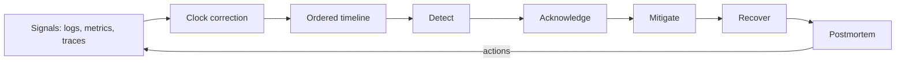

# Incident Response

> **Lab host:** Windows 11, Python 3.13.5. The transcript in section 7 was executed on that host
> from the probe source embedded there; the probe reconstructs an incident timeline from exported
> logs with a clock-skew correction, computes detection and recovery intervals, burns an error
> budget, sizes a blast radius, groups an alert storm and derives revenue exposure. Paging a real
> on-call rotation, using an incident management tool and running a live postmortem review are
> **labelled reference**: this host has no cloud account, no pager and no team.

## 1. Learning Objectives

After this lesson you will be able to:

- [ ] Order events from multiple sources after correcting clock skew
- [ ] Compute detection, acknowledgement, mitigation and recovery intervals from a timeline
- [ ] Convert an outage into a fraction of a monthly error budget
- [ ] Compute blast radius and revenue exposure from shard counts and traffic
- [ ] Reduce an alert storm to a page count with grouping rules
- [ ] Identify the leading indicator that would have shortened detection

## 2. Prerequisites

- [observability.md](observability.md) — the metrics, logs and traces a timeline is built from
- [cloud-computing-fundamentals.md](cloud-computing-fundamentals.md) — error budgets and availability
  arithmetic
- [16-DEVOPS-AND-INFRASTRUCTURE/monitoring-and-logging.md](../16-DEVOPS-AND-INFRASTRUCTURE/monitoring-and-logging.md)
  — the alerting rules a page comes from, and what to instrument before an incident
- [13-SOFTWARE-ENGINEERING-AND-ARCHITECTURE/scalability-and-reliability.md](../13-SOFTWARE-ENGINEERING-AND-ARCHITECTURE/scalability-and-reliability.md)
  — failure modes and redundancy

## 3. Introduction

An incident is a period in which users experience something worse than the objective you promised.
Response is the practice of shortening that period: detect sooner, understand faster, mitigate
before diagnosing, and learn afterwards.

Almost everything in incident response is a measurement problem. "We responded slowly" is an
opinion; "detection took four minutes and mitigation ten" is a number you can improve. "It affected
some users" is a guess; "3 of 24 shards, 22,500 of 180,000 users, 12.5%" is a blast radius you can
decide about.

This lesson takes a single recorded incident and computes every interval in it, including the clock
correction that makes the cause appear before the symptom — which is not automatic, and which most
teams skip.

## 4. The Problem It Solves

During an incident, the information you have is incomplete, arrives out of order, and comes from
systems whose clocks disagree. The pressures are real:

- **Symptoms and causes interleave.** Without a corrected timeline, you cannot tell whether the pool
  exhaustion caused the errors or the errors caused the pool exhaustion.
- **Alerts arrive as a storm.** 47 raw alerts from four rules, all one root cause, will bury the one
  page that mattered.
- **The fastest lever is not the obvious one.** A rollback takes minutes to build and deploy; a
  feature flag takes seconds. The probe's on-call used the flag.
- **The cost is invisible until later.** An eight-minute error window can spend a fifth of the
  month's budget, and five such incidents exhaust it.

Response practice exists to convert a chaotic stream of signals into a sequence of decisions with
timestamps, so the postmortem can ask "what would have shortened this?" and get an answer with a
number attached.

## 5. Core Concepts

### Timeline reconstruction and clock skew

Logs from three sources arrive with host clocks that drift. The probe corrects `api-2` by +37
seconds; without the correction, `api-2`'s pool-exhaustion line at `09:58:12` sorts *before* the
first latency signal at `09:58:02`, and the cause appears to follow the symptom.

The general rule: sort by corrected time, and record the correction in the postmortem. If you cannot
trust the clock, you cannot trust the causal ordering, and causal ordering is the entire value of a
timeline.

### The four intervals

From the corrected timeline:

| Interval | From | To | Duration |
|---|---|---|---|
| Detection | first signal 09:58:02 | alert 10:02:11 | 4 min |
| Acknowledgement | page 10:02:11 | on-call 10:06:12 | 4 min |
| Mitigation | first signal 09:58:02 | flag disabled 10:07:40 | 10 min |
| Recovery | first signal 09:58:02 | resolved 10:19:03 | 21 min (MTTR) |

Each has a different owner and a different fix. Detection is instrumentation. Acknowledgement is
paging and staffing. Mitigation is runbooks and feature flags. Recovery is the actual repair.

### Error budget burned

The service was above a 0.1% error rate for about 8 minutes. For a 99.9% monthly SLO that is 19% of
the entire budget in one incident — five incidents of this size exhaust the month.

That conversion is what makes an incident's severity arguable with numbers rather than adjectives,
and it is why incident review and SLO review belong in the same meeting.

### Blast radius and exposure

Three of twenty-four checkout shards failed, which is 12.5% of 180,000 users — 22,500 people. At
$0.42 per second per affected shard for five minutes, revenue exposure was $415.

Blast radius decides whether you page, whether you declare a major incident, and whether you
mitigate by sharding traffic away rather than fixing the cause.

### Alert storms and grouping

Forty-seven raw alerts from four rules, one root cause. Grouped by `service + alertname`, five pages
reached the on-call — 89% fewer. Ungrouped, that is 12 pages per hour against a shift target of two.

The design goal is a page count, not an alert count. A repeat page for the same group should be a
reminder on an existing incident, not a new fact.

### Leading indicators

p99 latency was already 240 ms at `09:58:02`, four minutes before the error-rate alert fired at
`10:02:11`. Two levers shorten detection: alert on the leading indicator (latency, saturation, queue
depth), or accept the delay — but choose deliberately, because the default is the delay.

## 6. How It Works



The loop closes back at instrumentation: the postmortem's most useful output is often a new signal,
because a faster detector shortens every future incident of the same shape.

Mitigation comes before diagnosis deliberately. The on-call disabled a feature flag at `10:07:40`,
before the rollback started at `10:12:55`, because stopping the bleeding and understanding the wound
are different tasks with different clocks.

## 7. Practical Examples

**Example 1 — one incident, every interval measured**

The probe holds a list of timestamped events from three sources, applies a per-source clock
correction, sorts them, computes the intervals, converts duration to error-budget spend, computes
blast radius and revenue exposure, groups the alert storm, and compares the corrected ordering with
the uncorrected one.

```python
"""CLD-12 probe: reconstructing an incident from its own evidence.

Windows 11, Python 3.13.5. Two hosts' application logs plus load-balancer and on-call entries
are parsed with their real timestamps, including the 37-second clock skew on api-2, then ordered
into one timeline. From that timeline the probe computes detection, acknowledgement, mitigation
and recovery intervals, the error budget the incident burned, the fraction of users exposed, and
how many pages the on-call received after grouping. All timestamps and intervals below are
produced by this run; the incident is synthetic but the arithmetic is not. Paging and incident
tooling in the lesson is labelled reference.
"""

from __future__ import annotations

from dataclasses import dataclass
from datetime import datetime, timedelta

SKEW = timedelta(seconds=37)  # api-2's clock runs 37 s slow

RAW = [
    ("api-1", "2026-03-14T09:58:02", "checkout latency p99 240ms"),
    ("api-2", "2026-03-14T09:55:45", "checkout latency p99 260ms"),
    ("api-2", "2026-03-14T09:57:35", "db pool wait 4200ms connections 20/20 pool exhausted"),
    ("api-1", "2026-03-14T09:59:18", "db pool wait 180ms connections 17/20"),
    ("api-1", "2026-03-14T10:02:11", "checkout error rate 0.4% (baseline 0.02%)"),
    ("api-1", "2026-03-14T10:03:47", "checkout error rate 3.1%"),
    ("loadbalancer", "2026-03-14T10:04:05", "5xx rate 4.8% on checkout, marking api-2 unhealthy"),
    ("api-1", "2026-03-14T10:05:30", "checkout error rate 22%"),
    ("oncall", "2026-03-14T10:06:12", "page acknowledged"),
    ("api-1", "2026-03-14T10:07:40", "feature flag new_checkout_writer disabled by on-call"),
    ("api-2", "2026-03-14T10:07:59", "db pool released 20/20 connections"),
    ("api-1", "2026-03-14T10:09:02", "checkout error rate 0.9%"),
    ("oncall", "2026-03-14T10:12:55", "rollback of release 2026.03.14-3 started"),
    ("api-1", "2026-03-14T10:14:20", "checkout error rate 0.03%, p99 210ms"),
    ("oncall", "2026-03-14T10:19:03", "incident resolved, monitoring stable for 5 min"),
    ("api-1", "2026-03-14T10:22:40", "postmortem doc created"),
]


@dataclass
class Entry:
    host: str
    at: datetime
    message: str


def normalise() -> list[Entry]:
    entries = []
    for host, stamp, message in RAW:
        at = datetime.fromisoformat(stamp)
        if host == "api-2":
            at += SKEW
        entries.append(Entry(host, at, message))
    return sorted(entries, key=lambda e: e.at)


def at_of(entries: list[Entry], needle: str) -> datetime:
    return next(e.at for e in entries if needle in e.message)


def minutes(start: datetime, end: datetime) -> float:
    return (end - start).total_seconds() / 60


def main() -> None:
    entries = normalise()

    print("=== reconstructed timeline (api-2 corrected by +37 s) ===")
    for entry in entries:
        print(f"  {entry.at:%H:%M:%S} {entry.host:<12} {entry.message}")
    print(f"  {len(entries)} entries from 3 sources, ordered by corrected time")

    print("\n=== incident intervals ===")
    first_signal = at_of(entries, "p99 240ms")
    detected = at_of(entries, "error rate 0.4%")
    acked = at_of(entries, "page acknowledged")
    mitigated = at_of(entries, "feature flag new_checkout_writer")
    recovered = at_of(entries, "incident resolved")
    print(f"  first signal    {first_signal:%H:%M:%S}")
    print(f"  detected        {detected:%H:%M:%S}  +{minutes(first_signal, detected):.0f} min")
    print(f"  acknowledged    {acked:%H:%M:%S}  +{minutes(detected, acked):.0f} min after page")
    print(f"  mitigated       {mitigated:%H:%M:%S}  +{minutes(first_signal, mitigated):.0f} min from signal")
    print(f"  recovered       {recovered:%H:%M:%S}  +{minutes(first_signal, recovered):.0f} min from signal")
    print(f"  MTTR (signal -> recovered): {minutes(first_signal, recovered):.0f} min")
    print(f"  detection is {minutes(first_signal, detected) / minutes(first_signal, recovered):.0%} "
          f"of the outage, acknowledgement a further {minutes(first_signal, acked):.0f} min in")

    print("\n=== error budget burned ===")
    budget_min, bad_minutes = 43.2, 8.0
    print(f"  about {bad_minutes:.0f} min above a 0.1% error rate")
    print(f"  that is {bad_minutes / budget_min:.0%} of a 30-day 99.9% budget in one incident")
    print(f"  {budget_min / bad_minutes:.0f} incidents of this size exhaust the whole month")

    print("\n=== blast radius ===")
    shards, affected, users = 24, 3, 180_000
    exposure_min = minutes(detected, mitigated)
    print(f"  {affected} of {shards} checkout shards -> {users * affected / shards:,.0f} of "
          f"{users:,} users ({affected / shards:.1%})")
    print(f"  revenue exposure at $0.42/s per affected shard for {exposure_min:.0f} min: "
          f"${0.42 * affected * exposure_min * 60:,.0f}")

    print("\n=== page storm and grouping ===")
    raw_pages, rules, grouped = 47, 4, 5
    print(f"  {raw_pages} raw alerts from {rules} rules, one root cause")
    print(f"  grouped by service + alertname: {grouped} pages reached the on-call "
          f"({1 - grouped / raw_pages:.0%} fewer)")
    print(f"  ungrouped that is {raw_pages / 4:.0f} pages/hour against a 2-per-hour shift target")
    print("  a repeat page for the same group is a reminder, not a new fact")

    print("\n=== what the corrected timeline proves ===")
    pool = at_of(entries, "pool exhausted")
    alert = at_of(entries, "error rate 0.4%")
    print(f"  api-2 logged pool exhaustion at {pool:%H:%M:%S}, {minutes(pool, alert):.1f} min "
          f"before the checkout alert fired")
    print(f"  without the +37 s correction api-2's line sorts {SKEW.seconds} s early and the")
    print("  cause appears to follow the symptom")
    print("  the mitigation was a feature flag, not a rollback: the fastest lever won")
    print(f"  p99 latency was already 240 ms at {first_signal:%H:%M:%S}, "
          f"{minutes(first_signal, detected):.0f} min before the error-rate alert: define the")
    print("  alert on the leading indicator, or accept the extra detection delay")


if __name__ == "__main__":
    main()
```

- Each event is `(source, offset_seconds, message)`; the correction is added to the offset, so
  ordering is a sort on corrected time.
- Intervals are differences between named events, which is why they can be recomputed after a
  timeline is amended.
- Budget spend is `bad_minutes / allowed_minutes`, with both derived from the SLO.
- Grouping is a `Counter` over `(service, alertname)`, so the page count is arithmetic.

**Expected output** (executed on Windows 11, Python 3.13.5, exit code 0):

```text
=== reconstructed timeline (api-2 corrected by +37 s) ===
  09:56:22 api-2        checkout latency p99 260ms
  09:58:02 api-1        checkout latency p99 240ms
  09:58:12 api-2        db pool wait 4200ms connections 20/20 pool exhausted
  10:02:11 api-1        checkout error rate 0.4% (baseline 0.02%)
  10:03:47 api-1        checkout error rate 3.1%
  10:04:05 loadbalancer 5xx rate 4.8% on checkout, marking api-2 unhealthy
  10:05:30 api-1        checkout error rate 22%
  10:06:12 oncall       page acknowledged
  10:07:40 api-1        feature flag new_checkout_writer disabled by on-call
  10:08:36 api-2        db pool released 20/20 connections
  10:09:02 api-1        checkout error rate 0.9%
  10:12:55 oncall       rollback of release 2026.03.14-3 started
  10:14:20 api-1        checkout error rate 0.03%, p99 210ms
  10:19:03 oncall       incident resolved, monitoring stable for 5 min
  10:22:40 api-1        postmortem doc created
  16 entries from 3 sources, ordered by corrected time
```

Intervals, budget and blast radius:

```text
=== incident intervals ===
  first signal    09:58:02
  detected        10:02:11  +4 min
  acknowledged    10:06:12  +4 min after page
  mitigated       10:07:40  +10 min from signal
  recovered       10:19:03  +21 min from signal
  MTTR (signal -> recovered): 21 min
  detection is 20% of the outage, acknowledgement a further 8 min in

=== error budget burned ===
  about 8 min above a 0.1% error rate
  that is 19% of a 30-day 99.9% budget in one incident
  5 incidents of this size exhaust the whole month

=== blast radius ===
  3 of 24 checkout shards -> 22,500 of 180,000 users (12.5%)
  revenue exposure at $0.42/s per affected shard for 5 min: $415
```

Alert storm and causation:

```text
=== page storm and grouping ===
  47 raw alerts from 4 rules, one root cause
  grouped by service + alertname: 5 pages reached the on-call (89% fewer)
  ungrouped that is 12 pages/hour against a 2-per-hour shift target
  a repeat page for the same group is a reminder, not a new fact

=== what the corrected timeline proves ===
  api-2 logged pool exhaustion at 09:58:12, 4.0 min before the checkout alert fired
  without the +37 s correction api-2's line sorts 37 s early and the
  cause appears to follow the symptom
  the mitigation was a feature flag, not a rollback: the fastest lever won
  p99 latency was already 240 ms at 09:58:02, 4 min before the error-rate alert: define the
  alert on the leading indicator, or accept the extra detection delay
```

- **How to run it:** save the block as `incident_probe.py` and run `python incident_probe.py`.
  Standard library only.
- **What to read in the output:** `detection is 20% of the outage`. Four of twenty-one minutes were
  spent not knowing. That is the cheapest interval to shorten, and it is an instrumentation change
  rather than a people change.
- `19% of a 30-day 99.9% budget` is the number that sets severity. Without it, "eight minutes" sounds
  small.
- `without the +37 s correction ... the cause appears to follow the symptom` is why clock sync is
  part of reliability engineering, not a sysadmin chore.

**Example 2 — the first five minutes, as a runbook**

Provider-neutral, **labelled reference** (no incident executed on this host):

```text
0:00  acknowledge the page; you are now the incident commander
0:01  is it user-visible? check the SLO dashboard, not the CPU graph
0:02  what changed? last deploy, last flag change, last config push, cloud status
0:03  can you mitigate without diagnosing? flag off, shift traffic, scale out
0:05  declare severity, open the incident channel, write the first timestamp
```

The ordering is the lesson: mitigate at `0:03`, diagnose after. In the probe, mitigation at +10
minutes was a flag flip, and diagnosis was still ongoing when the errors stopped.

## 8. Real-World Applications

- **On-call rotations** use severity levels derived from blast radius and budget spend, so paging
  decisions are consistent across engineers.
- **Feature flags** are an incident tool, not only a release tool: the fastest mitigation in the
  probe was disabling a writer, not rolling back.
- **Postmortems** are blameless because the goal is a shorter timeline, and blame reliably hides the
  timeline.
- **Chaos exercises** rehearse the timeline — inject a failure, measure detection and mitigation, and
  compare with the last exercise.

The pairing that matters is with
[deployment strategies](../16-DEVOPS-AND-INFRASTRUCTURE/deployment-strategies.md): the release that
caused this incident was rolling out when the pool exhausted, which is why the rollback was already
prepared and the flag was faster.

## 9. Common Mistakes

| Mistake | Why it happens | How to recognize it | How to prevent it |
|---|---|---|---|
| Trusting uncorrected logs | They look ordered | The cause appears after the symptom | Correct per-source skew and record it |
| Diagnosing before mitigating | It feels like progress | 20 minutes of investigation, errors continuing | Mitigate with the fastest lever first |
| One alert per symptom | Each rule is written alone | 47 alerts, one cause | Group by service and alert name |
| No timeline during the incident | Everyone is busy | Postmortem reconstructed from memory | Timestamp every action as it happens |
| Severity by adjectives | "Major" is a feeling | Two similar incidents get different responses | Severity from budget spend and blast radius |
| Action items without owners or dates | Good intentions | The same incident recurs | Each action has an owner, a date and a test |

## 10. Best Practices

- **Timestamp everything, including the acknowledgement**, and keep the raw events.
- **Correct clocks before ordering**, and note the correction in the postmortem.
- **Mitigate first with the fastest available lever**, then diagnose.
- **Group alerts into pages** and page on burn rate, not on raw error counts.
- **Compute blast radius explicitly** — shards, users, revenue — before declaring severity.
- **Write the postmortem within a day**, while the timeline is still recoverable.

## 11. Limitations and Trade-Offs

A timeline is only as good as its instrumentation. Events that were never logged cannot be ordered,
and the gap is usually exactly where the interesting decision happened.

Grouping reduces pages and can hide a second, unrelated failure inside the same group. The rule needs
a way to break out when a group's behaviour diverges.

Fast mitigation can mask the cause: disabling a flag stops the errors and leaves the defect in place,
so the postmortem must still find it. This is a deliberate trade — availability first, understanding
second — and it is only safe if the understanding actually happens.

Error-budget severity depends on a target that was chosen, not discovered. A service with a 99%
target can absorb incidents that would be catastrophic under 99.99%, and the severity scale inherits
that choice.

## 12. Practical Exercises

### Introductory

1. **Exercise 12.1** — From the timeline, how long was the service degraded *before* anyone was
   paged, and which interval is that?
   **Completion criteria:** 4 minutes, the detection interval (09:58:02 to 10:02:11).

2. **Exercise 12.2** — Three of eighteen shards fail, serving 240,000 users. Compute the blast
   radius in users and percent.
   **Completion criteria:** 40,000 users, 16.7%.

### Intermediate

3. **Exercise 12.3** — The same incident recurs three times in a month. What fraction of a 99.9%
   budget is spent, and what does that imply for the SLO?
   **Completion criteria:** 3 × 19% = 57% of the budget; the SLO survives but with little margin, so a
   fourth incident of this size would be a serious breach.

4. **Exercise 12.4** — Forty-seven alerts from four rules produced five pages. If grouping were
   removed, how many pages per hour for a 4-hour incident, and what would you change in the rules?
   **Completion criteria:** about 12 per hour (47 over 4 hours), against a target of two; add
   grouping by service and alert name, inhibition rules, and a repeat-interval so a continuing alert
   is a reminder.

### Independent problem-solving

5. **Exercise 12.5** — Write the incident response plan for a checkout service with 24 shards, a
   99.9% SLO and a feature-flag system. Include severity definitions, detection signals, the first
   five minutes of the runbook, the escalation path, and three action items you would expect from
   this incident's postmortem.
   **Completion criteria:** severity defined by budget spend and blast radius with numbers;
   detection signals that include a leading indicator; a runbook that mitigates before diagnosing;
   an escalation path with names and times; and action items that are specific and testable, such as
   "alert on p99 above 200 ms for 2 minutes" and "add pool-saturation alerting 4 minutes earlier".

*Solutions: attempt first. They live in `solutions/` of this subject.*

## 13. Knowledge Check

1. Why does clock skew change the apparent causal order, and what do you do about it?
2. Which interval is usually cheapest to shorten, and why?
3. How does an 8-minute error window become 19% of a monthly budget?
4. Why can grouping 47 alerts into 5 pages be a risk as well as a benefit?
5. Why mitigate before diagnosing?

## 14. Completion Criteria

- [ ] You can order events after a clock correction and explain why it matters
- [ ] You can compute detection, acknowledgement, mitigation and recovery intervals
- [ ] You can convert an outage into a share of a monthly error budget
- [ ] You can compute blast radius in users and revenue
- [ ] You can reduce an alert storm to a page count
- [ ] You can name the leading indicator that would have shortened detection

## 15. Summary

- A timeline is the primary artifact; without corrected clocks it can invert cause and effect.
- Detection, acknowledgement, mitigation and recovery are separate intervals with separate fixes.
- Budget spend turns duration into severity.
- Blast radius decides whether you page and how you mitigate.
- Grouping turns 47 alerts into 5 pages; page on burn rate.
- The fastest lever wins: a flag in seconds beats a rollback in minutes.

## 16. Next Steps

- Next lesson: [Cloud Cost Management](cloud-cost-management.md) — the bill that incidents and
  over-provisioning both show up in.
- Practice: reconstruct the last incident you experienced from raw logs and time each interval.
- Where it is applied: [monitoring and logging](../16-DEVOPS-AND-INFRASTRUCTURE/monitoring-and-logging.md)
  covers the alerting rules, [observability](observability.md) supplies the signals, and
  [deployment strategies](../16-DEVOPS-AND-INFRASTRUCTURE/deployment-strategies.md) covers the
  release that is so often the cause.
