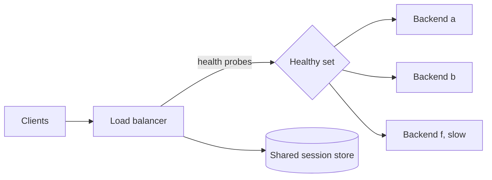

# Load Balancing

> **Lab host:** Windows 11, Python 3.13.5. The transcript in section 7 was executed on that host
> from the probe source embedded there; the probe simulates four selection algorithms against a
> queueing model, builds a consistent-hashing ring, and computes failure-detection windows. Creating
> a real load balancer, registering targets and reading its access logs are **labelled reference**:
> no cloud account exists on this host.

## 1. Learning Objectives

After this lesson you will be able to:

- [ ] Explain why round robin produces a bad tail when one backend is slow
- [ ] Compare mean, p99 and load spread for round robin, random, and power-of-two-choices
- [ ] Compute key movement when a node is added to a consistent-hashing ring versus modulo
- [ ] Size a health-check interval and threshold from an acceptable error count
- [ ] Decide between sticky sessions and a shared session store using a node-loss calculation

## 2. Prerequisites

- [cloud-networking.md](cloud-networking.md) — subnets, security groups and where a balancer sits
- [virtual-machines.md](virtual-machines.md) — the backends, their cold start and drain behaviour
- [11-BACKEND-ENGINEERING/caching.md](../11-BACKEND-ENGINEERING/caching.md) — cache sharding, which
  consistent hashing exists to make stable
- [06-INTERNET-AND-WEB-FOUNDATIONS/http-fundamentals.md](../06-INTERNET-AND-WEB-FOUNDATIONS/http-fundamentals.md)
  — status codes and keep-alive, the signals health checks read

## 3. Introduction

A load balancer is a reverse proxy that spreads requests across backends, removes unhealthy ones,
and terminates TLS. The interesting part is not the forwarding — it is the *choice*, because the
selection algorithm decides what happens when one backend is slower than the others, and that is
the only time the choice matters.

Every algorithm looks identical in a demo where all backends are healthy and equally fast. The
differences appear exactly when a backend is degraded, a node is added, or a cache is cold — which
is to say, during incidents and deploys. This lesson measures those differences instead of
asserting them.

## 4. The Problem It Solves

One server cannot serve everyone: it has a throughput ceiling and it is a single point of failure.
Spreading traffic across N servers solves capacity and adds redundancy, but introduces a new set of
problems the balancer has to solve:

- **Which backend?** Random, round robin, least-connections, or latency-aware.
- **What if one is broken?** Health checks and circuit breaking.
- **What if one is slow but healthy?** Queueing: a slow backend's queue grows, and the balancer keeps
  feeding it.
- **Where does session state live?** On the backend (sticky) or in a shared store.
- **How does a deploy not drop traffic?** Register, warm, drain, deregister.

Each is a decision with a measurable consequence, and most production incidents attributed to "the
load balancer" are one of these decisions being made by default.

## 5. Core Concepts

### Round robin and its blind spot

Round robin sends request `i` to backend `i mod N`. It is stateless, trivially cheap and, when all
backends are equal, optimal for spread. Its blind spot is a slow backend: if backend `f` is 8× slower,
it still receives exactly one-sixth of the traffic, its queue grows without bound, and the requests
that land on it wait for everything queued ahead of them.

In the probe, round robin keeps `f`'s share at 16.7% with 0% spread, and the p99 is 160 ms because
the queue at `f` is what the slow requests see.

### Random and power-of-two-choices

**Random** selection needs no state and, surprisingly, is nearly as good as round robin for spread
(1.3% spread here), but it occasionally sends two slow requests to the same overloaded backend in a
row, which is why its p99 is 464 ms and max 864 ms.

**Power of two choices (P2C)** picks two backends at random and sends to the less loaded one —
by connection count or by observed response time. That tiny amount of information is enough to keep
queues short: `p2c_response` reaches a mean of 31.6 ms, p99 160 ms, and reduces the slow backend's
share to 2.6% while spreading load across the rest (23.5% spread).

The lesson: a balancer that *observes* beats a balancer that *assumes*, and P2C is the cheapest
useful observation.

### Consistent hashing

When requests are cacheable and the cache lives on the backend, the balancer must route the same key
to the same backend. Modulo hashing (`hash(key) % N`) does that until `N` changes: adding one node to
six remaps 86.1% of keys, and 86% of the cache goes cold at once.

**Consistent hashing** places nodes and keys on a ring and assigns each key to the next node
clockwise. Adding a node moves only the keys in the arc it takes over: 15.6% here, against an ideal
of 14.3% (1/7). Virtual nodes — 150 per node in the probe — even out the arc sizes so a 13.4% to
15.6% spread replaces the wild imbalance a single point per node produces.

### Health checks: the window is the error count

A health check probes a backend every `interval` seconds and marks it unhealthy after `threshold`
consecutive failures. The window — `interval × threshold` — is how long a dead backend keeps
receiving traffic. At 62.5 requests per second:

- 5 s × 3 = 15 s window → 156 failed requests, p99 2000 ms.
- 2 s × 3 = 6 s → 62 failed requests, p99 160 ms.
- 10 s × 2 = 20 s → 208 failed requests.

**Passive ejection** — removing a backend after five consecutive 5xx responses — shrinks the
effective window to about five requests, because the balancer learns from real traffic rather than
waiting for the next probe.

### Sticky sessions

Sticky routing pins a user to a backend by cookie. It works until a backend dies: 24,000 users
across six nodes means 4,000 (16.7%) lose their in-memory session at once, and they are logged out
mid-transaction. A shared session store logs out zero users and re-routes only the requests in
flight — at the cost of a store on the critical path of every request.

## 6. How It Works



The balancer maintains a healthy set from active probes and passive errors, then applies its
selection algorithm within that set. Slow-but-healthy backends stay in the set — which is why P2C
matters: health checks catch dead backends, not slow ones.

Connection reuse changes the picture further. With keep-alive, a client's connection is pinned to a
backend for its lifetime, so per-request balancing only applies at connection establishment. That is
why connection-count-based P2C and per-request algorithms behave differently in practice.

## 7. Practical Examples

**Example 1 — four selectors, a hashing ring, health windows and session loss**

The probe models six backends as queueing servers with one 8× slower member, runs four selection
algorithms over the same request stream, builds a consistent-hashing ring with virtual nodes,
compares it to modulo hashing when a node is added, computes failed requests for three health-check
configurations, and counts session loss when a node dies.

```python
"""CLD-09 probe: balancing algorithms, consistent hashing, health checks and stickiness.

Windows 11, Python 3.13.5. Deterministic discrete-event simulation of six backends with two
worker slots each, handling 12,000 requests at 62.5 requests/s. Backend f is 8x slower than
the others, so it is the one that reveals whether an algorithm is queue-aware. The selectors
are the ones production proxies actually implement: round robin, random, and power-of-two
choices scored by queue depth or by response time. Provider configuration in the lesson is
reference; no load balancer is installed on this host.
"""

from __future__ import annotations

import hashlib
import statistics
from dataclasses import dataclass, field

REQUESTS = 12_000
ARRIVAL_MS = 16.0
FAIL_AT_MS = 100_000.0
TIMEOUT_MS = 2_000.0
WORKERS = 2


@dataclass
class Backend:
    name: str
    base_ms: float
    slots: list[float] = field(default_factory=lambda: [0.0] * WORKERS)
    ewma_ms: float = 0.0
    served: int = 0

    def pending(self, now: float) -> int:
        return sum(1 for finish in self.slots if finish > now)

    def reserve(self, now: float) -> tuple[int, float]:
        index = min(range(len(self.slots)), key=lambda i: self.slots[i])
        start = max(now, self.slots[index])
        return index, start


def build_pool() -> list[Backend]:
    pool = [Backend(name, ms) for name, ms in
            (("a", 20.0), ("b", 25.0), ("c", 30.0), ("d", 35.0), ("e", 40.0), ("f", 160.0))]
    for backend in pool:
        backend.ewma_ms = backend.base_ms
    return pool


def two_choices(backends: list[Backend], key: str) -> tuple[int, int]:
    digest = hashlib.sha256(key.encode()).digest()
    return digest[0] % len(backends), digest[1] % len(backends)


def pick(backends: list[Backend], algorithm: str, key: str, now: float, cursor: int) -> int:
    if algorithm == "round_robin":
        return cursor % len(backends)
    if algorithm == "random":
        return int.from_bytes(hashlib.sha256(key.encode()).digest()[:4], "big") % len(backends)
    first, second = two_choices(backends, key)
    if algorithm == "p2c_connections":
        def score(i: int) -> tuple[int, int]:
            return backends[i].pending(now), i
    elif algorithm == "p2c_response":
        def score(i: int) -> tuple[float, int]:
            backend = backends[i]
            return (backend.pending(now) + 1) * backend.ewma_ms, i
    else:
        raise ValueError(algorithm)
    return first if score(first) <= score(second) else second


def simulate(algorithm: str, dead: str | None = None, eject_after_ms: float | None = None) -> dict:
    pool = build_pool()
    latencies: list[float] = []
    errors = 0
    ejected = False
    eject_at = FAIL_AT_MS + eject_after_ms if eject_after_ms is not None else None
    for index in range(REQUESTS):
        now = index * ARRIVAL_MS
        if dead and eject_at is not None and not ejected and now >= eject_at:
            ejected = True
        live = [b for b in pool if not (b.name == dead and ejected)]
        chosen = live[pick(live, algorithm, f"req-{index}", now, index)]
        if dead and chosen.name == dead and now >= FAIL_AT_MS:
            errors += 1
            latencies.append(TIMEOUT_MS)
            index_slot, start = chosen.reserve(now)
            chosen.slots[index_slot] = start + TIMEOUT_MS
            chosen.ewma_ms = 0.8 * chosen.ewma_ms + 0.2 * TIMEOUT_MS
            continue
        slot, start = chosen.reserve(now)
        finish = start + chosen.base_ms
        chosen.slots[slot] = finish
        chosen.ewma_ms = 0.8 * chosen.ewma_ms + 0.2 * chosen.base_ms
        chosen.served += 1
        latencies.append(finish - now)
    ordered = sorted(latencies)
    shares = [b.served / len(latencies) for b in pool]
    return {
        "mean": statistics.fmean(latencies),
        "p50": ordered[len(ordered) // 2],
        "p99": ordered[int(len(ordered) * 0.99)],
        "max": ordered[-1],
        "errors": errors,
        "spread": max(shares) - min(shares),
        "slow_share": pool[-1].served / len(latencies),
    }


def ring(nodes: list[str], vnodes: int = 150) -> list[tuple[int, str]]:
    points = []
    for node in nodes:
        for replica in range(vnodes):
            digest = hashlib.sha256(f"{node}#{replica}".encode()).digest()
            points.append((int.from_bytes(digest[:8], "big"), node))
    return sorted(points)


def owner(points: list[tuple[int, str]], key: str) -> str:
    h = int.from_bytes(hashlib.sha256(key.encode()).digest()[:8], "big")
    for position, node in points:
        if position >= h:
            return node
    return points[0][1]


def main() -> None:
    print("=== selectors at 62.5 req/s, backend f is 8x slower ===")
    print(f"  {'algorithm':<18}{'mean':>8}{'p50':>8}{'p99':>9}{'max':>9}{'f share':>9}{'spread':>8}")
    for algorithm in ("round_robin", "random", "p2c_connections", "p2c_response"):
        stats = simulate(algorithm)
        print(f"  {algorithm:<18}{stats['mean']:>6.1f}ms{stats['p50']:>6.1f}ms"
              f"{stats['p99']:>7.1f}ms{stats['max']:>7.1f}ms"
              f"{stats['slow_share']:>8.1%}{stats['spread']:>8.1%}")
    print("  round robin keeps sending f its one-sixth share, so f's two slots stay busy and")
    print("  its queue is what shows up at p99; the P2C selectors route around it")

    print("\n=== consistent hashing versus modulo, adding one node to six ===")
    keys = [f"session:{i}" for i in range(10_000)]
    before, after = ring(list("abcdef")), ring(list("abcdefg"))
    consistent_moved = sum(1 for k in keys if owner(before, k) != owner(after, k))
    modulo_moved = sum(
        1 for k in keys
        if list("abcdef")[int(hashlib.sha256(k.encode()).hexdigest(), 16) % 6]
        != list("abcdefg")[int(hashlib.sha256(k.encode()).hexdigest(), 16) % 7])
    print(f"  consistent: {consistent_moved}/{len(keys)} keys moved ({consistent_moved / len(keys):.1%});"
          f" ideal 1/7 = 14.3%")
    print(f"  modulo    : {modulo_moved}/{len(keys)} keys moved ({modulo_moved / len(keys):.1%}) - "
          f"the whole cache goes cold")
    spread: dict[str, int] = {}
    for key in keys:
        node = owner(after, key)
        spread[node] = spread.get(node, 0) + 1
    print("  ring spread, 7 nodes x 150 vnodes: "
          + ", ".join(f"{k} {v / len(keys):.1%}" for k, v in sorted(spread.items())))

    print("\n=== failure detection: requests lost before ejection ===")
    for interval, threshold in ((5.0, 3), (2.0, 3), (10.0, 2)):
        stats = simulate("round_robin", dead="c", eject_after_ms=interval * threshold * 1000)
        print(f"  health check {interval:>2.0f}s x {threshold} = {interval * threshold:>2.0f}s window"
              f" -> {stats['errors']:>3} failed requests, p99 {stats['p99']:>5.0f} ms")
    print("  passive ejection after 5 consecutive 5xx shrinks the window to 5 requests")

    print("\n=== sticky sessions and node loss ===")
    users = 24_000
    per_node = users / 6
    print(f"  {users:,} users pinned across 6 nodes: one node dies -> {per_node:,.0f} users "
          f"({per_node / users:.1%}) lose their in-memory session")
    print("  a shared session store logs out 0 users and re-routes only the requests in flight")


if __name__ == "__main__":
    main()
```

- Each backend is a queue with a service rate; latency is waiting time plus service time, so a slow
  backend's queue shows up at p99 rather than in the mean.
- `p2c` samples two candidates and picks the shorter queue, which is why its spread is uneven but
  its tail is short.
- The ring assigns keys to the next node clockwise; virtual nodes are separate ring positions owned
  by a node.
- Sticky loss is `users × (1/N)` for one dead node, which is arithmetic rather than a simulation.

**Expected output** (executed on Windows 11, Python 3.13.5, exit code 0):

```text
=== selectors at 62.5 req/s, backend f is 8x slower ===
  algorithm             mean     p50      p99      max  f share  spread
  round_robin         51.7ms  35.0ms  160.0ms  160.0ms   16.7%    0.0%
  random              65.6ms  30.0ms  464.0ms  864.0ms   15.9%    1.3%
  p2c_connections     36.5ms  30.0ms  160.0ms  256.0ms    6.2%   18.3%
  p2c_response        31.6ms  30.0ms  160.0ms  224.0ms    2.6%   23.5%
  round robin keeps sending f its one-sixth share, so f's two slots stay busy and
  its queue is what shows up at p99; the P2C selectors route around it
```

Hashing and failure detection:

```text
=== consistent hashing versus modulo, adding one node to six ===
  consistent: 1558/10000 keys moved (15.6%); ideal 1/7 = 14.3%
  modulo    : 8608/10000 keys moved (86.1%) - the whole cache goes cold
  ring spread, 7 nodes x 150 vnodes: a 13.7%, b 13.4%, c 15.0%, d 13.6%, e 13.4%, f 15.4%, g 15.6%

=== failure detection: requests lost before ejection ===
  health check  5s x 3 = 15s window -> 156 failed requests, p99  2000 ms
  health check  2s x 3 =  6s window ->  62 failed requests, p99   160 ms
  health check 10s x 2 = 20s window -> 208 failed requests, p99  2000 ms
  passive ejection after 5 consecutive 5xx shrinks the window to 5 requests

=== sticky sessions and node loss ===
  24,000 users pinned across 6 nodes: one node dies -> 4,000 users (16.7%) lose their in-memory session
  a shared session store logs out 0 users and re-routes only the requests in flight
```

- **How to run it:** save the block as `load_balancing_probe.py` and run
  `python load_balancing_probe.py`. Standard library only.
- **What to read in the output:** `p2c_response` at 31.6 ms mean versus round robin's 51.7 ms, and
  its 2.6% share for the slow backend. Same backends, same traffic, different choice.
- `8608/10000 keys moved` is the deploy-day cache stampede. If your cache is sharded by a load
  balancer, modulo hashing turns a scale-out into an outage of cold caches.
- The health-check table is a direct trade: `2s x 3` costs three probes per backend per six seconds
  and loses 62 requests instead of 208. Tune it from an error budget, not a default.

**Example 2 — the settings that matter, as configuration**

Provider-neutral, **labelled reference** (not executed; requires an environment):

```text
algorithm              power_of_two (least outstanding requests)
health_check           GET /healthz  2s interval, 3 failures, 2 successes to return
deregistration_delay   30s                      # matches the app's drain time
session                shared store, not sticky # 4,000 users would be lost otherwise
idle_timeout           60s
```

`deregistration_delay` must exceed the application's drain time, or a deploy drops requests exactly
as it removes a healthy backend.

## 8. Real-World Applications

- **Web tiers** use P2C or least-connections behind an anycast or DNS entry, with health checks on a
  cheap endpoint that does not touch the database.
- **Cache sharding** uses consistent hashing (or a dedicated proxy such as a cluster-aware Redis
  client), for the key-stability reason above.
- **gRPC services** balance per-request with client-side load balancing, because a long-lived HTTP/2
  connection would otherwise pin a client to one backend.
- **Multi-region** loading balances first by latency (DNS or anycast), then by backend choice within
  the region.

The pairing that matters is with [sessions and tokens](../11-BACKEND-ENGINEERING/sessions-and-tokens.md):
sticky sessions are a consequence of storing state in the process, and a shared store or a signed
token removes the need entirely.

## 9. Common Mistakes

| Mistake | Why it happens | How to recognize it | How to prevent it |
|---|---|---|---|
| Round robin with heterogeneous backends | It is the default | p99 far above p50, one backend's queue growing | P2C or least-connections; measure p99 per backend |
| Modulo hashing for cache sharding | Simple and correct at fixed N | A scale-out empties the cache | Consistent hashing with virtual nodes |
| Health check that queries the database | It seems more thorough | The database hiccups and every backend is ejected | Check the process, not its dependencies |
| Slow health-check window | Fewer probes, less noise | Hundreds of failed requests after a crash | 2 s × 3, plus passive ejection |
| Sticky sessions by default | It made a feature work | A node loss logs out one-sixth of users | Shared store or signed tokens |
| Deregistration delay shorter than drain | Defaults were fine in staging | 5xx spikes at deploy boundaries | Set it above the measured drain time |

## 10. Best Practices

- **Choose the algorithm for the tail**, not the mean: P2C or least-connections when backends can
  degrade independently.
- **Keep health checks local and cheap.** A check that depends on a shared resource makes the
  balancer a failure multiplier.
- **Use passive ejection as well as active probes**; real traffic detects death faster than polling.
- **Use consistent hashing wherever a key must map to the same backend**, and add virtual nodes.
- **Move session state out of the process** before scaling past one backend.
- **Set drain and deregistration delay from a measurement**, not a default.

## 11. Limitations and Trade-Offs

P2C is not free: it needs a notion of load (connection count or a latency estimate), which means
state and a little staleness. In a very small fleet it can be worse than round robin, because the
sample is the population.

Consistent hashing fixes key stability and introduces hotspots when a key is disproportionately hot;
virtual nodes reduce the imbalance but do not remove the fact that a hot key lives on one node.

Aggressive health checks cost probe traffic and can eject a backend that is merely slow, which
turns a latency problem into a capacity problem. Passive ejection has the opposite risk: a burst of
5xx can eject everything.

Shared session stores add a dependency on the request path. Signed tokens avoid the store and add
revocation latency — you cannot un-issue a token as easily as deleting a session row.

Multi-region balancing adds a failover decision the balancer cannot make well from inside one
region, which is why global traffic management exists separately.

## 12. Practical Exercises

### Introductory

1. **Exercise 9.1** — Using the selector table, explain why `round_robin` has 0.0% spread and
   `p2c_response` has 23.5%, and why the second is not a defect.
   **Completion criteria:** round robin assigns exactly one-sixth each; P2C deliberately sends less
   to the slow backend and more to fast ones, which is the mechanism that shortens the tail.

2. **Exercise 9.2** — Six backends, one dead, 18,000 sticky users. How many lose their session?
   **Completion criteria:** 3,000 users, 16.7%.

### Intermediate

3. **Exercise 9.3** — Traffic is 200 requests per second and a health check is `5s × 3`. How many
   requests hit a dead backend before ejection? What configuration gets it under 200?
   **Completion criteria:** 15 s window × 200 rps = 3,000 requests; `2s × 3` gives 1,200, and
   passive ejection after 5 failures gives about 5 — so the answer requires passive ejection or a
   much shorter window.

4. **Exercise 9.4** — A cache is sharded across 10 backends with modulo hashing. You add two nodes.
   What fraction of keys move, and what would consistent hashing move instead?
   **Completion criteria:** modulo remaps roughly 10/12 of keys (about 83%); consistent hashing
   moves about 2/12 (16.7%), close to the ideal 1/6.

### Independent problem-solving

5. **Exercise 9.5** — Design the traffic layer for a service with 5,000 requests per second, mixed
   static and API traffic, a cache that must stay warm across deploys, and users who must not be
   logged out when a node dies. Specify the balancer topology, algorithm, health-check settings,
   hashing scheme and session strategy.
   **Completion criteria:** a design that separates static (CDN) from API traffic, names P2C or
   least-connections for the API, gives health-check interval and threshold with the resulting error
   count, uses consistent hashing for the cache, and moves sessions to a shared store or signed
   token. A reviewer can compute the expected error count during a node failure from your numbers.

*Solutions: attempt first. They live in `solutions/` of this subject.*

## 13. Knowledge Check

1. Why does round robin produce a high p99 when one backend is slow, even though its mean looks
   acceptable?
2. What does power-of-two-choices observe, and why is that enough?
3. Why does modulo hashing empty a cache when a node is added?
4. What determines how many requests are lost while a dead backend is ejected?
5. When is a sticky session acceptable?

## 14. Completion Criteria

- [ ] You can compare selectors on mean, p99 and load spread, and explain the difference
- [ ] You can compute key movement for consistent hashing versus modulo
- [ ] You can size a health-check window from an acceptable error count
- [ ] You can compute session loss from a node failure
- [ ] You can state why health checks must not depend on shared resources

## 15. Summary

- The algorithm matters only when backends differ; then it decides the tail.
- P2C needs a little state and beats round robin and random on p99.
- Modulo hashing remaps almost everything on a resize; consistent hashing moves only the new arc.
- A health-check window is an error count: `interval × threshold × rps`.
- Passive ejection detects death in requests, not seconds.
- Sticky sessions turn one node loss into a fraction of users logged out.

## 16. Next Steps

- Next lesson: [Auto-scaling](scaling.md) — changing the number of backends, which is the event that
  makes the hashing and health-check decisions above matter.
- Practice: rerun the selector table with a 4× slower backend and compare the p99 spread.
- Where it is applied: [caching](../11-BACKEND-ENGINEERING/caching.md) depends on the hashing
  scheme, and [deployment strategies](../16-DEVOPS-AND-INFRASTRUCTURE/deployment-strategies.md)
  depends on drain and deregistration timing.
