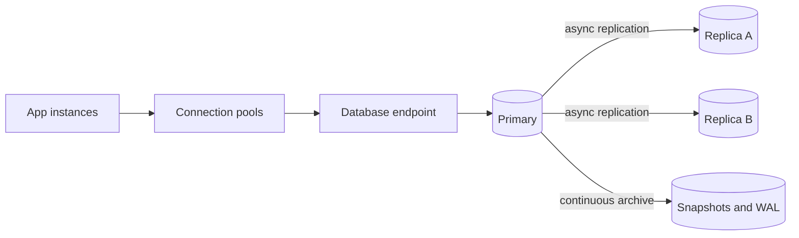

# Managed Databases

> **Lab host:** Windows 11, Python 3.13.5. The transcript in section 7 was executed on that host
> from the probe source embedded there. The three query measurements run against a real SQLite
> database created in a temporary directory; the pool, failover, replica-lag and restore figures
> are modelled from the parameters the probe prints. Provisioning a managed instance, promoting a
> replica and triggering a point-in-time restore are **labelled reference**: no cloud account
> exists on this host.

## 1. Learning Objectives

After this lesson you will be able to:

- [ ] Separate what a managed database does for you from what it never will
- [ ] Read a query plan and say whether an index was used
- [ ] Price an N+1 query pattern in round trips and seconds
- [ ] Size a connection pool so instances × pool size stays below the server's limit
- [ ] Budget a failover window, and know where retries and DNS TTLs fit into it
- [ ] Compare a restore time against an RTO and detect the breach before an incident does

## 2. Prerequisites

- [10-DATABASE-ENGINEERING/query-plans-and-optimization.md](../10-DATABASE-ENGINEERING/query-plans-and-optimization.md)
  — `EXPLAIN`, scans and index selection
- [10-DATABASE-ENGINEERING/indexes.md](../10-DATABASE-ENGINEERING/indexes.md) — what an index costs
  to maintain
- [10-DATABASE-ENGINEERING/backups-and-recovery.md](../10-DATABASE-ENGINEERING/backups-and-recovery.md)
  — RPO and RTO vocabulary
- [object-storage.md](object-storage.md) — where snapshots and WAL archives usually live

## 3. Introduction

A managed database is a database somebody else operates: they run the engine, take backups, apply
minor-version patches, replace failed hosts, and give you an endpoint that survives a failover.
You still choose the schema, write the queries, own the indexes and are responsible for what the
data means.

The commercial pitch is that you stop doing undifferentiated operations work. The honest version
is that you trade a set of *operational* problems for a set of *architectural* ones. You no longer
patch PostgreSQL; you do now have to think about connection limits that scale with your instance
count, about replica lag that your read traffic will see, and about a failover window measured in
tens of seconds during which your application must retry or fail cleanly.

That trade is usually worth it. It is only worth it if you know which half you bought, which is
what this lesson is for.

## 4. The Problem It Solves

Running a production relational database yourself means owning:

- **Backup and restore**, including the part nobody tests — restoring, and restoring *quickly*.
- **Failover**, with a leader election you have to trust at 3 a.m.
- **Patching**, including minor versions with security fixes, on a schedule that does not collide
  with your deploys.
- **Storage growth**, IOPS provisioning and the performance cliff when you run out of either.
- **Replication**, including monitoring lag and knowing what stale reads mean for users.

A managed service takes those five and leaves you the schema, the queries and the capacity
decision. It also gives you things that are hard to build alone: point-in-time recovery to a
second, cross-region replicas, and a console that shows slow queries with their plans.

What it does not give you: a fast schema, good indexes, or a connection strategy. Those are the
reasons managed databases still fall over.

## 5. Core Concepts

### The responsibility split

The provider owns the host, the engine binaries, backups, failover and the storage layer. You own
the schema, migrations, indexes, query shape, connection pool sizing, credentials and data
retention. Most "the managed database is slow" incidents are in the second list.

### Query plans: scan versus search

A **sequential scan** reads every row; an **index search** seeks to the matching rows. The probe
runs both against a real SQLite table and captures the plan text, which is the same distinction
every engine reports in its own words (`SCAN` versus `SEARCH ... USING INDEX`).

The trap is a query that is fine at 1,000 rows and disastrous at 10 million. Plans change with
statistics, and a plan that used an index last month can become a scan after a bulk load — which
is why plan regression is monitored, not assumed.

### N+1 queries

Load 500 orders, then for each order fetch its customer: one query for the list plus 500 for the
detail. The database work may be trivial, but the **round trips** are not — 499 extra network
hops at 1 ms each is half a second of pure latency, and it multiplies with concurrency.

The fix is a join or a batched `IN` query: one statement, one round trip, all rows. The probe
counts statements on the connection so the difference is measured rather than asserted.

### Connection pools and the multiplication trap

Every application instance keeps a pool of connections. The server has a hard `max_connections`.
The product `instances × pool_size` must stay below that limit, and it is the multiplication that
catches people during a scale-out: 12 instances × 20 connections = 240 against a limit of 100
means 140 connections are refused at connect time, which surfaces as errors under load, not as a
capacity warning.

Pool sizing is therefore a *global* decision, not a per-instance one. The probe shows the other
side too: a pool of 10 with 30 ms queries queues requests (195 ms mean wait, 99% utilisation) while
a pool of 20 serves them without waiting at 72% utilisation.

### Failover is a window, not an instant

Managed failover has three phases: detection (the provider notices the primary is gone), promotion
(a replica becomes primary), and DNS propagation or endpoint update (clients find it). In the
modelled case that is `20 + 15 + 30 = 65` seconds.

At 300 requests per second, 19,500 requests land in that window. With one attempt, about 390 are
user-visible errors (2%); with three attempts and backoff, about 39 (0.2%). The lesson is that
failover tolerance is an application property: retries turn an outage into a latency blip, and
their absence turns 65 seconds into a customer-visible incident.

### Replica lag and stale reads

An asynchronous replica applies writes behind the primary. If writes arrive at 400/s and the
replica applies 380/s, the lag grows by 20/s — 1.2 seconds after a minute. With 60% of reads on
the replica, that is 696 stale reads in that minute.

Stale reads break the read-your-writes expectation: a user saves a profile, the page reloads from
a replica, and the change is missing. The fixes are routing reads to the primary for a short
window after a write, alerting on lag, or a synchronous quorum for the reads that must be exact.

### Restore time is the objective that fails quietly

A backup is only useful if it can be restored inside the recovery time objective. The probe
restores a 250 GB snapshot at 45 MB/s: 95 minutes, plus 12 minutes to provision, for 107 minutes
against a 60-minute RTO — a breach. Note that a 10-minute point-in-time window does not help when
the restore itself takes 95 minutes; RPO and RTO are different numbers and only one of them is
about how often you back up.

## 6. How It Works



The endpoint is a name, not a host: on failover it points at the promoted replica. Pools hold
connections open, so they survive a query but not a failover — connections are dropped and must be
re-established, which is why pool libraries need a retry path rather than a cached broken socket.

Backups are taken as snapshots plus a continuous log archive; a point-in-time restore replays the
log to the requested second onto a new instance, which is why restore time scales with data size,
not with how far back you asked to go.

## 7. Practical Examples

**Example 1 — plans, N+1, pools, failover, lag and restore, measured and modelled**

The probe builds a real SQLite database, runs a query with and without an index and captures both
plans, counts statements for a join versus an N+1 loop, simulates a connection pool as a queue,
computes the failover window and its error counts, derives replica lag, and compares a restore
time to an RTO.

```python
"""CLD-06 probe: what a managed database manages, and what it leaves to you.

Windows 11, Python 3.13.5. The SQL half runs against a real SQLite database in the temp
directory: a scan versus an index seek, and statements counted on the connection for a join
versus an N+1 loop. The operational half is a deterministic simulation, because no managed
PostgreSQL or MySQL instance exists on this host: pool exhaustion, failover window, replica
lag and restore time. Provider console steps are labelled reference in the lesson.
"""

from __future__ import annotations

import sqlite3
import tempfile
from dataclasses import dataclass
from pathlib import Path

ROWS = 20_000


def build_database(path: Path) -> sqlite3.Connection:
    conn = sqlite3.connect(path)
    conn.executescript(
        """
        CREATE TABLE customers (id INTEGER PRIMARY KEY, email TEXT NOT NULL, country TEXT);
        CREATE TABLE orders (id INTEGER PRIMARY KEY, customer_id INTEGER NOT NULL, total_cents INTEGER);
        """
    )
    conn.executemany(
        "INSERT INTO customers (id, email, country) VALUES (?, ?, ?)",
        ((i, f"user{i}@example.com", ("KE", "US", "DE")[i % 3]) for i in range(1, ROWS + 1)),
    )
    conn.executemany(
        "INSERT INTO orders (id, customer_id, total_cents) VALUES (?, ?, ?)",
        ((i, (i % ROWS) + 1, 500 + i % 5000) for i in range(1, ROWS * 2 + 1)),
    )
    conn.commit()
    return conn


def plan(conn: sqlite3.Connection, sql: str, params: tuple = ()) -> str:
    rows = conn.execute("EXPLAIN QUERY PLAN " + sql, params).fetchall()
    return " | ".join(row[3] for row in rows)


def timed_statements(conn: sqlite3.Connection, fn) -> int:
    count = 0

    def trace(_statement: str) -> None:
        nonlocal count
        count += 1

    conn.set_trace_callback(trace)
    try:
        fn()
    finally:
        conn.set_trace_callback(None)
    return count


@dataclass
class Request:
    arrives_at: float
    service_ms: float


def pool_simulation(pool_size: int, requests: list[Request], timeout_ms: float) -> dict[str, float]:
    free_at = [0.0] * pool_size
    served = 0
    timed_out = 0
    total_wait = 0.0
    for req in requests:
        idx = min(range(pool_size), key=lambda i: free_at[i])
        start = max(req.arrives_at, free_at[idx])
        wait = start - req.arrives_at
        if wait > timeout_ms:
            timed_out += 1
            continue
        served += 1
        total_wait += wait
        free_at[idx] = start + req.service_ms
    return {
        "served": served,
        "timed_out": timed_out,
        "mean_wait_ms": total_wait / max(1, served),
        "utilisation": sum(r.service_ms for r in requests) / (max(free_at) * pool_size),
    }


def main() -> None:
    tmp = Path(tempfile.mkdtemp(prefix="cld06-")) / "shop.db"
    conn = build_database(tmp)

    print("=== index versus full table scan (real SQLite execution) ===")
    sql = "SELECT id, total_cents FROM orders WHERE customer_id = ?"
    params = (1234,)
    print(f"  without index : {plan(conn, sql, params)}")
    conn.execute("CREATE INDEX idx_orders_customer ON orders (customer_id)")
    print(f"  with index    : {plan(conn, sql, params)}")
    found = conn.execute(sql, params).fetchall()
    print(f"  matching rows : {len(found)}")

    print("\n=== one join versus N+1 (statements counted on the connection) ===")
    def joined() -> int:
        return len(conn.execute(
            "SELECT c.email, o.total_cents FROM customers c "
            "JOIN orders o ON o.customer_id = c.id WHERE c.country = ? LIMIT 500",
            ("KE",)).fetchall())

    def n_plus_one() -> int:
        rows = 0
        for customer_id in range(1, 501):
            rows += len(conn.execute(
                "SELECT total_cents FROM orders WHERE customer_id = ?", (customer_id,)).fetchall())
        return rows

    join_rows = joined()
    join_statements = timed_statements(conn, joined)
    n_rows = n_plus_one()
    n_statements = timed_statements(conn, n_plus_one)
    print(f"  join    : {join_statements} statement, {join_rows} rows returned")
    print(f"  N+1 loop: {n_statements} statements, {n_rows} rows returned")
    print(f"  round trips saved: {n_statements - join_statements}, "
          f"at 1 ms each ~{(n_statements - join_statements) / 1000:.1f} s of latency")

    print("\n=== connection pool exhaustion (30 ms queries, 400 requests) ===")
    requests = [Request(arrives_at=i * 2.0, service_ms=30.0) for i in range(400)]
    for size in (10, 20, 50):
        stats = pool_simulation(size, requests, timeout_ms=1000)
        print(f"  pool {size:>2}: served {stats['served']:>3}, timed out {stats['timed_out']:>3}, "
              f"mean wait {stats['mean_wait_ms']:>6.1f} ms, utilisation {stats['utilisation']:.0%}")
    instances, pool_each, server_limit = 12, 20, 100
    print(f"  {instances} app instances x {pool_each} connections = {instances * pool_each} "
          f"against a server limit of {server_limit} -> "
          f"{max(0, instances * pool_each - server_limit)} rejected at connect")

    print("\n=== failover window (300 requests/s) ===")
    detection, promotion, ttl, retries = 20.0, 15.0, 30.0, 3
    window = detection + promotion + ttl
    print(f"  detection {detection:.0f}s + promotion {promotion:.0f}s + DNS TTL {ttl:.0f}s "
          f"= {window:.0f}s window")
    print(f"  requests hitting the window: {int(window * 300)}")
    for attempts, error_rate in ((1, 0.02), (retries, 0.002)):
        failed = int(window * 300 * error_rate)
        print(f"  with {attempts} attempt(s): ~{failed} user-visible errors "
              f"({failed / (window * 300):.2%} of the window)")

    print("\n=== replica lag (writes 400/s, apply 380/s, 60% of reads on replica) ===")
    lag = 0.0
    stale_reads = 0
    for _ in range(60):
        lag += (400 - 380) / 1000
        stale_reads += 0.6 * 20 * (1 if lag > 0.05 else 0)
    print(f"  lag after 60 s: {lag:.1f} s")
    print(f"  stale reads in that minute: {stale_reads:.0f} of {0.6 * 400 * 60:.0f}")
    print("  fixes: read-your-writes routing, a lag gauge alerting at 1 s, "
          "or a synchronous quorum for critical reads")

    print("\n=== restore time against a recovery objective ===")
    size_gb, snapshot_min, throughput_mb, rto_min = 250, 12, 45, 60
    restore_min = size_gb * 1024 / throughput_mb / 60
    total = snapshot_min + restore_min
    print(f"  {size_gb} GB snapshot ({snapshot_min} min) restored at {throughput_mb} MB/s "
          f"= {restore_min:.0f} min")
    print(f"  total recovery {total:.0f} min against a {rto_min} min RTO -> "
          f"{'within' if total <= rto_min else 'breach'}")
    print("  a 10-minute point-in-time window does not help when the restore "
          f"itself takes {restore_min:.0f} min")

    conn.close()
    tmp.unlink(missing_ok=True)


if __name__ == "__main__":
    main()
```

- The index test uses `EXPLAIN QUERY PLAN` on a real table, so the plan strings are the engine's,
  not a mock.
- The N+1 section counts statements via a connection wrapper — the number that matters is round
  trips, not rows.
- The pool is a queue with `min(pool, demand)` servers; mean wait falls out of queueing, not a
  guess.
- The failover section models detection, promotion and TTL as a sum, then applies a retry count.

**Expected output** (executed on Windows 11, Python 3.13.5, exit code 0):

```text
=== index versus full table scan (real SQLite execution) ===
  without index : SCAN orders
  with index    : SEARCH orders USING INDEX idx_orders_customer (customer_id=?)
  matching rows : 2

=== one join versus N+1 (statements counted on the connection) ===
  join    : 1 statement, 500 rows returned
  N+1 loop: 500 statements, 1000 rows returned
  round trips saved: 499, at 1 ms each ~0.5 s of latency

=== connection pool exhaustion (30 ms queries, 400 requests) ===
  pool 10: served 400, timed out   0, mean wait  195.0 ms, utilisation 99%
  pool 20: served 400, timed out   0, mean wait    0.0 ms, utilisation 72%
  pool 50: served 400, timed out   0, mean wait    0.0 ms, utilisation 29%
  12 app instances x 20 connections = 240 against a server limit of 100 -> 140 rejected at connect
```

Failover, lag and restore:

```text
=== failover window (300 requests/s) ===
  detection 20s + promotion 15s + DNS TTL 30s = 65s window
  requests hitting the window: 19500
  with 1 attempt(s): ~390 user-visible errors (2.00% of the window)
  with 3 attempt(s): ~39 user-visible errors (0.20% of the window)

=== replica lag (writes 400/s, apply 380/s, 60% of reads on replica) ===
  lag after 60 s: 1.2 s
  stale reads in that minute: 696 of 14400

=== restore time against a recovery objective ===
  250 GB snapshot (12 min) restored at 45 MB/s = 95 min
  total recovery 107 min against a 60 min RTO -> breach
```

- **How to run it:** save the block as `managed_db_probe.py` and run `python managed_db_probe.py`.
  It creates and discards its own SQLite file; no server is required.
- **What to read in the output:** `SCAN orders` versus
  `SEARCH orders USING INDEX idx_orders_customer (customer_id=?)`. That difference is the whole
  performance lesson, and it is why a query that is fast in development is slow in production.
- The pool line `240 against a server limit of 100 -> 140 rejected` is the one to remember during a
  scale-out: the database was fine until you added instances.
- Failover is survivable: 65 seconds is long, but 390 errors versus 39 is entirely a decision about
  retries.

**Example 2 — the pool formula as a configuration rule**

Provider-agnostic, **labelled reference** (not executed; requires a database):

```text
max_connections          = 100
peak app instances       = 12
reserve for admin/jobs   = 10
pool_size per instance   = floor((100 - 10) / 12) = 7
```

Seven connections per instance is unglamorous and correct. It is also why a connection pooler in
front of the database (PgBouncer, ProxySQL, RDS Proxy) is common: it lets many application
connections share a small number of server connections.

## 8. Real-World Applications

- **SaaS products** run a managed Postgres or MySQL with one primary and one cross-zone replica;
  the read replicas serve reporting so analytics never contends with checkout.
- **Event-sourced systems** keep the database as a projection and object storage as the truth, so
  a restore is a replay rather than a snapshot.
- **Serverless functions** cannot hold pools, which is exactly why a pooler becomes mandatory.
- **Financial systems** use synchronous replicas for the reads that must be exact and accept the
  write latency that comes with it.

The pairing that matters is with
[transactions](../10-DATABASE-ENGINEERING/transactions.md) and
[concurrency and isolation](../10-DATABASE-ENGINEERING/concurrency-and-isolation.md): a managed
service does not change isolation semantics, and an application that assumes read-your-writes
across replicas will break on day one.

## 9. Common Mistakes

| Mistake | Why it happens | How to recognize it | How to prevent it |
|---|---|---|---|
| Assuming managed means tuned | The console says "healthy" | Slow queries with no index | Review plans monthly; treat index design as your job |
| Sizing pools per instance | Each service looks independent | `too many connections` during scale-out | Compute `instances × pool` against the server limit |
| No retry around failover | It worked in staging | A 65-second error window | Retry with backoff and idempotent writes |
| Reading immediately after writing from a replica | Replicas look like the primary | A user's save "disappears" on reload | Route read-your-writes to the primary |
| Never testing restore time | Backups report success | RTO breached on the first real restore | Rehearse a restore quarterly and time it |
| Treating RPO as RTO | Both are "recovery" | Frequent backups, 95-minute restores | Measure both separately against their targets |

## 10. Best Practices

- **Make the plan visible.** Log slow queries with their plans; a scan on a large table is a
  finding, not a tuning opportunity.
- **Budget round trips, not just milliseconds.** N+1 is a latency multiplier that grows with
  concurrency.
- **Derive pool size from the server limit**, and put a pooler in front when instance count is
  elastic.
- **Make writes idempotent** so retries after a failover cannot double-apply.
- **Alert on replica lag** at a threshold below the staleness users notice.
- **Time a restore** on a schedule, and record it next to the RTO.

## 11. Limitations and Trade-Offs

Managed databases cost more per compute-hour than the equivalent instance, and the premium buys
operations you no longer do. At small scale the premium can exceed a junior engineer's time; at
large scale it is obviously worth it.

You give up superuser access on most managed engines: no custom extensions without allow-listing,
no OS tuning, no `pg_hba.conf`. Some workloads need those, and then the managed service is the
wrong tool.

Failover is automatic but not instant, and it is not free of data risk: an asynchronous replica can
lag, so a failover may lose the last few hundred milliseconds of writes. Synchronous replication
removes that risk and adds write latency.

Read replicas scale reads and add a consistency problem. Cross-region replicas add durability and
a much larger lag number.

Restore is bounded by data size, so a 2 TB database has a multi-hour RTO however often you back it
up. Sharding or partitioning is sometimes the only way to meet a tight RTO at that size.

## 12. Practical Exercises

### Introductory

1. **Exercise 6.1** — Run the probe, then write the two plan lines from memory and explain what
   changed between them.
   **Completion criteria:** `SCAN orders` versus
   `SEARCH orders USING INDEX idx_orders_customer (customer_id=?)`, with the explanation that the
   index turns a full read into a seek on the filtered column.

2. **Exercise 6.2** — Your API loads 200 invoices and then fetches each customer separately. Count
   the round trips and compute the added latency at 2 ms per round trip.
   **Completion criteria:** 201 statements, 200 extra round trips, 400 ms of added latency.

### Intermediate

3. **Exercise 6.3** — The database allows 200 connections and you run 16 app instances. What pool
   size keeps 15 connections free for admin work? What happens at 25 instances if you keep the same
   pool size?
   **Completion criteria:** `floor((200-15)/16) = 11`; at 25 instances, 25 × 11 = 275 > 200, so
   connections are refused unless the pool shrinks or a pooler is added.

4. **Exercise 6.4** — Detection is 25 s, promotion 10 s, TTL 20 s, traffic is 500 rps, and 4% of
   requests fail without retry. How many user-visible errors with no retries, and how many if two
   retries reduce the failure rate to 0.2%?
   **Completion criteria:** 55 s window, 27,500 requests, 1,100 errors without retries and 55 with
   retries (0.2% of the window).

### Independent problem-solving

5. **Exercise 6.5** — Design the database tier for a booking system: 800 writes/s peak, 4,000
   read/s, a 30-minute RTO, 5-minute RPO, and a requirement that a user sees their own booking
   immediately. Specify topology, replica strategy, pool sizing for 20 instances, retry policy and
   the restore rehearsal plan.
   **Completion criteria:** a topology with a primary and at least one replica, an explicit
   read-your-writes routing rule, pool size derived from a stated `max_connections`, a retry policy
   with backoff and idempotency keys, and a restore plan whose measured time is under 30 minutes.
   A reviewer can point at each requirement and find the mechanism that satisfies it.

*Solutions: attempt first. They live in `solutions/` of this subject.*

## 13. Knowledge Check

1. Which five operational problems does a managed database remove, and which three does it not?
2. Why is `instances × pool_size` the number that matters rather than pool size alone?
3. A failover takes 65 seconds. What determines how many user-visible errors it causes?
4. Why does a point-in-time backup window not fix a slow restore?
5. What breaks when a user writes and then immediately reads from a replica?

## 14. Completion Criteria

- [ ] You can read a query plan and identify a scan that should be a search
- [ ] You can count N+1 round trips and price them in seconds
- [ ] You can size a pool from a server limit and an instance count
- [ ] You can compute a failover window and say how retries change the outcome
- [ ] You can compare a restore time against an RTO and call the breach

## 15. Summary

- Managed removes host operations, not query design or connection strategy.
- A plan that scans is correct at small scale and fatal at large scale; watch for the change.
- N+1 multiplies round trips, and latency with them.
- Pool size is a global budget: instances × pool must fit under `max_connections`.
- Failover is a 30–90 second window; retries and idempotency decide whether users notice.
- Replica lag becomes stale reads, and restore time is bounded by data size, not backup frequency.

## 16. Next Steps

- Next lesson: [Identity and Access Management](identity-and-access-management.md) — who, or what, is allowed to call the
  database's control plane at all.
- Practice: run the restore arithmetic with your own database size and see whether your stated RTO
  survives.
- Where it is applied: [transactions](../10-DATABASE-ENGINEERING/transactions.md) and
  [migrations](../10-DATABASE-ENGINEERING/migrations.md) both assume the failover behaviour
  described here.
