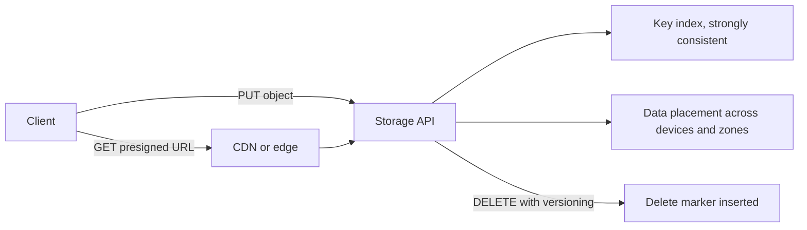

# Object Storage

> **Lab host:** Windows 11, Python 3.13.5. The transcript in section 7 was executed on that host
> from the probe source embedded there; the probe implements content hashing, multipart ETags,
> versioning with delete markers, prefix pagination, HMAC-signed URLs and durability arithmetic in
> the standard library. Creating a real bucket and uploading through a provider SDK are
> **labelled reference**: no cloud account exists on this host.

## 1. Learning Objectives

After this lesson you will be able to:

- [ ] Explain what makes object storage different from a file system or a block device
- [ ] Compute the effect of content-hash deduplication on stored bytes
- [ ] Predict when a multipart upload changes the ETag, and why comparing it to an MD5 fails
- [ ] Describe what a delete marker does to a key with versioning enabled
- [ ] Design a presigned URL so that it expires, cannot be tampered with, and is scoped to one key

## 2. Prerequisites

- [cloud-computing-fundamentals.md](cloud-computing-fundamentals.md) — durability and availability
  as separate properties
- [11-BACKEND-ENGINEERING/file-uploads.md](../11-BACKEND-ENGINEERING/file-uploads.md) — the
  application side of receiving a file
- [15-APPLICATION-SECURITY/secure-file-uploads.md](../15-APPLICATION-SECURITY/secure-file-uploads.md)
  — why the browser should not hold your storage credentials
- [16-DEVOPS-AND-INFRASTRUCTURE/backups-and-recovery.md](../16-DEVOPS-AND-INFRASTRUCTURE/backups-and-recovery.md)
  — versioning as a recovery mechanism

## 3. Introduction

Object storage stores **objects** in **buckets**. An object is bytes plus metadata plus a key. A
bucket is a namespace with a globally unique name. There are no directories, no partial writes, no
append, and no in-place edit: you `PUT` a whole object and you `GET` a whole object.

That sounds limited, and it is — deliberately. The limitations are what make it possible to store
exabytes with eleven nines of durability at a few cents per gigabyte. A file system has to
maintain inode consistency and directory semantics; object storage just has to put bytes somewhere
safe and remember where.

Almost every production system eventually needs object storage: user uploads, static assets,
backups, logs, data-lake files, container image layers, database exports. The mistakes are also
remarkably consistent — comparing multipart ETags to MD5s, forgetting that delete markers keep
the bytes, and hand-rolling signed URLs. This lesson is about the mechanisms behind those
mistakes.

## 4. The Problem It Solves

Before object storage, durable file storage meant either a network file system (a single point of
failure with tricky locking semantics) or a database BLOB column (which makes the database enormous
and the backup window unbearable).

Object storage solves four specific problems:

- **Durability at scale without a filesystem.** Data is stored redundantly across independent
  devices and facilities; the provider publishes a durability figure, and you stop running `fsck`.
- **Capacity without provisioning.** A bucket has no size, no volume to attach, and no IOPS to
  tune. You pay for what you store.
- **HTTP-native access.** Every object has a URL, so a CDN, a browser or a mobile client can fetch
  it without an application in the middle.
- **Cheap archival tiers.** The same API writes to hot storage or to a tier that costs a fraction
  and takes hours to retrieve, which is what makes long-retention backups affordable.

What it does not solve: querying. Object storage lists and fetches; it does not filter, join or
aggregate. If you find yourself building an index beside it, you may want a database instead.

## 5. Core Concepts

### Keys, prefixes and the illusion of folders

A key is a string, conventionally with `/` separators: `reports/2026/q1.pdf`. The console draws
folders, but there are none — there is a flat keyspace sorted lexicographically. **Listing by
prefix** is a range scan on that sort order, which is why `reports/2026/` is fast and
`*q1*` is not supported at all.

Listing is **paginated**: the response returns a batch plus a continuation token, and the token is
opaque. Code that ignores it silently processes the first 1,000 keys of a bucket and reports
success.

### Consistency

Modern providers offer **strong read-after-write consistency** for new objects and overwrites, and
list operations that reflect the latest state. Older systems were eventually consistent, and code
written for them (retry until the object appears) still exists. Know which model you are on: a
`PUT` followed immediately by a `GET` works on current providers and did not always.

### ETags are not checksums

An ETag identifies a representation of an object. For a single-part upload it often equals the
MD5 of the bytes. For a **multipart** upload it is a hash of the part hashes plus a `-N` suffix,
where `N` is the part count. Identical bytes uploaded as three parts and as one part produce
different ETags.

That is why "verify the upload by comparing the ETag to the file's MD5" fails for every file above
the multipart threshold — typically 8 MB or whatever your SDK sets. The corrected pattern is to
store your own SHA-256 in object metadata and compare that.

### Versioning and delete markers

With versioning enabled, a `PUT` creates a new version and keeps the old one. A `DELETE` does not
remove bytes: it inserts a **delete marker**, a zero-byte placeholder that becomes the current
version. A `GET` of the key returns "no such key", while the previous versions remain retrievable
by version ID and the key still appears in listings.

This is the mechanism behind "we deleted it but the bucket did not shrink", and it is also the
mechanism that saves you after a bad deploy overwrites a config file.

### Presigned URLs

A **presigned URL** grants temporary access to one object without exposing credentials. The server
signs a canonical request — method, key, expiry — with a secret key, and anyone holding the URL can
perform exactly that operation until it expires.

Two properties matter. The signature covers the expiry, so changing `expires=` invalidates it.
And the signature is computed with a specific key, so a URL signed by one identity cannot be
replayed with another. Both are demonstrated in section 7.

### Durability is not availability, and eleven nines is not magic

Durability is the probability that data is not lost; availability is the probability that you can
read it right now. A bucket can be 99.999999999% durable and briefly unavailable.

The probe computes durability for naive replication: with a 1.5% annual drive failure rate and no
repair, three replicas give 5.5 nines, and 10+4 erasure coding gives 5.9. Published figures are
far higher because providers repair continuously; the lesson is that redundancy buys nines in
proportion to the extra copies, and repair is what turns storage into a durable system.

## 6. How It Works



A `PUT` writes the bytes to multiple devices, updates the key index, and returns an ETag. A `GET`
resolves the key in the index and streams from one copy. A `DELETE` on a versioned bucket writes a
marker rather than removing data.

Large objects are uploaded in parts: the client initiates a multipart upload, sends parts in
parallel, and completes with the list of part numbers and ETags. Completion is atomic — a
half-finished upload is invisible until it is completed or aborted, which is why abandoned
multipart uploads quietly accrue storage cost.

## 7. Practical Examples

**Example 1 — deduplication, multipart ETags, versioning, pagination, signing and durability**

The probe stores seven objects in a content-addressed store, shows the stored-versus-logical byte
ratio, reassembles a multipart upload, demonstrates versioning and delete markers, paginates a
prefix listing, signs and then tampers with a presigned URL, and computes durability for several
redundancy schemes.

```python
"""CLD-05 probe: object storage semantics, implemented rather than described.

Windows 11, Python 3.13.5. No bucket exists on this host, so the probe implements the parts
of object storage that cause the incidents: content addressing and deduplication, multipart
upload with the ETag rule that surprises everyone, versioning with delete markers, prefix
listing with pagination, HMAC presigned URLs with tamper and expiry checks, and the
durability arithmetic behind "eleven nines". All numbers below are computed here.
"""

from __future__ import annotations

import hashlib
import hmac
import time
from dataclasses import dataclass, field


@dataclass
class StoredObject:
    key: str
    body: bytes
    digest: str
    version: int
    deleted: bool = False


@dataclass
class Bucket:
    blobs: dict[str, bytes] = field(default_factory=dict)   # digest -> content
    versions: dict[str, list[StoredObject]] = field(default_factory=dict)
    versioning: bool = False

    def put(self, key: str, body: bytes) -> StoredObject:
        digest = hashlib.sha256(body).hexdigest()
        self.blobs.setdefault(digest, body)                 # identical bytes stored once
        history = self.versions.setdefault(key, [])
        obj = StoredObject(key, body, digest, len(history) + 1)
        history.append(obj)
        return obj

    def get(self, key: str, version: int | None = None) -> StoredObject | None:
        history = self.versions.get(key, [])
        if not history:
            return None
        if version is not None:
            found = next((o for o in history if o.version == version), None)
            return None if found and found.deleted else found
        newest = history[-1]
        if newest.deleted:
            return None            # delete marker: the key answers 404
        return newest

    def delete(self, key: str) -> str:
        history = self.versions.get(key, [])
        if not history:
            return "no such key"
        if self.versioning:
            history.append(StoredObject(key, b"", "delete-marker", len(history) + 1, deleted=True))
            return "delete marker added; previous versions retained"
        self.versions.pop(key)
        return "object removed permanently"

    def list(self, prefix: str = "", limit: int = 4) -> tuple[list[str], str | None]:
        keys = sorted(k for k in self.versions if k.startswith(prefix))
        page = keys[:limit]
        token = page[-1] if len(keys) > limit else None
        return page, token

    @property
    def physical_bytes(self) -> int:
        return sum(len(b) for b in self.blobs.values())

    @property
    def logical_bytes(self) -> int:
        return sum(len(o.body) for h in self.versions.values() for o in h if not o.deleted)


def multipart_etag(parts: list[bytes]) -> str:
    """S3-style multipart ETag: MD5 of the concatenated binary MD5s, plus '-N'."""
    digests = b"".join(hashlib.md5(p).digest() for p in parts)
    return f"{hashlib.md5(digests).hexdigest()}-{len(parts)}"


def single_etag(body: bytes) -> str:
    return hashlib.md5(body).hexdigest()


def presign(secret: bytes, method: str, key: str, expires_at: int, now: int | None = None) -> str:
    now = int(time.time()) if now is None else now
    payload = f"{method}\n/{key}\n{expires_at}".encode()
    signature = hmac.new(secret, payload, hashlib.sha256).hexdigest()[:32]
    return f"key={key}&method={method}&expires={expires_at}&signature={signature}"


def verify(secret: bytes, url: str, now: int) -> tuple[bool, str]:
    fields = dict(pair.split("=", 1) for pair in url.split("&"))
    expires_at = int(fields["expires"])
    expected = presign(secret, fields["method"], fields["key"], expires_at, now)
    if not hmac.compare_digest(expected, url):
        return False, "signature mismatch"
    if now > expires_at:
        return False, "expired"
    return True, "valid"


def durability_replicas(copies: int, annual_failure: float) -> float:
    """Rough annual durability without repair: all copies must fail in the same year."""
    return 1.0 - annual_failure**copies


def durability_erasure(data: int, parity: int, annual_failure: float) -> float:
    """Durability when any `parity` failures are recoverable, no repair modelled."""
    from math import comb

    total = data + parity
    lost = 0.0
    for failures in range(parity + 1, total + 1):
        lost += comb(total, failures) * annual_failure**failures * (1 - annual_failure) ** (total - failures)
    return 1.0 - lost


def nines(value: float) -> str:
    return f"{-__import__('math').log10(max(1e-300, 1 - value)):.1f} nines"


def main() -> None:
    bucket = Bucket(versioning=True)
    print("=== deduplication by content hash ===")
    bodies = {
        "reports/2026-q1.pdf": b"quarterly report" * 400,
        "reports/2026-q1-copy.pdf": b"quarterly report" * 400,
        "reports/2026-q2.pdf": b"quarterly report v2" * 400,
        "logs/app-1.log": b"INFO started\n" * 700,
        "logs/app-2.log": b"INFO started\n" * 700,
        "logs/app-3.log": b"WARN retry\n" * 300,
    }
    for key, body in bodies.items():
        obj = bucket.put(key, body)
        print(f"  put {key:<28} {len(body):>6} B sha256:{obj.digest[:12]} v{obj.version}")
    print(f"  logical bytes {bucket.logical_bytes}, stored bytes {bucket.physical_bytes} "
          f"({bucket.physical_bytes / bucket.logical_bytes:.0%} after dedupe)")

    print("\n=== multipart upload and the ETag rule ===")
    payload = bytes(range(256)) * (12 * 1024 * 1024 // 256)   # 12 MiB, 5 MiB parts
    part_size = 5 * 1024 * 1024
    parts = [payload[i:i + part_size] for i in range(0, len(payload), part_size)]
    assembled = b"".join(parts)
    print(f"  parts: {[len(p) for p in parts]}")
    print(f"  multipart ETag: {multipart_etag(parts)}")
    print(f"  single-part ETag would be: {single_etag(payload)}")
    print(f"  reassembled == original: {assembled == payload}")
    print(f"  ETags differ for identical bytes: {multipart_etag(parts) != single_etag(payload)}"
          f" -> never compare a multipart ETag to a local MD5")

    print("\n=== versioning and delete markers ===")
    key = "config/app.json"
    bucket.put(key, b'{"retries": 3}')
    bucket.put(key, b'{"retries": 5}')
    print(f"  two puts, current body: {bucket.get(key).body!r}")
    print(f"  get version 1: {bucket.get(key, 1).body!r}")
    print(f"  delete: {bucket.delete(key)}")
    print(f"  get after delete: {bucket.get(key)!r} (NoSuchKey)")
    print(f"  get version 2 after delete: {bucket.get(key, 2).body!r}")
    print(f"  listing still contains the key: {key in bucket.list(prefix='config/')[0]}")

    print("\n=== prefix listing with pagination ===")
    for i in range(6):
        bucket.put(f"events/2026/11/day-{i:02d}.json", f'{{"day": {i}}}'.encode())
    page, token = bucket.list(prefix="events/", limit=4)
    print(f"  page 1: {page} next-token={token}")
    remaining = sorted(k for k in bucket.versions if k.startswith("events/") and k > token)
    print(f"  page 2: {remaining[:4]}")

    print("\n=== presigned URLs ===")
    secret = b"lab-signing-key"
    now = 1_800_000_000
    url = presign(secret, "GET", "reports/2026-q1.pdf", now + 900, now)
    print(f"  signed: ...{url[-60:]}")
    print(f"  verify immediately: {verify(secret, url, now)}")
    print(f"  verify after 15 min: {verify(secret, url, now + 901)}")
    tampered = url.replace("expires=", "expires=9")
    print(f"  verify tampered expiry: {verify(secret, tampered, now)}")
    other_secret = b"attacker-key"
    print(f"  verify with another key: {verify(other_secret, url, now)}")

    print("\n=== durability arithmetic (1.5% annual drive failure, no repair) ===")
    afr = 0.015
    for copies in (2, 3):
        d = durability_replicas(copies, afr)
        print(f"  {copies} replicas: durability {d:.10f} ({nines(d)}), storage overhead {copies}x")
    for data, parity in ((6, 3), (10, 4)):
        d = durability_erasure(data, parity, afr)
        print(f"  {data}+{parity} erasure: durability {d:.10f} ({nines(d)}), "
              f"overhead {(data + parity) / data:.1f}x")
    print("  with background repair the provider's published figure is far higher;")
    print("  without repair, redundancy buys nines only in proportion to extra copies")


if __name__ == "__main__":
    main()
```

- The store keys blobs by SHA-256, so two identical uploads share one stored blob; the version
  number increments per key, which is what makes versioning demonstrable.
- `multipart_etag` hashes the part digests and appends `-N`, exactly the rule real providers use.
- The delete path inserts a marker and leaves versions intact; `get` resolves the current version,
  which is a marker, and returns `None`.
- `presign` is HMAC-SHA256 over method, key and expiry, so any tampering changes the digest.

**Expected output** (executed on Windows 11, Python 3.13.5, exit code 0):

```text
=== deduplication by content hash ===
  put reports/2026-q1.pdf            6400 B sha256:36ea5f4a117c v1
  put reports/2026-q1-copy.pdf       6400 B sha256:36ea5f4a117c v1
  put reports/2026-q2.pdf            7600 B sha256:93e981451ba1 v1
  put logs/app-1.log                 9100 B sha256:2581f5fc4347 v1
  put logs/app-2.log                 9100 B sha256:2581f5fc4347 v1
  put logs/app-3.log                 3300 B sha256:bdd4ba444043 v1
  logical bytes 41900, stored bytes 26400 (63% after dedupe)

=== multipart upload and the ETag rule ===
  parts: [5242880, 5242880, 2097152]
  multipart ETag: 19019d16dd0f439825c39a2c5b9178fd-3
  single-part ETag would be: ee8e104a3ce4b8f60f0e0106f20f51a4
  reassembled == original: True
  ETags differ for identical bytes: True -> never compare a multipart ETag to a local MD5

=== versioning and delete markers ===
  two puts, current body: b'{"retries": 5}'
  get version 1: b'{"retries": 3}'
  delete: delete marker added; previous versions retained
  get after delete: None (NoSuchKey)
  get version 2 after delete: b'{"retries": 5}'
  listing still contains the key: True
```

Pagination and signing:

```text
=== prefix listing with pagination ===
  page 1: ['events/2026/11/day-00.json', 'events/2026/11/day-01.json', 'events/2026/11/day-02.json', 'events/2026/11/day-03.json'] next-token=events/2026/11/day-03.json
  page 2: ['events/2026/11/day-04.json', 'events/2026/11/day-05.json']

=== presigned URLs ===
  signed: ...xpires=1800000900&signature=4781c1abd547f6b8f182e805bbf9645a
  verify immediately: (True, 'valid')
  verify after 15 min: (False, 'expired')
  verify tampered expiry: (False, 'signature mismatch')
  verify with another key: (False, 'signature mismatch')
```

- **How to run it:** save the block as `object_storage_probe.py` and run
  `python object_storage_probe.py`. Standard library only, including `hmac` and `hashlib`.
- **What to read in the output:** 41,900 logical bytes stored as 26,400 — 63% — because three pairs
  of keys hold identical content. Deduplication is a property of the *content*, not the key name.
- The ETag section is the practical takeaway: the same bytes produce
  `19019d16dd0f439825c39a2c5b9178fd-3` and `ee8e104a3ce4b8f60f0e0106f20f51a4`. Any upload
  verification comparing them is broken for every large file.
- The delete section shows the trap: `get after delete` is `None (NoSuchKey)` while
  `get version 2 after delete` still returns the body, and the key is still listed.

**Example 2 — the upload pattern that avoids all of it**

Provider SDK code, **labelled reference**, not executed here (requires credentials):

```python
# server side
digest = sha256_of(file)
key = f"uploads/{digest[:2]}/{digest}"
bucket.put(key, body=file, metadata={"sha256": digest})
url = bucket.presign_get(key, expires_in=900)

# client side, after download
assert sha256_of(downloaded) == metadata["sha256"]   # not the ETag
```

Content-addressed keys give deduplication for free, a stored digest gives verification that
survives multipart, and a 15-minute expiry limits the blast radius of a leaked URL.

## 8. Real-World Applications

- **User uploads** go browser → presigned URL → bucket, with the application storing only the key
  and metadata. The bucket is never public.
- **Static sites** serve HTML, JS and images from a bucket behind a CDN; the origin only serves on
  cache miss.
- **Data lakes** land raw events as immutable objects partitioned by date prefix, then transform
  them into a queryable format.
- **Backups and exports** use lifecycle rules to move to archival tiers and expire after a
  retention window.
- **Container registries** are object storage with a manifest convention on top.

The pairing that matters is with
[Caching](../11-BACKEND-ENGINEERING/caching.md): object storage is the origin, the CDN is the
thing users actually hit, and egress pricing is why that distinction is worth money.

## 9. Common Mistakes

| Mistake | Why it happens | How to recognize it | How to prevent it |
|---|---|---|---|
| Comparing a multipart ETag to an MD5 | ETags look like hashes | Verification fails only for files above the multipart threshold | Store your own digest in metadata |
| Assuming `DELETE` freed space | The API returned 204 | Bucket size unchanged; key still listed | Check versioning; add a lifecycle rule to expire non-current versions |
| Ignoring the continuation token | The first page looks like the whole bucket | Exactly 1,000 keys processed | Loop until the token is absent |
| Public bucket "temporarily" | It unblocked a demo | Anonymous `GET` succeeds | Presigned URLs or a CDN with an origin access identity |
| Long-lived presigned URLs | Convenience | URLs valid for days, shared in chat | 5–15 minutes, scoped to one key and one method |
| One bucket per environment with no lifecycle rules | Nobody owns retention | Storage cost grows monotonically | Lifecycle rules from day one |

## 10. Best Practices

- **Content-address the keys you control** (`sha256` prefix plus digest); deduplication and
  idempotent retries come free.
- **Store the digest in metadata** and verify after download, never against the ETag.
- **Enable versioning on anything a human can overwrite**, and add a lifecycle rule that expires
  non-current versions after a defined window.
- **Abort incomplete multipart uploads** with a lifecycle rule; abandoned parts are billed.
- **Never make a bucket public.** Presign, or put a CDN in front with a restricted origin.
- **Encrypt with a key you manage** if the data is regulated, and record which key in metadata.

## 11. Limitations and Trade-Offs

Object storage is not a filesystem: no partial writes, no rename, no locking, no append. Workloads
that need those (databases, message queues, active virtual disks) belong on block storage.

Listing is sorted and paginated, not indexed. A bucket with a billion keys is fine to read by key
and painful to enumerate; anything that needs queries belongs in a database with the object as a
pointer.

Versioning costs storage for every retained version and complicates deletion: "delete this user's
data" becomes "delete every version of every key", which needs a deliberate procedure.

Archival tiers are cheap to store and expensive to retrieve, with retrieval times measured in
hours. A restore plan that assumes instant access from an archive tier is not a plan.

Durability is high but availability is not absolute; a single-region bucket disappears with the
region. Cross-region replication is the answer, and it doubles storage cost and egress.

## 12. Practical Exercises

### Introductory

1. **Exercise 5.1** — Upload a 10 MB file as one part and as three parts. Compute both ETags by
   hand using the probe's rule, then explain why a verification script comparing ETag to MD5
   passes for the first and fails for the second.
   **Completion criteria:** the multipart ETag ends in `-3`, the single-part one does not, and the
   explanation names the part-count suffix.

2. **Exercise 5.2** — A bucket has versioning enabled and holds one key with four versions. You
   delete the key. State exactly what a `GET`, a `GET` with version ID, and a `LIST` return.
   **Completion criteria:** `GET` returns not-found, `GET` with version ID returns the bytes, and
   `LIST` still shows the key — matching the probe's output.

### Intermediate

3. **Exercise 5.3** — The probe's dedupe saves 37% of stored bytes. Explain which pairs dedupe,
   what the saving would be if each upload were compressed with a different salt, and why
   content-addressing still helps there.
   **Completion criteria:** the answer identifies the identical pdf and log pairs, notes that
   salted compression destroys byte-identity so dedupe fails, and states that content-addressing
   still gives idempotent retries.

4. **Exercise 5.4** — A presigned URL is valid for 24 hours and leaks. Describe three changes that
   would have limited the damage, and one change that does not help at all.
   **Completion criteria:** shorter expiry, scoping to one key and one method, and requiring
   authentication before signing; the non-fix is rotating the bucket name or renaming the object.

### Independent problem-solving

5. **Exercise 5.5** — Design the storage layer for a photo application with 5 million images, a
   99.99% read availability target, and a requirement that deleting an account removes all bytes
   within 30 days. Specify bucket layout, key scheme, versioning policy, lifecycle rules, CDN
   placement and the deletion procedure.
   **Completion criteria:** a design with a content-addressed key scheme, versioning plus a
   non-current-version expiry rule, a documented multi-step deletion procedure, and a stated
   monthly storage and egress estimate. A reviewer can trace one upload and one account deletion
   end to end.

*Solutions: attempt first. They live in `solutions/` of this subject.*

## 13. Knowledge Check

1. Why is an object's ETag different when the same bytes are uploaded in parts?
2. What does a delete marker do, and what does it not do?
3. Why is listing by prefix fast and listing by suffix impossible?
4. What are the two properties a presigned URL's signature protects?
5. Why does three-replica durability buy only 5.5 nines without repair?

## 14. Completion Criteria

- [ ] You can explain the object model and when it is the wrong choice
- [ ] You can compute deduplication savings from content hashes
- [ ] You can state the multipart ETag rule without looking it up
- [ ] You can describe versioning, delete markers and the listing consequence
- [ ] You can design a presigned URL flow with a bounded blast radius

## 15. Summary

- Object storage is a flat keyspace of immutable blobs with metadata; prefixes are a sort order,
  not directories.
- Content-addressing deduplicates and makes retries idempotent.
- Multipart ETags are `hash-of-part-hashes-N`; verify with your own digest instead.
- Versioning turns `DELETE` into a marker that hides the key without freeing bytes.
- Presigned URLs are signed over method, key and expiry, so tampering and replay both fail.
- Durability comes from copies plus repair; availability is a separate promise.

## 16. Next Steps

- Next lesson: [Managed Databases](managed-databases.md) — what you give up and what you buy when
  the database is a service.
- Practice: add a lifecycle rule design to exercise 5.5, then price it.
- Where it is applied: [file uploads](../11-BACKEND-ENGINEERING/file-uploads.md) uses the presigned
  flow directly, and [backups](../16-DEVOPS-AND-INFRASTRUCTURE/backups-and-recovery.md) uses
  versioning as a safety net.
