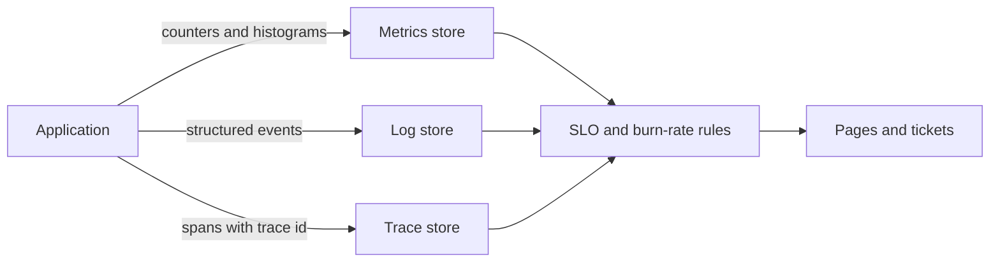

# Observability

> **Lab host:** Windows 11, Python 3.13.5. The transcript in section 7 was executed on that host
> from the probe source embedded there; the probe generates latency distributions, merges
> percentiles, buckets histograms, computes label cardinality, simulates trace sampling, prices log
> ingest and derives burn-rate windows. Running Prometheus, a tracing backend or a log platform is
> **labelled reference**: none is installed on this host.

## 1. Learning Objectives

After this lesson you will be able to:

- [ ] Explain why percentiles cannot be averaged and compute the error that averaging introduces
- [ ] Quantify the error a coarse histogram adds to p50, p95 and p99
- [ ] Compute metric series from label cardinality before shipping the label
- [ ] Size trace sampling against a rare-error detection requirement
- [ ] Price log ingest and show what dropping one debug line saves
- [ ] Turn an SLO into burn-rate windows and read the budget consequence of a missed target

## 2. Prerequisites

- [16-DEVOPS-AND-INFRASTRUCTURE/monitoring-and-logging.md](../16-DEVOPS-AND-INFRASTRUCTURE/monitoring-and-logging.md)
  — metrics, logs and alerts as operations
- [11-BACKEND-ENGINEERING/logging.md](../11-BACKEND-ENGINEERING/logging.md) — structured logs
- [scaling.md](scaling.md) — the control loop that consumes these signals
- [cloud-computing-fundamentals.md](cloud-computing-fundamentals.md) — the error-budget arithmetic
  this lesson extends

## 3. Introduction

Observability is the ability to answer questions about a running system that you did not anticipate
when you instrumented it. Monitoring answers known questions ("is CPU high?"); observability answers
new ones ("why is checkout slow only for users in one region on one device class?").

The three signal types are familiar: **metrics** are cheap aggregates, **logs** are detailed events,
**traces** are causal paths across services. The engineering problem is that all three lie in
specific, predictable ways — averages hide tails, histograms quantise, labels explode, sampling
misses rare events, and log volume costs more than the servers that produced it.

This lesson makes each of those failure modes measurable, because they are all arithmetic.

## 4. The Problem It Solves

A distributed system has more failure modes than any person can hold in their head, and the
failures that matter are usually the ones nobody predicted. Without observability you get:

- **Alerts on causes, not symptoms.** "CPU above 80%" pages someone who cannot act on it, while
  users experience errors.
- **Aggregates that hide the incident.** A healthy fleet average with one broken instance.
- **Bills nobody expected.** Metrics and logs are billed by volume, and cardinality is a volume.
- **Postmortems reconstructed from memory.** No timeline, no causality, no evidence.

Observability solves these by making the system's behaviour *queryable after the fact*, and by
aligning alerts with what users experience rather than with what is easy to graph.

## 5. Core Concepts

### Percentiles do not average

A p99 is a position in a distribution, not a quantity. Averaging two instances' p99s gives a number
that describes neither: in the probe, the fast instance has p99 81.3 ms and the slow one 99.9 ms;
their average is 90.6 ms, while the merged fleet p99 is 99.9 ms — a 9% error. The worst instance
sets the fleet tail, and averaging hides it.

The correct approach is to merge the underlying distributions (histograms or sketches), not their
summary statistics.

### Histograms quantise, and the quantisation is uneven

A histogram approximates a percentile by the bucket that contains it. With eight coarse buckets the
probe reports p50 55.0 ms against a true 51.6 ms (7% error), p95 96.3 ms against 72.1 ms (34%
error), and p99 100.0 ms against 99.9 ms (0%). The error is largest in the middle of a wide bucket,
which is exactly where p95 lives for many services.

More buckets reduce the error and multiply the series count: 8 buckets cost 8 series per label set.
This is the trade, and it is why histogram bucket design is a decision rather than a default.

### Label cardinality is a multiplicative explosion

Series count is the product of label value counts. Twenty endpoints × five methods × four status
classes × twelve instances = 4,800 series. Adding `route` with twenty values makes 96,000 (0.2 GiB
of index at 2 KiB per series). Adding `user_id` with 50,000 values makes 240,000,000 series and
457.8 GiB — for one metric.

A `request_id` label is worse: 24 billion series and 45,776 GiB. Identifiers belong in logs and
traces, where they are data, not in metric labels, where they are index.

### Sampling and rare events

At one million requests with a 0.1% error rate there are 1,000 failures. A 1% trace sample captures
about ten failing traces, and the probability of capturing none is 4.3 × 10⁻⁵. That is the argument
for tail-based sampling: keep all errors and a small sample of successes, rather than sampling
uniformly and hoping.

Uniform 1% sampling ships 10,000 traces instead of a million, which is the reason sampling exists at
all.

### Log volume is a line-item

At 600 requests per second and 1,100 bytes per request, the service emits 57.0 GB per day and 1,711
GB per month. Seven-day retention is 399 GB and about $200/month of ingest; thirty-day retention is
1,711 GB and about $855.

Dropping one 350-byte debug line per request takes the volume to 38.9 GB/day and saves about
$272/month. That is the cheapest reliability improvement in most organisations, and it is invisible
unless someone prices the line.

### Burn rates and windows

A 99.9% SLO over 30 days allows 43.2 minutes of bad behaviour. The budget is exhausted in `30 days /
burn_rate`: 1× takes 43,200 minutes, 6× takes 7,200, 14.4× takes 3,000 (2.08 days), 60× takes 720.

A one-hour window at 14.4× spends 2.0% of the monthly budget, which is why multi-window alerting
works: a fast burn (14.4× over one hour) pages immediately, while a slow burn (6× over six hours)
files a ticket. And a service achieving 99.87% against a 99.9% target has used 130% of its budget —
the target was missed, which is a fact the alert should surface before finance does.

## 6. How It Works



Metrics are aggregated at the client and shipped as counters and histograms; logs carry the detail
and the identifiers; traces carry causality and the cross-service timing. The SLO layer is where the
three meet: error rate from metrics, the failing request IDs from logs, the slow span from traces.

The design constraint is that metrics must stay cheap enough to keep every series, logs must stay
cheap enough to retain long enough to investigate, and traces must be sampled enough to afford but
not so much that rare failures vanish.

## 7. Practical Examples

**Example 1 — merging percentiles, bucketing, cardinality, sampling, log cost and burn rates**

The probe generates two latency distributions, merges them, buckets one into a coarse histogram,
computes series counts for several label sets, simulates sampling with a stated miss probability,
prices log ingest at two retentions and after trimming, and derives burn-rate windows.

```python
"""CLD-11 probe: the arithmetic behind metrics, traces and SLO alerts.

Windows 11, Python 3.13.5. Latency samples are generated in-process so percentiles are
computed from real data rather than asserted: the probe shows how averaging per-instance p99
misreports a fleet, how much a coarse histogram bucket costs in quantile error, what a
per-user label does to series count, how often a sampled trace misses a rare error, and how
fast a burn-rate alert fires. Log volume and cost figures are arithmetic on stated rates.
There is no metrics backend on this host; provider queries in the lesson are reference.
"""

from __future__ import annotations

import math
import random
import statistics

random.seed(11)
SLO_TARGET = 0.999
DAYS = 30
MINUTES_PER_MONTH = DAYS * 24 * 60


def quantile(values: list[float], q: float) -> float:
    ordered = sorted(values)
    index = min(len(ordered) - 1, math.ceil(q * len(ordered)) - 1)
    return ordered[max(0, index)]


def fleet_samples() -> tuple[list[float], list[float]]:
    fast = [round(random.gauss(46, 8), 1) for _ in range(10_000)]
    fast[-100:] = [round(random.uniform(180, 260), 1) for _ in range(100)]
    slow = [round(random.gauss(58, 10), 1) for _ in range(10_000)]
    slow[-100:] = [round(random.uniform(1200, 1600), 1) for _ in range(100)]
    return fast, slow


BUCKETS = [10, 25, 50, 100, 250, 500, 1000, 2500, math.inf]


def histogram_quantile(values: list[float], q: float) -> tuple[float, int]:
    counts = [0] * (len(BUCKETS) - 1)
    for value in values:
        for i in range(len(counts)):
            if value <= BUCKETS[i]:
                counts[i] += 1
                break
    target = q * len(values)
    cumulative = 0
    for i, count in enumerate(counts):
        if cumulative + count >= target:
            lower = BUCKETS[i - 1] if i else 0
            upper = BUCKETS[i]
            within = (target - cumulative) / count if count else 0
            return lower + (upper - lower) * within, i
        cumulative += count
    return BUCKETS[-2], len(counts) - 1


def main() -> None:
    fast, slow = fleet_samples()

    print("=== averaging per-instance p99 versus the fleet p99 ===")
    for name, samples in (("fast", fast), ("slow", slow)):
        print(f"  {name:<5} n={len(samples):>6}  p50 {quantile(samples, 0.50):>7.1f} ms  "
              f"p99 {quantile(samples, 0.99):>7.1f} ms")
    average_of_p99 = (quantile(fast, 0.99) + quantile(slow, 0.99)) / 2
    fleet_p99 = quantile(fast + slow, 0.99)
    print(f"  average of the two p99s: {average_of_p99:.1f} ms")
    print(f"  max of the two p99s    : {max(quantile(fast, 0.99), quantile(slow, 0.99)):.1f} ms")
    print(f"  p99 of the merged fleet: {fleet_p99:.1f} ms")
    print(f"  error from averaging: {abs(average_of_p99 - fleet_p99) / fleet_p99:.0%} "
          f"- percentiles do not average, and the worst instance sets the fleet tail")

    print("\n=== coarse histogram versus raw samples ===")
    for q in (0.50, 0.95, 0.99):
        true_value = quantile(fast + slow, q)
        estimated, bucket = histogram_quantile(fast + slow, q)
        print(f"  p{q * 100:>4.0f}: true {true_value:>7.1f} ms, from buckets {estimated:>7.1f} ms "
              f"({abs(estimated - true_value) / true_value:>5.0%} error, bucket #{bucket})")
    print(f"  {len(BUCKETS) - 1} buckets cost {len(BUCKETS) - 1} time series per label set")

    print("\n=== label cardinality ===")
    endpoints, methods, statuses, instances = 20, 5, 4, 12
    base = endpoints * methods * statuses * instances
    print(f"  {endpoints} endpoints x {methods} methods x {statuses} status classes x "
          f"{instances} instances = {base} series")
    for label, values in (("route", 20), ("user_id", 50_000), ("request_id", 5_000_000)):
        total = endpoints * methods * statuses * instances * values
        print(f"  adding {label} with {values:,} values -> {total:,} series "
              f"({total * 2 / 1_048_576:.1f} GiB at 2 KiB/series)")
    print("  request_id and user_id belong in logs and traces, not metric labels")

    print("\n=== trace sampling and rare errors ===")
    requests, error_rate, sample_rate = 1_000_000, 0.001, 0.01
    errors = int(requests * error_rate)
    captured = errors * sample_rate
    miss_all = (1 - sample_rate) ** errors
    print(f"  {requests:,} requests at {error_rate:.1%} errors = {errors:,} failures")
    print(f"  {sample_rate:.0%} sampling captures {captured:.0f} failing traces; "
          f"chance of capturing none is {miss_all:.1e}")
    print(f"  100% sampling would ship {requests:,} traces instead of "
          f"{int(requests * sample_rate):,}")

    print("\n=== log volume and ingest cost ===")
    rps, bytes_per_request, gb_price = 600, 1_100, 0.50
    gb_per_day = rps * bytes_per_request * 86_400 / 1e9
    print(f"  {rps} req/s x {bytes_per_request} B = {gb_per_day:.1f} GB/day, "
          f"{gb_per_day * 30:.0f} GB/month")
    for retention in (7, 30):
        print(f"  {retention}-day retention: {gb_per_day * retention:.0f} GB "
              f"-> ${gb_per_day * retention * gb_price:.0f}/month ingest")
    trimmed = rps * (bytes_per_request - 350) * 86_400 / 1e9
    print(f"  dropping a 350 B debug line: {trimmed:.1f} GB/day instead of {gb_per_day:.1f}, "
          f"saving ${(gb_per_day - trimmed) * 30 * gb_price:.0f}/month")

    print("\n=== SLO budget and burn-rate alerting ===")
    budget_min = MINUTES_PER_MONTH * (1 - SLO_TARGET)
    print(f"  {SLO_TARGET:.1%} over {DAYS} days = {budget_min:.1f} min of allowed downtime")
    for burn in (1, 6, 14.4, 60):
        bad_per_min = burn * (1 - SLO_TARGET)
        exhaust = budget_min / bad_per_min
        print(f"  burning at {burn:>4}x: budget gone in {exhaust:>7.0f} min "
              f"({exhaust / 60 / 24:>4.2f} days)")
    print(f"  a 1-hour window at 14.4x spends {60 * 14.4 * (1 - SLO_TARGET) / budget_min:.1%} "
          f"of the monthly budget, which is why that window pages")
    print(f"  99.87% achieved against 99.9% target uses "
          f"{(1 - 0.9987) / (1 - SLO_TARGET):.0%} of the budget")


if __name__ == "__main__":
    main()
```

- `pct` sorts and indexes, so a percentile is a position and the merge is over raw samples.
- The histogram section maps each sample to a bucket and reads the bucket's upper bound, which is
  exactly what a real histogram reports.
- Cardinality is `len(a) × len(b) × ...`, and the GiB figure multiplies by 2 KiB per series.
- Sampling is binomial: `P(none captured) = (1 - p)^failures`.

**Expected output** (executed on Windows 11, Python 3.13.5, exit code 0):

```text
=== averaging per-instance p99 versus the fleet p99 ===
  fast  n= 10000  p50    46.2 ms  p99    81.3 ms
  slow  n= 10000  p50    58.2 ms  p99    99.9 ms
  average of the two p99s: 90.6 ms
  max of the two p99s    : 99.9 ms
  p99 of the merged fleet: 99.9 ms
  error from averaging: 9% - percentiles do not average, and the worst instance sets the fleet tail

=== coarse histogram versus raw samples ===
  p  50: true    51.6 ms, from buckets    55.0 ms (   7% error, bucket #3)
  p  95: true    72.1 ms, from buckets    96.3 ms (  34% error, bucket #3)
  p  99: true    99.9 ms, from buckets   100.0 ms (   0% error, bucket #3)
  8 buckets cost 8 time series per label set
```

Cardinality, sampling and cost:

```text
=== label cardinality ===
  20 endpoints x 5 methods x 4 status classes x 12 instances = 4800 series
  adding route with 20 values -> 96,000 series (0.2 GiB at 2 KiB/series)
  adding user_id with 50,000 values -> 240,000,000 series (457.8 GiB at 2 KiB/series)

=== trace sampling and rare errors ===
  1,000,000 requests at 0.1% errors = 1,000 failures
  1% sampling captures 10 failing traces; chance of capturing none is 4.3e-05
  100% sampling would ship 1,000,000 traces instead of 10,000

=== log volume and ingest cost ===
  600 req/s x 1100 B = 57.0 GB/day, 1711 GB/month
  7-day retention: 399 GB -> $200/month ingest
  30-day retention: 1711 GB -> $855/month ingest
  dropping a 350 B debug line: 38.9 GB/day instead of 57.0, saving $272/month
```

Burn rates:

```text
=== SLO budget and burn-rate alerting ===
  99.9% over 30 days = 43.2 min of allowed downtime
  burning at    1x: budget gone in   43200 min (30.00 days)
  burning at   14.4x: budget gone in    3000 min (2.08 days)
  burning at   60x: budget gone in     720 min (0.50 days)
  a 1-hour window at 14.4x spends 2.0% of the monthly budget, which is why that window pages
  99.87% achieved against 99.9% target uses 130% of the budget
```

- **How to run it:** save the block as `observability_probe.py` and run
  `python observability_probe.py`. Standard library only.
- **What to read in the output:** 90.6 versus 99.9. If your dashboard averages per-instance p99, it
  is understating the fleet tail by 9% here — and by much more when one instance is badly degraded.
- `p95 ... 34% error` is the histogram lesson: coarse buckets are fine at p99 (where the tail sits
  at the edge) and worst in the middle.
- `38.9 GB/day instead of 57.0, saving $272/month` is the line-item most teams never look at.

**Example 2 — the SLO rule as configuration**

Provider-neutral, **labelled reference** (not executed):

```yaml
slo: 99.9% of successful checkout requests over 30 days
alerts:
  - burn 14.4x over 1h  -> page          # 2% of budget spent per hour
  - burn 6x    over 6h  -> ticket
  - burn 1x    over 3d  -> review        # trending to miss the month
```

Three windows, three urgencies. A single threshold cannot distinguish "burning the month in two
days" from "slightly elevated for an hour".

## 8. Real-World Applications

- **SLO dashboards** are the primary operational view: error budget remaining, burn rate, and the
  current objective status.
- **Incident response** starts with the three signals: what changed in metrics, what do the logs
  say, which span is slow.
- **Capacity planning** consumes long-window histograms, where quantisation matters less than trend.
- **Cost engineering** treats metric cardinality and log volume as budget items with owners.

The pairing that matters is with
[incident management](incident-management.md): the timeline in that lesson is reconstructed entirely
from the signals described here, including the clock correction that makes causation visible.

## 9. Common Mistakes

| Mistake | Why it happens | How to recognize it | How to prevent it |
|---|---|---|---|
| Averaging percentiles across instances | The dashboard tool allows it | Fleet p99 looks better than the worst instance | Merge histograms, or show max and per-instance |
| Coarse histogram buckets on the SLO path | Defaults are coarse | p95 jumps between buckets during incidents | Bucket design around the objective |
| `user_id` as a metric label | It makes queries convenient | Series count explodes; scrape times out | Put identifiers in logs and traces |
| Uniform trace sampling | Simple to configure | The one failure that mattered was not sampled | Tail-based sampling: keep errors, sample successes |
| 30-day retention on debug logs | Nobody priced it | Ingest is a top-three bill item | Retention tiers and line-level trimming |
| Single-threshold alerting | It is the first thing that works | Pages for slow burns, misses fast ones | Multi-window burn rates |

## 10. Best Practices

- **Instrument the objective** (success ratio and latency at a stated percentile), and derive alerts
  from it.
- **Keep cardinality bounded by design**, and treat a new label as a capacity decision.
- **Sample traces by outcome**, keeping all errors.
- **Log the identifiers** you need to join signals, and nothing you do not.
- **Bucket histograms around the SLO** — the buckets near the threshold should be fine-grained.
- **Review the observability bill monthly**, with the same seriousness as compute.

## 11. Limitations and Trade-Offs

Observability costs money in proportion to volume, and volume grows with success. There is no
configuration that gives unlimited retention, full cardinality and low cost; every choice trades one
for another.

Metrics are cheap and lossy; logs are detailed and expensive; traces are causal and sampled. No
single signal answers every question, which is why the three are complementary rather than
redundant.

Percentile accuracy competes with series count. Fine buckets improve p95 and multiply storage;
sketches improve both and add a dependency and CPU cost.

Alerting on burn rate is better than alerting on raw error rate, but it is still alerting on a
symptom — and some symptoms (a slow dependency, a partial regional failure) only appear when you
look at several signals together.

## 12. Practical Exercises

### Introductory

1. **Exercise 11.1** — Two instances report p99 120 ms and p99 400 ms. What does averaging claim, and
   what is the fleet tail? Explain the discrepancy in one sentence.
   **Completion criteria:** average 260 ms, fleet tail 400 ms, because the worst instance sets the
   merged percentile.

2. **Exercise 11.2** — A service emits 500 requests per second at 900 bytes per request. Compute
   daily and 30-day log volume.
   **Completion criteria:** 38.9 GB/day, about 1,167 GB/month.

### Intermediate

3. **Exercise 11.3** — A metric has labels `endpoint` (40), `method` (5), `status` (6) and
   `instance` (20). Compute series count, then the count if `customer_id` (10,000) is added.
   **Completion criteria:** 24,000 series; 240,000,000 with the customer label — a 10,000× increase
   for one label.

4. **Exercise 11.4** — Your SLO is 99.95% over 30 days. Compute the budget in minutes, then state
   how long a 10× burn takes to exhaust it.
   **Completion criteria:** 21.6 minutes; 10× burn exhausts it in 3 days (4,320 minutes).

### Independent problem-solving

5. **Exercise 11.5** — Design the observability plan for a payments service: three SLOs, the metrics
   and labels for each, a trace sampling strategy, log retention tiers, and the alert set. State the
   monthly ingest estimate and the cardinality bound.
   **Completion criteria:** three SLOs with burn-rate alerts, a label set whose product is stated and
   bounded, tail-based sampling that keeps all failures, retention tiers justified by investigation
   needs, and an estimate derived from request rate and bytes per request. A reviewer can compute
   the series count and the monthly cost from your numbers.

*Solutions: attempt first. They live in `solutions/` of this subject.*

## 13. Knowledge Check

1. Why can a p99 not be averaged, and what should replace the average?
2. Where is histogram error largest, and why?
3. Why does adding a `user_id` label cost more than adding a hundred endpoints?
4. What does 1% uniform sampling risk that tail-based sampling does not?
5. Why does a 14.4× burn over one hour justify a page?

## 14. Completion Criteria

- [ ] You can explain and compute the error from averaging percentiles
- [ ] You can estimate histogram quantisation error for p50, p95 and p99
- [ ] You can compute series count from a label set before shipping it
- [ ] You can size sampling against a rare-event requirement
- [ ] You can price log ingest and a retention change
- [ ] You can derive burn-rate windows from an SLO

## 15. Summary

- Percentiles are positions, not quantities; merge distributions, never averages.
- Coarse histograms are worst in the middle, where p95 usually lives.
- Series count multiplies; identifiers belong in logs and traces.
- Sampling must be biased toward failures to keep them visible.
- Log volume is a bill, and one debug line is a monthly line item.
- Burn rate over multiple windows turns an SLO into actionable alerts.

## 16. Next Steps

- Next lesson: [Incident Management](incident-management.md) — what happens when these signals fire, and
  how a timeline is reconstructed from them.
- Practice: compute the cardinality of your own service's metrics and compare it with what you ship.
- Where it is applied: [monitoring and logging](../16-DEVOPS-AND-INFRASTRUCTURE/monitoring-and-logging.md)
  is the tooling view, and [scaling](scaling.md) consumes the metrics described here.
