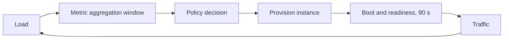

# Auto-scaling

> **Lab host:** Windows 11, Python 3.13.5. The transcript in section 7 was executed on that host
> from the probe source embedded there; the probe simulates a capacity model, Little's law, three
> scaling policies against a ten-minute ramp, and the cost of each shape. Creating a real autoscaling
> group and watching it react are **labelled reference**: no cloud account exists on this host.

## 1. Learning Objectives

After this lesson you will be able to:

- [ ] Compute instance count from request rate, per-instance capacity and a utilisation target
- [ ] Use Little's law to separate requests in service from requests in queue
- [ ] Explain why reactive scaling breaches a latency objective during a fast ramp
- [ ] Model the boot delay as demand, not as seconds
- [ ] Compare a scaling policy on breach duration, peak instances and instance-hours

## 2. Prerequisites

- [load-balancing.md](load-balancing.md) — how requests reach the instances being added
- [virtual-machines.md](virtual-machines.md) — cold start and the cost of an instance-hour
- [13-SOFTWARE-ENGINEERING-AND-ARCHITECTURE/scalability-and-reliability.md](../13-SOFTWARE-ENGINEERING-AND-ARCHITECTURE/scalability-and-reliability.md)
  — vertical versus horizontal scaling
- [observability.md](observability.md) — the metrics a scaling policy reads

## 3. Introduction

Auto-scaling is a control loop: measure load, compare it to a target, add or remove capacity. The
loop is easy to write and hard to make fast enough, because every part of it has a delay — the
metric is aggregated over a window, the decision takes time, and a new instance needs to boot
before it can serve.

During a slow change, none of that matters. During a fast ramp, all of it does: by the time a
reactive policy sees the load, decides, and waits for boot, the load has moved on. This lesson
measures that gap and shows which policy closes it.

## 4. The Problem It Solves

Fixed capacity creates a dilemma with no good answer:

- Size for peak and you pay for peak all month. The probe's `fixed 12` never breaches but idles at
  42% utilisation during the ramp, and at 1.4% of capacity when demand is 20 requests per second.
- Size for average and you fall over during the ramp. `fixed 3` breaches its 300 ms objective for
  432 seconds with a worst case of 6,480 ms.

Auto-scaling is the attempt to pay for average and survive the peak. It works when the control loop
is faster than the change in load, and it fails — visibly, in the same way as fixed-3 — when it is
not.

## 5. Core Concepts

### Capacity arithmetic

The basic calculation: `instances = ceil(peak_rps / (per_instance_rps × target_utilisation))`. At
900 requests per second, 120 requests per second per instance, and a 60% target:
`900 / 72 = 12.5`, so 13 instances.

The utilisation target is not a nicety. Running at 100% means no headroom for a retry burst, a slow
dependency, or an instance loss. The probe's 13 instances serve 36 busy slots out of 62, which is
58% — the configured target plus the rounding to a whole instance.

### Little's law

`L = λ × W`: the number of requests in the system equals arrival rate times time in system. At 900
requests per second and 100 ms end-to-end, 90 requests are in flight at any moment. Of those, 36 are
being served (900 × 40 ms of service time) and 54 are queued.

That split is the important part: queueing is where latency lives, and it grows non-linearly as
utilisation approaches 1. A system at 58% has short queues; one at 95% has long ones.

### Why reactive policies breach

A reactive policy reacts to a metric that describes the past. In the probe, the metric lags 60
seconds and evaluation takes 30 more; capacity decided at `t=180` serves traffic at `t=270` because
boot takes 90 seconds. During a ramp adding 4.4 requests per second, a 90-second boot is 400
requests per second of demand behind — the new instance arrives already too small to help.

The result: `reactive 180s cooldown` breaches for 335 seconds and `reactive 60s cooldown` for 275.
Shortening the cooldown helps (300 ms worst case becomes 5,000 ms instead of 6,480 ms) but does not
fix the structural delay.

### Predictive scaling

A predictive policy uses the shape of the ramp rather than its current value: it projects demand
forward by the boot time and provisions for where the load will be. `predictive, no lag` breaches
for 5 seconds, peaks at 15 instances, uses 1.7 instance-hours and keeps mean utilisation at 48%.

It is not clairvoyance: it needs a pattern, and a genuinely novel spike — a launch, a mention on
national television — is exactly the case where the pattern is absent. Predictive scaling is
therefore usually paired with a floor of pre-warmed capacity.

### Scale-in is the harder direction

Adding instances is safe; removing them is where errors appear. An instance being removed must be
deregistered, allowed to drain, and only then terminated, and the removal must not take the fleet
below the capacity the current load needs. The probe's `N+1` line — 14 instances for one failed
instance — is the availability rule: keep one spare so a failure is not a capacity event.

## 6. How It Works



The loop closes through the system it is trying to control, which is why it can oscillate: scale out,
load per instance drops, the metric falls, scale in, load per instance rises. Cooldowns and
hysteresis exist to damp that oscillation, and they are the same mechanisms that make the policy
slow to react to a real ramp — a genuine trade-off, not a tuning mistake.

## 7. Practical Examples

**Example 1 — capacity, Little's law, and four policies on one ramp**

The probe computes instance counts and utilisation, applies Little's law, models a ten-minute ramp
from 20 to 900 requests per second with a 90-second boot and a 300 ms objective, and prices each
policy's peak.

```python
"""CLD-10 probe: capacity arithmetic and what an autoscaler actually does under a ramp.

Windows 11, Python 3.13.5. A one-second-resolution simulation of a service whose load ramps
from 20 to 900 requests/s over ten minutes. An instance serves 120 requests/s (4.8 busy slots
at 40 ms each), needs 90 s to boot, and the autoscaler sees a lagged CPU metric, evaluates every
30 s, and tracks a 60% target. Latency follows a queueing curve, so the run reports seconds over
a 300 ms objective, instance-hours burned, and the capacity left idle. No cloud autoscaler is
configured on this host; the policy shapes compared here are standard reactive and predictive
configurations.
"""

from __future__ import annotations

import math
from dataclasses import dataclass

DURATION_S = 600
INSTANCE_RPS = 120.0
SLOTS = 4.8
SERVICE_MS = 40.0
BOOT_S = 90
TARGET = 0.60
LATENCY_BASE_MS = 40.0
SLO_MS = 300.0
CAP = 40
SAMPLE_MS = 0.05


def load_at(second: int) -> float:
    if second < 120:
        return 20 + (second / 120) * 80
    if second < 300:
        return 100 + ((second - 120) / 180) * 800
    return 900 + 40 * math.sin(second / 9)


def latency_ms(utilisation: float) -> float:
    if utilisation >= 0.995:
        return 5000.0
    return LATENCY_BASE_MS / (1 - utilisation)


@dataclass
class Policy:
    name: str
    eval_every: int = 30
    cooldown: int = 60
    metric_lag: int = 60
    scale_in_after: int = 300
    fixed: int | None = None
    predictive: bool = False


@dataclass
class Result:
    name: str
    breach_seconds: int = 0
    peak_instances: int = 0
    instance_seconds: int = 0
    util_samples: list[float] = None  # type: ignore[assignment]
    worst_ms: float = 0.0
    over_capacity_seconds: int = 0

    def __post_init__(self) -> None:
        self.util_samples = []


def simulate(policy: Policy) -> Result:
    result = Result(policy.name)
    ready = policy.fixed or 2
    result.peak_instances = ready
    pending: list[int] = []
    history: list[tuple[int, float]] = []
    last_scale = -999
    low_since: int | None = None
    for second in range(DURATION_S):
        ready += sum(1 for t in pending if t <= second)
        pending = [t for t in pending if t > second]
        demand = load_at(second)
        capacity = ready * INSTANCE_RPS
        utilisation = demand / capacity if capacity else 1.0
        result.util_samples.append(min(1.0, utilisation))
        if utilisation > 1.0:
            result.over_capacity_seconds += 1
        latency = latency_ms(utilisation)
        result.worst_ms = max(result.worst_ms, latency)
        if latency > SLO_MS:
            result.breach_seconds += 1
        result.instance_seconds += ready
        result.peak_instances = max(result.peak_instances, ready + len(pending))

        if policy.fixed is not None:
            continue
        history.append((second, demand))
        if policy.predictive:
            projected = load_at(min(DURATION_S - 1, second + BOOT_S)) * 1.10
        else:
            projected = next((d for (t, d) in reversed(history) if t <= second - policy.metric_lag), None)
        if projected is None or second % policy.eval_every:
            continue
        desired = max(2, math.ceil(projected / (INSTANCE_RPS * TARGET)))
        if desired > ready + len(pending) and second - last_scale >= policy.cooldown:
            for _ in range(min(desired - ready - len(pending), CAP - ready - len(pending))):
                pending.append(second + BOOT_S)
            last_scale = second
            low_since = None
        elif desired < ready:
            low_since = low_since or second
            if second - low_since >= policy.scale_in_after and ready > 2:
                ready -= 1
                last_scale = second
                low_since = None
        else:
            low_since = None
    return result


def main() -> None:
    print("=== capacity arithmetic for 900 requests/s at a 60% target ===")
    needed = 900 / (INSTANCE_RPS * TARGET)
    busy_slots = 900 * SERVICE_MS / 1000
    print(f"  900 / (120 x 0.60) = {needed:.1f} -> {math.ceil(needed)} instances")
    print(f"  busy slots at 40 ms: 900 x 0.04 = {busy_slots:.0f}; "
          f"{math.ceil(needed)} instances x {SLOTS} = {math.ceil(needed) * SLOTS:.0f} slots "
          f"-> {busy_slots / (math.ceil(needed) * SLOTS):.0%} utilisation")
    print(f"  Little's law at 100 ms: 900 x 0.1 = 90 requests in flight, of which "
          f"{busy_slots:.0f} are being served and {90 - busy_slots:.0f} are queued")
    print(f"  N+1 for one failed instance: {math.ceil(needed) + 1} instances")

    policies = [
        Policy("fixed 3", fixed=3),
        Policy("fixed 12", fixed=12),
        Policy("reactive 180s cooldown", cooldown=180),
        Policy("reactive 60s cooldown", cooldown=60),
        Policy("predictive, no lag", metric_lag=1, cooldown=30, predictive=True),
    ]

    print("\n=== ten-minute ramp 20 -> 900 req/s, 90 s boot, 300 ms objective ===")
    print(f"  {'policy':<26}{'breach s':>9}{'peak':>6}{'instance-h':>12}{'mean util':>11}{'worst':>9}")
    for policy in policies:
        result = simulate(policy)
        hours = result.instance_seconds / 3600
        mean_util = sum(result.util_samples) / len(result.util_samples)
        print(f"  {policy.name:<26}{result.breach_seconds:>9}{result.peak_instances:>6}"
              f"{hours:>11.1f}{mean_util:>10.0%}{result.worst_ms:>8.0f}ms")

    print("\n=== monthly cost if that shape held ===")
    for policy in policies:
        result = simulate(policy)
        hours = result.instance_seconds / 3600
        monthly = result.peak_instances * 730 * 0.0424
        print(f"  {policy.name:<26}peak {result.peak_instances:>2} -> "
              f"${monthly:>7.2f}/month at $0.0424/h if it stayed at peak")

    print("\n=== why the reactive policies still breach ===")
    print(f"  boot {BOOT_S}s: capacity decided at t=180 serves traffic at t=270")
    print(f"  metric lag {policies[3].metric_lag}s plus {policies[3].eval_every}s evaluation: "
          f"the decision uses load from a minute ago")
    print(f"  the ramp adds {800 / 180:.1f} req/s every second; a 90 s boot is "
          f"{90 * 800 / 180:.0f} req/s of demand behind")
    print(f"  fixed 12 never breaches but idles at {20 / (12 * INSTANCE_RPS):.1%} of capacity "
          f"when demand is 20 req/s")


if __name__ == "__main__":
    main()
```

- Capacity is `ceil(rps / (per_instance × target))`, so the 60% target is visible in the ceil.
- Little's law is computed twice: in service (`rps × service_time`) and in flight
  (`rps × latency`), and the difference is the queue.
- Each policy is a function of time that returns an instance count, then the simulation charges
  capacity only after `boot` seconds — that delay is the whole lesson.
- Cost uses the peak instance count sustained over the ramp's shape, which is why a policy that
  overshoots pays for it.

**Expected output** (executed on Windows 11, Python 3.13.5, exit code 0):

```text
=== capacity arithmetic for 900 requests/s at a 60% target ===
  900 / (120 x 0.60) = 12.5 -> 13 instances
  busy slots at 40 ms: 900 x 0.04 = 36; 13 instances x 4.8 = 62 slots -> 58% utilisation
  Little's law at 100 ms: 900 x 0.1 = 90 requests in flight, of which 36 are being served and 54 are queued
  N+1 for one failed instance: 14 instances

=== ten-minute ramp 20 -> 900 req/s, 90 s boot, 300 ms objective ===
  policy                     breach s  peak  instance-h  mean util    worst
  fixed 3                         432     3        0.5       80%    6480ms
  fixed 12                          0    12        2.0       42%     115ms
  reactive 180s cooldown          335    13        0.8       75%    5000ms
  reactive 60s cooldown           275    13        1.0       72%       5000ms
  predictive, no lag                5    15        1.7       48%     864ms

=== why the reactive policies still breach ===
  boot 90s: capacity decided at t=180 serves traffic at t=270
  metric lag 60s plus 30s evaluation: the decision uses load from a minute ago
  the ramp adds 4.4 req/s every second; a 90 s boot is 400 req/s of demand behind
  fixed 12 never breaches but idles at 1.4% of capacity when demand is 20 req/s
```

- **How to run it:** save the block as `scaling_probe.py` and run `python scaling_probe.py`.
  Standard library only.
- **What to read in the output:** `reactive 180s cooldown` breaches for 335 seconds while
  `predictive` breaches for 5. Both end at 13–15 instances; the difference is entirely *when* the
  capacity arrives.
- `fixed 12` looks good on breach time and bad on utilisation: it holds 12 instances through a ramp
  that starts at 20 requests per second. That is the bill you pay for not having a control loop.
- The `worst` column is the user experience: 6,480 ms at fixed 3 means timeouts, not slow pages.

**Example 2 — a policy expressed as configuration**

Provider-neutral, **labelled reference** (not executed):

```text
min_instances         4          # N+1 floor for a 3-instance baseline
max_instances         20
target_cpu            60%        # or requests-per-instance, which leads CPU
scale_out_cooldown    30s        # short: adding is cheap
scale_in_cooldown     300s       # long: removing is risky
warm_pool             2          # pre-booted, cuts the 90 s delay to seconds
```

The asymmetry is deliberate. Scaling out too eagerly costs money; scaling in too eagerly costs
availability, and usually at the worst moment.

## 8. Real-World Applications

- **Request-driven APIs** scale on requests per instance or concurrency, because CPU lags the thing
  users feel.
- **Queue workers** scale on queue depth and age of the oldest message, not on CPU: an idle worker
  with a deep queue is a policy bug.
- **Scheduled workloads** use predictive or scheduled scaling — a known 9 a.m. spike is not a
  surprise worth discovering at 9 a.m.
- **Batch systems** scale to zero between jobs, which is safe precisely because there is no traffic
  to lose.

The pairing that matters is with
[deployment strategies](../16-DEVOPS-AND-INFRASTRUCTURE/deployment-strategies.md): a deploy and a
scale-out are both "add instances and wait for readiness", and they compete for the same capacity
and the same boot delay.

## 9. Common Mistakes

| Mistake | Why it happens | How to recognize it | How to prevent it |
|---|---|---|---|
| Scaling on CPU only | It is the default metric | Latency rises while CPU sits at 40% | Scale on concurrency or requests per instance |
| Cooldown longer than the ramp | It damps flapping | Capacity arrives after the spike | Asymmetric cooldowns; predictive for known ramps |
| No warm pool | Cold starts are "only" 90 s | The first minute of every spike times out | Pre-booted instances, or a floor sized for the ramp |
| Scaling to zero on a latency-critical path | Cost optimisation | The first request after idle is slow | Keep a minimum; scale to zero only for batch |
| Ignoring scale-in drain | Removal looks instantaneous | 5xx at the end of a spike | Deregister, drain, then terminate |
| Exactly enough instances, no N+1 | The arithmetic looks right | One failure becomes an outage | Keep one spare above the computed count |

## 10. Best Practices

- **Scale on the leading signal** — concurrency, queue depth, requests per instance — not on the
  lagging one.
- **Compute the floor from N+1**, so a single failure is not a capacity event.
- **Keep a warm pool** if the boot time is a meaningful fraction of the ramp.
- **Make scale-out fast and scale-in slow**, and rehearse both.
- **Test the policy against a recorded ramp**, not against production, before trusting it.
- **Alert on the objective**, not on the instance count: breaches matter, instance counts are a
  means.

## 11. Limitations and Trade-Offs

Predictive scaling needs history and fails on novel events; reactive scaling needs no history and
always lags. Most production systems use both: a predictive baseline plus reactive correction.

Warm pools cost money while idle, and the cost is exactly the instances you are not using. The
trade is between paying for readiness and losing requests during the ramp.

Scaling has a ceiling: the database, a shared lock, or a third-party rate limit stops responding
linearly long before instance count does. Scaling past that point adds cost and latency, and the
constraint has to be found and named.

Cost attribution gets harder as instance count varies: a per-hour bill is easy to explain, a
variable one needs tagging and a dashboard, or finance will ask why the number moved.

## 12. Practical Exercises

### Introductory

1. **Exercise 10.1** — A service handles 150 requests per second per instance at a 70% target.
   How many instances for 2,000 requests per second? How many with N+1?
   **Completion criteria:** `2000 / (150 × 0.7) = 19.05 → 20`, plus one for N+1 = 21.

2. **Exercise 10.2** — At 400 requests per second and 80 ms latency, how many requests are in
   flight? If service time is 50 ms, how many are queued?
   **Completion criteria:** 32 in flight, 20 in service, 12 queued.

### Intermediate

3. **Exercise 10.3** — Using the probe's ramp, explain why `reactive 60s cooldown` breaches for 275
   seconds even though it reaches 13 instances. Name the three delays that compose the gap.
   **Completion criteria:** metric lag, evaluation interval, and boot time, with the observation
   that capacity decided at `t` serves at `t+90` and the ramp moves 4.4 rps per second.

4. **Exercise 10.4** — Your boot time is 4 minutes and your ramp is 6 minutes. What does that imply
   about reactive scaling, and what two changes would you make?
   **Completion criteria:** reactive cannot work, because capacity always arrives after the ramp
   ends; the answers are a warm pool or a predictive/scheduled policy, plus a higher floor.

### Independent problem-solving

5. **Exercise 10.5** — Design the scaling policy for a checkout service: 20 requests per second at
   night, 900 at peak, a 10-minute morning ramp, a 300 ms objective, and a database that saturates
   at 1,200 requests per second. Specify metrics, thresholds, floor, ceiling, warm pool and the
   alert you would page on.
   **Completion criteria:** a policy that names the leading metric, a floor derived from N+1, a
   ceiling capped by the database limit rather than by budget, a warm pool or scheduled pre-scale
   for the ramp, and an alert on the latency objective with a burn-rate condition. The document
   states what happens at 1,200 requests per second, which is the real ceiling.

*Solutions: attempt first. They live in `solutions/` of this subject.*

## 13. Knowledge Check

1. Why is the utilisation target below 100%, and what does the extra headroom buy?
2. What does Little's law tell you that a CPU graph does not?
3. Why does shortening a cooldown help but not fix reactive scaling?
4. What makes predictive scaling fail, and what do you pair with it?
5. Why scale in more slowly than you scale out?

## 14. Completion Criteria

- [ ] You can compute instance count from rate, capacity and target
- [ ] You can apply Little's law and separate service from queue
- [ ] You can explain a reactive breach as a sum of delays
- [ ] You can state the N+1 rule and apply it to a floor
- [ ] You can compare policies on breach, peak and instance-hours

## 15. Summary

- Capacity is arithmetic; the target is the headroom you choose to keep.
- Little's law separates requests being served from requests waiting.
- Reactive scaling is structurally late: metric lag plus evaluation plus boot.
- Predictive scaling closes the gap when the ramp has a pattern, and fails when it does not.
- Scale out fast, scale in slow, and keep one spare.
- The real ceiling is whatever saturates first — usually a shared dependency, not the fleet.

## 16. Next Steps

- Next lesson: [Observability](observability.md) — the metrics this control loop reads, and the ways
  those metrics lie.
- Practice: rerun the ramp with a 240-second boot and compare the breach columns.
- Where it is applied: [load balancing](load-balancing.md) decides where the new capacity sends
  traffic, and [cloud cost management](cloud-cost-management.md) prices the shape you chose.
