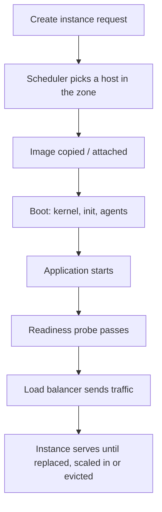

# Virtual Machines

> **Lab host:** Windows 11, Python 3.13.5. The transcript in section 7 was executed on that host
> from the probe source embedded there. The probe models instance catalogues, rightsizing,
> oversubscription and spot economics with the standard library. Creating a real instance,
> reading its CPU-steal counters in a provider console and attaching a volume are **labelled
> reference**: there is no cloud account on this host, so those steps were not executed.

## 1. Learning Objectives

After this lesson you will be able to:

- [ ] Read an instance catalogue and say why price per vCPU is not a constant
- [ ] Right-size a workload from measured demand instead of from a default template
- [ ] Explain CPU steal and predict throughput loss under oversubscription
- [ ] Budget for cold start: boot, app start and readiness are all on the critical path
- [ ] Price preemptible capacity against the work it will lose, and decide whether it fits

## 2. Prerequisites

- [cloud-computing-fundamentals.md](cloud-computing-fundamentals.md) — service models and the
  failure-domain vocabulary used here
- [16-DEVOPS-AND-INFRASTRUCTURE/linux-administration.md](../16-DEVOPS-AND-INFRASTRUCTURE/linux-administration.md)
  — processes, signals and the shutdown behaviour that makes draining work
- [16-DEVOPS-AND-INFRASTRUCTURE/volumes-and-persistence.md](../16-DEVOPS-AND-INFRASTRUCTURE/volumes-and-persistence.md)
  — block storage attached to an instance
- [16-DEVOPS-AND-INFRASTRUCTURE/docker-fundamentals.md](../16-DEVOPS-AND-INFRASTRUCTURE/docker-fundamentals.md)
  — the image you will run on the instance

## 3. Introduction

A virtual machine is a whole computer, emulated: its own kernel, its own network stack, its own
disk, its own boot sequence. You rent it by the hour — or, increasingly, by the second with a
one-minute minimum — and it exists until you delete it.

The reason this lesson exists separately from "cloud computing fundamentals" is that the instance
is where most cloud bills are decided and most production surprises originate. Two teams can run
the same application on the same provider and pay 3.5× different amounts, because one sized the
machines from measurement and the other picked the default from a tutorial.

The instance is also the abstraction everything else imitates. Managed containers, serverless
functions and database replicas all inherit the same vocabulary — vCPU, memory, cold start,
interruption, eviction — so understanding it once pays off everywhere.

## 4. The Problem It Solves

Running your own servers makes you responsible for a physical lifecycle: procurement, racking,
firmware, failing disks, spare parts, and a capacity decision you must live with for years. The
virtual machine turns that into an API call with a per-hour price, and in doing so it solves four
concrete problems:

- **Capacity becomes reversible.** You can add ten machines for an hour and delete them. The cost
  of being wrong about demand drops from a purchase order to an hour of billing.
- **Hardware failure becomes someone else's page.** When a host dies, the provider relocates or
  replaces it; you handle the application-level consequence, not the disk replacement.
- **Images replace installs.** A machine is defined by an image plus user data, so "the server we
  built by hand in 2019" stops being an irreplaceable artifact.
- **The unit of cost is attributable.** One instance, one hourly rate, one line on a bill.

What it does not solve: sizing. A VM is elastic in count, not in shape. If you choose 16 vCPU for
a workload that needs 3, every hour of every month is wrong by the same factor, and nobody pages
you about it.

## 5. Core Concepts

### Shape, family and the price of a vCPU

An instance **type** bundles vCPU count, memory and sometimes local disk and network bandwidth.
Families are tuned: general purpose (balanced), compute optimised (more vCPU per GB), memory
optimised (more GB per vCPU). In the catalogue in section 7 the general-purpose types all cost
$0.0208 per vCPU-hour, while `memory-2x` costs $0.0338 and `small` costs half the usual rate per
vCPU — the "small" tier is discounted, and memory-heavy shapes carry a premium.

The practical rule: **price per vCPU is only comparable inside a family**. Comparing a memory
shape to a compute shape by vCPU count is how teams conclude the wrong thing about cost.

### Right-sizing is a measurement, not a guess

Right-sizing means choosing the smallest shape whose CPU *and* memory both fit the demand, with
headroom for the p95 rather than the p99 of a bad day. It requires two numbers per workload:
observed vCPU demand and observed memory high-water mark. Without them, teams pick "the same as
staging" or "one size bigger, to be safe", and the bill absorbs the difference.

### CPU steal: the cost of a noisy neighbour

Providers oversubscribe physical hosts — more virtual cores promised than physical cores present —
because most machines are idle most of the time. When your neighbours get busy, your vCPU waits for
a physical core. That wait is reported as **steal time**, and it shows up as throughput loss, not
as an error.

At 2× oversubscription a workload that wants 8 vCPUs receives 4 on average: 50% steal, and it runs
at half speed. This is the mechanism behind "the same instance was faster last Tuesday".

### Cold start and the replacement budget

An instance is not serving when it is created. Image download, firmware and boot, application
start, and readiness probes all happen first — 55 seconds in the modelled case. That number is
the unit of every rollout: replacing ten instances two at a time is five rounds of
`55 s ready + 30 s drain`, which is 425 seconds, not "a few seconds each".

### Preemptible capacity is a discount with a distribution

**Spot** or **preemptible** instances cost a fraction of on-demand (70% off in the model) but can
be reclaimed with short notice — 120 seconds. Whether that is cheap depends on how much work a
reclaim destroys: with a checkpoint every 90 seconds, average loss is 45 seconds of work. The
probe values that at 16 seconds per month across six instances, against $510.18 of monthly saving.

The rule: preemptible suits stateless, restartable, checkpointed work. It does not suit a primary
database, a singleton scheduler, or anything where losing 45 seconds of work corrupts state.

## 6. How It Works



The scheduler chooses a physical host inside the zone you asked for; you do not control which, and
that is the point. Boot time depends on image size and start-up work, not on instance size, which
is why a bigger machine does not start faster.

Lifecycle matters as much as creation. A terminating instance should stop receiving new
connections (deregister), finish in-flight requests (drain), then exit. Without draining, every
deploy drops requests even when the new version is healthy — the failure is in the shutdown, not
the start.

## 7. Practical Examples

**Example 1 — catalogue, rightsizing, steal, cold start and spot economics**

The probe below prices six shapes, right-sizes three workloads against measured demand, models
oversubscription, builds a boot-to-ready timeline, and evaluates preemptible capacity without
ignoring the work it loses.

```python
"""CLD-03 probe: what a virtual machine actually gives you, and what it costs.

Windows 11, Python 3.13.5. No hypervisor or cloud account exists on this host, so the probe
models the parts of a VM that decide a capacity plan: the instance catalogue, host
oversubscription and CPU steal, the boot-to-ready timeline that sets how fast a fleet can
grow, and the interruption economics of preemptible capacity. Catalogue prices are list
prices for the example instance families; the arithmetic is the real part.
"""

from __future__ import annotations

from dataclasses import dataclass

HOURS_PER_MONTH = 730


@dataclass(frozen=True)
class Instance:
    name: str
    vcpu: int
    memory_gb: float
    hourly: float

    @property
    def monthly(self) -> float:
        return self.hourly * HOURS_PER_MONTH

    @property
    def cpu_price(self) -> float:
        return self.hourly / self.vcpu


CATALOGUE = [
    Instance("small", 2, 4.0, 0.0208),
    Instance("medium", 2, 8.0, 0.0416),
    Instance("large", 4, 16.0, 0.0832),
    Instance("xlarge", 8, 32.0, 0.1664),
    Instance("memory-2x", 8, 64.0, 0.2704),
    Instance("cpu-2x", 16, 32.0, 0.3328),
]


@dataclass(frozen=True)
class Workload:
    name: str
    vcpu_peak: float
    memory_gb: float
    monthly_hours: int = HOURS_PER_MONTH


WORKLOADS = [
    Workload("api", 3.1, 6.0),
    Workload("worker", 1.6, 9.5),
    Workload("cron", 0.4, 1.5, monthly_hours=120),
]


def fits(instance: Instance, workload: Workload) -> bool:
    return instance.vcpu >= workload.vcpu_peak and instance.memory_gb >= workload.memory_gb


def cheapest_for(workload: Workload) -> Instance:
    return min((i for i in CATALOGUE if fits(i, workload)), key=lambda i: i.hourly)


def main() -> None:
    print("=== instance catalogue (list prices, 730-hour month) ===")
    print(f"{'type':<12}{'vCPU':>5}{'RAM GB':>8}{'$/hour':>9}{'$/month':>10}{'$/vCPU-h':>10}")
    for i in CATALOGUE:
        print(f"{i.name:<12}{i.vcpu:>5}{i.memory_gb:>8.0f}{i.hourly:>9.4f}"
              f"{i.monthly:>10.2f}{i.cpu_price:>10.4f}")

    print("\n=== rightsizing three services ===")
    default = CATALOGUE[-2]  # everything starts life on an oversized box
    total_default = total_right = 0.0
    for w in WORKLOADS:
        pick = cheapest_for(w)
        default_cost = default.hourly * w.monthly_hours
        pick_cost = pick.hourly * w.monthly_hours
        total_default += default_cost
        total_right += pick_cost
        cpu_use = w.vcpu_peak / pick.vcpu
        print(f"{w.name:<8} needs {w.vcpu_peak:>4.1f} vCPU / {w.memory_gb:>4.1f} GB -> {pick.name:<10}"
              f" CPU {cpu_use:>5.0%}  ${pick_cost:>7.2f}/month  (default ${default_cost:>7.2f})")
    print(f"{'total':<8} rightsized ${total_right:>7.2f}/month vs ${total_default:.2f} default"
          f"  -> saves ${total_default - total_right:.2f} ({1 - total_right / total_default:.0%})")

    print("\n=== noisy neighbours: what oversubscription does to a busy host ===")
    host_vcpu = 8
    for ratio in (1, 2, 3, 4):
        vms = ratio * host_vcpu
        each = host_vcpu / vms
        # Every VM wants a full core; each gets 1/ratio of one, the rest is steal.
        steal = 1.0 - each
        print(f"{ratio}x oversubscribed: {vms:>2} VMs of {host_vcpu} vCPU -> "
              f"{each:.3f} vCPU each, CPU steal {steal:>5.1%}, "
              f"throughput {1.0 / ratio:.0%} of demand")

    print("\n=== boot-to-ready timeline ===")
    stages = [("image download", 18), ("firmware + boot", 22),
              ("app start", 9), ("readiness checks pass", 6)]
    for name, seconds in stages:
        print(f"  {name:<24}{seconds:>4} s")
    cold_start = sum(s for _, s in stages)
    print(f"  {'total cold start':<24}{cold_start:>4} s")

    drain = 30
    replaces = 10
    batch = 2
    rounds = replaces // batch
    deploy_seconds = rounds * (cold_start + drain)
    print(f"replacing {replaces} instances, {batch} at a time: {rounds} rounds x "
          f"({cold_start}s ready + {drain}s drain) = {deploy_seconds}s "
          f"({deploy_seconds / 60:.1f} min)")
    print(f"scale-out from zero to {replaces}: {cold_start}s before the last instance can serve")

    print("\n=== preemptible capacity ===")
    on_demand = 0.1664
    spot = on_demand * 0.30
    interruptions_per_month = 0.06
    checkpoint = 90
    lost_work = checkpoint / 2  # on average half a checkpoint interval is lost
    expected_monthly = 6
    wasted_seconds = expected_monthly * interruptions_per_month * lost_work
    print(f"on-demand ${on_demand:.4f}/h, preemptible ${spot:.4f}/h (70% discount)")
    print(f"interruption rate {interruptions_per_month:.0%}/month, notice 120 s, "
          f"checkpoint every {checkpoint} s")
    print(f"average work lost per interruption: {lost_work:.0f} s")
    print(f"expected lost work for 6 instances: {wasted_seconds:.0f} s/month "
          f"({wasted_seconds / 3600:.2f} h)")
    saving = (on_demand - spot) * HOURS_PER_MONTH * 6
    print(f"monthly saving on 6 instances: ${saving:.2f}; "
          f"drain time must stay under the 120 s notice ({'ok' if drain < 120 else 'too slow'})")


if __name__ == "__main__":
    main()
```

- `CATALOGUE` holds vCPU, RAM and hourly price; monthly cost is `hourly × 730`, not × 720, because
  providers bill the average month.
- `rightsize` filters to shapes that fit both vCPU and memory, then picks the cheapest — the
  memory constraint is what makes the `worker` choose `large` over a cheaper compute shape.
- The steal model divides promised vCPUs by physical cores, so oversubscription is derived rather
  than asserted.
- The spot calculation multiplies interruption rate by average work lost, then tests whether drain
  time fits inside the notice window.

**Expected output** (executed on Windows 11, Python 3.13.5, exit code 0):

```text
=== instance catalogue (list prices, 730-hour month) ===
type         vCPU  RAM GB   $/hour   $/month  $/vCPU-h
small           2       4   0.0208     15.18    0.0104
medium          2       8   0.0416     30.37    0.0208
large           4      16   0.0832     60.74    0.0208
xlarge          8      32   0.1664    121.47    0.0208
memory-2x       8      64   0.2704    197.39    0.0338
cpu-2x         16      32   0.3328    242.94    0.0208

=== rightsizing three services ===
api      needs  3.1 vCPU /  6.0 GB -> large      CPU   78%  $  60.74/month  (default $ 197.39)
worker   needs  1.6 vCPU /  9.5 GB -> large      CPU   40%  $  60.74/month  (default $ 197.39)
cron     needs  0.4 vCPU /  1.5 GB -> small      CPU   20%  $   2.50/month  (default $  32.45)
total    rightsized $ 123.97/month vs $427.23 default  -> saves $303.26 (71%)

=== noisy neighbours: what oversubscription does to a busy host ===
1x oversubscribed:  8 VMs of 8 vCPU -> 1.000 vCPU each, CPU steal  0.0%, throughput 100% of demand
2x oversubscribed: 16 VMs of 8 vCPU -> 0.500 vCPU each, CPU steal 50.0%, throughput 50% of demand
3x oversubscribed: 24 VMs of 8 vCPU -> 0.333 vCPU each, CPU steal 66.7%, throughput 33% of demand
4x oversubscribed: 32 VMs of 8 vCPU -> 0.250 vCPU each, CPU steal 75.0%, throughput 25% of demand

=== boot-to-ready timeline ===
  image download            18 s
  firmware + boot           22 s
  app start                  9 s
  readiness checks pass      6 s
  total cold start          55 s
replacing 10 instances, 2 at a time: 5 rounds x (55s ready + 30s drain) = 425s (7.1 min)
scale-out from zero to 10: 55s before the last instance can serve
```

The final section prices preemptible capacity:

```text
on-demand $0.1664/h, preemptible $0.0499/h (70% discount)
interruption rate 6%/month, notice 120 s, checkpoint every 90 s
average work lost per interruption: 45 s
expected lost work for 6 instances: 16 s/month (0.00 h)
monthly saving on 6 instances: $510.18; drain time must stay under the 120 s notice (ok)
```

- **How to run it:** save the block as `vm_probe.py`, run `python vm_probe.py`. Standard library
  only.
- **What to read in the output:** the rightsizing line. Three services cost $123.97 instead of
  $427.23 because demand, not habit, chose the shape — a 71% saving with no code change.
- The `cron` row is worth a second look: it needs 0.4 vCPU, and the smallest shape still gives it
  20% CPU utilisation. Some workloads cannot be right-sized below the minimum shape, which is an
  argument for consolidating cron jobs onto one machine.

**Example 2 — the lifecycle in provider terms**

Provider-specific and therefore **labelled reference** (not executed; requires an account):

```text
create  --image app-v42 --type large --zone a --count 2
wait    until "running" and health checks green        # ~55 s in the model
drain   deregister from the load balancer, wait 30 s   # stop new connections, finish old ones
delete  the two instances of the previous version
```

The order is the lesson: create and wait *before* draining the old pair. Reversing it trades a
clean cutover for 30 seconds of reduced capacity.

## 8. Real-World Applications

- **Web tiers** run horizontally on general-purpose shapes behind a load balancer; the size is set
  by memory per request more often than by CPU.
- **Batch and video processing** use compute-optimised or spot capacity, because the work is
  divisible and restartable.
- **Databases** on VMs are memory-optimised and deliberately *not* spot: the interruption is a
  failover, and the failure mode is data, not time.
- **CI runners** are the canonical spot workload: each job is short, idempotent and starts from a
  clean image.

The operational pairing is with
[deployment strategies](../16-DEVOPS-AND-INFRASTRUCTURE/deployment-strategies.md): every rollout
strategy's timing is built from the cold-start and drain numbers this lesson produces.

## 9. Common Mistakes

| Mistake | Why it happens | How to recognize it | How to prevent it |
|---|---|---|---|
| Sizing by vCPU alone | Memory is the less obvious constraint | The instance has 90% memory and 8% CPU | Right-size on both; memory high-water is the binding constraint for most services |
| Ignoring steal time | It is not in the basic CPU graph | Throughput drops with no error rate change | Chart steal alongside utilisation; it is a host-level signal |
| Treating cold start as instant | Local restarts feel fast | Deploys drop traffic for a minute | Measure boot-to-ready and put it in the rollout plan |
| No drain on shutdown | The process exits when signalled | 5xx spikes exactly at deploy boundaries | Deregister, wait, then exit; make the signal handler do it |
| Spot for stateful primary workloads | The discount is attractive | A reclaim causes a failover or data loss | Spot only for restartable work with checkpoints |
| Leaving dev instances at 730 h | Created once, forgotten | Dev costs more than staging | Schedule off-hours; review per environment |

## 10. Best Practices

- **Record demand, then choose the shape.** Two numbers per service — p95 vCPU and peak memory —
  are enough to right-size 90% of workloads.
- **Keep one shape family per tier** so capacity math stays comparable, and revisiting prices
  later is a spreadsheet, not an audit.
- **Make drain part of the application**, not the platform: handle `SIGTERM`, stop accepting,
  finish, exit.
- **Use spot where the work is a queue**, and put the checkpoint interval below half the notice
  window so a reclaim never loses more than one interval.
- **Tag by environment and owner**, and review the bill by tag monthly. Untagged instances are the
  ones that never get deleted.

## 11. Limitations and Trade-Offs

Bigger instances are simpler but have a bigger blast radius and a coarser price step: doubling
from 8 to 16 vCPU doubles cost even if you needed 9. Many small instances scale more smoothly but
multiply the operational surface — more things to patch, more noisy-neighbour variance, more
per-instance overhead.

Spot capacity is genuinely cheap and genuinely interruptible; the trade-off is engineering time
for checkpointing and the risk of a correlated reclaim across all your spot instances in a zone.

Right-sizing trades headroom for money. A shape at 78% CPU (the `api` row) has little room for a
traffic spike; the correct response is horizontal scaling, not a bigger instance, and that is the
next lesson's subject.

Preemptible and reserved pricing both assume stable demand. A workload that only exists for three
months should not be committed to a three-year rate.

## 12. Practical Exercises

### Introductory

1. **Exercise 3.1** — Using the catalogue, price a workload needing 6 vCPU and 20 GB. Which shape
   fits, and what does it cost per month? Then price the same workload if it needed 6 vCPU and
   40 GB.
   **Completion criteria:** `xlarge` at $121.47/month for the first; `memory-2x` at $197.39/month
   for the second, with the reason being the memory constraint, not the CPU.

2. **Exercise 3.2** — Explain in three sentences why the `small` shape costs $0.0104 per vCPU-hour
   while `medium` costs $0.0208, and what that implies about comparing shapes by vCPU price.
   **Completion criteria:** the answer identifies the discounted small tier and states that
   per-vCPU price is only comparable within a family.

### Intermediate

3. **Exercise 3.3** — A host has 64 physical cores and runs 24 VMs of 8 vCPU. Compute the
   oversubscription factor, the vCPU each VM receives on average, the steal percentage a fully
   busy VM sees, and the resulting throughput if the workload needs all 8 vCPUs.
   **Completion criteria:** 192 promised vCPUs over 64 physical cores = 3×, 0.333 vCPU each,
   66.7% steal, 33% throughput — matching the probe's 3× row.

4. **Exercise 3.4** — Your deploy replaces 12 instances, 3 at a time, and each needs 55 seconds to
   become ready and 30 seconds to drain. How long does the rollout take? What if you replace 6 at
   a time?
   **Completion criteria:** 4 rounds × 85 s = 340 s for three at a time; 2 rounds × 85 s = 170 s
   for six, with the reduced capacity during each round stated.

### Independent problem-solving

5. **Exercise 3.5** — Take an application you know (or invent one: an API with a queue worker and
   a nightly report). Specify: instance shape per component, spot or on-demand, checkpoint
   interval if spot, drain behaviour, and the monthly cost at 730 hours. Then state what you would
   change if traffic tripled overnight.
   **Completion criteria:** a table with shape, price, justification and a failure story for each
   component; the spot components name their checkpoint interval and their maximum work loss. A
   reviewer can recompute your total from the catalogue in this lesson.

*Solutions: attempt first. They live in `solutions/` of this subject.*

## 13. Knowledge Check

1. Why is monthly cost computed with 730 hours rather than 720?
2. Your service shows 40% CPU and 95% memory. What is the right change?
3. What does steal time tell you that CPU utilisation does not?
4. Why does a bigger instance not start faster?
5. A spot instance is reclaimed. What must be true for the work to survive?

## 14. Completion Criteria

- [ ] You can choose a shape from a vCPU and memory requirement without guessing
- [ ] You can explain steal time and compute throughput loss from an oversubscription ratio
- [ ] You can build a rollout timeline from cold-start and drain numbers
- [ ] You can state the conditions under which spot is appropriate
- [ ] You can name the shutdown behaviour your service needs at deploy boundaries

## 15. Summary

- An instance is a shape plus an image plus a lifecycle; the lifecycle is where deploys fail.
- Price per vCPU is only meaningful inside a family; memory shapes carry a premium.
- Right-sizing from two measured numbers saved 71% here with no code change.
- Oversubscription becomes steal time, and steal time becomes throughput loss.
- Cold start (55 s) and drain (30 s) are the units of every rollout.
- Spot trades 70% of the price for 120 seconds of notice; checkpoint below half of that.

## 16. Next Steps

- Next lesson: [Cloud Networking](cloud-networking.md) — subnets, security groups and routes, the
  layer that decides whether your instances can talk to each other and to the internet.
- Practice: re-run the probe with your own demand numbers in the `WORKLOADS` table.
- Where it is applied: [container orchestration](../16-DEVOPS-AND-INFRASTRUCTURE/docker-compose.md)
  and [load balancing](load-balancing.md) both assume the instance lifecycle described here.
