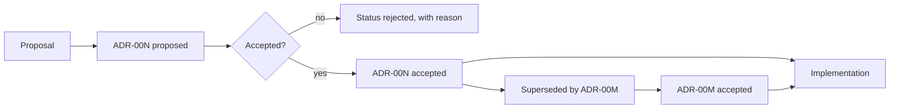

# Architecture Decision Records

> **Lab host:** Windows 11, Python 3.13.5. Section 7's transcript was executed on that host from the
> probe embedded there, which parses six real Markdown records, follows supersession chains, scores
> completeness, checks decision coverage against changed components, and flags records old enough to
> reread. The records are the probe's data; the parsing, chaining and scoring are real code.

## 1. Learning Objectives

After this lesson you will be able to:

- [ ] Write an ADR with the five fields that make it useful a year later
- [ ] Model supersession correctly, so a reader can tell which decision is current
- [ ] Audit a set of records for missing sections, dangling references and stale entries
- [ ] Measure decision coverage against the components that actually change
- [ ] State what an ADR is not, and when a design document is the right artefact

## 2. Prerequisites

- [Large-Codebase Maintenance](large-codebase-maintenance.md) — the graph whose edges ADRs explain;
  a decision record is often the only place the *why* of an edge exists
- [13-SOFTWARE-ENGINEERING-AND-ARCHITECTURE/clean-architecture.md](../13-SOFTWARE-ENGINEERING-AND-ARCHITECTURE/clean-architecture.md)
  — boundaries that decisions are usually about
- [13-SOFTWARE-ENGINEERING-AND-ARCHITECTURE/technical-debt.md](../13-SOFTWARE-ENGINEERING-AND-ARCHITECTURE/technical-debt.md)
  — the cost of undocumented decisions, which is what ADRs prevent
- [03-DEVELOPER-TOOLS/git-fundamentals.md](../03-DEVELOPER-TOOLS/git-fundamentals.md) — records live
  in version control like everything else, and their history is part of the record

## 3. Introduction

An **architecture decision record (ADR)** is a short Markdown file that captures one decision, the
context that forced it, and the consequences accepted by making it. It is written when the decision
is made, stored next to the code, and never edited afterwards — a changed decision is a new record
that supersedes the old one.

The format is deliberately small: an identifier, a title, a status, a date, and three sections
(**Context**, **Decision**, **Consequences**). Small enough that writing one takes fifteen minutes;
structured enough that a reader a year later can reconstruct the reasoning without asking anyone.

The value is not documentation for its own sake. It is that most architectural knowledge exists
only in the memory of whoever was in the room, and that memory leaves with them.

## 4. The Problem It Solves

Six months after a decision, the code shows *what* was chosen and nothing about *why*. A new
engineer sees a message broker, assumes it is load-bearing, and is afraid to remove it. In fact it
was added for a batch job that was deleted, and the broker now costs money and adds a failure mode
for no benefit.

The same gap causes repeated arguments. Without a record, the same trade-off is debated from
scratch every year, usually by different people, often reaching a different conclusion for reasons
nobody can compare. And when a decision turns out badly, there is no way to learn from it, because
the context that made it look reasonable has vanished.

Before ADRs, teams wrote design documents that described a system once and then drifted, or wiki
pages nobody updated, or nothing. The ADR's discipline is the opposite: many small records, each
immutable, linked by supersession, so the set stays honest as the system changes.

## 5. Core Concepts

### The five fields

- **Identifier** — sequential, never reused: `ADR-004`.
- **Title** — a decision, not a topic: "Use PostgreSQL as the primary datastore", not "Database".
- **Status** — `proposed`, `accepted`, `superseded by ADR-00N`, `deprecated`.
- **Date** — when it was accepted, because age is a review trigger.
- **Components** — which parts of the system it governs, which is what makes coverage measurable.

### Context, decision, consequences

**Context** is the forces at play: constraints, requirements, and what was true at the time. It is
the section that makes the record useful, and the one most often skipped.

**Decision** is one paragraph, active voice: "We will…". If it needs three paragraphs of
justification, that belongs in context.

**Consequences** is what follows, including the bad parts. A record with no negative consequences
is a press release, and a reader will not trust the positive ones either.

### Supersession

A **supersession** link is directional and must resolve. `ADR-006 claims to supersede ADR-009` when
no `ADR-009` exists is a dangling reference, and it is worse than no link: a reader follows it,
finds nothing, and concludes the record is unreliable. The probe flags exactly this case.

Chains can be longer than two: A superseded by B, B superseded by C. A reader entering at A must be
able to reach C. Bidirectional links (`supersedes` on the new record, `superseded by` on the old)
make that possible without a search.

### Completeness and coverage

**Completeness** is whether the three required sections have content. The probe scores six records
at 89% on average, with `ADR-006` at 33% because it has context and nothing else.

**Coverage** asks a different question: of the components that changed, how many have a decision
record? The probe finds four of seven covered (57%), with `events`, `auth` and `mobile` uncovered —
and notes that a proposed record does not count as a decision, because it has not been made.

### Freshness

Age is a review trigger, not a defect. The probe flags records older than 540 days as `REREAD` and
365 as `review`, because a decision made two years ago may still be right — but nobody has checked.

## 6. How It Works



The loop through `Superseded` is the part teams forget. Writing the new record is easy; annotating
the old one is the step that keeps the set navigable, and it is the step the probe checks.

The `rejected` branch is deliberately drawn. A record of a decision *not* taken, with its reason, is
often the most valuable file in the directory, because it prevents the same proposal returning every
eighteen months.

## 7. Practical Examples

**Example 1 — parsing and auditing six records**

The complete program contains six Markdown records as strings, parses them with a header regex and a
field regex, groups body sections, then reports status counts, supersession chains, completeness,
coverage and freshness.

```python
"""ADV-11 probe: six ADRs parsed, audited and scored.

Windows 11, Python 3.13.5. The records below are real Markdown, parsed with a small
reader: id, title, status, date, supersession and three body sections. The probe then does
what a reviewer does - follows supersession chains, finds records that reference a
decision that does not exist, measures completeness, checks decision coverage against the
components that changed, and flags records old enough to deserve rereading.
"""

from __future__ import annotations

import re
from dataclasses import dataclass, field
from datetime import date

TODAY = date(2026, 11, 6)

RECORDS = [
    """# ADR-001 Use PostgreSQL as the primary datastore
Status: superseded by ADR-004
Date: 2025-02-11
Components: db, api

## Context
We need transactions and relational integrity for billing.

## Decision
Run PostgreSQL 16 on managed infrastructure.

## Consequences
Operational familiarity; managed backups; one more vendor.
""",
    """# ADR-002 Adopt a monorepo
Status: accepted
Date: 2025-03-02
Components: build

## Context
Two repositories duplicated the shared model and drifted.

## Decision
One repository, one lockfile, per-package CI targets.

## Consequences
Atomic cross-package changes; CI must be path-filtered to stay fast.
""",
    """# ADR-003 Expose a REST API for partners
Status: accepted
Date: 2025-04-18
Components: api

## Context
Partner integrations need a stable contract.

## Decision
Versioned REST with OpenAPI as the source of truth.

## Consequences
Simple for partners; versioning discipline required.
""",
    """# ADR-004 Move the primary datastore to a distributed SQL service
Status: accepted
Date: 2025-09-01
Components: db

## Context
Single-node write capacity became the limit during quarter-end.

## Decision
Replace ADR-001's single node with a distributed SQL service.

## Consequences
Higher write capacity; new failure modes; migration plan required.
""",
    """# ADR-005 Introduce an event bus for order events
Status: proposed
Date: 2026-01-20
Components: events, api

## Context
Consumers poll the orders table and duplicate logic.

## Decision
Publish order events to a bus with at-least-once delivery.

## Consequences
Decoupling; duplicates must be handled; operational load increases.
""",
    """# ADR-006 Replace the reporting database
Status: accepted
Date: 2024-06-05
Components: reporting
Supersedes: ADR-009

## Context
Reports were slow.
""",
]


@dataclass
class Adr:
    adr_id: str
    title: str
    status: str
    decided: date
    components: list[str] = field(default_factory=list)
    supersedes: str | None = None
    superseded_by: str | None = None
    sections: dict[str, str] = field(default_factory=dict)

    @property
    def age_days(self) -> int:
        return (TODAY - self.decided).days


def parse(raw: str) -> Adr:
    lines = raw.strip().splitlines()
    header = re.match(r"# (ADR-\d+) (.+)", lines[0])
    fields = {}
    for line in lines[1:]:
        match = re.match(r"(Status|Date|Components|Supersedes): (.+)", line)
        if match:
            fields[match.group(1)] = match.group(2).strip()
    sections = {}
    current = None
    for line in lines:
        heading = re.match(r"## (.+)", line)
        if heading:
            current = heading.group(1).strip()
            sections[current] = ""
        elif current and line.strip():
            sections[current] += line.strip() + " "
    superseded_by = None
    status = fields.get("Status", "unknown")
    match = re.match(r"superseded by (ADR-\d+)", status)
    if match:
        superseded_by = match.group(1)
        status = "superseded"
    return Adr(
        adr_id=header.group(1),
        title=header.group(2),
        status=status,
        decided=date.fromisoformat(fields["Date"]),
        components=[c.strip() for c in fields.get("Components", "").split(",") if c.strip()],
        supersedes=fields.get("Supersedes"),
        superseded_by=superseded_by,
        sections={name: text.strip() for name, text in sections.items()},
    )


def status_section(adrs: list[Adr]) -> None:
    print("=== parsed records ===")
    print(f"{'id':<9}{'status':<12}{'date':<12}{'components':<18}{'age (days)':>11}")
    for adr in adrs:
        print(f"{adr.adr_id:<9}{adr.status:<12}{adr.decided.isoformat():<12}"
              f"{','.join(adr.components):<18}{adr.age_days:>11}")
    counts: dict[str, int] = {}
    for adr in adrs:
        counts[adr.status] = counts.get(adr.status, 0) + 1
    print(f"status counts                : {counts}")
    print("a 'proposed' record is a decision that has not been made; treat it as an option")


def chain_section(adrs: list[Adr]) -> None:
    print("\n=== supersession chains ===")
    by_id = {adr.adr_id: adr for adr in adrs}
    for adr in adrs:
        if adr.superseded_by:
            replacement = by_id.get(adr.superseded_by)
            print(f"{adr.adr_id} superseded by {adr.superseded_by}: "
                  f"replacement exists={replacement is not None}, "
                  f"status={replacement.status if replacement else 'missing'}")
        if adr.supersedes:
            target = by_id.get(adr.supersedes)
            print(f"{adr.adr_id} claims to supersede {adr.supersedes}: "
                  f"target exists={target is not None}")
    dangling = [adr.adr_id for adr in adrs
                if adr.supersedes and adr.supersedes not in by_id]
    print(f"dangling supersession claims : {dangling}")
    print("a supersession pointing at nothing is how institutional memory rots")


def completeness_section(adrs: list[Adr]) -> None:
    print("\n=== completeness: context, decision, consequences ===")
    required = ("Context", "Decision", "Consequences")
    print(f"{'id':<9}{'context':>9}{'decision':>10}{'conseq.':>9}{'score':>7}")
    scores = []
    for adr in adrs:
        present = [name for name in required if adr.sections.get(name)]
        score = len(present) / len(required)
        scores.append(score)
        flags = ["yes" if adr.sections.get(name) else "no" for name in required]
        print(f"{adr.adr_id:<9}{flags[0]:>9}{flags[1]:>10}{flags[2]:>9}{score:>7.0%}")
    print(f"average completeness         : {sum(scores) / len(scores):.0%}")
    incomplete = [adr.adr_id for adr, score in zip(adrs, scores) if score < 1]
    print(f"records missing a section    : {incomplete}")
    print("a decision without consequences is a wish with a date")


def coverage_section(adrs: list[Adr]) -> None:
    print("\n=== decision coverage against changed components ===")
    changed = ["api", "db", "build", "events", "reporting", "auth", "mobile"]
    covered = {component for adr in adrs if adr.status != "proposed"
               for component in adr.components}
    uncovered = [component for component in changed if component not in covered]
    print(f"components changed           : {len(changed)}")
    print(f"components with a decision   : {len([c for c in changed if c in covered])}")
    print(f"uncovered                    : {uncovered}")
    print(f"coverage                     : {1 - len(uncovered) / len(changed):.0%}")
    print("a component that changed without a record is usually the one nobody understood")


def freshness_section(adrs: list[Adr]) -> None:
    print("\n=== records old enough to reread ===")
    for adr in sorted(adrs, key=lambda a: -a.age_days):
        mark = "REREAD" if adr.age_days > 540 else ("review" if adr.age_days > 365 else "")
        print(f"{adr.adr_id:<9}{adr.age_days:>6} days  {mark}")
    stale = [adr.adr_id for adr in adrs if adr.age_days > 540]
    print(f"older than 18 months         : {stale}")
    print("age alone is not a defect; an accepted decision nobody revisited is a risk")


def main() -> None:
    adrs = [parse(raw) for raw in RECORDS]
    status_section(adrs)
    chain_section(adrs)
    completeness_section(adrs)
    coverage_section(adrs)
    freshness_section(adrs)
    print("\nprobe complete: parsed, chained, scored, covered and aged six records")


if __name__ == "__main__":
    main()
```

- `parse` reads the `# ADR-NNN Title` header, then the `Status`, `Date`, `Components` and
  `Supersedes` fields, then the `## Section` bodies.
- `superseded by ADR-00N` in the status field is parsed into a status plus a pointer, which is why
  `ADR-001` reports `superseded` rather than the literal string.
- `completeness_section` checks the three required sections for non-empty text, not for headings.
- `coverage_section` excludes `proposed` records on purpose.
- `freshness_section` compares dates to a fixed `TODAY`, so the capture does not rot with the clock.

**Expected output** (executed on Windows 11, Python 3.13.5, exit code 0):

```text
=== parsed records ===
id       status      date        components         age (days)
ADR-001  superseded  2025-02-11  db,api                    633
ADR-002  accepted    2025-03-02  build                     614
ADR-003  accepted    2025-04-18  api                       567
ADR-004  accepted    2025-09-01  db                        431
ADR-005  proposed    2026-01-20  events,api                290
ADR-006  accepted    2024-06-05  reporting                 884
status counts                : {'superseded': 1, 'accepted': 4, 'proposed': 1}
a 'proposed' record is a decision that has not been made; treat it as an option

=== supersession chains ===
ADR-001 superseded by ADR-004: replacement exists=True, status=accepted
ADR-006 claims to supersede ADR-009: target exists=False
dangling supersession claims : ['ADR-006']
a supersession pointing at nothing is how institutional memory rots

=== completeness: context, decision, consequences ===
id         context  decision  conseq.  score
ADR-001        yes       yes      yes   100%
ADR-002        yes       yes      yes   100%
ADR-003        yes       yes      yes   100%
ADR-004        yes       yes      yes   100%
ADR-005        yes       yes      yes   100%
ADR-006        yes        no       no    33%
average completeness         : 89%
records missing a section    : ['ADR-006']
a decision without consequences is a wish with a date

=== decision coverage against changed components ===
components changed           : 7
components with a decision   : 4
uncovered                    : ['events', 'auth', 'mobile']
coverage                     : 57%
a component that changed without a record is usually the one nobody understood

=== records old enough to reread ===
ADR-006     884 days  REREAD
ADR-001     633 days  REREAD
ADR-002     614 days  REREAD
ADR-003     567 days  REREAD
ADR-004     431 days  review
ADR-005     290 days  
older than 18 months         : ['ADR-001', 'ADR-002', 'ADR-003', 'ADR-006']
age alone is not a defect; an accepted decision nobody revisited is a risk

probe complete: parsed, chained, scored, covered and aged six records
```

- `status counts : {'superseded': 1, 'accepted': 4, 'proposed': 1}` is the inventory, and the
  proposed record is flagged as an option rather than a decision.
- `ADR-001 superseded by ADR-004: replacement exists=True, status=accepted` is a healthy chain.
- `ADR-006 claims to supersede ADR-009: target exists=False` with
  `dangling supersession claims : ['ADR-006']` is the audit finding that matters most.
- `ADR-006 ... 33%` and `records missing a section : ['ADR-006']` is completeness, computed rather
  than eyeballed.
- `uncovered : ['events', 'auth', 'mobile']` and `coverage : 57%` is the gap between what changes
  and what is explained.
- `ADR-006 884 days REREAD` and `older than 18 months : ['ADR-001', 'ADR-002', 'ADR-003',
  'ADR-006']` is the reread queue.
- **How to run it:** save as `adr_probe.py`, run `python adr_probe.py`. Standard library only.
- **Assumptions:** the records are embedded strings rather than files; the parser expects the field
  format used here. A real audit walks a directory and tolerates format drift.

**Example 2 — the same audit as a quarterly task**

```text
Run: parse all records          -> 6 found, 1 proposed
Check: dangling supersessions   -> ADR-006 -> ADR-009 missing (fix or annotate)
Check: completeness < 100%      -> ADR-006 missing Decision and Consequences
Check: coverage of changed code -> 3 components without a record
Check: age > 540 days           -> 4 records due for reread
```

Five checks, each mechanical, each producing an action. This is the difference between a directory
of Markdown files and a maintained record: the audit is cheap enough to run, so it runs.

## 8. Real-World Applications

- **Platform teams** record service-boundary and data-ownership decisions, which are the ones
  hardest to reverse.
- **Security teams** record accepted risks with their expiry, which turns "we know" into "we
  agreed".
- **Regulated environments** use ADRs as evidence that a decision was deliberate and reviewed.
- **Open-source projects** use them to explain design choices to contributors who were not in the
  discussion.
- **Post-incident reviews** often produce an ADR: the fix is a decision with consequences, not just
  a patch.

## 9. Common Mistakes

| Mistake | Why it happens | How to recognize it | How to prevent it |
|---|---|---|---|
| Editing an old record | It is "just a correction" | History no longer shows what was decided when | Supersede instead; the old record is evidence |
| A record with no consequences | It is written to justify, not to think | No negative trade-off anywhere | Require at least one cost per record |
| Titles that name topics | "Database" feels natural | You cannot tell what was decided from the index | Title the decision, in active voice |
| Dangling supersession links | The target was never written | A reader follows a link to nothing | Validate links in CI, as the probe does |
| Recording only accepted decisions | Rejections feel like failures | The same proposal returns annually | Record rejections with their reasons |
| Coverage measured by file count | It is easy to count files | Many records, none about the risky component | Measure coverage against changed components |

## 10. Best Practices

- **Write the record when the decision is made**, in the same week. Reconstructed rationale is
  fiction with dates.
- **Keep it under a page.** A record nobody finishes is a record nobody reads. The rule stops
  applying when the decision is a migration plan — then the plan is a separate document and the ADR
  links to it.
- **Record the alternatives considered**, briefly. The rejected option is what the next reader will
  propose.
- **Annotate the superseded record in the same commit** as the new one, so the set is never
  inconsistent.
- **Audit quarterly** with the five checks above; mechanical checks are the only ones that survive.

## 11. Limitations and Trade-Offs

An ADR captures a decision, not a design. It will not tell you how the system works, and teams that
try to make it do so end up with long documents nobody maintains.

Records rot in a specific way: the code evolves, the record does not, and a reader cannot tell
whether a two-year-old record still describes reality. That is why freshness is a review trigger
rather than a guarantee.

Writing them has a cost, and oversupply is real. A record per pull request produces a directory
nobody reads; the useful density is roughly one record per decision that would be expensive to
reverse or surprising to a newcomer.

And they are only as good as their honesty. A record that lists no costs is worse than no record,
because it documents a fiction in a format that implies rigour.

## 12. Practical Exercises

### Introductory

1. **Exercise 11.1** — Write an ADR for a decision you have actually made (a database, a framework,
   a deployment target), with all five fields and one negative consequence.
   **Completion criteria:** a file under a page with a decision-shaped title, three sections, and a
   consequence you would not put in a slide.

2. **Exercise 11.2** — Using the probe's output, list the two records you would fix first and why.
   **Completion criteria:** `ADR-006` for both the dangling link and the missing sections, with the
   reason stated in terms of what a reader would experience.

### Intermediate

3. **Exercise 11.3** — Add `ADR-007` that supersedes `ADR-002` and update `ADR-002`'s status, then
   re-run the chain check.
   **Completion criteria:** both directions resolve, the dangling list is unchanged, and the status
   counts shift by one.

4. **Exercise 11.4** — Implement the coverage check against a real list of changed components from
   `git log --name-only` over the last month.
   **Completion criteria:** a computed coverage percentage with the uncovered components named, and
   the command used to produce the input.

### Independent problem-solving

5. **Exercise 11.5** — Your team has forty services and no decision records. Design the adoption
   plan: what to record first, the template, where records live, how supersession is enforced, and
   how you would measure whether the practice is working after three months. State the failure mode
   you expect and how you would detect it.
   **Completion criteria:** a plan with a prioritised first ten decisions (chosen by reversal cost),
   a CI check for dangling links, and two metrics with targets.

*Solutions: attempt first. They live in `solutions/` of this subject.*

## 13. Knowledge Check

1. Why is a superseded record kept rather than edited or deleted?
2. What does a dangling supersession link cost a reader, and how is it detected cheaply?
3. Why does a `proposed` record not count towards decision coverage?
4. A record has context and decision but no consequences. What is missing from the thinking?
5. When is an ADR the wrong artefact for what you need to communicate?

## 14. Completion Criteria

- [ ] You can write a one-page ADR with all five fields and an honest consequence
- [ ] You can model a supersession chain in both directions
- [ ] You can audit a record set for dangling links and missing sections
- [ ] You can compute decision coverage against changed components
- [ ] You can state what an ADR is not

## 15. Summary

- An ADR records one decision, its context and its consequences, at the time it is made.
- Records are immutable; change arrives as a superseding record with bidirectional links.
- Completeness is the three sections having content; coverage is decisions against changed code.
- Dangling supersession links and empty consequence sections are the two defects an audit finds.
- Age is a review trigger; a record nobody rereads is a record nobody trusts.

## 16. Next Steps

- Next subject: [19-PROFESSIONAL-DEVELOPMENT/README.md](../19-PROFESSIONAL-DEVELOPMENT/README.md) —
  the human systems around this technical work: review, documentation, teamwork and career.
- Practice: [13-SOFTWARE-ENGINEERING-AND-ARCHITECTURE/technical-debt.md](../13-SOFTWARE-ENGINEERING-AND-ARCHITECTURE/technical-debt.md)
  prices the debt that undocumented decisions create.
- Where it is applied: [20-PROJECT-LABORATORY/README.md](../20-PROJECT-LABORATORY/README.md)
  requires ADRs for the capstone's significant choices.
