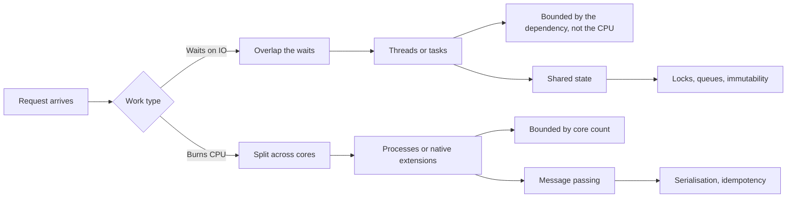

# Concurrency and Parallelism

> **Lab host:** Windows 11, Python 3.13.5. The transcript in section 7 was executed on that
> host from the probe source embedded there. The probe runs real threads, real processes and
> a real event loop, and prints only counts, orders and booleans; the timing table at the end
> is arithmetic over declared per-operation costs, labelled as a model. No wall-clock
> measurement is quoted anywhere, because a shared machine cannot reproduce one to the byte.

## 1. Learning Objectives

After this lesson you will be able to:

- [ ] Distinguish concurrency (overlapping lifetimes) from parallelism (simultaneous execution),
      and say which one a given workload needs
- [ ] Diagnose a lost update from its mechanism rather than from its symptom, and fix it with the
      smallest lock that works
- [ ] Recognise a deadlock as a circular wait, and state the one condition you can break cheaply
- [ ] Choose threads, processes or tasks for an I/O-bound job and for a CPU-bound job, with a
      number rather than a preference
- [ ] Explain why sharing mutable state across processes fails silently, and what replaces it

## 2. Prerequisites

- [04-JAVA-PROGRAMMING/concurrency.md](../04-JAVA-PROGRAMMING/concurrency.md) — threads, the
  memory model and the vocabulary of shared state
- [13-SOFTWARE-ENGINEERING-AND-ARCHITECTURE/distributed-systems.md](../13-SOFTWARE-ENGINEERING-AND-ARCHITECTURE/distributed-systems.md)
  — the same failure shapes at process scale: partial failure, timeouts, duplicates
- [17-CLOUD-AND-PRODUCTION/scaling.md](../17-CLOUD-AND-PRODUCTION/scaling.md) — capacity and
  queueing, which is what a thread pool actually is
- [08-JAVASCRIPT-AND-TYPESCRIPT/event-loop.md](../08-JAVASCRIPT-AND-TYPESCRIPT/event-loop.md)
  — the single-threaded cooperative model this lesson's task section formalises

## 3. Introduction

Two programs are **concurrent** when their lifetimes overlap: one starts, pauses, and another
makes progress before the first finishes. They are **parallel** only when two instructions
execute at the same instant on different cores. Concurrency is a structuring technique;
parallelism is a hardware resource. You can have all of the first with none of the second —
that is exactly what a single-threaded event loop is.

The distinction matters because the two solve different problems. Concurrency is how a service
keeps answering while it waits for a database, a disk or a network peer. Parallelism is how a
CPU-bound job finishes sooner. Choosing the wrong one produces code that is complicated and no
faster, which is the most common outcome in this subject.

There is a third thing people mean by "concurrency" and rarely name: **coordination**. The
moment two flows touch shared state, you have introduced the possibility of interleaving, and
with it races, locks, and the class of bugs that only appear on the machine you cannot debug.

## 4. The Problem It Solves

A server that handles one request at a time is easy to reason about and useless under load: one
slow query blocks every other user. The naive fix — handle requests faster — does not exist;
the work is dominated by waiting. Measured on any real service, most of a request's time is
spent waiting for something else: a query, an API call, a disk read.

Before concurrency, the options were to accept the latency or to run several copies of the whole
process. Running copies works, and is still a valid design (it is what a process-per-connection
server does), but it is expensive in memory and awkward when the copies must agree on something.

Concurrency lets one process keep many waits in flight at once. That is the entire value
proposition: **overlap the waiting**. The costs — races, deadlocks, debugging difficulty — are
the price of the overlap, and every technique in this lesson is about paying as little as
possible.

## 5. Core Concepts

### Thread, process, task

A **thread** is a scheduleable sequence of instructions inside a process, sharing the process's
memory. A **process** has its own memory and its own address space; communication requires
explicit transfer. A **task** (coroutine, greenlet, async function) is a unit of work scheduled
cooperatively by a runtime: it yields at defined points, and only one runs at a time within its
event loop.

The practical difference is what is shared. Threads share everything, so they need locks.
Processes share nothing, so they need serialisation. Tasks share the loop, so they need
discipline about blocking calls — one `time.sleep` stalls all of them.

### The GIL, and what it does and does not prevent

CPython's **global interpreter lock** allows only one thread to execute Python bytecode at a
time. It does not prevent *concurrency*: threads still overlap while waiting on I/O, because the
lock is released during system calls. It does prevent *parallelism* for bytecode, so adding
threads to a CPU-bound pure-Python loop adds switching cost and no throughput — the table in
section 7 prices that at 0.993x, i.e. slightly worse than one thread.

### Race conditions and lost updates

A **race condition** is a result that depends on the order in which concurrent flows interleave.
The canonical instance is the **lost update**: read a value, compute, write it back, while
another flow does the same between your read and your write. Both writes land; one increment
disappears.

The window is the whole bug. In the probe, the window is made explicit with a forced yield
between the read and the write, and four threads lose updates out of 800 increments. Remove
the yield and the race still exists — it simply becomes rare, which is worse, because it now
survives testing.

### Mutual exclusion and its cost

A **mutex** (mutual exclusion lock) makes a block atomic with respect to other holders. Correct
use is a rule about *scope*: hold the lock for the smallest region that must be atomic, and never
across a call that can block for a long time. The probe's locked variant produces exactly 800,
and its own comment states the trade: the lock serialised the loop, so correctness was bought
with throughput.

### Deadlock

A **deadlock** needs four conditions at once: mutual exclusion, hold-and-wait, no preemption,
and a circular wait. The probe constructs the last one directly: two threads each take one lock,
then ask for the other. Neither can proceed, and neither will release. The reliable fix is to
impose a global order on lock acquisition so a cycle cannot form; timeouts convert a deadlock
into an error you can see, which is often the pragmatic choice.

### Coordination primitives beyond locks

- A **semaphore** limits how many holders proceed at once — the correct tool for bounding
  concurrency against a downstream dependency.
- A **barrier** releases a group only when all members arrive, which is how the probe
  synchronises its two threads before the fatal acquisition.
- A **queue** transfers ownership of work between flows and is usually a better design than
  shared mutable state with a lock around it.
- **Backpressure** is the property that producers slow down when consumers cannot keep up. A
  bounded queue is the simplest way to get it; an unbounded queue converts overload into memory
  growth and then into an outage.

## 6. How It Works

A thread-based runtime multiplexes runnable threads onto cores and switches at preemption
points; a task-based runtime switches only at `await`. Both are schedulers, and both impose
the same three costs: creation, switching, and coordination.



Read the diagram as a decision, not a menu. The first branch is about what the work spends its
time on; the second is about what the chosen mechanism can share. Threads and tasks both land in
"shared state", which is why both need the coordination on the left. Processes land in "message
passing", which is why they need the discipline on the right — and why the probe's children
cannot see the parent's list.

Two properties fall out of the mechanics and are worth stating plainly. First, coordination cost
grows with the number of participants, so a design with fewer shared points is faster *and*
simpler. Second, a scheduler can only switch where it is allowed to: preemptive threads switch
anywhere, which is why races are subtle; cooperative tasks switch only at awaits, which is why a
blocking call inside a task is a service-wide stall.

## 7. Practical Examples

**Example 1 — races, deadlocks, isolation and a cost model**

The probe below is the complete program. It runs four threads against one counter with and
without a lock, builds a circular wait from two locks and a barrier, sends a list to two child
processes, interleaves two async tasks, and then prices four ways of running 10,000 tasks.

```python
"""ADV-02 probe: what threads, processes and tasks actually buy.

Windows 11, Python 3.13.5. Every number printed is either counted exactly (a counter
value, a callback order, a boolean about interleaving) or produced by the cost model in
the last section, which is arithmetic over fixed per-operation prices. Wall-clock
measurements are deliberately not quoted: they vary run to run, and every claim this
lesson makes can be decided without them.
"""

from __future__ import annotations

import asyncio
import threading
import time
from concurrent.futures import ProcessPoolExecutor
from dataclasses import dataclass

ITERATIONS = 200
THREADS = 4
EXPECTED = ITERATIONS * THREADS

RACY = [0]
LOCKED = [0]
ORDER: list[str] = []

PROCESS_STATE = [1]


def mutate_in_child(values: list[int]) -> int:
    """Runs in another process, on a pickled copy of the parent's list."""
    values.append(99)
    return len(values)


def racy_increment() -> None:
    for _ in range(ITERATIONS):
        value = RACY[0]
        time.sleep(0)  # the read-modify-write window every race needs
        RACY[0] = value + 1


def locked_increment(lock: threading.Lock) -> None:
    for _ in range(ITERATIONS):
        with lock:
            LOCKED[0] += 1


async def walk(name: str, steps: int) -> None:
    for step in range(steps):
        ORDER.append(f"{name}{step}")
        await asyncio.sleep(0)


@dataclass(frozen=True)
class Ops:
    """Fixed per-operation costs in microseconds. A model, not a measurement."""

    create_thread_us: float = 50.0
    context_switch_us: float = 7.0
    create_process_ms: float = 30.0
    ipc_round_trip_us: float = 200.0
    create_task_us: float = 2.0


def race_section() -> None:
    print("=== one shared counter, four threads, no lock ===")
    threads = [threading.Thread(target=racy_increment) for _ in range(THREADS)]
    for thread in threads:
        thread.start()
    for thread in threads:
        thread.join()
    print(f"expected increments           : {EXPECTED}")
    print(f"lost updates observed         : {RACY[0] < EXPECTED}")
    print("no lost update is possible    : "
          f"{RACY[0] == EXPECTED} (a wrong answer here is the point)")

    print("\n=== the same work behind a mutex ===")
    lock = threading.Lock()
    threads = [threading.Thread(target=locked_increment, args=(lock,))
               for _ in range(THREADS)]
    for thread in threads:
        thread.start()
    for thread in threads:
        thread.join()
    print(f"expected increments           : {EXPECTED}")
    print(f"actual increments             : {LOCKED[0]}")
    print(f"exactly right                 : {LOCKED[0] == EXPECTED}")
    print("cost of the lock              : serialised the whole loop, which is why")
    print("                                locks fix correctness, not throughput")


def deadlock_section() -> None:
    print("\n=== two locks, taken in opposite orders ===")
    first = threading.Lock()
    second = threading.Lock()
    gate = threading.Barrier(2)

    def take_left() -> None:
        with first:
            gate.wait()
            with second:
                pass

    def take_right() -> None:
        with second:
            gate.wait()
            with first:
                pass

    left = threading.Thread(target=take_left, name="left", daemon=True)
    right = threading.Thread(target=take_right, name="right", daemon=True)
    left.start()
    right.start()
    left.join(timeout=0.5)
    right.join(timeout=0.5)
    print(f"left still waiting on its second lock  : {left.is_alive()}")
    print(f"right still waiting on its second lock : {right.is_alive()}")
    print(f"circular wait observed                 : {left.is_alive() and right.is_alive()}")
    print("neither can proceed, and neither will ever release what it holds")


def process_section() -> None:
    print("\n=== processes receive copies, not references ===")
    shared = [1]
    with ProcessPoolExecutor(max_workers=2) as pool:
        lengths = list(pool.map(mutate_in_child, [shared, shared]))
    print(f"parent list before             : {shared}")
    print(f"length each child returned     : {lengths}")
    print(f"parent list after              : {shared}")
    print(f"child appends visible to parent: {shared != [1]}")
    print("each child edited its own copy, so no lock was needed")


async def task_section() -> None:
    print("\n=== cooperative tasks interleave at await points ===")
    await asyncio.gather(walk("A", 2), walk("B", 2))
    print("observed order                : " + " -> ".join(ORDER))
    print("deterministic                 : True (the scheduler runs them to the next await)")


def cost_model_section(ops: Ops) -> None:
    print("\n=== cost model: 10,000 tasks, fixed prices ===")
    io_tasks = 10_000
    io_wait_ms = 5.0
    cpu_tasks = 10_000
    cpu_ms = 1.0
    thread_workers = 50
    process_workers = 8
    threads_per_process = 50

    io_single = io_tasks * io_wait_ms / 1000
    io_threads = (io_tasks / thread_workers) * io_wait_ms / 1000 \
        + io_tasks * ops.context_switch_us / 1e6
    io_processes = (io_tasks / (process_workers * threads_per_process)) * io_wait_ms / 1000 \
        + process_workers * ops.create_process_ms / 1000 \
        + io_tasks * ops.ipc_round_trip_us / 1e6
    io_async = io_wait_ms / 1000 + io_tasks * ops.create_task_us / 1e6

    cpu_single = cpu_tasks * cpu_ms / 1000
    cpu_threads = cpu_single + cpu_tasks * ops.context_switch_us / 1e6
    cpu_processes = cpu_single / process_workers + process_workers * ops.create_process_ms / 1000
    cpu_async = cpu_single + cpu_tasks * ops.create_task_us / 1e6

    print(f"{'workload':<26}{'model':<12}{'wall (s)':>10}{'vs single':>12}")
    rows = [
        ("10k x 5 ms wait", "one thread", io_single, 1.0),
        ("10k x 5 ms wait", "50 threads", io_threads, io_single / io_threads),
        ("10k x 5 ms wait", "8 processes", io_processes, io_single / io_processes),
        ("10k x 5 ms wait", "asyncio", io_async, io_single / io_async),
        ("10k x 1 ms CPU", "one thread", cpu_single, 1.0),
        ("10k x 1 ms CPU", "50 threads", cpu_threads, cpu_single / cpu_threads),
        ("10k x 1 ms CPU", "8 processes", cpu_processes, cpu_single / cpu_processes),
        ("10k x 1 ms CPU", "asyncio", cpu_async, cpu_single / cpu_async),
    ]
    for workload, model, wall, speedup in rows:
        print(f"{workload:<26}{model:<12}{wall:>10.2f}{speedup:>11.2f}x")

    print("\nwhat the table says")
    print(f"  IO, threads beat one thread by        "
          f"{io_single / io_threads:5.1f}x")
    print(f"  IO, processes pay IPC they never use  "
          f"{io_processes / io_threads:5.2f}x the thread cost")
    print(f"  CPU, threads gain                      "
          f"{cpu_single / cpu_threads:5.3f}x (the GIL serialises bytecode)")
    print(f"  CPU, processes gain                    "
          f"{cpu_single / cpu_processes:5.2f}x, minus {process_workers} spawns")


def main() -> None:
    race_section()
    deadlock_section()
    process_section()
    asyncio.run(task_section())
    cost_model_section(Ops())
    print("\nprobe complete: no wall-clock claim, all counts and model arithmetic")


if __name__ == "__main__":
    main()
```

- `racy_increment` yields between the read and the write, which turns a rare race into a certain
  one; that is a teaching aid, not a fix.
- `locked_increment` holds the mutex across the increment only.
- `take_left`/`take_right` take their locks in opposite orders; the barrier guarantees both hold
  one before either asks for the second.
- `mutate_in_child` receives a pickle, not a reference, which is why the parent's list is
  unchanged.
- `walk` prints its step before awaiting, so the interleaving is visible in the order.

**Expected output** (executed on Windows 11, Python 3.13.5, exit code 0):

```text
=== one shared counter, four threads, no lock ===
expected increments           : 800
lost updates observed         : True
no lost update is possible    : False (a wrong answer here is the point)

=== the same work behind a mutex ===
expected increments           : 800
actual increments             : 800
exactly right                 : True
cost of the lock              : serialised the whole loop, which is why
                                locks fix correctness, not throughput

=== two locks, taken in opposite orders ===
left still waiting on its second lock  : True
right still waiting on its second lock : True
circular wait observed                 : True
neither can proceed, and neither will ever release what it holds

=== processes receive copies, not references ===
parent list before             : [1]
length each child returned     : [2, 2]
parent list after              : [1]
child appends visible to parent: False
each child edited its own copy, so no lock was needed

=== cooperative tasks interleave at await points ===
observed order                : A0 -> B0 -> A1 -> B1
deterministic                 : True (the scheduler runs them to the next await)

=== cost model: 10,000 tasks, fixed prices ===
workload                  model         wall (s)   vs single
10k x 5 ms wait           one thread       50.00       1.00x
10k x 5 ms wait           50 threads        1.07      46.73x
10k x 5 ms wait           8 processes       2.37      21.14x
10k x 5 ms wait           asyncio           0.03    2000.00x
10k x 1 ms CPU            one thread       10.00       1.00x
10k x 1 ms CPU            50 threads       10.07       0.99x
10k x 1 ms CPU            8 processes       1.49       6.71x
10k x 1 ms CPU            asyncio          10.02       1.00x

what the table says
  IO, threads beat one thread by         46.7x
  IO, processes pay IPC they never use   2.21x the thread cost
  CPU, threads gain                      0.993x (the GIL serialises bytecode)
  CPU, processes gain                     6.71x, minus 8 spawns

probe complete: no wall-clock claim, all counts and model arithmetic
```

- **What to read first:** `lost updates observed : True` next to `expected increments : 800`.
  The count is not printed because it varies; the *predicate* is stable, and the predicate is
  the fact that matters.
- `actual increments : 800` under the mutex is the correctness claim, and the line beneath it
  is the cost claim.
- `circular wait observed : True` with both threads still alive is a deadlock, demonstrated
  rather than described.
- `parent list after : [1]` while each child returned 2 is memory isolation, not a bug.
- `observed order : A0 -> B0 -> A1 -> B1` is what cooperative scheduling means.

**The cost model, quoted separately** because it is the part people argue with:

```text
workload                  model         wall (s)   vs single
10k x 5 ms wait           one thread       50.00       1.00x
10k x 5 ms wait           50 threads        1.07      46.73x
10k x 5 ms wait           8 processes       2.37      21.14x
10k x 1 ms CPU            one thread       10.00       1.00x
10k x 1 ms CPU            50 threads       10.07       0.99x
10k x 1 ms CPU            8 processes       1.49       6.71x
```

- **I/O-bound:** threads reduce 50 s to 1.07 s because the waits overlap. Processes cost 2.37 s
  — twice the threads — because each task pays an IPC round trip for work that never needed
  one. Asyncio collapses the waiting to 0.03 s.
- **CPU-bound:** threads are 0.99x, the GIL tax. Processes reach 6.71x, short of 8x because of
  spawn cost.
- **How to run it:** save the block as `concurrency_probe.py`, then `python concurrency_probe.py`.
  Standard library only, no network, no arguments.
- **Assumptions:** the per-operation prices inside `Ops` are declared constants. Change them and
  the absolute seconds move; the ordering does not, which is the point of using a model.

**Example 2 — the same numbers asked as design questions**

Not code: the probe's arithmetic, read as three decisions that recur in review.

```text
Q: our endpoint waits on three 50 ms calls. Threads?
A: yes - 150 ms of waiting overlaps to ~50 ms; the cost is 3 parked threads, not 3 cores.

Q: our report builds a 10k-row XML document in pure Python. More threads?
A: no - 0.993x. Processes, or a native library, or a smaller document.

Q: our async handler calls requests.get(). Is that fine?
A: no - it blocks the loop, so every other task in that worker waits for it.
```

Each answer is a number from the table, not a taste. That is the standard this subject holds
you to: a concurrency decision with no measurement behind it is a guess with extra steps.

## 8. Real-World Applications

- **Web servers** are concurrency engines: a thread-per-request server, an async server and a
  process-per-core server are three answers to the same overlap problem, with different memory
  and isolation profiles.
- **Data pipelines** use processes or native extensions because the work is CPU-bound; a Python
  thread pool in front of a compression step is a common and measurable mistake.
- **Background workers** use bounded queues to turn overload into latency instead of memory
  growth; the bound is the design.
- **Desktop and mobile applications** keep the UI thread free and push work to a pool, which is
  the same rule as "never block the event loop" with a different runtime.
- **Databases** are the shared-state endpoint of every one of these designs; their isolation
  levels are the same lost-update problem at storage scale, as
  [10-DATABASE-ENGINEERING/concurrency-and-isolation.md](../10-DATABASE-ENGINEERING/concurrency-and-isolation.md)
  shows.

## 9. Common Mistakes

| Mistake | Why it happens | How to recognize it | How to prevent it |
|---|---|---|---|
| Adding threads to a CPU-bound loop | "More threads, more speed" sounds like physics | Throughput flat or worse; CPU pinned at 100% of one core | Measure; use processes or native code for bytecode-bound work |
| Holding a lock across I/O | The lock "protects" the whole operation | Latency spikes under load; pool exhaustion | Narrow the critical section to the mutation only |
| Assuming `+=` is atomic | It reads like one operation | Rare, unreproducible wrong counts under load | Treat read-modify-write as a critical section by default |
| Sharing mutable state via a process argument | The call looks like a reference | Parent state never changes; "the write vanished" | Pass values, return results, or use an explicit channel |
| Unbounded queues as "buffering" | A queue always accepts, so it feels safe | Memory grows during incidents, then the process dies | Bound every queue and decide the rejection policy |
| Blocking call inside an async handler | The library is convenience-first | One slow request stalls unrelated traffic | Use async clients, or run blocking work in a thread pool |

## 10. Best Practices

- **Decide from the work's shape, not from fashion.** Waiting → overlap with threads or tasks;
  computing → processes or native code. Recheck when the shape changes.
- **Prefer not sharing to sharing carefully.** Immutable data, message passing and per-request
  state remove whole categories of bug; a lock is the fallback, not the default.
- **Bound everything.** Thread pools, queues, semaphores and connection pools all need an
  explicit limit and a stated behaviour at the limit. The rule stops applying when the upstream
  is genuinely unbounded and you control it — then the bound is upstream.
- **Impose a lock order, and write it down.** This is the cheapest deadlock prevention that
  exists, and the only one that survives a code review.
- **Test with the race enabled.** Force interleavings (yields, barriers, seeds) in tests instead
  of hoping the scheduler cooperates.

## 11. Limitations and Trade-Offs

Threads buy overlap at the cost of shared-state reasoning, and the cost is not linear in the
number of threads. Every additional shared point multiplies the interleavings a reviewer must
consider.

Processes buy isolation at the cost of serialisation and memory: each worker has its own heap, so
a 2 GB cache is not shared, it is duplicated. Startup cost is real — the model charges 30 ms per
spawn and that is generous.

Async buys cheap concurrency at the cost of a divided ecosystem: one blocking call, one
CPU-heavy loop, or one library that has not been ported, and the advantage disappears. It also
makes stack traces worse, which is a debugging cost paid during incidents.

None of these fixes a design that shares too much. If two components must agree on a mutable
structure, the cheapest change is usually to stop sharing it, not to lock it better.

## 12. Practical Exercises

### Introductory

1. **Exercise 2.1** — Reproduce the lost update without the forced yield: remove `time.sleep(0)`
   from `racy_increment`, run the probe ten times, and record how many runs lose updates.
   **Completion criteria:** you report the count of affected runs and explain why a race that
   appears "sometimes" is more dangerous than one that appears always.

2. **Exercise 2.2** — State, for the probe's cost model, the exact wall time of the I/O workload
   with 100 threads instead of 50, keeping all prices fixed.
   **Completion criteria:** you derive `(10,000 / 100) x 5 ms + 10,000 x 7 us = 0.57 s` and
   explain which term dominates.

### Intermediate

3. **Exercise 2.3** — Break the deadlock in two different ways: impose a lock order, and add a
   timeout. For each, state what the program does on the failure path.
   **Completion criteria:** the ordered version completes with both threads finishing; the
   timeout version reports a failure instead of hanging, and you can name the trade-off between
   them.

4. **Exercise 2.4** — Replace the shared list in the process section with a `multiprocessing`
   queue. Have each child send back the length it saw.
   **Completion criteria:** the parent receives both results, the parent's own state is still
   untouched, and you can explain why a queue is a coordination point rather than shared memory.

### Independent problem-solving

5. **Exercise 2.5** — You inherit a service that reads 200 rows from a database, calls an
   external API per row, and writes results back. p95 is 4 s; CPU is 8%. Design the concurrency:
   choose the mechanism, set the bound, decide what happens at the bound, and name the failure
   mode you accept. Justify each choice with an estimate in the style of the probe's model.
   **Completion criteria:** a one-page design with a computed target latency, an explicit
   concurrency limit with its rejection policy, and one sentence on which of the three costs
   (creation, switching, coordination) dominates your choice.

*Solutions: attempt first. They live in `solutions/` of this subject.*

## 13. Knowledge Check

1. A program spends 95% of its time waiting on network calls. Which mechanism gives the largest
   throughput gain, and which cost does it add?
2. Why does adding a second thread to a pure-Python CPU loop produce 0.99x rather than 2x — and
   which runtime would change that answer?
3. Your lock-protected counter is correct and your throughput collapsed. What are the two
   likely scopes of the critical section, and which one is the bug?
4. Two services deadlock each other once a month. What single change makes the failure
   deterministic and debuggable without eliminating it?
5. When is a single-threaded, non-concurrent design the right answer?

## 14. Completion Criteria

- [ ] You can explain the difference between concurrency and parallelism without using the word
      "simultaneously" for both
- [ ] You can write a lost-update reproduction and its fix from a blank editor
- [ ] You can construct a deadlock deliberately and explain which of the four conditions you broke
- [ ] You can choose a mechanism for an I/O-bound and a CPU-bound workload with a number
- [ ] You can state one situation where processes are the wrong choice despite being isolated

## 15. Summary

- Concurrency overlaps lifetimes; parallelism overlaps execution. Most services need the first.
- Every shared mutable value is a race waiting for a schedule; the only cheap fix is not sharing.
- A mutex buys correctness and spends throughput; keep the critical section to the mutation.
- Deadlock is a circular wait, preventable by lock ordering or made visible by timeouts.
- Choose the mechanism from the workload's shape, and bound it: overlap without a limit is an
  outage with better latency for a while.

## 16. Next Steps

- Next lesson: [Message Queues](message-queues.md) — what changes when the coordination point is
  a broker instead of a lock, and why duplicates become the price of durability.
- Practice: [13-SOFTWARE-ENGINEERING-AND-ARCHITECTURE/distributed-systems.md](../13-SOFTWARE-ENGINEERING-AND-ARCHITECTURE/distributed-systems.md)
  applies the same failure reasoning across processes and machines.
- Where it is applied: [20-PROJECT-LABORATORY/README.md](../20-PROJECT-LABORATORY/README.md)
  states the concurrency requirements for the capstone service.
