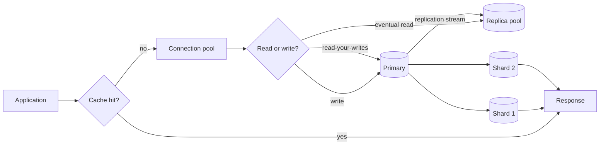

# Database Scaling

> **Lab host:** Windows 11, Python 3.13.5, standard library only. The probe in section 7 creates
> a real 20,000-row SQLite database in memory and prints the query plans SQLite's own planner
> returns before and after an index is created. Replica lag, shard skew, cache behaviour and pool
> ceilings are simulated on fixed inputs, so the counts reproduce exactly. No production database
> is involved and none is claimed.

## 1. Learning Objectives

After this lesson you will be able to:

- [ ] Read a query plan as evidence: `SCAN` versus `SEARCH ... USING INDEX`, and the row counts
      each implies
- [ ] Quantify what a read replica costs in freshness, and name the reads that must not use one
- [ ] Choose a shard key and state which queries it makes cheap, which it makes expensive, and
      what happens to a tenant that outgrows its shard
- [ ] Predict cache hit rate from the access pattern's working-set size rather than from the cache
      library
- [ ] Compute a connection pool's throughput ceiling and explain why more application threads do
      not raise it

## 2. Prerequisites

- [10-DATABASE-ENGINEERING/indexes.md](../10-DATABASE-ENGINEERING/indexes.md) — what an index is
  and what it costs on writes
- [10-DATABASE-ENGINEERING/query-plans-and-optimization.md](../10-DATABASE-ENGINEERING/query-plans-and-optimization.md)
  — reading a plan, which section 7 assumes you can do
- [11-BACKEND-ENGINEERING/caching.md](../11-BACKEND-ENGINEERING/caching.md) — cache-aside,
  invalidation and the stale-read question
- [17-CLOUD-AND-PRODUCTION/managed-databases.md](../17-CLOUD-AND-PRODUCTION/managed-databases.md)
  — what a provider runs for you, including replicas and failover

## 3. Introduction

A database scales along four axes, and they are not interchangeable. You can read faster with an
index, read more with replicas, store more with shards, and avoid reading at all with a cache.
Each fixes a different bottleneck, and applying the wrong one is how teams spend a quarter and
end up with the same latency.

The order matters. An unindexed query served by four replicas is four times the hardware doing
the same full scan. A cache in front of a query that is slow because of a missing index mostly
measures its own eviction policy. Sharding a database whose writes fit comfortably on one node
adds cross-shard queries and buys nothing.

So the discipline is: measure which axis is saturated, then move along that axis only.

## 4. The Problem It Solves

Every application eventually meets a limit it did not design for. The first is usually the query
the feature shipped with: a lookup by a non-indexed column, fine at ten thousand rows and fatal at
ten million. The second is read volume: the product page is hit a thousand times a second and the
primary is busy answering identical questions. The third is write volume or data size, where one
machine's disk or write throughput is genuinely the ceiling.

Before these techniques, the answer was a bigger machine — **vertical scaling**. It works, it is
simple, and it has a hard ceiling and a price curve that turns vertical. The four axes above are
what you do when the bigger machine is no longer enough, or no longer affordable.

The risk is that each axis introduces a new failure mode: replicas introduce staleness, shards
introduce cross-shard queries and hot tenants, caches introduce invalidation, and pools introduce
queueing that looks like latency rather than an error.

## 5. Core Concepts

### The plan, and what a scan costs

A **sequential scan** reads every row and tests the predicate. A **index search** navigates a
sorted structure to the matching rows. The probe's table has 20,000 rows and 250 customers, so a
scan examines 20,000 and an index examines about 80 — a 250x difference that grows with the table,
which is why the same query is fine in development and fatal in production.

The index is not free. Every insert, update and delete maintains it, it occupies disk, and the
planner may still decline to use it when the predicate matches a large fraction of the table.

### Read replicas and replication lag

A **read replica** receives a stream of changes from the primary and applies them slightly later.
The delay is **replication lag**. Reads served by a replica are eventually consistent: a user who
just wrote may read an older value.

The probe makes this concrete with a 1,200 ms lag: over a six-second window with writes for the
first two seconds, 16 of 30 reads are stale. The fix is not "no replicas"; it is routing — reads
that must see their own writes go to the primary, everything else to the pool.

### Sharding and the shard key

**Sharding** partitions rows across independent databases by a **shard key**. It raises write and
storage capacity, and it makes any query that does not include the shard key a scatter-gather
across every shard. The probe's hash distribution is nearly even (worst shard 1.03x average), but
a single large tenant lands entirely on one shard: even distribution across keys is not the same
as even distribution across load.

### Caches and the working set

A **cache** stores the result of an expensive read. It helps when the **working set** — the
distinct keys actually requested in a window — fits in the cache. The probe shows the cliff: the
same request stream gives 25% hits at capacity 50 and 96% at capacity 200, because the working set
is 75 keys. Capacity below the working set mostly measures eviction policy.

### Connection pools

A **connection pool** caps concurrent database work. Throughput ceiling is connections divided by
service time: ten connections at 5 ms is 2,000 queries per second, no matter how many application
threads wait. Excess threads queue, which presents as latency, not as an error — the failure mode
most likely to be misdiagnosed as "the database is slow".

## 6. How It Works



Read the diagram as four decision points. The cache asks whether the read is needed at all; the
pool asks whether the database can accept it now; the read routing asks how fresh it must be; and
sharding asks whether one node holds the data. Each arrow is a place a design can be wrong in a
way that only shows under load.

The replication stream is drawn as an arrow rather than a line because it is asynchronous: it is
the source of every stale read, and its lag is a number you should know as well as your latency
budget.

## 7. Practical Examples

**Example 1 — plans, lag, skew, hit rate and pool ceiling**

The complete program creates the table, prints plans before and after indexing, simulates a
replica with fixed lag, hashes four thousand keys across four shards, replays a request stream
through three cache sizes, and prices three pool sizes.

```python
"""ADV-05 probe: the four levers of database scaling, measured on SQLite.

Windows 11, Python 3.13.5, standard library only. The table is real: 20,000 rows created
in an in-memory SQLite database, and the query plans below are what SQLite's own planner
prints, not a description of what it might do. Replica lag, shard skew and cache hit rate
are simulated on a fixed clock so the counts reproduce exactly.
"""

from __future__ import annotations

import random
import sqlite3
import zlib
from dataclasses import dataclass

ROWS = 20_000
CUSTOMERS = 250
DAYS = 365


def build() -> sqlite3.Connection:
    connection = sqlite3.connect(":memory:")
    connection.execute(
        "CREATE TABLE orders ("
        " id INTEGER PRIMARY KEY,"
        " customer_id INTEGER NOT NULL,"
        " total_cents INTEGER NOT NULL,"
        " created_day INTEGER NOT NULL)"
    )
    rows = [
        (index, index % CUSTOMERS, 100 + (index * 37) % 900, index % DAYS)
        for index in range(1, ROWS + 1)
    ]
    connection.executemany("INSERT INTO orders VALUES (?, ?, ?, ?)", rows)
    connection.commit()
    return connection


def plan(connection: sqlite3.Connection, sql: str) -> str:
    rows = connection.execute("EXPLAIN QUERY PLAN " + sql).fetchall()
    return " | ".join(row[3] for row in rows)


def indexing_section(connection: sqlite3.Connection) -> None:
    print("=== index or scan: the planner states its choice ===")
    query = "SELECT id, total_cents FROM orders WHERE customer_id = 42"
    before = plan(connection, query)
    print(f"before index: {before}")
    print(f"rows a scan must examine     : {ROWS:,}")
    actual = connection.execute(
        "SELECT COUNT(*) FROM orders WHERE customer_id = 42").fetchone()[0]
    print(f"rows customer 42 owns        : {actual}")
    print(f"work removed by an index     : {ROWS // actual}x fewer rows read")

    connection.execute("CREATE INDEX idx_orders_customer ON orders (customer_id)")
    after = plan(connection, query)
    print(f"after index : {after}")
    print(f"planner changed its mind     : {'SCAN' in before and 'SEARCH' in after}")
    indexed_columns = connection.execute(
        "SELECT COUNT(*) FROM pragma_index_info('idx_orders_customer')").fetchone()[0]
    print(f"indexed columns              : {indexed_columns}")

    written = connection.execute(
        "INSERT INTO orders (customer_id, total_cents, created_day) VALUES (7, 500, 12)"
    ).rowcount
    print(f"cost of the index on writes  : every insert maintains it (rows written {written})")
    print("an index is a read-time bet paid for at write time")


def replica_section() -> None:
    print("\n=== read replicas: freshness versus read capacity ===")
    lag_ms = 1_200
    write_interval_ms = 100
    read_interval_ms = 200
    writes: list[tuple[int, int]] = []
    stale_reads = fresh_reads = 0

    for tick in range(0, 2_000, write_interval_ms):
        writes.append((tick, tick // write_interval_ms))
    read_times = range(0, 6_000, read_interval_ms)
    for read_at in read_times:
        visible = [version for written_at, version in writes if written_at + lag_ms <= read_at]
        expected = [version for written_at, version in writes if written_at <= read_at]
        if visible == expected:
            fresh_reads += 1

        else:
            stale_reads += 1

    total = fresh_reads + stale_reads
    print(f"writes per second            : {1000 / write_interval_ms:.0f}")
    print(f"replication lag              : {lag_ms} ms")
    print(f"reads at {1000 / read_interval_ms:.0f}/s for 6 s        : {total}")
    print(f"stale reads                  : {stale_reads} ({stale_reads / total:.0%})")
    print(f"fresh reads                  : {fresh_reads}")
    print("every stale read happened inside one lag window after a write")
    print("a read-your-writes guarantee needs that read pinned to the primary, not the pool")


def sharding_section() -> None:
    print("\n=== sharding: distribution is decided by the key, not the schema ===")
    shards = 4
    rng = random.Random(11)
    keys = [f"{rng.randrange(0xFFFFFF):06x}-{index}" for index in range(4_000)]
    counts = [0] * shards
    for key in keys:
        counts[zlib.crc32(key.encode("utf-8")) % shards] += 1
    spread = max(counts) / (len(keys) / shards)
    print(f"keys                         : {len(keys):,}")
    print(f"rows per shard               : {counts}")
    print(f"worst shard vs average       : {spread:.2f}x")

    one_key = [f"customer-1" for _ in range(4_000)]
    hot = [0] * shards
    for key in one_key:
        hot[zlib.crc32(key.encode("utf-8")) % shards] += 1
    print(f"all rows for one customer    : {hot}")
    print(f"shards touched by one tenant : {sum(1 for value in hot if value)}")
    print("a tenant that outgrows its shard has no schema fix; the key has to change")

    print("\n=== the cost of a query that spans shards ===")
    for shard_count in (1, 4, 16):
        print(f"{shard_count:>2} shard(s): scatter to {shard_count}, "
              f"merge {shard_count} result sets, fail if any one is unavailable")


def cache_section() -> None:
    print("\n=== a cache in front of the database ===")
    requests = 2_000
    catalog = [f"product-{index}" for index in range(500)]
    pattern = [catalog[min(len(catalog) - 1, (index % 100) ** 2 // 100)]
               for index in range(requests)]

    def hit_count(capacity: int) -> int:
        cache: list[str] = []
        hits = 0
        for key in pattern:
            if key in cache:
                hits += 1
                cache.remove(key)
            cache.append(key)
            if len(cache) > capacity:
                cache.pop(0)
        return hits

    print(f"requests                     : {requests:,}")
    print(f"distinct keys                : {len(set(pattern))}")
    for capacity in (50, 200, 500):
        hits = hit_count(capacity)
        print(f"capacity {capacity:>3}: {hits:>4} hits ({hits / requests:.1%}), "
              f"database reads {requests - hits:,}")
    print("the hit rate is a property of the access pattern, not of the cache library")
    print("a cache that cannot hold the working set mostly measures its own eviction policy")


@dataclass(frozen=True)
class Pool:
    connections: int
    service_ms: float


def pool_section() -> None:
    print("\n=== connection pool: concurrency is capped by connections ===")
    for pool in (Pool(10, 5.0), Pool(20, 5.0), Pool(40, 5.0)):
        throughput = pool.connections * 1000 / pool.service_ms
        print(f"{pool.connections:>3} connections at {pool.service_ms:.0f} ms: "
              f"{throughput:5.0f} queries/s ceiling")
    print("adding application threads past the pool does not add database concurrency")
    print("it adds queueing, which shows up as latency rather than as errors")


def main() -> None:
    connection = build()
    indexing_section(connection)
    replica_section()
    sharding_section()
    cache_section()
    pool_section()
    connection.close()
    print("\nprobe complete: plans, staleness, skew, hit rate and pool ceiling, all counted")


if __name__ == "__main__":
    main()
```

- `plan()` asks SQLite with `EXPLAIN QUERY PLAN`, so the strings are the planner's, not a
  paraphrase.
- The insert after indexing exists to show the write-side cost, not to change the result.
- `replica_section` writes for two seconds, then reads for six, which is why staleness stops at
  the lag boundary instead of continuing forever.
- `hit_count` is a real LRU: hit moves the key to the end, insert evicts the front.
- `Pool` is a dataclass so the three ceilings differ only by connection count.

**Expected output** (executed on Windows 11, Python 3.13.5, exit code 0):

```text
=== index or scan: the planner states its choice ===
before index: SCAN orders
rows a scan must examine     : 20,000
rows customer 42 owns        : 80
work removed by an index     : 250x fewer rows read
after index : SEARCH orders USING INDEX idx_orders_customer (customer_id=?)
planner changed its mind     : True
indexed columns              : 1
cost of the index on writes  : every insert maintains it (rows written 1)
an index is a read-time bet paid for at write time

=== read replicas: freshness versus read capacity ===
writes per second            : 10
replication lag              : 1200 ms
reads at 5/s for 6 s        : 30
stale reads                  : 16 (53%)
fresh reads                  : 14
every stale read happened inside one lag window after a write
a read-your-writes guarantee needs that read pinned to the primary, not the pool

=== sharding: distribution is decided by the key, not the schema ===
keys                         : 4,000
rows per shard               : [1029, 943, 1035, 993]
worst shard vs average       : 1.03x
all rows for one customer    : [0, 4000, 0, 0]
shards touched by one tenant : 1
a tenant that outgrows its shard has no schema fix; the key has to change

=== the cost of a query that spans shards ===
 1 shard(s): scatter to 1, merge 1 result sets, fail if any one is unavailable
 4 shard(s): scatter to 4, merge 4 result sets, fail if any one is unavailable
16 shard(s): scatter to 16, merge 16 result sets, fail if any one is unavailable

=== a cache in front of the database ===
requests                     : 2,000
distinct keys                : 75
capacity  50:  500 hits (25.0%), database reads 1,500
capacity 200: 1925 hits (96.2%), database reads 75
capacity 500: 1925 hits (96.2%), database reads 75
the hit rate is a property of the access pattern, not of the cache library
a cache that cannot hold the working set mostly measures its own eviction policy

=== connection pool: concurrency is capped by connections ===
 10 connections at 5 ms:  2000 queries/s ceiling
 20 connections at 5 ms:  4000 queries/s ceiling
 40 connections at 5 ms:  8000 queries/s ceiling
adding application threads past the pool does not add database concurrency
it adds queueing, which shows up as latency rather than as errors

probe complete: plans, staleness, skew, hit rate and pool ceiling, all counted
```

- `before index: SCAN orders` then `after index : SEARCH orders USING INDEX idx_orders_customer`
  is the whole index argument in two lines, produced by the planner.
- `rows customer 42 owns : 80` and `work removed by an index : 250x fewer rows read` quantify it
  against the table, not against a guess.
- `stale reads : 16 (53%)` then `fresh reads : 14` shows the lag window closing exactly when
  writes stop, which is the behaviour a replica actually has.
- `rows per shard : [1029, 943, 1035, 993]` with `worst shard vs average : 1.03x` is a healthy
  hash; `all rows for one customer : [0, 4000, 0, 0]` is the same hash with one tenant.
- `capacity  50: 500 hits (25.0%)` versus `capacity 200: 1925 hits (96.2%)` is the working-set
  cliff, and `capacity 500` repeating 96.2% shows the ceiling: the working set is 75 keys, so
  more cache cannot help.
- `10 connections at 5 ms: 2000 queries/s ceiling` is the number application threads cannot beat.
- **How to run it:** save as `database_scaling_probe.py`, run `python database_scaling_probe.py`.
  SQLite is in the standard library; nothing to install.
- **Assumptions:** one row per order, uniformly distributed customers, and a cache with a single
  eviction policy. Real distributions are skewer, which makes the index more valuable and the
  cache less predictable.

**Example 2 — reading the same output as a runbook**

```text
Symptom: p95 rose after launch, CPU on the primary is 90%, replicas idle.
Read it as: reads are not being routed. Fix routing before adding replicas.
Symptom: cache hit rate fell from 90% to 25% with no traffic change.
Read it as: the working set grew past capacity. Measure distinct keys, not requests.
Symptom: latency rose, error rate flat, connections at maximum.
Read it as: queueing at the pool. Raise the pool only if the database has headroom.
```

Each line is a different axis. Reaching for the wrong one is the most expensive mistake in this
lesson, because the cost is not a failed experiment — it is a new component that must now be
operated forever.

## 8. Real-World Applications

- **Product catalogues** are cache-dominated: a small hot set, a long tail, and a strict
  requirement that the cache never serves a sold-out product.
- **Multi-tenant SaaS** shards by tenant, which makes per-tenant queries fast and cross-tenant
  reporting slow — a trade usually accepted deliberately.
- **Analytics** uses replicas so reporting does not compete with the transactional path, accepting
  that dashboards lag.
- **Social feeds** combine all four axes: denormalised read models, caches, replicas and shards,
  because no single one covers the load.
- **Financial ledgers** avoid caches for balances entirely; correctness beats the read saving, and
  the pool is sized for the write path.

## 9. Common Mistakes

| Mistake | Why it happens | How to recognize it | How to prevent it |
|---|---|---|---|
| Adding replicas before indexing | Replicas are a console click; indexes are a migration | Replicas all busy with identical scans | Read the plan first; a scan costs the same everywhere |
| Sending read-your-writes traffic to a replica | The pool is transparent by default | "My change did not save" reports right after writes | Pin that read to the primary explicitly |
| Sharding on a low-cardinality key | It looks balanced on paper | One shard at 90% while others idle | Measure load per shard, not rows per shard |
| Caching without a working-set measurement | Hit rate is assumed, not computed | Hit rate collapses as the catalogue grows | Measure distinct keys per window before choosing capacity |
| Raising the pool to fix latency | More connections feels like more capacity | Database CPU saturates; latency worsens | Compute `connections / service time`; check database headroom |
| Cross-shard joins in the hot path | The query is convenient | p99 grows with shard count | Model the query per shard; denormalise or move the join |

## 10. Best Practices

- **Read the plan before changing infrastructure.** It is free, it is fast, and it usually ends
  the discussion.
- **Route reads by freshness requirement, not by convenience.** Name the reads that must be
  primary; everything else is a candidate for replicas.
- **Shard on the key your hot queries filter on**, and write down the queries that become
  scatter-gather. The rule stops applying when no single key dominates and every query is
  analytical — then a warehouse is the right answer, not a shard.
- **Size caches from the working set**, and alarm on hit rate rather than on cache size.
- **Treat the pool as the database's concurrency limit**, and give it a queue-depth metric so
  saturation is visible before it is a latency incident.

## 11. Limitations and Trade-Offs

Replicas trade freshness for read capacity, and the trade is not uniform: some reads tolerate
seconds of staleness and some tolerate none. A single pool hides that distinction, which is why
routing is a code change, not a configuration flag.

Sharding trades query flexibility for capacity. Every join that used to be local becomes a
network operation with partial-failure semantics. The moment you shard, you have a distributed
system, with everything
[13-SOFTWARE-ENGINEERING-AND-ARCHITECTURE/distributed-systems.md](../13-SOFTWARE-ENGINEERING-AND-ARCHITECTURE/distributed-systems.md)
warns about.

Caches trade correctness for latency, and invalidation is where that bill arrives. A cache with no
invalidation strategy is a slow-motion data corruption.

Vertical scaling remains the correct first answer far more often than the industry admits: one
well-indexed machine with enough RAM is simpler than three replicas and a cache, and it fails in
ways you already understand.

## 12. Practical Exercises

### Introductory

1. **Exercise 5.1** — Add a second index on `created_day` and print the plan for a range query
   that returns 40% of the table.
   **Completion criteria:** you show the planner choosing a scan despite the index, and explain
   the selectivity threshold in your own words.

2. **Exercise 5.2** — Compute the stale-read share for a 300 ms lag with the probe's write and
   read cadence, before running it.
   **Completion criteria:** a predicted count, then the measured count, with the difference
   explained.

### Intermediate

3. **Exercise 5.3** — Make the replica section route reads that follow a write to the primary, and
   report stale reads again.
   **Completion criteria:** stale reads fall to zero for pinned reads while the unpinned share is
   unchanged, and you can state the cost in primary load.

4. **Exercise 5.4** — Shard the same key set by range (first hex character) instead of by hash and
   compare the worst-shard ratio.
   **Completion criteria:** a measured ratio far worse than 1.03x, and an explanation of which
   workload range sharding suits.

### Independent problem-solving

5. **Exercise 5.5** — A marketplace has 40 million orders, 8,000 reads/s and 400 writes/s. p95 is
   180 ms against a 100 ms target; the primary is at 70% CPU and the cache hit rate is 40%. Decide
   the order of interventions, with a computed expected effect for each, and state what you would
   measure to confirm the diagnosis before acting.
   **Completion criteria:** a ranked plan naming the axis for each step, a predicted p95 after
   each, and the measurement that would falsify your first hypothesis.

*Solutions: attempt first. They live in `solutions/` of this subject.*

## 13. Knowledge Check

1. Why is adding replicas to an unindexed query a way to spend money without improving latency?
2. A user saves a profile and immediately does not see the change. Which read went where, and what
   is the smallest fix?
3. Your hash distributes rows evenly but one shard is hot. What is the shard key probably missing?
4. Cache capacity is doubled and the hit rate does not move. What does that tell you about the
   working set?
5. The pool is at its maximum, latency is rising and database CPU is 45%. What is happening, and
   what are the two legitimate responses?

## 14. Completion Criteria

- [ ] You can read a plan and say how many rows it will examine
- [ ] You can compute staleness from a lag and a write cadence
- [ ] You can choose a shard key and name the query it breaks
- [ ] You can predict a cache hit rate from a working set
- [ ] You can compute a pool ceiling and explain why threads beyond it only queue

## 15. Summary

- Four axes — index, replica, shard, cache — fix four different bottlenecks; diagnose before
  choosing.
- A scan costs the same on every replica, so indexing comes before replication.
- Replica lag makes reads eventually consistent; route freshness-critical reads to the primary.
- Sharding raises capacity and converts local joins into distributed queries; the key decides
  which.
- Caches help only when the working set fits, and pools cap concurrency at
  `connections / service time`.

## 16. Next Steps

- Next lesson: [Distributed Systems Patterns](distributed-systems-patterns.md) — what to do when
  the data is already spread across nodes and a single transaction is no longer available.
- Practice: [10-DATABASE-ENGINEERING/query-plans-and-optimization.md](../10-DATABASE-ENGINEERING/query-plans-and-optimization.md)
  goes deeper on the planner behaviour quoted here.
- Where it is applied: [20-PROJECT-LABORATORY/README.md](../20-PROJECT-LABORATORY/README.md)
  requires a scaling plan for the database tier.
