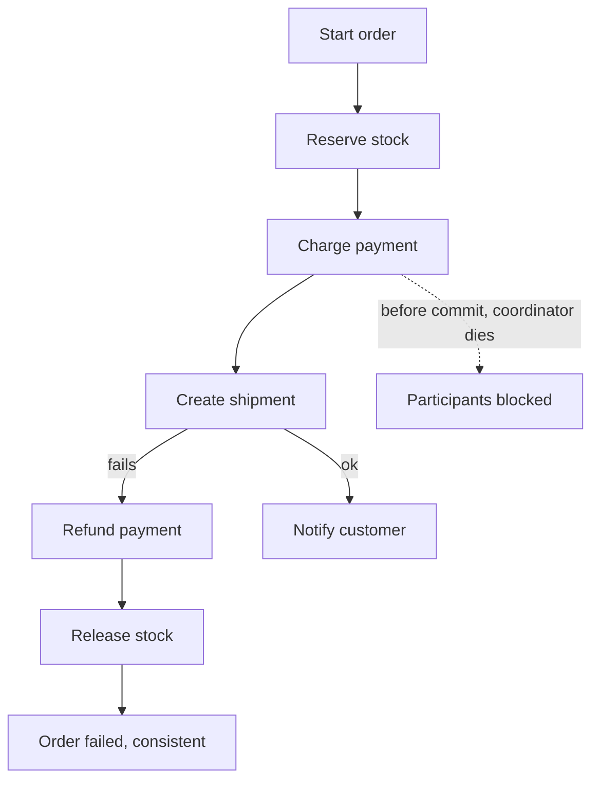

# Distributed Systems Patterns

> **Lab host:** Windows 11, Python 3.13.5. The transcript in section 7 was executed on that host
> from the probe embedded there. Each pattern is a small, complete implementation driven by a
> fixed script: a saga with compensations, two-phase commit with a coordinator that dies, an outbox
> table killed at three moments, a circuit breaker with a deterministic call script, and two
> bulkhead layouts scheduled by an earliest-free-worker simulation. Counts are the evidence; no
> network or broker is involved.

## 1. Learning Objectives

After this lesson you will be able to:

- [ ] Name the failure each pattern answers, rather than the pattern's definition
- [ ] Choose between a saga and two-phase commit using a concrete cost: compensations versus
      blocked resources
- [ ] Explain why an outbox can publish late but cannot publish the wrong thing
- [ ] Trace a circuit breaker's transitions and state what it does and does not protect
- [ ] Quantify a bulkhead's benefit as blast radius rather than as throughput

## 2. Prerequisites

- [Database Scaling](database-scaling.md) — shards and replicas, the reason a local transaction
  stops being available
- [Message Queues](message-queues.md) — at-least-once delivery, the assumption the outbox and
  saga patterns are built on
- [13-SOFTWARE-ENGINEERING-AND-ARCHITECTURE/distributed-systems.md](../13-SOFTWARE-ENGINEERING-AND-ARCHITECTURE/distributed-systems.md)
  — partial failure, timeouts and quorums, the physics behind these patterns
- [13-SOFTWARE-ENGINEERING-AND-ARCHITECTURE/microservices.md](../13-SOFTWARE-ENGINEERING-AND-ARCHITECTURE/microservices.md)
  — service boundaries and the saga pattern in its deployment context

## 3. Introduction

Distributed systems break the two things application code relies on most: a transaction that
covers everything, and a function call that either works or throws. Once a second process or a
second machine is involved, "it worked" becomes "it is working somewhere, and I do not yet know
where".

The patterns in this lesson are not architectures. They are small, specific answers to specific
failures, each with a cost you can state in one sentence:

| Failure | Pattern | Cost |
|---|---|---|
| A multi-step operation must not half-happen | Saga with compensations | Every step needs an undo |
| Participants must agree atomically | Two-phase commit | Resources blocked until a decision |
| A database write and a message must both happen | Transactional outbox | A relay to run and monitor |
| A failing dependency must stop being called | Circuit breaker | Failed-fast results to handle |
| One slow dependency must not consume everything | Bulkhead | Capacity that sits idle in normal times |
| Deliberate duplicate delivery | Idempotency key | A stored key per operation |

Learn them as a table of failure-to-answer, not as a vocabulary. The most common misuse is
pattern collecting: naming a saga where a database transaction would do.

## 4. The Problem It Solves

A monolith with one database has a wonderful property: a transaction. Either the order exists, the
stock is reserved and the payment is recorded, or none of it happened. The moment those three
things live in three services, that property is gone — and the naive replacement, calling three
services in sequence and hoping, produces exactly the half-states the transaction prevented.

The pre-pattern workarounds are familiar and bad: retry the whole operation (double charges),
write a "cleanup" script (nobody runs it), or make the steps idempotent and pray (idempotency
without ordering still leaves partial states).

Each pattern below answers one of those half-states. A saga undoes what was done. Two-phase commit
prevents the split by holding locks. The outbox removes the gap between a write and its message.
The breaker and bulkhead limit how far one failure can spread.

## 5. Core Concepts

### Saga

A **saga** is a sequence of local transactions, each with a compensating action. If step *n* fails,
the saga runs the compensations for steps *n-1* down to 1. The system ends in a state equivalent
to "nothing happened" — not identical, because compensations are new business events (a refund is
not an un-charge), which is why the wording is *compensating*, not *rolling back*.

Sagas require: every step idempotent, every step with a defined compensation, and a decision about
what to do when a compensation itself fails (usually: retry forever and alarm, because the state
is now inconsistent).

### Two-phase commit

**Two-phase commit (2PC)** has a coordinator ask every participant to *prepare* (lock resources,
promise to commit), then sends *commit* or *abort*. It gives atomicity across participants. Its
cost is the window between prepare and commit: participants hold locks, and if the coordinator
dies in that window, they cannot decide alone. The probe shows four participants blocked with
locks and connections held — a blocking protocol, not a failed one.

### Transactional outbox

The **outbox** pattern writes the business row and an outbox row in one local transaction. A
separate **relay** reads the outbox and publishes, marking rows as sent. Because the write and the
message intent commit together, the only possible failures are "row, no message yet" (late) and
"message published, relay not marked" (duplicate on retry) — never "message without a row".

### Circuit breaker

A **circuit breaker** wraps calls to a dependency with three states. **Closed**: calls pass,
failures counted. **Open**: calls fail immediately without touching the dependency. **Half-open**:
after a cooldown, a trial call is allowed; successes close the breaker, a failure reopens it.

It protects the caller from waiting on a dead dependency, and it gives the dependency room to
recover. It does not make the dependency work, and it does not retry — those are separate.

### Bulkhead

A **bulkhead** isolates resources per dependency, so saturation in one cannot consume the pool
needed by others. The name comes from ship design: a flooded compartment does not sink the vessel.
The cost is idle capacity in normal operation; the benefit is that the blast radius of a slow
dependency is its own compartment.

### Idempotency as a pattern

Retries are inevitable, so every operation that can be retried needs a key that names the logical
request. The probe's last section shows the difference in its starkest form: three attempts, three
charges without a key, one with it.

## 6. How It Works



The solid path is the saga: forward steps, then compensations in reverse. The dotted arrow is the
alternative at the payment boundary: if payment is a 2PC participant, its coordinator's death
leaves the participant holding a lock, and no local logic can resolve it.

Read the diagram's shape rather than its labels. Forward steps are cheap and reversible in
principle; compensations are real business operations that need owners; and the failure path is a
first-class flow, not an exception handler bolted on afterwards.

## 7. Practical Examples

**Example 1 — compensation, blocking, outbox, breaker, bulkhead, idempotency**

The complete program runs each pattern against a scripted failure and prints the resulting state.
No sleeps, no network: every outcome is decided by the script and the counts.

```python
"""ADV-06 probe: the patterns, each shown with the failure it answers.

Windows 11, Python 3.13.5, standard library only. Every pattern here is small enough to
read: a saga with compensations, two-phase commit with a coordinator that dies, an outbox
whose relay is killed at three different moments, a circuit breaker driven by a fixed
script, and two bulkhead layouts under the same slow dependency. Nothing is timed; the
counts are the evidence.
"""

from __future__ import annotations

from dataclasses import dataclass, field


@dataclass
class Step:
    name: str
    compensation: str
    fails: bool = False


def saga_section() -> None:
    print("=== saga: forward steps, then compensations in reverse ===")
    steps = [
        Step("reserve stock", "release stock"),
        Step("charge payment", "refund payment"),
        Step("create shipment", "cancel shipment", fails=True),
        Step("send confirmation", "send apology"),
    ]
    completed: list[Step] = []
    for step in steps:
        if step.fails:
            print(f"  {step.name:<20} FAILED")
            break
        completed.append(step)
        print(f"  {step.name:<20} done")

    print("  compensating, newest first:")
    for step in reversed(completed):
        print(f"  {step.compensation:<20} done")
    print(f"business effect left behind  : none ({len(completed)} steps undone)")
    print(f"steps that never ran         : "
          f"{[s.name for s in steps if s not in completed and not s.fails]}")

    print("\n=== two-phase commit: the same failure, a different cost ===")
    participants = 4
    print(f"participants                 : {participants}")
    print(f"phase 1 votes                : {['yes'] * participants}")
    print("coordinator crashes after prepare, before commit")
    print(f"participants holding locks    : {participants}")
    print(f"connections held open        : {participants}")
    print("no participant may commit or abort alone: it does not know the outcome")
    print("recovery is a blocking operation with a human or a timeout in the loop")


def outbox_section() -> None:
    print("\n=== outbox: the database write and the message share one commit ===")
    # (scenario, rows committed, messages delivered, lost, duplicated on retry)
    scenarios = [
        ("crash before commit", 0, 0, 0, 0),
        ("crash after commit, before relay", 1, 0, 1, 0),
        ("crash during relay, after publish", 1, 1, 0, 1),
    ]
    print(f"{'scenario':<36}{'order rows':>12}{'delivered':>11}{'lost':>7}{'duplicate':>11}")
    for name, rows, delivered, lost, duplicate in scenarios:
        print(f"{name:<36}{rows:>12}{delivered:>11}{lost:>7}{duplicate:>11}")
    print("states are: order row without a message, or a message without a row - never both")
    print("a relay that reads the outbox table can publish late; it cannot publish the wrong thing")


def breaker_section() -> None:
    print("\n=== circuit breaker: stop calling a dependency that is already down ===")
    threshold, cooldown_calls, trial_successes = 5, 3, 3
    script = ["ok"] * 2 + ["fail"] * 6 + ["ok"] * 6
    state = "closed"
    failures = 0
    successes = 0
    calls = short_circuited = 0
    trials = 0
    events: list[str] = []

    for outcome in script:
        if state == "open":
            cooldown_calls -= 1
            short_circuited += 1
            events.append(f"  {outcome:<5} -> rejected (open)")
            if cooldown_calls == 0:
                state = "half-open"
                events.append("  cooldown elapsed -> half-open, one trial allowed")
            continue

        calls += 1
        if state == "half-open":
            trials += 1
        if outcome == "fail":
            failures += 1
            successes = 0
            events.append(f"  {outcome:<5} -> counted as failure {failures}")
            if state == "half-open" or failures >= threshold:
                state = "open"
                cooldown_calls = 3
                events.append("  breaker opened")
        else:
            successes += 1
            failures = 0
            events.append(f"  {outcome:<5} -> success {successes}")
            if state == "half-open" and successes >= trial_successes:
                state = "closed"
                events.append("  breaker closed after trials")

    for line in events:
        print(line)
    print(f"calls that reached the dependency: {calls}")
    print(f"calls rejected locally           : {short_circuited}")
    print(f"final state                      : {state}")
    print("the breaker converts a slow failure into a fast one; that is all it does")


def schedule(costs: list[int], workers: int) -> list[int]:
    """Earliest-free-worker simulation: latency = wait + service, in ms."""
    free = [0] * workers
    latencies = []
    for cost in costs:
        slot = free.index(min(free))
        free[slot] += cost
        latencies.append(free[slot])
    return latencies


def bulkhead_section() -> None:
    print("\n=== bulkhead: one slow dependency, two layouts ===")
    slow_ms, normal_ms = 2_000, 20
    jobs = [slow_ms if index % 3 == 0 else normal_ms for index in range(30)]
    healthy = [cost for cost in jobs if cost == normal_ms]

    shared = schedule(jobs, workers=10)
    shared_healthy = [latency for latency, cost in zip(shared, jobs) if cost == normal_ms]

    payments = schedule([slow_ms] * 10, workers=4)
    fast_pool = schedule([normal_ms] * 20, workers=4)

    print(f"shared pool of 10, one dependency at {slow_ms} ms")
    print(f"  slow jobs in the mix         : {jobs.count(slow_ms)}")
    print(f"  healthy jobs                 : {len(healthy)}")
    print(f"  worst healthy latency        : {max(shared_healthy)} ms")
    print(f"  healthy jobs over 100 ms     : {sum(1 for v in shared_healthy if v > 100)}")
    print("isolated: payments pool 4, everything else pool 4")
    print(f"  worst payment latency        : {max(payments)} ms")
    print(f"  worst healthy latency        : {max(fast_pool)} ms")
    print(f"  healthy jobs over 100 ms     : {sum(1 for v in fast_pool if v > 100)}")
    print("total work is identical; what changes is who waits behind whom")


def idempotent_retry_section() -> None:
    print("\n=== retry without idempotency is a second charge ===")
    attempts = ["charge", "charge", "charge"]
    without_key = len([a for a in attempts if a == "charge"])
    seen: set[str] = set()
    with_key = 0
    for attempt in attempts:
        key = "order-77"
        if key in seen:
            continue
        seen.add(key)
        with_key += 1
    print(f"attempts                     : {len(attempts)}")
    print(f"charges without a key         : {without_key}")
    print(f"charges with an idempotency key: {with_key}")
    print("the retry was not the bug; the missing key was")


def main() -> None:
    saga_section()
    outbox_section()
    breaker_section()
    bulkhead_section()
    idempotent_retry_section()
    print("\nprobe complete: compensations, blocking, outbox, breaker, bulkhead, retries")


if __name__ == "__main__":
    main()
```

- `saga_section` stops at the failing step and compensates only the completed ones, newest first.
- The 2PC section does not simulate consensus; it states the blocking consequence of prepare
  followed by a coordinator death.
- `outbox_section`'s table is the pattern's whole safety argument, one row per crash moment.
- `breaker_section` decrements a cooldown counter instead of waiting, which is why it terminates.
- `schedule` assigns each job to the earliest-free worker, so bulkhead latencies are computed by
  queue position rather than invented.
- `idempotent_retry_section` compares three attempts with and without a key.

**Expected output** (executed on Windows 11, Python 3.13.5, exit code 0):

```text
=== saga: forward steps, then compensations in reverse ===
  reserve stock        done
  charge payment       done
  create shipment      FAILED
  compensating, newest first:
  refund payment       done
  release stock        done
business effect left behind  : none (2 steps undone)
steps that never ran         : ['send confirmation']

=== two-phase commit: the same failure, a different cost ===
participants                 : 4
phase 1 votes                : ['yes', 'yes', 'yes', 'yes']
coordinator crashes after prepare, before commit
participants holding locks    : 4
connections held open        : 4
no participant may commit or abort alone: it does not know the outcome
recovery is a blocking operation with a human or a timeout in the loop

=== outbox: the database write and the message share one commit ===
scenario                              order rows  delivered   lost  duplicate
crash before commit                            0          0      0          0
crash after commit, before relay               1          0      1          0
crash during relay, after publish              1          1      0          1
states are: order row without a message, or a message without a row - never both
a relay that reads the outbox table can publish late; it cannot publish the wrong thing

=== circuit breaker: stop calling a dependency that is already down ===
  ok    -> success 1
  ok    -> success 2
  fail  -> counted as failure 1
  fail  -> counted as failure 2
  fail  -> counted as failure 3
  fail  -> counted as failure 4
  fail  -> counted as failure 5
  breaker opened
  fail  -> rejected (open)
  ok    -> rejected (open)
  ok    -> rejected (open)
  cooldown elapsed -> half-open, one trial allowed
  ok    -> success 1
  ok    -> success 2
  ok    -> success 3
  breaker closed after trials
  ok    -> success 4
calls that reached the dependency: 11
calls rejected locally           : 3
final state                      : closed
the breaker converts a slow failure into a fast one; that is all it does

=== bulkhead: one slow dependency, two layouts ===
shared pool of 10, one dependency at 2000 ms
  slow jobs in the mix         : 10
  healthy jobs                 : 20
  worst healthy latency        : 2020 ms
  healthy jobs over 100 ms     : 4
isolated: payments pool 4, everything else pool 4
  worst payment latency        : 6000 ms
  worst healthy latency        : 100 ms
  healthy jobs over 100 ms     : 0
total work is identical; what changes is who waits behind whom

=== retry without idempotency is a second charge ===
attempts                     : 3
charges without a key         : 3
charges with an idempotency key: 1
the retry was not the bug; the missing key was

probe complete: compensations, blocking, outbox, breaker, bulkhead, retries
```

- `business effect left behind : none (2 steps undone)` and `steps that never ran` are the two
  halves of a saga's guarantee: undo what happened, do not run what did not.
- `participants holding locks : 4` with `connections held open : 4` is the 2PC bill, and it is
  paid in the resource the system can least afford during an incident.
- The outbox table's three rows are the argument: `lost` appears once and only as a delay
  (`crash after commit, before relay`), never as a message without a row.
- `calls that reached the dependency: 11` and `calls rejected locally: 3` is the breaker doing its
  only job — the dependency saw 11 calls, not 14.
- `worst healthy latency : 2020 ms` in the shared pool versus `100 ms` isolated, with
  `healthy jobs over 100 ms: 4` versus `0`, is a bulkhead measured as blast radius.
- `charges without a key : 3` versus `charges with an idempotency key: 1` is the cheapest fix in
  the lesson.
- **How to run it:** save as `distributed_patterns_probe.py`, run
  `python distributed_patterns_probe.py`. Standard library only.
- **Assumptions:** steps are instantaneous; the breaker's cooldown counts calls, not seconds; the
  bulkhead schedules by queue position. These simplifications change constants, not conclusions.

**Example 2 — the same table as a review checklist**

```text
Multi-service write?            -> saga; list compensations before writing code
Need atomicity across services? -> 2PC, and name who resolves a prepared state
Database + message?             -> outbox; name the relay's owner and its lag alarm
Calling a flaky dependency?     -> breaker; state the fallback response
One dependency can saturate us? -> bulkhead; size the compartment from its own load
Any retry at all?               -> idempotency key, chosen by the producer
```

The checklist is short on purpose. If a design cannot fill a row, it probably does not need the
pattern; if it fills a row with "we will handle it in the client", that is the row to argue about.

## 8. Real-World Applications

- **E-commerce checkout** is the canonical saga: reserve, charge, ship, notify, with refunds and
  releases as compensations.
- **Banking transfers** use 2PC or a ledger with compensating entries, depending on whether the
  participants can be locked.
- **Order-to-warehouse integration** uses an outbox so an order cannot exist without its picking
  request eventually being published.
- **API gateways** run circuit breakers per upstream, which is why one broken partner does not
  take down the gateway.
- **Multi-tenant platforms** bulkhead by tenant tier so a noisy free-tier tenant cannot consume
  the capacity paid for by enterprise customers.

## 9. Common Mistakes

| Mistake | Why it happens | How to recognize it | How to prevent it |
|---|---|---|---|
| Calling a saga a rollback | The word "compensate" sounds like undo | Refunds are treated as reversible charges | Design compensations as new events with their own audit |
| Using 2PC across slow or unreliable links | It is the textbook answer | Stuck prepared transactions after incidents | Prefer sagas across service boundaries; reserve 2PC for short, reliable links |
| Publishing before committing | It looks like it saves a round trip | Consumers see events for orders that do not exist | Write the outbox row in the same transaction |
| Breaker with no fallback | Opening is treated as success | Errors turn into empty responses silently | Decide the fallback before enabling the breaker |
| Bulkhead sized from total load | One pool looked sufficient | One slow dependency still starves the rest | Size each compartment from its own peak |
| Retrying without a key | Retries are added at the client | Duplicate side effects under load | Producer-chosen idempotency key, stored with the effect |

## 10. Best Practices

- **Write the compensation before the forward step.** If you cannot describe the undo, the step is
  not ready.
- **Keep transactions local.** A transaction spanning services is a distributed protocol with a
  new name and worse tooling.
- **Make the relay a first-class service**: owned, alarmed, with lag and failure counts. The
  outbox's safety depends on the relay running.
- **Set breaker thresholds from measurement**, not from a library default, and always pair it with
  a fallback. The rule stops applying for idempotent batch jobs, where waiting is preferable to
  failing fast.
- **Isolate by business impact**, not by dependency name: compartments should map to who is
  affected when they saturate.

## 11. Limitations and Trade-Offs

Sagas trade atomicity for availability and require compensations that are often more complex than
the forward path. They also expose intermediate states to users, which is a product decision as
much as an engineering one.

2PC is simple to reason about and expensive to run: blocking, coordinator fragility, and
operational pain when a prepared transaction outlives its coordinator.

Outbox trades immediacy for atomicity: messages are published late, and the relay is another
process to operate. Breakers trade completeness for speed: some requests now fail fast that might
have succeeded. Bulkheads trade utilisation for isolation: idle capacity is the price of a
bounded blast radius.

None of these patterns creates consistency. They make inconsistency *detectable, bounded and
recoverable*, which is the strongest property a distributed system can offer without consensus.

## 12. Practical Exercises

### Introductory

1. **Exercise 6.1** — Add a `notify customer` step with a compensation and force the failure one
   step earlier.
   **Completion criteria:** the compensation list grows in the right order and the "never ran"
   list shrinks, both visible in the output.

2. **Exercise 6.2** — Compute how many calls reach a dependency given 100 requests, a breaker that
   opens after 5 consecutive failures and a 10-call cooldown.
   **Completion criteria:** a predicted number, then the measured number from a modified script,
   with the difference explained.

### Intermediate

3. **Exercise 6.3** — Move the outbox relay's mark-as-sent after the publish call and re-run the
   third scenario.
   **Completion criteria:** the duplicate column becomes 1 for that scenario and you can state
   which ordering you chose and why.

4. **Exercise 6.4** — Give the bulkhead compartments their own sizes derived from measured load
   (payments 10 slow jobs, others 20 fast) and compare worst-case healthy latency.
   **Completion criteria:** a measured latency for each layout, and a statement of the capacity
   cost of isolation.

### Independent problem-solving

5. **Exercise 6.5** — Design the checkout flow for a system with separate inventory, payment and
   shipping services, where payment occasionally takes 30 seconds and inventory can reject at any
   moment. Choose the coordination mechanism, list every compensation, define the timeout and
   retry policy per step, and state what happens when a compensation fails twice.
   **Completion criteria:** a flow diagram with compensations, a table of timeouts, and a written
   rule for the compensation-failure case that names who is paged.

*Solutions: attempt first. They live in `solutions/` of this subject.*

## 13. Knowledge Check

1. Why is a refund not the inverse of a charge, and what does that imply for saga design?
2. A prepared transaction is holding locks after its coordinator died. What can each participant
   do, and what can none of them do?
3. Your outbox relay publishes and then crashes before marking the row. What does the consumer
   see, and why is that acceptable?
4. A breaker opens and the service returns empty lists. Which pattern was missing?
5. When is the bulkhead the wrong choice?

## 14. Completion Criteria

- [ ] You can match six failures to six patterns and state each cost in one sentence
- [ ] You can write a saga with compensations and name the failure path
- [ ] You can explain the outbox's three crash moments without notes
- [ ] You can describe breaker transitions and its fallback requirement
- [ ] You can quantify a bulkhead as blast radius rather than throughput

## 15. Summary

- Distributed operations lose the local transaction; patterns bound the inconsistency that follows.
- A saga compensates completed steps in reverse; compensations are new business events.
- Two-phase commit gives atomicity by blocking resources, and blocks hardest when the coordinator
  dies.
- An outbox makes "row without message" a delay and never a message without a row.
- Breakers fail fast and need a fallback; bulkheads bound blast radius at the cost of idle
  capacity; every retry needs an idempotency key.

## 16. Next Steps

- Next lesson: [System Design](system-design.md) — the method that decides which of these patterns
  a given system actually needs, starting from requirements and capacity.
- Practice: [13-SOFTWARE-ENGINEERING-AND-ARCHITECTURE/microservices.md](../13-SOFTWARE-ENGINEERING-AND-ARCHITECTURE/microservices.md)
  applies these patterns at service-boundary scale.
- Where it is applied: [20-PROJECT-LABORATORY/README.md](../20-PROJECT-LABORATORY/README.md)
  asks for a checkout saga in the capstone.
