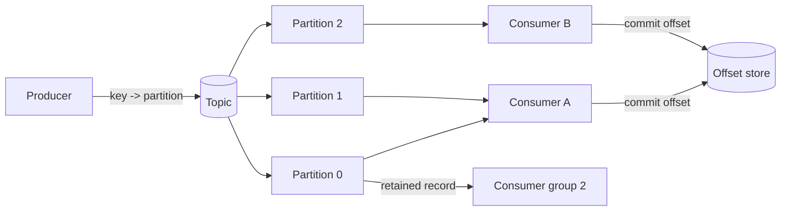

# Event Streaming

> **Lab host:** Windows 11, Python 3.13.5. The transcript in section 7 was produced on that host
> from the probe below, which builds a real partitioned log in memory: append, per-partition
> offsets, consumer-group assignment, committed offsets, compaction and tombstones. Keys are
> hashed with `zlib.crc32` rather than `hash()`, because Python salts string hashes per process
> and the partition table must reproduce. No streaming platform is installed on this host and
> none is claimed.

## 1. Learning Objectives

After this lesson you will be able to:

- [ ] Explain how a log differs from a queue: retention, replay and offsets rather than deletion
      on acknowledgement
- [ ] Choose a partition key and state exactly which ordering guarantee it buys
- [ ] Trace a duplicate to "processed, then crashed before committing the offset" and remove its
      effect with an idempotent sink
- [ ] Predict the parallelism ceiling from the partition count, and say what a thirteenth
      consumer does
- [ ] Compute retention cost from event rate, size, days and replication factor

## 2. Prerequisites

- [Message Queues](message-queues.md) — delivery guarantees and idempotency, which streaming
  reuses rather than replaces
- [Concurrency and Parallelism](concurrency-and-parallelism.md) — partition-to-consumer
  assignment is a coordination problem with a fixed width
- [13-SOFTWARE-ENGINEERING-AND-ARCHITECTURE/event-driven-architecture.md](../13-SOFTWARE-ENGINEERING-AND-ARCHITECTURE/event-driven-architecture.md)
  — the architecture this mechanism is usually chosen for
- [10-DATABASE-ENGINEERING/concurrency-and-isolation.md](../10-DATABASE-ENGINEERING/concurrency-and-isolation.md)
  — transactional boundaries, which decide whether a sink can be idempotent

## 3. Introduction

A log is an append-only sequence of records with a number next to each one. That is the whole
data structure, and almost every streaming property follows from it. Because records are not
deleted on read, several consumers can read the same record at their own pace. Because each
record has an **offset**, a consumer can say where it got to and resume there. Because the log is
split into **partitions**, the sequence is only total within a partition — which is the trade
that makes parallelism possible at all.

The difference from a queue is therefore not "faster" or "newer". A queue is a work queue: a
message is delivered to one consumer and then forgotten. A log is a shared record of facts:
it is delivered to every consumer group that asks, retained for a configured time, and replayable
from any offset within that window.

## 4. The Problem It Solves

Once several systems need the same events, a queue becomes a liability. Each new consumer means
another queue, another producer change, and another place for the payload schema to drift. A log
inverts that: producers write once, consumers subscribe independently, and adding a consumer
requires no producer change at all.

Replay is the second problem it solves. When a consumer has a bug for two days, a queue has
already discarded the messages it misprocessed. A log still has them, if retention covers the
window, so the fix is "reset the offset and reprocess" rather than "ask the upstream system to
re-emit history it does not keep".

The cost is that retention is now a storage bill with a clock, and that consumers must manage
offsets — including the failure window where work is done and the offset is not yet committed.

## 5. Core Concepts

### Records, offsets and partitions

A **record** is a key, a value and a timestamp. A **partition** is an ordered, append-only
sequence of records; each record's position is its **offset**, which never changes. A **topic**
is a named set of partitions. Ordering is guaranteed within a partition and nowhere else.

The **partition key** decides the partition, usually by hashing it. Every record with the same
key lands in the same partition, so per-key order is total. The probe prints this directly:
six keys, three partitions, every key touching exactly one partition.

### Consumer groups and offsets

A **consumer group** is a set of consumers that share the work of a topic. Each partition is
assigned to exactly one consumer in the group, so the group's parallelism is capped by the
partition count. Consumers commit **offsets** to record progress; the commit is the group's
durable memory.

There are two commit strategies and both have a failure mode. Commit-before-process risks losing
work: the offset advances past a record that was never handled. Commit-after-process risks
duplicating work: a crash between the effect and the commit replays the record. Streaming
platforms document at-least-once as the default for the second reason, exactly as queues do.

### Rebalancing

When a consumer joins or leaves, partitions are reassigned — a **rebalance**. During it,
consumers may be asked to give up partitions, and the group pauses briefly. The probe's crash
model is a miniature of this: a consumer dies holding a partition, and its records must be picked
up with the committed offset, not the processed position.

### Compaction and tombstones

**Log compaction** keeps the latest record per key and discards older versions, so the log
becomes a materialised table rather than a history. A **tombstone** is a record with a null value
meaning "this key was deleted"; compaction keeps it long enough for consumers to observe the
deletion, then removes it. The probe turns twelve writes into three retained records and one
tombstone.

### Retention

**Retention** is a time or size bound after which segments are deleted regardless of consumption.
It is the mechanism behind replay, so it is simultaneously a recovery capability and a recurring
cost. Both are computed, not estimated: the probe prices seven days of a million events per day
with three replicas at 21.5 GB.

### Lag

**Consumer lag** is the difference between the last produced offset and the last committed one,
summed across partitions. It is the single most useful operational number in a streaming system:
it says whether consumers are keeping up, and it grows at exactly `produce - consume`.

## 6. How It Works



Two groups can read the same partitions independently — that is the arrow from Partition 0 to the
second group, and it is why retention matters. Within one group, an assignment maps each partition
to exactly one consumer, so **Consumer A** owning two partitions processes twice as much as
**Consumer B** if the data is evenly spread. Offset commits go to the store on the right, and
that store is the only thing that survives a consumer restart.

The diagram also shows the ceiling: with three partitions, a group can use three consumers. A
fourth receives nothing. This is not a limitation to work around; it is the design, and it means
partition count is a capacity decision made at topic creation.

## 7. Practical Examples

**Example 1 — partitioning, offsets, replays, compaction, retention and lag**

The complete program builds a three-partition log, appends eleven events with six keys, runs a
two-consumer group where one consumer crashes mid-partition, compares a naive and an idempotent
sink, compacts the log, prices retention and computes lag and drain time.

```python
"""ADV-04 probe: a partitioned log, its offsets, and what "exactly once" costs.

Windows 11, Python 3.13.5. The log below is real state in this process: an append-only
list of records per partition, offsets that consumers commit, and a compaction pass. Keys
are hashed with crc32 rather than Python's hash(), because hash() is salted per process
and this probe has to print the same partition for the same key on every run.
"""

from __future__ import annotations

import zlib
from dataclasses import dataclass, field

PARTITIONS = 3


@dataclass(frozen=True)
class Event:
    event_id: str
    key: str
    kind: str


@dataclass
class Log:
    partitions: list[list[Event]] = field(default_factory=lambda: [[] for _ in range(PARTITIONS)])

    def partition_for(self, key: str) -> int:
        return zlib.crc32(key.encode("utf-8")) % PARTITIONS

    def append(self, event: Event) -> tuple[int, int]:
        partition = self.partition_for(event.key)
        self.partitions[partition].append(event)
        return partition, len(self.partitions[partition]) - 1

    def read(self, partition: int, offset: int) -> Event | None:
        if 0 <= offset < len(self.partitions[partition]):
            return self.partitions[partition][offset]
        return None


def partitioning_section() -> Log:
    print("=== keys choose partitions; partitions keep per-key order ===")
    log = Log()
    events = [
        Event("e1", "order-2", "created"),
        Event("e2", "order-1", "created"),
        Event("e3", "order-3", "created"),
        Event("e4", "order-2", "paid"),
        Event("e5", "order-6", "created"),
        Event("e6", "order-1", "paid"),
        Event("e7", "order-7", "created"),
        Event("e8", "order-5", "created"),
        Event("e9", "order-1", "shipped"),
        Event("e10", "order-3", "paid"),
        Event("e11", "order-7", "cancelled"),
    ]
    print(f"{'event':<8}{'key':<12}{'kind':<10}{'partition':>10}{'offset':>8}")
    for event in events:
        partition, offset = log.append(event)
        print(f"{event.event_id:<8}{event.key:<12}{event.kind:<10}{partition:>10}{offset:>8}")
    for partition, records in enumerate(log.partitions):
        print(f"partition {partition}: {[(r.key, r.kind) for r in records]}")
    keys = sorted({event.key for event in events})
    per_key = {key: sorted({partition for partition, records in enumerate(log.partitions)
                            for record in records if record.key == key}) for key in keys}
    print(f"partitions touched per key   : {per_key}")
    print(f"every key stayed in one partition: {all(len(v) == 1 for v in per_key.values())}")
    print(f"partition sizes              : {[len(p) for p in log.partitions]}")
    return log


def consumer_group_section(log: Log) -> None:
    print("\n=== two consumers, offsets committed per partition ===")
    assignments = {0: ("consumer-A", [0, 1]), 1: ("consumer-B", [2])}
    committed = {partition: 0 for partition in range(PARTITIONS)}
    processed: list[str] = []

    def consume(partition: int, stop_after: int | None = None) -> None:
        offset = committed[partition]
        count = 0
        while (event := log.read(partition, offset)) is not None:
            processed.append(event.event_id)
            offset += 1
            count += 1
            if stop_after is not None and count == stop_after:
                print(f"  consumer crashed at partition {partition}, offset {offset} "
                      f"(committed stays {committed[partition]})")
                return
        committed[partition] = offset

    consumer, partitions = assignments[0]
    print(f"{consumer} owns partitions {partitions}")
    consume(0, stop_after=1)
    consumer, partitions = assignments[1]
    print(f"{consumer} owns partitions {partitions}")
    for partition in partitions:
        consume(partition)

    print(f"records processed before recovery: {len(processed)}")
    for partition in (0, 1):
        consume(partition)
    replay = len(processed) - len(set(processed))
    print(f"total processing runs            : {len(processed)}")
    print(f"records processed more than once : {replay}")
    print("the crash was between processing and commit, so one record ran twice")
    print(f"offsets committed                : {committed}")
    print("a partition's offset is a single number: parallelism is bounded by partition count")


def exactly_once_section() -> None:
    print("\n=== at-least-once delivery, two sinks ===")
    delivered = [f"e{index % 5}" for index in range(12)]
    print(f"deliveries                   : {len(delivered)}")
    print(f"distinct events              : {len(set(delivered))}")

    naive_effects = len(delivered)
    seen: set[str] = set()
    effects = 0
    for event_id in delivered:
        if event_id in seen:
            continue
        seen.add(event_id)
        effects += 1
    print(f"naive sink side effects      : {naive_effects} (duplicates applied)")
    print(f"idempotent sink side effects : {effects}")
    print(f"dedupe store entries         : {len(seen)}")
    print("exactly-once is a property of the pair: replayable source plus idempotent sink")
    print("the second sink did not stop delivery; it made the repeat harmless")


def compaction_section() -> None:
    print("\n=== compaction keeps the last record per key ===")
    records = [
        ("order-1", "created"), ("order-2", "created"), ("order-1", "paid"),
        ("order-3", "created"), ("order-2", "paid"), ("order-1", "shipped"),
        ("order-3", "cancelled"), ("order-4", "created"), ("order-2", "shipped"),
        ("order-4", "deleted"), ("order-2", "delivered"), ("order-3", "created"),
    ]
    latest: dict[str, tuple[int, str]] = {}
    for index, (key, kind) in enumerate(records):
        latest[key] = (index, kind)
    survivors = [(key, kind) for key, (_, kind) in latest.items() if kind != "deleted"]
    tombstones = [key for key, (_, kind) in latest.items() if kind == "deleted"]
    print(f"records written              : {len(records)}")
    print(f"latest state per key         : {sorted((k, v[1]) for k, v in latest.items())}")
    print(f"tombstoned keys              : {tombstones}")
    print(f"records after compaction     : {len(survivors)}")
    print(f"reduction                    : {1 - len(survivors) / len(records):.0%}")
    print("compaction preserves the latest value per key, not the history of that key")


def retention_section() -> None:
    print("\n=== retention is a storage bill with a clock ===")
    events_per_day = 1_000_000
    bytes_per_event = 1_024
    retention_days = 7
    replicas = 3
    daily = events_per_day * bytes_per_event
    retained = daily * retention_days * replicas
    print(f"one day, one replica         : {daily / 1e9:.2f} GB")
    print(f"{retention_days}-day retention, {replicas} replicas: {retained / 1e9:.1f} GB")
    print(f"doubling retention to 14 days: {retained * 2 / 1e9:.1f} GB")
    print(f"without replication         : {retained / replicas / 1e9:.1f} GB")
    print("retention is a compliance and replay decision before it is a cost decision")


def lag_section() -> None:
    print("\n=== consumer lag, and the ceiling partitions impose ===")
    produce_per_s, consume_per_s = 5_000, 4_000
    lag = 0
    for _ in range(60):
        lag += produce_per_s - consume_per_s
    print(f"produce {produce_per_s}/s, consume {consume_per_s}/s")
    print(f"lag after 60 s               : {lag:,} records")
    scaled = consume_per_s * 2
    print(f"after doubling consumers     : {scaled}/s, drain {scaled - produce_per_s}/s")
    print(f"time to clear the backlog    : {lag / (scaled - produce_per_s):.0f} s")
    partitions = 12
    print(f"partitions                   : {partitions}")
    print(f"max useful consumers         : {partitions} (one partition each)")
    print(f"a 13th consumer receives     : 0 partitions, so it idles")
    print(f"per-partition throughput cap : {consume_per_s / partitions:.0f}/s at this consumer speed")


def main() -> None:
    log = partitioning_section()
    consumer_group_section(log)
    exactly_once_section()
    compaction_section()
    retention_section()
    lag_section()
    print("\nprobe complete: partitioning, offsets, replays, compaction, retention, lag")


if __name__ == "__main__":
    main()
```

- `partition_for` uses `zlib.crc32`, which is stable across runs; `hash()` is not.
- `Log.append` returns the partition and the offset, which is what a producer's metadata carries.
- `consume` advances a local offset and updates `committed` only after the loop finishes; the
  `stop_after` path returns early, leaving the commit behind.
- `latest` in the compaction section overwrites by key, which is exactly what compaction does.
- The lag section is arithmetic on rates: produce minus consume, accumulated over a window.

**Expected output** (executed on Windows 11, Python 3.13.5, exit code 0):

```text
=== keys choose partitions; partitions keep per-key order ===
event   key         kind       partition  offset
e1      order-2     created            0       0
e2      order-1     created            1       0
e3      order-3     created            2       0
e4      order-2     paid               0       1
e5      order-6     created            0       2
e6      order-1     paid               1       1
e7      order-7     created            2       1
e8      order-5     created            1       2
e9      order-1     shipped            1       3
e10     order-3     paid               2       2
e11     order-7     cancelled          2       3
partition 0: [('order-2', 'created'), ('order-2', 'paid'), ('order-6', 'created')]
partition 1: [('order-1', 'created'), ('order-1', 'paid'), ('order-5', 'created'), ('order-1', 'shipped')]
partition 2: [('order-3', 'created'), ('order-7', 'created'), ('order-3', 'paid'), ('order-7', 'cancelled')]
partitions touched per key   : {'order-1': [1], 'order-2': [0], 'order-3': [2], 'order-5': [1], 'order-6': [0], 'order-7': [2]}
every key stayed in one partition: True
partition sizes              : [3, 4, 4]

=== two consumers, offsets committed per partition ===
consumer-A owns partitions [0, 1]
  consumer crashed at partition 0, offset 1 (committed stays 0)
consumer-B owns partitions [2]
records processed before recovery: 5
total processing runs            : 12
records processed more than once : 1
the crash was between processing and commit, so one record ran twice
offsets committed                : {0: 3, 1: 4, 2: 4}
a partition's offset is a single number: parallelism is bounded by partition count

=== at-least-once delivery, two sinks ===
deliveries                   : 12
distinct events              : 5
naive sink side effects      : 12 (duplicates applied)
idempotent sink side effects : 5
dedupe store entries         : 5
exactly-once is a property of the pair: replayable source plus idempotent sink
the second sink did not stop delivery; it made the repeat harmless

=== compaction keeps the last record per key ===
records written              : 12
latest state per key         : [('order-1', 'shipped'), ('order-2', 'delivered'), ('order-3', 'created'), ('order-4', 'deleted')]
tombstoned keys              : ['order-4']
records after compaction     : 3
reduction                    : 75%
compaction preserves the latest value per key, not the history of that key

=== retention is a storage bill with a clock ===
one day, one replica         : 1.02 GB
7-day retention, 3 replicas: 21.5 GB
doubling retention to 14 days: 43.0 GB
without replication         : 7.2 GB
retention is a compliance and replay decision before it is a cost decision

=== consumer lag, and the ceiling partitions impose ===
produce 5000/s, consume 4000/s
lag after 60 s               : 60,000 records
after doubling consumers     : 8000/s, drain 3000/s
time to clear the backlog    : 20 s
partitions                   : 12
max useful consumers         : 12 (one partition each)
a 13th consumer receives     : 0 partitions, so it idles
per-partition throughput cap : 333/s at this consumer speed

probe complete: partitioning, offsets, replays, compaction, retention, lag
```

- `partition sizes : [3, 4, 4]` and `every key stayed in one partition: True` are the two facts
  that make per-key ordering possible.
- `records processed before recovery: 5` then `total processing runs: 12` against 11 records:
  one record ran twice. `records processed more than once : 1` is that difference.
- `naive sink side effects : 12` versus `idempotent sink side effects : 5` is "exactly once" as
  it actually exists — the same twelve deliveries, a different sink.
- `records after compaction : 3` with `tombstoned keys : ['order-4']` shows compaction keeping
  the latest value and honouring the delete.
- `lag after 60 s : 60,000 records` and `time to clear the backlog : 20 s` after doubling
  consumers is the arithmetic that matters during an incident.
- `max useful consumers : 12` and `a 13th consumer receives : 0 partitions, so it idles` is the
  partition ceiling stated as an operator will experience it.
- **How to run it:** save as `event_streaming_probe.py`, run `python event_streaming_probe.py`.
  Standard library only.
- **Assumptions:** one record per event, no batching, and a consumer that processes one record at
  a time. Real consumers batch, which changes the constant, not the shape.

**Example 2 — the same log read as a design decision**

```text
Ordering needed for: order-1 created -> paid -> shipped
Partition key        : order id             (total order per order)
Cross-order ordering : none, by construction
Consumers available  : 3 of 3 partitions     (a 4th would idle)
Replay window        : 7 days               (a bug found later than that is not replayable)
```

The last line is the one teams regret. Retention is usually set once, at creation, by whoever
copied a default. It should be set by the answer to "how long until we notice a bad deploy", and
that answer is rarely seven days.

## 8. Real-World Applications

- **Change data capture** turns database commits into a log, which is how search indexes and
  caches stay current without dual writes.
- **Event sourcing** stores state as a sequence of events; the log is the system of record, and
  projections are consumers. See
  [13-SOFTWARE-ENGINEERING-AND-ARCHITECTURE/event-driven-architecture.md](../13-SOFTWARE-ENGINEERING-AND-ARCHITECTURE/event-driven-architecture.md).
- **Metrics and telemetry pipelines** buffer bursts and fan out to several sinks with different
  retention needs.
- **Audit trails** use compaction carefully: history is the point, so the log is retained rather
  than compacted.
- **Machine-learning feature pipelines** replay historical windows to rebuild features after a
  definition change — a task a queue cannot support at all.

## 9. Common Mistakes

| Mistake | Why it happens | How to recognize it | How to prevent it |
|---|---|---|---|
| Too few partitions | The default is small and creation feels permanent | Consumers idle at low CPU while lag grows | Size partitions from peak consumer count, not today's traffic |
| Keying by a high-cardinality id for ordering | It spreads load well | Per-user order breaks intermittently | Key on the entity whose order you promised |
| Committing offsets before the effect | It is simpler and faster | Lost records after a crash, never duplicates | Commit after the effect; make the sink idempotent |
| Treating retention as a default | It is set once, silently | Replay impossible for the incident you care about | Choose retention from detection time, and write it down |
| Assuming global order | The API accepts keys without complaint | Consumers see interleaved events across keys | State the guarantee per key; document it |
| A sinking pipeline with no lag alarm | Lag is not in the default dashboard | Backlog discovered by users | Alarm on lag age, not just offset difference |

## 10. Best Practices

- **Choose the key from the guarantee.** Write down the sentence "all events for X are ordered",
  then pick the key that makes X true.
- **Size partitions for the future consumer count.** Rebalancing is easy; repartitioning a topic
  with history is not.
- **Make every sink idempotent, including "temporary" ones.** The probe's naive sink is what a
  prototype looks like; the difference is a key and a unique constraint.
- **Alarm on lag time, not lag count.** A million records behind is fine if the rate is a million
  per second. The rule stops applying when the consumer's work is not time-sensitive — an
  overnight batch is allowed to lag.
- **Treat retention as a recovery budget**, reviewed when the deploy process changes.

## 11. Limitations and Trade-Offs

A log retains data, and retention is storage you pay for continuously. Compared with a queue that
deletes on ack, a log is more expensive per message and cheaper per consumer.

Partitions are fixed at creation in most systems, and a key cannot be re-hashed without rewriting
history. Choosing a key is therefore a one-way decision with a long tail — the strongest argument
for spending an hour on it.

Offset management pushes responsibility to the consumer. A queue hides progress inside the broker;
a log makes it explicit, which is more powerful and more ways to get wrong.

Finally, ordering is per partition. If a business rule needs two entities ordered relative to each
other, a log with the natural key cannot express it; that rule belongs in a single consumer or in
a different data model entirely.

## 12. Practical Exercises

### Introductory

1. **Exercise 4.1** — Append the same eleven events with a different partitioning scheme: hash
   the *event id* instead of the key.
   **Completion criteria:** you show per-key order breaking, name the partition count per order,
   and explain why load balance improved while the guarantee was lost.

2. **Exercise 4.2** — Compute retention for 5 million events/day at 512 bytes, 14 days, two
   replicas.
   **Completion criteria:** 2.56 GB/day, 35.8 GB retained, with the arithmetic shown.

### Intermediate

3. **Exercise 4.3** — Move the commit to before processing, then re-run the crash scenario.
   **Completion criteria:** the replay count drops to zero and one record is lost; you can state
   which guarantee you traded for which.

4. **Exercise 4.4** — Add a third consumer group that starts from offset zero and reports its own
   lag. Show both groups reading the same records.
   **Completion criteria:** two groups with independent committed offsets over one log, and a
   demonstration that neither disturbs the other.

### Independent problem-solving

5. **Exercise 4.5** — Design the topic layout for a payments system: events for orders, refunds
   and payouts, 40,000 events/s peak, 3 KB average, 72-hour replay requirement, and a rule that
   all events for one account must be ordered. Choose partition count, keys, retention, consumer
   topology and the idempotency strategy for the ledger sink. State the parallelism ceiling and
   the storage bill.
   **Completion criteria:** a design whose partition count is justified by consumer throughput,
   whose key makes the account-ordering rule true, with computed retention in GB and a stated
   sink idempotency mechanism.

*Solutions: attempt first. They live in `solutions/` of this subject.*

## 13. Knowledge Check

1. A topic has four partitions and ten consumers in one group. What happens, and what would you
   change?
2. Why is `hash()` unsuitable for a partition function in a reproducible experiment, and what
   property does a production partitioner actually need?
3. You crash between writing the effect and committing the offset. Which records replay, and what
   makes the replay harmless?
4. Compaction turns twelve writes into three records. Which three, and what happened to the
   fourth key?
5. When is a queue the better choice than a log?

## 14. Completion Criteria

- [ ] You can explain offsets, partitions and consumer groups without notes
- [ ] You can compute the parallelism ceiling from a partition count
- [ ] You can state the duplicate window in offset terms and close it in the sink
- [ ] You can price retention from rate, size, days and replication
- [ ] You can name a requirement a log cannot express

## 15. Summary

- A log retains records and tracks position with offsets; a queue deletes on acknowledgement.
- Partitioning gives per-key order and caps consumer parallelism at the partition count.
- Committing after the effect duplicates on crash; an idempotent sink makes the duplicate free.
- Compaction keeps the latest value per key, with tombstones representing deletion.
- Retention buys replay and costs storage; lag is the operational signal that consumption is
  keeping up.

## 16. Next Steps

- Next lesson: [Database Scaling](database-scaling.md) — the storage tier under all of this, where
  replicas, shards and caches make the same freshness-versus-capacity trade.
- Practice: [13-SOFTWARE-ENGINEERING-AND-ARCHITECTURE/event-driven-architecture.md](../13-SOFTWARE-ENGINEERING-AND-ARCHITECTURE/event-driven-architecture.md)
  covers the consumer-side patterns this lesson's sinks depend on.
- Where it is applied: [20-PROJECT-LABORATORY/README.md](../20-PROJECT-LABORATORY/README.md)
  includes an event pipeline in the capstone brief.
