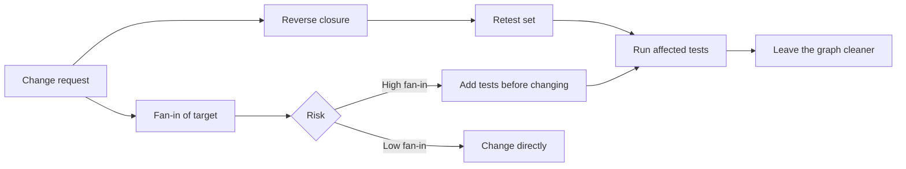

# Large-Codebase Maintenance

> **Lab host:** Windows 11, Python 3.13.5. The transcript in section 7 was executed on that host
> from the probe embedded there, which generates forty modules with import edges, then computes
> fan-in, cycles, change impact, build order, reading order and ownership coverage. The graph is
> real data in memory; the churn and ownership tables are fixed inputs standing in for repository
> history, and the lesson says so where it matters.

## 1. Learning Objectives

After this lesson you will be able to:

- [ ] Answer "what depends on this?" with a reverse transitive closure instead of a guess
- [ ] Detect a dependency cycle by traversal and explain what it costs a build system
- [ ] Rank files for reading by churn times complexity rather than by size or age
- [ ] State the ownership gaps in a codebase and why they predict future incidents
- [ ] Change code in a large repository with a computed retest set

## 2. Prerequisites

- [Distributed Systems Patterns](distributed-systems-patterns.md) — the same graph reasoning applied
  to services rather than modules
- [13-SOFTWARE-ENGINEERING-AND-ARCHITECTURE/modular-monoliths.md](../13-SOFTWARE-ENGINEERING-AND-ARCHITECTURE/modular-monoliths.md)
  — module boundaries and what makes a dependency acceptable
- [13-SOFTWARE-ENGINEERING-AND-ARCHITECTURE/technical-debt.md](../13-SOFTWARE-ENGINEERING-AND-ARCHITECTURE/technical-debt.md)
  — the economics of code you are afraid to change
- [03-DEVELOPER-TOOLS/git-fundamentals.md](../03-DEVELOPER-TOOLS/git-fundamentals.md) — history as
  data: churn, authorship and blame

## 3. Introduction

A large codebase is not a big small codebase. Past a certain size, the dominant cost of a change is
no longer typing it — it is finding every place affected by it, deciding what to read, and knowing
who to ask. The code itself is the easy part.

The useful mental model is a **graph**: modules are nodes, imports are directed edges. Almost every
maintenance question becomes a graph question. What depends on this module? The reverse transitive
closure. Can this be built? Whether the graph is acyclic. What should I read first? The nodes with
high churn and high complexity. Who owns this? A coverage question over the node set.

This lesson builds that graph and answers those questions with counts, because in a repository of
thousands of files, "it is probably just these three places" is how regressions ship.

## 4. The Problem It Solves

The failure mode of large-codebase work is **local reasoning about global effects**. You change a
utility, run the tests for its package, and ship. Three days later a batch job in another subsystem
breaks, because it depended on the old behaviour through two intermediate modules nobody mentioned.

The second failure is **reading by anxiety**: opening dozens of files, retaining none, and running
out of time before making the change. Reading order is a real skill, and it is computable.

The third is **hidden coupling**: two modules that must change together but do not import each
other, held in sync by convention. A dependency graph will not show it, which is exactly why the
graph must be paired with history and ownership data.

Before graph tooling, teams used grep and memory. Both work in a codebase of fifty files and fail at
five thousand — not because grep is bad, but because the answer is a set, not a line.

## 5. Core Concepts

### Fan-in, fan-out and instability

**Fan-in** is how many modules depend on this one; **fan-out** is how many it depends on.
**Instability** is `fan-out / (fan-in + fan-out)`: 0 means everything depends on it and it depends
on nothing (a stable core); 1 means it depends on others and nothing depends on it (a leaf).

The probe's `mod01` has fan-in 12 and instability 0.00 — a core module. Changing it is a
high-impact act. `mod12` has fan-in 4, fan-out 3, instability 0.43 — it participates in the
cycle and is the sort of module that becomes a change magnet.

### Cycles

A **cycle** is a path that returns to its start. In a build graph it is fatal: if A needs B and B
needs A, neither can be built first, and any "which version is deployed" question becomes
unanswerable. The probe finds exactly one cycle, `mod05 -> mod12 -> mod05`, and the cost is larger
than the two modules involved.

That cost is the lesson's sharpest number: with the cycle present, 23 of 40 modules can be ordered;
the other 17 are blocked, of which only 2 are in the cycle. The remaining 15 wait on them forever.
A tiny cycle poisons everything downstream, which is why build tools fail the whole build rather
than the two files.

### Change impact

The **impact set** of a change is the reverse transitive closure: the module itself, everything that
imports it, everything that imports those, and so on. The probe computes it for three modules and
gets 26 modules (65% of the codebase) for `mod02`, 17 (42%) for `mod05`, and 2 (5%) for `mod30`.

This is the retest set in graph terms. A reviewer who asks "did you run the tests for the affected
modules" is asking for this set; a CI system that computes it runs far fewer tests than "everything"
and far more than "the changed package".

### Churn times complexity

**Churn** is how often a file changes; **complexity** is how hard it is to understand (cyclomatic
complexity, length, nesting). Neither alone identifies risk: a busy file that is simple is fine, and
a complex file nobody touches is dormant. Their product ranks files by how much expensive attention
they consume.

The probe's table puts `billing/tax.py` first at 42 changes and complexity 18 (score 756), ahead of
`api/handlers.py` at 55 changes but complexity 9 (score 495). The file with the highest complexity,
`legacy/reports.py` at 41, scores 123 because it changed three times — stable and hard, which is a
different kind of risk.

### Ownership coverage

Code with no owner is code nobody is responsible for. The probe's four owners cover 19 of 40
modules, leaving 21 (52%) unowned. In practice, unowned modules are where incidents take longest to
diagnose, because the first ten minutes are spent finding someone who has read the file.

## 6. How It Works



The left path is the mechanical part: compute the set, run its tests. The right path is the
judgement part: a module with high fan-in needs tests *before* the change, because the retest set is
too large to verify by reading. The `Leave the graph cleaner` step is not decoration — every cycle
removed and every unowned module claimed reduces the cost of the next change.

## 7. Practical Examples

**Example 1 — the codebase as a graph**

The complete program generates forty modules with two imports each plus one deliberate cycle, then
prints fan-in/fan-out/instability, finds cycles by depth-first traversal, computes impact sets,
runs a topological sort, ranks files by churn times complexity, and reports ownership coverage.

```python
"""ADV-10 probe: a codebase as a graph, so change impact is computed, not guessed.

Windows 11, Python 3.13.5. Forty modules with imports are generated deterministically,
including one deliberate cycle, and the probe answers the questions a maintainer actually
asks: what depends on this, what breaks if I change it, in what order can this be built,
and which files deserve to be read first. Import edges are real data structures; the
churn and ownership tables are fixed inputs standing in for repository history.
"""

from __future__ import annotations

from collections import defaultdict

MODULES = [f"mod{index:02d}" for index in range(40)]


def build_graph() -> dict[str, set[str]]:
    graph: dict[str, set[str]] = {module: set() for module in MODULES}
    seed = 7
    for index in range(2, 40):
        # Each module imports two lower-numbered modules: a DAG by construction.
        # The generator is a fixed linear congruential step so the graph is identical
        # on every run and on every machine.
        for _ in range(2):
            seed = (seed * 1_103_515_245 + 12_345) % 2_147_483_648
            graph[MODULES[index]].add(MODULES[seed % index])
    # One deliberate violation of the layering.
    graph["mod05"].add("mod12")
    graph["mod12"].add("mod05")
    return graph


def fan_section(graph: dict[str, set[str]]) -> dict[str, int]:
    print("=== fan-in, fan-out and instability ===")
    fan_in: dict[str, int] = defaultdict(int)
    for module, imports in graph.items():
        for target in imports:
            fan_in[target] += 1
    ranked = sorted(MODULES, key=lambda m: (-fan_in[m], m))[:8]
    print(f"{'module':<8}{'fan-in':>8}{'fan-out':>9}{'instability':>13}")
    for module in ranked:
        out = len(graph[module])
        total = fan_in[module] + out
        instability = out / total if total else 0.0
        print(f"{module:<8}{fan_in[module]:>8}{out:>9}{instability:>13.2f}")
    print("instability 0 = everything depends on it, nothing it depends on")
    print("a module with high fan-in and high fan-out is a change magnet")
    return dict(fan_in)


def cycle_section(graph: dict[str, set[str]]) -> None:
    print("\n=== cycles: found by traversal, not by reading ===")
    state: dict[str, int] = {}
    stack: list[str] = []
    cycles: list[list[str]] = []

    def visit(node: str) -> None:
        state[node] = 1
        stack.append(node)
        for target in sorted(graph[node]):
            if state.get(target, 0) == 0:
                visit(target)
            elif state.get(target) == 1:
                start = stack.index(target)
                cycles.append(stack[start:] + [target])
        stack.pop()
        state[node] = 2

    for module in MODULES:
        if state.get(module, 0) == 0:
            visit(module)
    print(f"modules                      : {len(MODULES)}")
    print(f"import edges                 : {sum(len(v) for v in graph.values())}")
    print(f"cycles found                 : {len(cycles)}")
    for cycle in cycles:
        print(f"  {' -> '.join(cycle)}")
    print("a cycle turns 'which version is deployed' into an unanswerable question")


def impact_section(graph: dict[str, set[str]]) -> None:
    print("\n=== change impact: who must be retested ===")
    dependents: dict[str, set[str]] = defaultdict(set)
    for module, imports in graph.items():
        for target in imports:
            dependents[target].add(module)

    for changed in ("mod02", "mod05", "mod30"):
        seen: set[str] = set()
        frontier = [changed]
        while frontier:
            current = frontier.pop()
            for dependent in dependents[current]:
                if dependent not in seen:
                    seen.add(dependent)
                    frontier.append(dependent)
        print(f"change {changed}: {len(seen):>2} modules depend on it transitively "
              f"({len(seen) / len(MODULES):.0%} of the codebase)")
    print("the retest set is the reverse transitive closure, not the direct importers")


def build_order_section(graph: dict[str, set[str]]) -> None:
    print("\n=== build order: topological sort, and what a cycle costs it ===")

    def kahn(edges: dict[str, set[str]]) -> list[str]:
        # A module is buildable when its own imports are built: indegree is fan-out.
        indegree = {module: len(edges[module]) for module in MODULES}
        ready = sorted(module for module, degree in indegree.items() if degree == 0)
        order: list[str] = []
        while ready:
            module = ready.pop(0)
            order.append(module)
            for dependent, imports in edges.items():
                if module in imports:
                    indegree[dependent] -= 1
                    if indegree[dependent] == 0:
                        ready.append(dependent)
                        ready.sort()
        return order

    def reaches_itself(module: str) -> bool:
        seen: set[str] = set()
        stack = list(graph[module])
        while stack:
            current = stack.pop()
            if current == module:
                return True
            if current not in seen:
                seen.add(current)
                stack.extend(graph[current])
        return False

    order = kahn(graph)
    cyclic = [module for module in MODULES if reaches_itself(module)]
    blocked = len(MODULES) - len(order)
    print(f"modules ordered              : {len(order)} of {len(MODULES)}")
    print(f"first five                   : {order[:5]}")
    print(f"last five                    : {order[-5:]}")
    print(f"blocked                      : {blocked}")
    print(f"of which actually in a cycle : {len(cyclic)} ({cyclic})")
    print(f"the other {blocked - len(cyclic)} wait on the cycle forever")

    acyclic = {module: set(imports) for module, imports in graph.items()}
    acyclic["mod12"].discard("mod05")
    fixed = kahn(acyclic)
    print(f"after removing mod05 -> mod12 : {len(fixed)} of {len(MODULES)} orderable")
    print("a build system that cannot order the graph is telling you the graph is wrong")


def reading_section() -> None:
    print("\n=== where to read first: churn x complexity ===")
    hotspots = [
        ("billing/tax.py", 42, 18),
        ("billing/invoice.py", 31, 12),
        ("core/config.py", 8, 4),
        ("api/handlers.py", 55, 9),
        ("db/migrations.py", 12, 6),
        ("legacy/reports.py", 3, 41),
    ]
    ranked = sorted(hotspots, key=lambda row: (-(row[1] * row[2]), row[0]))
    print(f"{'file':<24}{'changes':>9}{'complexity':>12}{'score':>8}")
    for path, changes, complexity in ranked:
        print(f"{path:<24}{changes:>9}{complexity:>12}{changes * complexity:>8}")
    print(f"files changed more than once a week: "
          f"{sum(1 for _, c, _ in hotspots if c > 26)}")
    print("churn alone finds busy files; churn x complexity finds expensive ones")
    print("the 41-complexity file changed three times: stable and hard, read it when you must")


def ownership_section() -> None:
    print("\n=== ownership coverage ===")
    owners = {
        "billing": ["mod00", "mod01", "mod02", "mod03"],
        "platform": ["mod04", "mod05", "mod06", "mod07", "mod08"],
        "api": ["mod09", "mod10", "mod11", "mod12", "mod13", "mod14"],
        "data": ["mod15", "mod16", "mod17", "mod18"],
    }
    owned = {module for modules in owners.values() for module in modules}
    orphans = [module for module in MODULES if module not in owned]
    print(f"owners                       : {len(owners)}")
    for owner, modules in owners.items():
        print(f"  {owner:<10}{len(modules):>3} modules")
    print(f"modules with an owner        : {len(owned)}")
    print(f"modules with no owner        : {len(orphans)}")
    print(f"share unowned                : {len(orphans) / len(MODULES):.0%}")
    print("unowned code is not nobody's problem; it is everybody's excuse")


def main() -> None:
    graph = build_graph()
    fan_section(graph)
    cycle_section(graph)
    impact_section(graph)
    build_order_section(graph)
    reading_section()
    ownership_section()
    print("\nprobe complete: fan, cycles, impact, build order, reading order, ownership")


if __name__ == "__main__":
    main()
```

- `build_graph` uses a fixed linear congruential step, so the same graph is generated on every run
  and every machine; a random module generator would make the capture unreproducible.
- `fan_section` counts edges once and ranks by fan-in.
- `cycle_section` uses three-colour DFS: white unvisited, grey on the stack, black finished. A grey
  target is a cycle.
- `impact_section` walks reverse edges from the changed module to a fixed point.
- `kahn` counts *imports* as indegree, because a module is buildable only when its dependencies are
  built — the direction matters and getting it backwards stalls the sort.
- `reading_section` multiplies the fixed churn and complexity columns.

**Expected output** (executed on Windows 11, Python 3.13.5, exit code 0):

```text
=== fan-in, fan-out and instability ===
module    fan-in  fan-out  instability
mod01         12        0         0.00
mod00          8        0         0.00
mod08          7        2         0.22
mod03          4        2         0.33
mod05          4        2         0.33
mod11          4        2         0.33
mod12          4        3         0.43
mod02          3        2         0.40
instability 0 = everything depends on it, nothing it depends on
a module with high fan-in and high fan-out is a change magnet

=== cycles: found by traversal, not by reading ===
modules                      : 40
import edges                 : 76
cycles found                 : 1
  mod05 -> mod12 -> mod05
a cycle turns 'which version is deployed' into an unanswerable question

=== change impact: who must be retested ===
change mod02: 26 modules depend on it transitively (65% of the codebase)
change mod05: 17 modules depend on it transitively (42% of the codebase)
change mod30:  2 modules depend on it transitively (5% of the codebase)
the retest set is the reverse transitive closure, not the direct importers

=== build order: topological sort, and what a cycle costs it ===
modules ordered              : 23 of 40
first five                   : ['mod00', 'mod01', 'mod02', 'mod03', 'mod04']
last five                    : ['mod31', 'mod32', 'mod33', 'mod38', 'mod39']
blocked                      : 17
of which actually in a cycle : 2 (['mod05', 'mod12'])
the other 15 wait on the cycle forever
after removing mod05 -> mod12 : 40 of 40 orderable
a build system that cannot order the graph is telling you the graph is wrong

=== where to read first: churn x complexity ===
file                      changes  complexity   score
billing/tax.py                 42          18     756
api/handlers.py                55           9     495
billing/invoice.py             31          12     372
legacy/reports.py               3          41     123
db/migrations.py               12           6      72
core/config.py                  8           4      32
files changed more than once a week: 3
churn alone finds busy files; churn x complexity finds expensive ones
the 41-complexity file changed three times: stable and hard, read it when you must

=== ownership coverage ===
owners                       : 4
  billing     4 modules
  platform    5 modules
  api         6 modules
  data        4 modules
modules with an owner        : 19
modules with no owner        : 21
share unowned                : 52%
unowned code is not nobody's problem; it is everybody's excuse

probe complete: fan, cycles, impact, build order, reading order, ownership
```

- `mod01 12 0 0.00` and `mod00 8 0 0.00` are the stable core: many dependents, no dependencies.
- `cycles found : 1` with `mod05 -> mod12 -> mod05` is the single defect the graph exposes.
- `change mod02: 26 modules depend on it transitively (65% of the codebase)` is the retest set, and
  the reason a "small" utility change is not small.
- `modules ordered : 23 of 40`, `blocked : 17`, `of which actually in a cycle : 2`, `the other 15
  wait on the cycle forever` is the cost of a two-module cycle, and `after removing mod05 -> mod12 :
  40 of 40 orderable` is the fix.
- `billing/tax.py 42 18 756` against `legacy/reports.py 3 41 123` is why reading order is not the
  same as complexity order.
- `modules with no owner : 21` and `share unowned : 52%` is an organisational fact the graph makes
  visible.
- **How to run it:** save as `large_codebase_probe.py`, run `python large_codebase_probe.py`.
  Standard library only.
- **Assumptions:** imports are static and complete; the churn and ownership tables are fixed inputs
  rather than repository history. A real audit replaces those tables with `git log` output and a
  `CODEOWNERS` parse.

**Example 2 — the same analysis as a pre-change checklist**

```text
Target module        : billing/tax.py
Fan-in               : 12 dependents   -> tests before the change
Impact set           : 26 modules       -> retest set, ~4 minutes of CI
Cycle involvement    : none
Owner                : billing         -> reviewer known
Churn x complexity   : 756             -> highest in the repository
```

The checklist is what turns "I will be careful" into a plan. Each line is computed, and each line
changes what you do: high fan-in changes test order, a large impact set changes the CI command, an
unowned module changes who reviews.

## 8. Real-World Applications

- **Monorepos** compute impact sets to run only affected tests, which is the difference between a
  four-minute and a forty-minute pipeline.
- **Platform teams** use fan-in rankings to decide which shared libraries need stability guarantees
  and which can change freely.
- **Incident response** uses ownership coverage to route pages; an unowned module means a page with
  no obvious responder.
- **Refactoring programmes** use cycle counts as the objective: drive the count to zero, then
  discuss architecture.
- **Onboarding** uses churn-times-complexity to produce a reading list that is short, ranked and
  defensible.

## 9. Common Mistakes

| Mistake | Why it happens | How to recognize it | How to prevent it |
|---|---|---|---|
| Reading by directory structure | Directories look like the design | Hours spent in irrelevant files | Rank by fan-in and churn before reading |
| Trusting a package's own tests | They pass locally | Breakage appears in another subsystem | Compute the reverse closure and run it |
| Ignoring a "small" cycle | It involves two files | Build order stalls; deploy ambiguity | Treat every cycle as a defect with an owner |
| Ranking by file size | Big files feel important | Generated or vendored files top the list | Rank by churn x complexity, excluding generated code |
| Leaving modules unowned | Nobody volunteered | Incidents take longer to route | Assign an owner per directory, even if nominal |
| Refactoring without the graph | The change "obviously" only touches one file | Unexpected test failures or silent breakage | Compute impact before editing, then compare |

## 10. Best Practices

- **Compute the impact set before the edit**, and use it as the test command.
- **Treat cycles as build errors**, because they are: fail CI on a new cycle rather than debating it.
- **Keep a stable core small.** High fan-in modules should be few, simple and heavily tested. The
  rule stops applying when the "core" is a generated protocol definition, where fan-in is expected.
- **Assign owners to directories**, not files, so coverage cannot rot one file at a time.
- **Recompute the reading list quarterly**; churn changes, and last year's hotspot may be dormant.

## 11. Limitations and Trade-Offs

Static import graphs miss dynamic coupling: reflection, dependency injection by name, string-based
plugin loading and database schemas all create dependencies the graph cannot see. A codebase can
have zero cycles and still be impossible to change safely.

Churn and complexity are proxies. Churn measures attention, not risk; a file can change often
because it is generated, and a file can be dangerous precisely because it never changes. Both
metrics need a human filter.

Impact sets over-approximate, which is safe but expensive: a widely imported utility produces a
retest set that is most of the repository. That is a signal about the design, not a flaw in the
computation.

Finally, ownership data is political as well as technical. A `CODEOWNERS` entry does not create
knowledge, and coverage numbers can be gamed by assigning everything to one team.

## 12. Practical Exercises

### Introductory

1. **Exercise 10.1** — Compute the impact set of `mod10` by hand from the fan-in table, then verify
    with the probe.
    **Completion criteria:** a predicted set size and the measured one, with any difference
    explained by the traversal.

2. **Exercise 10.2** — Add a second cycle (`mod20 <-> mod21`) and report the new blocked count.
    **Completion criteria:** the ordered count falls, the blocked count rises by more than two, and
    you can explain why.

### Intermediate

3. **Exercise 10.3** — Remove the cycle by inverting one edge, then show that all forty modules
    order and that the impact set of `mod05` changes.
    **Completion criteria:** `40 of 40 orderable` and a before/after impact count for `mod05`.

4. **Exercise 10.4** — Replace the fixed churn table with `git log --numstat` output for this
    repository, and rank the top five files by churn times line count.
    **Completion criteria:** a real ranking from real history, with the command used and the
    generated files excluded.

### Independent problem-solving

5. **Exercise 10.5** — You must change the signature of a function in the most-depended-on module
    of a repository you know. Write the change plan: impact set, test strategy, migration order,
    communication, and rollback. State how you would detect a consumer your graph missed.
    **Completion criteria:** a plan naming the computed impact set, a staged rollout, and a specific
    detection mechanism for dynamic coupling (search, runtime error budget, or contract test).

*Solutions: attempt first. They live in `solutions/` of this subject.*

## 13. Knowledge Check

1. Why does a two-module cycle block fifteen other modules?
2. A file has the highest complexity in the repository and low churn. What kind of risk is it?
3. What does instability 0 tell you about a module, and how should that change your review process?
4. Your impact set is 80% of the repository for a one-line change. What does that say about the
   design?
5. Which dependencies can a static import graph not see?

## 14. Completion Criteria

- [ ] You can compute a reverse transitive closure and use it as a retest set
- [ ] You can find a cycle by traversal and explain its downstream cost
- [ ] You can rank files by churn times complexity and justify the ranking
- [ ] You can report ownership coverage and name why it matters
- [ ] You can name two couplings a static graph misses

## 15. Summary

- A large codebase is a graph; maintenance questions are graph queries with countable answers.
- Fan-in identifies the stable core; cycles block builds far beyond the modules they contain.
- Change impact is the reverse transitive closure, which is the honest retest set.
- Churn times complexity ranks reading order better than size, age or intuition.
- Unowned code is slow to diagnose; coverage is an operational metric, not an administrative one.

## 16. Next Steps

- Next lesson: [Architecture Decision Records](architecture-decision-records.md) — how to keep the
  reasons behind this graph from being lost.
- Practice: [13-SOFTWARE-ENGINEERING-AND-ARCHITECTURE/technical-debt.md](../13-SOFTWARE-ENGINEERING-AND-ARCHITECTURE/technical-debt.md)
  prices the debt a graph like this accumulates.
- Where it is applied: [20-PROJECT-LABORATORY/README.md](../20-PROJECT-LABORATORY/README.md)
  asks for an impact analysis in the capstone maintenance phase.
