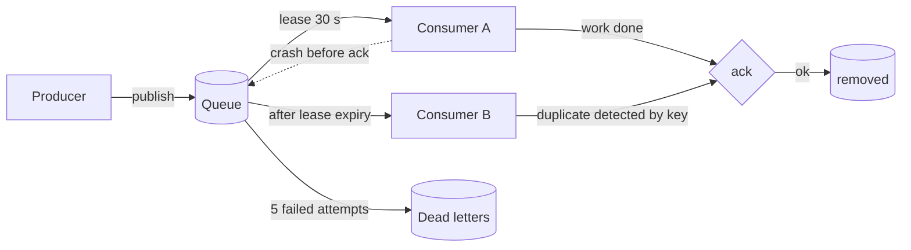

# Message Queues

> **Lab host:** Windows 11, Python 3.13.5. Section 7's transcript was executed on that host from
> the probe embedded there. The probe implements a broker in memory — publish, lease, visibility
> timeout, acknowledge, retry, dead-letter — and drives it with a simulated clock, so every line
> reproduces exactly. No broker is installed on this machine and none is claimed: the guarantees
> modelled here are the ones a real broker documents.

## 1. Learning Objectives

After this lesson you will be able to:

- [ ] Explain at-most-once, at-least-once and effectively-once delivery, and say which one a
      given queue configuration actually gives you
- [ ] Trace a duplicate from its cause (ack lost after processing) to its cost, and remove the
      cost with an idempotency key
- [ ] Design a retry schedule with a stated attempt count, backoff and dead-letter destination
- [ ] Predict what parallel consumers do to message ordering, and choose a key that restores it
- [ ] Compute whether a consumer pool drains a backlog or merely delays the failure

## 2. Prerequisites

- [Concurrency and Parallelism](concurrency-and-parallelism.md) — bounded queues, coordination
  and the cost of shared state, without which a consumer pool is guesswork
- [11-BACKEND-ENGINEERING/background-jobs.md](../11-BACKEND-ENGINEERING/background-jobs.md) —
  the single-process version of this problem: a job table, retries and a status endpoint
- [13-SOFTWARE-ENGINEERING-AND-ARCHITECTURE/event-driven-architecture.md](../13-SOFTWARE-ENGINEERING-AND-ARCHITECTURE/event-driven-architecture.md)
  — why producers and consumers are decoupled at all
- [17-CLOUD-AND-PRODUCTION/scaling.md](../17-CLOUD-AND-PRODUCTION/scaling.md) — arrival rate
  versus service rate, the arithmetic this lesson applies to consumers

## 3. Introduction

A message queue is a durable buffer between a producer that has work and a consumer that has
capacity. Its job is to make those two rates independent: the producer does not wait for the
consumer, and the consumer does not lose work when it restarts.

Everything interesting about queues follows from one constraint. To be durable, the broker must
record a message before acknowledging the producer. To be safe, the consumer must acknowledge a
message only after the work is done. Between those two acknowledgements there is always a window
in which a crash produces either a lost message or a repeated one — and the standard choice is to
repeat, because a duplicate you can handle is better than a payment you never took.

That choice is what "at-least-once" means, and it is the default for good reasons. The rest of
this lesson is about living with it.

## 4. The Problem It Solves

Calling a slow or unreliable service inline couples your latency and your availability to it. If
the mail provider takes four seconds, your signup takes four seconds; if it is down, signup fails
even though the account was created perfectly well.

The pre-queue workarounds all leak. A cron job scanning a table for unsigned-up users adds a
polling delay and a second query pattern. A background thread inside the web process dies with
the process and is invisible to other instances. A separate "retry script" run by hand is not a
system.

A queue makes the handoff explicit and durable: the message exists independently of both
processes, survives a restart, and can be observed. The price is the duplicate window described
above, plus the operational surface of one more thing that can be down.

## 5. Core Concepts

### Delivery guarantees

- **At-most-once**: the broker removes the message on delivery. A crash loses it. Cheap, and
  acceptable for metrics or cache warmups.
- **At-least-once**: the broker keeps the message until an acknowledgement. A crash after
  processing but before the ack produces a duplicate. This is the normal setting.
- **Effectively-once**: at-least-once delivery plus a consumer that recognises repeats, so the
  *effect* happens once. It is a property of the pair, never of the broker alone. Marketing calls
  it "exactly-once"; the duplicate still arrives.

### Visibility timeout and the lease

When a consumer receives a message, the broker hides it for a **visibility timeout** rather than
deleting it. If the consumer acks in time, the message is gone. If it crashes, the lease expires
and the message becomes visible again — to any consumer, including a different one. The timeout
is a latency-versus-duplication dial: short timeouts redeliver fast and duplicate work that is
merely slow; long timeouts delay recovery.

### Acknowledgement, idempotency and the key

An **idempotency key** is an identifier chosen by the producer that names the logical operation,
not the delivery. The consumer records keys it has completed; a repeat with a seen key is
acknowledged and skipped. The record must be written in the same transaction as the effect, or
the crash just moves.

### Retries, backoff, jitter and dead letters

A failed message is retried. **Exponential backoff** increases the delay between attempts so a
recovering dependency is not hammered. **Jitter** randomises the delay so a fleet of consumers
does not retry in lockstep. After a bounded number of attempts the message goes to a
**dead-letter queue (DLQ)** — a destination for messages that will never succeed, kept for
inspection rather than retried forever.

### Ordering and partitioning

A queue with parallel consumers preserves *enqueue* order but not *completion* order. Per-key
ordering requires routing all messages with the same key to the same consumer — which is what a
partitioned stream does properly, as [Event Streaming](event-streaming.md) shows.

### Head-of-line blocking

If one message fails and is retried in place, everything behind it waits. The probe prices this:
a poison message costs every healthy follower the full retry schedule. Dead-lettering after a
short bound is often better than retrying a message that is structurally broken.

## 6. How It Works



The loop in the middle is the whole contract. A message leaves the queue only under an ack or a
dead-letter decision; every other path returns it. Read the diagram with the failure in mind:
the arrow from A back to Q is not exceptional, it is the normal recovery path.

Two operational consequences follow. First, the number of in-flight messages is bounded by
consumers times prefetch, so consumer count is a throughput decision and prefetch is a latency
decision. Second, a consumer that is slow rather than dead is worse than one that is dead: it
keeps holding leases, so messages redeliver late and the duplicate rate climbs.

## 7. Practical Examples

**Example 1 — duplicates, keys, retries, DLQ, ordering and drain rate**

The complete program follows. It publishes three orders, crashes a consumer between work and ack,
redelivers, shows the duplicate being suppressed by a key, prints a retry schedule, retries a
poison message five times, compares completion order across two consumers, and computes whether a
consumer pool can drain a backlog.

```python
"""ADV-03 probe: a queue's guarantees, priced in duplicates and delay.

Windows 11, Python 3.13.5. The broker below is thirty lines of in-memory state driven by
a simulated clock, so every trace line is reproducible: no sleeping, no scheduler, no
network. What it models is the contract a real broker offers - publish, receive with a
visibility timeout, acknowledge, retry, dead-letter - and the two costs that contract
imposes on every consumer: duplicate delivery and delay.
"""

from __future__ import annotations

from dataclasses import dataclass, field


@dataclass
class Message:
    message_id: str
    key: str
    attempts: int = 0


@dataclass
class Broker:
    visibility_ms: int = 30_000
    queue: list[Message] = field(default_factory=list)
    in_flight: dict[str, int] = field(default_factory=dict)
    dead_letters: list[tuple[str, int]] = field(default_factory=list)
    deliveries: int = 0
    acks: int = 0

    def publish(self, message: Message) -> None:
        self.queue.append(message)

    def receive(self, now_ms: int) -> Message | None:
        """Oldest message not currently leased to another consumer."""
        for message in self.queue:
            lease_until = self.in_flight.get(message.message_id)
            if lease_until is None or lease_until <= now_ms:
                self.in_flight[message.message_id] = now_ms + self.visibility_ms
                self.deliveries += 1
                return message
        return None

    def ack(self, message: Message) -> None:
        self.acks += 1
        self.in_flight.pop(message.message_id, None)
        self.queue = [m for m in self.queue if m.message_id != message.message_id]

    def dead_letter(self, message: Message) -> None:
        self.in_flight.pop(message.message_id, None)
        self.queue = [m for m in self.queue if m.message_id != message.message_id]
        self.dead_letters.append((message.message_id, message.attempts))


def at_least_once_section() -> None:
    print("=== at-least-once: a crash after processing redelivers ===")
    broker = Broker(visibility_ms=30_000)
    for index in range(3):
        broker.publish(Message(f"m{index}", key=f"order-{index}"))

    clock = 0
    first = broker.receive(clock)
    print(f"t={clock:>6} consumer A received {first.message_id}, started work, crashed")
    print(f"t={clock:>6} no ack was sent, so the lease is still held until t=30000")

    clock = 30_000
    again = broker.receive(clock)
    print(f"t={clock:>6} consumer B received {again.message_id} "
          f"(same id: {again.message_id == first.message_id})")
    broker.ack(again)
    print(f"t={clock:>6} A processed it once, B processed it once, acks={broker.acks}")
    print("deliveries for one logical message   : 2")
    print("processing runs for one logical message: 2 (unless the consumer is idempotent)")
    print("a queue removes the second run only if you make it harmless")


def idempotency_section() -> None:
    print("\n=== idempotency key: the duplicate becomes a no-op ===")
    broker = Broker(visibility_ms=30_000)
    for index in range(3):
        broker.publish(Message(f"m{index}", key=f"order-{index}"))

    processed: set[str] = set()
    effects: list[str] = []

    def handle(message: Message, crash: bool = False) -> str:
        if message.key in processed:
            return f"{message.message_id}: duplicate key {message.key}, skipped"
        processed.add(message.key)
        effects.append(f"charged {message.key}")
        if crash:
            return f"{message.message_id}: crashed after charging, before ack"
        return f"{message.message_id}: charged and acked"

    clock = 0
    message = broker.receive(clock)
    print(f"t={clock:>6} {handle(message, crash=True)}")
    clock = 30_000
    message = broker.receive(clock)
    print(f"t={clock:>6} {handle(message)}")
    broker.ack(message)
    for _ in range(2):
        message = broker.receive(clock)
        print(f"t={clock:>6} {handle(message)}")
        broker.ack(message)
    print(f"deliveries {broker.deliveries}, side effects {len(effects)}, "
          f"duplicates suppressed {broker.deliveries - len(effects)}")
    print(f"every logical order charged once: {len(effects) == 3}")
    print("the key must be chosen by the producer and stored with the effect")


def retry_section() -> None:
    print("\n=== retry schedule: exponential with no jitter ===")
    base_ms, factor, max_attempts = 200, 2, 5
    delays = [base_ms * factor ** attempt for attempt in range(max_attempts)]
    print(f"attempt delays (ms)          : {delays}")
    print(f"cumulative delay before last : {sum(delays[:-1]) / 1000:.1f} s")
    print(f"total time before dead-letter: {sum(delays) / 1000:.1f} s")
    with_jitter = [delay * 0.5 + (delay * 0.5) * (index / max_attempts)
                   for index, delay in enumerate(delays)]
    print(f"same schedule with half jitter: "
          f"{[round(value) for value in with_jitter]}")
    print("jitter spreads retries so a shared outage is not hammered in lockstep")


def dead_letter_section() -> None:
    print("\n=== poison message: five attempts, then out of the queue ===")
    broker = Broker(visibility_ms=100)
    poison = Message("bad-1", key="order-9")
    broker.publish(poison)
    for follower in range(2):
        broker.publish(Message(f"ok-{follower}", key=f"order-{follower}"))

    clock = 0
    for attempt in range(1, 6):
        message = broker.receive(clock)
        message.attempts = attempt
        print(f"t={clock:>6} attempt {attempt} on {message.message_id} failed")
        if attempt == 5:
            broker.dead_letter(message)
        clock += 200 * 2 ** (attempt - 1)

    print(f"dead letters                 : {broker.dead_letters}")
    print(f"messages still queued        : {[m.message_id for m in broker.queue]}")
    print(f"followers waited behind it   : {clock / 1000:.1f} s of head-of-line blocking")
    print("the followers were healthy; their delay was inherited from one bad message")


def ordering_section() -> None:
    print("\n=== one queue, two consumers: completion order is not publish order ===")
    published = ["a", "b", "c", "d"]
    durations = {"a": 40, "b": 10, "c": 30, "d": 5}
    print(f"published order              : {published}")
    one, clock = [], 0
    for message in published:
        clock += durations[message]
        one.append((message, clock))
    print(f"one consumer, finish times   : {[(m, t) for m, t in one]}")
    two = []
    clock_a = clock_b = 0
    for index, message in enumerate(published):
        if index % 2 == 0:
            clock_a += durations[message]
            two.append((message, clock_a, "A"))
        else:
            clock_b += durations[message]
            two.append((message, clock_b, "B"))
    completed = sorted(two, key=lambda row: (row[1], row[2]))
    print(f"two consumers, completions   : {[(m, t, c) for m, t, c in completed]}")
    print(f"completion order             : {[m for m, _, _ in completed]}")
    print(f"matches publish order        : {[m for m, _, _ in completed] == published}")
    print("per-key ordering survives parallel consumers only if keys are routed to one consumer")


def capacity_section() -> None:
    print("\n=== backlog and drain rate ===")
    arrival_per_s, service_ms, backlog = 800, 25, 5_000
    per_consumer = 1000 / service_ms
    print(f"arrival rate                 : {arrival_per_s} msg/s")
    print(f"one consumer                 : {per_consumer:.0f} msg/s ({service_ms} ms each)")
    for consumers in (4, 20, 24):
        drain = consumers * per_consumer
        if drain > arrival_per_s:
            print(f"{consumers:>3} consumers: {drain:5.0f} msg/s, clears {backlog} in "
                  f"{backlog / (drain - arrival_per_s):5.1f} s")
        elif drain == arrival_per_s:
            print(f"{consumers:>3} consumers: {drain:5.0f} msg/s, backlog never shrinks")
        else:
            print(f"{consumers:>3} consumers: {drain:5.0f} msg/s, backlog grows "
                  f"{arrival_per_s - drain:5.0f} msg/s")
    print(f"consumers needed for parity  : {arrival_per_s / per_consumer:.0f}")
    print(f"one more consumer buys       : {per_consumer:.0f} msg/s of headroom")


def main() -> None:
    at_least_once_section()
    idempotency_section()
    retry_section()
    dead_letter_section()
    ordering_section()
    capacity_section()
    print("\nprobe complete: guarantees, duplicates, delay and drain, all counted")


if __name__ == "__main__":
    main()
```

- `Broker.receive` returns the oldest message whose lease has expired, which is why the crash
  trace redelivers at t=30000 rather than immediately.
- `handle` records the key *before* returning, so the crash model is "effect written, ack lost".
- The retry loop multiplies the delay by two and stops at five attempts.
- `capacity_section` is arrival rate minus drain rate; no timing is involved.

**Expected output** (executed on Windows 11, Python 3.13.5, exit code 0):

```text
=== at-least-once: a crash after processing redelivers ===
t=     0 consumer A received m0, started work, crashed
t=     0 no ack was sent, so the lease is still held until t=30000
t= 30000 consumer B received m0 (same id: True)
t= 30000 A processed it once, B processed it once, acks=1
deliveries for one logical message   : 2
processing runs for one logical message: 2 (unless the consumer is idempotent)
a queue removes the second run only if you make it harmless

=== idempotency key: the duplicate becomes a no-op ===
t=     0 m0: crashed after charging, before ack
t= 30000 m0: duplicate key order-0, skipped
t= 30000 m1: charged and acked
t= 30000 m2: charged and acked
deliveries 4, side effects 3, duplicates suppressed 1
every logical order charged once: True
the key must be chosen by the producer and stored with the effect

=== retry schedule: exponential with no jitter ===
attempt delays (ms)          : [200, 400, 800, 1600, 3200]
cumulative delay before last : 3.0 s
total time before dead-letter: 6.2 s
same schedule with half jitter: [100, 240, 560, 1280, 2880]
jitter spreads retries so a shared outage is not hammered in lockstep

=== poison message: five attempts, then out of the queue ===
t=     0 attempt 1 on bad-1 failed
t=   200 attempt 2 on bad-1 failed
t=   600 attempt 3 on bad-1 failed
t=  1400 attempt 4 on bad-1 failed
t=  3000 attempt 5 on bad-1 failed
dead letters                 : [('bad-1', 5)]
messages still queued        : ['ok-0', 'ok-1']
followers waited behind it   : 6.2 s of head-of-line blocking
the followers were healthy; their delay was inherited from one bad message

=== one queue, two consumers: completion order is not publish order ===
published order              : ['a', 'b', 'c', 'd']
one consumer, finish times   : [('a', 40), ('b', 50), ('c', 80), ('d', 85)]
two consumers, completions   : [('b', 10, 'B'), ('d', 15, 'B'), ('a', 40, 'A'), ('c', 70, 'A')]
completion order             : ['b', 'd', 'a', 'c']
matches publish order        : False
per-key ordering survives parallel consumers only if keys are routed to one consumer

=== backlog and drain rate ===
arrival rate                 : 800 msg/s
one consumer                 : 40 msg/s (25 ms each)
  4 consumers:   160 msg/s, backlog grows   640 msg/s
 20 consumers:   800 msg/s, backlog never shrinks
 24 consumers:   960 msg/s, clears 5000 in  31.2 s
consumers needed for parity  : 20
one more consumer buys       : 40 msg/s of headroom

probe complete: guarantees, duplicates, delay and drain, all counted
```

- `deliveries for one logical message : 2` with `acks=1` is at-least-once in one line.
- `deliveries 4, side effects 3, duplicates suppressed 1` is the key doing its job; note the
  broker still delivered four times.
- `dead letters : [('bad-1', 5)]` and `followers waited behind it : 6.2 s` are the two costs of
  retrying in place: bounded attempts, unbounded neighbour latency.
- `completion order : ['b', 'd', 'a', 'c']` against publish order `['a','b','c','d']` is why
  per-key ordering needs routing, not hope.
- `20 consumers: 800 msg/s, backlog never shrinks` is the important capacity line: equalling the
  arrival rate does not clear a backlog, it preserves it.
- **How to run it:** save as `message_queues_probe.py` and run `python message_queues_probe.py`.
  Standard library only.
- **Assumptions:** the clock is simulated; visibility timeouts and delays are integers in
  milliseconds. A real broker adds network latency and its own redelivery timing.

**Example 2 — reading the retry schedule as a decision**

The probe prints the schedule; the decision is what to do with it:

```text
attempt delays (ms)          : [200, 400, 800, 1600, 3200]
cumulative delay before last : 3.0 s
total time before dead-letter: 6.2 s
```

Six seconds is a choice, not a law. A payment retry wants hours and many attempts, because the
failure is usually transient. A malformed message wants one attempt and a DLQ, because the second
attempt will fail identically. The schedule should be derived from the *class* of failure the
message can represent — and that classification belongs in the consumer, not in the broker's
global configuration.

## 8. Real-World Applications

- **Order pipelines** use a queue between checkout and fulfilment so a slow warehouse system
  cannot fail a purchase; the idempotency key is the order id.
- **Email and notification fan-out** is the canonical at-least-once workload: a duplicate email is
  annoying, a missing one is a support ticket.
- **Image and video processing** uses queues to absorb upload bursts and to size workers
  independently of web servers.
- **Cross-service integration** uses a queue as the seam, which is the first step towards the
  event-driven patterns in
  [13-SOFTWARE-ENGINEERING-AND-ARCHITECTURE/event-driven-architecture.md](../13-SOFTWARE-ENGINEERING-AND-ARCHITECTURE/event-driven-architecture.md).
- **Dead-letter queues** are the operational interface: they are where you look when a deploy
  changed a payload shape, and they should be alarmed, not merely present.

## 9. Common Mistakes

| Mistake | Why it happens | How to recognize it | How to prevent it |
|---|---|---|---|
| Acking before the work is done | It makes the duplicate disappear in testing | Messages vanish during deploys or crashes | Ack last, always; make the effect idempotent instead |
| Idempotency key derived from the delivery | The message id is right there | Duplicates still cause double effects | Key on the business operation, chosen by the producer |
| Retrying a poison message forever | Backoff looks responsible | One queue's lag grows while others are fine | Bound attempts and route to a DLQ with the payload |
| Unbounded prefetch | "More in flight, more throughput" | Memory growth; long leases; late redelivery | Set prefetch from measured service time |
| Expecting global order with parallel consumers | Ordering works with one consumer | Intermittent out-of-order side effects | Partition by key, or accept per-key order only |
| No alarm on DLQ depth | The DLQ exists, so it is "handled" | Dead letters accumulate silently for weeks | Alarm on rate and depth, with an owner |

## 10. Best Practices

- **Design the consumer first.** The broker's guarantees are fixed; the consumer's idempotency is
  the part you control.
- **Store the key with the effect.** Same transaction, same database. A separate "dedupe service"
  reintroduces the window it was meant to close.
- **Classify failures before retrying.** Transient (retry with backoff), permanent (DLQ
  immediately), and unknown (bounded retries, then DLQ). The rule stops applying for
  at-most-once workloads, where retrying is the wrong default.
- **Bound the schedule, not just the attempts.** Total time to DLQ is what an operator feels.
- **Make lag and DLQ depth first-class metrics**, with dashboards that answer "is the queue
  draining" rather than "did anything arrive".

## 11. Limitations and Trade-Offs

A queue adds a hop, and a hop adds latency: the probe's retry schedule alone is seconds, before
any work happens. For a synchronous user-facing action with a strict budget, a queue is the wrong
tool and a direct call with a timeout is right.

Durability costs throughput. Every message is written and fsynced somewhere before the producer
is acknowledged; a broker tuned for speed weakens exactly the guarantee you chose it for.

At-least-once pushes complexity into every consumer, permanently. "Effectively-once" is not a
configuration flag; it is a discipline that must hold in the consumer's transaction boundary, and
it is the first thing to break when a new consumer is written by someone who did not read this
lesson.

Finally, a queue cannot fix an ordering requirement it does not model. If two messages must be
processed in sequence, they need the same key and the same consumer, or a stream with partitions.

## 12. Practical Exercises

### Introductory

1. **Exercise 3.1** — Change the visibility timeout from 30 s to 5 s in the at-least-once
   section and predict the trace before running it.
   **Completion criteria:** you state the new redelivery time, run it, and explain why a short
   timeout duplicates slow-but-healthy work.

2. **Exercise 3.2** — Using the probe's retry schedule, compute the delay for a seventh attempt
   and the total time to dead-letter with eight attempts.
   **Completion criteria:** `12.8 s` for the seventh delay and `51.0 s` cumulative, with the
   arithmetic shown.

### Intermediate

3. **Exercise 3.3** — Make the idempotency key survive a process restart by moving the `seen`
   set into a file or SQLite table, then crash the consumer twice.
   **Completion criteria:** side effects stay at three while deliveries grow; you can show the
   stored keys after the restart.

4. **Exercise 3.4** — Add a per-key ordered mode: route each key to a fixed consumer and show
   that completion order matches publish order for that key, while other keys still interleave.
   **Completion criteria:** per-key order holds across two consumers, and you can explain what
   the routing key had to become.

### Independent problem-solving

5. **Exercise 3.5** — A queue receives 1,200 messages/s at peak. Each message triggers a 60 ms
   call to a partner API that fails 2% of the time and rate-limits above 400 requests/s. Design
   the consumption topology: consumer count, prefetch, retry schedule, DLQ policy, and what the
   system does when the partner is down for ten minutes. State the backlog at the end of the
   outage and how long recovery takes.
   **Completion criteria:** a design with computed throughput (`consumers x 1000/60`), a stated
   rate limit below 400/s, a retry schedule with jitter, and a recovery time derived from drain
   minus arrival.

*Solutions: attempt first. They live in `solutions/` of this subject.*

## 13. Knowledge Check

1. The broker says "exactly-once". What is it actually promising, and what must your consumer do
   to make the promise true?
2. You ack after the work but before committing your database transaction. What happens on a crash,
   and which line moves?
3. Why does a fifth consumer add only 40 messages/s in the probe, and when does adding consumers
   stop helping entirely?
4. Two messages for the same order must be processed in order. What has to be true of their
   routing?
5. When is at-most-once the correct choice?

## 14. Completion Criteria

- [ ] You can explain the duplicate window without notes, and name the two places it can be closed
- [ ] You can write a retry schedule with jitter, a bound and a DLQ destination
- [ ] You can compute consumer throughput and say whether a backlog drains
- [ ] You can state why per-key ordering survives parallel consumers only with routing
- [ ] You can name one workload where a queue makes the system worse

## 15. Summary

- A queue decouples rates; durability forces a window where a crash duplicates or loses, and
  at-least-once chooses duplication.
- Visibility timeouts turn a crash into a redelivery, and a slow consumer into a late one.
- Idempotency keys, stored with the effect, convert duplicates into no-ops.
- Retries need a bound, a schedule with jitter and a dead-letter destination; in-place retries
  charge their latency to every message behind them.
- Parallel consumers keep enqueue order but not completion order; partitioning is the fix, not
  configuration.

## 16. Next Steps

- Next lesson: [Event Streaming](event-streaming.md) — the same handoff with a retained log,
  offsets and partition-level ordering.
- Practice: [11-BACKEND-ENGINEERING/background-jobs.md](../11-BACKEND-ENGINEERING/background-jobs.md)
  builds the single-process version whose retry table this lesson generalises.
- Where it is applied: [20-PROJECT-LABORATORY/README.md](../20-PROJECT-LABORATORY/README.md)
  makes the notification pipeline a capstone requirement.
