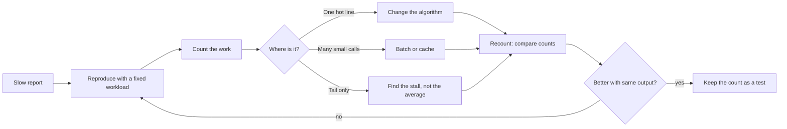

# Performance Profiling

> **Lab host:** Windows 11, Python 3.13.5. The transcript in section 7 was executed on that host
> from the probe embedded there. The probe counts work — comparisons, lookups, calls — rather than
> timing it, because a millisecond measured on a shared machine is not reproducible and a
> regression test built on one is a coin flip. The final section converts the counts to
> milliseconds with declared prices, and says so.

## 1. Learning Objectives

After this lesson you will be able to:

- [ ] Replace "this feels slow" with a counted quantity that can be compared before and after
- [ ] Read an inclusive/exclusive profile table and say which line to change
- [ ] Apply Amdahl's law to predict what an optimisation is worth before doing it
- [ ] Explain why an average latency improvement can leave the user experience unchanged
- [ ] Build a regression check on operation counts instead of elapsed time

## 2. Prerequisites

- [Concurrency and Parallelism](concurrency-and-parallelism.md) — the cost model there is the
  same idea: count, then price
- [05-DATA-STRUCTURES-AND-ALGORITHMS/big-o-notation.md](../05-DATA-STRUCTURES-AND-ALGORITHMS/big-o-notation.md)
  — complexity classes, which the comparison count makes visible
- [14-TESTING-AND-QUALITY/performance-testing.md](../14-TESTING-AND-QUALITY/performance-testing.md)
  — percentile budgets and load tests, which answer a different question from a profile
- [10-DATABASE-ENGINEERING/query-plans-and-optimization.md](../10-DATABASE-ENGINEERING/query-plans-and-optimization.md)
  — the same discipline applied to a query planner

## 3. Introduction

A **profiler** answers one question: where did the work go? Not "is it slow" — that is a
measurement — but "which function, called how many times, consumed what share of the total". The
answer is a table, and the table is the beginning of the work, not the end.

There are two families of profiler and they disagree usefully. A **sampling profiler** interrupts
the program periodically and records the stack; it has low overhead and gives statistical shares.
An **instrumenting profiler** records every call; it is exact and slows the program down. Python's
`cProfile` is the second kind, which is why its absolute times are inflated but its call counts are
exact.

This lesson uses a third approach that is better for teaching and for regression tests: **count the
work directly**. Comparisons, lookups and calls are integers. They do not vary between runs, they
do not depend on the machine, and a change that doubles them is a real regression regardless of
what the clock said.

## 4. The Problem It Solves

Performance work without measurement fails in a predictable way. Someone notices the page is slow,
guesses at the cause — usually the database, the framework, or "the network" — spends a week
optimising that, and ships a change that moves nothing. The guess was wrong, and nobody can prove
it because no baseline was recorded.

The opposite failure is optimising what is easy to measure. The function with the most calls is not
the most expensive; the query with the highest average is not the one with the worst tail. A
profile table ranks by cost, which is not the same as ranking by count.

Measurement also settles arguments. "This change made it faster" is a claim; "comparisons fell from
11,998,000 to 5,000 with identical output" is evidence. The second survives review, and it survives
the next refactor because it became a test.

## 5. Core Concepts

### Counting versus timing

A **count** is discrete and reproducible; a **duration** is continuous and noisy. For algorithmic
questions — is this O(n log n) or O(n²) — the count is strictly better evidence. For questions
about a specific machine under a specific load, only a duration helps.

The practical rule: use counts to decide *what* to change, and use a controlled benchmark to
confirm the change in production-like conditions. Mixing them up produces micro-optimisations
justified by noise.

### Inclusive and exclusive time

**Inclusive** time includes everything a function called; **exclusive** time is the function's own
work. A function with 1,800 ms inclusive and 1,700 ms exclusive is itself the problem. A function
with 4,000 ms inclusive and 20 ms exclusive is a dispatcher — the time is in its callees, and
optimising it is meaningless.

The probe's table makes the distinction concrete: `main` has the largest inclusive figure and 1%
of the exclusive work. Sorting by inclusive finds the branch of the call tree; sorting by exclusive
finds the line.

### Amdahl's law

**Amdahl's law** bounds the benefit of speeding up part of a program. If a fraction *p* of the time
is optimised by a factor *s*, the end-to-end speedup is `1 / ((1 - p) + p/s)`, and the ceiling as
*s* grows is `1 / (1 - p)`. Optimising 60% of the time by 10x yields 2.17x, not 10x, because the
other 40% is untouched.

The law is the best defence against enthusiasm: it converts "this loop is slow" into "this loop can
be worth at most 1.25x".

### The tail

A latency distribution has a mean and percentiles, and they answer different questions. The mean is
the arithmetic average of everyone's wait. **p95** and **p99** are the waits of the slowest five and
one per cent. In the probe's fixed distribution the mean is 64.4 ms, p99 is 300 ms, and the slowest
request is 14x the mean.

Users do not experience the mean. They experience their own request, and the ones that feel broken
are in the tail. This is why an optimisation that improves the mean by 10% can be worthless: it
usually comes from making the common case slightly cheaper, which leaves the tail untouched.

### Profiles lie in specific ways

- **Observer overhead** inflates functions with many small calls.
- **Inlining and caching** hide work the profiler attributes elsewhere.
- **A profile of the wrong workload** is the most common error: the development dataset is small
  enough that an O(n²) loop never shows up.
- **Sampling bias** makes rare, expensive calls look cheap if they are not sampled enough.

The defence is the same as in testing: profile the workload that hurts, at the size that hurts.

## 6. How It Works



The arrow that matters is `I -> B`. A profile is a hypothesis generator, and the loop only closes
when the counts move and the output is unchanged. Without the output comparison, every optimisation
is a potential correctness regression wearing a performance badge.

The `J` step is what turns a one-off investigation into engineering: the count becomes an assertion,
so the next person cannot silently reintroduce the quadratic loop.

## 7. Practical Examples

**Example 1 — counted work, Amdahl, a profile table, a tail, a priced model**

The complete program finds duplicates in 5,000 items two ways and counts comparisons and lookups,
prints Amdahl's arithmetic for four cases, tabulates a profile with inclusive and exclusive costs,
summarises a fixed latency distribution, and converts the counts to milliseconds.

```python
"""ADV-08 probe: profiling by counted work, not by stopwatch.

Windows 11, Python 3.13.5. Timing a program on a shared machine produces a different
number every run, which makes it a bad teaching artefact and a worse regression test. So
this probe counts: comparisons, dictionary lookups, calls, and bytes. Those counts are
identical on every machine, and the cost model at the end converts them to milliseconds
using declared prices.
"""

from __future__ import annotations

from dataclasses import dataclass

ITEMS = 5_000

COUNTER = {"comparisons": 0, "lookups": 0, "calls": 0}


def find_duplicates_quadratic(values: list[int]) -> list[int]:
    duplicates = []
    for index, value in enumerate(values):
        for other in values[index + 1:]:
            COUNTER["comparisons"] += 1
            if value == other:
                duplicates.append(value)
                break
    return duplicates


def find_duplicates_linear(values: list[int]) -> list[int]:
    seen: set[int] = set()
    duplicates = []
    for value in values:
        COUNTER["lookups"] += 1
        if value in seen:
            duplicates.append(value)
        seen.add(value)
    return duplicates


def dataset() -> list[int]:
    return [(index * 37) % 4_000 for index in range(ITEMS)]


def quadratic_section() -> list[int]:
    print("=== two implementations of 'find duplicates', counted ===")
    values = dataset()
    quadratic = find_duplicates_quadratic(values)
    print(f"items                        : {len(values):,}")
    print(f"quadratic comparisons        : {COUNTER['comparisons']:,}")
    print(f"duplicates found             : {len(quadratic)}")

    linear = find_duplicates_linear(values)
    print(f"linear lookups               : {COUNTER['lookups']:,}")
    print(f"duplicates found             : {len(linear)}")
    print(f"same answer                  : {sorted(set(quadratic)) == sorted(set(linear))}")
    print(f"work removed                 : "
          f"{COUNTER['comparisons'] / max(COUNTER['lookups'], 1):,.0f}x")
    print("the profile is the comparison count: the nested loop is the whole cost")
    return linear


def amdahl_section() -> None:
    print("\n=== Amdahl: what a faster hotspot is worth ===")
    for share, speedup in ((0.6, 2.0), (0.6, 10.0), (0.9, 10.0), (0.99, 100.0)):
        total = 1 / ((1 - share) + share / speedup)
        ceiling = 1 / (1 - share)
        print(f"hotspot {share:>4.0%} of time, {speedup:>5.0f}x faster: "
              f"end-to-end {total:5.2f}x (ceiling {ceiling:5.2f}x)")
    print("the ceiling is what the untouched remainder allows; it is reached at infinite speedup")
    print("optimising a 20% hotspot is a 1.25x ceiling no matter how clever the change")


def profile_table_section() -> None:
    print("\n=== the profile table, ordered by inclusive cost ===")
    calls = [
        ("main", 1, 4_000, 20),
        ("load", 1, 300, 40),
        ("parse", 1, 120, 30),
        ("validate", 5_000, 1_500, 1_400),
        ("insert", 5_000, 1_800, 1_700),
        ("normalise", 5_000, 600, 550),
        ("write", 1, 250, 240),
    ]
    total_exclusive = sum(exclusive for _, _, _, exclusive in calls)
    print(f"{'function':<14}{'calls':>8}{'inclusive ms':>14}{'exclusive ms':>14}{'share':>8}")
    for name, count, inclusive, exclusive in sorted(calls, key=lambda row: -row[2]):
        print(f"{name:<14}{count:>8,}{inclusive:>14,}{exclusive:>14}"
              f"{exclusive / total_exclusive:>7.0%}")
    print("inclusive counts the callee; exclusive is the function's own work")
    print("sorting by inclusive shows where the time accumulates; exclusive names the line to change")
    print(f"total wall time in the profile: {calls[0][2]:,} ms; "
          f"exclusive work sums to {total_exclusive:,} ms")


def tail_section() -> None:
    print("\n=== average latency hides the tail ===")
    latencies = [40] * 700 + [80] * 200 + [120] * 70 + [300] * 25 + [900] * 5
    latencies.sort()
    total = len(latencies)

    def percentile(p: float) -> int:
        return latencies[min(total - 1, int(p * total))]

    average = sum(latencies) / total
    print(f"requests                     : {total:,}")
    print(f"mean                         : {average:.1f} ms")
    print(f"p50                          : {percentile(0.50)} ms")
    print(f"p95                          : {percentile(0.95)} ms")
    print(f"p99                          : {percentile(0.99)} ms")
    print(f"max                          : {max(latencies)} ms")
    at_or_above_p99 = sum(1 for v in latencies if v >= percentile(0.99))
    print(f"requests at or above p99     : {at_or_above_p99}")
    print(f"slowest request vs the mean  : {max(latencies) / average:.1f}x")
    print("the mean moves when a handful of slow requests change; the tail is what users feel")
    print("an optimisation that shifts the mean by 10% may not move the tail at all")


@dataclass(frozen=True)
class Price:
    comparison_us: float = 0.02
    lookup_us: float = 0.05
    call_us: float = 1.0


def cost_model_section(price: Price) -> None:
    print("\n=== cost model: the counts turned into milliseconds ===")
    quadratic_ms = COUNTER["comparisons"] * price.comparison_us / 1_000
    linear_ms = COUNTER["lookups"] * price.lookup_us / 1_000
    print(f"quadratic                    : {quadratic_ms:8.1f} ms modelled")
    print(f"linear                       : {linear_ms:8.1f} ms modelled")
    print(f"ratio                        : {quadratic_ms / linear_ms:8.1f}x")
    print("change a price and the absolute numbers move; the shape does not")
    print("that is why the count, not the millisecond, is the regression signal")


def main() -> None:
    quadratic_section()
    amdahl_section()
    profile_table_section()
    tail_section()
    cost_model_section(Price())
    print("\nprobe complete: counts, ceiling, profile table, tail, modelled cost")


if __name__ == "__main__":
    main()
```

- `find_duplicates_quadratic` counts every comparison it makes, including the ones that do not
  match, which is the honest measure of a nested loop.
- `find_duplicates_linear` counts one lookup per item; the set membership is the operation.
- The Amdahl section is a two-line formula evaluated four times, which is all the law is.
- `profile_table_section` uses fixed numbers standing in for a real profile, so the arithmetic is
  checkable by hand.
- `percentile` indexes into a sorted list, so the tail figures are exact for the dataset.

**Expected output** (executed on Windows 11, Python 3.13.5, exit code 0):

```text
=== two implementations of 'find duplicates', counted ===
items                        : 5,000
quadratic comparisons        : 11,998,000
duplicates found             : 1000
linear lookups               : 5,000
duplicates found             : 1000
same answer                  : True
work removed                 : 2,400x
the profile is the comparison count: the nested loop is the whole cost

=== Amdahl: what a faster hotspot is worth ===
hotspot  60% of time,     2x faster: end-to-end  1.43x (ceiling  2.50x)
hotspot  60% of time,    10x faster: end-to-end  2.17x (ceiling  2.50x)
hotspot  90% of time,    10x faster: end-to-end  5.26x (ceiling 10.00x)
hotspot  99% of time,   100x faster: end-to-end 50.25x (ceiling 100.00x)
the ceiling is what the untouched remainder allows; it is reached at infinite speedup
optimising a 20% hotspot is a 1.25x ceiling no matter how clever the change

=== the profile table, ordered by inclusive cost ===
function         calls  inclusive ms  exclusive ms   share
main                 1         4,000            20     1%
insert           5,000         1,800          1700    43%
validate         5,000         1,500          1400    35%
normalise        5,000           600           550    14%
load                 1           300            40     1%
write                1           250           240     6%
parse                1           120            30     1%
inclusive counts the callee; exclusive is the function's own work
sorting by inclusive shows where the time accumulates; exclusive names the line to change
total wall time in the profile: 4,000 ms; exclusive work sums to 3,980 ms

=== average latency hides the tail ===
requests                     : 1,000
mean                         : 64.4 ms
p50                          : 40 ms
p95                          : 120 ms
p99                          : 300 ms
max                          : 900 ms
requests at or above p99     : 30
slowest request vs the mean  : 14.0x
the mean moves when a handful of slow requests change; the tail is what users feel
an optimisation that shifts the mean by 10% may not move the tail at all

=== cost model: the counts turned into milliseconds ===
quadratic                    :    240.0 ms modelled
linear                       :      0.2 ms modelled
ratio                        :    959.8x
change a price and the absolute numbers move; the shape does not
that is why the count, not the millisecond, is the regression signal

probe complete: counts, ceiling, profile table, tail, modelled cost
```

- `quadratic comparisons : 11,998,000` against `linear lookups : 5,000` is a 2,400x reduction in
  work with `same answer : True`. That sentence is a performance review in one line.
- `hotspot 60% of time, 10x faster: end-to-end 2.17x (ceiling 2.50x)` is why a "10x faster" claim
  in a pull request deserves a question about the other 40%.
- In the profile table, `main` has 4,000 ms inclusive and 20 ms exclusive: the branch, not the
  culprit. `insert` has 1,800 inclusive, 1,700 exclusive and 43% of the exclusive total — that is
  the line to change.
- `mean : 64.4 ms`, `p99 : 300 ms`, `slowest request vs the mean : 14.0x` is the tail argument in
  three numbers.
- `quadratic : 240.0 ms modelled` versus `linear : 0.2 ms modelled` with `ratio 959.8x` shows the
  count surviving a change of prices: the ratio moved, the shape did not.
- **How to run it:** save as `performance_profiling_probe.py`, run
  `python performance_profiling_probe.py`. Standard library only.
- **Assumptions:** 0.02 µs per comparison, 0.05 µs per lookup. These are plausible, not measured;
  they affect the modelled milliseconds, not the comparison counts.

**Example 2 — the same discipline as a regression check**

```python
def test_duplicates_do_not_regress() -> None:
    values = [(index * 37) % 4_000 for index in range(5_000)]
    COUNTER["lookups"] = 0
    find_duplicates_linear(values)
    assert COUNTER["lookups"] == 5_000
```

The assertion is on an integer that cannot vary, so it cannot flake. A time-based assertion of
`< 5 ms` would fail on a loaded CI runner roughly whenever it felt like it, and the usual response
is to widen the threshold until it catches nothing. Counts do not have that failure mode.

## 8. Real-World Applications

- **Web request paths** are profiled for inclusive time to find which dependency owns the latency,
  then optimised at the boundary rather than in the handler.
- **Data pipelines** are profiled by row counts and shuffle sizes, where wall time varies with
  cluster load but the work does not.
- **Mobile applications** use frame-time profiles, because the tail is what causes jank; an average
  of 16 ms with a p99 of 80 ms is a visibly broken app.
- **Databases** have their own profiler — the query plan — and the same inclusive/exclusive
  reasoning applies to plan nodes.
- **Regression suites** can assert on counts for hot paths, which is cheap and stable, while load
  tests cover the end-to-end question separately.

## 9. Common Mistakes

| Mistake | Why it happens | How to recognize it | How to prevent it |
|---|---|---|---|
| Optimising before profiling | The cause feels obvious | The change ships and nothing moves | Record a baseline count or a profile before editing |
| Profiling a toy dataset | It runs faster and is easier to set up | The hot path does not appear in the profile | Profile at production scale, or at the scale where the curve bends |
| Ranking by call count | The biggest number looks like the cost | A million cheap calls outrank one expensive query | Rank by exclusive time or counted work |
| Quoting a speedup from one run | Variance is invisible in a single sample | Colleagues cannot reproduce it | Repeat, report the distribution, or use counts |
| Optimising the mean | Averages are the default summary | p99 unchanged after the "win" | Measure the percentile the SLO is stated in |
| Ignoring output equality | The new code is faster | Behaviour changed subtly | Diff outputs before and after, always |

## 10. Best Practices

- **Write the question down first**: "which part of checkout costs the most" is answerable;
  "make checkout faster" is not.
- **Capture a baseline** — count, profile, percentile — before touching code, and keep it.
- **Use Amdahl to refuse work**: if the ceiling is 1.2x, say so before the sprint starts. The rule
  stops applying when the "hotspot" is a known future constraint, in which case the work is
  architecture, not optimisation.
- **Compare outputs, not just timings.** A faster wrong answer is the most expensive outcome.
- **Convert the finding into an assertion** so the regression cannot return quietly.

## 11. Limitations and Trade-Offs

Counting changes the program, even when it is cheap; instrumenting every call in a hot path can
dominate the very cost being measured. Sampling is cheaper but statistical, so it can miss a rare
expensive call.

Profiles are workload-specific. A profile of a read-heavy endpoint says nothing about the write
path, and a synthetic workload can miss the access pattern that makes production slow. This is the
single largest source of wasted optimisation effort.

Amdahl's law assumes the untouched part stays constant, which stops being true when the optimisation
changes the shape of the system — caching a query, for example, changes concurrency behaviour and
can move the bottleneck rather than shrink it.

Finally, a counted regression test protects the count, not the latency. The two can diverge when a
constant factor changes, which is why both belong in a serious performance practice.

## 12. Practical Exercises

### Introductory

1. **Exercise 8.1** — Compute the comparison count for the quadratic finder with 10,000 items and
   predict the ratio to the linear version.
   **Completion criteria:** you derive the `n(n-1)/2` sum, get 49,995,000, and explain why the
   ratio grows with *n*.

2. **Exercise 8.2** — Using the probe's distribution, compute what happens to the mean if the five
   900 ms requests are fixed to 300 ms, and whether p99 moves.
   **Completion criteria:** a new mean of about 61.4 ms, p99 still 300 ms, and the conclusion that
   the mean improved while the tail did not.

### Intermediate

3. **Exercise 8.3** — Add a third duplicate-finding implementation using `collections.Counter` and
   count its lookups. Compare all three on counts, not time.
   **Completion criteria:** three implementations, two counts each, identical output, and a stated
   ranking with the reason.

4. **Exercise 8.4** — Build a profile table for a function you wrote, with at least four callees,
   and identify the line you would change first.
   **Completion criteria:** a table with inclusive and exclusive columns summing consistently, and
   one line identified with a stated Amdahl ceiling.

### Independent problem-solving

5. **Exercise 8.5** — A report endpoint takes 4.2 s at p95. You have: a SQL query with a missing
   index, a Python loop that formats 20,000 rows, and an N+1 fetch of customer names. Design the
   investigation: what you measure first, what you expect each component to cost, the order of
   changes, and the predicted end-to-end result after each. State what would falsify your ordering.
   **Completion criteria:** a measurement plan with a predicted bottleneck, an Amdahl estimate per
   step, and an explicit falsifier.

*Solutions: attempt first. They live in `solutions/` of this subject.*

## 13. Knowledge Check

1. Why is a comparison count better evidence than a millisecond for an algorithmic question?
2. A function has 90% of the inclusive time and 2% of the exclusive time. What is it?
3. Your optimisation makes a 95%-of-time hotspot 100x faster. What is the end-to-end limit?
4. The mean improved by 15% and users report no change. What did you probably optimise?
5. When is a stopwatch the right instrument?

## 14. Completion Criteria

- [ ] You can count the work in a hot path and compare two implementations by count
- [ ] You can read inclusive versus exclusive and name the line to change
- [ ] You can compute an Amdahl ceiling before starting
- [ ] You can explain why the mean and p99 diverge
- [ ] You can write a non-flaky regression assertion on counted work

## 15. Summary

- Profile the workload that hurts, at the scale that hurts, before changing anything.
- Counts are reproducible; durations are not. Use counts to decide, benchmarks to confirm.
- Inclusive finds the branch, exclusive finds the line.
- Amdahl bounds the payoff; a 60% hotspot cannot exceed 2.5x.
- The tail is what users feel, and the mean hides it; keep the count as a test so the regression
  cannot return.

## 16. Next Steps

- Next lesson: [Reliability Engineering](reliability-engineering.md) — the same measurement
  discipline applied to availability rather than latency.
- Practice: [14-TESTING-AND-QUALITY/performance-testing.md](../14-TESTING-AND-QUALITY/performance-testing.md)
  covers percentile budgets and load generation.
- Where it is applied: [20-PROJECT-LABORATORY/README.md](../20-PROJECT-LABORATORY/README.md)
  requires a profiled bottleneck in the capstone report.
