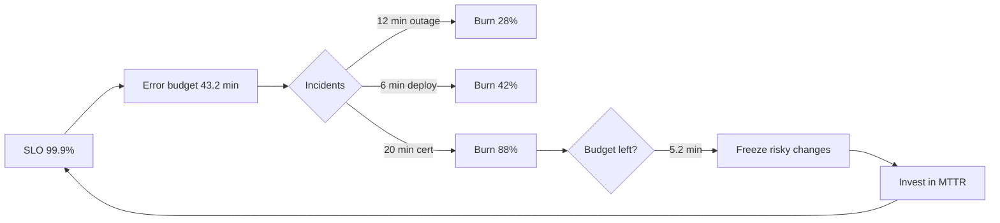

# Reliability Engineering

> **Lab host:** Windows 11, Python 3.13.5. Section 7's transcript was executed on that host from the
> probe embedded there. The probe computes availability from uptime and repair time, prices
> redundancy with independent and correlated failures, spends an error budget across incidents,
> simulates losing a replica at a stated load, decides a canary with a two-proportion test, and
> decomposes incident time. Nothing is timed; every figure is arithmetic over declared inputs.

## 1. Learning Objectives

After this lesson you will be able to:

- [ ] Compute availability from MTBF and MTTR and explain why repair time matters as much as
      failure rate
- [ ] Show how a shared dependency caps the availability of any number of replicas
- [ ] Turn an SLO into minutes of budget and track burn across incidents
- [ ] Predict the effect of losing one replica at a given utilisation, including retry amplification
- [ ] Decide a canary rollout from counts and a stated statistical threshold

## 2. Prerequisites

- [System Design](system-design.md) — the capacity and constraint vocabulary this lesson attaches
  reliability numbers to
- [17-CLOUD-AND-PRODUCTION/observability.md](../17-CLOUD-AND-PRODUCTION/observability.md) — SLIs,
  SLOs and burn-rate alerting, which this lesson uses rather than re-derives
- [17-CLOUD-AND-PRODUCTION/incident-management.md](../17-CLOUD-AND-PRODUCTION/incident-management.md)
  — the human process around the numbers computed here
- [13-SOFTWARE-ENGINEERING-AND-ARCHITECTURE/scalability-and-reliability.md](../13-SOFTWARE-ENGINEERING-AND-ARCHITECTURE/scalability-and-reliability.md)
  — redundancy and failure domains in architectural terms

## 3. Introduction

**Reliability engineering** is the practice of deciding how reliable a system must be, measuring
whether it is, and spending effort where the gap is. It is not "making things not fail" — failure
is a rate, not an event — and it is not "adding redundancy", which is one technique with a specific
cost.

The unit of the discipline is the **service-level objective (SLO)**: a target ratio over a window,
such as "99.9% of requests succeed over 30 days". From it follows the **error budget**: 0.1% of
43,200 minutes, or 43.2 minutes. The budget converts reliability from an argument into arithmetic.
When the budget is healthy, shipping is the right call; when it is spent, the right call is to stop
and fix.

The second unit is **time to repair**. Availability is uptime divided by total time, so halving the
repair time buys exactly what doubling the time between failures buys — and repair time is usually
the cheaper of the two to improve.

## 4. The Problem It Solves

Teams argue about reliability in adjectives. "It needs to be highly available" is not a requirement;
it is a mood. Without a target, every outage is equally unacceptable, every redundancy proposal is
equally justified, and the work never ends because there is no state called "done".

The second problem is misallocated effort. A service with 99.99% dependencies and a 99.9% target is
already over-engineered; a service with a 99.99% target and a 99.5% database is not going to reach
it no matter how many replicas the application tier has. Only arithmetic shows which of those two
situations you are in.

The third is decision paralysis during incidents and releases. With a budget, "should we ship on
Friday" has an answer: yes, if the budget is healthy; no, if it is exhausted. That answer is not
about risk appetite — it is about the number the organisation already agreed to.

## 5. Core Concepts

### Availability, MTBF and MTTR

**Availability** is `MTBF / (MTBF + MTTR)`, where **MTBF** is mean time between failures and
**MTTR** is mean time to repair. A service that fails every 720 hours and takes an hour to fix is
99.8613% available — 59.9 minutes of downtime in a 30-day month.

The consequence is often missed: MTTR is a first-class lever. Doubling MTBF and halving MTTR give
the same availability, and the second is usually an investment in detection, runbooks and rollback
rather than in redundancy.

### Redundancy and its ceiling

Independent replicas combine as `1 - (1 - p)^n`, which is why three 99% replicas reach 99.9999%.
But replicas are only independent with respect to failures smaller than their shared dependency. A
service behind a dependency that is 99.9% available cannot exceed 99.9%, however many replicas sit
behind it: the probe prints 99.8999% for exactly that configuration.

This is the difference between **redundancy** and **resilience**. Redundancy duplicates a component;
resilience survives the loss of one. A shared dependency defeats the first and must be addressed
for the second.

### Error budgets and burn

An **error budget** is the allowed bad fraction of the window: 43.2 minutes for 99.9% over 30 days.
**Burn rate** is the speed of consumption relative to the budget: 1x spends it exactly over the
window, 14.4x spends it in about two days. Budgets are spent by incidents; the probe spends 38 of
43.2 minutes across three and shows 88% consumed, a burn rate of 0.88x.

### Chaos experiments

A **chaos experiment** introduces a controlled failure to learn what the system does. It is only
informative when the load is near the capacity edge: losing one of four replicas at 80% utilisation
leaves 900 QPS of capacity for 960 QPS of demand, so 6.2% of requests fail. The same experiment at
30% utilisation teaches nothing.

Retries amplify the effect: at 1.5 attempts per failed request, the 60 QPS overflow becomes 90 QPS
of extra demand against a system that is already short. Load shedding and retry budgets exist
because of this arithmetic.

### Canaries and statistical decisions

A **canary** sends a small share of traffic to a new version and compares outcomes. The trap is
sample size: a 1% canary over 40 requests cannot distinguish a broken build from noise. The probe
uses 5,000 canary requests and 95,000 baseline, computes a two-proportion z, and gets 54.54 — far
past any reasonable threshold, on an error rate 15.2x the baseline.

The decision rule matters more than the statistic: decide the threshold *before* the rollout, or
the result will be interpreted to fit the outcome someone already wanted.

### Time decomposition

Incident duration decomposes into detect, acknowledge, diagnose, fix and verify. The probe's 44
minutes split 9/7/27/45/11, and halving detection saves 2 minutes while halving diagnosis saves 6.
The largest phase is the one to attack — which is often not the one that feels most urgent.

## 6. How It Works



The loop is the discipline: the SLO sets the budget, incidents spend it, and the response to a
nearly spent budget is to reduce risk *and* improve repair time, which raises availability for the
same failure rate.

The `Invest in MTTR` node is where most teams under-invest. Redundancy is visible and satisfying;
runbooks, rollback and detection are invisible and usually cheaper per minute of downtime avoided.

## 7. Practical Examples

**Example 1 — availability, budgets, redundancy, chaos, a canary and incident time**

The complete program runs six short sections: availability across four MTBF/MTTR pairs, independent
versus correlated redundancy, a spent budget, a replica loss at 80% load, a two-proportion canary
test, and an incident phase breakdown.

```python
"""ADV-09 probe: SLOs, budgets, redundancy, chaos and a canary decision.

Windows 11, Python 3.13.5. Reliability here is arithmetic and one small decision rule:
availability from uptime and repair time, the error budget an SLO buys, what redundancy
does when failures are independent and when they are not, the cost of losing a replica
under a real load, and a canary comparison that uses counts instead of intuition.
"""

from __future__ import annotations

from dataclasses import dataclass

MINUTES_PER_30_DAYS = 30 * 24 * 60


def availability_section() -> None:
    print("=== availability from uptime and repair time ===")
    for mtbf_h, mttr_h in ((720, 1), (720, 4), (168, 8), (2000, 0.5)):
        availability = mtbf_h / (mtbf_h + mttr_h)
        downtime = (1 - availability) * MINUTES_PER_30_DAYS
        print(f"MTBF {mtbf_h:>5} h, MTTR {mttr_h:>4} h: {availability:.4%}, "
              f"{downtime:6.1f} min/month")
    print("availability is a ratio of uptime to elapsed time, and MTTR moves it as much as MTBF")
    print("halving the repair time buys the same as doubling the time between failures")


def redundancy_section() -> None:
    print("\n=== redundancy: independent versus correlated failure ===")
    single = 0.99
    for copies in (2, 3):
        independent = 1 - (1 - single) ** copies
        print(f"{copies} independent replicas: {independent:.6%} "
              f"({(1 - independent) * MINUTES_PER_30_DAYS:.2f} min/month)")

    for shared_availability in (1.0, 0.999, 0.99):
        # Replicas are independent only if the shared dependency is up; when it is down,
        # every replica is down, however many there are.
        correlated = shared_availability * (1 - (1 - single) ** 3)
        print(f"3 replicas behind a dependency at {shared_availability:.3%}: {correlated:.4%} "
              f"({(1 - correlated) * MINUTES_PER_30_DAYS:.1f} min/month)")
    print("the dependency's availability becomes the ceiling, whatever the replica count")


def budget_section() -> None:
    print("\n=== error budget: 99.9% over 30 days ===")
    slo = 0.999
    budget_minutes = (1 - slo) * MINUTES_PER_30_DAYS
    print(f"budget                       : {budget_minutes:.1f} min")
    incidents = [("dependency outage", 12), ("bad deploy", 6), ("certificate expiry", 20)]
    spent = 0
    for name, minutes in incidents:
        spent += minutes
        print(f"  {name:<24}{minutes:>3} min, cumulative {spent:>2} min "
              f"({spent / budget_minutes:.0%} of budget)")
    print(f"remaining                    : {budget_minutes - spent:.1f} min")
    print(f"burn rate so far             : {spent / budget_minutes:.2f}x")
    print("an SLO without a budget is a slogan; the budget is what makes a trade-off decidable")


def chaos_section() -> None:
    print("\n=== chaos: lose one replica at 80% load ===")
    replicas, per_replica_qps, offered_qps = 4, 300, 960
    capacity = replicas * per_replica_qps
    print(f"capacity {replicas} x {per_replica_qps}/s = {capacity}/s, offered {offered_qps}/s "
          f"({offered_qps / capacity:.0%} utilised)")
    remaining = (replicas - 1) * per_replica_qps
    overflow = max(0, offered_qps - remaining)
    print(f"after losing one            : {remaining}/s capacity, overflow {overflow}/s")
    print(f"rejected share              : {overflow / offered_qps:.1%}")
    retries = 1.5
    amplified = overflow * retries
    print(f"client retries at {retries}x amplify the overflow to {amplified:.0f}/s")
    print(f"latency at saturation       : queued, not constant - Little's law applies")
    print("a chaos test that removes capacity is only informative if the load is near the edge")


def canary_section() -> None:
    print("\n=== canary: compare counts, not impressions ===")
    total = 100_000
    canary_share = 0.05
    canary_n = int(total * canary_share)
    baseline_n = total - canary_n
    baseline_errors, canary_errors = 500, 400
    baseline_rate = baseline_errors / baseline_n
    canary_rate = canary_errors / canary_n
    print(f"baseline {baseline_n:,} requests, {baseline_errors} errors: {baseline_rate:.2%}")
    print(f"canary   {canary_n:,} requests, {canary_errors} errors: {canary_rate:.2%}")
    print(f"ratio                        : {canary_rate / baseline_rate:.1f}x")
    # Two-proportion z-test, written out so the arithmetic is auditable.
    pooled = (baseline_errors + canary_errors) / total
    se = (pooled * (1 - pooled) * (1 / baseline_n + 1 / canary_n)) ** 0.5
    z = (canary_rate - baseline_rate) / se
    print(f"standard error               : {se:.5f}")
    print(f"z                            : {z:.2f}")
    print(f"decision at z > 2            : {'roll back' if z > 2 else 'continue'}")
    print(f"the canary error rate is {canary_rate / baseline_rate:.1f}x the baseline, "
          f"on a sample large enough to prove it")
    print("a 1% canary with 40 requests proves nothing, however alarming the percentage looks")


def detection_section() -> None:
    print("\n=== where incident time is actually spent ===")
    phases = [("detect", 4), ("acknowledge", 3), ("diagnose", 12), ("fix", 20), ("verify", 5)]
    total = sum(minutes for _, minutes in phases)
    for name, minutes in phases:
        print(f"  {name:<12}{minutes:>3} min ({minutes / total:>4.0%})")
    print(f"  {'total':<12}{total:>3} min")
    improved = [("detect", 2), ("acknowledge", 3), ("diagnose", 12), ("fix", 20), ("verify", 5)]
    saved = total - sum(m for _, m in improved)
    print(f"halving detection saves      : {saved} min ({saved / total:.0%} of the incident)")
    diag_saved = total - sum(m if n != "diagnose" else m // 2 for n, m in phases)
    print(f"halving diagnosis saves      : {diag_saved} min "
          f"({diag_saved / total:.0%} of the incident)")
    print("the largest phase is the one to attack; here that is the fix, then diagnosis")


def main() -> None:
    availability_section()
    redundancy_section()
    budget_section()
    chaos_section()
    canary_section()
    detection_section()
    print("\nprobe complete: availability, redundancy, budget, chaos, canary, detection")


if __name__ == "__main__":
    main()
```

- `availability_section` applies `mtbf / (mtbf + mttr)` and converts the result to minutes per
  30-day month.
- `redundancy_section` multiplies the shared dependency's availability into the independent
  replica result, which is why a 99.9% dependency dominates three replicas.
- `budget_section` accumulates incidents and prints cumulative burn after each.
- `chaos_section` subtracts lost capacity from offered load, then multiplies the overflow by a
  retry factor.
- `canary_section` writes out the pooled proportion and standard error so the z is auditable.
- `detection_section` halves one phase at a time and reports the saving.

**Expected output** (executed on Windows 11, Python 3.13.5, exit code 0):

```text
=== availability from uptime and repair time ===
MTBF   720 h, MTTR    1 h: 99.8613%,   59.9 min/month
MTBF   720 h, MTTR    4 h: 99.4475%,  238.7 min/month
MTBF   168 h, MTTR    8 h: 95.4545%, 1963.6 min/month
MTBF  2000 h, MTTR  0.5 h: 99.9750%,   10.8 min/month
availability is a ratio of uptime to elapsed time, and MTTR moves it as much as MTBF
halving the repair time buys the same as doubling the time between failures

=== redundancy: independent versus correlated failure ===
2 independent replicas: 99.990000% (4.32 min/month)
3 independent replicas: 99.999900% (0.04 min/month)
3 replicas behind a dependency at 100.000%: 99.9999% (0.0 min/month)
3 replicas behind a dependency at 99.900%: 99.8999% (43.2 min/month)
3 replicas behind a dependency at 99.000%: 98.9999% (432.0 min/month)
the dependency's availability becomes the ceiling, whatever the replica count

=== error budget: 99.9% over 30 days ===
budget                       : 43.2 min
  dependency outage        12 min, cumulative 12 min (28% of budget)
  bad deploy                6 min, cumulative 18 min (42% of budget)
  certificate expiry       20 min, cumulative 38 min (88% of budget)
remaining                    : 5.2 min
burn rate so far             : 0.88x
an SLO without a budget is a slogan; the budget is what makes a trade-off decidable

=== chaos: lose one replica at 80% load ===
capacity 4 x 300/s = 1200/s, offered 960/s (80% utilised)
after losing one            : 900/s capacity, overflow 60/s
rejected share              : 6.2%
client retries at 1.5x amplify the overflow to 90/s
latency at saturation       : queued, not constant - Little's law applies
a chaos test that removes capacity is only informative if the load is near the edge

=== canary: compare counts, not impressions ===
baseline 95,000 requests, 500 errors: 0.53%
canary   5,000 requests, 400 errors: 8.00%
ratio                        : 15.2x
standard error               : 0.00137
z                            : 54.54
decision at z > 2            : roll back
the canary error rate is 15.2x the baseline, on a sample large enough to prove it
a 1% canary with 40 requests proves nothing, however alarming the percentage looks

=== where incident time is actually spent ===
  detect        4 min (  9%)
  acknowledge   3 min (  7%)
  diagnose     12 min ( 27%)
  fix          20 min ( 45%)
  verify        5 min ( 11%)
  total        44 min
halving detection saves      : 2 min (5% of the incident)
halving diagnosis saves      : 6 min (14% of the incident)
the largest phase is the one to attack; here that is the fix, then diagnosis

probe complete: availability, redundancy, budget, chaos, canary, detection
```

- `MTBF 720 h, MTTR 1 h: 99.8613%, 59.9 min/month` and the same MTBF with a 4-hour MTTR at
  `99.4475%, 238.7 min/month` is the MTTR argument in two lines.
- `3 replicas behind a dependency at 99.900%: 99.8999%` against `99.9999%` for independent replicas
  is the ceiling: the dependency, not the replica count, sets the number.
- `budget : 43.2 min`, then `88% of budget`, `remaining : 5.2 min`, `burn rate : 0.88x` is a budget
  being spent in public.
- `capacity 4 x 300/s = 1200/s, offered 960/s (80% utilised)` then `rejected share : 6.2%` is why
  chaos experiments belong near the edge.
- `canary 5,000 requests, 400 errors: 8.00%` against `0.53%` baseline, `z : 54.54`, `roll back` is
  a decision with a number behind it.
- `halving detection saves : 2 min (5%)` versus `halving diagnosis saves : 6 min (14%)` shows why
  the phase breakdown comes before the improvement plan.
- **How to run it:** save as `reliability_probe.py`, run `python reliability_probe.py`. Standard
  library only.
- **Assumptions:** 30-day months, independent replica failures unless a shared dependency is
  declared, and a fixed retry factor. Real systems have correlated load effects that make outages
  worse than this model.

**Example 2 — the same numbers as a review decision**

```text
Target 99.99%?          -> find the dependency below it first; replicas will not fix it
Budget spent 88%?       -> freeze risky changes; the number already made the decision
Losing a replica at 80% -> 6.2% rejected; either add capacity or shed load deliberately
Canary at 1% of traffic -> too small to decide; wait for 5,000 requests or use staged rollout
Incident took 44 min    -> diagnosis and fix are 72% of it; detection is not the lever here
```

The second line is the one organisations find hardest. A budget is only real if it changes
behaviour, and a budget that is never allowed to block a release is a dashboard, not a policy.

## 8. Real-World Applications

- **SaaS platforms** run SLOs per customer-facing journey, not per service, because users experience
  the journey.
- **Payment systems** run tighter budgets and invest heavily in MTTR: fast rollback, rehearsed
  failover, and detection measured in seconds.
- **Consumer apps** trade availability for latency at the edge, using caches and degraded modes
  rather than failing outright.
- **Internal platforms** often run looser SLOs than their consumers assume, which is why publishing
  them matters more than improving them.
- **Regulated systems** need availability numbers for audit; deriving them from MTBF/MTTR and
  incidents is the defensible form.

## 9. Common Mistakes

| Mistake | Why it happens | How to recognize it | How to prevent it |
|---|---|---|---|
| Setting an SLO with no budget policy | The target sounds like the hard part | Budget exhausts and nothing changes | Agree what a spent budget does before it happens |
| Counting replicas as availability | The console shows three instances | Shared dependency outage takes all three | Draw the dependency, then compute the ceiling |
| Chaos testing a lightly loaded system | It is safer and easier to schedule | Experiments pass and outages still surprise | Run near the capacity edge, or inject dependency failure |
| Deciding a canary on a percentage | 8% looks alarming | 400 errors on 5,000 requests vs 3 before | Use counts and a pre-declared threshold |
| Improving detection only | Alerts are visible work | MTTR barely moves | Decompose the incident and attack the largest phase |
| Retries without a budget | Retries are the default client behaviour | Outage deepens as clients amplify load | Cap retries per request and shed load at the edge |

## 10. Best Practices

- **State the SLO as a ratio and a window**, and derive the budget in the same sentence.
- **Find the weakest dependency before adding replicas.** Compute the ceiling; if it is below the
  target, the work is elsewhere.
- **Invest in MTTR deliberately**: rollback, runbooks, detection, and rehearsed recovery. The rule
  stops applying when failures are so rare that repair cost dominates — then MTBF investment wins.
- **Pre-declare canary thresholds** and sample sizes, and stop the rollout automatically.
- **Review the budget monthly** and let it change what ships. A budget with no consequence is
  reporting, not engineering.

## 11. Limitations and Trade-Offs

Availability is not free and its cost curve is convex: 99.9% is routine, 99.99% usually requires a
second region and rehearsed failover, and 99.999% is a different organisation. At some point the
right answer is "accept 99.9% and make failures short".

SLOs measure what you chose to measure. A service can hit its SLO while being unusable for a
minority of users whose requests are not in the SLI — which is why per-journey SLOs exist.

Chaos experiments carry real risk: injecting failure near the edge can cause the outage it was
meant to prevent. The mitigation is blast-radius control, not optimism.

And statistical decisions need discipline. A canary test answers "is this different" — not "is this
different enough to matter". The threshold encodes the second question, and someone has to own it.

## 12. Practical Exercises

### Introductory

1. **Exercise 9.1** — Compute availability for MTBF 500 h and MTTR 2 h, and the monthly downtime.
   **Completion criteria:** 99.6016% and 172.3 minutes, with the division shown.

2. **Exercise 9.2** — With a 99.95% SLO over 30 days, compute the budget in minutes and how much a
   10-minute full outage consumes.
   **Completion criteria:** 21.6 minutes of budget, 46% consumed, stated in units.

### Intermediate

3. **Exercise 9.3** — Add a second shared dependency at 99.95% in series with the first at 99.9%
   and recompute the three-replica ceiling.
   **Completion criteria:** 99.8499% and an explanation of why adding replicas cannot recover it.

4. **Exercise 9.4** — Change the canary to 500 requests with 40 errors and compute the z.
   **Completion criteria:** the same 8% rate with a z around 17, and a statement of what the
   decision should be and why sample size changes confidence rather than the estimate.

### Independent problem-solving

5. **Exercise 9.5** — A service has a 99.95% SLO, four incidents in a month totalling 18 minutes,
   a dependency at 99.9%, and a detection time of 6 minutes. Diagnose whether the SLO is reachable,
   choose the next investment (redundancy, MTTR, or dependency), and justify it with computed
   numbers including the ceiling and the remaining budget.
   **Completion criteria:** a written decision with the availability ceiling computed, budget
   remaining stated, and one investment chosen with its expected effect quantified.

*Solutions: attempt first. They live in `solutions/` of this subject.*

## 13. Knowledge Check

1. Two services have the same MTBF; one has a 10-minute MTTR and one has an hour. Which is more
   available, and by how much per month?
2. Three replicas sit behind a 99.9% dependency. What is the maximum availability, and why?
3. Your budget is 85% spent with three weeks left in the window. What are the two legitimate
   responses?
4. At what utilisation does losing one of four replicas start rejecting traffic?
5. A canary shows 8% errors on 200 requests. What can you conclude?

## 14. Completion Criteria

- [ ] You can compute availability from MTBF and MTTR and convert it to monthly minutes
- [ ] You can explain and compute the shared-dependency ceiling
- [ ] You can spend an error budget across incidents and state the remaining policy
- [ ] You can predict the effect of a replica loss at a given utilisation
- [ ] You can decide a canary with counts and a pre-declared threshold

## 15. Summary

- Availability is a ratio of uptime to elapsed time; MTTR is as strong a lever as MTBF.
- Redundancy helps only across independent failure domains; a shared dependency sets the ceiling.
- An SLO buys a budget in minutes, and the budget is only real if it changes decisions.
- Chaos experiments are informative near the capacity edge, and retries amplify the shortfall.
- Canaries are statistical decisions: counts, a pre-declared threshold, and enough samples.

## 16. Next Steps

- Next lesson: [Large-Codebase Maintenance](large-codebase-maintenance.md) — reliability of the
  development process itself, where change impact is computed from a dependency graph.
- Practice: [17-CLOUD-AND-PRODUCTION/observability.md](../17-CLOUD-AND-PRODUCTION/observability.md)
  builds the SLIs these SLOs are measured with.
- Where it is applied: [20-PROJECT-LABORATORY/README.md](../20-PROJECT-LABORATORY/README.md)
  requires an SLO and a budget policy for the capstone.
