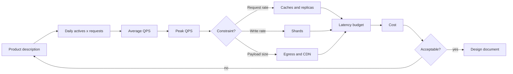

# System Design

> **Lab host:** Windows 11, Python 3.13.5. Section 7's transcript was executed on that host from
> the probe embedded there. The probe is the arithmetic half of a design review: daily actives to
> peak QPS, writes to terabytes per year, response size to egress bandwidth, volume to shard count,
> a latency budget spent line by line, a cache sized from its working set, queue backlog under a
> burst, and the monthly bill those assumptions imply. Every figure is computed from declared
> inputs, so a reviewer can change one and see which conclusions move.

## 1. Learning Objectives

After this lesson you will be able to:

- [ ] Turn a product description into peak QPS, storage per year, and bandwidth, showing each step
- [ ] State the three or four assumptions that actually drive a design, and test their sensitivity
- [ ] Spend a latency budget line by line and say what is left for the unknown
- [ ] Choose a shard count and a replica count from volume and node capacity, not from habit
- [ ] Write a one-page design whose numbers a reviewer can recompute

## 2. Prerequisites

- [Database Scaling](database-scaling.md) — shards, replicas and caches, the components a design
  chooses between
- [Distributed Systems Patterns](distributed-systems-patterns.md) — what coordination costs, so a
  design does not ask for atomicity it cannot have
- [13-SOFTWARE-ENGINEERING-AND-ARCHITECTURE/requirements-engineering.md](../13-SOFTWARE-ENGINEERING-AND-ARCHITECTURE/requirements-engineering.md)
  — turning ambiguous intent into testable requirements
- [13-SOFTWARE-ENGINEERING-AND-ARCHITECTURE/scalability-and-reliability.md](../13-SOFTWARE-ENGINEERING-AND-ARCHITECTURE/scalability-and-reliability.md)
  — the reliability vocabulary the storage and replica sections assume

## 3. Introduction

System design interviews and real design reviews look different but ask the same thing: given
ambiguous requirements and finite resources, produce a system whose trade-offs you can defend. The
work is not drawing boxes. It is deciding which numbers matter, estimating them early, and
choosing the simplest architecture that survives them.

A **back-of-the-envelope estimate** is arithmetic done before the design, to find which constraint
bites first. Two million daily users at eight requests each is sixteen million requests a day, or
about 185 per second on average — and with a peak factor of five, 926 per second. That single
number decides whether the design needs a cache, a read replica, or neither.

The value is not precision. It is knowing which of storage, bandwidth, request rate or latency is
the binding constraint, because that is the axis you design against.

## 4. The Problem It Solves

Designs fail in two directions. The first is under-design: a system built for a thousand users
meets a launch, and the team discovers in public that the database cannot take the write rate. The
second is over-design: a system built for a billion users by a team of four, with a service mesh
nobody can operate, a shard scheme nobody needs, and a bill that exceeds revenue.

Both come from the same missing step: no estimate of what the system must actually handle. Without
it, every architecture is equally defensible and equally arbitrary.

The pre-estimate workarounds are recognisable. "We will scale when we need to" postpones a
decision that becomes expensive. "Copy what the big companies do" imports constraints you do not
have. "Add caching" is a solution looking for a measurement. An estimate costs an hour and
eliminates most of the argument.

## 5. Core Concepts

### Traffic: average, peak and shape

**Average QPS** is daily requests divided by seconds per day. **Peak QPS** multiplies by a peak
factor derived from the product's rhythm — a consumer app peaks in the evening, a business tool at
mid-morning, a payment system at month end. The peak is what capacity must survive, and the peak
factor is the assumption most worth arguing about, because it is usually a guess.

The read/write split matters as much as the total: 90/10 permits replicas and caches; 50/50 makes
writes the constraint and sharding likely.

### Storage: rows to bytes to shards

Storage grows with writes, not with users. Users times writes per day times bytes per row gives
daily growth; multiply by retention for the total. Add index and replica overhead before dividing
by node capacity, or the shard count will be wrong in the direction that hurts.

### Bandwidth

Response size times request rate is **egress**, and it is priced separately from compute on every
cloud. A 40 KB response at 926 requests per second is 37.9 MB/s, which is 303 Mbit/s and roughly
20 TB a month at a realistic duty cycle — often the largest line item in a design built by someone
thinking only about databases.

### Latency budget

A **latency budget** allocates the p95 target across components before implementation. If the
target is 300 ms and the allocation totals 230, there are 70 ms for the unknowns — which is either
enough or a warning that the design has no room for a bad day. Budgets are only useful when each
line has an owner and a measurement.

### Caches and working sets

A cache is sized by the **working set**, the distinct keys requested in a window, not by total
objects. The 80/20 assumption says 20% of objects serve 80% of requests; the probe prices that at
3.2 million hot objects, 6.6 GB of memory, and a database load of 185 QPS instead of 926. If the
hit rate turns out to be 50%, the database sees 2.5x the assumed load — the sensitivity that
matters most in review.

### Queues and bursts

A queue absorbs a burst only if it can drain afterwards. Five thousand messages per second for a
minute against a thousand per second drain leaves 240,000 messages and 240 seconds of recovery —
four minutes of degraded service after a one-minute spike. That is the number to put in the design,
because it is the number users experience.

### Cost as a design output

Compute, storage and egress are computed from the same assumptions. The probe's bill is $2,163 a
month, of which egress is $1,812 — 84%. A design review that does not compute this is not a
design review; it is a diagram.

## 6. How It Works



The loop back to the assumptions is the important arrow. Estimates are not a one-way gate; they are
recomputed when a constraint forces a change. A design that has been through the loop twice is
usually simpler than the first draft, because the expensive parts were the ones nobody needed.

The branch at `Constraint?` is where most review time is wasted: teams add caches, replicas and
shards simultaneously instead of identifying which one the numbers demand. The probe answers the
question by computing all three and showing which one is actually binding.

## 7. Practical Examples

**Example 1 — the arithmetic of a design, from assumptions to bill**

The complete program takes one `Assumptions` dataclass and derives traffic, storage, bandwidth,
shard counts, a latency budget, cache sizing, queue behaviour and cost.

```python
"""ADV-07 probe: a design document's numbers, derived before anything is built.

Windows 11, Python 3.13.5. This is the arithmetic half of a system design: daily actives
to peak queries per second, writes to bytes per year, bytes to shards, a latency budget
spent line by line, and the bill that follows. Every figure is computed from the stated
assumptions, so a reviewer can change one input and see which conclusions move.
"""

from __future__ import annotations

from dataclasses import dataclass

SECONDS_PER_DAY = 86_400
DAYS_PER_YEAR = 365


@dataclass(frozen=True)
class Assumptions:
    daily_active_users: int = 2_000_000
    requests_per_user_day: int = 8
    writes_per_user_day: int = 3
    peak_factor: float = 5.0
    response_kb: int = 40
    write_kb: int = 2
    read_share: float = 0.9


def traffic_section(a: Assumptions) -> tuple[float, float]:
    print("=== traffic: daily actives to peak queries per second ===")
    daily_requests = a.daily_active_users * a.requests_per_user_day
    average_qps = daily_requests / SECONDS_PER_DAY
    peak_qps = average_qps * a.peak_factor
    print(f"requests per day             : {daily_requests:,}")
    print(f"average qps                  : {average_qps:,.0f}")
    print(f"peak factor                  : {a.peak_factor:.0f}x")
    print(f"peak qps                     : {peak_qps:,.0f}")
    print(f"reads / writes at peak       : {peak_qps * a.read_share:,.0f} / "
          f"{peak_qps * (1 - a.read_share):,.0f}")
    print("the peak factor is the assumption most worth arguing about")
    return average_qps, peak_qps


def storage_section(a: Assumptions) -> float:
    print("\n=== storage: writes per day to bytes per year ===")
    daily_writes = a.daily_active_users * a.writes_per_user_day
    daily_bytes = daily_writes * a.write_kb * 1_024
    yearly_bytes = daily_bytes * DAYS_PER_YEAR
    print(f"writes per day               : {daily_writes:,}")
    print(f"bytes per day                : {daily_bytes / 1e9:.1f} GB")
    print(f"bytes per year               : {yearly_bytes / 1e12:.2f} TB")
    print(f"three-year retention         : {yearly_bytes * 3 / 1e12:.1f} TB")
    print(f"with one index copy          : {yearly_bytes * 2 / 1e12:.1f} TB")
    return yearly_bytes


def bandwidth_section(a: Assumptions, peak_qps: float) -> None:
    print("\n=== bandwidth: response size times peak rate ===")
    peak_bytes_per_s = peak_qps * a.response_kb * 1_024
    print(f"response size                : {a.response_kb} KB")
    print(f"peak egress                  : {peak_bytes_per_s / 1e6:.1f} MB/s "
          f"({peak_bytes_per_s * 8 / 1e6:.0f} Mbit/s)")
    print(f"monthly egress               : "
          f"{peak_bytes_per_s * 0.2 * SECONDS_PER_DAY * 30 / 1e12:.1f} TB at 20% of peak")
    print("egress is usually the line item that surprises a first estimate")


def sharding_section(yearly_bytes: float) -> None:
    print("\n=== shards: capacity per node decides the count ===")
    for per_node_tb in (0.5, 1.0, 2.0):
        shards = -(-yearly_bytes // (per_node_tb * 1e12))
        print(f"{per_node_tb:>4.1f} TB per node: {int(shards):>2} shards for one year, "
              f"{int(shards) * 2:>2} with a replica each")
    print("shard count is a data-volume decision; query patterns decide the shard key")


def latency_section() -> None:
    print("\n=== latency budget: 300 ms p95, spent before coding ===")
    budget = [
        ("TLS + network round trip", 40),
        ("load balancer", 5),
        ("application logic", 30),
        ("cache lookup (miss path)", 5),
        ("database query", 60),
        ("serialisation", 10),
        ("third-party call", 80),
    ]
    total = sum(value for _, value in budget)
    for name, value in budget:
        print(f"  {name:<28}{value:>5} ms")
    print(f"  {'total':<28}{total:>5} ms of {300} ms")
    print(f"headroom                     : {300 - total} ms")
    print("a budget is only useful if each line has an owner and a measurement")


def cache_section(a: Assumptions, peak_qps: float) -> None:
    print("\n=== cache: the 80/20 assumption, priced ===")
    objects = a.daily_active_users * a.requests_per_user_day
    hot_share = 0.2
    hot_objects = int(objects * hot_share)
    hit_rate = 0.8
    print(f"distinct objects per day      : {objects:,}")
    print(f"hot 20% of objects           : {hot_objects:,}")
    print(f"assumed hit rate             : {hit_rate:.0%}")
    print(f"database reads at peak       : {peak_qps * (1 - hit_rate):,.0f}/s "
          f"instead of {peak_qps:,.0f}/s")
    print(f"cache memory at 2 KB/object  : {hot_objects * 2 * 1_024 / 1e9:.1f} GB")
    print("if the hit rate is 50%, the database sees 2.5x the load this line assumed")


def queue_section() -> None:
    print("\n=== burst absorption: a queue is a shock absorber with a size ===")
    burst_qps, burst_seconds, drain_qps = 5_000, 60, 1_000
    backlog = (burst_qps - drain_qps) * burst_seconds
    print(f"burst {burst_qps}/s for {burst_seconds} s, drain {drain_qps}/s")
    print(f"backlog at the end of the burst: {backlog:,} messages")
    print(f"time to drain                : {backlog / drain_qps:.0f} s")
    print(f"messages held at 1 KB each   : {backlog * 1_024 / 1e6:.0f} MB")
    print("a queue that drains slower than the burst arrives is a delay, not a fix")


def cost_section(yearly_bytes: float, peak_qps: float) -> None:
    print("\n=== monthly bill from the same assumptions ===")
    storage_gb = yearly_bytes / 1e9
    storage_cost = storage_gb * 0.023
    compute_nodes = -(-peak_qps // 300)
    compute_cost = compute_nodes * 0.085 * 730
    egress_tb = peak_qps * 40 * 1_024 * 0.2 * SECONDS_PER_DAY * 30 / 1e12
    egress_cost = egress_tb * 1_024 * 0.09
    total = storage_cost + compute_cost + egress_cost
    print(f"storage  {storage_gb:8,.0f} GB x $0.023      ${storage_cost:9,.2f}")
    print(f"compute  {int(compute_nodes):8d} nodes x $0.085/h ${compute_cost:9,.2f}")
    print(f"egress   {egress_tb:8.1f} TB x $0.09/GB     ${egress_cost:9,.2f}")
    print(f"total                                ${total:9,.2f}/month")
    print(f"cost per 1,000 requests              "
          f"${total / (peak_qps * 0.2 * SECONDS_PER_DAY * 30 / 1_000):.4f}")


def main() -> None:
    assumptions = Assumptions()
    average_qps, peak_qps = traffic_section(assumptions)
    yearly_bytes = storage_section(assumptions)
    bandwidth_section(assumptions, peak_qps)
    sharding_section(yearly_bytes)
    latency_section()
    cache_section(assumptions, peak_qps)
    queue_section()
    cost_section(yearly_bytes, peak_qps)
    print("\nprobe complete: traffic, storage, bandwidth, shards, latency, cache, queue, cost")


if __name__ == "__main__":
    main()
```

- `traffic_section` divides by 86,400 and multiplies by the peak factor; that is the whole of the
  QPS estimate.
- `storage_section` multiplies writes, bytes and days, then shows the effect of retention and an
  index copy.
- `sharding_section` uses ceiling division, so a design never rounds shards down.
- `latency_section` allocates a fixed budget and prints the headroom; it fails loudly by arithmetic
  if the allocation exceeds 300 ms.
- `cache_section` prints the sensitivity that matters: what the database sees at a 50% hit rate.
- `cost_section` reuses the same volumes, so the bill cannot drift from the design.

**Expected output** (executed on Windows 11, Python 3.13.5, exit code 0):

```text
=== traffic: daily actives to peak queries per second ===
requests per day             : 16,000,000
average qps                  : 185
peak factor                  : 5x
peak qps                     : 926
reads / writes at peak       : 833 / 93
the peak factor is the assumption most worth arguing about

=== storage: writes per day to bytes per year ===
writes per day               : 6,000,000
bytes per day                : 12.3 GB
bytes per year               : 4.49 TB
three-year retention         : 13.5 TB
with one index copy          : 9.0 TB

=== bandwidth: response size times peak rate ===
response size                : 40 KB
peak egress                  : 37.9 MB/s (303 Mbit/s)
monthly egress               : 19.7 TB at 20% of peak
egress is usually the line item that surprises a first estimate

=== shards: capacity per node decides the count ===
 0.5 TB per node:  9 shards for one year, 18 with a replica each
 1.0 TB per node:  5 shards for one year, 10 with a replica each
 2.0 TB per node:  3 shards for one year,  6 with a replica each
shard count is a data-volume decision; query patterns decide the shard key

=== latency budget: 300 ms p95, spent before coding ===
  TLS + network round trip       40 ms
  load balancer                   5 ms
  application logic              30 ms
  cache lookup (miss path)        5 ms
  database query                 60 ms
  serialisation                  10 ms
  third-party call               80 ms
  total                         230 ms of 300 ms
headroom                     : 70 ms
a budget is only useful if each line has an owner and a measurement

=== cache: the 80/20 assumption, priced ===
distinct objects per day      : 16,000,000
hot 20% of objects           : 3,200,000
assumed hit rate             : 80%
database reads at peak       : 185/s instead of 926/s
cache memory at 2 KB/object  : 6.6 GB
if the hit rate is 50%, the database sees 2.5x the load this line assumed

=== burst absorption: a queue is a shock absorber with a size ===
burst 5000/s for 60 s, drain 1000/s
backlog at the end of the burst: 240,000 messages
time to drain                : 240 s
messages held at 1 KB each   : 246 MB
a queue that drains slower than the burst arrives is a delay, not a fix

=== monthly bill from the same assumptions ===
storage     4,485 GB x $0.023      $   103.16
compute         4 nodes x $0.085/h $   248.20
egress       19.7 TB x $0.09/GB     $ 1,811.94
total                                $ 2,163.30/month
cost per 1,000 requests              $0.0045

probe complete: traffic, storage, bandwidth, shards, latency, cache, queue, cost
```

- `average qps : 185` then `peak qps : 926` is the single most useful pair in the output: the
  design must survive the second, not the first.
- `reads / writes at peak : 833 / 93` decides the architecture: read-heavy means caches and
  replicas before shards.
- `bytes per year : 4.49 TB` and `three-year retention : 13.5 TB` are what make shard count
  non-trivial; at one terabyte per node it is five shards, ten with replicas.
- `peak egress : 37.9 MB/s (303 Mbit/s)` and `monthly egress : 19.7 TB` are the lines that turn
  into the largest invoice item.
- `total : 230 ms of 300 ms` with `headroom : 70 ms` is a budget that survives one surprise, not
  three.
- `database reads at peak : 185/s instead of 926/s` is the cache's value stated as load removed,
  and the next line prices the memory that buys it.
- `backlog at the end of the burst: 240,000 messages` and `time to drain : 240 s` is the burst
  cost, which no amount of "the queue will absorb it" makes disappear.
- `total : $2,163.30/month` with egress at 84% is the design's price, derived rather than guessed.
- **How to run it:** save as `system_design_probe.py`, run `python system_design_probe.py`.
  Standard library only.
- **Assumptions:** uniform request cost, 20% of peak sustained for monthly egress, $0.023/GB
  storage, $0.085/node-hour, $0.09/GB egress. Change them; the structure of the answer holds.

**Example 2 — the sensitivity a reviewer should ask about**

```text
If peak factor is 10x instead of 5x: peak 1,852 QPS, compute doubles, egress doubles.
If average response is 100 KB instead of 40: egress 2.5x, and egress becomes 90%+ of the bill.
If hit rate is 50% instead of 80%: database reads 926/s, so the cache no longer removes the need
for replicas.
```

Three questions, three designs. This is why a design document states its assumptions numerically:
so the reviewer can attack the assumption instead of the diagram. A design whose conclusions do not
change under any of these is either robust or not actually sensitive to its inputs — and the
difference is whether you computed them.

## 8. Real-World Applications

- **Consumer apps** are read-heavy with sharp evening peaks; caches and replicas dominate, and
  egress from media is the cost driver.
- **B2B tools** have lower peaks but strict per-tenant isolation, which pushes towards sharding by
  tenant and away from shared caches.
- **Payment systems** are write-heavy with a month-end spike; the design is dominated by
  idempotency, audit retention and write capacity, not by caching.
- **Internal analytics** tolerate minutes of staleness, which makes replicas and batch pipelines
  cheap wins and real-time infrastructure unnecessary.
- **Marketplaces** combine all of it, which is why they are the standard interview prompt and the
  standard reason designs grow complicated.

## 9. Common Mistakes

| Mistake | Why it happens | How to recognize it | How to prevent it |
|---|---|---|---|
| Designing for average QPS | It is the number in the requirements | Works in testing, collapses at peak | Multiply by a peak factor and design for that |
| Ignoring egress | Compute is the visible cost | Bill is dominated by data transfer | Compute response size x rate before choosing payloads |
| Sharding before indexing and caching | Shards sound like scale | Cross-shard queries in the hot path | Show the constraint; shard only when writes demand it |
| Cache sized by total objects | "Cache everything" | Hit rate collapses as the catalogue grows | Size from the working set |
| Latency budget with no owner per line | Allocation looks like planning | Every line is "about right" and the total is not | Assign each line to a component and a measurement |
| No queue drain calculation | Queues are assumed to absorb | Degradation continues after the spike ends | Compute backlog and drain time, state both |

## 10. Best Practices

- **Write the assumptions first, as numbers.** Daily actives, requests per user, peak factor,
  payload size, retention. Everything else is derived.
- **Identify the binding constraint out loud.** "Writes bind at 93/s per shard" is a design
  statement; "we might need sharding" is not.
- **Budget latency before implementation**, with a line per component and an owner per line.
- **Compute the bill from the same volumes**, so cost is a design output rather than a surprise.
- **State the trigger for the next step**: "add replicas when read QPS exceeds 600 per node" is
  actionable; "monitor and scale" is not. The rule stops applying when a component's scaling is
  genuinely automatic and bounded by cost — then the trigger is a budget, not a number.

## 11. Limitations and Trade-Offs

Estimates are wrong, and the honest ones are wrong by a factor of two or three. Their value is
ordering constraints, not predicting reality; a design that is right about which axis binds first
is useful even when every number is off.

The arithmetic also says nothing about organisational cost. A design with five services may be
cheaper to run and far more expensive to operate with a team of four, and no capacity model
captures that.

Finally, a good estimate can become a fetish. Designing for the peak of a product that has not
launched is speculative; the right output is often "this design survives 10x growth, and here is
the number that would force a rewrite".

## 12. Practical Exercises

### Introductory

1. **Exercise 7.1** — Change the assumptions to 500,000 daily actives, 20 requests per user, and a
   3x peak factor. Compute average and peak QPS before running.
   **Completion criteria:** 116 average and 347 peak, matching the probe, with the division shown.

2. **Exercise 7.2** — Compute the monthly egress for a 120 KB response at 500 peak QPS at 20% duty
   cycle.
   **Completion criteria:** a figure in TB and a dollar cost at $0.09/GB, with the arithmetic in
   the answer.

### Intermediate

3. **Exercise 7.3** — Reduce the latency budget below 300 ms by moving one component out of the
   request path. State which component and what consistency cost that move introduces.
   **Completion criteria:** a revised budget under 300 ms with headroom, and one sentence naming
   the cost (staleness, eventual consistency, or an extra failure mode).

4. **Exercise 7.4** — Find the hit rate at which the cache stops removing the need for read
   replicas, given a per-node capacity of 300 QPS.
   **Completion criteria:** the threshold hit rate computed from `peak x (1 - hit) <= 300`, with
   the number stated.

### Independent problem-solving

5. **Exercise 7.5** — Design a photo-sharing service for 5 million daily actives: uploads, feeds,
   and image delivery. Produce the estimate table (traffic, storage, bandwidth, shards), a latency
   budget for the feed, the cache strategy with its working set, and the monthly cost. Name the
   binding constraint and the trigger that would force a redesign.
   **Completion criteria:** a one-page design a reviewer can recompute line by line, with every
   assumption numeric and the binding constraint named explicitly.

*Solutions: attempt first. They live in `solutions/` of this subject.*

## 13. Knowledge Check

1. Why is average QPS the wrong number to size capacity against?
2. Your storage estimate is 4.5 TB per year and your egress is 20 TB per month. Which one drives
   the architecture, and why?
3. A design has a 300 ms budget allocated to 295 ms. What has it actually promised?
4. The cache hit rate assumption is wrong by half. Which other component's sizing changes?
5. When is a back-of-the-envelope estimate a waste of an hour?

## 14. Completion Criteria

- [ ] You can derive peak QPS from a product description without notes
- [ ] You can compute storage per year and shard count from writes and retention
- [ ] You can allocate a latency budget and state the headroom
- [ ] You can size a cache from a working set and state the sensitivity
- [ ] You can produce a monthly cost from the same assumptions

## 15. Summary

- Estimate before designing: daily actives to QPS, writes to bytes, bytes to shards.
- Design for peak, not average, and argue about the peak factor explicitly.
- Identify the binding constraint — request rate, write rate or payload size — and design against it.
- A latency budget is only real if each line has an owner and a measurement.
- Cost is a design output; egress is the line most often forgotten and most often largest.

## 16. Next Steps

- Next lesson: [Performance Profiling](performance-profiling.md) — how to find the component that is
  actually slow, rather than the one the design assumed.
- Practice: [17-CLOUD-AND-PRODUCTION/cloud-cost-management.md](../17-CLOUD-AND-PRODUCTION/cloud-cost-management.md)
  turns these estimates into a bill you can attribute.
- Where it is applied: [20-PROJECT-LABORATORY/README.md](../20-PROJECT-LABORATORY/README.md)
  requires a design document in this shape for the capstone.
