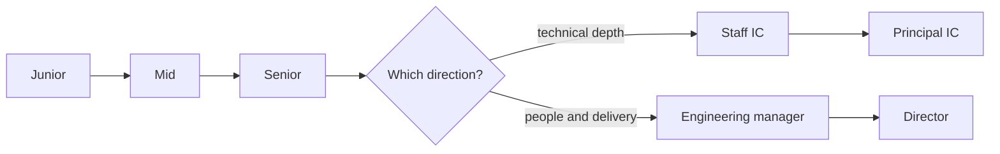

# Career Paths

> **Lab host:** Windows 11, Python 3.13.5. Section 7's transcript was executed on that host from the
> probe embedded there. The probe compares five levels on five dimensions and scores the distance
> between them, maps one person's evidence against two target levels, computes span of influence for
> three tracks, shows compensation bands as ratios, and counts why promotions stall. The expectation
> scores, ratios and stall counts are a declared model, not compensation or promotion data from any
> employer.

## 1. Learning Objectives

After this lesson you will be able to:

- [ ] Describe the individual-contributor and management tracks and what each is accountable for
- [ ] Read a level ladder by scope, autonomy, ambiguity, influence and craft rather than by title
- [ ] Build a promotion case from evidence and identify the specific gap that is missing
- [ ] Distinguish direct reports from span of influence and choose a track deliberately
- [ ] Evaluate a job offer on growth, scope and compensation shape rather than salary alone
- [ ] Recognize a plateau and decide whether to change level, track, or employer

## 2. Prerequisites

- [Engineering Workflows](engineering-workflows.md) — delivery practices that promotion cases are
  built from
- [Technical Documentation](technical-documentation.md) — design notes and decision records, which are
  the evidence a promotion packet needs
- [Teamwork and Communication](teamwork-and-communication.md) — influence and mentoring only count when
  they are visible
- [System Design](../18-ADVANCED-ENGINEERING/system-design.md) — the technical scope that separates
  senior from staff work

## 3. Introduction

A software career is not a single ladder. It is at least two tracks — **individual contributor (IC)**
and **management** — that share early levels and diverge later, plus specialisations such as security,
data, reliability and product engineering that change the content of the work without changing its
level.

Titles are unreliable. "Senior" at one company is "mid" at another, and "staff" can mean either a
technical lead with no reports or a manager of managers. What is portable is the shape of the work:
how large the problems are, how much ambiguity you are expected to resolve, and how many people are
affected by your decisions.

This lesson gives you that shape as five dimensions, a way to score the distance between levels, and a
method for building a promotion case from evidence rather than from tenure. It also covers the parts
nobody puts in a ladder document: span, compensation structure, plateaus, and how to choose between
tracks when both are available.

## 4. The Problem It Solves

The default career model in most companies is "become a manager or stagnate". That model loses
excellent engineers who would be poor managers, and it produces managers who took the role for the
salary rather than for the work. A parallel IC track exists to keep technical depth as a legitimate
destination, not a consolation prize.

The second problem is that promotion is opaque. Without a shared definition of the next level,
engineers optimise for visibility — the demo, the migration, the incident — rather than for scope, and
managers make cases from impression. The result is that promotion becomes political, and the people
who are worst served are those who do quiet, important work.

The third problem is that job changes are decided on salary. Compensation is one dimension of a job;
scope, learning, manager quality and the company's trajectory matter more over a five-year horizon,
and a raise that moves you into a role with no growth is a pay cut in slow motion.

## 5. Core Concepts

**Level** — the expected scope of work: junior (assigned tasks), mid (features), senior (projects),
staff (multi-team direction), principal (organisation-wide). Levels are shorthand for a bundle of
expectations, not a measure of merit.

**Track** — the kind of accountability. ICs are accountable for technical outcomes and direction;
managers for people, delivery and team health. Both exist at senior levels, and the pay bands usually
overlap.

**Scope** — the size of the problem you are trusted with: a task, a feature, a project, a programme, an
organisation.

**Ambiguity** — how much of the problem is defined for you. Senior work starts with a goal and requires
you to find the problem; junior work arrives with acceptance criteria.

**Span of influence** — how many people your decisions affect, directly or indirectly. A manager's span
is direct reports; a staff engineer's is the teams that adopt their designs.

**Readiness** — a list of evidenced requirements for the next level, not a feeling. The gaps are the
plan.

**Compensation shape** — how pay changes across levels: base, bonus, equity and the ratio between
levels. Shape matters more than a single offer number.

## 6. How It Works



The fork at senior is the important part of the diagram. Both branches require the same foundation —
shipping projects, owning production, writing designs — and then diverge in what you are accountable
for. Choosing the IC branch is not a rejection of people; staff engineers spend most of their time
influencing people through designs, reviews and mentoring.

The mechanics of progressing:

1. **Learn the next level's definition.** Ask for the ladder document. If there is none, ask your
   manager to write one paragraph for each dimension.
2. **Do the next level's work before the title.** Promotion is recognition of scope already
   demonstrated; waiting for the title to start is the most common stall.
3. **Record evidence as you go.** Design docs, incident reviews, reviews you wrote, people you
   mentored, decisions you influenced. Memory is a poor archive at review time.
4. **Identify the single missing dimension.** Readiness is usually 60–80% across most requirements
   with one or two gaps; the gaps are the work.
5. **Make the case in the company's format.** Promotion committees compare evidence against a rubric;
   they cannot infer impact from a job title.
6. **Decide whether the next level is the job you want.** Management is a different job, not a reward.

## 7. Practical Examples

**Example 1 — ladder, distance, readiness, span, compensation and stalls**

The complete program runs six sections: a five-level ladder across five dimensions, the scored
distance between adjacent levels, one person's readiness for two targets, span for three tracks,
compensation ratios, and the counted reasons promotions stall.

```python
"""PROF-10 probe: ladder dimensions, level distance, readiness, span and compensation shape.

Windows 11, Python 3.13.5. Five levels are described on five dimensions and scored on the same
dimensions so the distance between levels is a number rather than a slogan; a candidate's
evidence is mapped against two target levels; span of influence is separated into direct reports
and reach; and compensation bands are shown as ratios. The scores are a declared model of
expectations, not measured data.
"""

from __future__ import annotations

LEVELS = ["junior", "mid", "senior", "staff", "principal"]

DIMENSIONS = ["task scope", "autonomy", "ambiguity", "influence", "craft"]

LADDER = {
    "junior": ["assigned tasks", "supervised", "well-defined", "own work", "learns standards"],
    "mid": ["feature-sized", "self-directed", "mostly defined", "own team", "applies standards"],
    "senior": ["project-sized", "owns outcomes", "ambiguous", "team and neighbours",
               "sets standards"],
    "staff": ["multi-team", "sets direction", "under-specified", "organisation",
              "teaches craft"],
    "principal": ["org-wide", "accountable", "novel", "industry", "defines craft"],
}

# Declared expectation score per dimension per level, 1 (entry) to 5 (highest).
EXPECTATIONS = {
    "task scope": [1, 2, 3, 4, 5],
    "autonomy": [1, 2, 4, 5, 5],
    "ambiguity": [1, 2, 3, 4, 5],
    "influence": [1, 1, 2, 4, 5],
    "craft": [1, 2, 3, 4, 5],
}

SENIOR_EVIDENCE = {
    "led a project end to end": True,
    "owned production on-call": True,
    "wrote an accepted design doc": True,
    "mentored one engineer": False,
    "resolved a cross-team disagreement": False,
}

STAFF_EVIDENCE = {
    **SENIOR_EVIDENCE,
    "set a team's technical direction": False,
    "published a design review others adopted": True,
}

COMPENSATION = {"junior": 1.00, "mid": 1.35, "senior": 1.80, "staff": 2.40, "principal": 3.10}


def ladder_section() -> None:
    print("=== the same five dimensions at every level ===")
    header = "".join(f"{level:<22}" for level in LEVELS)
    print(f"{'dimension':<14}{header}")
    for index, dimension in enumerate(DIMENSIONS):
        row = "".join(f"{LADDER[level][index]:<22}" for level in LEVELS)
        print(f"{dimension:<14}{row}")
    print("the work stays technical; what changes is scope, ambiguity and who else is affected")


def distance_section() -> None:
    print("\n=== distance between adjacent levels ===")
    for step, (lower, upper) in enumerate(zip(LEVELS, LEVELS[1:])):
        deltas = []
        total = 0
        for dimension in DIMENSIONS:
            change = EXPECTATIONS[dimension][step + 1] - EXPECTATIONS[dimension][step]
            total += abs(change)
            deltas.append(f"{dimension} {change:+d}")
        print(f"{lower:<10}-> {upper:<10}distance {total}: {', '.join(deltas)}")
    print("promotion is not one skill improving; it is a different mix of five")
    print("the largest jumps land on autonomy and influence, which are the hardest to rehearse")


def readiness_section() -> None:
    print("\n=== readiness for the next level ===")
    for target, evidence in (("senior", SENIOR_EVIDENCE), ("staff", STAFF_EVIDENCE)):
        met = [name for name, done in evidence.items() if done]
        missing = [name for name, done in evidence.items() if not done]
        print(f"{target}: {len(met)}/{len(evidence)} requirements evidenced "
              f"({len(met) / len(evidence):.0%})")
        print(f"  missing: {missing}")
    print("the same person can be close to senior and not close to staff")
    print("readiness is a list of evidence, not a feeling; the missing items are the plan")


def span_section() -> None:
    print("\n=== span of influence ===")
    tracks = [
        ("staff engineer", 0, 3, 8),
        ("engineering manager", 6, 1, 6),
        ("principal engineer", 0, 5, 8),
    ]
    for name, reports, teams, per_team in tracks:
        reach = reports + teams * per_team
        print(f"  {name:<20}direct reports {reports:>2}, teams influenced {teams}, "
              f"engineers reached {reach:>2}")
    print("a manager's span is direct reports; a staff engineer's is decisions other teams adopt")
    print("both are influence; counting the wrong one is how people take the wrong job")


def compensation_section() -> None:
    print("\n=== compensation shape (junior = 1.00) ===")
    previous = None
    for level in LEVELS:
        ratio = COMPENSATION[level]
        step = "" if previous is None else f", +{ratio / previous - 1:.0%} from {previous:.2f}"
        print(f"  {level:<10}{ratio:.2f}x{step}")
        previous = ratio
    print(f"principal is {COMPENSATION['principal']:.2f}x junior for the same craft")
    print("each step buys more scope and ambiguity; it does not buy more typing")


def stall_section() -> None:
    print("\n=== why promotions stall ===")
    reasons = [("no evidence of scope beyond own team", 9),
               ("strong delivery, no direction-setting", 7),
               ("mentoring never recorded", 5),
               ("waiting for a title instead of acting at the level", 4)]
    total = sum(count for _, count in reasons)
    for reason, count in reasons:
        print(f"  {reason:<52}{count:>2} ({count / total:.0%})")
    print(f"engineers affected: {total}")
    print("the first two are the same gap seen from two sides: evidence of wider scope")


def main() -> None:
    ladder_section()
    distance_section()
    readiness_section()
    span_section()
    compensation_section()
    stall_section()
    print("\nprobe complete: ladder, distance, readiness, span, compensation, stalls")


if __name__ == "__main__":
    main()
```

- `LADDER` holds the descriptors per level per dimension; the table is the ladder document compressed
  into a grid.
- `EXPECTATIONS` assigns a 1–5 score per dimension per level so `distance_section` can sum absolute
  differences, which turns "what changes at the next level" into a number.
- `SENIOR_EVIDENCE` and `STAFF_EVIDENCE` share the senior requirements, so the same person's readiness
  is computed against both targets and the drop is visible.
- `span_section` separates direct reports from engineers reached through teams, because the two tracks
  count influence differently.
- `COMPENSATION` is a ratio table, deliberately not absolute salaries, so the shape transfers across
  markets.
- `stall_section` counts reasons, which is the closest thing to a diagnosis a model can offer.

**Expected output** (executed on Windows 11, Python 3.13.5, exit code 0):

```text
=== the same five dimensions at every level ===
dimension     junior                mid                   senior                staff                 principal             
task scope    assigned tasks        feature-sized         project-sized         multi-team            org-wide              
autonomy      supervised            self-directed         owns outcomes         sets direction        accountable           
ambiguity     well-defined          mostly defined        ambiguous             under-specified       novel                 
influence     own work              own team              team and neighbours   organisation          industry              
craft         learns standards      applies standards     sets standards        teaches craft         defines craft         
the work stays technical; what changes is scope, ambiguity and who else is affected

=== distance between adjacent levels ===
junior    -> mid       distance 4: task scope +1, autonomy +1, ambiguity +1, influence +0, craft +1
mid       -> senior    distance 6: task scope +1, autonomy +2, ambiguity +1, influence +1, craft +1
senior    -> staff     distance 6: task scope +1, autonomy +1, ambiguity +1, influence +2, craft +1
staff     -> principal distance 4: task scope +1, autonomy +0, ambiguity +1, influence +1, craft +1
promotion is not one skill improving; it is a different mix of five
the largest jumps land on autonomy and influence, which are the hardest to rehearse

=== readiness for the next level ===
senior: 3/5 requirements evidenced (60%)
  missing: ['mentored one engineer', 'resolved a cross-team disagreement']
staff: 4/7 requirements evidenced (57%)
  missing: ['mentored one engineer', 'resolved a cross-team disagreement', "set a team's technical direction"]
the same person can be close to senior and not close to staff
readiness is a list of evidence, not a feeling; the missing items are the plan

=== span of influence ===
  staff engineer      direct reports  0, teams influenced 3, engineers reached 24
  engineering manager direct reports  6, teams influenced 1, engineers reached 12
  principal engineer  direct reports  0, teams influenced 5, engineers reached 40
a manager's span is direct reports; a staff engineer's is decisions other teams adopt
both are influence; counting the wrong one is how people take the wrong job

=== compensation shape (junior = 1.00) ===
  junior    1.00x
  mid       1.35x, +35% from 1.00
  senior    1.80x, +33% from 1.35
  staff     2.40x, +33% from 1.80
  principal 3.10x, +29% from 2.40
principal is 3.10x junior for the same craft
each step buys more scope and ambiguity; it does not buy more typing

=== why promotions stall ===
  no evidence of scope beyond own team                 9 (36%)
  strong delivery, no direction-setting                7 (28%)
  mentoring never recorded                             5 (20%)
  waiting for a title instead of acting at the level   4 (16%)
engineers affected: 25
the first two are the same gap seen from two sides: evidence of wider scope

probe complete: ladder, distance, readiness, span, compensation, stalls
```

The ladder table is worth reading across a row rather than down a column. `influence     own work
           own team              team and neighbours   organisation          industry` shows the
change that most engineers underestimate: senior influence is already outside your own team, and staff
influence is organisational rather than technical. A person who is excellent within their team has
demonstrated senior scope, not staff scope.

The distance section makes the shape of promotion explicit. `junior    -> mid       distance 4`,
`mid       -> senior    distance 6`, `senior    -> staff     distance 6`, `staff     -> principal
distance 4`. The middle steps are the hard ones, and the deltas say why: `autonomy +2` into senior, and
`influence +2` into staff. Autonomy is hard to rehearse because it requires being trusted with less
defined work; influence is hard because it requires other teams to adopt your decisions, which no
amount of individual output guarantees.

Readiness is the section to use in a one-to-one. `senior: 3/5 requirements evidenced (60%)` with
`missing: ['mentored one engineer', 'resolved a cross-team disagreement']`, and `staff: 4/7
requirements evidenced (57%)` missing those two plus `"set a team's technical direction"`. The person is
closer to senior than to staff, and the same two gaps block both. The probe's line is the coaching
advice: *readiness is a list of evidence, not a feeling; the missing items are the plan*.

The span table corrects a common misreading. `engineering manager direct reports  6, teams influenced
1, engineers reached 12` looks like less influence than `staff engineer      direct reports  0, teams
influenced 3, engineers reached 24`. It is different influence, not less: the manager is accountable
for six people's growth and the team's delivery, while the staff engineer is accountable for decisions
that three teams adopt. `principal engineer  direct reports  0, teams influenced 5, engineers reached
40` is larger still, and still not a management role. Counting direct reports as the only form of
seniority is how engineers take management jobs they do not want.

The compensation table is about shape. `mid       1.35x, +35% from 1.00`, then three steps of about a
third each, ending at `principal is 3.10x junior for the same craft`. The steps are roughly
multiplicative, which is why a 10% raise at the same level is a smaller change than a level change, and
why a level change with a small raise may still be the better move: it moves the base for every
subsequent step.

The stall table is the diagnosis. `no evidence of scope beyond own team                 9 (36%)` and
`strong delivery, no direction-setting                7 (28%)` are the same gap described from two
sides, as the probe says. `mentoring never recorded                             5 (20%)` is a
documentation failure rather than a skill failure, and `waiting for a title instead of acting at the
level   4 (16%)` is the only one that is purely a decision.

- **How to run it:** save as `career_probe.py`, run `python career_probe.py`. Standard library only.
- **Assumptions:** the 1–5 expectations are a declared model, the compensation ratios are illustrative,
  and the stall counts are examples. Your company's ladder will differ in wording; compare the
  dimensions, not the labels.

**Example 2 — the same promotion case, weak and strong**

```text
Weak:   "I have been a senior engineer for three years and consistently delivered."
Strong: "Scope: led the billing migration across three teams (design doc, rollout plan, two
         engineers mentored). Influence: the idempotency pattern I wrote is now used by the
         orders and refunds teams. Evidence: ADR-014, the incident review for the double-charge
         bug, and reviews from both teams' leads. Gap: I have not yet set direction for a team
         outside billing, which is the staff requirement I am working on next quarter."
```

The strong version answers the committee's three questions — what scope, what influence, what evidence
— and names the gap itself. Naming the gap is not weakness; it is what distinguishes a candidate who
understands the level from one who is reciting a tenure argument.

## 8. Real-World Applications

- **Large technology companies** publish ladders with explicit dimensions and run promotion committees
  against them, which is why their engineers talk in terms of scope and influence.
- **Startups** often have no formal ladder, so levels are negotiated per hire; asking for the scope in
  writing protects both sides.
- **Consultancies** promote on client impact and delivery reliability, weighting communication more
  heavily than a product company would.
- **Regulated industries** have slower ladders but more stable scope; the trade is predictability for
  speed.
- **Career changes** into engineering from another field usually enter at mid level and progress
  quickly when the transferable skills — domain knowledge, communication, delivery — are made visible.

## 9. Common Mistakes

| Mistake | Why it happens | How to recognize it | How to prevent it |
|---|---|---|---|
| Taking management for the salary | It is presented as the next step | You miss coding and dread one-to-ones | Compare the work, not the band; IC tracks pay similarly |
| Waiting for the title to act at the level | Promotion feels like permission | "I will do that when I am staff" | Do the work, then ask for recognition |
| Building a case from tenure | Time is easy to count | "Three years in role" as the argument | Evidence of scope, influence and outcomes |
| Optimising for visibility | Committees reward what they can see | Big launches, quiet maintenance neglected | Record quiet work: reviews, mentoring, reliability |
| Ignoring the gap | The case feels strong | Surprise rejection with vague feedback | Ask for the rubric and name the gap yourself |
| Job-hopping for title bumps | Titles are comparable across companies | Three moves, no depth in any domain | Evaluate scope and learning, not the label |

## 10. Best Practices

- **Get the ladder in writing.** If it does not exist, ask your manager to write one paragraph per
  dimension for the next level; the conversation is the value.
- **Keep an evidence file.** One document, updated monthly: designs, incidents, reviews, mentoring,
  outcomes. Promotion season is not the time to reconstruct a year.
- **Act at the next level for at least a quarter before asking.** Committees look for demonstrated
  scope, not potential.
- **Choose the track by the work, not the prestige.** Management is meetings, conflict and people
  problems; staff IC is ambiguous direction-setting and influence without authority. Both are hard in
  different ways.
- **Ask about growth in interviews.** "What did the last person in this role do next?" is a better
  question than the salary range.
- **Treat compensation as a shape.** Base, bonus, equity and level progression compound; a single
  number does not.
- **Re-evaluate every eighteen months.** If you have not learned something that changes how you work,
  the plateau is real.

The advice changes for people who want to stay technical long-term: the principal IC path requires
deliberate exposure to problems outside your team, which usually means volunteering for cross-team
design work rather than another feature.

## 11. Limitations and Trade-Offs

Ladders describe the median, not the individual. Some excellent engineers do their best work at senior
level and have no interest in staff scope; treating that as failure is a management error, not a career
fact.

IC and management tracks are not always equal in practice. Many companies claim parity and pay managers
more; checking the bands before choosing is due diligence, not cynicism.

Promotion is partly political. Evidence is necessary and not sufficient; sponsorship by someone in the
room matters. Building that sponsorship is legitimate work, and pretending otherwise disadvantages the
engineers who take the advice literally.

Compensation ratios vary enormously by market, company size and equity liquidity. The shape in this
lesson is illustrative; the principle — compare level progression, not a single offer — is what
transfers.

## 12. Practical Exercises

### Introductory

1. **Exercise 10.1** — Score yourself 1–5 on the probe's five dimensions and compare with the ladder row
   for your current level. Name the dimension where you are furthest below the expectation.
   **Completion criteria:** five scores, the comparison, and the single dimension named.
2. **Exercise 10.2** — Write your evidence file for the last six months: three designs or decisions,
   two pieces of mentoring, one incident, one review you are proud of.
   **Completion criteria:** a one-page list with links or dates for each item.

### Intermediate

3. **Exercise 10.3** — Using `SENIOR_EVIDENCE`, add two requirements you believe your company uses and
   mark them evidenced or not. Recompute readiness and state whether the added requirements change your
   plan.
   **Completion criteria:** the new table and a paragraph on whether the plan changed.
4. **Exercise 10.4** — Compare two job offers (real or hypothetical) on five dimensions: scope, learning,
   manager quality, compensation shape, and company trajectory. Decide which to take and state what
   would change your mind.
   **Completion criteria:** the comparison table, the decision, and one condition that would reverse it.

### Independent problem-solving

5. **Exercise 10.5** — You are a senior engineer with 60% readiness for staff and an offer to manage a
   team of five at a 15% raise. Write the decision memo: the two roles' actual work, the five-year
   trajectory of each, what you would lose, what you would gain, and the evidence you would collect in
   the first six months to know whether you chose correctly.
   **Completion criteria:** a one-page memo with a decision, a falsifiable prediction, and a review date.

*Solutions: attempt first. They live in `solutions/` of this subject.*

## 13. Knowledge Check

1. Why does the probe score distance rather than listing descriptors? What does a distance of 6 versus 4
   tell you about the work of promotion?
2. A staff engineer has no direct reports and a manager has six. Which has more influence, and what does
   the answer depend on?
3. Why is "waiting for the title" a stall, and what should you do instead?
4. When is taking a management role the wrong choice, even at a higher salary?

## 14. Completion Criteria

Observable evidence that you have understood this lesson:

- [ ] You can describe the five dimensions and your own position on each
- [ ] You can state the specific evidence gap between you and the next level
- [ ] You can explain the difference between direct reports and span of influence
- [ ] You can compare two roles on more than salary and defend the choice
- [ ] You can name one thing you would do differently if you wanted the next level within a year

## 15. Summary

- Levels are bundles of scope, autonomy, ambiguity, influence and craft; titles are unreliable shorthand.
- The hard steps are the middle ones, where autonomy and influence jump rather than accumulate.
- Readiness is evidenced requirements; the missing items are the plan, and naming them is a strength.
- IC and management tracks differ in accountability, not in seniority; choose the work you want.
- Compensation is a shape: level progression compounds, and a single offer number does not.

## 16. Next Steps

- Back to the subject index: [19 — Professional Development](README.md) — the nine lessons as one
  programme
- Practice: [exercise set](exercises/README.md)
- Where it is applied: [20-PROJECT-LABORATORY](../20-PROJECT-LABORATORY/README.md) — the capstone is
  the evidence base for the first promotion case
