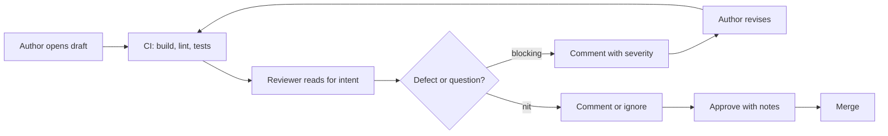

# Code Review

> **Lab host:** Windows 11, Python 3.13.5. Section 7's transcript was executed on that host from the
> probe embedded there. The probe models review time and defect detection against diff size, prices
> additional reviewers, totals the work a comment set creates, and converts review latency into
> stack landing time with Little's law. Nothing is timed with a stopwatch; the reading speed and
> detection curves are declared assumptions printed alongside their results.

## 1. Learning Objectives

After this lesson you will be able to:

- [ ] Explain what code review is for — and what it is not for — and allocate your attention
      accordingly
- [ ] Predict how detection falls as a diff grows, and split a change before that happens
- [ ] Decide how many reviewers a change needs and justify the marginal reviewer
- [ ] Triage a comment set by the work it creates, not by how it feels to receive it
- [ ] Write review comments that are specific, actionable and kind without being vague
- [ ] Measure review latency and connect it to the lead time of everything behind the queue

## 2. Prerequisites

- [Pull Requests and Code Review](../03-DEVELOPER-TOOLS/pull-requests-and-code-review.md) — the
  mechanics of opening, commenting on and merging a pull request
- [Clean Code](../13-SOFTWARE-ENGINEERING-AND-ARCHITECTURE/clean-code.md) — naming, function size
  and structure, which most review comments are really about
- [Testing Fundamentals](../14-TESTING-AND-QUALITY/testing-fundamentals.md) — what a test must
  assert before a reviewer can trust it
- [Engineering Workflows](engineering-workflows.md) — batch size and queue latency, which this
  lesson assumes rather than re-derives

## 3. Introduction

**Code review** is the practice of having another engineer read a proposed change before it enters
the shared codebase. It is the highest-leverage quality practice available to a team, and also the
one most often reduced to ritual: a rubber stamp on a 2,000-line diff, or a thread of style
preferences that helps nobody.

Review does four jobs, in descending order of value. It **catches defects** that tests and static
analysis missed. It **spreads knowledge** so that more than one person can maintain the code. It
**aligns design** before the cost of change grows. And it **creates a written record** of why the
code looks the way it does. Teams that treat review only as defect detection under-invest in it,
because the other three jobs are where most of the return is.

The reviewer's scarcest resource is attention, and attention degrades predictably with volume. That
is why the most useful decision in review happens before reading a line: whether this change should
be reviewed at this size at all.

## 4. The Problem It Solves

Without review, the only check on a change is whether its author believed it. Tests cover what
someone thought to test; static analysis covers what someone thought to encode. Both are
systematic, and both share the author's blind spots. A second reader is the cheapest way to find
the class of problem the author cannot see: a misunderstood requirement, an error path that was
never considered, a name that means the opposite of what it says.

Review also solves a organisational problem. A codebase where every file has exactly one person who
understands it is fragile: that person's holiday is an outage risk, and their departure is a
rewrite. Review is how understanding is transferred, one diff at a time, at the moment the change
is small enough to explain.

The failure mode is review that costs more than it returns. A large diff reviewed late, by someone
with no context, produces comments about formatting and silence about the concurrency bug. The team
concludes that review does not find bugs, and starts treating it as a formality — which makes it
one.

## 5. Core Concepts

**Diff** — the set of added, removed and changed lines in a change. **Diff size** is usually
counted in changed lines; it is the dominant factor in how much a reviewer will actually see.

**Detection rate** — the share of the defects present in a change that reviewers find. It is not a
property of the reviewer alone; it falls with size, fatigue and time pressure.

**Review latency** — the time between "ready for review" and the first substantive response. It is
the number authors feel, and the one that drives them to batch changes.

**Severity** — the consequence of a defect if it ships: blocking (correctness, security, data
loss), question (needs clarification before deciding), nit (style or preference), praise (worth
naming). Triage by severity is what keeps a review thread proportional to its risk.

**Little's law** — average items in a queue equals arrival rate times average time in the queue.
For review, wait time equals open pull requests divided by merge throughput.

**Stack** — a series of changes where each depends on the previous one. Each step's latency adds,
which is why a fast review process matters more for stacked work than for a single change.

## 6. How It Works



The loop matters more than the boxes. A review that produces blocking comments sends the author back
to CI, which is correct: the revised change is a new change and deserves the same gates. A review
that produces only nits should approve with notes rather than block, because blocking on preference
teaches authors to avoid review.

Reading a diff well has an order:

1. **Read the description first.** What is this change trying to do? If the description cannot say
   it in three sentences, the change is probably doing too much.
2. **Read the tests before the implementation.** Tests state the intended behaviour and reveal what
   the author considered. Missing tests are a blocking comment, not a nit.
3. **Read the diff for structure.** New abstractions, changed interfaces, and data flow matter more
   than line-level style.
4. **Read the risky parts closely.** Error handling, concurrency, authorisation, migrations,
   anything that touches money or personal data.
5. **Skim the mechanical parts.** Renames, formatting and generated code do not need attention;
   ask for them in a separate commit so they can be skipped.

## 7. Practical Examples

**Example 1 — size, reviewers, comment triage and latency**

The complete program runs four sections: review time and detection by diff size with a session cap,
detection with one to three reviewers, the work created by a comment set, and stack landing time
from Little's law.

```python
"""PROF-03 probe: review throughput, defect detection, comment triage and review latency.

Windows 11, Python 3.13.5. The probe prices a review in minutes from diff size, combines
independent reviewers, classifies a small set of real review comments into blocking / nit /
question / praise, and applies Little's law to the pull requests a team leaves waiting.
"""

from __future__ import annotations

# One uninterrupted review session is capped at four hours; beyond that reviewers skim.
SESSION_CAP_MINUTES = 240.0


def review_model(lines: int) -> tuple[float, float]:
    if lines <= 150:
        per_hour, detection = 320.0, 0.90
    elif lines <= 300:
        per_hour, detection = 280.0, 0.86
    elif lines <= 600:
        per_hour, detection = 220.0, 0.76
    elif lines <= 1200:
        per_hour, detection = 160.0, 0.45
    else:
        per_hour, detection = 120.0, 0.22
    return min(lines / per_hour * 60, SESSION_CAP_MINUTES), detection


def size_section() -> None:
    print("=== diff size: reading time and detection ===")
    defects = 8
    for lines in (100, 250, 500, 1000, 2000):
        minutes, detection = review_model(lines)
        cap = " (capped)" if minutes == SESSION_CAP_MINUTES else ""
        print(f"{lines:>5} lines: {minutes:6.1f} min{cap:<10} detection {detection:>4.0%}, "
              f"{round(defects * detection)}/{defects} defects")
    print("reading speed falls as the diff grows, so review time grows faster than size")
    print("a 2,000-line review gets the same four hours as a 1,000-line one and sees less")


def reviewers_section() -> None:
    print("\n=== independent reviewers ===")
    single = 0.55
    for reviewers in (1, 2, 3):
        found = 1 - (1 - single) ** reviewers
        minutes = reviewers * 30
        print(f"{reviewers} reviewer(s): {found:.0%} detection for {minutes} min of review")
    print("the second reviewer adds 25% absolute detection for 30 more minutes")
    print("reviewers are not independent in practice: shared context correlates their misses")


def comments_section() -> None:
    print("\n=== comment triage ===")
    comments = [
        ("blocking", "this holds the lock across the network call"),
        ("nit", "prefer f-string here"),
        ("question", "what happens if the list is empty?"),
        ("blocking", "unbounded retry loop on a 500"),
        ("praise", "good catch on the timezone bug"),
        ("nit", "extra blank line"),
        ("blocking", "no test for the rejected path"),
        ("question", "is this index used anywhere?"),
        ("nit", "naming: l -> lines"),
        ("blocking", "secret logged at debug level"),
        ("nit", "missing trailing newline"),
        ("praise", "nice reduction in branching"),
    ]
    costs = {"blocking": 15, "question": 8, "nit": 3, "praise": 0}
    counts: dict[str, int] = {}
    total = 0
    for kind, _ in comments:
        counts[kind] = counts.get(kind, 0) + 1
        total += costs[kind]
    for kind in ("blocking", "question", "nit", "praise"):
        print(f"  {kind:<9}{counts[kind]:>2} comment(s), {costs[kind]:>2} min each: "
              f"{counts[kind] * costs[kind]:>3} min")
    print(f"comments {len(comments)}, work they create {total} min")
    actionable = counts["blocking"] + counts["question"]
    print(f"blocking or clarifying          : {actionable}/{len(comments)} "
          f"({actionable / len(comments):.0%})")
    print("the nits are cheap individually and add up; the blocking comments are the review")


def latency_section() -> None:
    print("\n=== review latency: Little's law ===")
    arrivals_per_day = 3.0
    for hours in (0.5, 4.0, 26.0):
        wait_days = hours / 24
        open_prs = arrivals_per_day * wait_days
        print(f"median wait {hours:>5.1f} h: {open_prs:5.2f} PRs open on average, "
              f"a 3-PR stack takes {3 * hours:5.1f} h to land")
    print("open count is arrival rate times wait; a stack multiplies the wait per step")
    review_minutes = 45
    per_day = arrivals_per_day * review_minutes
    print(f"reviewer load at {review_minutes} min per PR: {per_day:.0f} min/day "
          f"({per_day / 60:.2f} h), spread over the team's available reviewers")
    print("waiting is not free time: it is the lead time of every change behind that PR")


def main() -> None:
    size_section()
    reviewers_section()
    comments_section()
    latency_section()
    print("\nprobe complete: size, reviewers, triage, latency")


if __name__ == "__main__":
    main()
```

- `review_model` computes reading minutes from a per-line speed that falls as the diff grows, then
  caps the session at four hours. The cap is the modelling assumption that keeps the output
  plausible: without it, a 2,000-line review would claim sixteen hours, which no one actually
  spends.
- `size_section` prints both minutes and detection, so the cost and the benefit of a large review
  are visible side by side.
- `reviewers_section` combines independent detection as `1 - (1 - d) ** n`, then states the caveat
  in prose: real reviewers share context, so the combination overstates the gain.
- `triage_section` multiplies comment counts by a declared cost per comment type, which is how a
  thread of twelve comments becomes 88 minutes of work.
- `latency_section` divides open pull requests by arrival rate to get wait, then multiplies by the
  number of steps in a stack.

**Expected output** (executed on Windows 11, Python 3.13.5, exit code 0):

```text
=== diff size: reading time and detection ===
  100 lines:   18.8 min           detection  90%, 7/8 defects
  250 lines:   53.6 min           detection  86%, 7/8 defects
  500 lines:  136.4 min           detection  76%, 6/8 defects
 1000 lines:  240.0 min (capped)  detection  45%, 4/8 defects
 2000 lines:  240.0 min (capped)  detection  22%, 2/8 defects
reading speed falls as the diff grows, so review time grows faster than size
a 2,000-line review gets the same four hours as a 1,000-line one and sees less

=== independent reviewers ===
1 reviewer(s): 55% detection for 30 min of review
2 reviewer(s): 80% detection for 60 min of review
3 reviewer(s): 91% detection for 90 min of review
the second reviewer adds 25% absolute detection for 30 more minutes
reviewers are not independent in practice: shared context correlates their misses

=== comment triage ===
  blocking  4 comment(s), 15 min each:  60 min
  question  2 comment(s),  8 min each:  16 min
  nit       4 comment(s),  3 min each:  12 min
  praise    2 comment(s),  0 min each:   0 min
comments 12, work they create 88 min
blocking or clarifying          : 6/12 (50%)
the nits are cheap individually and add up; the blocking comments are the review

=== review latency: Little's law ===
median wait   0.5 h:  0.06 PRs open on average, a 3-PR stack takes   1.5 h to land
median wait   4.0 h:  0.50 PRs open on average, a 3-PR stack takes  12.0 h to land
median wait  26.0 h:  3.25 PRs open on average, a 3-PR stack takes  78.0 h to land
open count is arrival rate times wait; a stack multiplies the wait per step
reviewer load at 45 min per PR: 135 min/day (2.25 h), spread over the team's available reviewers
waiting is not free time: it is the lead time of every change behind that PR

probe complete: size, reviewers, triage, latency
```

The size table is the central argument of this lesson. `100 lines:   18.8 min ... detection  90%,
7/8 defects` against `2000 lines:  240.0 min (capped)  detection  22%, 2/8 defects`. The large
review costs thirteen times the attention and finds a quarter of the defects. It is not that the
reviewer is careless; it is that a two-thousand-line diff exceeds what a person can hold, so the
reviewer falls back on pattern matching and finds only the obvious.

The reviewer table prices the marginal reviewer honestly. `1 reviewer(s): 55% detection for 30 min`
becomes `2 reviewer(s): 80% detection for 60 min` — 25 absolute points for 30 minutes, the best
return in the table. The third adds `91%` for another 30 minutes, which is a real but smaller gain,
and the probe's closing line warns that correlated misses make the real number lower. The decision
rule that follows: two reviewers for risky changes, one for routine ones, and never three as a
default.

The triage table turns a subjective experience into a budget. `blocking  4 comment(s), 15 min each:
 60 min`, `question  2 ... 16 min`, `nit       4 ... 12 min`, `praise    2 ... 0 min`, for
`comments 12, work they create 88 min`. The nits are individually trivial and collectively an eighth
of the work. The blocking comments are the review. A reviewer who spends the session on nits and
approves is producing cost without detection.

The latency section is the one authors quote in retros. `median wait  26.0 h:  3.25 PRs open on
average, a 3-PR stack takes  78.0 h to land` — three days for a stack whose individual changes were
each ready in a day. The arithmetic is not a complaint about reviewers; it is a statement that a
queue of three changes multiplies whatever the review wait is. Reduce the wait, or stop stacking.

- **How to run it:** save as `code_review_probe.py`, run `python code_review_probe.py`. Standard
  library only.
- **Assumptions:** reading speed falls linearly with size in the modelled range, four-hour cap,
  30 minutes per reviewer per review, declared minutes per comment type, 45 minutes of reviewer
  load per pull request. Real reviewers differ; the shape is what transfers.

**Example 2 — a review checklist that fits on a card**

```text
1. Description says what and why in three sentences?      no -> ask, do not read on
2. Tests changed and meaningful?                          no -> blocking
3. Error paths handled and observable?                     no -> blocking
4. Authorisation checked on every new entry point?         no -> blocking
5. Migration reversible, or backup proven?                 no -> blocking
6. Names say what they mean; comments explain why?         no -> question
7. Formatting, import order, personal preference?          -> nit, do not block
8. Anything you would want to know at 3am?                 -> praise or question
```

The order is deliberate: the first five items are cheap to check and expensive to miss. The last
three are where review threads go to die. A checklist is not a substitute for reading the code; it
is a way to stop the review from ending before the expensive questions were asked.

## 8. Real-World Applications

- **Large technology companies** run review as a required gate with ownership rules: a change to a
  service needs approval from that service's owners, which keeps design authority local.
- **Open-source projects** review in public, so the thread is also documentation of the design and
  the etiquette expected of contributors.
- **Regulated environments** require review records as evidence of change control; the review
  comment becomes an audit artefact.
- **Security-critical systems** separate functional review from security review, because the
  questions are different and one reviewer rarely holds both kinds of attention at once.
- **Small teams** review everything, not because every change is risky, but because the knowledge
  transfer is the point when there are only four people.

## 9. Common Mistakes

| Mistake | Why it happens | How to recognize it | How to prevent it |
|---|---|---|---|
| Approving without reading | The diff is huge and the deadline is near | Approval in under a minute on a large diff | Cap size; approve only what you read |
| Reviewing style as blocking | Style is easy to see and easy to state | Long threads about formatting | Automate formatting; keep style as nits |
| Blocking on preference | Reviewer believes their way is the standard | "I would have done this differently" | Ask whether the code is wrong, not whether it is yours |
| Silent approval of risky code | No comment feels safer than a wrong comment | Auth or migration code merged with no discussion | Checklist order; ask questions even when unsure |
| Using review to redesign | The change reveals a design the reviewer dislikes | Comment count grows with each revision | Move design debates to a document or a call; decide, then review |
| One reviewer for everything | Convenient, and the reviewer is willing | Same name on every approval; queue behind them | Rotate reviewers; require two on risky paths |

## 10. Best Practices

- **Review the change, not the author.** "This error path returns success on failure" is about the
  code. "You always forget error handling" is about a person, and it makes the next review worse.
- **Say what you want, not what you dislike.** A comment that names the change you are asking for
  gets applied; a comment that expresses discomfort gets argued with.
- **Mark severity explicitly.** `blocking:`, `question:`, `nit:`, `praise:`. Without labels, every
  comment looks equally mandatory, and authors either fix everything or nothing.
- **Ask questions before asserting.** "What happens if this list is empty?" often reveals that the
  author handled it, and always costs less than a wrong assertion.
- **Review your own diff first.** Reading your own change in the review tool finds a surprising
  amount: debug prints, unrelated files, a test that asserts nothing.
- **Keep approval and merge cheap.** A change that passes gates and review should merge without a
  meeting. Friction after approval teaches authors to batch.
- **Praise specifically.** "The retry wrapper here is the right level of abstraction" tells the
  author what to keep doing. Generic "LGTM" teaches nothing.

These practices stop applying in an incident: a hotfix needs one experienced reviewer and a
follow-up review afterwards. Insisting on the full process during an outage costs more than the
defect it prevents.

## 11. Limitations and Trade-Offs

Review is a human process, so it does not scale linearly. Beyond a few changes per reviewer per day,
attention collapses and detection with it. Adding reviewers to a queue that is already too long
makes the queue longer before it makes it shorter.

Review cannot substitute for tests. A reviewer reading a 500-line diff cannot verify behaviour the
way a test can, and a team that relies on review instead of tests will ship the same bug repeatedly.

Review favours the visible. Formatting, naming and structure are easy to comment on; a subtle
authorisation gap is not. Checklists help, but they do not make an inexperienced reviewer into a
security reviewer.

Review also has a social cost. A harsh thread can make an author avoid review, which is worse than a
missed defect because it removes the feedback loop entirely. Kindness here is not politeness; it is
what keeps the mechanism working.

## 12. Practical Exercises

### Introductory

1. **Exercise 3.1** — Review the probe's `review_model` for a 600-line diff. Compute the minutes
   with the cap and without it, and explain which number you would put in a planning document.
   **Completion criteria:** both figures and one sentence justifying the choice.
2. **Exercise 3.2** — Take a recent review you wrote and label every comment `blocking`,
   `question`, `nit` or `praise`. Count the work each category creates using the probe's per-comment
   costs. **Completion criteria:** a table of counts, the total minutes, and one sentence on whether
   the blocking share was high enough.

### Intermediate

3. **Exercise 3.3** — Modify `reviewers_section` so that the second reviewer's detection is
   correlated: assume they find only 60% of what an independent reviewer would. Print the revised
   detection for two and three reviewers and explain the difference from the independent model.
   **Completion criteria:** the printed table, and a paragraph on why shared context lowers the
   marginal reviewer.
4. **Exercise 3.4** — Write four review comments on this snippet, one of each severity, each under
   25 words:

   ```python
   def withdraw(account, amount):
       if account.balance >= amount:
           account.balance -= amount
           return True
       return False
   ```

   **Completion criteria:** four labelled comments that a colleague could act on without asking
   what you meant.

### Independent problem-solving

5. **Exercise 3.5** — Your team merges 8 pull requests a day, has 20 open on average, and wants a
   median review wait under 4 hours. Design the review process — reviewer rotation, size caps,
   severity rules, and what you will measure — and predict the new wait. Then state the failure
   mode you expect in the first month and how you will detect it.
   **Completion criteria:** the arithmetic, the process description, and a named failure mode with
   its leading indicator.

*Solutions: attempt first. They live in `solutions/` of this subject.*

## 13. Knowledge Check

1. Why does detection fall faster than review time grows as a diff gets larger, and what does that
   imply about approving a large diff after a long session?
2. A team adds a third mandatory reviewer to every change and its median latency doubles. Was the
   detection gain worth it? What would you measure to answer that properly?
3. What is the difference between a `question` and a `blocking` comment, and why does the
   distinction change an author's behaviour?
4. When is it correct to merge a change without review, and what must be true afterwards?

## 14. Completion Criteria

Observable evidence that you have understood this lesson:

- [ ] You can state the diff-size limit you would enforce and defend it with the detection curve
- [ ] You can label every comment in a real review thread by severity and total the work it creates
- [ ] You can compute review wait from open pull requests and throughput
- [ ] You can name three things you would check before reading the implementation of a diff
- [ ] You can describe a review you would refuse to approve, and say why refusing is the right call

## 15. Summary

- Review exists to catch what machines cannot, spread knowledge, align design and record decisions;
  defect detection alone under-uses it.
- Detection collapses as diffs grow, so the most valuable review decision is to split the change.
- The second reviewer is usually worth it; the third usually is not, and correlation makes the real
  gain smaller than the arithmetic suggests.
- Triage comments by the work they create, and keep nits from crowding out blocking questions.
- Review latency is queue latency; it multiplies through stacks and drives authors to batch.

## 16. Next Steps

- Next lesson: [Technical Documentation](technical-documentation.md) — the written artefact that
  makes review, onboarding and operation possible without a meeting
- Practice: [exercise set](README.md#exercises-and-practice)
- Where it is applied: [20-PROJECT-LABORATORY](../20-PROJECT-LABORATORY/README.md) — projects are
  graded on review conduct as well as code
