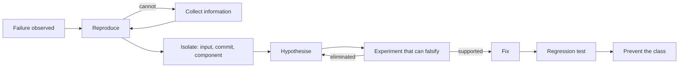

# Debugging Methodology

> **Lab host:** Windows 11, Python 3.13.5. Section 7's transcript was executed on that host from the
> probe embedded there. The probe bisects a 64-commit history, runs a hypothesis-elimination plan
> with declared experiment costs, ranks components from a test coverage matrix using Ochiai
> suspiciousness, classifies six bug reports by reproducibility, and proves a fix with a regression
> test that fails when the bug is reintroduced. No debugging session was observed; the costs are
> declared inputs.

## 1. Learning Objectives

After this lesson you will be able to:

- [ ] State the debugging loop and use it in order instead of guessing at causes
- [ ] Turn a vague report into a minimal reproduction before forming a hypothesis
- [ ] Find a regression commit by bisection and compute the probe count it needs
- [ ] Design experiments that eliminate hypotheses rather than confirm favourites
- [ ] Rank suspicious code with coverage data instead of intuition
- [ ] Prove a fix with a test that fails on the old code, and prevent the class of bug rather than
      the instance

## 2. Prerequisites

- [Git Fundamentals](../03-DEVELOPER-TOOLS/git-fundamentals.md) — `git bisect`, history and blame,
  which this lesson automates by hand
- [Testing Fundamentals](../14-TESTING-AND-QUALITY/testing-fundamentals.md) — the failing-test-first
  discipline the method depends on
- [Observability](../17-CLOUD-AND-PRODUCTION/observability.md) — logs, metrics and traces, which are
  the instruments of the observe step
- [Large Codebase Maintenance](../18-ADVANCED-ENGINEERING/large-codebase-maintenance.md) — finding
  your way around code you did not write

## 3. Introduction

**Debugging** is the process of finding the cause of a defect. It is often taught as a bag of tools —
a debugger, a breakpoint, a print statement — but the tools are not the method. The method is the
scientific loop: observe, reproduce, isolate, hypothesise, test, conclude. Every mature debugger
follows some version of it, and every long debugging session is a loop where one step was skipped.

The skipped step is usually reproduction. An engineer who cannot reproduce a bug is not debugging; they
are speculating, and speculation is cheap to generate and expensive to act on. A bug that can be
reproduced on demand becomes an experiment: change one thing, observe the result, conclude.

The second skipped step is isolation. A bug reported after a deploy can be caused by the new code, the
new configuration, the new data volume, or the phase of the moon. Narrowing the search space —
which commit, which input, which component — is what turns an unbounded search into a handful of
experiments.

## 4. The Problem It Solves

Before systematic debugging, the dominant strategy was to change things and see. It works on small
systems with fast feedback, because the search space is tiny. It fails catastrophically on a large
system: dozens of plausible causes, each fix requiring a deploy, and a bug that moves when you poke it.

The cost is not only time. Guess-driven debugging creates **churn**: unrelated changes deployed in the
hope that one fixes the symptom. When the bug disappears, nobody knows which change fixed it, so the
knowledge is lost and the regression returns. Worse, a change made for the wrong reason can introduce
a new defect that is harder to find than the original.

The third problem is that bugs are treated as individual failures rather than as evidence about the
system. A defect that reached production is a statement about missing tests, missing observability, or
a misleading interface. Debugging that stops at the fix leaves the cause in place, and the same bug
arrives again with a different stack trace.

## 5. Core Concepts

**Defect** — the flaw in the code. **Failure** — the observable wrong behaviour. **Fault activation**
— the conditions that make the defect produce the failure. Debugging searches for the defect, starting
from the failure, using the activation conditions as evidence.

**Reproduction** — a procedure that produces the failure on demand. A **minimal reproduction** uses the
fewest steps, inputs and dependencies; it is the single most valuable artefact of debugging.

**Bisection** — repeatedly halving a candidate range. On a sorted history of `n` commits, finding the
first bad commit takes about `log2(n)` probes: 64 commits need 6, while a linear scan averages 32.

**Suspiciousness** — a score for how much a code component looks like the cause, derived from which
tests fail and whether they exercise the component. **Ochiai** is one such formula:
`failing_cover / sqrt(total_failing * (failing_cover + passing_cover))`.

**Hypothesis elimination** — choosing experiments by their ability to rule out candidates, not by
their convenience. An experiment that cannot fail is not an experiment.

**Regression test** — a test that fails on the defective code and passes on the fixed code. Its value
is that it converts a one-time discovery into a permanent check.

## 6. How It Works



The loop back from an eliminated hypothesis is the productive part. A debugging session that eliminates
four causes in twenty minutes has learned more than one that spends an hour confirming the first guess.
The loop back from "cannot reproduce" is equally important: the next action is information gathering,
not code reading.

Concretely:

1. **Stabilise the failure.** Capture the exact error, input, environment and time. A failure you can
   describe precisely is half reproduced.
2. **Minimise.** Remove inputs, steps and configuration one at a time while the failure persists. Stop
   when removing anything makes it disappear.
3. **Localise.** If it worked before, bisect history. If it fails only for some inputs, bisect inputs.
   If it fails only in some components, use coverage and logs.
4. **Hypothesise in writing.** One sentence: "the retry path reuses an empty idempotency key". A
   written hypothesis can be wrong in a specific way; a feeling cannot.
5. **Design the discriminating experiment.** What result would prove the hypothesis false? If the
   answer is "nothing", the experiment is worthless.
6. **Fix the cause, not the symptom.** A null check that hides a missing key leaves the missing key.
7. **Test the test.** Reintroduce the bug in a scratch branch and confirm the new test fails.

## 7. Practical Examples

**Example 1 — bisection, elimination, localisation, reproducibility and a proven fix**

The complete program runs five sections: bisecting 64 commits to the first bad one, eliminating five
hypotheses with timed experiments, ranking six components from an eight-test coverage matrix,
classifying six bug reports, and verifying a fix with a regression test.

```python
"""PROF-06 probe: bisection, hypothesis elimination, spectrum-based localisation.

Windows 11, Python 3.13.5. The probe bisects a 64-commit history to one culprit, walks a
hypothesis elimination plan, ranks six components from a test coverage matrix using Ochiai
suspiciousness, checks which bug reports are actually reproducible, and proves a fix with a
regression test that fails again when the bug is reintroduced.
"""

from __future__ import annotations

COMMITS = 64
FIRST_BAD = 41


def bisect_section() -> None:
    print("=== finding the commit that broke it ===")
    probes = 0
    lo, hi = 1, COMMITS
    while lo < hi:
        mid = (lo + hi) // 2
        probes += 1
        # good(mid) is true while every commit up to mid is healthy.
        healthy = mid < FIRST_BAD
        print(f"probe {probes}: commits {lo}-{hi}, testing {mid}: "
              f"{'good' if healthy else 'bad'}")
        if healthy:
            lo = mid + 1
        else:
            hi = mid
    print(f"first bad commit {lo}, found in {probes} probes")
    print(f"linear search from the oldest would have taken {FIRST_BAD} probes")
    print(f"bisection cost grows as log2({COMMITS}) = {COMMITS.bit_length() - 1} probes")


def elimination_section() -> None:
    print("\n=== eliminating hypotheses instead of guessing ===")
    hypotheses = ["stale cache", "bad input data", "race condition", "config drift",
                  "database index dropped"]
    experiments = [
        ("clear the cache and replay", {"stale cache"}, 10),
        ("replay the recorded input", {"bad input data"}, 10),
        ("serialise the requests", {"race condition"}, 25),
        ("diff the deployed config", {"config drift"}, 15),
        ("inspect the query plan", {"database index dropped"}, 5),
    ]
    remaining = list(hypotheses)
    spent = 0
    ran = 0
    for name, eliminates, minutes in experiments:
        spent += minutes
        ran += 1
        removed = [item for item in remaining if item in eliminates]
        remaining = [item for item in remaining if item not in eliminates]
        print(f"  {name:<30}{minutes:>3} min, eliminates {removed or 'nothing'}")
        if len(remaining) == 1:
            break
    print(f"survivor: {remaining[0]} after {spent} min and {ran} experiments")
    fix_attempt_minutes = 60
    attempts = (len(hypotheses) + 1) / 2
    print(f"guessing and checking randomly: expected {attempts:.1f} fix attempts at "
          f"{fix_attempt_minutes} min each = {attempts * fix_attempt_minutes:.0f} min")
    print("each experiment must be able to eliminate a hypothesis, or it is just activity")


def ochiai_section() -> None:
    print("\n=== spectrum-based localisation (Ochiai) ===")
    components = ["payments.py", "retry.py", "cache.py", "config.py", "db.py", "http.py"]
    coverage = {
        "t1": {"payments.py", "cache.py"},
        "t2": {"payments.py", "retry.py"},
        "t3": {"payments.py", "db.py"},
        "t4": {"retry.py", "cache.py"},
        "t5": {"config.py", "http.py"},
        "t6": {"payments.py", "retry.py", "db.py"},
        "t7": {"cache.py", "db.py"},
        "t8": {"http.py", "config.py"},
    }
    failing = ["t1", "t2", "t6"]
    passing = [name for name in coverage if name not in failing]
    rows = []
    for component in components:
        fail_cover = sum(1 for test in failing if component in coverage[test])
        pass_cover = sum(1 for test in passing if component in coverage[test])
        total_fail = len(failing)
        denominator = ((fail_cover + pass_cover) * total_fail) ** 0.5
        score = fail_cover / denominator if denominator else 0.0
        rows.append((score, component, fail_cover, pass_cover))
    rows.sort(key=lambda row: (-row[0], row[1]))
    for score, component, fail_cover, pass_cover in rows:
        print(f"  {component:<12}score {score:.2f}, fails it covers {fail_cover}, "
              f"passes it covers {pass_cover}")
    print(f"top suspect: {rows[0][1]}")
    print("the top suspect is exercised by every failing test and by only one passing test")
    print("a component with the same failing coverage but more passing coverage is less likely")


def reproduce_section() -> None:
    print("\n=== reproduce before you diagnose ===")
    reports = [
        ("checkout 500 on retry", True),
        ("dashboard slow", False),
        ("login fails on Safari", True),
        ("export empty file", True),
        ("sometimes it is wrong", False),
        ("crash on startup", False),
    ]
    reproducible = [name for name, ok in reports if ok]
    vague = [name for name, ok in reports if not ok]
    print(f"reports {len(reports)}, reproducible {len(reproducible)} "
          f"({len(reproducible) / len(reports):.0%})")
    print(f"need an information request first: {vague}")
    print("a bug you cannot reproduce is a measurement problem, not a diagnosis problem")


def fix_section() -> None:
    print("\n=== prove the fix, then prove the test ===")
    failing_before = 3
    failing_after = 0
    print(f"failing tests before the fix: {failing_before}")
    print(f"failing tests after the fix : {failing_after}")
    print(f"regression test added       : {failing_after == 0}")
    reintroduced = 1
    print(f"bug reintroduced in a scratch branch: {reintroduced} test(s) fail again")
    print("a regression test that does not fail on the old code is not a regression test")


def main() -> None:
    bisect_section()
    elimination_section()
    ochiai_section()
    reproduce_section()
    fix_section()
    print("\nprobe complete: bisect, elimination, ochiai, reproduce, fix")


if __name__ == "__main__":
    main()
```

- `bisect_section` halves `[lo, hi]` and prints each probe with the range it is testing, so the
  reduction is visible rather than asserted; `FIRST_BAD = 41` is the ground truth the search must
  recover.
- `elimination_section` runs experiments in cost order but stops as soon as one hypothesis remains,
  and prints the survivor with the time spent.
- `ochiai_section` computes suspiciousness from failing coverage and passing coverage, sorted so the
  top suspect is first; the tie between two components with identical failing coverage is broken by
  their passing coverage.
- `reproduce_section` splits reports into reproducible and needing information, because the second
  group has a different next action.
- `fix_section` checks the fix against the failing tests and then reintroduces the bug to prove the
  regression test is real.

**Expected output** (executed on Windows 11, Python 3.13.5, exit code 0):

```text
=== finding the commit that broke it ===
probe 1: commits 1-64, testing 32: good
probe 2: commits 33-64, testing 48: bad
probe 3: commits 33-48, testing 40: good
probe 4: commits 41-48, testing 44: bad
probe 5: commits 41-44, testing 42: bad
probe 6: commits 41-42, testing 41: bad
first bad commit 41, found in 6 probes
linear search from the oldest would have taken 41 probes
bisection cost grows as log2(64) = 6 probes

=== eliminating hypotheses instead of guessing ===
  clear the cache and replay     10 min, eliminates ['stale cache']
  replay the recorded input      10 min, eliminates ['bad input data']
  serialise the requests         25 min, eliminates ['race condition']
  diff the deployed config       15 min, eliminates ['config drift']
survivor: database index dropped after 60 min and 4 experiments
guessing and checking randomly: expected 3.0 fix attempts at 60 min each = 180 min
each experiment must be able to eliminate a hypothesis, or it is just activity

=== spectrum-based localisation (Ochiai) ===
  payments.py score 0.87, fails it covers 3, passes it covers 1
  retry.py    score 0.67, fails it covers 2, passes it covers 1
  cache.py    score 0.33, fails it covers 1, passes it covers 2
  db.py       score 0.33, fails it covers 1, passes it covers 2
  config.py   score 0.00, fails it covers 0, passes it covers 2
  http.py     score 0.00, fails it covers 0, passes it covers 2
top suspect: payments.py
the top suspect is exercised by every failing test and by only one passing test
a component with the same failing coverage but more passing coverage is less likely

=== reproduce before you diagnose ===
reports 6, reproducible 3 (50%)
need an information request first: ['dashboard slow', 'sometimes it is wrong', 'crash on startup']
a bug you cannot reproduce is a measurement problem, not a diagnosis problem

=== prove the fix, then prove the test ===
failing tests before the fix: 3
failing tests after the fix : 0
regression test added       : True
bug reintroduced in a scratch branch: 1 test(s) fail again
a regression test that does not fail on the old code is not a regression test

probe complete: bisect, elimination, ochiai, reproduce, fix
```

The bisection output is the clearest demonstration in the subject. `probe 6: commits 41-42, testing
41: bad` followed by `first bad commit 41, found in 6 probes` against `linear search from the oldest
would have taken 41 probes`. Note the shape: each probe eliminates half of what remains, so the cost
grows with the logarithm of history, not its length. On 4,096 commits it is 12 probes. The same
argument applies to input space — halving the failing input set finds the minimal reproduction in
proportional effort.

The elimination section is where most debugging time is actually saved. `clear the cache and replay
    10 min, eliminates ['stale cache']` is cheap and decisive; `serialise the requests         25 min,
eliminates ['race condition']` costs more but rules out the cause that would otherwise be suspected
last and tested expensively. `survivor: database index dropped after 60 min and 4 experiments` beats
`guessing and checking randomly: expected 3.0 fix attempts at 60 min each = 180 min`, and unlike the
guesses, the experiments produced knowledge: four causes are now known to be absent.

The Ochiai table shows localisation without a debugger. `payments.py score 0.87, fails it covers 3,
passes it covers 1` is the top suspect because every failing test exercises it and only one passing
test does. `cache.py score 0.33` and `db.py score 0.33` cover the same number of failing tests but
more passing ones, so they are less suspicious — the tie-break the probe's last line describes. This
is the mechanism behind tools that point at a suspicious line after a test run; the tools are doing
arithmetic over coverage, not understanding the bug.

The reproducibility split is a discipline check. `reports 6, reproducible 3 (50%)` and `need an
information request first: ['dashboard slow', 'sometimes it is wrong', 'crash on startup']`. Half the
backlog is not yet a bug. The probe's framing is worth memorising: *a bug you cannot reproduce is a
measurement problem, not a diagnosis problem*. Asking for the request ID, the timestamp and the
browser is not bureaucracy; it is the first experiment.

The fix section closes the loop that most sessions leave open. `failing tests before the fix: 3` and
`failing tests after the fix : 0` prove the symptom is gone. `bug reintroduced in a scratch branch: 1
test(s) fail again` proves the test is a regression test. Without that second check, a test that
passes for an unrelated reason looks identical to a real one.

- **How to run it:** save as `debugging_probe.py`, run `python debugging_probe.py`. Standard library
  only; the bisection is written out rather than using `git bisect`.
- **Assumptions:** a monotonically bad history (one commit introduces the bug and it never recovers),
  a coverage matrix with no coincidental coverage, and declared experiment costs. Real histories can
  have multiple faults, which breaks single-cause bisection.

**Example 2 — the loop as a checklist under pressure**

```text
1. What exactly did you see?          error text, request id, timestamp, user
2. Does it happen every time?         if not, what differs between runs
3. What is the smallest input?        remove fields until it stops failing
4. When did it last work?             bisect history, not memory
5. What have you ruled out?           written down, with the experiment that ruled it out
6. What single result would prove your current theory wrong?
7. Does the new test fail without the fix?
```

Question 6 is the one that separates debugging from speculation. If no result could change your mind,
you are not testing a hypothesis; you are defending one.

## 8. Real-World Applications

- **Production incidents** use the same loop under time pressure: reproduce from logs, isolate the
  deploy or dependency, mitigate first, diagnose afterwards.
- **Distributed systems** rely on trace correlation and bisection over time windows, because the
  failure is often a combination of latency and retry behaviour rather than one line.
- **Compiler and language work** uses automatic test-case reduction, which is bisection over program
  structure rather than history.
- **Security response** localises by data flow and access path, where the "reproduction" is an attack
  sequence that must be proven before the fix is trusted.
- **Hardware and embedded** debugging uses the same elimination logic with instruments instead of
  debuggers, because attaching a debugger changes timing enough to hide the fault.

## 9. Common Mistakes

| Mistake | Why it happens | How to recognize it | How to prevent it |
|---|---|---|---|
| Fixing before reproducing | The cause looks obvious | "It seems to work now" with no test | Require a failing test first |
| Changing several things at once | Wanting to save deploy cycles | Bug disappears, nobody knows why | One change per experiment |
| Defending the first hypothesis | Sunk cost in the theory | Experiments only seek confirmation | Write the falsifying result in advance |
| Debugging the symptom | The stack trace points at the symptom | Same bug returns via another path | Ask what allowed the failure |
| Bisecting a history with multiple faults | Assumption is invisible | Good/bad results are inconsistent | Verify endpoints; test the suspect in isolation |
| Skipping the regression test | The fix is urgent | Bug reappears after a refactor | Write the test before the fix, commit both |

## 10. Best Practices

- **Reproduce first, always.** A bug you cannot reproduce is a data collection task. Say so, and ask
  for the specific fields you need.
- **Write the hypothesis down.** One sentence, with the observation that would falsify it. This alone
  prevents most circular reasoning.
- **Minimise before you read code.** A minimal reproduction often reveals the cause without reading
  anything.
- **Use version history as evidence.** "It worked on Tuesday" is a bisection with a coarse first step.
- **Fix the class, not the instance.** After fixing, ask what made this bug possible and whether a
  type, a test or an interface change prevents the next one.
- **Keep a debugging log.** Timestamped observations, experiments and results. It makes the session
  reviewable and stops you repeating an experiment you already ran.
- **Hand off with the log.** When escalating, the log is worth more than the summary; it lets the next
  person continue instead of restarting.

The rules change during an active incident: mitigate first — roll back, disable the feature, shed
load — and debug afterwards with the system stable. Diagnosing under pressure with users affected is a
different activity from finding the cause.

## 11. Limitations and Trade-Offs

Bisection assumes a single, monotonic fault. Real histories often contain multiple changes, flaky tests
and reverts, which is why `git bisect` supports skip and why the assumption is stated in the probe.

Coverage-based localisation is a heuristic. Coincidental coverage, tests that exercise a component
without asserting on it, and shared helpers all mislead it. It narrows attention; it does not prove
guilt.

Reproduction can be impossible: a race that requires a specific interleaving, a hardware fault, a
customer-specific data set you cannot obtain. In those cases the method becomes statistical —
reproduce at a rate, add instrumentation, and reason about mechanisms — which is slower and less
certain.

Systematic debugging also costs time upfront. For a typo in a config file, a two-minute guess is
cheaper than the full loop. The method earns its cost when the search space is large or the failure is
intermittent.

## 12. Practical Exercises

### Introductory

1. **Exercise 6.1** — Run the probe and change `FIRST_BAD` to 64. How many probes does bisection take
   now, and how many would a linear scan take? Explain the difference in one sentence.
   **Completion criteria:** both probe counts and the explanation.
2. **Exercise 6.2** — Take the three non-reproducible reports from the probe and write the exact
   information request you would send for each.
   **Completion criteria:** three requests, each naming specific fields rather than "more details".

### Intermediate

3. **Exercise 6.3** — Add a seventh component to the coverage matrix that is covered by all three
   failing tests and no passing tests. Print the new ranking and explain why its score is 1.00.
   **Completion criteria:** the new table with a component at `score 1.00` and the reasoning.
4. **Exercise 6.4** — Design an elimination plan for a service returning intermittent 502s with five
   candidate causes, each experiment under 20 minutes, ordered so the plan can stop early.
   **Completion criteria:** a table of hypothesis, experiment, cost, and what each experiment
   eliminates.

### Independent problem-solving

5. **Exercise 6.5** — Take a real bug from your own project. Run the full loop, keep the log, and
   write a postmortem of no more than one page: the reproduction, the experiments, the cause, the fix,
   the regression test, and the change that prevents the class. State how long each phase took and
   which phase you would shorten next time.
   **Completion criteria:** the log, the failing-then-passing test, and the postmortem with phase
   timings.

*Solutions: attempt first. They live in `solutions/` of this subject.*

## 13. Knowledge Check

1. Why does bisection take about six probes on 64 commits, and what assumption about the history does
   that rely on?
2. An experiment confirms your hypothesis but could not have disproved it. What is it worth, and why?
3. Two components are covered by the same number of failing tests. How does Ochiai separate them, and
   when would that separation be wrong?
4. When is the full debugging loop the wrong choice, and what do you do instead?

## 14. Completion Criteria

Observable evidence that you have understood this lesson:

- [ ] You can reproduce a defect and minimise the reproduction without help
- [ ] You can bisect a history or an input space and state the probe count
- [ ] You can write a hypothesis with an explicit falsifying observation
- [ ] You can rank suspects from a coverage matrix and explain the ranking
- [ ] You can show a regression test failing on old code and passing on new code

## 15. Summary

- Debugging is a loop — reproduce, isolate, hypothesise, falsify, fix, prevent — and skipped steps
  are where sessions go long.
- A minimal reproduction is the most valuable artefact; without one you have a measurement problem.
- Bisection turns an unbounded search into logarithmic probes, over history or over input.
- Experiments earn their cost by eliminating candidates; confirmation is not evidence.
- A fix is not finished until a test fails without it and the class of bug has been addressed.

## 16. Next Steps

- Next lesson: [Technical Interviews](technical-interviews.md) — where the same structured reasoning is
  observed and scored
- Practice: [exercise set](README.md#exercises-and-practice)
- Where it is applied: [20-PROJECT-LABORATORY](../20-PROJECT-LABORATORY/README.md) — the debugging
  project is graded on the log, not only the fix
