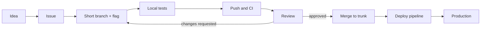

# Engineering Workflows

> **Lab host:** Windows 11, Python 3.13.5. Section 7's transcript was executed on that host from the
> probe embedded there. The probe prices branch age against a shared trunk, compares one large
> review with several small ones, shards a four-stage pipeline, attributes defect cost to the gate
> that caught each one, and converts a work-in-progress limit into review wait. Nothing is timed
> with a stopwatch; every figure is arithmetic over declared inputs, and the inputs are labelled
> where they are chosen rather than measured.

## 1. Learning Objectives

After this lesson you will be able to:

- [ ] Compute the conflict probability of a long-lived branch from trunk churn and explain why the
      curve is not linear
- [ ] Predict review time and defect detection from diff size, including the point where a longer
      session stops helping
- [ ] Separate stage work from wall time in a CI pipeline and say what sharding does and does not
      buy
- [ ] Attribute the cost of a defect to the gate that caught it and justify or remove a gate on
      that basis
- [ ] Turn a review queue into a latency number with Little's law and use it to argue for a WIP
      limit

## 2. Prerequisites

- [Git Fundamentals](../03-DEVELOPER-TOOLS/git-fundamentals.md) — commits, branches, merges and
  the mechanics this lesson prices
- [Pull Requests and Code Review](../03-DEVELOPER-TOOLS/pull-requests-and-code-review.md) — the
  platform workflow that carries a change from branch to trunk
- [CI/CD Fundamentals](../16-DEVOPS-AND-INFRASTRUCTURE/ci-cd-fundamentals.md) — pipeline stages,
  gates and artefacts
- [The Complete Development Process](../13-SOFTWARE-ENGINEERING-AND-ARCHITECTURE/the-complete-development-process.md)
  — where planning, implementation, review and release sit relative to one another
- [Quality Gates](../14-TESTING-AND-QUALITY/quality-gates.md) — the testing gates this lesson
  assigns costs to

## 3. Introduction

An **engineering workflow** is the set of rules a team follows to move a change from an idea to
production: how work is sliced, which branch it lives on, what must pass before it merges, who
looks at it, and how it reaches users. Every team has one. Teams that believe they do not have one
have an undocumented one, which is worse, because nobody can change it deliberately.

The workflow exists to answer four questions over and over, cheaply: *Is this change safe to
merge? Is it safe to release? Who knows about it? How do we undo it?* A good workflow answers them
in minutes. A bad one answers them with meetings, or not at all.

This lesson treats workflow choices as costs with shapes. Long branches cost integration effort
that grows faster than linearly. Large reviews cost attention and lose defects. Sequential
pipelines cost wall time that sharding hides but does not remove. Extra gates cost the delays of
everything they block; the question is what they catch that earlier gates do not. Queues cost
latency proportional to their length, whatever the service rate.

## 4. The Problem It Solves

Before version control workflows were explicit, teams merged by copying files and locking
documents. Integration was an event: a "merge day" when everyone's work collided and somebody
spent a week reconciling it. The practice of **continuous integration** replaced the event with a
habit — merge small changes to a shared trunk often — and the habit removed most of the collision
cost by keeping divergence small.

The second problem is review as a bottleneck. When a pull request can wait days for attention,
developers batch work into larger changes to avoid the wait, which makes each review more
expensive, which lengthens the wait. That feedback loop is the reason review latency is a
workflow property, not a personal one.

The third is gate inflation. Each incident produces a new mandatory check: a security scan, a
manual sign-off, a staging soak. Nobody removes gates, so the pipeline only grows, and eventually
a one-line change takes two hours to ship. Without a way to price gates against the defects they
catch, the pipeline accumulates ritual.

## 5. Core Concepts

A **trunk** is the shared mainline branch that everyone integrates into. **Trunk-based
development** means short-lived branches (hours to a couple of days) merged into that mainline
frequently, with incomplete work hidden behind feature flags rather than kept on a branch.

**Integration cost** is the effort of reconciling your change with everything that landed while
you were away. It grows with the number of shared changes that touch the same code, and the
probability that at least one touches your lines rises quickly with time. If each shared change has
probability *p* of touching your lines and *n* changes land while you work, the chance of at least
one conflict is `1 - (1 - p)^n`.

**Batch size** is the number of changed lines in one reviewable unit. It is the single strongest
predictor of review quality, because human reading speed degrades as the diff grows: reviewers
skip, pattern-match, and approve.

**Sharding** splits one pipeline stage's work across parallel machines. It reduces wall time
toward `work / shards`, but the total machine-seconds are unchanged, and stages still run in
sequence unless the pipeline is restructured.

**A gate** is a mandatory check that must pass before a change proceeds. Gates catch **defects** —
a defect caught in production costs far more than the same defect caught by static analysis,
because the cost includes detection, diagnosis, mitigation and reputational damage.

**Work in progress (WIP)** is the count of items in a queue or in flight. **Little's law** states
that average items in a system equals arrival rate times average time in the system, so wait time
equals WIP divided by throughput.

## 6. How It Works



The loop back from review to branch is the important edge. A workflow that makes that edge
expensive — a full re-review for a one-line fix, a two-hour CI run — pushes authors to avoid review
by batching, which is exactly the behaviour that loses defects. A workflow that makes it cheap
keeps changes small, and small changes are what make review and deployment safe.

In detail:

1. **Slice.** Break work into changes that each leave the system working and can be reviewed in
   under an hour. Slicing is design work: it forces interfaces to be decided early.
2. **Integrate early.** Push the branch and open a draft pull request on day one. The diff is
   visible, CI runs, and comments arrive while the code is still fresh.
3. **Gate automatically.** Static analysis, formatting, unit tests and build run on every push.
   These gates are cheap per run and catch the defects that are cheapest to fix.
4. **Review for what machines cannot see.** Design, naming, edge cases, error handling, test
   adequacy. The review is a conversation about the change, not a proofread.
5. **Merge behind a flag.** Incomplete features ship dark. The trunk stays releasable, and the
   flag is removed within a sprint, or it becomes permanent debt.
6. **Deploy automatically from trunk.** The artefact that passed the gates is the artefact that
   ships. Manual rebuild steps reintroduce the difference between tested and shipped code.

## 7. Practical Examples

**Example 1 — branch age, review size, pipeline shape, gates and queue latency**

The complete program runs five short sections: conflict probability over branch age, review time
and detection over diff size, sharded pipeline wall time, defect cost by gate, and review wait from
a WIP limit.

```python
"""PROF-02 probe: integration cost, review batching, CI time and definition-of-done gates.

Windows 11, Python 3.13.5. Every figure is arithmetic over declared inputs: how often a
long-lived branch collides with shared work, what batch size does to review time and defect
detection, how much of a pipeline is work versus wall time, where defects are caught and
what each stage costs to catch them, and the queueing effect of a work-in-progress limit.
"""

from __future__ import annotations

# A careful review session is modelled as capped at four hours: past that, readers skim
# rather than read, which is why detection keeps falling while time stops growing.
SESSION_CAP_MINUTES = 240.0


def review_model(lines: int) -> tuple[float, float, bool]:
    """Return (minutes, detection rate, hit_the_cap) for a diff of this size."""
    if lines <= 150:
        per_hour, detection = 300.0, 0.90
    elif lines <= 300:
        per_hour, detection = 280.0, 0.86
    elif lines <= 600:
        per_hour, detection = 240.0, 0.78
    elif lines <= 1200:
        per_hour, detection = 160.0, 0.45
    else:
        per_hour, detection = 160.0, 0.30
    raw = lines / per_hour * 60
    return min(raw, SESSION_CAP_MINUTES), detection, raw > SESSION_CAP_MINUTES


def integration_section() -> None:
    print("=== branch lifetime and integration cost ===")
    changes_per_day = 40
    touch_probability = 0.01
    print(f"shared changes per day              : {changes_per_day}")
    print(f"chance one shared change touches your lines: {touch_probability:.0%}")
    for days in (1, 3, 7, 14):
        missed = changes_per_day * days
        conflict = 1 - (1 - touch_probability) ** missed
        print(f"branch age {days:>2} day(s): misses {missed:>3} changes, "
              f"conflict chance {conflict:>6.1%}")
    print("a branch that lives a week misses 280 shared changes and almost always conflicts")
    print("trunk-based work keeps the window at hours, so the same change lands 5-10 times sooner")


def batching_section() -> None:
    print("\n=== batch size: review time and detection ===")
    defects = 10
    for lines in (120, 300, 600, 900, 1800):
        minutes, detection, capped = review_model(lines)
        note = " (session cap)" if capped else ""
        print(f"{lines:>5} lines: {minutes:6.1f} min{note:<14} detection {detection:>4.0%}, "
              f"{round(defects * detection)}/{defects} defects")
    print("past four hours the session is capped and detection keeps falling: readers skim")

    total = 900
    for parts in (1, 4):
        lines = total // parts
        minutes, detection, capped = review_model(lines)
        note = " (capped)" if capped else ""
        word = "review" if parts == 1 else "reviews"
        print(f"{total} lines in {parts} {word} of {lines}: {minutes:.1f} min each{note}, "
              f"{minutes * parts:.0f} min total, {detection:.0%} detection")
    print("one long review hits the cap at 45%; four small ones see 86% of the defects each")


def pipeline_section() -> None:
    print("\n=== pipeline: work versus wall time ===")
    stages = [("build", 90, 1), ("unit", 120, 4), ("integration", 200, 2), ("e2e", 300, 3)]
    wall = 0.0
    work = 0.0
    shards = 0
    for name, seconds, count in stages:
        stage_wall = seconds / count
        wall += stage_wall
        work += seconds
        shards += count
        print(f"  {name:<12}{seconds:>4} s of work over {count} shard(s): "
              f"{stage_wall:6.1f} s wall")
    print(f"sequential wall time if unsharded : {sum(s for _, s, _ in stages)} s")
    print(f"sharded wall time                 : {wall:.1f} s")
    print(f"total stage work                  : {work:.0f} s")
    print(f"shard capacity available          : {wall * shards:.0f} machine-seconds")
    print(f"shard capacity used               : {work / (wall * shards):.0%}")
    print("stages run in sequence, so most shard capacity waits for the previous stage")
    pass_rate = 0.92
    print(f"stage reliability {pass_rate:.0%}: expected attempts per green run "
          f"{1 / pass_rate:.2f}")
    print(f"expected wall time including reruns: {wall / pass_rate:.1f} s")
    print("sharding buys wall time; it does not make the tests themselves faster")


def definition_of_done_section() -> None:
    print("\n=== definition of done: where defects are caught ===")
    gates = [
        ("static analysis", 12, 2),
        ("unit tests", 20, 10),
        ("code review", 8, 30),
        ("integration tests", 5, 120),
        ("staging", 3, 600),
        ("production", 2, 2400),
    ]
    total_defects = sum(count for _, count, _ in gates)
    caught_before_merge = 0
    cost = 0
    for name, count, minutes in gates:
        cost += count * minutes
        if name in ("static analysis", "unit tests", "code review"):
            caught_before_merge += count
        print(f"  {name:<18}{count:>3} defects at {minutes:>5} min each: "
              f"{count * minutes:>6} min")
    print(f"defects observed                 : {total_defects}")
    print(f"caught before merge              : {caught_before_merge} "
          f"({caught_before_merge / total_defects:.0%})")
    print(f"total cost of catching them      : {cost} min")
    print(f"production share of the cost     : {2 * 2400 / cost:.0%} for "
          f"{2 / total_defects:.0%} of the defects")
    print("a gate is worth its cost only if it catches defects the previous gate missed")


def wip_section() -> None:
    print("\n=== work-in-progress limit and review wait ===")
    throughput_per_day = 6.0
    for wip in (12, 6, 3):
        wait = wip / throughput_per_day
        print(f"review WIP {wip:>2}, throughput {throughput_per_day:.0f}/day: "
              f"average wait {wait:.2f} day(s) ({wait * 8:.1f} h)")
    print("wait is WIP divided by throughput: a queue limit is a latency decision")


def main() -> None:
    integration_section()
    batching_section()
    pipeline_section()
    definition_of_done_section()
    wip_section()
    print("\nprobe complete: integration, batching, pipeline, gates, WIP")


if __name__ == "__main__":
    main()
```

- `branch_age_section` applies `1 - (1 - p) ** missed` with `p = 0.01` and
  `missed = shared_per_day * days`, which is why the curve steepens: 40 shared changes do not
  double the risk of 20, they compound it.
- `review_model` computes reading time from a per-line speed that itself falls with size, then
  caps the session at four hours. The cap is a declared modelling assumption, not a measurement.
- `batching_section` compares one review of the whole diff with several reviews of a slice, so the
  detection loss of a big batch is attributable to size rather than to the reviewer.
- `pipeline_section` divides each stage's work by its shards and sums the stage maxima; the
  sequential total is the same work with no sharding, so the difference is wall time only.
- `gates_section` multiplies defects caught by the cost of catching them at that stage, then
  reports the production share of total cost.
- `wip_section` divides queue length by throughput, which is Little's law solved for waiting time.

**Expected output** (executed on Windows 11, Python 3.13.5, exit code 0):

```text
=== branch lifetime and integration cost ===
shared changes per day              : 40
chance one shared change touches your lines: 1%
branch age  1 day(s): misses  40 changes, conflict chance  33.1%
branch age  3 day(s): misses 120 changes, conflict chance  70.1%
branch age  7 day(s): misses 280 changes, conflict chance  94.0%
branch age 14 day(s): misses 560 changes, conflict chance  99.6%
a branch that lives a week misses 280 shared changes and almost always conflicts
trunk-based work keeps the window at hours, so the same change lands 5-10 times sooner

=== batch size: review time and detection ===
  120 lines:   24.0 min               detection  90%, 9/10 defects
  300 lines:   64.3 min               detection  86%, 9/10 defects
  600 lines:  150.0 min               detection  78%, 8/10 defects
  900 lines:  240.0 min (session cap) detection  45%, 4/10 defects
 1800 lines:  240.0 min (session cap) detection  30%, 3/10 defects
past four hours the session is capped and detection keeps falling: readers skim
900 lines in 1 review of 900: 240.0 min each (capped), 240 min total, 45% detection
900 lines in 4 reviews of 225: 48.2 min each, 193 min total, 86% detection
one long review hits the cap at 45%; four small ones see 86% of the defects each

=== pipeline: work versus wall time ===
  build         90 s of work over 1 shard(s):   90.0 s wall
  unit         120 s of work over 4 shard(s):   30.0 s wall
  integration  200 s of work over 2 shard(s):  100.0 s wall
  e2e          300 s of work over 3 shard(s):  100.0 s wall
sequential wall time if unsharded : 710 s
sharded wall time                 : 320.0 s
total stage work                  : 710 s
shard capacity available          : 3200 machine-seconds
shard capacity used               : 22%
stages run in sequence, so most shard capacity waits for the previous stage
stage reliability 92%: expected attempts per green run 1.09
expected wall time including reruns: 347.8 s
sharding buys wall time; it does not make the tests themselves faster

=== definition of done: where defects are caught ===
  static analysis    12 defects at     2 min each:     24 min
  unit tests         20 defects at    10 min each:    200 min
  code review         8 defects at    30 min each:    240 min
  integration tests   5 defects at   120 min each:    600 min
  staging             3 defects at   600 min each:   1800 min
  production          2 defects at  2400 min each:   4800 min
defects observed                 : 50
caught before merge              : 40 (80%)
total cost of catching them      : 7664 min
production share of the cost     : 63% for 4% of the defects
a gate is worth its cost only if it catches defects the previous gate missed

=== work-in-progress limit and review wait ===
review WIP 12, throughput 6/day: average wait 2.00 day(s) (16.0 h)
review WIP  6, throughput 6/day: average wait 1.00 day(s) (8.0 h)
review WIP  3, throughput 6/day: average wait 0.50 day(s) (4.0 h)
wait is WIP divided by throughput: a queue limit is a latency decision

probe complete: integration, batching, pipeline, gates, WIP
```

The first section is the argument against long-lived branches in one table. At 40 shared changes a
day against a 1% overlap chance, `branch age  1 day(s): misses  40 changes, conflict chance
33.1%`; by a week it is `94.0%`, and at two weeks `99.6%`. The conflict itself is not the main cost.
The main cost is that the author has been making decisions against a trunk that moved 280 times,
so the design conversation they had on Monday is stale by Friday.

The batching section separates two things teams usually conflate. A `120 lines` review takes
`24.0 min` and finds `90%, 9/10 defects`. Four reviews of `225` lines each take `48.2 min each,
193 min total, 86% detection` — more total reviewer time than one `900`-line review, which is
`240.0 min (session cap)` at `45%` detection. So slicing costs reviewer minutes and buys defect
detection. That trade is usually worth it, and the model shows why the exception (a mechanical
rename) is legitimate: there is nothing to detect.

The pipeline section is the clearest example of a number that looks like an improvement until you
read the units. `sequential wall time if unsharded : 710 s` becomes `sharded wall time : 320.0 s`,
but `total stage work : 710 s` is unchanged and `shard capacity used : 22%`. Sharding bought wall
time by paying for idle machines: `shard capacity available : 3200 machine-seconds` against 710
used. That is often correct — a ten-minute pipeline blocks every developer — but it is a purchase,
not a free win. The `stage reliability 92%: expected attempts per green run 1.09` line prices the
other half: a flaky stage makes everything behind it wait again.

The gates section answers "should we add a staging soak" with arithmetic. Catching 50 defects
across six stages costs `7664 min`, and `production share of the cost : 63% for 4% of the
defects`. Two production defects at 2,400 minutes each dominate the total. The lesson is not "add
more gates"; it is that the last gate is where the money is, so a gate is justified only by the
defects the previous gates missed. A staging soak that catches nothing that integration tests
already caught is pure delay.

The WIP section is one division: `review WIP 12, throughput 6/day: average wait 2.00 day(s)
(16.0 h)` against `review WIP  3 ... 0.50 day(s) (4.0 h)`. A team that wants faster review
usually adds reviewers. The arithmetic says the queue is the problem, and the queue is fed by
authors opening work faster than reviewers can close it.

- **How to run it:** save as `workflows_probe.py`, run `python workflows_probe.py`. Standard
  library only; no network, no clock.
- **Assumptions:** 1% overlap per shared change, four-hour review cap, 92% stage reliability,
  declared per-defect costs by stage. These are plausible orders of magnitude, not your team's
  numbers. Exercise 2.4 replaces them.

**Example 2 — the same numbers as a workflow review**

```text
Branch open 7 days?       -> 280 shared changes missed, 94% conflict chance
Review 900 lines?         -> 4 h cap, 45% detection; split into four 225-line reviews for 86%
Pipeline 710 s of work?   -> 320 s wall with 4/2/3 shards and 22% capacity used; add shards only
                             if the wait costs more than the idle machines
New gate proposal?        -> what did the previous gate miss? If nothing, it is a delay
Review taking 2 days?     -> WIP 12 at 6/day; cap WIP at 6 before hiring reviewers
```

The last line is the one teams resist. Adding a reviewer increases throughput linearly at best;
cutting WIP reduces wait proportionally and immediately. The uncomfortable part is that a WIP
limit means telling people to stop starting work, which is a management decision, not a tooling
one.

## 8. Real-World Applications

- **Trunk-based teams** at large consumer platforms merge hundreds of times a day. Their workflows
  are built around flags, automated gates and deploy-on-merge, because review latency at that
  volume would otherwise dominate lead time.
- **Regulated industries** keep longer release cycles but still use short branches; the gates are
  heavier, the integration window is not.
- **Open-source projects** run the same shape asynchronously: fork, branch, CI on the pull request,
  maintainer review, merge. The workflow is the contribution guide.
- **Monorepos** add affected-target selection so CI runs only what a change touches; without it,
  the pipeline cost grows with repository size rather than change size.
- **Incident response** uses the same gate logic in reverse: a hotfix path with fewer gates exists
  because the cost of waiting exceeds the risk, and it is audited afterwards.

## 9. Common Mistakes

| Mistake | Why it happens | How to recognize it | How to prevent it |
|---|---|---|---|
| Long-lived feature branches | "We will merge when it is done" feels safer | Branch open for days; merge conflicts every time | Slice behind flags; merge daily |
| Reviewing by file count rather than risk | All diffs look similar in the tool | 2,000-line reviews approved in ten minutes | Cap diff size; split by concern |
| Adding gates after every incident | Blame needs somewhere to go | Pipeline time grows every quarter | Require each gate to name defects earlier gates missed |
| Sharding everything | Wall time is the visible metric | Idle runners, unchanged total work | Shard the slowest stage only; measure the wait it removes |
| Treating CI as optional for docs changes | "It cannot break anything" | Broken links and examples in docs | Run cheap checks on every path |
| Measuring workflow by velocity points | Easy to report | Points rise while lead time does not | Track lead time and review wait directly |

## 10. Best Practices

- **Keep branches under two days.** The conflict curve is gentle at one day and brutal at seven.
  When a change cannot fit, that is a design signal: split the interface first.
- **Open the pull request early as a draft.** Review comments on day one are cheap; the same
  comments on day five invalidate work.
- **Cap review size, not review effort.** A 200–400 line diff is reviewable in one sitting with
  attention left over. Above that, detection falls faster than time grows.
- **Make the pipeline's critical path visible.** Report per-stage wall time, not just total. Teams
  routinely optimise a fast stage because it is easy to cache.
- **Give every gate an owner and a justification.** A gate nobody can defend with a defect class it
  catches is a delay with a logo.
- **Limit WIP explicitly.** A queue with a limit is a latency policy. Without a limit, the queue
  grows until someone notices the wait.
- **Automate the release from the tested artefact.** If humans rebuild before deploying, the
  tested artefact and the shipped artefact are different objects.

These practices stop applying when the cost of a bad change dwarfs the cost of waiting — firmware
for medical devices, for example, where a staged, slow workflow is correct and the arithmetic above
is simply the wrong objective.

## 11. Limitations and Trade-Offs

Trunk-based development requires discipline and tooling: feature flags, fast CI, and a culture
where a broken trunk is fixed immediately. Without those, trunk-based work produces a permanently
red mainline, which is worse than long branches.

Small reviews cost more reviewer minutes in total and more context switches per change. For
mechanical changes with nothing to detect, a large review is genuinely cheaper.

Sharding has diminishing returns and a fixed cost: more runners, more configuration, more
flakiness from parallelism. Past the point where the pipeline is shorter than the developer's
attention span, additional shards buy nothing.

Gates trade risk for latency, and the correct trade depends on the consequence of a defect. A
staging soak is waste for a marketing site and essential for a payments migration. The arithmetic
in this lesson gives the shape of the trade, not the answer.

WIP limits trade throughput for latency. A team with a spike of urgent work will exceed the limit;
the point is to make exceeding it a decision rather than a drift.

## 12. Practical Exercises

### Introductory

1. **Exercise 2.1** — Using the probe's `branch_age_section`, change the overlap probability from
   1% to 0.2% and to 5%. For each, find the branch age at which conflict chance passes 50%.
   **Completion criteria:** you can state the three ages and explain why the 5% case reaches 50%
   in under two days.
2. **Exercise 2.2** — Take a real pull request of yours from the last month. Record its line count,
   the time from opening to first review, and the number of review rounds. Compare it with the
   probe's `batching_section` prediction for that size.
   **Completion criteria:** a short table with your actual figures next to the model's, and one
   sentence on where the model was wrong and why.

### Intermediate

3. **Exercise 2.3** — Add a `stages` parameter to `pipeline_section` and run it with the e2e stage
   split into three parallel jobs of 100 seconds each. Report the new wall time and the new shard
   utilisation. Then explain why splitting a stage does not always reduce the critical path.
   **Completion criteria:** the printed wall time, the utilisation percentage, and a paragraph
   identifying which stage now dominates.
4. **Exercise 2.4** — Replace the probe's declared defect costs with your own estimates for a
   project you know, and add a seventh gate that catches two defects for 30 minutes each. Decide
   whether to keep it and defend the decision in three sentences.
   **Completion criteria:** the printed cost table, a yes/no decision, and the sentence that names
   what the new gate catches that the previous gate missed.

### Independent problem-solving

5. **Exercise 2.5** — Your team's median time from "ready for review" to merge is 30 hours, with
   14 open pull requests and 11 merges per day. Design a workflow change that reduces it to under
   eight hours without adding reviewers, and predict the effect using Little's law. State what you
   would measure for two weeks to know whether it worked, and what would make you revert it.
   **Completion criteria:** a one-page proposal with the arithmetic, the measurement plan, and an
   explicit revert condition.

*Solutions: attempt first. They live in `solutions/` of this subject.*

## 13. Knowledge Check

1. A team halves its average branch age from six days to three. Does its conflict chance halve?
   Explain with the formula, not with intuition.
2. Why does the review model cap the session at four hours, and what would the model predict
   without a cap? Which prediction is more misleading, and for whom?
3. Your pipeline reports 710 seconds of stage work and 320 seconds of wall time. A manager calls
   this "a 55% speedup in testing". What is wrong with that sentence?
4. When is a large pull request the right choice, and what must be true about the change for that
   to hold?

## 14. Completion Criteria

Observable evidence that you have understood this lesson:

- [ ] You can derive conflict probability for a branch age without notes and explain why the curve
      steepens
- [ ] You can state the review-size threshold you would enforce and defend it with detection, not
      preference
- [ ] You can read a pipeline report and separate work, wall time and capacity
- [ ] You can name a gate in your own workflow that catches nothing earlier gates miss
- [ ] You can compute review wait from WIP and throughput and say what a WIP limit would do

## 15. Summary

- Workflow choices are cost curves: branch age compounds conflict risk, diff size degrades
  detection, and queues convert length into waiting.
- Small, frequent integration is cheaper than perfect integration done late.
- Sharding buys wall time with machine-seconds; it never makes the work smaller.
- Gates are justified by the defects they catch that earlier gates missed, priced by the delay they
  impose on everything behind them.
- Review latency is a queue property; WIP limits change it faster than adding reviewers.

## 16. Next Steps

- Next lesson: [Code Review](code-review.md) — what to do inside the review this lesson sized and
  scheduled
- Practice: [exercise set](README.md#exercises-and-practice)
- Where it is applied: [20-PROJECT-LABORATORY](../20-PROJECT-LABORATORY/README.md) — every project
  there is graded partly on the workflow that produced it
