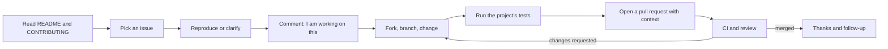

# Open-Source Contributions

> **Lab host:** Windows 11, Python 3.13.5. Section 7's transcript was executed on that host from the
> probe embedded there. The probe triages eight issues, ranks them for a first contribution, walks a
> nine-step contribution funnel, computes merge rates by pull-request size, and summarises a sample
> of maintainer first-response times. No network calls are made; the issue list and counts are
> declared inputs, and the funnel rates are a model rather than a measurement of any project.

## 1. Learning Objectives

After you finish this lesson you will be able to:

- [ ] Read a project's contribution guide, licence and issue tracker and decide whether to invest
- [ ] Triage an issue for reproducibility, labelling and maintainer engagement before starting work
- [ ] Choose a first contribution that is likely to be accepted rather than merely easy
- [ ] Explain where contributors drop out of the funnel and what the maintainer can do about it
- [ ] Write a pull request a maintainer can review without asking for context
- [ ] Behave correctly when a contribution is rejected, stalled, or superseded

## 2. Prerequisites

- [Git Fundamentals](../03-DEVELOPER-TOOLS/git-fundamentals.md) — forks, remotes, branches and
  rebasing, which every contribution needs
- [GitHub Workflows](../03-DEVELOPER-TOOLS/github-workflows.md) — issues, pull requests, review and
  CI on the hosting platform
- [Pull Requests and Code Review](../03-DEVELOPER-TOOLS/pull-requests-and-code-review.md) — the
  review vocabulary this lesson applies across organisational boundaries
- [Technical Documentation](technical-documentation.md) — the contribution guide, README and code
  samples you will be reading as a stranger

## 3. Introduction

**Open-source contribution** is the practice of changing software you do not own, in public, under a
licence that permits it, in a project whose maintainers have no obligation to accept your work. That
last clause is the whole discipline. In a workplace, a rejected change is a disagreement with a
colleague; in open source, a rejected change is a stranger deciding your effort is not what the
project needs, and the correct response is neither argument nor sulking.

Contributing is also the most efficient professional development available. You read code written to
a standard you did not set, you receive review from people with no incentive to be gentle, and you
learn how a project's conventions encode years of decisions. A landed pull request in a project you
use is stronger evidence of engineering ability than any certificate, because a maintainer accepted
it.

The mechanics are ordinary Git. The difficulty is social: finding work that is wanted, doing it at a
size that can be reviewed, and communicating in a way that respects a maintainer's time.

## 4. The Problem It Solves

Every project has more work than maintainers. Issues accumulate, documentation rots, and the same
questions are answered repeatedly. Contributors are how that backlog gets addressed without the
maintainer doing everything — but only if contributions arrive in a form that can be merged.

The naive approach — find a bug, fix it, open a pull request — fails often enough that many people
conclude open source is closed to outsiders. The common failure is not code quality. It is a change
nobody asked for, against a design decision made three years earlier, in a pull request that also
reformats the file. The maintainer closes it, politely or not, and the contributor stops.

The second problem is on the maintainer's side: triage. An issue without a reproduction is not
actionable, an issue with no label is invisible, and an issue answered by nobody is a contributor
who leaves. The probe's triage section is written from that perspective, because understanding the
maintainer's queue is how a contributor chooses work that can land.

## 5. Core Concepts

**Licence** — the legal terms under which you may use and modify the code. Check it before
contributing: a project without a licence is not open source, whatever its repository visibility.

**Contribution guide** (`CONTRIBUTING.md`) — the project's stated process: how to set up, what to
sign, how to format commits, what will be rejected. Ignoring it is the most common avoidable mistake.

**Issue triage** — deciding what an issue is: bug, feature, question; reproducible or not; which
area; how urgent. Labels are the visible output of triage.

**Reproduction** — the smallest set of steps, inputs and environment that makes a bug happen. An
issue without one is a report, and reports need work before they become bugs.

**Good first issue** — a label maintainers use for issues they believe a newcomer can complete. It is
a hint, not a guarantee; the issue may still be stale or under-specified.

**Pull request size** — changed lines. Small pull requests merge at much higher rates, for the same
reason they get better review: they are cheap to evaluate.

## 6. How It Works



The step contributors skip is `D`, claiming the issue before working. Without it, two people write
the same fix, and the maintainer has to choose — which wastes one contribution and creates
awkwardness. A one-line comment, "I would like to work on this; is the approach in #412 still the
plan?", costs nothing and prevents the most common duplicated effort.

The steps maintainers care about, in order:

1. **Does the change match an accepted issue or an obvious bug?** Unrequested features are the
   largest category of rejected pull requests.
2. **Is it small and focused?** One concern per pull request. Formatting changes go in their own
   commit so they can be skipped.
3. **Do the tests pass, and is there a test for the change?** A bug fix without a regression test
   will regress.
4. **Does it follow local conventions?** Naming, error handling, commit message style. The guide
   usually says; the surrounding code always shows.
5. **Is the description sufficient?** What changed, why, how it was verified, and what the reviewer
   should look at first.

## 7. Practical Examples

**Example 1 — triage, first-issue ranking, funnel, size and responsiveness**

The complete program runs five sections: triage of eight issues, a clarity ranking for a first
contribution, a nine-step contribution funnel, merge rates by pull-request size, and a summary of
maintainer first-response times.

```python
"""PROF-05 probe: issue triage, contributor funnel, PR size and maintainer response.

Windows 11, Python 3.13.5. Eight issues are triaged from labels, reproduction and age; a
nine-step contribution funnel is walked with declared conversion rates; pull requests are
bucketed by size to compare merge rates; and first-response times are summarised from a
fixed sample. All inputs are inline so the printout is reproducible.
"""

from __future__ import annotations

from dataclasses import dataclass


@dataclass
class Issue:
    number: int
    labels: tuple[str, ...]
    has_reproduction: bool
    age_days: int
    maintainer_comments: int
    asks_question: bool


ISSUES = [
    Issue(412, ("bug", "good first issue"), True, 12, 2, False),
    Issue(418, ("bug",), False, 9, 1, False),
    Issue(421, ("docs", "good first issue"), True, 40, 0, False),
    Issue(430, ("enhancement",), True, 75, 0, True),
    Issue(437, ("bug", "needs reproduction"), False, 120, 0, False),
    Issue(441, ("bug", "good first issue"), True, 3, 3, False),
    Issue(452, ("question",), False, 61, 0, True),
    Issue(460, ("enhancement", "help wanted"), True, 200, 1, False),
]


def triage_section() -> None:
    print("=== issue triage ===")
    stale = []
    for issue in ISSUES:
        is_stale = issue.age_days > 60 and issue.maintainer_comments == 0
        if is_stale:
            stale.append(issue.number)
        print(f"#{issue.number:<4} {issue.age_days:>3} d  labels={','.join(issue.labels):<34}"
              f" repro={'yes' if issue.has_reproduction else 'no ':<3} "
              f"maintainer comments={issue.maintainer_comments}"
              f"{'  STALE' if is_stale else ''}")
    with_repro = sum(1 for issue in ISSUES if issue.has_reproduction)
    labelled = sum(1 for issue in ISSUES if issue.labels)
    print(f"issues {len(ISSUES)}, with reproduction {with_repro} "
          f"({with_repro / len(ISSUES):.0%}), labelled {labelled} "
          f"({labelled / len(ISSUES):.0%})")
    print(f"stale (over 60 days, no maintainer reply): {stale}")
    print("an issue without a reproduction is a question until someone makes it a bug")


def ranking_section() -> None:
    print("\n=== ranking candidates for a first contribution ===")
    scored = []
    for issue in ISSUES:
        score = 0
        score += 2 if issue.has_reproduction else 0
        score += 2 if "good first issue" in issue.labels else 0
        score += 1 if issue.maintainer_comments > 0 else 0
        score -= 2 if issue.asks_question else 0
        scored.append((score, issue.number))
    scored.sort(key=lambda pair: (-pair[0], pair[1]))
    for score, number in scored:
        print(f"  #{number:<4} clarity score {score:>2}")
    print("the best first issue is reproduced, labelled, and already has a maintainer reply")
    print("a question with no reproduction is the worst place to start, however easy it looks")


def funnel_section() -> None:
    print("\n=== contribution funnel ===")
    steps = [
        ("reads the contributing guide", 1000),
        ("finds an issue to work on", 180),
        ("forks and clones", 90),
        ("runs the test suite locally", 54),
        ("opens a pull request", 26),
        ("passes CI on the first push", 11),
        ("gets a review", 9),
        ("addresses review comments", 6),
        ("merged", 4),
    ]
    previous = None
    for name, count in steps:
        conversion = "" if previous is None else f" ({count / previous:>4.0%} of previous)"
        print(f"  {name:<32}{count:>5}{conversion}")
        previous = count
    print(f"end-to-end landing rate: {steps[-1][1] / steps[0][1]:.2%} of readers")
    print("the biggest drop is usually the first PR, not the code: CI setup and review etiquette")


def size_section() -> None:
    print("\n=== pull request size and merge rate ===")
    buckets = [("1-50 lines", 140, 129), ("51-200", 96, 78), ("201-500", 58, 36),
               ("501-1000", 27, 11), (">1000", 19, 5)]
    merged = 0
    opened = 0
    for name, count, successes in buckets:
        merged += successes
        opened += count
        print(f"  {name:<10}{count:>4} opened, {successes:>4} merged: "
              f"{successes / count:>5.0%}")
    print(f"overall: {merged}/{opened} merged ({merged / opened:.0%})")
    print("small pull requests merge more often because they are cheap to review")


def response_section() -> None:
    print("\n=== maintainer first response ===")
    hours = [1.5, 3.0, 6.5, 12.0, 26.0, 48.0, 96.0, 240.0]
    ordered = sorted(hours)
    middle = len(ordered) // 2
    median = (ordered[middle - 1] + ordered[middle]) / 2
    p90 = ordered[int(len(ordered) * 0.9)]
    slow = [value for value in ordered if value > 48]
    print(f"samples {len(ordered)}: {ordered}")
    print(f"median first response {median:.1f} h, p90 {p90:.1f} h, "
          f"over 48 h: {len(slow)}")
    print("a contributor waits on the median, not the mean: report the distribution")


def main() -> None:
    triage_section()
    ranking_section()
    funnel_section()
    size_section()
    response_section()
    print("\nprobe complete: triage, ranking, funnel, size, response")


if __name__ == "__main__":
    main()
```

- `triage_section` flags an issue as stale when it is over 60 days old with no maintainer reply —
  the combination that predicts a contributor will get no answer.
- `ranking_section` scores clarity from reproduction, the good-first-issue label, an existing
  maintainer reply, and whether the issue is actually a question; the weights are declared and
  deliberately favour issues a newcomer can finish.
- `funnel_section` prints each step's count and the conversion from the previous step, so the
  largest drop is visible rather than averaged away.
- `size_section` groups pull requests into size buckets and reports merge rate per bucket, which is
  the cleanest evidence for keeping changes small.
- `response_section` reports median, p90 and the count over 48 hours, because the distribution is
  what a contributor experiences.

**Expected output** (executed on Windows 11, Python 3.13.5, exit code 0):

```text
=== issue triage ===
#412   12 d  labels=bug,good first issue               repro=yes maintainer comments=2
#418    9 d  labels=bug                                repro=no  maintainer comments=1
#421   40 d  labels=docs,good first issue              repro=yes maintainer comments=0
#430   75 d  labels=enhancement                        repro=yes maintainer comments=0  STALE
#437  120 d  labels=bug,needs reproduction             repro=no  maintainer comments=0  STALE
#441    3 d  labels=bug,good first issue               repro=yes maintainer comments=3
#452   61 d  labels=question                           repro=no  maintainer comments=0  STALE
#460  200 d  labels=enhancement,help wanted            repro=yes maintainer comments=1
issues 8, with reproduction 5 (62%), labelled 8 (100%)
stale (over 60 days, no maintainer reply): [430, 437, 452]
an issue without a reproduction is a question until someone makes it a bug

=== ranking candidates for a first contribution ===
  #412  clarity score  5
  #441  clarity score  5
  #421  clarity score  4
  #460  clarity score  3
  #418  clarity score  1
  #430  clarity score  0
  #437  clarity score  0
  #452  clarity score -2
the best first issue is reproduced, labelled, and already has a maintainer reply
a question with no reproduction is the worst place to start, however easy it looks

=== contribution funnel ===
  reads the contributing guide     1000
  finds an issue to work on         180 ( 18% of previous)
  forks and clones                   90 ( 50% of previous)
  runs the test suite locally        54 ( 60% of previous)
  opens a pull request               26 ( 48% of previous)
  passes CI on the first push        11 ( 42% of previous)
  gets a review                       9 ( 82% of previous)
  addresses review comments           6 ( 67% of previous)
  merged                              4 ( 67% of previous)
end-to-end landing rate: 0.40% of readers
the biggest drop is usually the first PR, not the code: CI setup and review etiquette

=== pull request size and merge rate ===
  1-50 lines 140 opened,  129 merged:   92%
  51-200      96 opened,   78 merged:   81%
  201-500     58 opened,   36 merged:   62%
  501-1000    27 opened,   11 merged:   41%
  >1000       19 opened,    5 merged:   26%
overall: 259/340 merged (76%)
small pull requests merge more often because they are cheap to review

=== maintainer first response ===
samples 8: [1.5, 3.0, 6.5, 12.0, 26.0, 48.0, 96.0, 240.0]
median first response 19.0 h, p90 240.0 h, over 48 h: 2
a contributor waits on the median, not the mean: report the distribution

probe complete: triage, ranking, funnel, size, response
```

The triage table is a lesson in reading a tracker. `issues 8, with reproduction 5 (62%), labelled 8
(100%)` looks healthy, but `stale (over 60 days, no maintainer reply): [430, 437, 452]` identifies
three issues where work would disappear into silence. Note that #430 has a reproduction and a clear
enhancement label, and is still stale: reproduction is necessary, not sufficient. What predicts a
useful contribution is a maintainer who has engaged.

The ranking section makes the trade explicit. `#412 clarity score 5` and `#441 ... 5` are
reproduced, labelled and already discussed; `#452 ... -2` is a question with no reproduction, which
the probe calls the worst place to start "however easy it looks". A beginner who picks the question
because the fix sounds trivial spends their first contribution waiting for clarification that may
never come.

The funnel is the section to show a maintainer. `reads the contributing guide     1000` down to
`merged                              4` is `end-to-end landing rate: 0.40% of readers`. The largest
single drop is early — `finds an issue to work on         180 ( 18% of previous)` — and the next is
`forks and clones                   90 ( 50% of previous)`; a further 42% of those
who open a pull request fail CI on the first push. None of this is about coding ability. It is
about the project being navigable and the local setup being reproducible. A project that wants
more contributors fixes those two steps before it writes a "good first issue" programme.

The size table is the most actionable number in the lesson: `1-50 lines 140 opened,  129 merged:
  92%` against `>1000       19 opened,    5 merged:   26%`, overall `259/340 merged (76%)`. Large
pull requests are not rejected because maintainers are lazy; they are rejected because reviewing a
thousand lines properly takes hours nobody has budgeted. If your change is large, split it, or ask
first whether the shape is wanted.

The response section explains why contributors leave. `median first response 19.0 h, p90 240.0 h,
over 48 h: 2`. The median is tolerable; the p90 means one contributor in ten waits ten days. The
probe's closing line — report the distribution, not the mean — is the difference between a project
that believes it is responsive and one that is.

- **How to run it:** save as `open_source_probe.py`, run `python open_source_probe.py`. Standard
  library only; no network.
- **Assumptions:** the issue list is illustrative, the funnel conversion rates are a plausible
  model, and the response sample is eight values. Exercise 5.3 substitutes real numbers from a
  project you use.

**Example 2 — the pull request description that gets merged**

```text
What:      Fixes a 500 on retry when the idempotency key is empty (#412)
Why:       The retry path treats an empty key as a duplicate of the first request
How:       Generate a key when absent; added a regression test for the retry case
Verified:  pytest tests/test_retry.py -k idempotency  (new test fails on old code)
Reviewer:  Start with retry.py; the fixture change is mechanical
```

Four lines, and the maintainer knows what to read first, why the change exists, and that it was
verified. Compare with "fixed the bug, please review", which requires the maintainer to reconstruct
all of that from the diff — and maintainers, reasonably, review the cheap pull requests first.

## 8. Real-World Applications

- **Infrastructure projects** (databases, runtimes, build tools) accept contributions mainly as bug
  fixes and tests; features require an accepted design proposal first.
- **Application libraries** accept documentation and example contributions readily, because those
  are reviewed cheaply and improve the first-run experience for everyone.
- **Corporate open source** employs maintainers, so contribution etiquette includes knowing whether
  a change belongs upstream or in an internal fork.
- **Standards and specifications** take contributions as issues and pull requests against the spec
  text, where the social process matters more than the code.
- **Security projects** often restrict contributions to a private channel first; reading
  `SECURITY.md` before opening a public issue is part of the etiquette.

## 9. Common Mistakes

| Mistake | Why it happens | How to recognize it | How to prevent it |
|---|---|---|---|
| Opening a feature nobody asked for | The idea seems obviously good | "This is a great idea but not in scope" | Open an issue first; wait for a maintainer's yes |
| Ignoring `CONTRIBUTING.md` | Setup seems obvious | CI rejects formatting; reviewer cites the guide | Read the guide before writing code |
| One pull request, many concerns | Batching feels efficient | Diff touches unrelated files | One concern per pull request; separate formatting commits |
| No test for the fix | The fix seems obvious | Reviewer asks for a regression test | Write the failing test first |
| Silently working on a claimed issue | Wanting to avoid being told no | Duplicate pull requests on the same issue | Comment your intent and approach |
| Arguing after a rejection | Effort feels wasted | Long threads, escalating tone | Ask what would make it acceptable, or accept and move on |

## 10. Best Practices

- **Use the software before contributing to it.** A bug you hit yourself gives you a reproduction,
  motivation and a test case.
- **Read the last twenty merged pull requests.** They show the size, tone and review expectations
  more accurately than any guide.
- **Claim the issue with your intended approach.** One sentence, then wait a day for a maintainer's
  response before writing code.
- **Keep the change small enough to review in one sitting.** If it cannot be, say why in the
  description and offer to split it.
- **Match the project's conventions, not your preferences.** The goal is to be merged; style debates
  are a tax on the reviewer.
- **Run the project's full test suite, not just your new test.** Local green is the baseline
  expectation, not an achievement.
- **Thank the reviewer and follow up.** The people reviewing your work are unpaid and doing it
  because they care about the project.

Rejection etiquette deserves its own line: a closed pull request is information, not an insult. Ask
one question — "would a different approach be acceptable?" — and if the answer is no, leave the
branch available and move on. Maintainers remember contributors who were easy to work with.

## 11. Limitations and Trade-Offs

Open source is not a substitute for paid work. Contributions cost time, are unpaid, and may be
rejected after hours of effort. Projects differ enormously in responsiveness; a contribution to an
unmaintained repository is effort with no review and no merge.

Maintainers are a bottleneck by design. Some projects deliberately close feature contributions to
keep scope under control, and that is a legitimate governance choice, not hostility.

Contributing to an unfamiliar project is slow at first: setup, conventions and domain knowledge take
days before the first useful change. That cost is worth paying once for a project you will keep using,
and rarely worth paying for a drive-by fix.

There is also a power asymmetry: maintainers can change the licence or archive the project, and your
contribution may become unusable. Reading the governance model before investing is part of the
decision.

## 12. Practical Exercises

### Introductory

1. **Exercise 5.1** — Choose a project you use. Read its `CONTRIBUTING.md`, `README.md` and licence.
   Write down the setup steps and the required commit style.
   **Completion criteria:** a five-line summary with links and the licence name.
2. **Exercise 5.2** — Triage five open issues from that project using the probe's criteria:
   reproduction, labels, maintainer engagement, and whether it is a question.
   **Completion criteria:** a table with your clarity scores and one issue you would start with.

### Intermediate

3. **Exercise 5.3** — Replace the probe's eight issues with your triage from Exercise 5.2 and rerun.
   Compare your ranking with the maintainers' labels; investigate any disagreement.
   **Completion criteria:** the new printed ranking and one paragraph explaining the largest
   disagreement.
4. **Exercise 5.4** — Write the full description for a pull request fixing the issue you chose,
   following the probe's Example 2 format, before writing any code.
   **Completion criteria:** a description with what, why, how, verification command and reviewer
   starting point.

### Independent problem-solving

5. **Exercise 5.5** — Land one real contribution in a project with at least 100 stars: a
   documentation fix, a test, a typo, or a small bug fix. Record the funnel steps you actually
   completed, the response time, and what you would do differently. If it is rejected, record why
   and what you learned about the project's scope.
   **Completion criteria:** a link to the merged (or closed) pull request and a short reflection
   naming the step where you nearly gave up.

*Solutions: attempt first. They live in `solutions/` of this subject.*

## 13. Knowledge Check

1. Why does the probe call an issue with a reproduction but no maintainer reply a poor first
   contribution, even though it is clearly a bug?
2. The funnel's largest drop is before any code is written. What does that imply about how projects
   should spend effort if they want contributors?
3. A maintainer closes your pull request as out of scope. What is the one useful question to ask,
   and what should you do if the answer is no?
4. Why do small pull requests merge more often, and what does that say about the "one big cleanup"
   approach?

## 14. Completion Criteria

Observable evidence that you have understood this lesson:

- [ ] You can find and summarise a project's contribution guide and licence without help
- [ ] You can triage an issue on reproduction, labels and maintainer engagement
- [ ] You can write a pull request description a maintainer can review without asking questions
- [ ] You can explain the funnel's largest drop and one change that would address it
- [ ] You have opened at least one real pull request, merged or closed, and can describe what
      happened

## 15. Summary

- A contribution is a proposal to strangers who owe you nothing; etiquette is the mechanism that
  makes it reviewable.
- Reproductions and maintainer engagement predict a useful contribution better than the
  good-first-issue label.
- Most contributors are lost before writing code — at navigation and local setup — not at review.
- Small, focused pull requests merge far more often than large ones, for the same reason they get
  better review.
- Rejection is information; asking one clarifying question and moving on protects both your time and
  the project's.

## 16. Next Steps

- Next lesson: [Debugging Methodology](debugging-methodology.md) — the systematic process behind the
  reproductions this lesson depends on
- Practice: [exercise set](README.md#exercises-and-practice)
- Where it is applied: [20-PROJECT-LABORATORY](../20-PROJECT-LABORATORY/README.md) — capstone work
  is expected to include one external contribution
