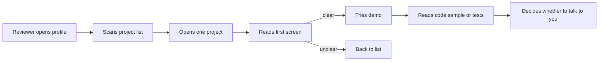

# Portfolio Development

> **Lab host:** Windows 11, Python 3.13.5. Section 7's transcript was executed on that host from the
> probe embedded there. The probe audits six projects against verifiable evidence, flags
> tutorial-shaped repositories from commit and test signals, computes commit depth over active days,
> and allocates a six-minute reviewer scan across a project page. The projects are illustrative; the
> weights and the scan budget are declared policy, not measurements.

## 1. Learning Objectives

After this lesson you will be able to:

- [ ] Distinguish a claim from evidence and audit a project against what a reviewer can verify
- [ ] Choose which projects to present, which to fix and which to remove
- [ ] Recognize the signals of a tutorial-shaped repository in your own work
- [ ] Write a project page that answers a reviewer's questions in the first screen
- [ ] Explain one project's trade-offs, failures and next steps for ten minutes without notes
- [ ] Build depth over time instead of collecting project count

## 2. Prerequisites

- [Technical Documentation](technical-documentation.md) — the README and runbook that make a project
  legible
- [Open-Source Contributions](open-source-contributions.md) — external contributions as portfolio
  evidence, and how their review history reads
- [Testing Fundamentals](../14-TESTING-AND-QUALITY/testing-fundamentals.md) — the tests a reviewer
  looks for before believing a claim
- [Git Fundamentals](../03-DEVELOPER-TOOLS/git-fundamentals.md) — commit history as evidence of how
  work actually happened

## 3. Introduction

A **portfolio** is a small set of artefacts that let a stranger judge your engineering without taking
your word for it. The unit is not the project; it is the evidence a reviewer can open, run and read.
One project with a live deployment, tests, a clear README and a written decision record beats five
repositories whose descriptions say "full-stack app".

The audience is specific and impatient. A hiring manager or senior engineer spends a few minutes per
candidate, usually after reading a CV, and is looking for a reason to keep reading. Their questions
are predictable: what does it do, can I see it working, is the code any good, did this person think
about anything hard, and could I have a useful conversation with them about it?

A portfolio answers those questions with artefacts. The CV says "built a payments service"; the
portfolio shows the retry design, the failure that led to it, and the test that proves it. The second
is credible in a way the first cannot be.

## 4. The Problem It Solves

Before portfolios, junior engineers were judged on credentials and interviews. Credentials correlate
with opportunity rather than ability, and interviews are noisy. A portfolio gives a candidate a way to
present work that exists independently of an interview performance, which is especially valuable for
people who did not have access to prestigious internships.

For the reviewer, the problem is verification cost. Every claim on a CV costs time to check: call a
reference, ask probing questions, hope the candidate is honest. A portfolio with a live URL and a
public repository moves most of that verification to the reviewer's browser, at their convenience.

The third problem is that tutorials teach without producing evidence. Following a course produces a
repository that looks like work but cannot be defended: no decisions were made, no failure was
diagnosed, no trade-off was weighed. Reviewers have learned to spot this, which is why "tutorial
projects" is a common rejection reason and why the distinction in this lesson matters.

## 5. Core Concepts

**Evidence** — something a reviewer can verify without your participation: a running deployment, a
test suite that runs, a commit history, a written design note, a merged pull request.

**Claim** — a statement about your work. Claims are necessary for navigation (a reviewer needs to know
what to look at) and worthless without evidence behind them.

**Tutorial-shaped** — a repository with a single commit, one active day, no tests and no README
decisions. Any one signal can be innocent; together they predict a project you cannot discuss in
depth.

**Depth** — commits spread over weeks, revisiting decisions, responding to problems found in use. Depth
is what makes a project defensible: you can explain why the third design replaced the first.

**Reviewer scan** — the first few minutes a reviewer spends on a project page. It is a budget, and the
elements that consume it are predictable: README first screen, demo, code sample, tests.

**Demo** — a link that works without setup. It is the highest-value evidence for a web project and the
first thing to break; a dead demo link is worse than no demo.

## 6. How It Works



The loop back to the project list is the default outcome, and it usually happens in under a minute.
That is not unfairness; it is the arithmetic of reviewing many candidates. The design consequence is
that the first screen carries most of the weight: if it does not say what the project is, who it is
for, and where to click, nothing after it is read.

Building a project for the portfolio, rather than for a course, changes the order of work:

1. **Start from a problem you have.** A real annoyance gives you a user, a success criterion and
   motivation to keep going past the interesting part.
2. **Ship a small version early.** A deployed, working, limited tool is stronger evidence than a
   local, unfinished, ambitious one.
3. **Write the README while building.** What it does, how to run it, what you decided and why. The
   README is the project's front door.
4. **Add tests where they earn their place.** Not for coverage; for the parts where a regression would
   be embarrassing and hard to notice.
5. **Use it.** Real use produces issues, which produce commits, which produce depth and stories.
6. **Record one decision.** A short design note — options considered, choice, consequence — is the
   artefact that turns a project into a conversation.

## 7. Practical Examples

**Example 1 — evidence audit, tutorial tells, depth and the reviewer scan**

The complete program runs four sections: an evidence score for six projects, tutorial-shape detection,
commit depth per active day, and a six-minute scan budget.

```python
"""PROF-08 probe: portfolio evidence audit, tutorial tells, reviewer scan budget.

Windows 11, Python 3.13.5. Six projects are scored on what a reviewer can verify rather than
what the author claims, four tutorial-shaped repositories are examined for their tells, a
six-minute reviewer scan is allocated across the elements of a project page, and depth is
distinguished from a weekend of commits.
"""

from __future__ import annotations

from dataclasses import dataclass

EVIDENCE = [
    ("repository", 20),
    ("live deployment", 20),
    ("tests", 20),
    ("readme", 15),
    ("commit history over weeks", 15),
    ("written design decisions", 10),
]


@dataclass
class Project:
    name: str
    claims: tuple[str, ...]
    evidence: tuple[str, ...]
    commits: int
    active_days: int


PROJECTS = [
    Project("expense tracker", ("full-stack", "tested", "deployed"),
            ("repository", "live deployment", "tests", "readme",
             "commit history over weeks", "written design decisions"), 84, 41),
    Project("recipe API", ("REST API", "documented"),
            ("repository", "tests", "readme", "written design decisions"), 52, 23),
    Project("weather CLI", ("CLI tool",),
            ("repository", "readme"), 12, 2),
    Project("chat app", ("realtime", "scalable", "production-ready"),
            ("repository", "live deployment"), 9, 1),
    Project("portfolio site", ("responsive",),
            ("repository", "live deployment", "readme"), 31, 6),
    Project("clone of a tutorial", ("full-stack", "tested"),
            ("repository", "live deployment"), 3, 1),
]


def audit_section() -> None:
    print("=== evidence audit ===")
    for project in PROJECTS:
        score = sum(weight for name, weight in EVIDENCE if name in project.evidence)
        missing = [name for name, _ in EVIDENCE if name not in project.evidence]
        print(f"{project.name:<22}{score:>3}/100  missing: {missing}")
    print("claims are free; evidence is what a reviewer can open in a browser")
    unverifiable = sum(1 for project in PROJECTS if "live deployment" not in project.evidence)
    print(f"projects without a live deployment: {unverifiable}/{len(PROJECTS)}")


def tutorial_section() -> None:
    print("\n=== tutorial tells ===")
    tells = 0
    for project in PROJECTS:
        single_commit = project.commits <= 3
        weekend = project.active_days <= 1
        no_tests = "tests" not in project.evidence
        flagged = single_commit or (weekend and no_tests)
        tells += flagged
        reasons = []
        if single_commit:
            reasons.append("single commit")
        if weekend:
            reasons.append("one active day")
        if no_tests:
            reasons.append("no tests")
        print(f"  {project.name:<22}{'tutorial-shaped' if flagged else 'own work':<16}"
              f"{', '.join(reasons)}")
    print(f"flagged: {tells}/{len(PROJECTS)}")
    print("none of these tells is proof; together they predict a project you cannot defend")


def depth_section() -> None:
    print("\n=== depth: commits over time ===")
    for project in PROJECTS:
        per_active_day = project.commits / project.active_days
        span = "weeks" if project.active_days >= 14 else "days"
        unit = "day" if project.active_days == 1 else "days"
        print(f"  {project.name:<22}{project.commits:>3} commits over "
              f"{project.active_days:>2} active {unit} ({per_active_day:>5.1f}/day, {span})")
    print("84 commits over 41 days means revisiting decisions; 84 over two days means typing")


def scan_section() -> None:
    print("\n=== six-minute reviewer scan ===")
    budget = 360
    elements = [("first screen of the README", 90), ("live demo", 120),
                ("one code sample", 90), ("test folder", 60)]
    spent = 0
    for name, seconds in elements:
        spent += seconds
        print(f"  {name:<28}{seconds:>4} s, cumulative {spent:>3} s")
    print(f"budget {budget} s, spent {spent} s, left {budget - spent} s")
    print("what a reviewer sees in the first screen decides whether the rest is read at all")
    print("three links above the fold: repository, deployment, one decision write-up")


def main() -> None:
    audit_section()
    tutorial_section()
    depth_section()
    scan_section()
    print("\nprobe complete: audit, tutorial tells, depth, scan")


if __name__ == "__main__":
    main()
```

- `EVIDENCE` assigns weights to verifiable artefacts, with repository, live deployment and tests
  carrying the most; the score is a sum of what exists, not of what is claimed.
- `audit_section` prints each project's score and the specific missing items, which is directly
  actionable: the list is the to-do list.
- `tutorial_section` flags a project when it has a single commit, or one active day with no tests, and
  prints the reasons so the flag can be argued with.
- `depth_section` divides commits by active days, which separates sustained work from a single long
  session.
- `scan_section` spends a declared budget across the page elements and reports what is left.

**Expected output** (executed on Windows 11, Python 3.13.5, exit code 0):

```text
=== evidence audit ===
expense tracker       100/100  missing: []
recipe API             65/100  missing: ['live deployment', 'commit history over weeks']
weather CLI            35/100  missing: ['live deployment', 'tests', 'commit history over weeks', 'written design decisions']
chat app               40/100  missing: ['tests', 'readme', 'commit history over weeks', 'written design decisions']
portfolio site         55/100  missing: ['tests', 'commit history over weeks', 'written design decisions']
clone of a tutorial    40/100  missing: ['tests', 'readme', 'commit history over weeks', 'written design decisions']
claims are free; evidence is what a reviewer can open in a browser
projects without a live deployment: 2/6

=== tutorial tells ===
  expense tracker       own work        
  recipe API            own work        
  weather CLI           own work        no tests
  chat app              tutorial-shaped one active day, no tests
  portfolio site        own work        no tests
  clone of a tutorial   tutorial-shaped single commit, one active day, no tests
flagged: 2/6
none of these tells is proof; together they predict a project you cannot defend

=== depth: commits over time ===
  expense tracker        84 commits over 41 active days (  2.0/day, weeks)
  recipe API             52 commits over 23 active days (  2.3/day, weeks)
  weather CLI            12 commits over  2 active days (  6.0/day, days)
  chat app                9 commits over  1 active day (  9.0/day, days)
  portfolio site         31 commits over  6 active days (  5.2/day, days)
  clone of a tutorial     3 commits over  1 active day (  3.0/day, days)
84 commits over 41 days means revisiting decisions; 84 over two days means typing

=== six-minute reviewer scan ===
  first screen of the README    90 s, cumulative  90 s
  live demo                    120 s, cumulative 210 s
  one code sample               90 s, cumulative 300 s
  test folder                   60 s, cumulative 360 s
budget 360 s, spent 360 s, left 0 s
what a reviewer sees in the first screen decides whether the rest is read at all
three links above the fold: repository, deployment, one decision write-up

probe complete: audit, tutorial tells, depth, scan
```

The audit table is deliberately harsh. `expense tracker       100/100  missing: []` is the standard:
repository, deployment, tests, README, history over weeks, and a written decision record.
`recipe API             65/100  missing: ['live deployment', 'commit history over weeks']` is a good
project with two fixable gaps — deploy it and keep working on it for a month, and it becomes strong.
`weather CLI            35/100` is not a bad program; it is a program that cannot answer a reviewer's
questions. The probe's line is the summary: *claims are free; evidence is what a reviewer can open in
a browser*.

The tutorial section is the one to apply to your own repositories honestly.
`chat app                tutorial-shaped one active day, no tests` and
`clone of a tutorial   tutorial-shaped single commit, one active day, no tests`, for `flagged: 2/6`.
Note that the weather CLI, `own work`, has no tests but twelve commits over two days: the flag is not a
verdict on quality, it is a prediction about defensibility. A project you built while learning can be
perfectly good evidence if you can explain the decisions; the flags are a prompt to check whether you
can.

The depth table turns a commit graph into a sentence. `expense tracker        84 commits over 41 active
days (  2.0/day, weeks)` reads as sustained work with revisiting; `chat app                9 commits
over  1 active days (  9.0/day, days)` reads as a single session. Neither number is good or bad in
itself — a focused weekend can produce a genuinely useful tool — but only one of them gives you a story
about a problem you hit on day nineteen.

The scan section is a design constraint. `first screen of the README    90 s`, `live demo
120 s`, `one code sample               90 s`, `test folder                   60 s`, `budget 360 s, spent
360 s, left 0 s`. There is no time for a long introduction, a table of contents, or a badge wall. The
probe's closing line names the three links that belong above the fold: repository, deployment, and one
decision write-up.

- **How to run it:** save as `portfolio_probe.py`, run `python portfolio_probe.py`. Standard library
  only.
- **Assumptions:** the evidence weights are a policy choice, the tutorial thresholds are heuristics,
  and the scan budget is six minutes. Reviewers vary; the ordering of value does not vary much.

**Example 2 — one project page, first screen only**

```text
# Receipt Splitter
Splits a group receipt by item, with per-person totals and a shareable link.
Live: receipt-splitter.example.com   Code: github.com/you/receipt-splitter

Why: splitting a receipt in a group chat took ten minutes of arithmetic, so I built
the version I wanted. Next: OCR for photographed receipts.

Design note: why the totals are computed server-side (rounding, audit) -- link
Tests: 41, covering rounding edge cases and the share-link authorisation -- link
```

Four lines answer what, where, why, and what is next. The design note link is what converts a project
into a conversation: it shows a decision with alternatives, which is the thing interviewers actually
probe.

## 8. Real-World Applications

- **Job applications** use the portfolio as the first filter; a link in a CV is often opened before any
  interview is scheduled.
- **Freelance and contract work** uses case studies with before/after measurements, because clients
  buy outcomes rather than technologies.
- **Internal promotion** uses the same evidence in a different format: design docs, incident reviews
  and shipped projects, presented as a packet.
- **Career changes** use portfolio projects to demonstrate a skill the previous role did not require,
  which is the one context where a course project can be legitimate evidence if it goes beyond the
  course.
- **Open-source maintainers** have an implicit portfolio: the repository, the issues they answered and
  the reviews they wrote.

## 9. Common Mistakes

| Mistake | Why it happens | How to recognize it | How to prevent it |
|---|---|---|---|
| Presenting tutorials as projects | They look like work and were easy to finish | Single commit, no tests, no decisions | Rebuild one with your own requirements and record the decisions |
| No live demo | Deployment is the boring part | Reviewer cannot try it | Deploy early; keep the URL alive |
| README describes the stack, not the problem | Technology is easier to write about | First line lists frameworks | Lead with the problem and the user |
| Many shallow projects | Counting feels like progress | Ten repositories, none with tests | Three projects with depth beat ten without |
| Hiding failures | Failure feels like weakness | No mention of what went wrong | One paragraph on a bug that changed the design |
| Dead links and stale demos | Projects are abandoned after the CV is sent | 404 on the demo | Check every link quarterly; remove what you will not maintain |

## 10. Best Practices

- **Present three projects, not ten.** A reviewer will open two. Choose the two you can discuss for
  twenty minutes.
- **Lead with the problem.** "Splits a group receipt by item" tells the reviewer what it is in one
  line; "React, Node, PostgreSQL" tells them what it is built with.
- **Put repository, deployment and one decision note above the fold.** Those are the three links that
  answer the three questions.
- **Write one design note per project.** Options, choice, consequence. It is the cheapest way to show
  engineering judgement.
- **Keep the demo alive or remove it.** A dead demo is a negative signal about maintenance.
- **Record the failure.** The bug that forced a redesign is the most interesting thing in the project
  and the easiest to omit.
- **Contribute externally.** A merged pull request in a project you do not own is evidence that
  survives any suspicion of tutorial-following.

The advice changes for senior candidates: depth in one domain, and evidence of influence beyond your
own code — reviews, designs, mentoring — matters more than another application.

## 11. Limitations and Trade-Offs

Portfolios favour people with time. Building, deploying and documenting projects takes evenings that
people with caring responsibilities or second jobs may not have, which is a fairness problem the
format does not solve. The mitigation is to make smaller artefacts count: a design note, a merged
contribution, a well-reviewed pull request.

Projects also age. A three-year-old repository with obsolete dependencies can hurt more than help if
the reviewer cannot run it. Maintenance is part of the portfolio, and pruning is legitimate.

Evidence can be gamed: a test that asserts nothing, a README copied from a template, a demo that is a
static mock. Reviewers learn the tells, which is why depth and external contributions carry more weight
than a polished landing page.

Finally, a portfolio cannot replace the interview conversation. It changes what the conversation can
be about — from "what did you build" to "why did you build it that way" — which is the improvement
worth optimising for.

## 12. Practical Exercises

### Introductory

1. **Exercise 8.1** — Audit your own repositories with the probe's six evidence items. Score each and
   list the missing items.
   **Completion criteria:** a table of projects and scores, with the single highest-value fix per
   project.
2. **Exercise 8.2** — Rewrite the first screen of one project README using Example 2's structure: what,
   where, why, next, plus two links.
   **Completion criteria:** a first screen under 120 words containing a working demo link.

### Intermediate

3. **Exercise 8.3** — Add a project to the probe with a live deployment and tests but no decision note,
   and one with a decision note but no deployment. Compute both scores and decide which to fix first,
   with a reason.
   **Completion criteria:** both scores and a paragraph justifying the order.
4. **Exercise 8.4** — Write a 300-word design note for a decision in one of your projects: the options,
   the constraints, the choice, the consequence, and what would make you revisit it.
   **Completion criteria:** a note that names at least two rejected options and one cost of the choice.

### Independent problem-solving

5. **Exercise 8.5** — Choose one project and turn it into portfolio evidence in two weeks: deploy it,
   add tests for the two riskiest paths, write the README and one design note, use it yourself, and
   record one failure and the change it caused. Then write the ten-minute verbal walkthrough you would
   give, including what you would do next.
   **Completion criteria:** a live URL, a passing test run, the README, the design note, and the
   walkthrough outline.

*Solutions: attempt first. They live in `solutions/` of this subject.*

## 13. Knowledge Check

1. Why does the probe weight a live deployment as heavily as tests, and when would that weighting be
   wrong?
2. A project has one commit and a polished README. What does the commit history tell a reviewer that
   the README cannot?
3. What belongs in the first screen of a project page, and why does the six-minute budget not allow
   anything else?
4. When is a course project legitimate portfolio evidence, and what must you add to it?

## 14. Completion Criteria

Observable evidence that you have understood this lesson:

- [ ] You can audit a project against the six evidence items and name the gaps
- [ ] You can recognize tutorial-shaped signals in your own repositories
- [ ] You can write a first screen that answers what, where, why and next
- [ ] You can explain one project's trade-offs and failures for ten minutes without notes
- [ ] You have removed or fixed one project that would weaken your portfolio

## 15. Summary

- A portfolio is evidence a reviewer can verify, not a list of claims.
- One defensible project beats five shallow ones; the reviewer will open two.
- Tutorial-shaped repositories are detectable, and the tells predict a project you cannot discuss.
- Depth comes from sustained work and recorded decisions, not from commit count.
- The first screen carries most of the weight: what, where, why, next, and three links.

## 16. Next Steps

- Next lesson: [Teamwork and Communication](teamwork-and-communication.md) — the skills that make the
  work behind a portfolio visible to a team
- Practice: [exercise set](exercises/README.md)
- Where it is applied: [20-PROJECT-LABORATORY](../20-PROJECT-LABORATORY/README.md) — the capstone is
  the portfolio piece this lesson describes
