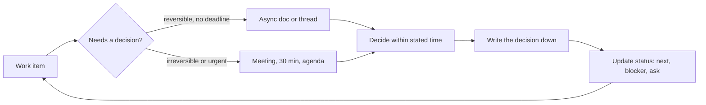

# Teamwork and Communication

> **Lab host:** Windows 11, Python 3.13.5. Section 7's transcript was executed on that host from the
> probe embedded there. The probe scores six written updates against the five fields a reader needs,
> costs interruptions with and without batching, compares synchronous and asynchronous decisions,
> converts unresolved ambiguity into blocked person-days, and prices the habit of asking for help on a
> timer. Recovery and meeting times are declared constants, not stopwatch measurements.

## 1. Learning Objectives

After this lesson you will be able to:

- [ ] Write a status update that a reader can act on without asking a follow-up question
- [ ] Decide whether a decision belongs in a meeting or an asynchronous thread, with the cost of each
- [ ] Understand why interruptions are expensive even when the interruption itself is short
- [ ] Turn a vague request into a specific ask with a decision, options and a deadline
- [ ] Disagree productively and commit to a decision you argued against
- [ ] Escalate at a stated threshold instead of silently struggling

## 2. Prerequisites

- [Engineering Workflows](engineering-workflows.md) — review queues and WIP, which are where most
  communication about work happens
- [Code Review](code-review.md) — the written communication channel with the highest frequency and the
  most room for tone failure
- [Technical Documentation](technical-documentation.md) — writing for a reader who is not present
- [Incident Management](../17-CLOUD-AND-PRODUCTION/incident-management.md) — the high-pressure case of
  everything in this lesson

## 3. Introduction

**Teamwork** in software is mostly communication under uncertainty: someone knows something you need,
someone is waiting on something you have, and neither of you has the full picture. The engineering
part is rarely the bottleneck. The bottleneck is the loop that gets information from the person who
has it to the person who needs it, in a form they can act on.

The two failure modes are familiar. **Too little communication** produces duplicated work, missed
dependencies, and surprises at release. **Too much communication** produces meetings that could have
been a message, status updates that say nothing, and an interruption culture where nobody finishes a
thought. Both feel like work; neither is the work.

The skills in this lesson are therefore about *form*: a status update with the right fields, an ask
with the right specificity, a decision made in the right channel, a disagreement that ends with a
decision rather than a stalemate. They are learnable, and they compound: a team that writes well needs
fewer meetings, which leaves more time to write well.

## 4. The Problem It Solves

Distributed and asynchronous work made an old problem visible: most of what a team knows is tacit.
Before remote work, proximity hid the gap — you overheard the decision, you saw the deploy fail, you
asked across the desk. Remove proximity and the gap becomes a stream of small failures: people unaware
of a constraint, decisions made twice, questions answered in a thread nobody else reads.

The second problem is interruption economics. A message costs the sender seconds and the receiver
twenty minutes of lost focus. In an open-plan office or a busy chat channel, the receiver never gets
twenty uninterrupted minutes, so deep work happens outside working hours, which is unsustainable and
excludes people with responsibilities.

The third problem is ambiguity. "Can you look at the deploy?" has no decision, no options and no
deadline, so the recipient must reconstruct all three, and the sender waits without knowing what for.
The cost is not the ten minutes of clarification; it is the days of blocked work while both parties
assume the other is handling it.

## 5. Core Concepts

**Status update** — a short written report with five fields: what is done, what is next, what is
blocking, what you need from someone, and when this was true. Without the ask and the date it is a
report, not an update.

**Synchronous communication** — a meeting, call or live chat, where participants pay attention at the
same time. **Asynchronous communication** — a document, ticket or thread, where participants pay
attention when convenient.

**Decision latency** — the elapsed time from "we need to decide" to "decided". Async has lower
attention cost and higher latency; sync is the reverse.

**Interruption cost** — the time to regain focus after a context switch, which is much larger than the
interruption. Batching interruptions moves the cost from per-interruption to per-batch.

**Specific ask** — a request that names the decision, the options, the person who decides, and the
deadline. A specific ask can be answered; a vague one starts a conversation.

**Disagree and commit** — stating disagreement clearly, then supporting the decision once it is made.
It is the mechanism that lets a team decide without unanimity.

**Escalation threshold** — a stated time or condition after which you ask for help. It converts asking
from a judgement about competence into a rule.

## 6. How It Works



The loop is the point: every decision produces a written record and a status update, which reduces the
next round of questions. Teams that skip the write-down pay for the same decision repeatedly, usually
with a different set of people.

How to choose the channel:

1. **Reversible and not urgent?** Async. A thread with a deadline gets a better decision than a meeting
   because people can think and check facts.
2. **Irreversible, urgent, or high conflict?** Sync. A 30-minute conversation resolves what a week of
   thread cannot, provided there is an agenda and a decider.
3. **Information only?** Write it down once, link it everywhere. Do not schedule a meeting to read it.
4. **Status?** Written, with the five fields, in a place the team already checks.
5. **Escalation?** Direct message to the person who can unblock you, with the specific ask.

## 7. Practical Examples

**Example 1 — status fields, interruption batching, decision channels, ambiguity and escalation**

The complete program runs five sections: completeness of six status updates, interruption cost with and
without batching, sync versus async decision cost, the cost of vague asks, and the effect of an
escalation rule.

```python
"""PROF-09 probe: status completeness, interruption batching, decision latency, vague asks.

Windows 11, Python 3.13.5. Six written updates are scored against the five fields a reader
needs, interruption recovery is costed with and without batching, synchronous and asynchronous
decisions are compared on elapsed time, and unresolved ambiguity is converted into blocked
person-days. Recovery times are declared constants, not measured.
"""

from __future__ import annotations

FIELDS = ("done", "next", "blocker", "ask", "date")

UPDATES = [
    ("moved the importer to the new schema", "wire the retry path", None,
     "review the migration, please", "2026-11-06"),
    ("fixed the login redirect", None, None, None, None),
    ("investigated the timeout", "add a metric", "waiting on prod access",
     "grant read access to the staging bucket", "2026-11-07"),
    ("refactor in progress", "refactor", "none", "none", None),
    ("shipped the export endpoint", "monitor error rate", None,
     "someone to watch the dashboard tonight", "2026-11-05"),
    ("reviewed two PRs", "start the queue work", None, None, "2026-11-06"),
]


def status_section() -> None:
    print("=== status update completeness ===")
    for text, *rest in UPDATES:
        values = [text, *rest]
        present = [field for field, value in zip(FIELDS, values) if value]
        missing = [field for field in FIELDS if field not in present]
        print(f"  {text:<48}{len(present)}/{len(FIELDS)} {missing}")
    total_fields = len(UPDATES) * len(FIELDS)
    filled = sum(sum(1 for value in [text, *rest] if value) for text, *rest in UPDATES)
    print(f"fields filled {filled}/{total_fields} ({filled / total_fields:.0%})")
    asks = sum(1 for _, *rest in UPDATES if rest[2])
    print(f"updates containing an explicit ask: {asks}/{len(UPDATES)}")
    print("'fixed the login redirect' is a report: done only, no next step and no date")


def interruption_section() -> None:
    print("\n=== interruptions and recovery ===")
    recovery = 23
    interruptions = 8
    scattered = interruptions * recovery
    batched = 2 * recovery
    print(f"{interruptions} interruptions x {recovery} min to regain focus = {scattered} min")
    print(f"two batches, each costing one recovery     = {batched} min")
    print(f"saved {scattered - batched} min "
          f"({(scattered - batched) / scattered:.0%}) by changing when, not whether")
    print("the cost is the recovery, not the question: a one-minute answer costs 24")


def decision_section() -> None:
    print("\n=== synchronous versus asynchronous decision ===")
    stakeholders = 5
    async_rounds = 3
    round_hours = 6
    async_elapsed = async_rounds * round_hours
    meeting_minutes = 45
    context_minutes = 15
    sync_elapsed = (meeting_minutes + stakeholders * context_minutes) / 60
    participants = stakeholders
    async_attention = async_rounds * 10 * participants / 60
    sync_attention = (meeting_minutes * participants + stakeholders * context_minutes) / 60
    print(f"async: {async_rounds} rounds x {round_hours} h = {async_elapsed} h elapsed, "
          f"{async_attention:.1f} person-hours")
    print(f"sync : {meeting_minutes} min meeting + context = {sync_elapsed:.2f} h elapsed, "
          f"{sync_attention:.1f} person-hours")
    print(f"async costs {async_elapsed / sync_elapsed:.0f}x the elapsed time and "
          f"{async_attention / sync_attention:.2f}x the attention")
    print("use sync for reversible decisions with a deadline; async for the rest")


def ambiguity_section() -> None:
    print("\n=== cost of an unclear ask ===")
    vague_asks = 3
    days_blocked = 1.5
    people_waiting = 2
    blocked = vague_asks * days_blocked * people_waiting
    print(f"{vague_asks} vague asks x {days_blocked} days x {people_waiting} people "
          f"= {blocked:.1f} person-days blocked")
    clarify_minutes = 10
    print(f"clearing each one takes about {clarify_minutes} min of conversation")
    print(f"ratio of clarification to blocked time: 1:{blocked * 8 * 60 / (vague_asks * clarify_minutes):.0f}")
    print("a question that does not name the decision, the options, and the deadline "
          "costs days")


def escalation_section() -> None:
    print("\n=== asking for help on a timer ===")
    stuck_minutes = 30
    developers = 10
    print(f"rule: after {stuck_minutes} min without progress, ask")
    for compliance in (1.0, 0.5):
        wasted = developers * stuck_minutes * 2 * (1 - compliance)
        print(f"  {compliance:.0%} compliance: {wasted:.0f} min/day lost to silent struggle "
              f"across {developers} developers")
    print("the rule is a default, not a ceiling: some problems deserve a focused hour")


def main() -> None:
    status_section()
    interruption_section()
    decision_section()
    ambiguity_section()
    escalation_section()
    print("\nprobe complete: status, interruption, decision, ambiguity, escalation")


if __name__ == "__main__":
    main()
```

- `status_section` checks each update against `done`, `next`, `blocker`, `ask` and `date`, and prints
  the missing fields, so the feedback is specific rather than "be clearer".
- `interruption_section` multiplies interruptions by a declared recovery time, then compares that with
  two batched windows, which is the arithmetic behind "office hours" policies.
- `decision_section` computes elapsed time and person-hours for the same five-person decision in both
  channels, because they optimise different quantities.
- `ambiguity_section` converts vague asks into blocked person-days and compares them with the cost of
  clarifying.
- `escalation_section` shows the cost of silent struggle at two compliance rates.

**Expected output** (executed on Windows 11, Python 3.13.5, exit code 0):

```text
=== status update completeness ===
  moved the importer to the new schema            4/5 ['blocker']
  fixed the login redirect                        1/5 ['next', 'blocker', 'ask', 'date']
  investigated the timeout                        5/5 []
  refactor in progress                            4/5 ['date']
  shipped the export endpoint                     4/5 ['blocker']
  reviewed two PRs                                3/5 ['blocker', 'ask']
fields filled 21/30 (70%)
updates containing an explicit ask: 4/6
'fixed the login redirect' is a report: done only, no next step and no date

=== interruptions and recovery ===
8 interruptions x 23 min to regain focus = 184 min
two batches, each costing one recovery     = 46 min
saved 138 min (75%) by changing when, not whether
the cost is the recovery, not the question: a one-minute answer costs 24

=== synchronous versus asynchronous decision ===
async: 3 rounds x 6 h = 18 h elapsed, 2.5 person-hours
sync : 45 min meeting + context = 2.00 h elapsed, 5.0 person-hours
async costs 9x the elapsed time and 0.50x the attention
use sync for reversible decisions with a deadline; async for the rest

=== cost of an unclear ask ===
3 vague asks x 1.5 days x 2 people = 9.0 person-days blocked
clearing each one takes about 10 min of conversation
ratio of clarification to blocked time: 1:144
a question that does not name the decision, the options, and the deadline costs days

=== asking for help on a timer ===
rule: after 30 min without progress, ask
  100% compliance: 0 min/day lost to silent struggle across 10 developers
  50% compliance: 300 min/day lost to silent struggle across 10 developers
the rule is a default, not a ceiling: some problems deserve a focused hour

probe complete: status, interruption, decision, ambiguity, escalation
```

The status table is the most portable tool in the lesson. `investigated the timeout                        5/5
[]` is an update; `fixed the login redirect                        1/5 ['next', 'blocker', 'ask',
'date']` is a report. Across six updates, `fields filled 21/30 (70%)` and `updates containing an
explicit ask: 4/6`. The missing ask is the expensive gap: an update that says "waiting on prod access"
without asking anyone for it produces no action, and the author waits another day.

The interruption section explains a policy most engineers have felt but not costed. `8 interruptions x
23 min to regain focus = 184 min` is three hours of a day lost to eight one-minute questions.
`two batches, each costing one recovery     = 46 min` and `saved 138 min (75%)` is the case for office
hours, or for a channel where questions are queued and answered twice a day. Note what the batching
does not do: it does not reduce the number of questions, and it delays answers. That trade is right for
questions that are not urgent and wrong for a production incident.

The decision section is where teams argue past each other. `async: 3 rounds x 6 h = 18 h elapsed, 2.5
person-hours` against `sync : 45 min meeting + context = 2.00 h elapsed, 5.0 person-hours`. Async is
nine times slower in elapsed time and half the attention. The probe's rule follows from the numbers:
*use sync for reversible decisions with a deadline; async for the rest*. A team that meets for
everything spends its senior engineers' attention; a team that threads everything waits three days for
a decision that a call would settle in twenty minutes.

The ambiguity section is the one to show a manager. `3 vague asks x 1.5 days x 2 people = 9.0
person-days blocked` and `clearing each one takes about 10 min of conversation`, a ratio of
`1:144`. Nine person-days is more than a sprint-week of one engineer, lost to three messages that did
not name a decision. The fix is not more communication; it is a template: decision, options, decider,
deadline.

The escalation section makes asking for help a rule rather than a character trait. `rule: after 30 min
without progress, ask`, and at `50% compliance: 300 min/day lost to silent struggle across 10
developers`. The rule is a default, not a ceiling — the probe says so — because some problems deserve a
focused hour. But without a stated default, the amount of time people spend stuck silently varies with
their confidence, which is the opposite of what a team wants.

- **How to run it:** save as `teamwork_probe.py`, run `python teamwork_probe.py`. Standard library
  only.
- **Assumptions:** 23 minutes to regain focus (a widely cited figure, not measured here), 6-hour async
  rounds, 45-minute meetings, 10 minutes of attention per participant per async round. These are
  orders of magnitude; Exercise 9.3 substitutes your team's numbers.

**Example 2 — the same update, before and after**

```text
Before: "Still working on the importer. Some issues with the schema."
After:  "Importer: schema v2 mapping done and merged (#412). Next: retry path, aiming Thu.
         Blocker: staging DB has no v2 data, so I cannot test end to end.
         Ask: @sam, can you restore the v2 dump to staging by Wed EOD? If not, I will
         test against a local fixture and note the gap. Date: Tue 10:00."
```

The second version takes ninety seconds to write and saves a day of waiting, because the blocker has an
owner, the ask has a deadline, and the fallback is stated so nobody has to ask what happens if Sam is
away.

## 8. Real-World Applications

- **Distributed teams** run on written status and decision records; time zones make synchronous
  coordination expensive, so form matters more.
- **Incident response** uses a single commander and a written timeline, because parallel communication
  during an outage creates contradictory actions.
- **Open-source projects** coordinate entirely asynchronously, which is why their norms — one topic per
  thread, explicit proposals, decision summaries — are worth copying.
- **Cross-functional projects** need a shared vocabulary between engineering, design and product; a
  written decision record is the artefact that survives personnel changes.
- **Performance reviews** draw on the same evidence: updates, reviews, design notes and incident
  write-ups are the record of what you did and how you communicated it.

## 9. Common Mistakes

| Mistake | Why it happens | How to recognize it | How to prevent it |
|---|---|---|---|
| Status without an ask | Reporting feels like the job | Readers ask "so what do you need?" | Five fields, every time |
| Meeting for a reversible decision | Meetings feel decisive | Calendar full, decisions still pending | Async first; sync for irreversible or urgent |
| Interrupting for every question | The question is quick for the sender | Nobody gets an hour of focus | Batch questions; state response windows |
| Vague requests | The context is in the sender's head | "Can you look at this?" with no decision named | Template: decision, options, decider, deadline |
| Silent struggle | Asking feels like incompetence | Someone stuck for a day on a ten-minute question | Stated escalation threshold |
| Disagreeing after the decision | The argument was not resolved | Re-litigating in side channels | Disagree explicitly, then commit and record |

## 10. Best Practices

- **Write the ask last, and make it a question with a name and a date.** The rest of the update exists
  to support it.
- **State the decision, the options and the deadline in every request.** Three sentences; the reply
  becomes a choice instead of a conversation.
- **Protect focus with stated windows.** "I answer messages at 11 and 16" is a communication policy, not
  rudeness, provided urgent channels exist.
- **Default to written decisions.** A decision in a call that nobody writes down will be remade within a
  month.
- **Disagree in the thread, commit in the standup.** Make the disagreement specific and evidence-based;
  once decided, say you will support it.
- **Escalate early and specifically.** "I have spent 90 minutes on X, I think the cause is Y, can you
  confirm?" is faster than either silence or a vague plea.
- **Apologise for the interruption, then make it worth it.** A question with context and a proposed
  answer respects the receiver's time.

These norms change in an incident: synchronous, commander-led communication with a written timeline is
correct, and batching questions is wrong. The probe's own caveat applies — the rule is a default.

## 11. Limitations and Trade-Offs

Written communication is slower for complex, emotional or conflictual topics. A thread about a design
disagreement can harden positions that a ten-minute conversation would dissolve. Knowing when to switch
to voice is a skill the arithmetic cannot supply.

Async-first cultures disadvantage people who write less fluently, non-native speakers, and people who
think by talking. Good teams provide multiple channels rather than declaring one correct.

Batching interruptions delays answers. For a junior engineer blocked on a concept, a two-hour wait can
cost the afternoon; the policy needs an exception for genuine blockers.

Status updates also have a cost: writing five fields well takes ten minutes. Daily detailed updates on
a small team are overhead; weekly ones on a large distributed team are the minimum.

## 12. Practical Exercises

### Introductory

1. **Exercise 9.1** — Rewrite the probe's worst update — `fixed the login redirect` — into a five-field
   update, inventing plausible details.
   **Completion criteria:** all five fields present, with a named ask and a date.
2. **Exercise 9.2** — Count the interruptions in one of your working days and compute the recovery cost
   at 23 minutes each. Then propose two batching windows and compute the saving.
   **Completion criteria:** the count, the two totals and the proposed windows.

### Intermediate

3. **Exercise 9.3** — Replace the probe's recovery time with your own estimate and its meeting length
   with your team's. Re-run and state which decision in the last month should have been async.
   **Completion criteria:** the new figures and one named decision with its channel recommendation.
4. **Exercise 9.4** — Turn this request into a specific ask: "The deploy is broken again, can someone
   look?" Include decision, options, decider and deadline.
   **Completion criteria:** an ask under 60 words that names a person and a time.

### Independent problem-solving

5. **Exercise 9.5** — Your team of six has a two-hour daily meeting load, a chat channel with 200
   messages a day, and a recurring complaint that decisions are remade. Design a communication
   protocol: channels, response windows, decision records, escalation rules and status format. Predict
   the effect on meeting hours and decision latency, and state how you would know in a month whether it
   worked.
   **Completion criteria:** a one-page protocol with the arithmetic, the measurements and a revert
   condition.

*Solutions: attempt first. They live in `solutions/` of this subject.*

## 13. Knowledge Check

1. Why does a status update without an ask produce no action, even when everyone reads it?
2. A five-person decision takes 2 hours synchronously and 18 hours asynchronously. When is each the
   right choice, and what does "right" optimise?
3. Batching interruptions saves 75% of recovery time. What does it cost, and who pays that cost?
4. What does "disagree and commit" require of the person who lost the argument, and why is it not
   simply compliance?

## 14. Completion Criteria

Observable evidence that you have understood this lesson:

- [ ] You can write a five-field status update in under ten minutes
- [ ] You can decide the channel for a decision and justify it with elapsed time and attention
- [ ] You can convert a vague request into a specific ask with a decider and a deadline
- [ ] You can state your escalation threshold and one question you asked too late
- [ ] You can describe a disagreement you lost and how you committed to the decision

## 15. Summary

- Teamwork is communication under uncertainty; the form of the message decides whether it produces
  action.
- A status update needs done, next, blocker, ask and a date; without the ask it is a report.
- Interruptions cost recovery time, not interruption time; batching moves the cost from each question to
  each window.
- Sync minimises elapsed time, async minimises attention; choose by reversibility and deadline.
- Vague asks cost days; a specific ask names the decision, the options, the decider and the deadline.

## 16. Next Steps

- Next lesson: [Career Paths](career-paths.md) — how the skills in this subject map to roles and levels
- Practice: [exercise set](exercises/README.md)
- Where it is applied: [20-PROJECT-LABORATORY](../20-PROJECT-LABORATORY/README.md) — team projects are
  graded on communication artefacts as well as code
