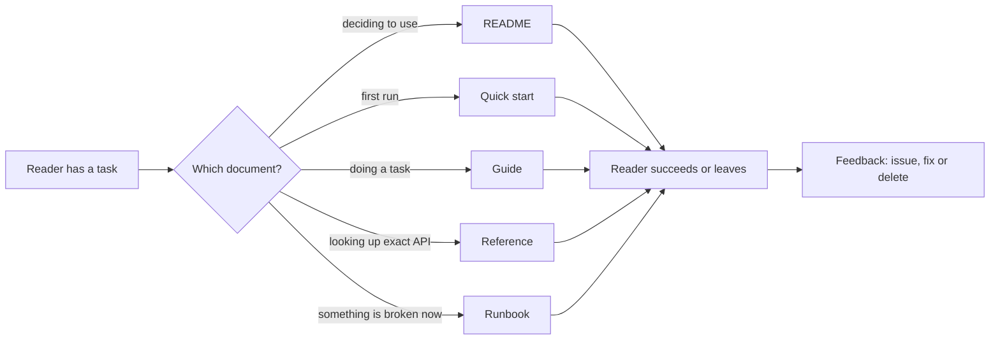

# Technical Documentation

> **Lab host:** Windows 11, Python 3.13.5. Section 7's transcript was executed on that host from the
> probe embedded there. The probe scores four documents against a required-section checklist, checks
> code samples for symbols the current API no longer has, audits a runbook for executable steps,
> compounds per-step comprehension over a twelve-step guide, and ages documents against code churn.
> Nothing is timed; the reader-success figures are a declared per-step probability, not a study.

## 1. Learning Objectives

After this lesson you will be able to:

- [ ] Choose the document type a situation needs — README, guide, reference, ADR or runbook — and
      say what each one is for
- [ ] Score a document's completeness against a checklist and distinguish completeness from
      usability
- [ ] Detect documentation drift by checking samples against the current API rather than by
      re-reading prose
- [ ] Rewrite a runbook step using the probe's executable-step test
- [ ] Explain why comprehension compounds across steps and use it to argue for fewer steps
- [ ] Decide when a document should be deleted rather than updated

## 2. Prerequisites

- [Git Fundamentals](../03-DEVELOPER-TOOLS/git-fundamentals.md) — history, blame and tags, which
  are how you date a document against the code it describes
- [Technical Debt](../13-SOFTWARE-ENGINEERING-AND-ARCHITECTURE/technical-debt.md) — the framing for
  documentation as debt that accrues interest
- [Architecture Decision Records](../18-ADVANCED-ENGINEERING/architecture-decision-records.md) —
  the decision-record format this lesson treats as one document type among several
- [Incident Management](../17-CLOUD-AND-PRODUCTION/incident-management.md) — the pressure under
  which a runbook is read, which sets its requirements

## 3. Introduction

**Technical documentation** is writing that lets someone use, change or operate software without
asking its author. The test is not whether the prose is good; it is whether a specific reader can
complete a specific task with it, at the moment they need to.

Documentation is usually discussed as a chore, which hides that it is an interface. A README is the
interface to a repository. A runbook is the interface to an incident. An API reference is the
interface to a service. When the interface is wrong, the cost is not aesthetic: people install the
wrong version, call the removed parameter, or restart the wrong service at 3am.

The four document types in this lesson have different readers and different failure modes. A
**README** is read by someone deciding whether to use the project. A **guide** is read by someone
doing a task for the first time. A **reference** is read by someone who knows what they want and
needs the exact signature. A **runbook** is read by a tired person under time pressure who cannot
afford to interpret. Treating them as one genre is why so much documentation is simultaneously
complete and useless.

## 4. The Problem It Solves

Before documentation was treated as part of the deliverable, knowledge lived in heads and in chat
history. That works while the team is stable and the system is small. It fails in three predictable
ways: new people take months to become productive, on-call engineers wake up people who are asleep,
and decisions get relitigated because nobody remembers why the current design was chosen.

The second problem is drift. Code changes continuously; prose changes occasionally. A code sample
that references a function removed two releases ago is worse than no sample, because it wastes the
reader's time and teaches them that the documentation is unreliable — after which they stop reading
all of it.

The third problem is the wrong document for the moment. A conceptual essay does not help someone
whose deploy is failing. A step-by-step guide does not help someone looking up an argument name.
Documentation that is not shaped for its reader's situation is documentation that gets abandoned,
and abandonment is invisible until the incident.

## 5. Core Concepts

**Document type** — the reader's situation and the job the document does. The five used here:
README (should I use this?), quick start (can I get it running?), guide (how do I do this task?),
reference (what exactly is the signature?), runbook (what do I do right now?).

**Completeness** — whether the required sections for a document type are present. It is cheap to
measure and does not imply usability.

**Drift** — the gap between what a document says and what the code does. Drift is measurable:
extract the symbols a sample uses and check them against the current API.

**Executable step** — a step a reader can perform without making a decision. "Check the dashboard
for error rate" is not executable; "run `curl -s localhost:9090/metrics | grep http_errors_total`"
is.

**Compounding comprehension** — if each step is understood with probability *q*, the chance of
completing an *n*-step guide unaided is `q^n`. Small per-step ambiguity becomes large total failure
over a long guide.

**Freshness** — document age combined with the amount of code change since. Age alone is not a
signal; a stable reference can be two years old and correct, while a runbook rewritten last month
can already be wrong.

## 6. How It Works



The last box is what separates documentation that improves from documentation that rots. Every
reader outcome — success, confusion, a filed issue — is a signal. Teams that collect the signal fix
the document; teams that do not keep a document that was accurate once.

Writing a document follows the same order as reading it:

1. **Name the reader and the moment.** "An engineer who has just been paged and has never seen this
   service" is a different document from "an engineer evaluating the library".
2. **Name the task.** One document, one job. A README that also teaches the architecture serves
   neither reader well.
3. **Write the smallest thing that completes the task.** For a quick start, that is the shortest
   path from clone to a working example.
4. **Test it as the reader.** Follow your own instructions on a clean machine, or have someone else
   do it while you watch. Every hesitation is a defect.
5. **Add the troubleshooting section last**, from the questions actually asked.
6. **Attach it to change.** Put the document next to the code it describes and update it in the same
   pull request, or the drift is guaranteed.

## 7. Practical Examples

**Example 1 — completeness, drift, runbook audit, reader success and freshness**

The complete program runs five sections: a required-section score for four documents, a
symbol-level drift check for five code samples, an actionability audit of a runbook, a
comprehension-compounding calculation, and an age-against-churn freshness report.

```python
"""PROF-04 probe: documentation completeness, sample drift, runbook actionability.

Windows 11, Python 3.13.5. Four documents are linted against the sections a stranger needs,
five code samples are checked for references that no longer exist, a runbook is scored on
whether a tired reader can act on it, and a reader simulation multiplies per-step clarity.
"""

from __future__ import annotations

REQUIRED = ["what it is", "install", "quick start", "configuration", "troubleshooting",
            "license"]


def completeness_section() -> None:
    print("=== documentation completeness ===")
    docs = {
        "README": {"what it is", "install", "quick start", "license"},
        "RUNBOOK": {"what it is", "troubleshooting", "configuration"},
        "ARCHITECTURE": {"what it is", "configuration"},
        "ONBOARDING": {"what it is", "install", "quick start"},
    }
    for name, present in docs.items():
        missing = [section for section in REQUIRED if section not in present]
        print(f"{name:<13}{len(present)}/{len(REQUIRED)} sections "
              f"({len(present) / len(REQUIRED):>4.0%}) missing: {missing}")
    print("the runbook is the document read under pressure, and it is missing install and start")
    print("completeness is measurable; whether the present sections are usable is not")


def drift_section() -> None:
    print("\n=== code samples versus the current API ===")
    samples = [
        ("README quick start", ["create_client", "run_query"], ["create_client"]),
        ("README configuration", ["load_config"], ["load_config"]),
        ("tutorial step 3", ["Client", "connect", "query"], ["Client", "query"]),
        ("migration guide", ["migrate", "rollback"], ["migrate", "rollback"]),
        ("plugin example", ["register", "Plugin"], ["register"]),
    ]
    broken = 0
    for name, referenced, existing in samples:
        missing = [symbol for symbol in referenced if symbol not in existing]
        broken += bool(missing)
        print(f"  {name:<22}{len(referenced)} symbol(s), missing {missing}")
    print(f"samples with at least one dead reference: {broken}/{len(samples)}")
    print(f"drift rate {broken / len(samples):.0%}; each one is a reader who stops and "
          f"files a bug")


def runbook_section() -> None:
    print("\n=== runbook actionability ===")
    steps = [
        ("check the dashboard for error rate", False),
        ("`kubectl get pods -n payments`", True),
        ("`kubectl logs deploy/payments --tail=100`", True),
        ("look at the database", False),
        ("`ALTER SYSTEM SET max_connections = 300;`", True),
        ("`kubectl rollout restart deploy/payments`", True),
        ("verify error rate is back under 1%", False),
        ("`kubectl rollout undo deploy/payments`", True),
    ]
    commands = sum(1 for _, is_command in steps if is_command)
    vague = [text for text, is_command in steps if not is_command]
    print(f"steps {len(steps)}, concrete commands {commands} ({commands / len(steps):.0%})")
    print(f"steps a tired reader cannot execute: {vague}")
    has_rollback = any("rollout undo" in text for text, _ in steps)
    print(f"rollback step present           : {has_rollback}")
    print("a runbook step that says 'look at the database' is a step the reader must invent")


def reader_section() -> None:
    print("\n=== will a stranger get through it? ===")
    steps = 12
    for clarity in (0.99, 0.95, 0.90):
        success = clarity ** steps
        print(f"per-step clarity {clarity:.0%} over {steps} steps: "
              f"completes unaided {success:.0%}")
    print("at 95% per step, one reader in two finishes a twelve-step guide without help")
    print("the fix is fewer steps or a check after each one, not better prose")


def freshness_section() -> None:
    print("\n=== documentation age against code churn ===")
    pages = [("README", 400, 18), ("RUNBOOK", 300, 6), ("ARCHITECTURE", 250, 2),
             ("ONBOARDING", 120, 9)]
    stale = 0
    for name, age_days, changes in pages:
        is_stale = age_days > 90 and changes > 5
        stale += is_stale
        print(f"  {name:<13}{age_days:>4} days old, {changes:>2} code changes since: "
              f"{'stale' if is_stale else 'current'}")
    print(f"stale pages: {stale}/{len(pages)}")
    print("age alone proves nothing; age with churn is the signal worth alerting on")


def main() -> None:
    completeness_section()
    drift_section()
    runbook_section()
    reader_section()
    freshness_section()
    print("\nprobe complete: completeness, drift, runbook, reader, freshness")


if __name__ == "__main__":
    main()
```

- `completeness_section` checks each document against `REQUIRED` sections for its type, which is why
  the runbook is scored on `install` and `quick start` rather than on prose quality.
- `drift_section` extracts symbol-like tokens from each sample and compares them with the current
  API set; a missing symbol is a concrete, checkable defect rather than a judgement.
- `runbook_section` classifies each step as executable if it contains a command, and prints the
  steps a tired reader would have to invent.
- `reader_section` raises per-step clarity to a power: `0.99 ** 12` against `0.95 ** 12` and
  `0.90 ** 12`.
- `freshness_section` flags a document as stale only when it is old *and* the code it describes has
  changed since.

**Expected output** (executed on Windows 11, Python 3.13.5, exit code 0):

```text
=== documentation completeness ===
README       4/6 sections ( 67%) missing: ['configuration', 'troubleshooting']
RUNBOOK      3/6 sections ( 50%) missing: ['install', 'quick start', 'license']
ARCHITECTURE 2/6 sections ( 33%) missing: ['install', 'quick start', 'troubleshooting', 'license']
ONBOARDING   3/6 sections ( 50%) missing: ['configuration', 'troubleshooting', 'license']
the runbook is the document read under pressure, and it is missing install and start
completeness is measurable; whether the present sections are usable is not

=== code samples versus the current API ===
  README quick start    2 symbol(s), missing ['run_query']
  README configuration  1 symbol(s), missing []
  tutorial step 3       3 symbol(s), missing ['connect']
  migration guide       2 symbol(s), missing []
  plugin example        2 symbol(s), missing ['Plugin']
samples with at least one dead reference: 3/5
drift rate 60%; each one is a reader who stops and files a bug

=== runbook actionability ===
steps 8, concrete commands 5 (62%)
steps a tired reader cannot execute: ['check the dashboard for error rate', 'look at the database', 'verify error rate is back under 1%']
rollback step present           : True
a runbook step that says 'look at the database' is a step the reader must invent

=== will a stranger get through it? ===
per-step clarity 99% over 12 steps: completes unaided 89%
per-step clarity 95% over 12 steps: completes unaided 54%
per-step clarity 90% over 12 steps: completes unaided 28%
at 95% per step, one reader in two finishes a twelve-step guide without help
the fix is fewer steps or a check after each one, not better prose

=== documentation age against code churn ===
  README        400 days old, 18 code changes since: stale
  RUNBOOK       300 days old,  6 code changes since: stale
  ARCHITECTURE  250 days old,  2 code changes since: current
  ONBOARDING    120 days old,  9 code changes since: stale
stale pages: 3/4
age alone proves nothing; age with churn is the signal worth alerting on

probe complete: completeness, drift, runbook, reader, freshness
```

The completeness table shows the shape of most real documentation sets: `README       4/6 sections
( 67%) missing: ['configuration', 'troubleshooting']` is a decent README, while `RUNBOOK      3/6
sections ( 50%) missing: ['install', 'quick start', 'license']` is a document that will fail exactly
when it is needed. The probe's comment is the point: *the runbook is the document read under
pressure, and it is missing install and start*. Scoring a runbook by README criteria is not
pedantry; it is noticing that the reader cannot get to the part they need.

Drift is the section to steal for a CI job. `samples with at least one dead reference: 3/5` and
`drift rate 60%` is a number a team can act on. Note what the check does not do: it does not read
the prose, so it cannot catch a sample that uses a current function incorrectly. It catches the
cheapest and most common failure — the sample that calls something that no longer exists.

The runbook audit is deliberately mechanical: `steps 8, concrete commands 5 (62%)`, and the three
non-executable steps are listed verbatim. `a runbook step that says 'look at the database' is a
step the reader must invent` is the standard to hold: under pressure, the reader has no attention
to spare for design. `rollback step present           : True` is a separate pass — a runbook with no
rollback is a procedure with no exit.

The reader section is the argument against long guides. Twelve steps at 99% per-step clarity leaves
`89%` of readers completing unaided; at 95% it is `54%`; at 90% it is `28%`. A team that improves
prose from 90% to 95% per step doubles the completion rate, which sounds impressive until you
notice that cutting the guide from twelve steps to six at 95% takes it to 74%. Fewer steps and
checks after each one beat better sentences.

The freshness table combines age and churn, which is the only useful version of the signal.
`ARCHITECTURE  250 days old,  2 code changes since: current` is old and fine.
`ONBOARDING   120 days old,  9 code changes since: stale` is newer and wrong. Alerting on age alone
produces noise; alerting on churn since last edit produces work.

- **How to run it:** save as `documentation_probe.py`, run `python documentation_probe.py`. Standard
  library only.
- **Assumptions:** the required-section lists are a declared checklist, the per-step clarity values
  are illustrative, and the stale threshold is a policy choice (90 days and more than five code
  changes). Exercise 4.3 changes both.

**Example 2 — one page, five documents, five readers**

```text
Someone evaluating the project       -> README: what it does, who it is for, one working example
Someone running it for the first time -> quick start: clone, install, run, expected output
Someone doing a recurring task        -> guide: numbered steps, one decision per step, checks
Someone looking up an exact call      -> reference: signatures, types, errors, since-version
Someone paged at 03:00                -> runbook: symptom, check, action, rollback, escalation
```

If you cannot say which of these a document is, the reader cannot either. The fix is usually to
split it, not to write more.

## 8. Real-World Applications

- **Open-source libraries** live or die by their README and quick start; a reader who cannot get a
  working example in five minutes rarely comes back.
- **Platform teams** publish golden-path guides and runbooks, because their users are other
  engineers who need to self-serve.
- **Regulated industries** treat documentation as evidence: change records, operating procedures and
  architecture decisions are audited, and their absence is a finding.
- **On-call rotations** depend on runbooks that assume no context, since the person paged may be
  from another team.
- **API products** generate reference documentation from schemas so the reference cannot drift,
  and hand-write the guides, where judgement is required.

## 9. Common Mistakes

| Mistake | Why it happens | How to recognize it | How to prevent it |
|---|---|---|---|
| Writing for the author's memory | The author knows the system | Steps reference unstated prerequisites | Have someone else follow it on a clean machine |
| One document for every reader | Splitting feels like duplication | README contains deep architecture and install steps | Separate by reader and moment; link between them |
| Copy-pasted samples that rot | Samples are written once and never run | Calls to removed functions | Execute samples in CI; check symbols |
| Vague runbook steps | The author has never been paged | "Check the system", "look at the logs" | Every step contains a command or a check |
| Updating prose without testing | Editing feels like fixing | Instructions that miss a new required flag | Re-run the guide after changing it |
| Keeping documents nobody reads | Deleting feels like losing work | No traffic, no links, no owner | Delete or archive; version control remembers |

## 10. Best Practices

- **Put the document where the reader already is.** A runbook linked from the alert, a README at the
  repository root, a reference generated from the schema.
- **Write the quick start first and test it on a clean environment.** It is the highest-traffic
  document and the cheapest to verify.
- **Prefer one executable command per step.** A step with two decisions is two steps; a step with a
  decision and no criteria is a step the reader will improvise.
- **Include expected output.** "You should see `listening on :8080`" tells the reader they succeeded;
  without it, they guess.
- **Generate what can be generated.** Signatures, configuration tables and CLI help drift least when
  derived from source.
- **Date-stamp decisions, not instructions.** An ADR says when and why; a guide says what to do now.
- **Give every document an owner and a review date.** Unowned documentation is documentation with no
  one to notice it is wrong.

These rules stop applying for documents that are deliberately historical: a postmortem should not be
"updated" when the system changes, because its value is the record of what people believed at the
time.

## 11. Limitations and Trade-Offs

Documentation costs time that could be spent on code, and the return is delayed and diffuse. The
honest trade is to document the paths with the most readers and the highest cost of failure: install,
first task, and incident response. Conceptual essays are valuable but should not displace a working
quick start.

Prose cannot keep up with fast-moving code. For volatile interfaces, generate reference material and
keep guides short enough to re-verify cheaply.

Too much documentation is a real failure mode. A wiki with four conflicting setup guides is worse
than one accurate page, because the reader cannot tell which is current. Deleting is part of
maintenance.

Finally, documentation cannot fix a confusing interface. If the install requires six undocumented
steps, the highest-value change is often to the install, and the document is a symptom.

## 12. Practical Exercises

### Introductory

1. **Exercise 4.1** — Score your own project's README against the probe's six required sections.
   List the missing ones and add the single most important section.
   **Completion criteria:** the before/after section count and the added section.
2. **Exercise 4.2** — Take three code samples from any documentation you can find and check every
   function they call against the current source. Report the drift rate.
   **Completion criteria:** a table of samples, symbols, and whether each still exists.

### Intermediate

3. **Exercise 4.3** — Change the probe's stale rule to flag a document when it is older than 90 days
   regardless of churn, then to flag when churn exceeds five changes regardless of age. Compare the
   two flag sets and argue which produces more useful work.
   **Completion criteria:** both printed flag sets and a paragraph choosing one rule.
4. **Exercise 4.4** — Rewrite this runbook step so a tired reader can execute it: "Check whether the
   worker queue is backed up and restart the consumer if needed."
   **Completion criteria:** a step containing at least one exact command, one numeric threshold, and
   one expected result.

### Independent problem-solving

5. **Exercise 4.5** — Your service has a README, a wiki page, and a runbook that disagree about the
   required environment variables. Design the documentation set you would converge on, including
   what is generated, what is hand-written, where each lives, and how drift is detected. State the
   migration order and what you would delete.
   **Completion criteria:** a one-page plan with a document inventory, a drift check, and an explicit
   deletion list.

*Solutions: attempt first. They live in `solutions/` of this subject.*

## 13. Knowledge Check

1. Why can a document be 100% complete against a checklist and still be unusable? Give an example
   from the probe's output.
2. A guide has twelve steps at 97% per-step clarity. What is the chance a reader completes it
   unaided, and what two changes would raise that most?
3. Why is age alone a poor freshness signal, and what should be combined with it?
4. When is deleting a document the correct maintenance action, and what should you check first?

## 14. Completion Criteria

Observable evidence that you have understood this lesson:

- [ ] You can name the five document types and the reader each serves
- [ ] You can audit a runbook and mark every non-executable step
- [ ] You can compute compound completion probability for a guide and use it to justify shortening
- [ ] You can run a symbol-level drift check on a sample and report a drift rate
- [ ] You can state one document in your own project that should be deleted, and why

## 15. Summary

- Documentation is an interface; success is a reader completing a task, not prose that reads well.
- Each document type serves one reader in one moment; mixing them serves nobody.
- Completeness is measurable and cheap; usability requires watching someone follow the document.
- Drift is detectable mechanically by checking samples against the current API, and should be a CI
  check.
- Comprehension compounds across steps, so shortening a guide beats polishing its sentences.

## 16. Next Steps

- Next lesson: [Open-Source Contributions](open-source-contributions.md) — where documentation is the
  first thing a stranger reads and the contribution guide is the workflow
- Practice: [exercise set](README.md#exercises-and-practice)
- Where it is applied: [20-PROJECT-LABORATORY](../20-PROJECT-LABORATORY/README.md) — every project
  ships a README and a runbook, both graded
