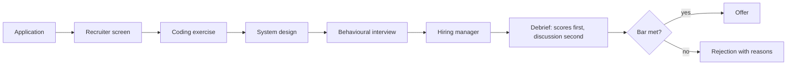

# Technical Interviews

> **Lab host:** Windows 11, Python 3.13.5. Section 7's transcript was executed on that host from the
> probe embedded there. The probe scores four candidates on a weighted rubric, re-ranks two of them
> with and without weights, computes Cohen's kappa for two interviewers, compares work samples with
> puzzle questions, and prices a five-interview loop. Nothing here is a measured hiring outcome; the
> weights, validity rates and costs are declared inputs.

## 1. Learning Objectives

After this lesson you will be able to:

- [ ] Describe the stages of a typical technical loop and what each stage is trying to observe
- [ ] Read a rubric, including its weights, and explain how weights change a hiring decision
- [ ] Compute simple inter-rater agreement and Cohen's kappa, and say what kappa adds
- [ ] Compare interview formats by what they predict and what they cost
- [ ] Prepare for interviews in a way that improves your engineering, not just your performance
- [ ] Give a structured answer about a project, a conflict or a failure without reciting a script

## 2. Prerequisites

- [Engineering Workflows](engineering-workflows.md) — review, testing and delivery practices that
  interviewers ask you to describe
- [Code Review](code-review.md) — the vocabulary for discussing code quality in a live setting
- [System Design](../18-ADVANCED-ENGINEERING/system-design.md) — the structure of design interviews
  and the trade-off language they expect
- [Debugging Methodology](debugging-methodology.md) — the reasoning process interviewers try to
  observe during problem-solving rounds

## 3. Introduction

A **technical interview** is a structured conversation intended to predict whether someone will do
well in a job. It is a measurement with a human in the loop, and like any measurement it has
reliability (do two interviewers agree?) and validity (does the score predict performance?). Most
complaints about interviews are complaints about one of those two properties.

The company's problem is that hiring is expensive and a bad hire is worse. A five-interview loop is
a filter designed to reduce the chance of a bad hire at the cost of rejecting some good ones. The
candidate's problem is that the filter is noisy: two weeks of preparation can change the outcome, and
the signal being measured is not always the signal the job needs.

Understanding the machinery helps in both directions. As a candidate, you can prepare for the thing
being measured instead of guessing. As an engineer who will eventually interview others, you can
avoid the formats that feel rigorous and predict nothing.

## 4. The Problem It Solves

Hiring without structure produces **noise**: interviewers ask whatever they find interesting, compare
candidates with whoever they interviewed last week, and hire people like themselves. The structured
interview movement — fixed questions, defined rubrics, scored independently — exists because
unstructured interviews have poor predictive validity and are prone to bias.

The second problem is cost. A loop of five interviews costs ten interviewer-hours per candidate, and
most candidates are rejected. The cost is paid by the team's delivery work, so every additional round
must be justified by the bad hires it prevents.

The third problem is candidate experience. A process that is slow, opaque and inconsistent is a
signal about the company: if the interview is chaotic, the on-call rotation probably is too. Strong
candidates decline offers based on the process, which raises the cost of the filter further.

## 5. Core Concepts

**Loop** — the sequence of interviews a candidate completes, typically a recruiter screen, a coding
exercise, a system design discussion, a behavioural interview and a hiring-manager conversation.

**Rubric** — the dimensions being scored, the scale, and the weights. A **weighted rubric** makes the
role's priorities explicit: a backend role weights systems and testing more than a design role does.

**Bar** — the threshold a candidate must meet. **Hire / no hire** decisions are usually derived from
per-dimension scores against a bar, not from a single overall impression.

**Calibration** — aligning interviewers so that a 3 means the same thing to everyone. Without it,
scores measure interviewer severity rather than candidate ability.

**Inter-rater agreement** — how often two interviewers reach the same decision. Raw agreement
overstates it when one interviewer passes almost everyone; **Cohen's kappa** corrects for agreement
that would happen by chance:
`kappa = (observed - expected) / (1 - expected)`.

**Predictive validity** — the correlation between interview performance and job performance. Work
samples and structured behavioural interviews predict better than puzzle questions and unstructured
conversation.

## 6. How It Works



The debrief order is the most consequential detail. If the group discusses before scoring, the loudest
or most senior interviewer anchors everyone else, and independent signal is lost. Writing scores first
preserves the disagreement, which is exactly the information the hiring decision needs.

What each stage is actually trying to observe:

1. **Screen** — motivation, communication, and whether the basic facts match the role.
2. **Coding** — can you turn a problem statement into working, tested code while explaining your
   reasoning? The code matters less than the process.
3. **Design** — can you take an ambiguous requirement, make assumptions explicit, choose a structure
   and defend the trade-offs?
4. **Behavioural** — can you describe past work with specifics: your role, the constraint, the
   decision, the outcome, and what you would change?
5. **Manager conversation** — expectations, growth, and whether the role is the one you want.

## 7. Practical Examples

**Example 1 — weighted scoring, a rank flip, kappa, validity and loop cost**

The complete program runs five sections: a five-dimension weighted rubric over four candidates, a
re-ranking of two candidates with and without weights, Cohen's kappa for two interviewers, a
work-sample-versus-puzzle comparison, and the interviewer-hours cost of one hire.

```python
"""PROF-07 probe: weighted rubrics, ranking flips, inter-rater agreement and loop cost.

Windows 11, Python 3.13.5. Four candidates are scored on a five-dimension rubric, two
candidates are re-ranked with and without weights to show that the rubric is a policy, Cohen's
kappa is computed on two interviewers' decisions, and the interview loop's cost per hire is
counted in interviewer-hours.
"""

from __future__ import annotations

WEIGHTS = {
    "coding": 0.25,
    "problem solving": 0.25,
    "communication": 0.20,
    "testing": 0.15,
    "systems": 0.15,
}

CANDIDATES = {
    "Ana": {"coding": 5, "problem solving": 4, "communication": 4, "testing": 5, "systems": 4},
    "Ben": {"coding": 5, "problem solving": 5, "communication": 2, "testing": 3, "systems": 3},
    "Cleo": {"coding": 3, "problem solving": 3, "communication": 5, "testing": 4, "systems": 4},
    "Dev": {"coding": 4, "problem solving": 2, "communication": 3, "testing": 2, "systems": 2},
}


def weighted(scores: dict[str, int]) -> float:
    return sum(scores[dimension] * weight for dimension, weight in WEIGHTS.items())


def rubric_section() -> None:
    print("=== weighted rubric ===")
    for dimension, weight in WEIGHTS.items():
        print(f"  {dimension:<16}weight {weight:.2f}")
    threshold = 3.0
    for name, scores in CANDIDATES.items():
        total = weighted(scores)
        decision = "hire" if total >= threshold else "no hire"
        print(f"{name:<6}weighted {total:.2f}  decision {decision}")
    print(f"threshold {threshold:.1f}: the mean of the scale, fixed before the loop started")
    print("weights are a policy decision about what the role needs, not a scoring detail")


def flip_section() -> None:
    print("\n=== the same two candidates, weighted and unweighted ===")
    pair = {"Ben": CANDIDATES["Ben"], "Cleo": CANDIDATES["Cleo"]}
    for name, scores in pair.items():
        mean = sum(scores.values()) / len(scores)
        print(f"{name}: weighted {weighted(scores):.2f}, unweighted {mean:.2f}")
    print("unweighted ranks Cleo above Ben; weighting the role's needs ranks Ben first")
    print("neither ranking is wrong: one states the policy, the other hides it")


def kappa_section() -> None:
    print("\n=== inter-rater agreement (Cohen's kappa) ===")
    # 2x2 counts: both pass, only A passes, only B passes, both fail.
    both_pass, only_a, only_b, both_fail = 5, 2, 1, 4
    total = both_pass + only_a + only_b + both_fail
    observed = (both_pass + both_fail) / total
    a_pass = both_pass + only_a
    b_pass = both_pass + only_b
    expected = (a_pass * b_pass + (total - a_pass) * (total - b_pass)) / (total * total)
    kappa = (observed - expected) / (1 - expected)
    print(f"decisions {total}: both pass {both_pass}, only A {only_a}, "
          f"only B {only_b}, both fail {both_fail}")
    print(f"observed agreement {observed:.0%}, chance agreement {expected:.0%}")
    print(f"kappa {kappa:.2f}")
    if kappa > 0.6:
        verdict = "substantial"
    elif kappa > 0.4:
        verdict = "moderate"
    elif kappa > 0:
        verdict = "slight"
    else:
        verdict = "no better than chance"
    print(f"interpretation: {verdict} agreement")
    print("two interviewers who disagree on a third of candidates are measuring themselves")


def validity_section() -> None:
    print("\n=== work sample versus puzzle question ===")
    hires = 50
    work_sample, puzzle = 0.72, 0.41
    good_work = round(hires * work_sample)
    good_puzzle = round(hires * puzzle)
    print(f"{hires} hires from each method, still performing after a year:")
    print(f"  work sample {work_sample:.0%}: {good_work} good hires, "
          f"{hires - good_work} failures")
    print(f"  puzzle      {puzzle:.0%}: {good_puzzle} good hires, "
          f"{hires - good_puzzle} failures")
    cost = 150_000
    extra_failures = (hires - good_puzzle) - (hires - good_work)
    print(f"difference: {good_work - good_puzzle} hires, ${extra_failures * cost:,} of "
          f"replacement cost at ${cost:,} per failed hire")
    print("a puzzle measures puzzle performance; a work sample measures the job")


def loop_cost_section() -> None:
    print("\n=== cost of one hire ===")
    interviews = 5
    minutes_per_interview = 60
    interviewers = 2
    candidates_per_hire = 6
    per_candidate = interviews * minutes_per_interview * interviewers / 60
    print(f"{interviews} interviews x {minutes_per_interview} min x {interviewers} interviewers"
          f" = {per_candidate:.0f} interviewer-hours per candidate")
    print(f"{candidates_per_hire} candidates per hire = "
          f"{per_candidate * candidates_per_hire:.0f} interviewer-hours per hire")
    print(f"at {candidates_per_hire} candidates, {candidates_per_hire - 1} receive a full loop "
          f"and are rejected")
    print("loop length is a cost decision: every added round is paid by every rejected candidate")


def main() -> None:
    rubric_section()
    flip_section()
    kappa_section()
    validity_section()
    loop_cost_section()
    print("\nprobe complete: rubric, flip, kappa, validity, cost")


if __name__ == "__main__":
    main()
```

- `WEIGHTS` makes the role's priorities explicit and sums to 1.0; `weighted()` is a dot product, so a
  candidate's total is auditable line by line.
- `flip_section` computes both a weighted total and an unweighted mean for two candidates whose
  strengths differ, which is how a rubric encodes a policy rather than hiding one.
- `kappa_section` builds the two-by-two table from four counts, computes observed agreement, chance
  agreement and kappa, then maps the result to an interpretation band.
- `validity_section` converts two success rates into good hires and failures out of 50, and prices the
  difference at a declared replacement cost.
- `loop_cost_section` multiplies interviews, minutes and interviewers, then multiplies by candidates per
  hire.

**Expected output** (executed on Windows 11, Python 3.13.5, exit code 0):

```text
=== weighted rubric ===
  coding          weight 0.25
  problem solving weight 0.25
  communication   weight 0.20
  testing         weight 0.15
  systems         weight 0.15
Ana   weighted 4.40  decision hire
Ben   weighted 3.80  decision hire
Cleo  weighted 3.70  decision hire
Dev   weighted 2.70  decision no hire
threshold 3.0: the mean of the scale, fixed before the loop started
weights are a policy decision about what the role needs, not a scoring detail

=== the same two candidates, weighted and unweighted ===
Ben: weighted 3.80, unweighted 3.60
Cleo: weighted 3.70, unweighted 3.80
unweighted ranks Cleo above Ben; weighting the role's needs ranks Ben first
neither ranking is wrong: one states the policy, the other hides it

=== inter-rater agreement (Cohen's kappa) ===
decisions 12: both pass 5, only A 2, only B 1, both fail 4
observed agreement 75%, chance agreement 50%
kappa 0.50
interpretation: moderate agreement
two interviewers who disagree on a third of candidates are measuring themselves

=== work sample versus puzzle question ===
50 hires from each method, still performing after a year:
  work sample 72%: 36 good hires, 14 failures
  puzzle      41%: 20 good hires, 30 failures
difference: 16 hires, $2,400,000 of replacement cost at $150,000 per failed hire
a puzzle measures puzzle performance; a work sample measures the job

=== cost of one hire ===
5 interviews x 60 min x 2 interviewers = 10 interviewer-hours per candidate
6 candidates per hire = 60 interviewer-hours per hire
at 6 candidates, 5 receive a full loop and are rejected
loop length is a cost decision: every added round is paid by every rejected candidate

probe complete: rubric, flip, kappa, validity, cost
```

The rubric table shows how a policy becomes a decision. `Ana   weighted 4.40  decision hire` is
strong on every dimension; `Dev   weighted 2.70  decision no hire` is weak on problem solving and
testing, and no amount of charm moves the weighted total over `threshold 3.0`. The threshold is
declared before the loop starts, which is the difference between a rubric and a rationalisation.

The flip section is the part candidates rarely see. `Ben: weighted 3.80, unweighted 3.60` and
`Cleo: weighted 3.70, unweighted 3.80` — unweighted ranks Cleo first, weighted ranks Ben first. Ben is
strong at coding and problem solving and weak at communication; Cleo is the reverse. The probe's
comment is exact: *neither ranking is wrong: one states the policy, the other hides it*. If the job
requires writing code all day and explaining it occasionally, weights are the honest form. A company
that uses an unweighted average has decided that all five dimensions matter equally, whether or not
that is true.

Kappa is the number to quote when someone claims two interviewers "agreed". `observed agreement 75%,
chance agreement 50%` gives `kappa 0.50`, interpreted as `moderate agreement`. Raw agreement of 75%
sounds reassuring until you notice that with these pass rates, two interviewers flipping coins would
agree half the time. Kappa subtracts that baseline. Anything below about 0.4 means the interview is
measuring the interviewer.

The validity section is the argument for work samples. `work sample 72%: 36 good hires, 14 failures`
against `puzzle      41%: 20 good hires, 30 failures` is `difference: 16 hires, $2,400,000 of
replacement cost at $150,000 per failed hire`. The dollar figure is a declared cost, not a universal
truth, but the direction is robust: a task that resembles the job predicts the job better than a task
that resembles a puzzle. This is why "solve this brain-teaser" interviews have largely disappeared
from serious loops.

The loop cost section prices the filter. `5 interviews x 60 min x 2 interviewers = 10 interviewer-hours
per candidate` and `6 candidates per hire = 60 interviewer-hours per hire`. At `6 candidates, 5
receive a full loop and are rejected`. That is the trade: the team spends sixty hours of senior time to
avoid one bad hire, and the arithmetic only works if a bad hire costs more than sixty hours of
senior time — which, at the replacement cost used above, it does.

- **How to run it:** save as `interviews_probe.py`, run `python interviews_probe.py`. Standard library
  only.
- **Assumptions:** scores are 1–5, weights reflect a generalist backend role, success rates are
  illustrative, replacement cost is $150,000, and one hour per interview with two interviewers. Your
  loop will differ; the structure of the calculation will not.

**Example 2 — the same candidate, described two ways**

```text
Weak:    "I worked on the payments service and improved performance."
Strong:  "The checkout p99 was 1.8 s and support tickets were rising. I owned the
          retry path. I measured first: 60% of latency was retries after timeouts.
          I added a circuit breaker and idempotency keys, rolled it out behind a flag,
          and p99 fell to 400 ms over three weeks. Next time I would instrument the
          dependency earlier; I found the cause two days later than I should have."
```

The strong version has a constraint, a role, a measurement, a decision, an outcome and a reflection.
The weak version has none of those, which is why interviewers ask "what was your specific
contribution?" — the question is not hostile, it is the rubric asking for evidence.

## 8. Real-World Applications

- **Large technology companies** run structured loops with defined rubrics and calibrated
  interviewers, because at their volume, small validity improvements are worth millions.
- **Startups** run shorter loops and rely more on work samples and references, because they cannot
  afford sixty interviewer-hours per hire.
- **Agencies and consultancies** interview for client-facing communication as heavily as for coding,
  so their weights differ sharply.
- **Internal mobility** uses the same rubric language, which is why engineers who understand rubrics
  find it easier to move between teams.
- **Open-source maintainers** effectively interview contributors through pull requests: a work sample
  at the contributor's own pace, with public review.

## 9. Common Mistakes

| Mistake | Why it happens | How to recognize it | How to prevent it |
|---|---|---|---|
| Unweighted scoring for a specialised role | Averaging is easy | A candidate strong in an irrelevant dimension wins | Set weights from the role's actual work |
| No rubric at all | "I know a good engineer when I see one" | Interviewers disagree and cannot say why | Score dimensions independently before discussion |
| Discussing before scoring | The debrief feels collaborative | First speaker's opinion becomes the decision | Write scores first, then discuss |
| Puzzle questions | They feel clever | Candidates who solve puzzles underperform on the job | Use work samples and realistic problems |
| No calibration | Interviewers are busy | Same candidate scores 2 and 4 with no explanation | Calibrate with recorded examples and shared anchors |
| Treating a rejection as a verdict on the person | Rejection hurts | Candidate stops preparing or argues | Separate the decision from the feedback |

## 10. Best Practices

**As a candidate:**

- **Prepare stories, not scripts.** For each project, know the constraint, your role, the trade-off,
  the measurement and what you would change. Six well-prepared stories cover most behavioural
  questions.
- **Think aloud during coding.** The interviewer is scoring reasoning, and silence reads as absence of
  reasoning even when it is not.
- **Ask clarifying questions before designing.** Stating assumptions is part of the signal, not a
  weakness.
- **Say what you do not know.** A confident wrong answer is worse than "I have not used that; here is
  how I would find out".
- **Ask about the process.** Loop length, rubric, and feedback are fair questions and tell you how the
  company thinks about hiring.

**As an interviewer:**

- **Write the question and the rubric before the interview.** Improvising produces uncomparable
  evidence.
- **Score independently, immediately after.** Memory decays and discussion contaminates.
- **Look for evidence, not agreement.** "They think like us" is a bias, not a signal.
- **Leave time for the candidate's questions.** It is both courteous and informative.
- **Give specific feedback when the process allows.** "You did not test edge cases" is actionable;
  "not a culture fit" is not.

## 11. Limitations and Trade-Offs

Interviews are a noisy measurement. Even structured loops reject good engineers and occasionally hire
poor ones; the aim is to improve the odds, not to make the decision certain.

Work samples are more valid but expensive: they take hours of candidate time and are unpaid labour
when long. There is an ethical line between a reasonable exercise and free consulting.

Rubrics encode the company's current priorities, which may be wrong. A rubric that weights algorithmic
speed heavily will hire people who are fast at puzzles, and the organisation may not notice the
resulting gap in maintenance skill for a year.

Kappa and validity figures come from research on populations; they do not tell you whether this
particular interviewer is good. Calibration is local work.

Finally, interviews are a two-way evaluation. A company that optimises only its own signal will lose
candidates who notice the process is disrespectful, and that cost does not appear in the hiring
metrics.

## 12. Practical Exercises

### Introductory

1. **Exercise 7.1** — Using the probe's weights, add a candidate with scores 2, 2, 5, 5, 5 and compute
   the weighted total. Decide hire or no hire and explain which weight decided it.
   **Completion criteria:** the total, the decision, and the deciding dimension.
2. **Exercise 7.2** — Write three STAR-style stories from your own work: a technical decision, a
   conflict, and a failure. Each under 150 words, each with a measurement.
   **Completion criteria:** three stories containing constraint, role, action, outcome and reflection.

### Intermediate

3. **Exercise 7.3** — Change `WEIGHTS` so communication counts 0.40 and coding 0.15. Re-run and
   explain how the ranking changes. Then argue for or against those weights for a developer-advocate
   role.
   **Completion criteria:** the new table and a two-paragraph argument.
4. **Exercise 7.4** — Recompute kappa for the table `both pass 3, only A 4, only B 4, both fail 3` and
   interpret the result. What does the low value say about the interviewers?
   **Completion criteria:** the observed agreement, chance agreement, kappa and an interpretation.

### Independent problem-solving

5. **Exercise 7.5** — Design a 90-minute interview for a mid-level backend role that predicts job
   performance: state the dimensions, the weights, the task, what evidence you would record, and how
   you would calibrate two interviewers. Then state the failure mode you expect and how you would
   detect it after ten candidates.
   **Completion criteria:** a one-page design with rubric, task, evidence template and a calibration
   plan.

*Solutions: attempt first. They live in `solutions/` of this subject.*

## 13. Knowledge Check

1. Why can two interviewers agree 75% of the time and still be barely better than chance? What does
   kappa add?
2. A company uses an unweighted average of five dimensions for a role that is 80% coding. What is it
   implicitly deciding, and who benefits?
3. Why do work samples predict job performance better than puzzle questions, and what is the main cost
   of using them?
4. In a debrief, why should scores be written before discussion? What failure does the reverse order
   cause?

## 14. Completion Criteria

Observable evidence that you have understood this lesson:

- [ ] You can compute a weighted rubric total and explain which weight changed the decision
- [ ] You can compute kappa from a two-by-two table and interpret it
- [ ] You can describe the stages of a loop and what each observes
- [ ] You can tell a project story with constraint, role, trade-off, measurement and reflection
- [ ] You can name one interview format you would remove from a loop and defend it with validity or cost

## 15. Summary

- Interviews are a noisy measurement with a cost; structure, rubrics and calibration exist to reduce
  the noise.
- Weights are policy: they decide what the role values, and unweighted averages hide that decision.
- Raw agreement flatters interviewers; kappa shows how much of it is chance.
- Work samples predict job performance better than puzzles, at a higher cost per candidate.
- Preparation that transfers is preparation about your own work — constraints, trade-offs, measurements
  and what you would change.

## 16. Next Steps

- Next lesson: [Portfolio Development](portfolio-development.md) — the evidence an interview will ask
  you to discuss
- Practice: [exercise set](exercises/README.md)
- Where it is applied: [20-PROJECT-LABORATORY](../20-PROJECT-LABORATORY/README.md) — the capstone is
  designed to be defensible in exactly this conversation
