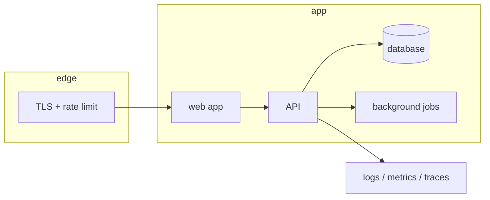

# Capstone — One Product, End to End

## 1. Problem statement

Every project so far was given to you: a brief, a domain, a set of acceptance criteria. The capstone
removes the brief. You choose a product, find a real user for it, and carry it from a sentence to a
deployed service with tests, a threat model, telemetry and a walkthrough you can defend.

The thing being assessed is not the size of the product. A small product that a real person uses, with
honest documentation and a measured SLO, scores higher than an ambitious one that is 70% built and
demoed from a laptop. Scope is a design decision, and choosing it well is part of the grade.

"Solved" means: a named person outside this course uses the thing for a stated purpose; the acceptance
criteria you wrote are met and checked; the service is deployed and observable; and you can explain every
significant decision, including the ones you would make differently now.

## 2. Intended users

You must name at least one **real** user — a person, not a persona — and describe how you learned what
they need. The rest of the table is yours to complete.

| User | Goal | Skill level | Accessibility needs |
|---|---|---|---|
| Primary user (real, named to your mentor) | *(their words, not yours)* | | |
| Secondary user | | | |
| Operator (you) | Keep it running and know when it is not | Professional | Runbook on a phone |
| Reviewer | Assess the work in under an hour | Professional | README that leads to evidence |

A persona invented for the document does not satisfy this section. A conversation, five questions, or a
week of watching someone do the task by hand does.

## 3. Functional requirements

The capstone has a **fixed core** and a **chosen surface**.

Fixed core (all required, regardless of product):

- **FR-1** A user can complete the product's primary job end to end, twice, without help.
- **FR-2** Data persists across sessions and is owned by the user who created it.
- **FR-3** Authentication and authorisation are enforced on the server; the UI is not the control.
- **FR-4** Every mutation validates its input on the server and returns a typed error.
- **FR-5** A destructive action is reversible or confirmed, and never loses data silently.
- **FR-6** The product works on a 360 px viewport and with a keyboard only.
- **FR-7** An export of the user's own data exists (CSV or JSON), because a product that traps data is
  not finished.
- **FR-8** A health endpoint and a version endpoint exist and are used by the deployment.

Chosen surface: 6–12 additional functional requirements specific to your product, numbered FR-9 onward,
each testable. Fewer, sharper requirements beat a long list; a requirement you cannot check is a wish.

## 4. Non-functional requirements

| ID | Requirement | Measurable target |
|---|---|---|
| NFR-1 | Performance | p95 under 400 ms for the primary action at 3× your expected peak |
| NFR-2 | Accessibility | WCAG 2.2 AA for the primary flow; axe reports no serious issues |
| NFR-3 | Availability | A target you choose (99% is honest for a solo project), measured externally |
| NFR-4 | Security | No critical/high findings in SAST, dependency or container scans at release |
| NFR-5 | Recovery | A backup restore performed and timed, RPO and RTO stated |
| NFR-6 | Observability | Any 5xx spike pages or notifies within 5 minutes |
| NFR-7 | Maintainability | A new contributor can run the test suite from the README in under 15 minutes |
| NFR-8 | Cost | Monthly cost stated, with the dominant line item named |

Choose the numbers, then measure them. An unmet target that is documented and explained is worth more
than a met target that was never measured.

## 5. Prerequisites

All seven laboratory projects, or their equivalent experience, plus the subjects they draw on. The
capstone assumes you can already: design a schema, build an API, build a UI, write tests that fail when
the code is wrong, deploy a container, and read a dashboard.

There is no new lesson to read before this. If a prerequisite is missing, the capstone will find it in
week two — which is the point, and also the reason not to start the capstone first.

## 6. Architecture

You choose it, document it as deployed, and defend it in an ADR. The diagram must show trust boundaries,
data stores, external services and where secrets live. Three shapes are common and all acceptable:



Constraints, not choices: one deployable unit per process you operate (keep it to two or three);
managed database; no secret in the repository; one origin for the browser and the API unless you can
explain the CORS and cookie consequences.

The architecture section must include **what you deliberately did not build** and why. A monolith that
says "no queue, because the workload is a 200 ms synchronous job and a queue would add a failure mode"
is stronger than a diagram with six boxes and no reasoning.

## 7. Data model

Your schema, with an ERD, the constraints that enforce your invariants, and an index justified by a real
query. Required content:

- Every table with its keys and the constraints that matter (uniqueness, FK behaviour, checks).
- The ownership rule: how a row is tied to a user, and how every query enforces it.
- A retention decision for any personal data: lifetime, deletion path, and what happens to derived data.
- One `EXPLAIN` for the heaviest query, with the index you added and the before/after timings.

If your product has no personal data, say so and say why — a public read-only dataset still has an
ownership and integrity story.

## 8. API contract

Every endpoint the product uses, with method, path, success status, error statuses and one example.
The contract must include:

- The authentication mechanism and where the credential lives.
- The error format, one example per error class (validation, not found, forbidden, conflict).
- Pagination or a documented bound on every list.
- Idempotency for any create that a user might retry (payment-like actions, uploads, form resubmits).

If the product is server-rendered with form posts, the same table applies with routes and redirects;
"no API" is not an exemption from the contract.

## 9. UI requirements

The primary flow is the product. Everything else is secondary.

- **The one job** — complete it in under three interactions from the landing state, or document why not.
- **States** — loading, empty, error, partial, success. Each designed, not defaulted.
- **Accessibility** — keyboard path through the primary flow, visible focus, labelled controls, contrast
  measured, text at 200% without clipping.
- **Responsive** — 360 px is the design target, not an afterthought; the layout at 1440 px is not stretched.
- **Copy** — error messages say what happened and what to do next; no "Something went wrong".

Take one screenshot per state and put them in `docs/screens/`. They are the fastest way for a reviewer to
see whether the product is finished.

## 10. Folder structure

```text
capstone/
├── README.md                 # the product, the URL, how to run, the evidence index
├── docs/
│   ├── requirements.md       # FR/NFR with traceability to tests
│   ├── architecture.md       # as-deployed diagram + decisions
│   ├── threat-model.md
│   ├── runbook.md
│   └── adr/
├── app/                      # application code
├── tests/                    # unit, integration, e2e
├── deploy/                   # Dockerfile, IaC or platform config, backup scripts
├── observability/            # dashboards, alerts, SLO
└── evidence/                 # dated scan reports, load test, restore drill, screenshots
```

## 11. Milestones

Six weeks at 10–12 hours a week, or the equivalent. Each gate is a review with your mentor; a gate not
passed is not skipped.

| Gate | Week | Pass condition |
|---|---|---|
| G0 Problem | 1 | A named user, their words, and a one-paragraph product statement; scope cut to what fits |
| G1 Walking skeleton | 2 | Deployed URL, sign-in, one real record created and read back |
| G2 Core loop | 3 | FR-1 to FR-4 pass against the deployed app; schema and contract written |
| G3 Hardening | 4 | Threat model, server-side authz tests, input validation, error states |
| G4 Operations | 5 | Pipeline, health, logs, metrics, SLO, backup drill |
| G5 Proof | 6 | Load test, accessibility audit, user trial with the named user, walkthrough |

The most common failure is starting at G2 and discovering at G4 that the data model cannot support
deletion or export. G0's scope cut and G2's schema review exist to catch that early.

## 12. Implementation tasks

For G0 only:

1. Write the product statement in one paragraph: who, what job, what changes for them.
2. Talk to the named user for 20 minutes; write five quotes and the task they do by hand today.
3. List every feature you are tempted to build; cut it to the smallest set that completes the job.
4. Write FR-9 onward from the user's words, not from the feature list.
5. State the one thing you will not build, and why.
6. Book the G1 review with a URL you do not have yet.

## 13. Testing strategy

| Layer | What it proves | Minimum |
|---|---|---|
| Unit | Pure logic: pricing, scheduling, parsing, permissions predicates | The rules with more than two branches |
| Integration | Database constraints, transactions, authz against real rows | Every invariant in section 7 |
| E2E | The primary flow through the browser, from a clean database | One happy path, one failure path |
| Security | 401/403 matrix, input validation, headers, rate limit | Every endpoint in section 8 |
| Performance | p95 at 3× peak, with a report | The primary action |
| Accessibility | axe plus a keyboard walkthrough | The primary flow |

Traceability: each FR/NFR in `docs/requirements.md` names the test that proves it. A requirement with no
test is marked "unverified" rather than assumed.

## 14. Security requirements

- **Threat model** — STRIDE over the deployed diagram; each mitigation names its control and its file.
- **AuthN/AuthZ** — server-side checks on every route; a matrix test that a second account cannot read or
  mutate the first account's rows.
- **Input** — validation on the server, parameterised queries, output encoding, upload type and size
  limits if uploads exist.
- **Secrets** — runtime injection, no secret in git, rotation documented; `.env.example` has names only.
- **Transport and headers** — HTTPS, HSTS, CSP enforced, `no-store` on authenticated responses.
- **Abuse** — rate limits on auth and expensive endpoints, account lockout, generic auth errors.
- **Data** — encryption at rest for the database and backups, retention policy applied, export and delete
  paths working.
- **Dependencies** — pinned, scanned in CI, SBOM produced per release.

## 15. Deployment plan

A public URL over HTTPS, deployed by a pipeline from `main`, with a documented rollback. Include:

- The environments (local, staging if you have one, production) and what differs.
- The deploy gate: tests, scans, migration check.
- The rollback command and the time it takes, measured once.
- The backup schedule and the restore drill record.
- The cost, monthly, with the dominant line.

A capstone that only runs locally is not deployed, regardless of how good the code is. If a platform
constraint blocks deployment, document the constraint and the workaround in the README rather than
quietly omitting the URL.

## 16. Documentation requirements

- `README.md`: what it is, the live URL, a 60-second local start, the evidence index (links to scans,
  load test, restore drill, screenshots).
- `docs/requirements.md` with traceability.
- `docs/architecture.md` as deployed, including what you did not build.
- `docs/threat-model.md` and `docs/runbook.md`.
- `observability/slo.md` with the SLI, target and budget policy.
- Two **ADRs** minimum: the architecture shape, and one hard trade-off you actually debated.
- A walkthrough script for a 15-minute demo, with the three questions you expect and your answers.

## 17. Acceptance criteria

- [ ] AC-1 A named real user completed the primary job unaided, and their feedback is recorded.
- [ ] AC-2 The deployed URL serves the product over HTTPS; a stranger can sign up and use it.
- [ ] AC-3 FR-1 to FR-8 pass on the deployed instance, each traced to a test or a dated manual check.
- [ ] AC-4 Every additional FR passes, or is documented as cut with the reason.
- [ ] AC-5 A second account cannot read or mutate the first account's data (test evidence).
- [ ] AC-6 The primary flow is keyboard-operable, passes axe, and is usable at 360 px.
- [ ] AC-7 All NFR targets are measured and reported, including the ones missed.
- [ ] AC-8 CI runs tests and scans on every push; the release has no critical/high findings.
- [ ] AC-9 A 5xx spike produces an alert within 5 minutes, demonstrated once.
- [ ] AC-10 A restore from backup was performed and timed; the record is in `evidence/`.
- [ ] AC-11 The load test at 3× peak reports p95 and names the first bottleneck.
- [ ] AC-12 A 15-minute walkthrough explains the architecture, the weakest part, and one decision you
      would reverse.

## 18. Extension challenges

1. **A second real user** — onboard someone who is not you and watch where they get stuck. Teaches the
   gap between "works" and "usable".
2. **Operate it for 30 days** — keep the SLO, review the bill, respond to the alerts. Teaches the cost of
   ownership that a demo never shows.
3. **Handover** — give the repo to someone else for a week and fix what they could not do. Teaches
   documentation by feedback rather than by hope.
4. **A deliberate migration** — change a schema or a framework version under live data. Teaches
   expand/contract with consequences.
5. **Publish the post-mortem** — write up one real incident, including the part that was your fault.
   Teaches the professional habit the whole curriculum has been building toward.

## Solutions policy

There is no reference solution for the capstone, by design: a capstone with a solution is a project with
a brief. What exists instead is a review rubric — the seven dimensions in the
[laboratory overview](../README.md#grading-rubric) — and a guide at
[reference-solution/README.md](reference-solution/README.md) to how a capstone is assessed and what
distinguishes a 70 from an 90.
