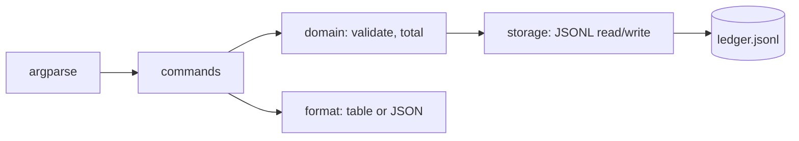

# Project 01 — Command-Line Expense Ledger

## 1. Problem statement

People who want to know where their money goes usually start with a spreadsheet and abandon it within
a month. The friction is not arithmetic; it is data entry and recall. Typing a row into a spreadsheet
means opening a GUI application, finding the file, remembering the column order, and then discovering
next month that the totals are wrong because a date was typed in a different format.

A command-line ledger solves the friction: one short command to record an expense, one to see the
month, one to export for a tax return. It is small enough to build in a few evenings and rich enough
to have real edge cases — malformed input, duplicate imports, currency rounding, dates in three
formats, files that do not exist yet.

"Solved" means: a user can record, list, filter and total their expenses without opening an editor,
and can trust that a bad line in the data file produces a clear error rather than a silent wrong
total.

## 2. Intended users

| User | Goal | Skill level | Accessibility needs |
|---|---|---|---|
| Freelancer | Record business expenses quickly, export monthly totals | Comfortable with a terminal | Works over SSH; no mouse; screen-reader-friendly plain output |
| Student | Track a small budget, see where the month went | Beginner; will copy commands from the README | Clear error messages that say what to do next |
| Bookkeeper | Import a bank CSV, correct mistakes, re-run totals | Intermediate; automates with scripts | Stable exit codes and a `--json` mode for pipes |

## 3. Functional requirements

- **FR-1** `add` records an expense with amount, category, date and optional note.
- **FR-2** Dates accept `YYYY-MM-DD`, `DD/MM/YYYY` and `YYYY/MM/DD`, and are stored canonically as
  `YYYY-MM-DD`.
- **FR-3** Amounts are stored as integer minor units (cents) and printed with two decimals; no float
  arithmetic touches money.
- **FR-4** `list` prints expenses in date order, with `--from`, `--to`, `--category` and `--limit`
  filters.
- **FR-5** `report` prints totals per category for a period, plus a grand total and a count.
- **FR-6** `import` reads a CSV with columns `date,amount,category,note` and reports how many rows were
  imported, skipped and rejected, with the line number and reason for each rejection.
- **FR-7** Recording the same expense twice (same date, amount, category and note) is refused unless
  `--allow-duplicate` is passed.
- **FR-8** A missing data file is created on first write; a corrupt line is reported with its line
  number and skipped, and the exit code is non-zero.
- **FR-9** `--json` on `list` and `report` emits one JSON document on stdout, with no other output.
- **FR-10** Every command supports `--help` and `--version`.

## 4. Non-functional requirements

| ID | Requirement | Measurable target |
|---|---|---|
| NFR-1 | Startup and list performance | `list` over 100,000 records completes in under 1 second on the lab host |
| NFR-2 | Memory | Importing a 200 MB CSV does not exceed 256 MB RSS (streaming, not read-all) |
| NFR-3 | Data safety | A failed write never leaves a truncated ledger; writes go to a temp file and are renamed |
| NFR-4 | Portability | Runs on Windows 11 and Linux with CPython 3.11+, no compiled dependencies |
| NFR-5 | Usability | Every error names the problem, the offending value and the next action |
| NFR-6 | Determinism | `--json` output is stable and sorted, suitable for diffing in tests |

## 5. Prerequisites

| Lesson | Why needed here |
|---|---|
| [Python fundamentals](../../02-PROGRAMMING-FUNDAMENTALS/README.md) | Functions, modules, exceptions, file I/O |
| [Command-line basics](../../03-DEVELOPER-TOOLS/terminal-fundamentals.md) | Arguments, exit codes, pipes, environment |
| [Git fundamentals](../../03-DEVELOPER-TOOLS/git-fundamentals.md) | Commits per milestone; the history is graded |
| [Big-O notation](../../05-DATA-STRUCTURES-AND-ALGORITHMS/big-o-notation.md) | NFR-1 requires knowing why sorting once beats sorting per query |
| [Sorting](../../05-DATA-STRUCTURES-AND-ALGORITHMS/sorting.md) | `list` ordering and the report's grouping |
| [Testing fundamentals](../../14-TESTING-AND-QUALITY/testing-fundamentals.md) | Unit and integration tests for parsing and CLI behaviour |

## 6. Architecture

A single Python package with a thin CLI layer, a domain layer and a storage layer. The CLI parses
arguments and formats output; it contains no business rules. The domain validates and computes. The
storage layer serialises and guards the file.



**Yours to decide** (and judged in the walkthrough): the storage format (JSONL is suggested, not
required), how filtering is composed, whether the domain returns values or raises, and how the CLI
maps exceptions to exit codes. **Given**: Python 3.11+, standard library only, and the command names
in section 8.

The important boundary is between `commands` and `domain`: a command may print, but it must not
contain a rule that a test would otherwise have to drive through `argparse`. That boundary is the
difference between a testable CLI and a pile of `main()`.

## 7. Data model

One JSON object per line in `ledger.jsonl`:

| Field | Type | Constraint |
|---|---|---|
| `id` | string | UUIDv4, unique |
| `date` | string | `YYYY-MM-DD`, valid calendar date |
| `amount_minor` | integer | Non-zero; negative for refunds |
| `currency` | string | ISO-4217, default `EUR` |
| `category` | string | 1–40 characters, trimmed, case-insensitive uniqueness |
| `note` | string | Optional, ≤ 200 characters, no newlines |
| `created_at` | string | ISO-8601 UTC timestamp |

Required constraints: `id` unique across the file, `date` parseable, `amount_minor` an integer, and no
newlines in any string field (the last one is what makes JSONL safe). Append-only is suggested; if you
choose a mutable store, you own the concurrent-write story.

## 8. API contract

The "API" is the command surface. All commands accept `--data PATH` (default `./ledger.jsonl`).

| Command | Purpose | Success | Error cases |
|---|---|---|---|
| `add AMOUNT CATEGORY [--date D] [--note N] [--allow-duplicate]` | Record an expense | exit 0, prints the new id | 2 bad amount/date, 3 duplicate, 4 write failure |
| `list [--from D] [--to D] [--category C] [--limit N] [--json]` | List expenses | exit 0 | 2 bad filter/date range |
| `report [--from D] [--to D] [--json]` | Totals per category | exit 0 | 2 bad range |
| `import FILE.csv [--dry-run]` | Bulk import | exit 0, or 1 if any row rejected | 2 missing file, 1 partial import |
| `--version`, `--help` | Identity and usage | exit 0 | — |

Exit codes are part of the contract: `0` success, `1` partial success or data problem, `2` usage
error, `3` conflict (duplicate), `4` I/O failure. A script must be able to distinguish "no expenses"
from "the file is unreadable", and `0` vs `1` is how.

## 9. UI requirements

Text output only. `list` prints a fixed-width table with a header row and right-aligned amounts;
`report` prints category, total and share, then a total line. States to handle:

- **empty** — `no expenses recorded` on stderr, exit 0 (an empty ledger is not an error).
- **loading** — not applicable; commands are synchronous.
- **error** — one line on stderr: what failed, the value, and the next action.
- **success** — human mode prints a summary; `--json` prints only the document.

Accessibility: no colour as the sole carrier of meaning, ASCII-only output by default (Windows
consoles default to cp1252), and `--json` for screen readers and pipes. Do not print progress bars
when stdout is not a TTY.

## 10. Folder structure

```text
project-01-command-line-application/
├── pyproject.toml            # package metadata and the console-script entry point
├── README.md                 # install, usage, design notes
├── src/ledger/
│   ├── __init__.py
│   ├── __main__.py           # python -m ledger
│   ├── cli.py                # argparse, exit-code mapping
│   ├── commands.py           # one function per command
│   ├── domain.py             # validation, totals, duplicate rule
│   ├── storage.py            # JSONL read/append, atomic write
│   └── formatting.py         # table and JSON renderers
└── tests/
    ├── test_domain.py
    ├── test_storage.py
    └── test_cli.py           # subprocess-level, asserts exit codes
```

## 11. Milestones

| # | Milestone | Deliverable | Depends on |
|---|---|---|---|
| M1 | Skeleton and `add` | Package installs; `add` appends a valid record; one test | — |
| M2 | `list` and filters | Date/category filters, ordering, empty state | M1 |
| M3 | `report` and money | Integer-minor-unit totals, per-category shares | M2 |
| M4 | `import` | Streaming CSV, per-row rejection report, `--dry-run` | M2 |
| M5 | Robustness | Corrupt-line handling, atomic writes, duplicates, exit codes | M3, M4 |
| M6 | Polish | `--json`, help text, README, packaging | M5 |

## 12. Implementation tasks

For M1 only:

1. Create the package with `pyproject.toml`, a `ledger` console script, and `python -m ledger`.
2. Write `parse_amount("12.34") -> 1234` and `parse_date("03/04/2026") -> "2026-04-03"` in `domain.py`,
   with tests first.
3. Write `append_record(path, record)` in `storage.py` using `open(..., "a", encoding="utf-8")` and a
   newline-terminated JSON object.
4. Wire `add` in `commands.py`, and map validation errors to exit code 2 in `cli.py`.
5. Add one subprocess test that runs the installed entry point and asserts the exit code and the file
   content.

You write M2–M6's task breakdown yourself; that is part of the exercise.

## 13. Testing strategy

| Requirement | Test level | Notes |
|---|---|---|
| FR-2, FR-3 | unit | Table-driven date and amount cases, including `29/02/2025` and `"1,234.50"` |
| FR-4, FR-5 | integration | Build a fixture ledger, run the command, assert exact stdout |
| FR-6 | integration | CSV with valid, malformed and duplicate rows; assert counts and line numbers |
| FR-7 | unit + integration | Duplicate rule in the domain; refusal and override through the CLI |
| FR-8 | integration | Truncated JSONL line; assert stderr and exit code 1 |
| FR-9 | integration | Parse stdout as JSON; assert no extra lines |
| NFR-1 | performance | Generate 100k records; assert elapsed under 1 s in a marked test |
| NFR-3 | unit | Simulate a failure mid-write; assert the previous file is intact |

Deliberately **not** tested: the help text's wording, the exact table padding beyond one snapshot
test, and `argparse` itself. Testing the framework's behaviour is a tax with no return.

## 14. Security requirements

- **Path handling** — `--data` is resolved with `Path.resolve()`; refuse to write outside the current
  directory unless `--allow-outside` is passed. Verified by a test using `../escape.jsonl`.
- **CSV injection** — a note beginning with `=`, `+`, `-` or `@` is escaped when exported to CSV.
  Verified by a test that opens the export and asserts a leading apostrophe.
- **No shell** — no `subprocess` call is used to read or write files; no `eval` on user input.
- **Denial of service** — import enforces a maximum line length (64 KB) and reports oversized lines
  rather than crashing.
- **No secrets** — the ledger stores no credentials; if you add a currency API, the key comes from an
  environment variable and never appears in the file or in `--help`.

## 15. Deployment plan

This project ships as a package, not a service: `pipx install .` or `pip install .` in a virtual
environment, then `ledger --version`. "Deployment" here means installable from a clean checkout by
someone who has never seen the code.

Requirements: `pyproject.toml` with a pinned-compatible Python range, no runtime dependencies beyond
the standard library, and a README whose install section works on Windows and Linux. Rollback is
`pipx uninstall ledger`; there is no data migration to undo because the format is append-only.

## 16. Documentation requirements

- `README.md` with: what it does, install, the five commands with one example each, the data file
  format, exit codes, and a "design notes" section covering the storage choice and the atomic write.
- One **ADR** (`docs/adr/0001-*.md`) on a decision you actually made: JSONL versus SQLite, integer
  minor units, or the duplicate rule. State the options, the choice and the consequence.
- `--help` text for every command that a stranger can follow without the README.

## 17. Acceptance criteria

- [ ] AC-1 A clean checkout installs with one documented command and `ledger --version` prints a
      version.
- [ ] AC-2 `add 12.34 coffee` then `list` shows one row with `12.34` and today's date.
- [ ] AC-3 `add 12,34 coffee` (comma decimal) either parses correctly or fails with exit code 2 and a
      message naming the accepted format — no silent misparse.
- [ ] AC-4 Dates in all three accepted formats produce the same stored `YYYY-MM-DD` value.
- [ ] AC-5 `list --from 2026-01-01 --to 2026-01-31` excludes records outside the range.
- [ ] AC-6 `report` totals match a hand-computed fixture exactly, to the cent.
- [ ] AC-7 `import` of a five-row CSV with two bad rows prints `3 imported, 2 rejected`, names both
      line numbers, and exits 1.
- [ ] AC-8 A duplicate `add` exits 3; the same command with `--allow-duplicate` exits 0 and adds a
      second record.
- [ ] AC-9 A ledger with a truncated JSON line produces a clear error and exit 1, and leaves the file
      unchanged.
- [ ] AC-10 `list --json | python -m json.tool` succeeds, and the output contains no table text.
- [ ] AC-11 `list` over 100,000 records completes under 1 second; the measurement is recorded in the
      README.
- [ ] AC-12 Tests run with one documented command and all pass on a clean checkout.

## 18. Extension challenges

1. **Multi-currency with fixed rates** — store the rate used at write time, not at report time. Teaches
   why historical data must not be recomputed with today's inputs.
2. **Budgets and alerts** — `budget set food 300`, then `report` marks categories over budget. Teaches
   the difference between a stored rule and a derived view.
3. **Recurring expenses** — materialise monthly records on demand without duplicating them on repeated
   runs. Teaches idempotency in a batch job.
4. **Concurrent writers** — two processes appending at once must not interleave partial lines. Teaches
   file locking and why append-only formats are easier to make safe.
5. **A `--since` relative date parser** (`7d`, `2w`, `last-month`) — teaches the boundary between
   parsing convenience and ambiguous input, and gives you a fuzz target.

## Solutions policy

A solution guide exists at [reference-solution/README.md](reference-solution/README.md), written after
this brief. It is for checking your work and comparing approaches — not for producing it. A solution
read before the attempt teaches nothing and is easy to detect in a walkthrough.
