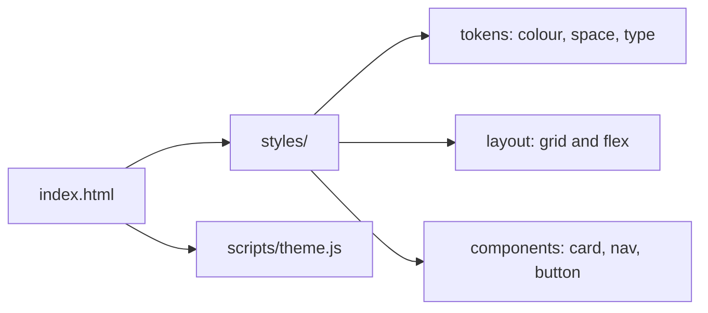

# Project 02 — Responsive Portfolio Site

## 1. Problem statement

A developer without a portfolio is asking a stranger to take their CV on faith. The fix is not a
template with a photo and three icons; it is a page that answers, in the first screen, what you build,
where the evidence is, and how to contact you — and that works on a phone, on a keyboard, and with a
screen reader.

This project is the site itself: hand-written HTML, CSS and a small amount of JavaScript, no framework
and no build step. It is deliberately constrained. Frameworks hide the things this project grades —
document structure, the cascade, responsive layout and accessibility — and those are exactly the
skills that make every later frontend project easier.

"Solved" means: a visitor on a 360 px phone can find your projects in one scroll, a keyboard-only
visitor can reach every link, a screen-reader user hears a sensible outline, and the page scores
accessibility 100 in an automated audit without any visual regression at three widths.

## 2. Intended users

| User | Goal | Skill level | Accessibility needs |
|---|---|---|---|
| Hiring manager | Judge fit in under two minutes | Non-technical; reads on a phone | Readable text at default zoom; no horizontal scroll |
| Senior engineer | Check whether the code is worth interviewing | Technical; opens devtools | Semantic markup they can inspect; fast load |
| Recruiter | Copy a link, find contact details | Low technical | Visible email/link, no CAPTCHA, works without JS |
| Screen-reader user | Navigate to projects and contact | Expert with assistive tech | Landmarks, headings, alt text, focus order |

## 3. Functional requirements

- **FR-1** A single page with four sections: introduction, projects, about, contact.
- **FR-2** Each project card shows a title, a one-sentence problem statement, the tech used, and links
  to the live site and the repository.
- **FR-3** Navigation links jump to each section and are usable with the keyboard alone.
- **FR-4** A visible skip link moves focus to the main content as the first tab stop.
- **FR-5** The contact section offers a `mailto:` link and at least one professional profile link.
- **FR-6** A theme toggle switches light/dark, persists the choice in `localStorage`, and defaults to
  the operating-system preference.
- **FR-7** The page renders correctly at 360, 768, 1024 and 1440 px widths with no horizontal scroll.
- **FR-8** All content is present without JavaScript; the toggle and any animation are enhancements.
- **FR-9** Images have meaningful alt text or are marked decorative; icons are inline SVG with
  `aria-hidden` when decorative.
- **FR-10** Every page has a unique `<title>` and a meta description.

## 4. Non-functional requirements

| ID | Requirement | Measurable target |
|---|---|---|
| NFR-1 | Performance | Lighthouse performance ≥ 95 on a throttled mobile profile; no render-blocking third-party requests |
| NFR-2 | Payload | HTML + CSS + JS ≤ 120 KB uncompressed, ≤ 40 KB compressed |
| NFR-3 | Accessibility | Lighthouse accessibility 100; axe-core reports no violations; keyboard-only walkthrough completes |
| NFR-4 | Layout stability | Cumulative layout shift < 0.1 at all four widths |
| NFR-5 | Compatibility | Current Chrome, Firefox, Safari and Edge; graceful degradation without `:has()` or container queries |
| NFR-6 | Robustness | No console errors; page usable with CSS disabled |

## 5. Prerequisites

| Lesson | Why needed here |
|---|---|
| [HTML fundamentals](../../07-HTML-AND-CSS/README.md) | Semantic elements, landmarks, forms |
| [CSS layout](../../07-HTML-AND-CSS/README.md) | Flexbox and grid are the whole layout story here |
| [Internet and web foundations](../../06-INTERNET-AND-WEB-FOUNDATIONS/README.md) | How a static page is served, what HTTP caching does |
| [JavaScript fundamentals](../../08-JAVASCRIPT-AND-TYPESCRIPT/javascript-fundamentals.md) | The toggle and progressive enhancement |
| [Accessibility](../../09-FRONTEND-ENGINEERING/README.md) | The audit criteria in NFR-3 are graded, not optional |

## 6. Architecture

Static files, no build step, no framework. The page is one HTML document; CSS is organised in layers
(reset, tokens, layout, components, utilities); JavaScript is one small module.



**Yours to decide**: whether dark mode uses `prefers-color-scheme` plus a `data-theme` attribute or
CSS custom properties alone; whether project cards are `<article>` or `<li>`; how the grid collapses.
**Given**: no CSS frameworks, no build step, no JS required for content.

The architectural point is the cascade: a token layer, a layout layer and a component layer make the
four-width requirement a matter of two media queries rather than twelve overrides. A solution that
adds `!important` at 768 px has no layer model and fails `AC-7` at the next width.

## 7. Data model

There is no database. The "model" is the content structure, and it must exist in the HTML before any
script runs:

| Entity | Fields | Where |
|---|---|---|
| Owner | name, role, one-sentence pitch, location | `header` / intro |
| Project | title, problem sentence, stack tags, live URL, repo URL, optional image | project list |
| Contact | email, profile URLs | `footer` / contact |

Project data may be duplicated in a JS array for filtering **only** if the same items exist in the
markup (FR-8). Content is authored in HTML; a JSON file that renders the page client-side violates the
brief.

## 8. API contract

No application API. The relevant contracts are the URL and the anchors:

| Surface | Contract |
|---|---|
| `/` | The page; must return 200 with content in the initial HTML |
| `#projects`, `#about`, `#contact` | Stable ids matching nav links |
| `mailto:` | Must open a mail client with the address prefilled |
| `rel="noopener"` | Every external link that opens a new tab |

## 9. UI requirements

```text
+--------------------------------------------------+
| skip link (visible on focus)                      |
| name / role            nav: work about contact   |
+--------------------------------------------------+
| H1 pitch (2 lines max)     [contact button]      |
+--------------------------------------------------+
| WORK                                              |
| [ card ] [ card ] [ card ]                        |
|  title     title     title                        |
|  problem   problem   problem                      |
|  stack     stack     stack                        |
|  live/repo live/repo live/repo                    |
+--------------------------------------------------+
| ABOUT (short, one photo optional)                 |
+--------------------------------------------------+
| CONTACT  email · github · linkedin                |
+--------------------------------------------------+
```

States: hover and focus must be visually distinct; the theme toggle must announce its state; an
external link failure is the visitor's problem, but a missing image must not break layout (set
dimensions or use `aspect-ratio`).

Accessibility specifics that are graded: one `<h1>`, headings in order, landmarks (`header`, `nav`,
`main`, `footer`), 4.5:1 contrast for body text, 3:1 for large text and UI borders, a visible focus
ring that is not removed, and `prefers-reduced-motion` respected if you animate anything.

## 10. Folder structure

```text
project-02-responsive-portfolio/
├── index.html
├── styles/
│   ├── reset.css
│   ├── tokens.css
│   ├── layout.css
│   └── components.css
├── scripts/
│   └── theme.js
├── assets/
│   ├── portrait.webp        # optional, with width/height set
│   └── favicon.svg
└── README.md
```

## 11. Milestones

| # | Milestone | Deliverable | Depends on |
|---|---|---|---|
| M1 | Content and semantics | Complete HTML with landmarks, headings, real copy | — |
| M2 | Mobile-first layout | Single column at 360 px, no overflow | M1 |
| M3 | Responsive layout | Two and three columns at 768 / 1024 px | M2 |
| M4 | Visual system | Tokens, type scale, colour, dark theme | M2 |
| M5 | Accessibility pass | Skip link, focus styles, contrast, alt text, axe clean | M3, M4 |
| M6 | Performance and audit | Image sizing, font strategy, Lighthouse ≥ 95 | M5 |

## 12. Implementation tasks

For M1 only:

1. Write the real copy first — name, pitch, three projects with problem sentences, contact links. No
   lorem ipsum.
2. Mark up `header`, `nav`, `main`, three `section`s and `footer`; one `h1`, `h2` per section.
3. Build the project list as a `<ul>` of `<article>`s, each with an `h3` and two links.
4. Add the skip link as the first focusable element, targeting `#main`.
5. Validate with the W3C validator and fix every error before writing CSS.

## 13. Testing strategy

| Requirement | Test level | Notes |
|---|---|---|
| FR-7 | visual/responsive | Screenshot at four widths; assert `document.scrollWidth <= innerWidth` |
| FR-8 | manual + automated | Disable JS; all content and links still present |
| FR-9, NFR-3 | automated audit | axe-core in the browser console or CI; zero violations |
| FR-2 | content check | A script that asserts three cards each have two links |
| NFR-1, NFR-2 | Lighthouse | Record scores and byte counts in the README |
| NFR-4 | performance | Lighthouse CLS or a layout-shift observer |
| FR-6 | manual | Toggle, reload, check persistence and system-preference default |

Deliberately not tested: pixel-perfect rendering across browsers (impossible and not the goal), and
the exact wording of copy.

## 14. Security requirements

- **No inline event handlers** — no `onclick=` attributes; scripts are external and loaded with
  `defer`.
- **Third-party isolation** — if you embed anything, use `rel="noopener noreferrer"`; no analytics
  script that can read the page.
- **No secrets** — no API keys in the repository; a contact form without a backend is out of scope.
- **Safe external links** — `target="_blank"` only with `rel="noopener"`.
- **Content Security Policy** — a meta CSP that forbids inline script, verified by the page still
  working (it should, because there is no inline script).

## 15. Deployment plan

Static hosting: GitHub Pages, Netlify or Cloudflare Pages. Requirements: HTTPS, a custom domain or a
stable URL, and a `404.html`. No build step means deployment is a push or a drag-and-drop.

Health check: the deployed URL returns 200 and the page's title is correct. Rollback: revert the
commit and redeploy; static sites have no migration to undo. Verify the deployed page, not the local
one — relative paths are the usual failure.

## 16. Documentation requirements

- `README.md`: what the site is, how to run it locally (`python -m http.server`), the accessibility and
  performance audit results with dates, and the design decisions (type scale, colour tokens, theme
  strategy).
- One **ADR** on a real decision: mobile-first versus desktop-first, or system-preference theming
  versus a manual default.
- The page itself is documentation: semantic markup is the artefact a reviewer inspects.

## 17. Acceptance criteria

- [ ] AC-1 The page loads from a static server with no build step and no console errors.
- [ ] AC-2 All four sections exist and every nav link reaches its section by keyboard.
- [ ] AC-3 The skip link is the first tab stop, is visible on focus, and moves focus to `main`.
- [ ] AC-4 At 360 px there is no horizontal scroll; at 1440 px the content has a readable measure
      (45–75 characters per line).
- [ ] AC-5 Lighthouse accessibility is 100 and axe reports zero violations.
- [ ] AC-6 With JavaScript disabled, all content, navigation and contact links still work.
- [ ] AC-7 Lighthouse performance on mobile is ≥ 95 and CLS < 0.1.
- [ ] AC-8 HTML + CSS + JS total ≤ 120 KB uncompressed; the figure is recorded in the README.
- [ ] AC-9 The theme toggle persists across reloads and defaults to the OS preference on first visit.
- [ ] AC-10 Every image has correct dimensions and alt text (or `alt=""` when decorative).
- [ ] AC-11 The page validates with zero W3C HTML errors.
- [ ] AC-12 The deployed URL returns 200 over HTTPS and matches the local build.

## 18. Extension challenges

1. **Project filtering without a framework** — filter by stack with `hidden` and a URL query parameter.
   Teaches progressive enhancement and state in the URL.
2. **A build-free blog** — one extra page per post, generated by a 40-line Python script. Teaches
   static generation without a framework.
3. **Container queries for cards** — the card adapts to its container, not the viewport. Teaches the
   difference between component and page responsiveness.
4. **Print stylesheet** — the portfolio prints as a one-page CV. Teaches media queries beyond width.
5. **Internationalisation** — an English/German toggle with `lang` attributes and translated copy.
   Teaches why text length is a layout constraint.

## Solutions policy

A solution guide exists at [reference-solution/README.md](reference-solution/README.md), written after
this brief. Compare approaches after your own attempt; the mark-up and token decisions are the
learning, and they cannot be copied into understanding.
